# Page: AgentScope Overview

# AgentScope Overview

<details>
<summary>Relevant source files</summary>

The following files were used as context for generating this wiki page:

- [.gemini/styleguide.md](.gemini/styleguide.md)
- [.github/copilot-instructions.md](.github/copilot-instructions.md)
- [README.md](README.md)
- [README_zh.md](README_zh.md)
- [docs/NEWS.md](docs/NEWS.md)
- [docs/NEWS_zh.md](docs/NEWS_zh.md)
- [examples/console/README.md](examples/console/README.md)
- [examples/console/main.py](examples/console/main.py)
- [src/agentscope/__init__.py](src/agentscope/__init__.py)
- [src/agentscope/_version.py](src/agentscope/_version.py)
- [src/agentscope/console/__init__.py](src/agentscope/console/__init__.py)
- [src/agentscope/console/_console.py](src/agentscope/console/_console.py)
- [tests/console_renderer_test.py](tests/console_renderer_test.py)

</details>


AgentScope v2 is a production-ready, high-performance multi-agent framework designed to leverage the reasoning and tool-calling capabilities of modern Large Language Models (LLMs). Unlike frameworks that rely on rigid prompt templates, AgentScope focuses on flexible abstractions that allow agents to operate autonomously while providing developers with robust control through a two-layer architecture [README.md:64-70]().

The current version of the framework is `2.0.6` [src/agentscope/_version.py:4-4](). For a quick setup, see [Getting Started & Installation](#1.1).

## Two-Layer Architecture

AgentScope is structured into two primary layers: the **SDK Layer** for local development and agent logic, and the **Agent Service Layer** for production deployment and multi-agent orchestration [README.md:124-142]().

### SDK Layer (Core Logic)
The SDK provides the building blocks for creating individual agents. It revolves around the `Agent` class and the **ReAct** (Reasoning-Acting) loop, which handles structured outputs, real-time interruptions, and tool execution [README.md:128-128]().

*   **Models:** Support for LLM, Embedding, and TTS providers including OpenAI, Anthropic, Gemini, DashScope, DeepSeek, and Ollama [README.md:130-130]().
*   **Middleware:** A hook-based system (e.g., `RAGMiddleware`, `TTSMiddleware`, `AgenticMemoryMiddleware`) that wraps agent actions to handle context compression, memory, and tracing [README.md:134-134](), [examples/console/main.py:23-23]().
*   **Tool System:** Managed via `Toolkit`, supporting Python functions, MCP (Model Context Protocol), and specialized skills [README.md:129-129]().

### Agent Service Layer (Backend & Deployment)
The Service layer facilitates scaling agents into multi-user, multi-session applications. It utilizes a FastAPI-based backend to manage agent lifecycles, persistence, and communication [README.md:77-80]().

*   **Persistence:** Standardized storage for SQL and Redis backends [README.md:84-85]().
*   **Workspaces:** Sandboxed environments for safe tool execution (Docker, K8s, Daytona, E2B, OpenSandbox) [README.md:81-82]().
*   **Channels:** Integration with IM platforms like Feishu (Lark) and Discord [README.md:77-77]().

AgentScope Architecture Overview
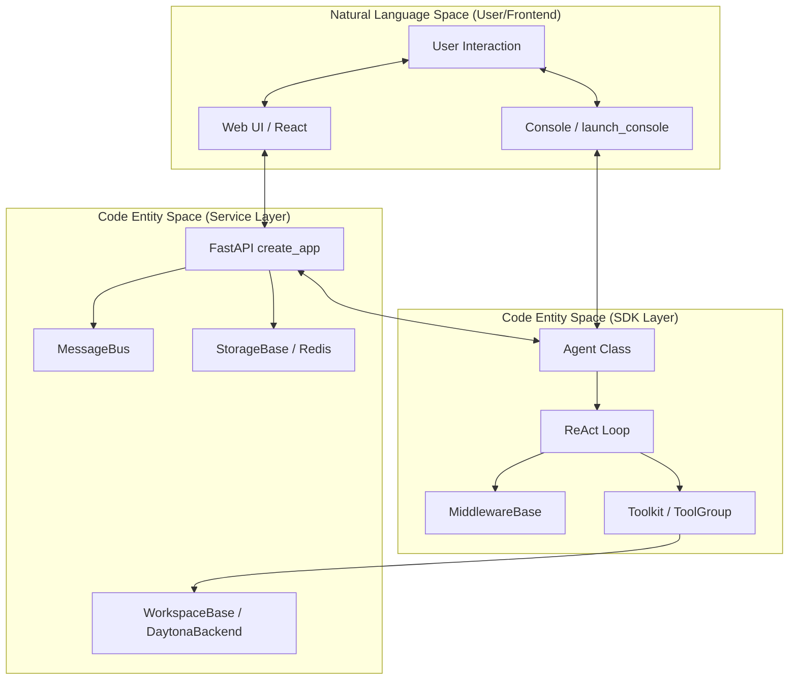
**Sources:** [README.md:124-142](), [src/agentscope/console/_console.py:95-131](), [examples/console/main.py:55-84]()

## Key Design Principles

AgentScope is built on several core principles to ensure maintainability and performance:

1.  **Reasoning over Constraints:** The framework prioritizes the model's innate reasoning and tool-use abilities over opinionated orchestrations [README.md:68-70]().
2.  **Lazy Loading:** To keep the core package lightweight, third-party dependencies are imported only when needed at the function level [.github/copilot-instructions.md:10-19]().
3.  **Strict Encapsulation:** Internal framework components are prefixed with `_` to distinguish them from the public API, with exposure controlled through `__init__.py` [src/agentscope/__init__.py:5-10](), [.github/copilot-instructions.md:27-30]().
4.  **Extensibility:** Features like Long-term Memory are implemented as swappable middlewares, such as `ReMe long-term memory` or `AgenticMemoryMiddleware` [README.md:83-84](), [examples/console/main.py:75-79]().
5.  **Event-Driven Interaction:** Real-time feedback is provided via a stream of `AgentEvent` objects, which are rendered by components like `ConsoleRenderer` or the Web UI [src/agentscope/console/_renderer.py:6-15](), [tests/console_renderer_test.py:9-27]().

Bridging NL and Code Entities
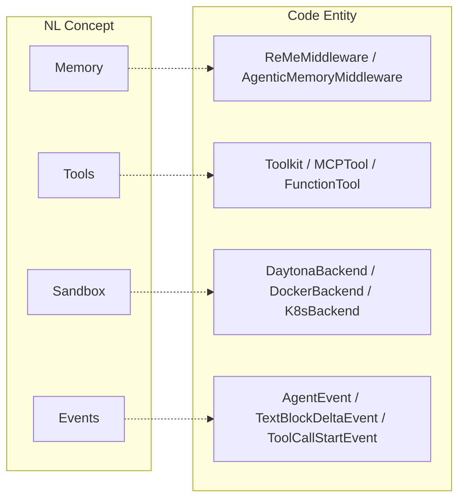
**Sources:** [.github/copilot-instructions.md:10-30](), [README.md:77-84](), [src/agentscope/console/__init__.py:1-20](), [tests/console_renderer_test.py:9-27]()

## Wiki Navigation

This wiki is organized to take you from basic setup to deep architectural dives:

*   **[Getting Started & Installation](#1.1):** Environment setup, API key configuration, and running your first agent.
*   **[Contributing & Development Standards](#1.2):** Guidelines for PRs, lazy-loading rules, testing, and coding style.
*   **[Core SDK Architecture](#2):** Deep dive into the `Agent` class, message system, and middleware hooks.
*   **[Model Layer](#3):** Details on LLM adapters (OpenAI, Anthropic, etc.), embedding models, and TTS integration.
*   **[Tool System](#4):** How to build skills, use built-in tools (Bash, Filesystem), and integrate with MCP servers.
*   **[Workspace & Execution Environments](#5):** Managing local and sandboxed environments (Docker, K8s, Daytona).
*   **[RAG (Retrieval-Augmented Generation)](#6):** Implementing document pipelines, vector stores, and long-term memory.
*   **[Agent Service (Backend)](#7):** Building and deploying the FastAPI backend, session management, and multi-agent teams.
*   **[Web UI Frontend](#8):** Exploring the React-based frontend components and SSE streaming.
*   **[Testing Infrastructure](#9):** Overview of unit tests, integration tests, and model example scripts.
*   **[Glossary](#10):** Definitions of codebase-specific terms and code pointers.

**Sources:** [README.md:124-150](), [src/agentscope/_version.py:4-4](), [.github/copilot-instructions.md:1-97]()

---

# Page: Getting Started & Installation

# Getting Started & Installation

<details>
<summary>Relevant source files</summary>

The following files were used as context for generating this wiki page:

- [.gemini/styleguide.md](.gemini/styleguide.md)
- [.github/copilot-instructions.md](.github/copilot-instructions.md)
- [README.md](README.md)
- [README_zh.md](README_zh.md)
- [docs/NEWS.md](docs/NEWS.md)
- [docs/NEWS_zh.md](docs/NEWS_zh.md)
- [examples/console/README.md](examples/console/README.md)
- [examples/console/main.py](examples/console/main.py)
- [pyproject.toml](pyproject.toml)
- [src/agentscope/_version.py](src/agentscope/_version.py)
- [src/agentscope/console/__init__.py](src/agentscope/console/__init__.py)
- [src/agentscope/console/_console.py](src/agentscope/console/_console.py)
- [src/agentscope/rag/__init__.py](src/agentscope/rag/__init__.py)
- [src/agentscope/rag/_parser/__init__.py](src/agentscope/rag/_parser/__init__.py)
- [src/agentscope/rag/_parser/_excel.py](src/agentscope/rag/_parser/_excel.py)
- [src/agentscope/rag/_parser/_word.py](src/agentscope/rag/_parser/_word.py)
- [src/agentscope/rag/_vdb/__init__.py](src/agentscope/rag/_vdb/__init__.py)
- [tests/console_renderer_test.py](tests/console_renderer_test.py)
- [tests/rag_parser_test.py](tests/rag_parser_test.py)
- [tests/rag_vdb_elasticsearch_test.py](tests/rag_vdb_elasticsearch_test.py)
- [tests/rag_vdb_milvus_lite_test.py](tests/rag_vdb_milvus_lite_test.py)
- [tests/rag_vdb_mongodb_test.py](tests/rag_vdb_mongodb_test.py)

</details>


AgentScope 2.0 is a production-ready, multi-agent platform designed to bridge the gap between high-level agentic reasoning and robust execution. This page provides a technical guide to setting up the environment, managing dependencies via `pyproject.toml`, and executing your first agentic workflow using the SDK and the new Console interface.

## Installation

AgentScope requires **Python 3.11** or higher [pyproject.toml:20-20](). It uses a modular installation approach via `pyproject.toml` extras to keep the core footprint minimal while supporting a vast ecosystem of models, storage backends, and sandboxes.

### Core Installation
To install the base SDK with standard dependencies:
```bash
pip install agentscope
```

### Optional Dependencies (Extras)
For advanced features like RAG, distributed services, or specific vector databases, use the following extras defined in `pyproject.toml` [pyproject.toml:51-167]():

| Extra | Description | Key Dependencies |
| :--- | :--- | :--- |
| `models` | Extended provider support (Gemini, Ollama, xAI) | `google-genai`, `ollama`, `xai-sdk` |
| `service` | Backend Agent Service components | `fastapi`, `uvicorn`, `ag-ui-protocol` |
| `rag` | Document processing pipeline | `pypdf`, `python-pptx`, `pandas` |
| `vdb-qdrant` | In-memory/cloud vector search | `qdrant-client` |
| `vdb-milvus` | Local/Lite vector search | `milvus-lite`, `pymilvus` |
| `vdb-mongodb` | MongoDB Atlas vector search | `pymongo` |
| `workspace` | Sandboxed execution (Docker, K8s, E2B, Daytona) | `aiodocker`, `kubernetes-asyncio`, `e2b`, `daytona` |
| `channel` | External platform integrations | `lark-oapi`, `discord.py` |
| `full` | All features and integrations | All above extras |

**Example: Installing RAG with local Milvus support**
```bash
pip install "agentscope[rag,vdb-milvus]"
```

**Sources:**
- [pyproject.toml:51-167]()
- [README.md:100-120]()

---

## Environment & Credential Management

AgentScope uses a centralized `CredentialFactory` to manage API keys and provider-specific configurations. This allows for a clean separation between agent logic and sensitive configuration.

### Supported Credential Providers
Each provider is implemented as a subclass of `CredentialBase`.

| Provider | Credential Class | Discriminator `type` |
| :--- | :--- | :--- |
| OpenAI | `OpenAICredential` | `openai_credential` |
| Gemini | `GeminiCredential` | `gemini_credential` |
| Anthropic | `AnthropicCredential` | `anthropic_credential` |
| DashScope | `DashScopeCredential` | `dashscope_credential` |
| Ollama | `OllamaCredential` | `ollama_credential` |

### Configuration Example
Credentials can be initialized directly or managed via environment variables.

```python
import os
from agentscope.model import OpenAIChatModel

# 1. Initialize model with environment-based authentication
# AgentScope model adapters automatically look for standard API keys 
# if a specific credential object is not provided.
model = OpenAIChatModel(
    model="gpt-4o",
    api_key=os.environ.get("OPENAI_API_KEY")
)
```

**Sources:**
- [README.md:130-130]()
- [src/agentscope/rag/__init__.py:1-51]()

---

## Architecture: Mapping NL to Code

AgentScope bridges the gap between natural language interaction and structured code execution. The following diagrams map these conceptual spaces to specific code entities.

### Request Execution Pipeline
This diagram shows how a user's natural language input is transformed into a model call through SDK entities.

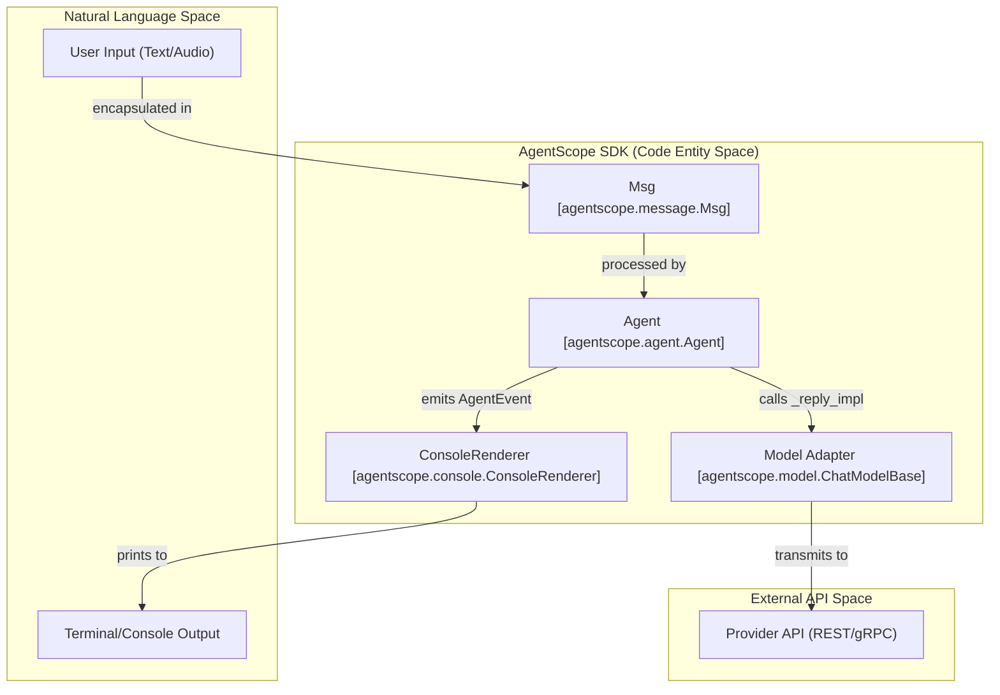

### RAG Subsystem Mapping
Mapping the RAG concepts to the `agentscope.rag` module classes [src/agentscope/rag/__init__.py:4-28]().

```mermaid
graph LR
    subgraph "Natural Language Space"
        Docs["Documents (PDF/Docx/XLSX)"]
        Query["User Query"]
    end

    subgraph "RAG Module (Code Entity Space)"
        P["Parser [ParserBase]"]
        C["Chunker [ApproxTokenChunker]"]
        VDB["Vector Store [VectorStoreBase]"]
        KB["KnowledgeBase [KnowledgeBase]"]
    end

    Docs -->|parse()| P
    P -->|chunk()| C
    C -->|VectorRecord| VDB
    VDB --> KB
    Query -->|search()| KB
```

**Sources:**
- [src/agentscope/rag/__init__.py:4-28]()
- [src/agentscope/rag/_vdb/__init__.py:4-13]()
- [src/agentscope/console/__init__.py:1-20]()

---

## Running Your First Agent (Console Mode)

AgentScope 2.0 introduces `launch_console` [src/agentscope/console/_console.py](), an interactive chat loop bound to a single agent for testing without writing UI code.

```python
from agentscope.agent import ReActAgent
from agentscope.console import launch_console

# 1. Define your agent
agent = ReActAgent(
    name="Assistant",
    model_config_name="my_gpt4_config",
    sys_prompt="You are a helpful assistant."
)

# 2. Launch the terminal-based interactive loop
# This handles input, streaming output, and tool-call confirmation
launch_console(agent)
```

For more granular control, use the `ConsoleRenderer` [src/agentscope/console/_renderer.py:1-20]() to turn an `AgentEvent` stream into line-based terminal output [src/agentscope/console/__init__.py:6-9]().

**Sources:**
- [src/agentscope/console/__init__.py:1-20]()
- [examples/console/main.py:1-10]()

---

## Vector Database Setup for RAG

For Retrieval-Augmented Generation, you must select a `VectorStoreBase` implementation [src/agentscope/rag/_vdb/_vector_store.py:8-8]().

| Database | Implementation Class | Extra |
| :--- | :--- | :--- |
| Qdrant | `QdrantStore` | `vdb-qdrant` |
| Milvus Lite | `MilvusLiteStore` | `vdb-milvus` |
| MongoDB | `MongoDBStore` | `vdb-mongodb` |
| Elasticsearch | `ElasticsearchStore` | `vdb-elasticsearch` |

### Quick-Start: Milvus Lite
Milvus Lite allows for local file-based persistence without requiring a server [pyproject.toml:107-107]().

```python
from agentscope.rag import MilvusLiteStore

# Creates a local database file 'rag_storage.db'
store = MilvusLiteStore(uri="./rag_storage.db")
```

**Sources:**
- [src/agentscope/rag/_vdb/__init__.py:12-12]()
- [pyproject.toml:105-108]()

---

# Page: Contributing & Development Standards

# Contributing & Development Standards

<details>
<summary>Relevant source files</summary>

The following files were used as context for generating this wiki page:

- [.gemini/styleguide.md](.gemini/styleguide.md)
- [.github/PULL_REQUEST_TEMPLATE.md](.github/PULL_REQUEST_TEMPLATE.md)
- [.github/copilot-instructions.md](.github/copilot-instructions.md)
- [.github/workflows/pr-title-check.yml](.github/workflows/pr-title-check.yml)
- [.github/workflows/pre-commit.yml](.github/workflows/pre-commit.yml)
- [.github/workflows/publish-pypi.yml](.github/workflows/publish-pypi.yml)
- [.github/workflows/stale.yml](.github/workflows/stale.yml)
- [.pre-commit-config.yaml](.pre-commit-config.yaml)
- [CONTRIBUTING.md](CONTRIBUTING.md)
- [CONTRIBUTING_zh.md](CONTRIBUTING_zh.md)
- [assets/images/agentscope.png](assets/images/agentscope.png)
- [src/agentscope/_version.py](src/agentscope/_version.py)
- [src/agentscope/agent/__init__.py](src/agentscope/agent/__init__.py)
- [tests/agent_injection_test.py](tests/agent_injection_test.py)
- [tests/middleware_filesystem_memory_test.py](tests/middleware_filesystem_memory_test.py)

</details>


This page outlines the technical standards, workflows, and infrastructure for contributing to the AgentScope codebase. It covers coding conventions, the mandatory use of lazy loading for optional dependencies, the pre-commit and CI/CD pipelines, and the pull request (PR) lifecycle.

## 1. Development Workflow & PR Process

AgentScope follows a structured contribution workflow to ensure code quality and maintainability. All contributors are expected to follow the [Conventional Commits](https://www.conventionalcommits.org/) specification for both commit messages and PR titles.

### PR Title & Commit Standards
PR titles are automatically validated by GitHub Actions [`.github/workflows/pr-title-check.yml`]() to ensure they follow the format: `<type>(<scope>): <description>`. The scope must be lowercase, using only alphanumeric characters, hyphens, or underscores [`CONTRIBUTING.md:160-162`]().

| Type | Purpose |
| :--- | :--- |
| `feat` | New features or capabilities [`CONTRIBUTING.md:134`](). |
| `fix` | Bug fixes [`CONTRIBUTING.md:135`](). |
| `docs` | Documentation changes only [`CONTRIBUTING.md:136`](). |
| `refactor` | Code changes that neither fix a bug nor add a feature [`CONTRIBUTING.md:138`](). |
| `ci` | Changes to CI/CD configuration or scripts [`CONTRIBUTING.md:140`](). |
| `perf` | Performance improvements [`CONTRIBUTING.md:139`](). |
| `test` | Adding or correcting tests [`.github/PULL_REQUEST_TEMPLATE.md:6`](). |
| `chore` | Maintenance tasks or dependency updates [`CONTRIBUTING.md:141`](). |

### PR Checklist
Before submitting a PR, contributors must ensure:
1. An issue exists and is linked in the PR description [`.github/PULL_REQUEST_TEMPLATE.md:21-21`]().
2. Docstrings follow the **Google Style** [`.github/PULL_REQUEST_TEMPLATE.md:23-23`]().
3. All pre-commit hooks pass locally [`CONTRIBUTING.md:111-112`]().
4. Unit tests are provided for new features [`CONTRIBUTING.md:103-104`]().
5. Optional dependencies are lazy-loaded [`CONTRIBUTING.md:141-145`]().

**Sources:** [`CONTRIBUTING.md:83-186`](), [`.github/PULL_REQUEST_TEMPLATE.md:1-25`](), [`.github/workflows/pr-title-check.yml`]()

---

## 2. Coding Standards & Conventions

### Lazy Loading Rule
To keep the core SDK lightweight, any dependency not listed in the base `[project.dependencies]` of `pyproject.toml` must be **lazy-imported** at the point of use [`.github/copilot-instructions.md:10-12`](). This includes providers like Gemini, Ollama, and storage backends like Redis. This ensures that `import agentscope` remains fast and `ImportError` only occurs when a specific feature is invoked [`CONTRIBUTING.md:151-152`]().

For base class imports, the framework prefers a factory pattern to avoid circular imports and heavy top-level dependencies [`.github/copilot-instructions.md:13-19`]().

```python
# Correct usage for optional dependencies [CONTRIBUTING.md:146-150]
def some_function():
    import google.genai  # from the `gemini` extra — lazy-imported
    # ... use google.genai here
```

### Encapsulation Standards
All Python files under `src/agentscope` should be named with a `_` prefix, and exposure must be controlled through `__init__.py` [`.github/copilot-instructions.md:28-29`](). For example, `Agent` is defined in `src/agentscope/agent/_agent.py` but exposed via `src/agentscope/agent/__init__.py` [`src/agentscope/agent/__init__.py:3-7`]().

### AI-Assisted Coding Policy
AgentScope allows the use of AI coding assistants (e.g., Claude Code, Cursor) provided they are used responsibly [`CONTRIBUTING.md:48-51`]().
*   **Human Authorship:** Contributors must read every line of diff and understand the "why" behind changes [`CONTRIBUTING.md:55-56`]().
*   **Atomic PRs:** AI-generated PRs must be broken into focused, single-purpose changes; 10K+ line dumps will be rejected [`CONTRIBUTING.md:66-69`]().

**Sources:** [`CONTRIBUTING.md:48-78`](), [`CONTRIBUTING.md:141-155`](), [`.github/copilot-instructions.md:1-30`](), [`src/agentscope/agent/__init__.py:1-12`]()

---

## 3. Pre-commit & Linting Infrastructure

AgentScope employs a rigorous multi-stage linting process via `pre-commit` to ensure code consistency.

### Pre-commit Pipeline
The configuration in [`.pre-commit-config.yaml`]() executes the following checks:
*   **Static Analysis:** `mypy` for type checking [`.pre-commit-config.yaml:27-50`]() and `pylint` for code smells [`.pre-commit-config.yaml:66-111`]().
*   **Formatting:** `black` (line length 79) [`.pre-commit-config.yaml:55-59`]() and `flake8` [`.pre-commit-config.yaml:60-65`]().
*   **Safety:** `detect-private-key` and `check-ast` [`.pre-commit-config.yaml:5-21`]().

### Mermaid: Code Quality Flow
This diagram bridges the developer's local environment to the CI system.

```mermaid
graph TD
    subgraph "Local_Development_Space"
        [DEV_Code] --> [PC_Install]
        [PC_Install] --> [PC_Hooks]
    end

    subgraph "Code_Entity_Space_pre-commit-config.yaml"
        [PC_Hooks] --> [Black_Formatter]
        [PC_Hooks] --> [Mypy_Type_Checker]
        [PC_Hooks] --> [Pylint_Linter]
        [PC_Hooks] --> [Flake8_Linter]
        
        [Black_Formatter] --> ["black --line-length=79"]
        [Mypy_Type_Checker] --> ["mypy --disallow-untyped-defs"]
        [Pylint_Linter] --> ["pylint --max-statements=100"]
    end

    subgraph "CI_Space_github_workflows"
        [Black_Formatter] & [Mypy_Type_Checker] & [Pylint_Linter] --> [Pre_commit_yml]
        [Pre_commit_yml] --> [GitHub_Actions_Runner]
    end
```
**Sources:** [`.pre-commit-config.yaml:1-117`](), [`.github/workflows/pre-commit.yml:1-30`]()

---

## 4. Testing Infrastructure

Tests are located in the `tests/` directory and are executed using `pytest`.

### Test Execution & Utilities
The testing infrastructure utilizes specialized utilities to handle non-deterministic LLM outputs.
*   **Mocking:** Tests frequently use `MockModel` and `AnyString` to simulate LLM responses [`tests/agent_injection_test.py:10-12`]().
*   **State Injection:** The `AgentInjectionTest` class demonstrates how to test internal state mechanisms like `_inject_runtime_state` by patching `datetime` to return a `FROZEN_NOW` [`tests/agent_injection_test.py:23-61`]().
*   **Assertions:** Reviewers require test assertions to compare entire data structures rather than individual fields to ensure clarity [`.github/copilot-instructions.md:41-42`]().

### Mermaid: Agent State Injection Test Flow
This diagram shows how the test suite interacts with the `Agent` class to verify runtime behavior.

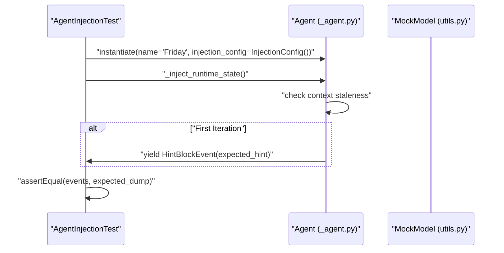
**Sources:** [`tests/agent_injection_test.py:41-134`](), [`.github/copilot-instructions.md:41-42`]()

---

## 5. CI/CD Workflows

AgentScope uses GitHub Actions for automation:

| Workflow | File | Description |
| :--- | :--- | :--- |
| **Pre-commit** | `pre-commit.yml` | Runs all linting hooks on the full codebase using `uv` [`.github/workflows/pre-commit.yml:1-30`](). |
| **Stale** | `stale.yml` | Marks and closes inactive issues/PRs after 60 days of inactivity [`.github/workflows/stale.yml:22-35`](). |
| **Publish** | `publish-pypi.yml` | Builds the package via `python -m build` and uploads to PyPI using `Twine` [`.github/workflows/publish-pypi.yml:9-43`](). |
| **PR Title** | `pr-title-check.yml` | Validates Conventional Commit format for PR titles [`.github/workflows/pr-title-check.yml`]() |

### Mermaid: Release Data Flow
This diagram maps the natural language "Contribution" to the code entities that manage the release.

```mermaid
graph LR
    subgraph "Natural_Language_Space"
        [Contributor] --> [Pull_Request]
        [Pull_Request] --> [Release_Published]
    end

    subgraph "Code_Entity_Space_Workflows"
        [Pull_Request] --> [Pre_commit_yml]
        [Pre_commit_yml] --> [PR_Title_Check_yml]
        [Release_Published] --> [Publish_PyPi_Package]
    end

    subgraph "Deployment_Tools"
        [Publish_PyPi_Package] --> ["uv pip install build"]
        [Publish_PyPi_Package] --> ["python -m build"]
        [Publish_PyPi_Package] --> ["gh-action-pypi-publish"]
    end
```
**Sources:** [`.github/workflows/publish-pypi.yml:32-43`](), [`.github/workflows/pre-commit.yml:1-30`](), [`.github/workflows/stale.yml:6-36`]()

---

# Page: Core SDK Architecture

# Core SDK Architecture

<details>
<summary>Relevant source files</summary>

The following files were used as context for generating this wiki page:

- [src/agentscope/agent/_agent.py](src/agentscope/agent/_agent.py)
- [src/agentscope/agent/_config.py](src/agentscope/agent/_config.py)
- [src/agentscope/app/middleware/_protocol/_agui.py](src/agentscope/app/middleware/_protocol/_agui.py)
- [src/agentscope/app/middleware/_protocol/_base.py](src/agentscope/app/middleware/_protocol/_base.py)
- [src/agentscope/console/_renderer.py](src/agentscope/console/_renderer.py)
- [src/agentscope/event/_event.py](src/agentscope/event/_event.py)
- [src/agentscope/middleware/_base.py](src/agentscope/middleware/_base.py)
- [src/agentscope/state/_state.py](src/agentscope/state/_state.py)
- [tests/agent_basic_test.py](tests/agent_basic_test.py)
- [tests/agent_interrupt_test.py](tests/agent_interrupt_test.py)
- [tests/agent_structured_output_test.py](tests/agent_structured_output_test.py)
- [tests/agui_protocol_test.py](tests/agui_protocol_test.py)
- [tests/hitl_external_execution_test.py](tests/hitl_external_execution_test.py)
- [tests/hitl_user_confirmation_test.py](tests/hitl_user_confirmation_test.py)
- [tests/middleware_test.py](tests/middleware_test.py)

</details>


The AgentScope SDK layer provides the fundamental building blocks for creating autonomous agents. It defines the core `Agent` class, the reasoning-acting loop, a sophisticated middleware system for intercepting execution, and a robust message/event bus for communication.

## The Agent & ReAct Loop

The `Agent` class [src/agentscope/agent/_agent.py:112-113]() is the primary entity in the SDK. It orchestrates the interaction between a language model, a toolkit, and internal state. The core of its execution is the **Reasoning-Acting (ReAct)** loop, which allows the agent to iteratively think, call tools, and process results until a task is completed or interrupted.

Key interfaces and configurations include:
*   `reply`: A high-level coroutine for generating a full response [src/agentscope/agent/_agent.py:276-277]().
*   `reply_stream`: An async generator for streaming responses and events [src/agentscope/agent/_agent.py:317-318]().
*   `_reply_impl`: The internal implementation of the ReAct loop [src/agentscope/agent/_agent.py:382-383]().
*   `ReActConfig`: Controls loop parameters such as `max_iters` [src/agentscope/agent/_config.py:182-183]().

For details, see [Agent & ReAct Loop](#2.1).

## Middleware System

AgentScope employs an interception system based on `MiddlewareBase` [src/agentscope/middleware/_base.py:13-14](). Middlewares can be injected into an agent to modify behavior (e.g., adding RAG, logging, or budget constraints) without altering the agent's source code. The system supports two patterns:
1.  **Onion Pattern**: Wraps execution points like `on_reply`, `on_reasoning`, `on_acting`, and `on_model_call` [src/agentscope/middleware/_base.py:19-25]().
2.  **Transformer Pattern**: Sequentially modifies data, such as `on_system_prompt` [src/agentscope/middleware/_base.py:27-28]().

For details, see [Middleware System](#2.2).

### SDK Component Interaction
This diagram illustrates how the `Agent` class coordinates various SDK components during a single `reply` cycle.

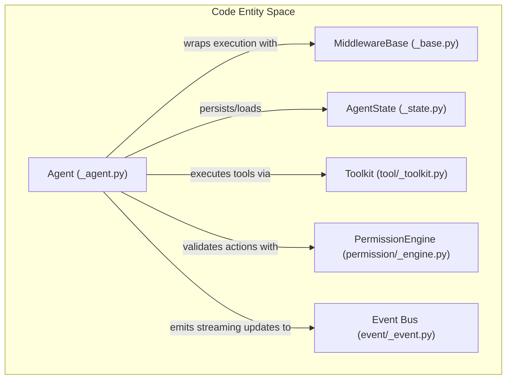
Sources: [src/agentscope/agent/_agent.py:112-212](), [src/agentscope/middleware/_base.py:13-31](), [src/agentscope/state/_state.py:176-189]()

## Messages & Events

Communication in AgentScope is handled via `Msg` objects and `AgentEvent` streams. 
*   **Messages**: Structured objects (`Msg`, `AssistantMsg`, `UserMsg`, `SystemMsg`) that represent conversation history and final outputs [src/agentscope/message/__init__.py](). These messages contain various `ContentBlock` types like `TextBlock`, `ThinkingBlock`, `ToolCallBlock`, and `ToolResultBlock` [src/agentscope/message/__init__.py]().
*   **Events**: Fine-grained signals defined in `EventType` (e.g., `TextBlockDeltaEvent`, `ToolCallStartEvent`, `ModelCallEndEvent`) emitted during `reply_stream` to provide real-time feedback [src/agentscope/event/_event.py:26-67]().

For details, see [Messages & Events](#2.3).

## State Management

The `AgentState` class [src/agentscope/state/_state.py:176-177]() encapsulates all persistent data for an agent, including:
*   **Context**: The uncompressed conversation history (`list[Msg]`) [src/agentscope/state/_state.py:187-188]().
*   **Summary**: Compressed memory for long-running sessions, managed via `ContextConfig` [src/agentscope/state/_state.py:183-185](), [src/agentscope/agent/_config.py:51-52]().
*   **ToolContext**: Caches for file tools and activated tool groups [src/agentscope/state/_state.py:32-33]().
*   **ReplyContext**: Metadata for the current active reply, including `cur_iter`, `reply_id`, and `structured_output` requirements [src/agentscope/state/_state.py:149-174]().

Sources: [src/agentscope/state/_state.py:1-212](), [src/agentscope/agent/_config.py:51-140]()

## Permission Engine & HITL

The `PermissionEngine` [src/agentscope/agent/_agent.py:178-179]() governs tool execution. It evaluates `PermissionRule` sets to decide if an action should be allowed, denied, or require **Human-In-The-Loop (HITL)** confirmation. 
*   **HITL Flow**: When a rule returns `PermissionBehavior.ASK` [src/agentscope/permission/_permission.py](), the agent emits a `RequireUserConfirmEvent` [src/agentscope/event/_event.py:60]() and parks the execution until a `UserConfirmResultEvent` is received [src/agentscope/event/_event.py:63]().
*   **Interruption**: Agents handle `UserInterruptEvent` to close pending tool calls with an `interrupted` state [src/agentscope/event/_event.py:64](), [src/agentscope/agent/_agent.py:1010-1015]().

For details, see [Permission Engine & HITL](#2.4).

### Natural Language to Code Mapping
This diagram bridges user-facing concepts to the specific classes and files that implement them.

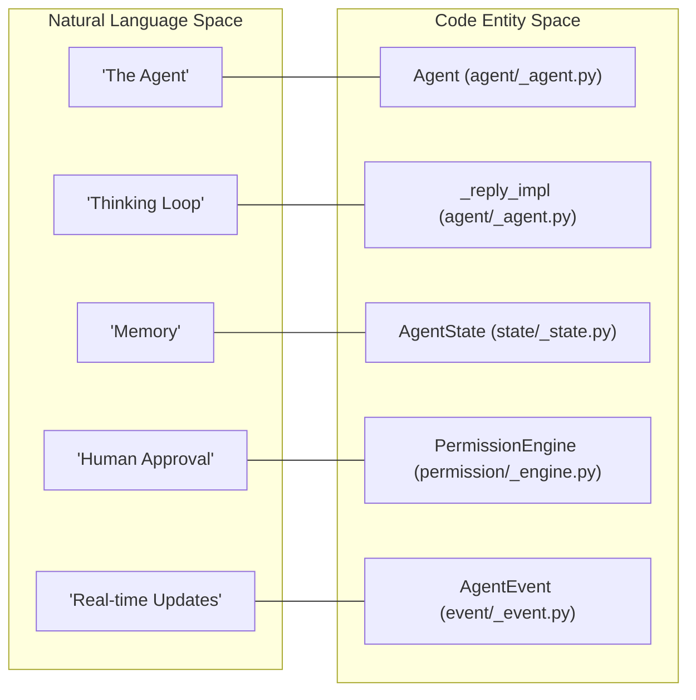
Sources: [src/agentscope/agent/_agent.py:112-113](), [src/agentscope/agent/_agent.py:382-383](), [src/agentscope/state/_state.py:176-177](), [src/agentscope/event/_event.py:70-71]()

---

# Page: Agent & ReAct Loop

# Agent & ReAct Loop

<details>
<summary>Relevant source files</summary>

The following files were used as context for generating this wiki page:

- [src/agentscope/agent/_agent.py](src/agentscope/agent/_agent.py)
- [src/agentscope/agent/_config.py](src/agentscope/agent/_config.py)
- [src/agentscope/agent/_structured_output_tool.py](src/agentscope/agent/_structured_output_tool.py)
- [src/agentscope/agent/_utils.py](src/agentscope/agent/_utils.py)
- [src/agentscope/state/__init__.py](src/agentscope/state/__init__.py)
- [src/agentscope/state/_state.py](src/agentscope/state/_state.py)
- [tests/agent_basic_test.py](tests/agent_basic_test.py)
- [tests/agent_interrupt_test.py](tests/agent_interrupt_test.py)
- [tests/agent_structured_output_test.py](tests/agent_structured_output_test.py)
- [tests/hitl_external_execution_test.py](tests/hitl_external_execution_test.py)
- [tests/hitl_mixed_test.py](tests/hitl_mixed_test.py)
- [tests/hitl_user_confirmation_test.py](tests/hitl_user_confirmation_test.py)
- [tests/middleware_test.py](tests/middleware_test.py)

</details>


The `Agent` class is the central orchestration entity in AgentScope. It manages the Reasoning-Acting (ReAct) loop, handles structured outputs, integrates with the middleware system, and manages human-in-the-loop (HITL) interactions.

## 1. The Agent Class Overview

The `Agent` class `[src/agentscope/agent/_agent.py:112-112]()` encapsulates the state, model, toolkit, and configuration required for an autonomous agent to operate.

### Key Components
- **State Management**: Uses `AgentState` `[src/agentscope/agent/_agent.py:169-169]()` to track conversation history, summaries, and tool contexts.
- **Model Integration**: Utilizes a `ChatModelBase` `[src/agentscope/agent/_agent.py:168-168]()` for reasoning and text generation.
- **Toolkit**: A `Toolkit` instance `[src/agentscope/agent/_agent.py:186-186]()` providing the agent with available functions, skills, and MCP tools.
- **Middlewares**: A pipeline of `MiddlewareBase` objects `[src/agentscope/agent/_agent.py:193-215]()` that intercept execution at various hooks (e.g., `on_reply`, `on_acting`).

### Configuration Objects
The agent's behavior is fine-tuned via specialized configuration classes defined in `[src/agentscope/agent/_config.py:1-200]()`:
- `ModelConfig`: Retries and fallback settings.
- `ContextConfig`: Token ratios for triggering compression and summary templates `[src/agentscope/agent/_config.py:51-140]()`.
- `ReActConfig`: Maximum iterations for the loop.
- `InjectionConfig`: Controls runtime state injection (time, timezone, etc.) `[src/agentscope/agent/_config.py:142-184]()`.

**Sources:** `[src/agentscope/agent/_agent.py:112-215]()`, `[src/agentscope/agent/_config.py:1-184]()`.

## 2. The Reply Interface

The `Agent` provides two primary entry points for interaction: `reply` and `reply_stream`.

### reply vs. reply_stream
- **`reply`**: A convenience method that consumes the `reply_stream` and returns the final `Msg` object `[src/agentscope/agent/_agent.py:284-307]()`.
- **`reply_stream`**: The core asynchronous generator that yields `AgentEvent` objects (for UI streaming) and terminates with the final `Msg` `[src/agentscope/agent/_agent.py:309-373]()`.

### Implementation Flow: `_reply_impl`
The internal `_reply_impl` `[src/agentscope/agent/_agent.py:375-496]()` manages the lifecycle of a single response:
1. **Context Preparation**: Injects runtime state (if enabled) and compresses history if token limits are exceeded `[src/agentscope/agent/_agent.py:388-410]()`.
2. **Input Handling**: Merges new messages into the agent's internal context `[src/agentscope/agent/_agent.py:412-424]()`.
3. **The Loop**: Executes the ReAct loop until a termination condition is met (e.g., the model provides a final answer or max iterations are reached).
4. **Finalization**: Cleans up tool caches and updates the `AgentState`.

**Sources:** `[src/agentscope/agent/_agent.py:284-496]()`.

## 3. The ReAct Loop Internals

The Reasoning-Acting loop is implemented through a sequence of internal methods that coordinate model calls and tool executions.

### Execution Pipeline Diagram

Title: ReAct Loop Internal Logic
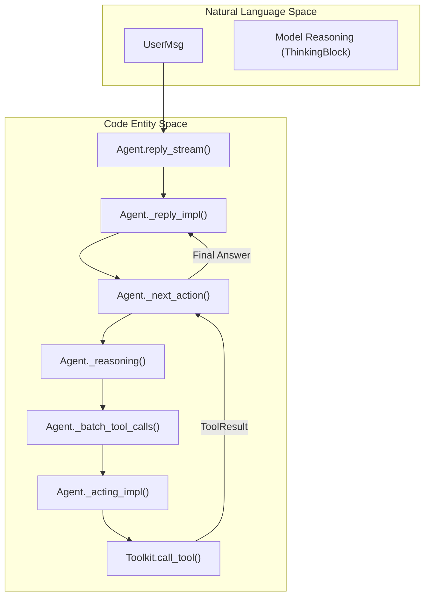

### Key Loop Functions
- **`_next_action`**: Decides whether to continue reasoning or stop based on the last model response `[src/agentscope/agent/_agent.py:498-580]()`.
- **`_reasoning`**: Wraps the LLM call. It formats the prompt using the `Middleware` pipeline and triggers `ModelCallStartEvent` `[src/agentscope/agent/_agent.py:643-706]()`.
- **`_batch_tool_calls`**: Orchestrates the execution of one or more tool calls. It handles concurrency safety by separating tools into sequential and concurrent batches `[src/agentscope/agent/_agent.py:734-850]()`.

**Sources:** `[src/agentscope/agent/_agent.py:498-850]()`.

## 4. Structured Output

AgentScope supports enforcing structured output via Pydantic models. When a `structured_schema` is provided to `reply`, the agent injects a specialized internal tool called `GenerateStructuredOutput` `[src/agentscope/agent/_agent.py:672-680]()`.

### Mechanism
1. The schema is converted to a JSON schema and passed to the model `[src/agentscope/state/_state.py:164-170]()`.
2. The agent monitors for calls to `GenerateStructuredOutput`.
3. Upon a call, `_GenerateStructuredOutput` validates the input against the Pydantic model `[src/agentscope/agent/_structured_output_tool.py:53-84]()`.
4. If validation fails, the error is fed back into the ReAct loop for the model to self-correct `[tests/agent_structured_output_test.py:175-202]()`.

**Sources:** `[src/agentscope/agent/_agent.py:672-680]()`, `[src/agentscope/state/_state.py:164-170]()`, `[src/agentscope/agent/_structured_output_tool.py:53-84]()`.

## 5. Human-in-the-Loop (HITL) & Interruption

AgentScope handles asynchronous interruptions and permission-based pauses (ASK behavior).

### Permission and Execution Flow

Title: HITL and Tool Execution Flow
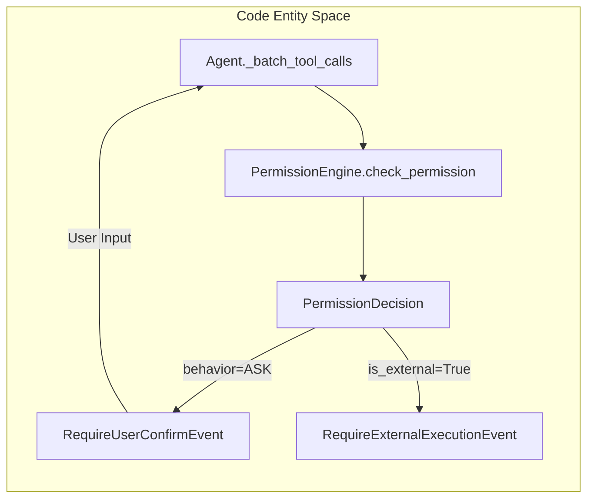

### Interruption Handling
- **Cancellation**: If an `asyncio.Task` is cancelled during tool execution, the agent catches `CancelledError`, emits a `UserInterruptEvent`, and marks in-flight tools as `INTERRUPTED` `[src/agentscope/agent/_agent.py:1053-1090]()`.
- **Parked Replies**: When a reply requires user confirmation, the agent "parks" the state. Resumption occurs when a `UserConfirmResultEvent` is passed back into `reply_stream` `[src/agentscope/agent/_agent.py:440-456]()`.
- **Closure of Unfinished Calls**: The method `_close_unfinished_tool_calls` `[src/agentscope/agent/_agent.py:1053-1090]()` ensures that any pending HITL or external execution requests are formally closed with an interrupted state if the reply ends prematurely.

**Sources:** `[src/agentscope/agent/_agent.py:440-1090]()`, `[tests/agent_interrupt_test.py:1-13]()`.

## 6. Context Injection and Compression

To improve reasoning, the agent automatically injects metadata into the context via `_get_injected_content` `[src/agentscope/agent/_agent.py:1260-1323]()`.

| Injected Field | Source | Description |
| :--- | :--- | :--- |
| `current_time` | `datetime.now()` | Localized time based on `InjectionConfig.timezone` `[src/agentscope/agent/_agent.py:1265-1275]()`. |
| `tasks` | `AgentState.task_context` | List of current plan/tasks the agent is tracking `[src/agentscope/agent/_agent.py:1277-1288]()`. |
| `context_usage` | `Model.count_tokens()` | Current token count vs. model limit `[src/agentscope/agent/_agent.py:1290-1318]()`. |

### Compression Pipeline
When `trigger_ratio` is reached `[src/agentscope/agent/_config.py:57-60]()`, the agent:
1. Calls `_compress_context` `[src/agentscope/agent/_agent.py:1134-1234]()`.
2. Uses the model to generate a structured summary based on `SummarySchema` `[src/agentscope/agent/_config.py:9-49]()`.
3. Offloads old messages to the `Offloader` if configured `[src/agentscope/agent/_agent.py:1225-1230]()`.
4. Updates `AgentState.summary` with the new compressed representation `[src/agentscope/state/_state.py:183-185]()`.

**Sources:** `[src/agentscope/agent/_agent.py:1134-1323]()`, `[src/agentscope/agent/_config.py:9-60]()`, `[src/agentscope/state/_state.py:183-185]()`.

---

# Page: Middleware System

# Middleware System

<details>
<summary>Relevant source files</summary>

The following files were used as context for generating this wiki page:

- [src/agentscope/app/middleware/_protocol/_agui.py](src/agentscope/app/middleware/_protocol/_agui.py)
- [src/agentscope/app/middleware/_protocol/_base.py](src/agentscope/app/middleware/_protocol/_base.py)
- [src/agentscope/console/_renderer.py](src/agentscope/console/_renderer.py)
- [src/agentscope/event/_event.py](src/agentscope/event/_event.py)
- [src/agentscope/middleware/__init__.py](src/agentscope/middleware/__init__.py)
- [src/agentscope/middleware/_base.py](src/agentscope/middleware/_base.py)
- [src/agentscope/middleware/_longterm_memory/__init__.py](src/agentscope/middleware/_longterm_memory/__init__.py)
- [src/agentscope/middleware/_longterm_memory/_reme/__init__.py](src/agentscope/middleware/_longterm_memory/_reme/__init__.py)
- [src/agentscope/middleware/_tracing/__init__.py](src/agentscope/middleware/_tracing/__init__.py)
- [src/agentscope/middleware/_tracing/_attributes.py](src/agentscope/middleware/_tracing/_attributes.py)
- [src/agentscope/middleware/_tracing/_converter.py](src/agentscope/middleware/_tracing/_converter.py)
- [src/agentscope/middleware/_tracing/_extractor.py](src/agentscope/middleware/_tracing/_extractor.py)
- [src/agentscope/middleware/_tracing/_setup.py](src/agentscope/middleware/_tracing/_setup.py)
- [src/agentscope/middleware/_tracing/_trace.py](src/agentscope/middleware/_tracing/_trace.py)
- [src/agentscope/middleware/_tracing/_utils.py](src/agentscope/middleware/_tracing/_utils.py)
- [src/agentscope/middleware/_tts_middleware.py](src/agentscope/middleware/_tts_middleware.py)
- [tests/agui_protocol_test.py](tests/agui_protocol_test.py)
- [tests/tracing_test.py](tests/tracing_test.py)
- [tests/tts_middleware_test.py](tests/tts_middleware_test.py)

</details>


The AgentScope Middleware System provides a powerful interception mechanism that allows developers to modify agent behavior without altering the core agent source code. It follows a modular design where middlewares are hooked into specific points of the agent's execution lifecycle, such as model calls, tool execution, and context management.

## Middleware Architecture

AgentScope utilizes two primary patterns for its middleware pipeline:
1.  **Onion Pattern**: Most hooks wrap around an internal implementation. Each middleware can execute logic before and after calling the `next_handler`, which represents the next middleware in the chain or the final core logic [src/agentscope/middleware/_base.py:19-25]().
2.  **Transformer Pattern**: Used for the `on_system_prompt` hook, where the system prompt string is passed through a sequential pipeline of transformations [src/agentscope/middleware/_base.py:27-28]().

### Hook Points

Middlewares can implement any of the following 7 hook points defined in `MiddlewareBase` [src/agentscope/middleware/_base.py:13-29]():

| Hook Name | Purpose | Data Flow |
| :--- | :--- | :--- |
| `on_reply` | Intercepts the entire `Agent.reply` process. | `AsyncGenerator[AgentEvent \| Msg]` |
| `on_reasoning` | Wraps the reasoning/LLM inference phase. | `AsyncGenerator` |
| `on_acting` | Wraps individual tool execution (`toolkit.call_tool`). | `AsyncGenerator[ToolChunk \| ToolResponse]` |
| `on_model_call` | Intercepts raw Model API calls. | `AsyncGenerator[ChatResponse]` |
| `on_check_permission` | Intercepts the permission engine decision. | `Awaitable[PermissionDecision]` |
| `on_compress_context` | Wraps the context compression logic. | `AsyncGenerator` |
| `on_system_prompt` | Transforms the system prompt string. | `str -> str` |

### Middleware Registration

When an `Agent` is initialized, it filters the provided list of middlewares by the hooks they implemented. This optimization ensures that only relevant middlewares are invoked at each hook point [src/agentscope/middleware/_base.py:30-31]().

### Data Flow Diagram: The Onion Pipeline

The following diagram illustrates how a middleware chain wraps the core agent logic (e.g., `_reply_impl`) using the Onion pattern.

**Title: Middleware Execution Pipeline (Onion Pattern)**
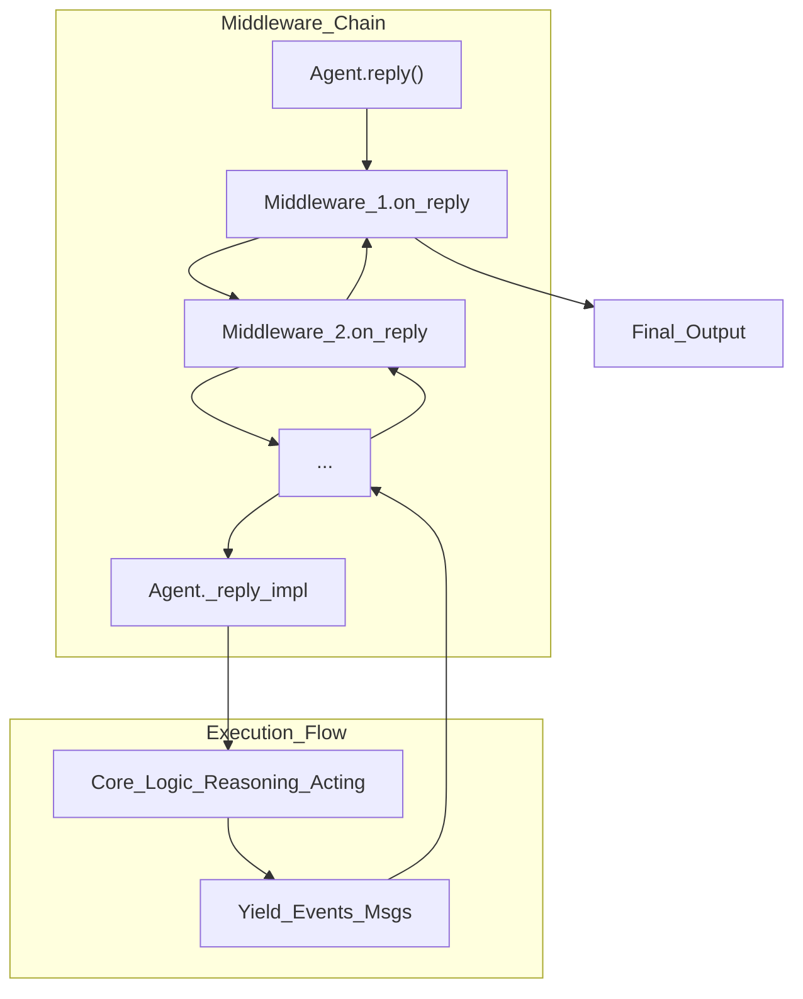
Sources: [src/agentscope/middleware/_base.py:13-53](), [src/agentscope/middleware/_base.py:68-95]()

---

## Implementation Details

### The `MiddlewareBase` Class
All middlewares must inherit from `MiddlewareBase`. It provides an `is_implemented` utility to check if a subclass has overridden a specific hook by comparing the subclass method to the base class method [src/agentscope/middleware/_base.py:55-66]().

Middlewares are executed asynchronously. For generator-based hooks (like `on_reply`), the middleware must iterate over the `next_handler()` (often using `async for` or `anext`) and yield the items to maintain the stream [src/agentscope/middleware/_base.py:40-45](), [src/agentscope/middleware/_tracing/_trace.py:206-213]().

### Integration with Agent Execution
The `Agent` class manages the execution of these hooks. The middleware system automatically detects which hooks are implemented at runtime [src/agentscope/middleware/_base.py:30-31]().

**Title: Association of Middleware Hooks to Agent Internals**
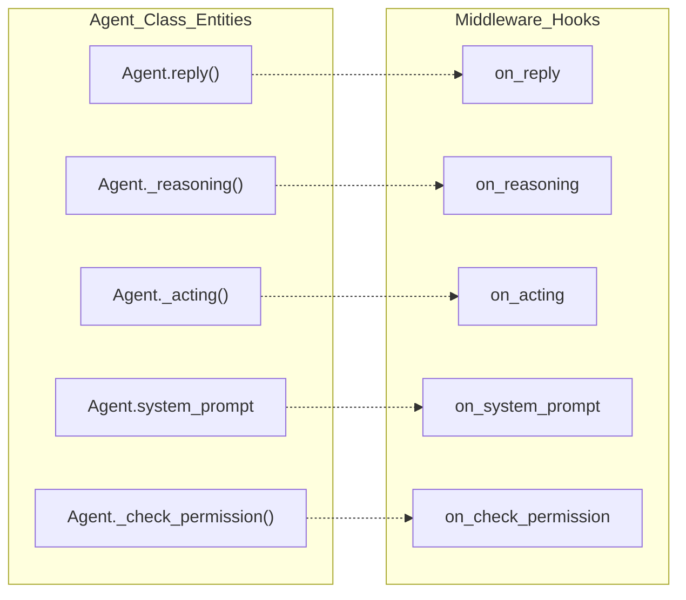
Sources: [src/agentscope/middleware/_base.py:13-29](), [src/agentscope/middleware/_base.py:68-175]()

---

## Built-in Middlewares

AgentScope provides several built-in middlewares for common agentic tasks:

### 1. Tracing Middleware (`TracingMiddleware`)
Uses OpenTelemetry (OTel) to trace agent execution. It captures attributes like `gen_ai.conversation.id`, model usage (tokens), and tool execution details [src/agentscope/middleware/_tracing/_trace.py:117-132](). It hooks into `on_reply`, `on_model_call`, and `on_acting` to provide a complete view of the agent's lifecycle [src/agentscope/middleware/_tracing/_trace.py:137-206](). It also handles synthetic spans for externally executed tools [src/agentscope/middleware/_tracing/_trace.py:174-197]().

### 2. Budget Middleware (`ReplyBudgetControlMiddleware`)
Monitors and enforces token or financial budgets for an agent's reply. It hooks into `on_reply` to track usage and control the reasoning-acting loop [src/agentscope/middleware/_budget.py]().

### 3. TTS Middleware (`TTSMiddleware`)
Integrates Text-to-Speech capabilities. It intercepts the `on_reply` stream, collects `TextBlockDeltaEvent` and `TextBlockEndEvent` items, and sends them to a `TTSModelBase` to generate audio content [src/agentscope/middleware/_tts_middleware.py:21-39](). The audio is injected back into the stream as `DataBlockDeltaEvent` [src/agentscope/middleware/_tts_middleware.py:174-179](). It supports both real-time streaming input and non-realtime synthesis [src/agentscope/middleware/_tts_middleware.py:67-109]().

### 4. Long-term Memory Middlewares
Middlewares provide various strategies for persistent agent memory [src/agentscope/middleware/_longterm_memory/__init__.py:8-12]():
*   **ReMeMiddleware**: Retrieval-based Memory that searches historical context [src/agentscope/middleware/_longterm_memory/_reme/__init__.py]().
*   **Mem0Middleware**: Integration with the Mem0 service for managed memory [src/agentscope/middleware/_longterm_memory/_mem0.py]().
*   **AgenticMemoryMiddleware**: High-level memory management for autonomous agents [src/agentscope/middleware/_longterm_memory/_agentic_memory.py]().

### 5. RAG Middleware (`RAGMiddleware`)
Connects an agent to a `KnowledgeBase`. It typically hooks into `on_reply` or `on_reasoning` to perform retrieval before the model is called [src/agentscope/middleware/_rag.py]().

### 6. AGUI Protocol Middleware (`AGUIProtocolMiddleware`)
A specialized middleware used in the Agent Service layer (FastAPI). It intercepts `text/event-stream` responses and converts standard `AgentEvent` objects into the AGUI protocol format (e.g., converting `ReplyStartEvent` to `RUN_STARTED`) for consumption by the Web UI [src/agentscope/app/middleware/_protocol/_agui.py:44-74](), [src/agentscope/app/middleware/_protocol/_base.py:68-81]().

---

## Usage Example

```python
from agentscope.agent import Agent
from agentscope.middleware import TracingMiddleware, ReplyBudgetControlMiddleware

# Initialize middlewares
tracing = TracingMiddleware()
budget = ReplyBudgetControlMiddleware(max_iters=5) 

# Apply to agent
agent = Agent(
    name="Assistant",
    model=my_model,
    system_prompt="You are helpful.",
    middlewares=[tracing, budget]
)
```

Sources:
- Middleware Base Interface: [src/agentscope/middleware/_base.py:1-180]()
- Tracing Implementation: [src/agentscope/middleware/_tracing/_trace.py:117-210]()
- TTS Implementation: [src/agentscope/middleware/_tts_middleware.py:21-118]()
- AGUI Protocol: [src/agentscope/app/middleware/_protocol/_agui.py:44-112]()
- Middleware Registry: [src/agentscope/middleware/__init__.py:1-24]()
- Protocol Base: [src/agentscope/app/middleware/_protocol/_base.py:17-37]()

---

# Page: Messages & Events

# Messages & Events

<details>
<summary>Relevant source files</summary>

The following files were used as context for generating this wiki page:

- [src/agentscope/app/middleware/_protocol/_agui.py](src/agentscope/app/middleware/_protocol/_agui.py)
- [src/agentscope/app/middleware/_protocol/_base.py](src/agentscope/app/middleware/_protocol/_base.py)
- [src/agentscope/console/_renderer.py](src/agentscope/console/_renderer.py)
- [src/agentscope/event/_event.py](src/agentscope/event/_event.py)
- [src/agentscope/message/_base.py](src/agentscope/message/_base.py)
- [src/agentscope/middleware/_base.py](src/agentscope/middleware/_base.py)
- [src/agentscope/model/_model_response.py](src/agentscope/model/_model_response.py)
- [tests/agui_protocol_test.py](tests/agui_protocol_test.py)
- [tests/compress_context_test.py](tests/compress_context_test.py)
- [tests/event_to_message_test.py](tests/event_to_message_test.py)
- [tests/message_test.py](tests/message_test.py)
- [tests/model_response_test.py](tests/model_response_test.py)
- [tests/service_agent_interrupt_test.py](tests/service_agent_interrupt_test.py)
- [tests/service_inbox_middleware_test.py](tests/service_inbox_middleware_test.py)

</details>


AgentScope employs a structured message and event system to facilitate communication between agents and provide a real-time, streaming interface for frontends. The system is built on two primary pillars: the `Msg` class for stateful context and the `AgentEvent` hierarchy for asynchronous, granular updates.

## Message Structure

The `Msg` class is the fundamental unit of information exchange and storage within AgentScope. It is designed to be Pydantic-serializable and serves as the primary element in an agent's context [src/agentscope/message/_base.py:67-69]().

### The Msg Class
A `Msg` represents a single turn in a conversation, characterized by a `role` (user, assistant, or system) and a list of `content` blocks [src/agentscope/message/_base.py:75-80]().

Key fields include:
- `id`: A unique identifier generated upon creation [src/agentscope/message/_base.py:81-82]().
- `name`: The display name of the sender [src/agentscope/message/_base.py:75-76]().
- `usage`: A `Usage` object tracking `input_tokens` and `output_tokens` [src/agentscope/message/_base.py:58-64]().
- `finished_reason`: A `ReplyFinishedReason` enum indicating how the message generation concluded (e.g., `COMPLETED`, `INTERRUPTED`, `ERROR`, `EXCEED_MAX_ITERS`) [src/agentscope/message/_base.py:103-105]().
- `structured_output`: Populated when a structured schema is requested during the reply process [src/agentscope/message/_base.py:106-111]().

### Content Blocks
Instead of a monolithic string, the `content` field is a `list[ContentBlock]` [src/agentscope/message/_base.py:77-78](). This allows a single message to contain mixed media, tool calls, and internal reasoning.

| Block Type | Class | Purpose |
| :--- | :--- | :--- |
| **Text** | `TextBlock` | Standard natural language text [src/agentscope/message/_block.py:46-51](). |
| **Thinking** | `ThinkingBlock` | Internal chain-of-thought or reasoning. Supports `signature` for Anthropic and `thought: True` for Gemini [src/agentscope/message/_block.py:54-66](). |
| **Data** | `DataBlock` | Multimodal data (images, audio, video), supporting `URLSource` or `Base64Source` [src/agentscope/message/_block.py:100-116](). |
| **Tool Call** | `ToolCallBlock` | A request to execute a tool with JSON arguments [src/agentscope/message/_block.py:137-160](). |
| **Tool Result** | `ToolResultBlock` | The output of tool execution, including its state (SUCCESS/ERROR/DENIED) [src/agentscope/message/_block.py:175-197](). |
| **Hint** | `HintBlock` | Out-of-band instructions or system injections (e.g., RAG results or background tool completions) [src/agentscope/message/_block.py:79-88](). |

### Logical Validation
The `Msg` class enforces role-based content restrictions using a Pydantic `model_validator` [src/agentscope/message/_base.py:116-126]():
- **UserMsg**: Restricted to `text` and `data` blocks [src/agentscope/message/_base.py:33-40]().
- **SystemMsg**: Restricted to `text` blocks only [src/agentscope/message/_base.py:42-49]().
- **AssistantMsg**: Can contain any block type, including tool calls and thinking blocks.

Sources: [src/agentscope/message/_base.py:1-126](), [src/agentscope/message/_block.py:46-197](), [src/agentscope/event/_event.py:102-110]()

## Agent Events

Events are transient, granular updates emitted during an agent's `reply_stream`. They allow the frontend to render deltas (like streaming text) and lifecycle changes before the final `Msg` is fully formed.

### Event Hierarchy
All events inherit from `EventBase`, which provides an `id`, `created_at` timestamp, and `metadata` dictionary [src/agentscope/event/_event.py:70-81]().

**Key Event Types (`EventType` enum) [src/agentscope/event/_event.py:26-68]():**
- **Lifecycle**: `REPLY_START`, `REPLY_END`, `MODEL_CALL_START`, `MODEL_CALL_END`.
- **Content Deltas**: `TEXT_BLOCK_DELTA`, `THINKING_BLOCK_DELTA`, `DATA_BLOCK_DELTA`, `TOOL_CALL_DELTA`.
- **Tool Execution**: `TOOL_RESULT_START`, `TOOL_RESULT_END`.
- **HITL**: `REQUIRE_USER_CONFIRM`, `USER_CONFIRM_RESULT`, `REQUIRE_EXTERNAL_EXECUTION`.

#### Natural Language to Code Entity Mapping: Message Generation
This diagram bridges the LLM's raw output stream to the structured `Msg` and `AgentEvent` entities.

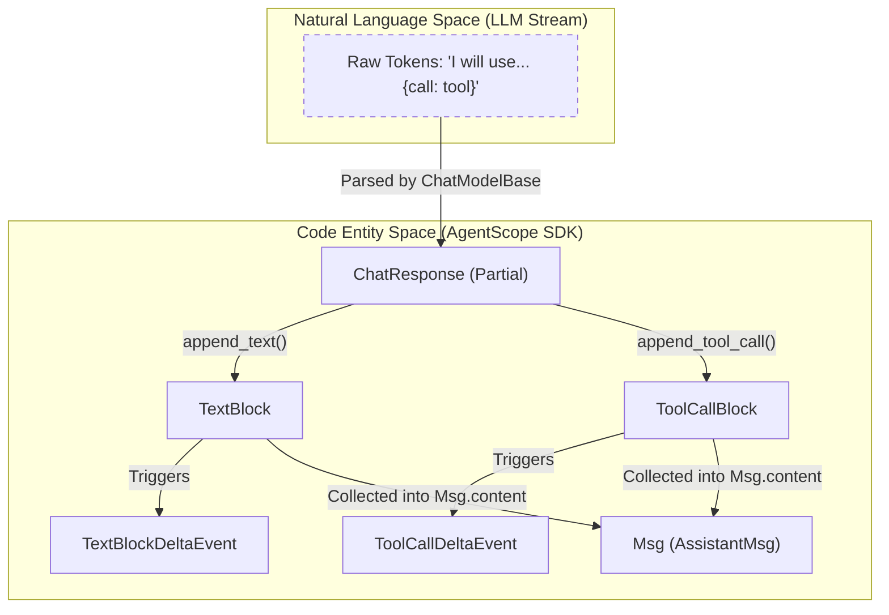
Sources: [src/agentscope/event/_event.py:26-68](), [src/agentscope/message/_base.py:67-112](), [src/agentscope/model/_model_response.py:33-165]()

## Streaming Architecture (SSE)

AgentScope uses Server-Sent Events (SSE) to stream agent activity from the `AgentService` to the Web UI.

### The Streaming Pipeline
1. **Agent Execution**: The agent yields `AgentEvent` objects from its `reply_stream` [src/agentscope/middleware/_base.py:73-94]().
2. **Middleware Interception**: Middlewares like `InboxMiddleware` can inject `HintBlock` events into the stream if background messages arrive [tests/service_inbox_middleware_test.py:1-19]().
3. **Protocol Conversion**: The `AGUIProtocolMiddleware` intercepts the SSE stream and converts internal `AgentEvent` JSON into the `AGUI` protocol format (e.g., `REPLY_START` becomes `RUN_STARTED`) [tests/agui_protocol_test.py:73-87]().
4. **Frontend Rendering**: The `ConsoleRenderer` (for CLI) or React components (for Web) consume these events to provide incremental updates [src/agentscope/console/_renderer.py:130-187]().

#### System Sequence: Event Streaming to Frontend
This diagram maps the internal SDK events to the protocol frames seen by the frontend.

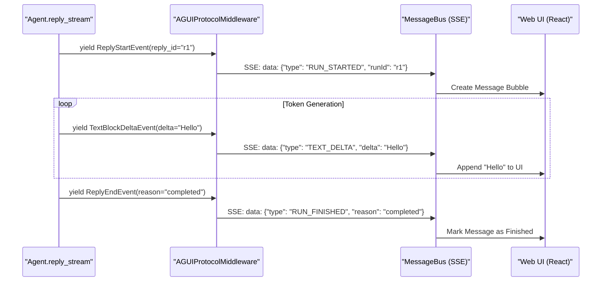

### Accumulation and Interruption
The `Msg.append_event` method allows a static message object to "absorb" a stream of events, reconstructing its content blocks in real-time [tests/event_to_message_test.py:4-24](). This is critical for maintaining consistency between the streaming UI and the persistent storage.

If a reply is interrupted (e.g., via `asyncio.CancelledError`), the `CancelDispatcher` ensures the task is terminated and a `ReplyEndEvent` with `finished_reason="interrupted"` is emitted [tests/service_agent_interrupt_test.py:3-19]().

Sources: [src/agentscope/event/_event.py:112-126](), [src/agentscope/console/_renderer.py:78-187](), [tests/agui_protocol_test.py:1-134](), [tests/service_agent_interrupt_test.py:121-195]()

---

# Page: Permission Engine & HITL

# Permission Engine & HITL

<details>
<summary>Relevant source files</summary>

The following files were used as context for generating this wiki page:

- [src/agentscope/agent/_agent.py](src/agentscope/agent/_agent.py)
- [src/agentscope/agent/_config.py](src/agentscope/agent/_config.py)
- [src/agentscope/permission/_decision.py](src/agentscope/permission/_decision.py)
- [src/agentscope/permission/_engine.py](src/agentscope/permission/_engine.py)
- [src/agentscope/permission/_types.py](src/agentscope/permission/_types.py)
- [src/agentscope/state/_state.py](src/agentscope/state/_state.py)
- [src/agentscope/tool/_builtin/_bash.py](src/agentscope/tool/_builtin/_bash.py)
- [src/agentscope/tool/_builtin/_bash_parser.py](src/agentscope/tool/_builtin/_bash_parser.py)
- [src/agentscope/tool/_builtin/_edit.py](src/agentscope/tool/_builtin/_edit.py)
- [src/agentscope/tool/_builtin/_write.py](src/agentscope/tool/_builtin/_write.py)
- [tests/agent_basic_test.py](tests/agent_basic_test.py)
- [tests/agent_interrupt_test.py](tests/agent_interrupt_test.py)
- [tests/agent_structured_output_test.py](tests/agent_structured_output_test.py)
- [tests/builtin_bash_test.py](tests/builtin_bash_test.py)
- [tests/hitl_external_execution_test.py](tests/hitl_external_execution_test.py)
- [tests/hitl_user_confirmation_test.py](tests/hitl_user_confirmation_test.py)
- [tests/middleware_test.py](tests/middleware_test.py)
- [tests/permission_bash_parser_test.py](tests/permission_bash_parser_test.py)
- [tests/permission_engine_test.py](tests/permission_engine_test.py)
- [tests/permission_mode_test.py](tests/permission_mode_test.py)

</details>


The Permission Engine in AgentScope provides a robust framework for governing agent actions, particularly tool execution. It enables Human-In-The-Loop (HITL) workflows by intercepting sensitive operations and requesting user confirmation or external execution.

## Permission Architecture

The permission system is centered around the `PermissionEngine`, which evaluates `PermissionRule` objects against a `PermissionContext`. Every agent instance maintains its own `PermissionEngine` initialized with a `PermissionContext` stored in the agent's state [src/agentscope/agent/_agent.py:177-178]().

### Core Components

| Class | Responsibility |
| :--- | :--- |
| `PermissionEngine` | Orchestrates the decision process by evaluating tool-specific and global rules [src/agentscope/permission/_engine.py:17-18](). |
| `PermissionRule` | A data model defining a specific permission (e.g., `allow` or `deny`) for a tool or a specific resource (like a file path) [src/agentscope/permission/_types.py:84-101](). |
| `PermissionContext` | Holds the current `PermissionMode` and the list of active `PermissionRule` objects [src/agentscope/permission/_types.py:102](). |
| `PermissionDecision` | The result of an evaluation, containing a `PermissionBehavior` (ALLOW, DENY, ASK, PASSTHROUGH) and optional metadata [src/agentscope/permission/_decision.py:13-35](). |

### Decision Flow Diagram

This diagram maps the logical flow of a permission check to the code entities involved.

"Permission Check Flow"
```mermaid
graph TD
    subgraph "Natural Language Space"
        "User Request" --> "Agent Reasoning"
        "Agent Reasoning" --> "Action Intent"
    end

    subgraph "Code Entity Space"
        "Action Intent" --> "Agent._acting_impl"
        "Agent._acting_impl" --> "Agent._check_permission_loop"
        "Agent._check_permission_loop" --> "PermissionEngine.check_permission"
        
        "PermissionEngine.check_permission" --> "ToolBase.check_permissions"
        "ToolBase.check_permissions" --> "Decision"
        
        "Decision" -- "PASSTHROUGH" --> "PermissionEngine._evaluate_rules"
        "Decision" -- "ASK" --> "HITL_Flow"
        "Decision" -- "ALLOW" --> "Execute_Tool"
        
        "PermissionEngine._evaluate_rules" --> "PermissionRule.match_rule"
    end

    style "Agent._acting_impl" stroke-dasharray: 5 5
```
Sources: [src/agentscope/agent/_agent.py:1083-1120](), [src/agentscope/permission/_engine.py:38-75](), [src/agentscope/permission/_decision.py:13-35]()

## Permission Modes

The `PermissionMode` defines the baseline behavior for the engine.

*   **`BYPASS`**: Trust all actions. No checks are performed unless a rule is marked as `bypass_immune` [src/agentscope/permission/_types.py:24-25]().
*   **`EXPLORE`**: Read-only operations are auto-allowed. Write/Execute operations default to `ASK` [src/agentscope/permission/_types.py:31-32]().
*   **`ACCEPT_EDITS`**: Similar to `EXPLORE`, but allows file edits within designated working directories without asking [src/agentscope/tool/_builtin/_edit.py:167-178]().
*   **`DONT_ASK`**: Unattended mode. Auto-allows safe operations and fails (denies) anything that would normally require a prompt [src/agentscope/permission/_types.py:53-54]().
*   **`DEFAULT`**: Strict mode. Everything requires explicit rules or user confirmation [src/agentscope/permission/_types.py:18-19]().

## Human-In-The-Loop (HITL) Flow

When a permission check results in `PermissionBehavior.ASK`, the agent enters a "parked" state. It emits a `RequireUserConfirmEvent` and waits for a corresponding `UserConfirmResultEvent` to be injected into the `reply` loop [src/agentscope/agent/_agent.py:1123-1144]().

### HITL Event Sequence

"HITL Event Sequence"
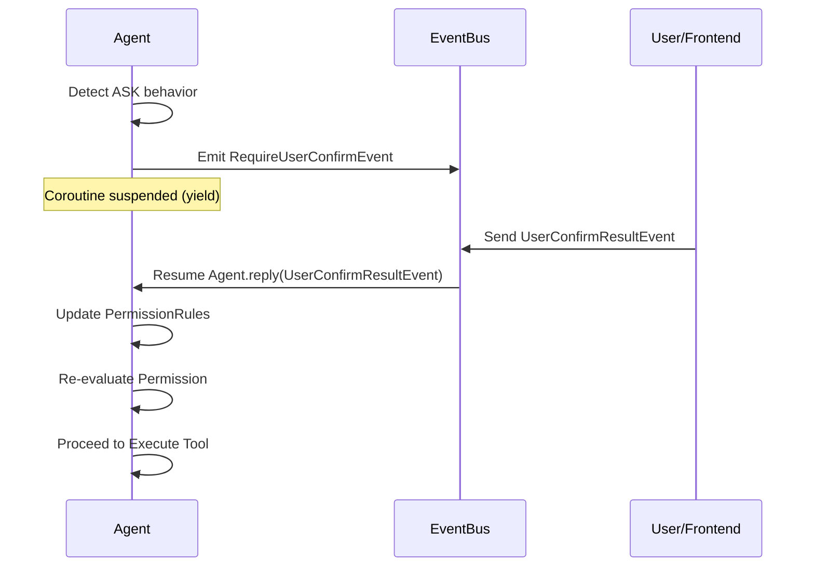
Sources: [src/agentscope/agent/_agent.py:1123-1144](), [src/agentscope/event/_event.py:315-345](), [tests/hitl_user_confirmation_test.py:248-280]()

### External Execution
If a tool is marked as `is_external_tool = True`, the agent does not execute the tool code locally. Instead, it emits a `RequireExternalExecutionEvent` [src/agentscope/agent/_agent.py:1255-1265](). The frontend is responsible for executing the command and returning the result via an `ExternalExecutionResultEvent` [src/agentscope/event/_event.py:365-375]().

## Fine-Grained Shell Permissions

For shell-based tools like `Bash`, AgentScope uses a `BashCommandParser` to perform static analysis of commands before execution. This prevents bypasses like command substitution or subshells unless explicitly permitted.

### Bash Command Parser
The `BashCommandParser` decomposes a command string into components [src/agentscope/tool/_builtin/_bash_parser.py:15-16]().
*   **Redirection Check**: Detects if the command writes to sensitive files [src/agentscope/tool/_builtin/_bash_parser.py:115-125]().
*   **Substitution Check**: Identifies `$(...)` or backticks `` `...` `` which could execute arbitrary code [src/agentscope/tool/_builtin/_bash_parser.py:130-140]().
*   **Dangerous Paths**: The `Bash` tool maintains a list of `DEFAULT_DANGEROUS_FILES` (e.g., `.bashrc`, `/etc/shadow`) and `DEFAULT_DANGEROUS_DIRECTORIES` [src/agentscope/tool/_builtin/_bash.py:139-140]().

### Example: Edit Tool Permission Check
The `Edit` tool implements its own `check_permissions` logic to handle `ACCEPT_EDITS` mode:
1.  **Safety Check**: If the path is in `dangerous_files`, return `ASK` with `bypass_immune=True` [src/agentscope/tool/_builtin/_edit.py:154-161]().
2.  **Working Dir Check**: If in `ACCEPT_EDITS` or `DONT_ASK` and the file is within an allowed path, return `ALLOW` [src/agentscope/tool/_builtin/_edit.py:167-178]().
3.  **Fallback**: Return `PASSTHROUGH` to let the `PermissionEngine` check global rules [src/agentscope/tool/_builtin/_edit.py:181-182]().

## State Management and Interruption

The agent's permission state is persisted within `AgentState.permission_context` [src/agentscope/state/_state.py:214](). During long-running tool executions, if an interruption occurs (e.g., via `UserInterruptEvent`), the agent uses `_close_unfinished_tool_calls` to transition all pending or in-flight tool calls to an `interrupted` state [src/agentscope/agent/_agent.py:1416-1473]().

Sources: [src/agentscope/agent/_agent.py:123-182](), [src/agentscope/tool/_builtin/_edit.py:123-182](), [src/agentscope/tool/_builtin/_bash.py:137-168](), [src/agentscope/tool/_builtin/_bash_parser.py:15-140](), [src/agentscope/state/_state.py:214](), [src/agentscope/agent/_agent.py:1416-1473]()

---

# Page: Model Layer

# Model Layer

<details>
<summary>Relevant source files</summary>

The following files were used as context for generating this wiki page:

- [src/agentscope/model/__init__.py](src/agentscope/model/__init__.py)
- [src/agentscope/model/_base.py](src/agentscope/model/_base.py)
- [src/agentscope/model/_utils.py](src/agentscope/model/_utils.py)
- [tests/model_base_test.py](tests/model_base_test.py)
- [tests/model_count_tokens_test.py](tests/model_count_tokens_test.py)

</details>


The Model Layer in AgentScope provides a unified abstraction for interacting with various Large Language Model (LLM) providers. It handles the complexities of API communication, streaming response accumulation, retry logic, and credential management, allowing agents to remain model-agnostic.

### Core Abstraction: `ChatModelBase`

The foundation of the model layer is the `ChatModelBase` class [src/agentscope/model/_base.py:36-37](). It defines the standard interface for all chat-based models, including support for streaming [src/agentscope/model/_base.py:49-50](), retry policies [src/agentscope/model/_base.py:52-56](), and token estimation [src/agentscope/model/_base.py:236-237]().

#### Model Execution Flow
When an agent calls a model via `__call__`, the following sequence occurs:
1.  **Retry Logic**: The base class wraps the execution in a retry loop based on `max_retries` [src/agentscope/model/_base.py:184-185](). It only retries on exceptions defined in `_get_retryable_exceptions` [src/agentscope/model/_base.py:100-108]().
2.  **API Execution**: The concrete provider implementation executes `_call_api` [src/agentscope/model/_base.py:187-193]().
3.  **Stream Accumulation**: If streaming is enabled, the `_StreamAccumulator` [src/agentscope/model/_utils.py:199-208]() gathers deltas (e.g., `_AccTextBlock`, `_AccToolCallBlock`, `_AccThinkingBlock`) to produce a final, complete `ChatResponse`.
4.  **Interruption Handling**: If the call is cancelled, it returns a `ChatResponse` with `FinishedReason.INTERRUPTED` [src/agentscope/model/_base.py:195-200]().

**Sources:** [src/agentscope/model/_base.py:36-200](), [src/agentscope/model/_utils.py:199-208]()

---

### Model Entity Architecture

The following diagram illustrates how internal code entities bridge the gap between abstract model concepts and provider-specific implementations.

**Model Layer Architecture**
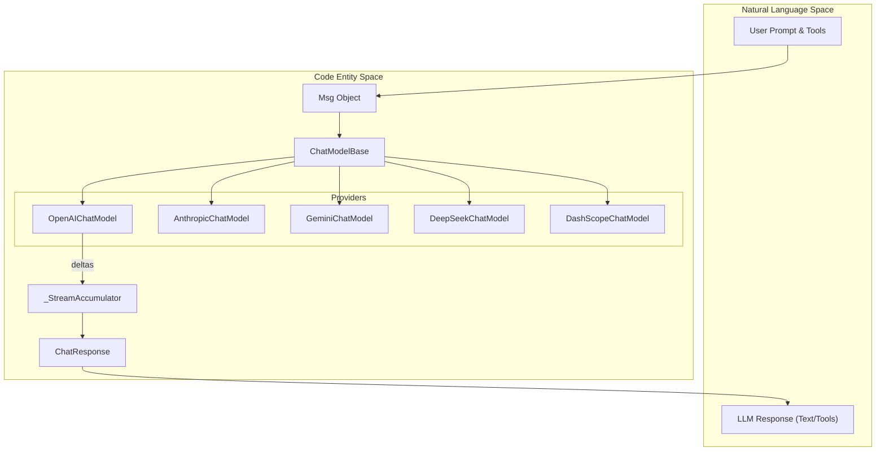
**Sources:** [src/agentscope/model/_base.py:36-164](), [src/agentscope/model/_utils.py:199-208](), [src/agentscope/model/__init__.py:8-16]()

---

### Model Cards and Configuration

AgentScope uses **Model Cards** to manage model metadata and parameters. Each provider has a `_models` directory containing YAML files that define candidate models and their default settings [src/agentscope/model/_base.py:126-136]().

*   **`ModelCard`**: A Pydantic model that stores model metadata, such as `name`, `label`, `input_types`, `output_types`, and `context_size` [src/agentscope/model/_model_card.py:11-62]().
*   **Dynamic Schema Merging**: `ModelCard.from_yaml` merges the provider's `Parameters` class with YAML-based `parameter_overrides` to generate the final JSON schema used by the frontend [src/agentscope/model/_model_card.py:72-161]().
*   **Credential Management**: Credentials (e.g., API keys) are managed via `CredentialBase` [src/agentscope/model/_base.py:19](), ensuring sensitive information is separated from model logic.

**Sources:** [src/agentscope/model/_base.py:111-156](), [src/agentscope/model/_model_card.py:11-161]()

---

### Standardized Responses and Usage

All models return a `ChatResponse` [src/agentscope/model/_model_response.py:64-65](), which contains:
*   **`content`**: A list of blocks (e.g., `TextBlock`, `ToolCallBlock`, `ThinkingBlock`, `DataBlock`) [src/agentscope/model/_model_response.py:73-74]().
*   **`finished_reason`**: An enum indicating why the model stopped (e.g., `COMPLETED`, `MAX_TOKENS`, `INTERRUPTED`) [src/agentscope/model/_model_response.py:13-20]().
*   **`usage`**: A `ChatUsage` object tracking `input_tokens`, `output_tokens`, and execution `time` [src/agentscope/model/_model_usage.py:9-20]().

**Sources:** [src/agentscope/model/_model_response.py:13-74](), [src/agentscope/model/_model_usage.py:9-32]()

---

### Data Transformation Pipeline

The following diagram shows the transformation of data from internal `Msg` objects to provider-specific payloads and back to structured `ChatResponse` objects.

**Model Data Pipeline**
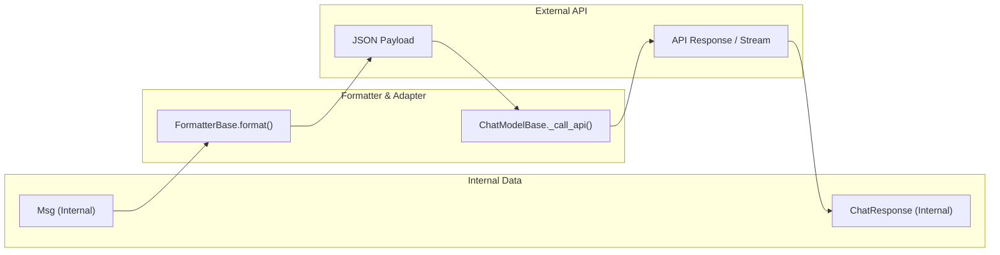
**Sources:** [src/agentscope/model/_base.py:158-194](), [src/agentscope/model/_model_response.py:64-100]()

---

### Detailed Sub-topics

For in-depth information on specific components of the Model Layer, refer to the following child pages:

*   **[LLM Provider Adapters](#3.1)**: Details on concrete implementations for OpenAI (Chat & Responses API), Anthropic, Gemini, DashScope, DeepSeek, Moonshot, Ollama, and xAI. Covers streaming, thinking/reasoning modes, and tool calling.
*   **[Message Formatters](#3.2)**: Explains how the `FormatterBase` translates internal `Msg` objects into provider-specific API payloads, including multi-agent flattening and multimodal promotion.
*   **[Embedding Models](#3.3)**: Infrastructure for embedding models (`EmbeddingBase`), provider implementations (OpenAI, DashScope, Gemini, Ollama), and integration with the RAG subsystem.
*   **[Text-to-Speech (TTS) Models](#3.4)**: Infrastructure for TTS models (`TTSBase`), supporting audio streaming and integration with agent output via `TTSMiddleware`.

---

# Page: LLM Provider Adapters

# LLM Provider Adapters

<details>
<summary>Relevant source files</summary>

The following files were used as context for generating this wiki page:

- [scripts/model_examples/openai_chat_multimodal.py](scripts/model_examples/openai_chat_multimodal.py)
- [src/agentscope/_utils/_common.py](src/agentscope/_utils/_common.py)
- [src/agentscope/formatter/_openai_response_formatter.py](src/agentscope/formatter/_openai_response_formatter.py)
- [src/agentscope/model/_anthropic/_model.py](src/agentscope/model/_anthropic/_model.py)
- [src/agentscope/model/_anthropic/_models/claude-haiku-4-5.yaml](src/agentscope/model/_anthropic/_models/claude-haiku-4-5.yaml)
- [src/agentscope/model/_anthropic/_models/claude-opus-4-5.yaml](src/agentscope/model/_anthropic/_models/claude-opus-4-5.yaml)
- [src/agentscope/model/_anthropic/_models/claude-opus-4-6.yaml](src/agentscope/model/_anthropic/_models/claude-opus-4-6.yaml)
- [src/agentscope/model/_anthropic/_models/claude-opus-4-7.yaml](src/agentscope/model/_anthropic/_models/claude-opus-4-7.yaml)
- [src/agentscope/model/_anthropic/_models/claude-opus-4-8.yaml](src/agentscope/model/_anthropic/_models/claude-opus-4-8.yaml)
- [src/agentscope/model/_anthropic/_models/claude-sonnet-4-5.yaml](src/agentscope/model/_anthropic/_models/claude-sonnet-4-5.yaml)
- [src/agentscope/model/_anthropic/_models/claude-sonnet-4-6.yaml](src/agentscope/model/_anthropic/_models/claude-sonnet-4-6.yaml)
- [src/agentscope/model/_dashscope/_model.py](src/agentscope/model/_dashscope/_model.py)
- [src/agentscope/model/_deepseek/_model.py](src/agentscope/model/_deepseek/_model.py)
- [src/agentscope/model/_gemini/_model.py](src/agentscope/model/_gemini/_model.py)
- [src/agentscope/model/_model_card.py](src/agentscope/model/_model_card.py)
- [src/agentscope/model/_moonshot/_model.py](src/agentscope/model/_moonshot/_model.py)
- [src/agentscope/model/_ollama/_model.py](src/agentscope/model/_ollama/_model.py)
- [src/agentscope/model/_openai_chat/_model.py](src/agentscope/model/_openai_chat/_model.py)
- [src/agentscope/model/_openai_chat/_models/gpt-4.1-nano.yaml](src/agentscope/model/_openai_chat/_models/gpt-4.1-nano.yaml)
- [src/agentscope/model/_openai_chat/_models/gpt-5.5.yaml](src/agentscope/model/_openai_chat/_models/gpt-5.5.yaml)
- [src/agentscope/model/_openai_chat/_models/gpt-audio-mini.yaml](src/agentscope/model/_openai_chat/_models/gpt-audio-mini.yaml)
- [src/agentscope/model/_openai_chat/_models/o3.yaml](src/agentscope/model/_openai_chat/_models/o3.yaml)
- [src/agentscope/model/_openai_chat/_models/o4-mini.yaml](src/agentscope/model/_openai_chat/_models/o4-mini.yaml)
- [src/agentscope/model/_openai_response/_model.py](src/agentscope/model/_openai_response/_model.py)
- [src/agentscope/model/_openai_response/_models/gpt-5.5.yaml](src/agentscope/model/_openai_response/_models/gpt-5.5.yaml)
- [src/agentscope/model/_openai_response/_models/o3.yaml](src/agentscope/model/_openai_response/_models/o3.yaml)
- [src/agentscope/model/_openai_response/_models/o4-mini.yaml](src/agentscope/model/_openai_response/_models/o4-mini.yaml)
- [src/agentscope/model/_xai/_model.py](src/agentscope/model/_xai/_model.py)
- [src/agentscope/model/_xai/_models/grok-3-fast.yaml](src/agentscope/model/_xai/_models/grok-3-fast.yaml)
- [src/agentscope/model/_xai/_models/grok-3-mini.yaml](src/agentscope/model/_xai/_models/grok-3-mini.yaml)
- [src/agentscope/model/_xai/_models/grok-3.yaml](src/agentscope/model/_xai/_models/grok-3.yaml)
- [src/agentscope/model/_xai/_models/grok-4.3.yaml](src/agentscope/model/_xai/_models/grok-4.3.yaml)
- [tests/formatter_openai_response_test.py](tests/formatter_openai_response_test.py)
- [tests/model_anthropic_test.py](tests/model_anthropic_test.py)
- [tests/model_dashscope_test.py](tests/model_dashscope_test.py)
- [tests/model_deepseek_test.py](tests/model_deepseek_test.py)
- [tests/model_gemini_test.py](tests/model_gemini_test.py)
- [tests/model_moonshot_test.py](tests/model_moonshot_test.py)
- [tests/model_ollama_test.py](tests/model_ollama_test.py)
- [tests/model_openai_chat_test.py](tests/model_openai_chat_test.py)
- [tests/model_openai_response_test.py](tests/model_openai_response_test.py)
- [tests/model_xai_test.py](tests/model_xai_test.py)

</details>


This page provides a detailed technical overview of the LLM provider adapters in AgentScope. These adapters bridge the gap between AgentScope's internal message representations and the diverse APIs of various model providers, handling API communication, streaming, tool calling, and multimodal data.

## Architecture Overview

AgentScope uses a unified `ChatModelBase` interface [[src/agentscope/model/_base.py:112-114]]() that all provider adapters implement. The core of each adapter is the `_call_api` method, which handles message formatting, parameter preparation, and the actual network request.

### Data Flow: Message to API Response

The following diagram illustrates how a generic request flows through a provider adapter.

**Provider Adapter Data Flow**
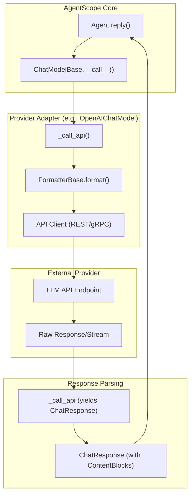
**Sources:** [[src/agentscope/model/_openai_chat/_model.py:188-195]](), [[src/agentscope/model/_gemini/_model.py:228-235]](), [[src/agentscope/model/_anthropic/_model.py:179-186]]()

---

## OpenAI Adapters

AgentScope provides two distinct adapters for OpenAI, reflecting the evolution of their API from simple completions to complex reasoning events.

### OpenAI Chat Completions API (`OpenAIChatModel`)
The standard adapter for models like `gpt-4o`. It supports:
*   **Multimodal Inputs:** Handles images and audio via `DataBlock` and `Base64Source` [[src/agentscope/model/_openai_chat/_model.py:18-25]]().
*   **Audio Output:** Can trigger voice responses by setting the `voice` parameter, which automatically injects `audio` into the API `modalities` [[src/agentscope/model/_openai_chat/_model.py:94-107]]().
*   **Reasoning:** Supports `o3` and `o4` models via `reasoning_effort` [[src/agentscope/model/_openai_chat/_model.py:59-70]]().

### OpenAI Responses API (`OpenAIResponseModel`)
A specialized adapter designed for reasoning models (e.g., `o3`, `o4-mini`) that provides first-class streaming events for thinking/reasoning [[src/agentscope/model/_openai_response/_model.py:34-38]]().
*   **Thinking Blocks:** Specifically parses `reasoning` items into `ThinkingBlock` objects [[src/agentscope/model/_openai_response/_model.py:205-216]]().
*   **Event Handling:** Unlike the Chat API which uses `delta` text, the Responses API uses specific event types like `response.text.delta` and `response.content_part.completed` [[tests/model_openai_response_test.py:94-103]]().

**Sources:** [[src/agentscope/model/_openai_chat/_model.py:36-109]](), [[src/agentscope/model/_openai_response/_model.py:31-82]]()

---

## Anthropic Adapter (`AnthropicChatModel`)

The Anthropic adapter manages the `AsyncAnthropic` client and handles their unique event-based streaming protocol.

*   **Thinking Modes:** Supports `adaptive`, `enabled`, and `disabled` modes. `adaptive` is used for newer models like Claude 4.7 [[src/agentscope/model/_anthropic/_model.py:59-72]]().
*   **Redacted Thinking:** Handles `redacted_thinking` blocks, which occur when the model's internal reasoning is encrypted or hidden by the provider [[tests/model_anthropic_test.py:202-207]]().
*   **Streaming Logic:** Iterates through events such as `message_start`, `content_block_start`, and `content_block_delta` to assemble the final `ChatResponse` [[tests/model_anthropic_test.py:6-8]]().

**Sources:** [[src/agentscope/model/_anthropic/_model.py:27-97]](), [[tests/model_anthropic_test.py:39-75]]()

---

## Google Gemini Adapter (`GeminiChatModel`)

Gemini integration utilizes the `google.genai` SDK and features a strict schema sanitization layer.

### Schema Sanitization
Gemini's API has specific restrictions on JSON schemas for tool calling. The `_sanitize_schema_for_gemini` function performs the following [[src/agentscope/model/_gemini/_model.py:25-50]]():
*   **Removes `additionalProperties`**: Not supported by Gemini [[src/agentscope/model/_gemini/_model.py:65-66]]().
*   **Const to Enum**: Converts `const` keywords to single-value `enum` lists [[src/agentscope/model/_gemini/_model.py:70-72]]().
*   **Null Type Handling**: Rewrites `{"type": "null"}` to `{"type": "object"}` or simplifies `anyOf` containing null to ensure compatibility [[src/agentscope/model/_gemini/_model.py:62-89]]().

### Features
*   **Thinking Budget:** Allows specifying a token budget for reasoning [[src/agentscope/model/_gemini/_model.py:131-136]]().
*   **gRPC/REST:** Defaults to using the Google GenAI client which handles the underlying transport [[src/agentscope/model/_gemini/_model.py:201-206]]().

**Sources:** [[src/agentscope/model/_gemini/_model.py:112-154]](), [[src/agentscope/model/_gemini/_model.py:25-109]]()

---

## DashScope & DeepSeek Adapters

Both DashScope (Alibaba) and DeepSeek provide OpenAI-compatible endpoints, allowing AgentScope to reuse the `openai.AsyncClient` while injecting provider-specific logic.

| Feature | DashScope (`DashScopeChatModel`) | DeepSeek (`DeepSeekChatModel`) |
| :--- | :--- | :--- |
| **Client** | `openai.AsyncClient` [[src/agentscope/model/_dashscope/_model.py:167-171]]() | `openai.AsyncClient` [[src/agentscope/model/_deepseek/_model.py:130-135]]() |
| **Thinking** | `thinking_enable` & `thinking_budget` [[src/agentscope/model/_dashscope/_model.py:53-64]]() | `thinking_enable` (via `reasoning_content`) [[src/agentscope/model/_deepseek/_model.py:39-47]]() |
| **Audio** | Supports omni-style voice output [[src/agentscope/model/_dashscope/_model.py:96-109]]() | N/A |
| **Reasoning Effort** | N/A | `high`, `max` [[src/agentscope/model/_deepseek/_model.py:49-58]]() |

**Sources:** [[src/agentscope/model/_dashscope/_model.py:34-112]](), [[src/agentscope/model/_deepseek/_model.py:26-77]]()

---

## Other Provider Adapters

### Moonshot AI (`MoonshotChatModel`)
*   Supports the Kimi series (e.g., `kimi-k3`, `kimi-k2.6`).
*   Handles different token limit keys: uses `max_completion_tokens` for `kimi-k3` and standard `max_tokens` for others [[src/agentscope/model/_moonshot/_model.py:184-190]]().
*   Provides `reasoning_effort` for Kimi models [[src/agentscope/model/_moonshot/_model.py:49-57]]().

### Ollama (`OllamaChatModel`)
*   Interfaces with local Ollama instances via its REST API.
*   Uses a dedicated `OllamaChatFormatter` to handle local model prompt templates [[src/agentscope/model/_ollama/_model.py:132-133]]().

### xAI (`xAIChatModel`)
*   Supports Grok models (e.g., `grok-3`).
*   Implements the OpenAI-compatible interface with `xAI`-specific parameters like `thinking_enable` [[src/agentscope/model/_xai/_model.py:43-47]]().

---

## Technical Implementation Details

### Provider Adapter Class Structure
The following diagram maps the code entities involved in a model call.

**Code Entity Map: Model Call Pipeline**
```mermaid
classDiagram
    class ChatModelBase {
        <<abstract>>
        +__call__(messages, tools, tool_choice)
        #_call_api(model_name, messages, tools, tool_choice)*
    }
    class OpenAIChatModel {
        +client: AsyncClient
        +formatter: OpenAIChatFormatter
        #_call_api()
    }
    class GeminiChatModel {
        +client: google.genai.Client
        +formatter: GeminiChatFormatter
        #_call_api()
        -_sanitize_schema_for_gemini(schema)
    }
    class ChatResponse {
        +id: str
        +content: List[ContentBlock]
        +usage: ChatUsage
    }
    class ContentBlock {
        <<interface>>
    }
    
    ChatModelBase <|-- OpenAIChatModel
    ChatModelBase <|-- GeminiChatModel
    ChatModelBase ..> ChatResponse : produces
    ChatResponse *-- ContentBlock : contains
```
**Sources:** [[src/agentscope/model/_base.py:112]](), [[src/agentscope/model/_openai_chat/_model.py:36]](), [[src/agentscope/model/_gemini/_model.py:112]](), [[src/agentscope/model/_model_response.py:33-67]]()

### Tool Calling and Schema Sanitization
When tools are passed to a model, the adapter is responsible for converting the AgentScope `Toolkit` schemas into the provider's format. 
*   **OpenAI/DashScope:** Use standard JSON schema.
*   **Gemini:** Requires the recursive cleaning defined in `_sanitize_schema_for_gemini` to remove unsupported keywords like `additionalProperties` [[src/agentscope/model/_gemini/_model.py:25-109]]().
*   **Anthropic:** Uses a specific `tool_use` block type in the response [[tests/model_anthropic_test.py:58-65]]().

### Streaming Logic
All adapters support streaming by returning an `AsyncGenerator[ChatResponse, None]` [[src/agentscope/model/_openai_chat/_model.py:195]]().
1.  **Intermediate Chunks:** `is_last` is set to `False`. Chunks contain partial text, reasoning deltas, or incremental tool arguments.
2.  **Accumulation:** Adapters use helper methods like `append_text`, `append_thinking`, and `append_tool_call` on the `ChatResponse` object to build the final output [[src/agentscope/model/_model_response.py:69-165]]().
3.  **Final Chunk:** `is_last` is set to `True`. This chunk contains the **full accumulated content** and the final `usage` statistics [[src/agentscope/model/_model_response.py:40-42]]().

**Sources:** [[src/agentscope/model/_openai_chat/_model.py:188-195]](), [[src/agentscope/model/_model_response.py:33-165]](), [[tests/model_openai_chat_test.py:4-9]](), [[tests/model_gemini_test.py:3-7]]()

---

# Page: Message Formatters

# Message Formatters

<details>
<summary>Relevant source files</summary>

The following files were used as context for generating this wiki page:

- [scripts/model_examples/openai_chat_multimodal.py](scripts/model_examples/openai_chat_multimodal.py)
- [src/agentscope/formatter/_anthropic_formatter.py](src/agentscope/formatter/_anthropic_formatter.py)
- [src/agentscope/formatter/_dashscope_formatter.py](src/agentscope/formatter/_dashscope_formatter.py)
- [src/agentscope/formatter/_deepseek_formatter.py](src/agentscope/formatter/_deepseek_formatter.py)
- [src/agentscope/formatter/_formatter_base.py](src/agentscope/formatter/_formatter_base.py)
- [src/agentscope/formatter/_gemini_formatter.py](src/agentscope/formatter/_gemini_formatter.py)
- [src/agentscope/formatter/_ollama_formatter.py](src/agentscope/formatter/_ollama_formatter.py)
- [src/agentscope/formatter/_openai_formatter.py](src/agentscope/formatter/_openai_formatter.py)
- [src/agentscope/formatter/_openai_response_formatter.py](src/agentscope/formatter/_openai_response_formatter.py)
- [src/agentscope/message/_block.py](src/agentscope/message/_block.py)
- [src/agentscope/model/_openai_response/_model.py](src/agentscope/model/_openai_response/_model.py)
- [tests/formatter_anthropic_test.py](tests/formatter_anthropic_test.py)
- [tests/formatter_dashscope_test.py](tests/formatter_dashscope_test.py)
- [tests/formatter_deepseek_test.py](tests/formatter_deepseek_test.py)
- [tests/formatter_gemini_test.py](tests/formatter_gemini_test.py)
- [tests/formatter_ollama_test.py](tests/formatter_ollama_test.py)
- [tests/formatter_openai_response_test.py](tests/formatter_openai_response_test.py)
- [tests/model_openai_response_test.py](tests/model_openai_response_test.py)

</details>


Message formatters in AgentScope are responsible for translating internal `Msg` objects into the specific JSON payloads required by various LLM provider APIs. This layer abstracts away differences in role naming (e.g., `assistant` vs `model`), multimodal data structures (e.g., `image_url` vs `inline_data`), and complex sequences like tool calls and reasoning blocks.

## Core Architecture

All formatters inherit from `FormatterBase`, which defines the standard interface for converting a list of messages into a list of provider-specific dictionaries [src/agentscope/formatter/_formatter_base.py:1-30]().

### Data Flow: Msg to API Payload

The transformation process typically follows this pipeline:
1.  **Extraction**: The formatter iterates through the `Msg` list and calls `get_content_blocks()` to retrieve individual `ContentBlock` objects (e.g., `TextBlock`, `DataBlock`, `ToolCallBlock`, `ToolResultBlock`, `ThinkingBlock`) [src/agentscope/message/_block.py:11-200]().
2.  **Multimodal Processing**: `DataBlock` objects are converted into base64 strings or specific URL formats based on provider requirements. OpenAI and DashScope often use `image_url` structures [src/agentscope/formatter/_openai_formatter.py:77-118](), while Gemini uses `inline_data` [src/agentscope/formatter/_gemini_formatter.py:62-109]().
3.  **Role Mapping**: Internal roles (`user`, `assistant`, `system`) are mapped to provider-specific strings. For example, Gemini maps `assistant` to `model` [src/agentscope/formatter/_gemini_formatter.py:171]().
4.  **Structural Assembly**: Blocks are grouped into the provider's message structure (e.g., OpenAI's `content` list vs Ollama's flat `content` string [src/agentscope/formatter/_ollama_formatter.py:143-149]()).

### Entity Mapping: Natural Language to Code

The following diagram bridges the conceptual transformation from a conversation to the code entities that handle it.

**Message Transformation Entity Map**
```mermaid
graph TD
    subgraph "NaturalLanguageSpace"
        A["User Input / Agent Response"]
    end

    subgraph "InternalSDKSpace"
        B["Msg Object"]
        C["ContentBlock Hierarchy"]
        B --> C
        C1["TextBlock"]
        C2["DataBlock (Image/Audio)"]
        C3["ToolCallBlock"]
        C4["ThinkingBlock"]
        C5["ToolResultBlock"]
    end

    subgraph "CodeEntitySpace_Formatters"
        D["FormatterBase"]
        E["OpenAIChatFormatter"]
        F["GeminiChatFormatter"]
        G["AnthropicChatFormatter"]
        
        D -.->|"implements"| E
        D -.->|"implements"| F
        D -.->|"implements"| G
    end

    subgraph "ProviderAPISpace"
        H["OpenAI JSON (role: assistant, content: [...])"]
        I["Gemini JSON (role: model, parts: [...])"]
    end

    A --> B
    C1 & C2 & C3 & C4 & C5 --> D
    E --> H
    F --> I
```
Sources: [src/agentscope/formatter/_formatter_base.py:1-30](), [src/agentscope/message/_block.py:11-54](), [src/agentscope/formatter/_openai_formatter.py:189-202]()

---

## Provider-Specific Implementation Details

### OpenAI (Chat & Responses API)
AgentScope supports both the standard Chat Completions API and the newer Responses API (used for `o1`/`o3` models).

*   **Chat Completions**: Uses `OpenAIChatFormatter`. It maps `Msg.name` to the `name` field in the API to distinguish between different agents in the same conversation [src/agentscope/formatter/_openai_formatter.py:189-193]().
*   **Responses API**: Uses `OpenAIResponseFormatter`. Key differences include using `input_text`/`output_text` instead of `text`, and promoting tool calls/results to top-level items in the `input` list rather than nesting them inside a message [src/agentscope/formatter/_openai_response_formatter.py:88-101](). Local `file://` paths are promoted to base64 data URIs [src/agentscope/formatter/_openai_formatter.py:102-108]().

### Anthropic
The `AnthropicChatFormatter` handles Claude's specific requirements:
*   **Thinking Continuity**: Anthropic requires all previous thinking blocks (with their signatures) to be passed back to the API to maintain reasoning continuity [src/agentscope/formatter/_anthropic_formatter.py:46-51]().
*   **Tool Result Forcing**: When a `ToolResultBlock` is encountered, the formatter forces the role to `user`, as tool outputs are considered user-provided context for Claude [src/agentscope/formatter/_anthropic_formatter.py:94](); [tests/formatter_anthropic_test.py:161-174]().
*   **JSON Repair**: Tool call inputs are processed via `_json_loads_with_repair` to handle truncated or malformed LLM outputs [src/agentscope/formatter/_anthropic_formatter.py:176-182]().

### Gemini
`GeminiChatFormatter` maps the internal `assistant` role to `model` [src/agentscope/formatter/_gemini_formatter.py:112-115](). It handles multimodal data via `inline_data` blocks [src/agentscope/formatter/_gemini_formatter.py:62-109](). It supports `thought: true` flags for `ThinkingBlock` objects, but skips empty thinking blocks to avoid API 400 errors [src/agentscope/formatter/_gemini_formatter.py:156-168]().

### Ollama
`OllamaChatFormatter` flattens multiple `TextBlock` objects into a single `content` string [src/agentscope/formatter/_ollama_formatter.py:143-149](). It handles tool calls by converting JSON string arguments into actual Python dictionaries, as required by the Ollama SDK [src/agentscope/formatter/_ollama_formatter.py:199-201]().

### DashScope & DeepSeek
*   **DashScope**: Uses `DashScopeChatFormatter` which is largely OpenAI-compatible but extends support for `video_url` and `input_audio` [src/agentscope/formatter/_dashscope_formatter.py:70-73](). It also supports `application/x-thinking` for reasoning models [src/agentscope/formatter/_dashscope_formatter.py:57-61]().
*   **DeepSeek**: Implements formatters that handle the specific `reasoning_content` field used by DeepSeek's reasoning models [src/agentscope/formatter/_deepseek_formatter.py:1-50]().

---

## Advanced Formatting Logic

### Multi-Agent Flattening
In multi-agent scenarios, the LLM provider may only support a single `user` and `assistant` role. `MultiAgentFormatter` variants (e.g., `AnthropicMultiAgentFormatter`, `GeminiMultiAgentFormatter`) solve this by:
1.  Wrapping historical messages between different agents into a single `user` message.
2.  Using XML-like tags (e.g., `<history>...</history>`) to delineate the conversation history [tests/formatter_anthropic_test.py:189-192]().
3.  Prepending a `conversation_history_prompt` to explain the format to the model [src/agentscope/formatter/_anthropic_formatter.py:194]().

### Tool Result Grouping
Formatters handle the sequence of tool calls and their corresponding results. For instance, in `OpenAIResponseFormatter`, `ToolResultBlock` objects are converted into `function_call_output` items [src/agentscope/formatter/_openai_response_formatter.py:98](). Gemini formatters convert `ToolResultBlock` into a separate `user` role message containing a `function_response` part [tests/formatter_gemini_test.py:155-168]().

### Multimodal Promotion
For providers like OpenAI's Responses API, formatters translate `image_url` into `input_image` [src/agentscope/formatter/_openai_response_formatter.py:79-83](). DashScope formatters handle the promotion of media blocks into specific `image_url`, `video_url`, or `input_audio` types [src/agentscope/formatter/_dashscope_formatter.py:98-105]().

---

## Implementation Diagram

The following sequence diagram illustrates how a `ChatModel` uses a `Formatter` to prepare data for an API call.

**API Call Preparation Sequence**
```mermaid
sequenceDiagram
    participant A as Agent
    participant M as OpenAIResponseModel
    participant F as OpenAIResponseFormatter
    participant C as openai.AsyncClient

    A->>M: __call__(messages: list[Msg])
    M->>M: _call_api(messages, tools, ...)
    M->>F: format(messages)
    loop For each Msg
        F->>F: get_content_blocks()
        alt is TextBlock
            F->>F: map to "input_text" (user) or "output_text" (assistant)
        else is DataBlock (Image)
            F->>F: _format_response_data_block() -> "input_image"
        else is ToolCallBlock
            F->>F: promote to top-level "function_call"
        else is ToolResultBlock
            F->>F: map to "function_call_output"
        end
    end
    F-->>M: formatted_messages: list[dict]
    M->>C: responses.create(input=formatted_messages, ...)
    C-->>M: Response Object
    M-->>A: ChatResponse
```
Sources: [src/agentscope/model/_openai_response/_model.py:155-191](), [src/agentscope/formatter/_openai_response_formatter.py:104-120](), [src/agentscope/message/_block.py:11-127]()

## Summary of Formatter Roles

| Formatter Class | Key Characteristic | Source |
| :--- | :--- | :--- |
| `OpenAIChatFormatter` | Maps `Msg.name` to API `name` field; supports audio/image. | [src/agentscope/formatter/_openai_formatter.py:189]() |
| `OpenAIResponseFormatter` | Uses `input_text` and top-level `function_call` for o1/o3. | [src/agentscope/formatter/_openai_response_formatter.py:88]() |
| `AnthropicChatFormatter` | Preserves `ThinkingBlock` signatures and repairs tool JSON. | [src/agentscope/formatter/_anthropic_formatter.py:46]() |
| `GeminiChatFormatter` | Maps `assistant` to `model`; uses `parts` with `thought` flags. | [src/agentscope/formatter/_gemini_formatter.py:112]() |
| `OllamaChatFormatter` | Flattens content to string; handles dict-based tool arguments. | [src/agentscope/formatter/_ollama_formatter.py:102]() |
| `DashScopeChatFormatter` | OpenAI-compatible with added video/audio/thinking support. | [src/agentscope/formatter/_dashscope_formatter.py:26]() |

Sources:
- `src/agentscope/formatter/_formatter_base.py`
- `src/agentscope/formatter/_openai_formatter.py`
- `src/agentscope/formatter/_openai_response_formatter.py`
- `src/agentscope/formatter/_anthropic_formatter.py`
- `src/agentscope/formatter/_gemini_formatter.py`
- `src/agentscope/formatter/_ollama_formatter.py`
- `src/agentscope/formatter/_dashscope_formatter.py`
- `src/agentscope/formatter/_deepseek_formatter.py`
- `src/agentscope/message/_block.py`
- `src/agentscope/model/_openai_response/_model.py`
- `tests/formatter_anthropic_test.py`
- `tests/formatter_gemini_test.py`
- `tests/formatter_ollama_test.py`
- `tests/formatter_dashscope_test.py`

---

# Page: Embedding Models

# Embedding Models

<details>
<summary>Relevant source files</summary>

The following files were used as context for generating this wiki page:

- [src/agentscope/embedding/_ollama/_model.py](src/agentscope/embedding/_ollama/_model.py)
- [src/agentscope/embedding/_openai/_model.py](src/agentscope/embedding/_openai/_model.py)
- [src/agentscope/tts/_openai/_model.py](src/agentscope/tts/_openai/_model.py)
- [tests/tts_openai_test.py](tests/tts_openai_test.py)

</details>


The embedding model infrastructure in AgentScope provides a standardized interface for transforming text into numerical vectors. This layer supports multiple providers, batching, retry logic, and file-based caching, serving as a critical component for the Retrieval-Augmented Generation (RAG) subsystem.

## Core Infrastructure

AgentScope defines a unified contract for embedding models through the `EmbeddingModelBase` class. This base class handles common concerns like input sanitization, batching large requests, and managing retries for transient API failures.

### Key Data Structures

*   **`EmbeddingResponse`**: Encapsulates the results of an embedding request, including the vectors, usage statistics, and the source (e.g., "network" or "cache") `[src/agentscope/embedding/_embedding_response.py:7-32]()`.
*   **`EmbeddingUsage`**: Tracks token consumption and execution time `[src/agentscope/embedding/_embedding_usage.py:7-14]()`.
*   **`EmbeddingCacheBase`**: An interface for implementing persistent storage of embeddings to reduce API costs and latency `[src/agentscope/embedding/_cache_base.py:10-40]()`.

### Embedding Data Flow
The following diagram illustrates how text moves from the application through the embedding infrastructure to the provider APIs.

**Title: Embedding Request Pipeline**
```mermaid
graph TD
    subgraph "Natural Language Space"
        Input["list[str | TextBlock]"]
    end

    subgraph "Code Entity Space: EmbeddingBase"
        Base["EmbeddingModelBase.embed()"]
        Sanitize["_sanitize_inputs()"]
        Batch["_batch_generator()"]
        Retry["_retry_wrapper()"]
    end

    subgraph "Provider Implementations"
        OAI["OpenAIEmbeddingModel._call_api()"]
        DS["DashScopeEmbeddingModel._call_api()"]
        OL["OllamaEmbeddingModel._call_api()"]
    end

    subgraph "Caching Layer"
        Cache["EmbeddingCacheBase.retrieve()"]
    end

    Input --> Base
    Base --> Sanitize
    Sanitize --> Batch
    Batch --> Cache
    Cache -- "Miss" --> Retry
    Retry --> OAI & DS & OL
    OAI & DS & OL --> Resp["EmbeddingResponse"]
```
Sources: `[src/agentscope/embedding/_embedding_base.py:79-136]()`, `[src/agentscope/embedding/_openai/_model.py:115-179]()`, `[src/agentscope/embedding/_ollama/_model.py:85-132]()`.

## Provider Implementations

AgentScope supports several major embedding providers out of the box. Each implementation inherits from `EmbeddingModelBase` and implements the `_call_api` method.

| Provider | Class Name | Default Batch Size | Supported Models (Examples) |
| :--- | :--- | :--- | :--- |
| **OpenAI** | `OpenAIEmbeddingModel` | 2048 | `text-embedding-3-small`, `text-embedding-3-large` |
| **DashScope** | `DashScopeEmbeddingModel` | 25 | `text-embedding-v1`, `text-embedding-v2`, `text-embedding-v3` |
| **Ollama** | `OllamaEmbeddingModel` | 512 | `nomic-embed-text`, `mxbai-embed-large` |
| **Gemini** | `GeminiEmbeddingModel` | 100 | `text-embedding-004` |

### Implementation Details
*   **OpenAI**: Uses the `openai.AsyncClient`. It allows toggling the `pass_dimensions` flag for compatibility with third-party OpenAI-style proxies `[src/agentscope/embedding/_openai/_model.py:96-100]()`.
*   **Ollama**: Interacts with locally hosted models via the `ollama.AsyncClient` `[src/agentscope/embedding/_ollama/_model.py:83-84]()`.
*   **DashScope**: Supports specialized parameters like `text_type` (e.g., `query` vs `document`) to optimize retrieval performance `[src/agentscope/embedding/_dashscope/_model.py:50-70]()`.

Sources: `[src/agentscope/embedding/_openai/_model.py:16-30]()`, `[src/agentscope/embedding/_ollama/_model.py:15-26]()`, `[src/agentscope/embedding/_dashscope/_model.py:15-30]()`.

## Integration with RAG Subsystem

Embedding models are the bridge between raw documents and vector stores in the RAG subsystem. They are primarily orchestrated by the `KnowledgeBase` class.

**Title: RAG Integration and Vector Space Mapping**
```mermaid
graph TD
    subgraph "Natural Language Space"
        Doc["Document (PDF/Text/etc.)"]
        Query["User Prompt"]
    end

    subgraph "Code Entity Space: RAG Pipeline"
        Parser["ParserBase.parse()"]
        Chunker["ChunkerBase.chunk()"]
        KB["KnowledgeBase"]
        Embed["EmbeddingModelBase"]
    end

    subgraph "Vector Store Space"
        VDB["VectorStoreBase (Qdrant/Milvus/etc.)"]
        VR["VectorRecord"]
    end

    Doc --> Parser
    Parser --> Chunker
    Chunker --> KB
    KB -- "embed(chunks)" --> Embed
    Embed -- "EmbeddingResponse" --> KB
    KB -- "insert()" --> VDB
    VDB -.-> VR
    
    Query --> KB
    KB -- "embed(query)" --> Embed
    Embed --> KB
    KB -- "search(vector)" --> VDB
```
Sources: `[src/agentscope/embedding/_embedding_base.py:79-136]()`, `[src/agentscope/embedding/_openai/_model.py:115-179]()`, `[src/agentscope/embedding/_ollama/_model.py:85-132]()`.

### Data Flow in RAG
1.  **Ingestion**: Documents are parsed into data models and then broken into chunks by a chunker implementation.
2.  **Embedding**: The `KnowledgeBase` calls the embedding model's `embed` method to generate vectors for each chunk.
3.  **Storage**: The resulting vectors and original chunk metadata are wrapped in a `VectorRecord` and persisted in a `VectorStoreBase` implementation such as `QdrantStore`, `MilvusLiteStore`, `ElasticsearchStore`, or `MongoDBStore`.
4.  **Retrieval**: During inference, the user query is embedded using the same model, and the resulting vector is used to perform a similarity search against the vector store.

Sources: `[src/agentscope/embedding/_embedding_base.py:79-136]()`, `[src/agentscope/embedding/_openai/_model.py:155-165]()`.

## Caching Mechanism

To prevent redundant API calls for identical text, AgentScope provides a file-based caching layer. The `EmbeddingCacheBase` can be injected into any embedding model instance `[src/agentscope/embedding/_cache_base.py:10-40]()`.

When caching is enabled:
1.  The `_call_api` method first checks the cache using a hash of the input text and model parameters `[src/agentscope/embedding/_openai/_model.py:140-149]()`.
2.  If a hit occurs, the cached vectors are returned with `source="cache"`.
3.  If a miss occurs, the API is called, and the result is stored in the cache before being returned `[src/agentscope/embedding/_openai/_model.py:167-171]()`.

Sources: `[src/agentscope/embedding/_openai/_model.py:101-102]()`, `[src/agentscope/embedding/_ollama/_model.py:108-117]()`.

---

# Page: Text-to-Speech (TTS) Models

# Text-to-Speech (TTS) Models

<details>
<summary>Relevant source files</summary>

The following files were used as context for generating this wiki page:

- [src/agentscope/credential/_dashscope.py](src/agentscope/credential/_dashscope.py)
- [src/agentscope/credential/_gemini.py](src/agentscope/credential/_gemini.py)
- [src/agentscope/credential/_ollama.py](src/agentscope/credential/_ollama.py)
- [src/agentscope/embedding/_ollama/_model.py](src/agentscope/embedding/_ollama/_model.py)
- [src/agentscope/middleware/_tts_middleware.py](src/agentscope/middleware/_tts_middleware.py)
- [src/agentscope/tts/__init__.py](src/agentscope/tts/__init__.py)
- [src/agentscope/tts/_dashscope/__init__.py](src/agentscope/tts/_dashscope/__init__.py)
- [src/agentscope/tts/_dashscope/_cosyvoice_model.py](src/agentscope/tts/_dashscope/_cosyvoice_model.py)
- [src/agentscope/tts/_dashscope/_cosyvoice_models/cosyvoice-v3-flash.yaml](src/agentscope/tts/_dashscope/_cosyvoice_models/cosyvoice-v3-flash.yaml)
- [src/agentscope/tts/_dashscope/_cosyvoice_models/cosyvoice-v3-plus.yaml](src/agentscope/tts/_dashscope/_cosyvoice_models/cosyvoice-v3-plus.yaml)
- [src/agentscope/tts/_dashscope/_cosyvoice_utils.py](src/agentscope/tts/_dashscope/_cosyvoice_utils.py)
- [src/agentscope/tts/_dashscope/_realtime_model.py](src/agentscope/tts/_dashscope/_realtime_model.py)
- [src/agentscope/tts/_gemini/__init__.py](src/agentscope/tts/_gemini/__init__.py)
- [src/agentscope/tts/_gemini/_model.py](src/agentscope/tts/_gemini/_model.py)
- [src/agentscope/tts/_gemini/_models/gemini-2.5-flash-preview-tts.yaml](src/agentscope/tts/_gemini/_models/gemini-2.5-flash-preview-tts.yaml)
- [src/agentscope/tts/_gemini/_models/gemini-2.5-pro-preview-tts.yaml](src/agentscope/tts/_gemini/_models/gemini-2.5-pro-preview-tts.yaml)
- [src/agentscope/tts/_openai/_model.py](src/agentscope/tts/_openai/_model.py)
- [tests/tts_dashscope_test.py](tests/tts_dashscope_test.py)
- [tests/tts_gemini_test.py](tests/tts_gemini_test.py)
- [tests/tts_middleware_test.py](tests/tts_middleware_test.py)
- [tests/tts_openai_test.py](tests/tts_openai_test.py)

</details>


The Text-to-Speech (TTS) module in AgentScope provides a standardized infrastructure for converting agent reasoning or response text into audio. It supports multiple providers, streaming output, and seamless integration with the agent's message loop via middleware.

## Architecture Overview

The TTS system is built on a base abstraction `TTSModelBase` which defines the contract for synthesis, streaming, and lifecycle management. The infrastructure bridges the gap between raw text produced by LLMs and structured audio data blocks transmitted to the frontend.

### Core Components

*   **`TTSModelBase`**: The abstract base class defining the interface for all TTS implementations [src/agentscope/tts/_tts_base.py:14-117]().
*   **`TTSResponse`**: A standardized container for synthesized audio, wrapping audio data in a `DataBlock` and providing usage statistics [src/agentscope/tts/_tts_response.py:6-19]().
*   **`TTSMiddleware`**: An onion-pattern middleware that intercepts agent replies, detects text blocks, and injects corresponding audio data events [src/agentscope/middleware/_tts_middleware.py:21-39]().
*   **Model Cards**: YAML-based definitions (e.g., `cosyvoice-v3-flash.yaml`) that describe model capabilities, supported voices, and media types [src/agentscope/tts/_dashscope/_cosyvoice_models/cosyvoice-v3-flash.yaml:1-23]().

### Data Flow: Text to Audio Events

The following diagram illustrates how a text response from an LLM is transformed into a stream of audio events through the `TTSMiddleware`.

**TTS Synthesis Pipeline**
```mermaid
graph TD
    subgraph "Natural Language Space"
        [LLM_Output] --> |"Text Stream"| [Agent_Reasoning]
    end

    subgraph "Code Entity Space"
        [Agent_Reasoning] --> |"TextBlockDeltaEvent"| TTSMiddleware["TTSMiddleware.on_reply"]
        TTSMiddleware --> |"push(text)"| TTSModel["TTSModelBase.synthesize / .push"]
        TTSModel --> |"Raw Bytes"| Response["TTSResponse"]
        Response --> |"Base64 + MIME"| DataBlock["DataBlock (Base64Source)"]
        DataBlock --> |"Event Injection"| EventBus["DataBlockStart/Delta/EndEvent"]
    end

    EventBus --> |"SSE Stream"| Frontend["Web UI / Audio Player"]
```
Sources: [src/agentscope/middleware/_tts_middleware.py:51-118](), [src/agentscope/tts/_tts_response.py:6-19](), [src/agentscope/message.py:16-17]()

---

## Provider Implementations

AgentScope supports several major TTS providers, each handling streaming and audio formatting differently.

### 1. OpenAI TTS
Uses the OpenAI Audio Speech API. It supports both standard aggregation (returning a full file) and streaming (yielding incremental chunks).
*   **Supported Formats**: `mp3` (default), `opus`, `aac`, `flac`, `wav`, `pcm` [src/agentscope/tts/_openai/_model.py:24-32]().
*   **Models**: `tts-1`, `tts-1-hd`, `gpt-4o-mini-tts` [src/agentscope/tts/_openai/_model.py:104-106]().
*   **Logic**: When `stream=True`, it uses `with_streaming_response.create` and yields `TTSResponse` chunks as bytes arrive [src/agentscope/tts/_openai/_model.py:168-170](), [src/agentscope/tts/_openai/_model.py:201-220]().

### 2. DashScope (Alibaba)
Provides high-performance models including `CosyVoice`.
*   **CosyVoice**: Optimized for low-latency synthesis [src/agentscope/tts/_dashscope/_cosyvoice_model.py:4-12]().
*   **Realtime Support**: `DashScopeRealtimeTTSModel` implements a WebSocket-based push/pull mechanism for ultra-low latency [src/agentscope/tts/_dashscope/_realtime_model.py:6-12]().
*   **WAV Injection**: Since DashScope models often return raw PCM, AgentScope injects WAV headers (e.g., 24kHz, mono, 16-bit) for browser compatibility [tests/tts_dashscope_test.py:36-42]().

### 3. Gemini TTS
Google's Gemini implementation leverages the `generateContent` API with `AUDIO` response modalities [tests/tts_gemini_test.py:29-39]().
*   **Logic**: It aggregates multiple `inline_data` parts from the Gemini response into a single WAV container [tests/tts_gemini_test.py:103-130]().

Sources: [src/agentscope/tts/_openai/_model.py:46-175](), [src/agentscope/tts/_dashscope/__init__.py:1-12](), [src/agentscope/credential/_dashscope.py:48-60](), [src/agentscope/credential/_gemini.py:45-49]()

---

## TTSMiddleware Integration

The `TTSMiddleware` is the primary way to add voice to an agent. It operates in two modes based on the `realtime` attribute of the model:

| Feature | Non-Realtime (`realtime=False`) | Realtime (`realtime=True`) |
| :--- | :--- | :--- |
| **Trigger** | `TextBlockEndEvent` [src/agentscope/middleware/_tts_middleware.py:82]() | `TextBlockDeltaEvent` [src/agentscope/middleware/_tts_middleware.py:67]() |
| **Input** | Accumulated full text buffer [src/agentscope/middleware/_tts_middleware.py:83]() | Incremental text deltas [src/agentscope/middleware/_tts_middleware.py:69]() |
| **Method** | `tts.synthesize(text)` [src/agentscope/middleware/_tts_middleware.py:99]() | `tts.push(delta)` [src/agentscope/middleware/_tts_middleware.py:70]() |
| **Output** | Full audio sequence emitted at once | Audio emitted as soon as model generates it |

### Lifecycle Management
The middleware uses an `async with` context manager to handle model connections (e.g., opening/closing WebSockets for realtime models) during the `on_reply` execution [src/agentscope/middleware/_tts_middleware.py:63]().

**Middleware Execution Flow**
```mermaid
sequenceDiagram
    participant A as Agent
    participant M as TTSMiddleware
    participant T as TTSModel (Realtime)
    
    A->>M: yield TextBlockDeltaEvent("Hello")
    M->>T: push("Hello")
    T-->>M: yield TTSResponse(audio_chunk_1)
    M->>A: yield DataBlockStartEvent
    M->>A: yield DataBlockDeltaEvent(audio_chunk_1)
    
    A->>M: yield TextBlockEndEvent
    M->>T: synthesize() (drain buffer)
    T-->>M: yield TTSResponse(audio_chunk_final)
    M->>A: yield DataBlockDeltaEvent(audio_chunk_final)
    M->>A: yield DataBlockEndEvent
```
Sources: [src/agentscope/middleware/_tts_middleware.py:51-118](), [tests/tts_middleware_test.py:52-121]()

---

## Model YAML Cards

Models are defined using YAML cards to decouple implementation from configuration. These cards define the available voices and media types.

**Example: CosyVoice v3 Flash Card**
```yaml
name: cosyvoice-v3-flash
label: CosyVoice-v3-Flash
status: active
input_types:
  - text/plain
output_types:
  - audio/wav
voices:
  - longanyang
  - longanhuan
  - longhuhu_v3
```
Sources: [src/agentscope/tts/_dashscope/_cosyvoice_models/cosyvoice-v3-flash.yaml:1-23]()

---

## Key Classes and Functions

### `TTSModelBase`
*   `synthesize(text, **kwargs)`: Primary entry point for text-to-speech conversion. Returns a single `TTSResponse` or an `AsyncGenerator` [src/agentscope/tts/_tts_base.py:58-81]().
*   `push(text, **kwargs)`: Used for realtime streaming. Pushes text into a model buffer [src/agentscope/tts/_tts_base.py:83-100]().
*   `connect()` / `close()`: Lifecycle hooks for stateful connections (WebSockets/gRPC) [src/agentscope/tts/_tts_base.py:102-117]().

### `TTSResponse`
*   `content`: A `DataBlock` containing a `Base64Source`. The `data` field is a base64-encoded string of the audio bytes [src/agentscope/tts/_tts_response.py:14](), [src/agentscope/message.py:17]().
*   `is_last`: Boolean flag indicating if this is the final chunk in a stream [src/agentscope/tts/_tts_response.py:16]().
*   `usage`: A `TTSUsage` object tracking input tokens, output tokens, and synthesis time [src/agentscope/tts/_tts_response.py:18]().

Sources: [src/agentscope/tts/_tts_base.py:14-117](), [src/agentscope/tts/_tts_response.py:6-19](), [src/agentscope/message.py:16-17]()

---

# Page: Tool System

# Tool System

<details>
<summary>Relevant source files</summary>

The following files were used as context for generating this wiki page:

- [src/agentscope/app/_router/_schema/_workspace.py](src/agentscope/app/_router/_schema/_workspace.py)
- [src/agentscope/app/deps.py](src/agentscope/app/deps.py)
- [src/agentscope/tool/__init__.py](src/agentscope/tool/__init__.py)
- [src/agentscope/tool/_adapters.py](src/agentscope/tool/_adapters.py)
- [src/agentscope/tool/_builtin/__init__.py](src/agentscope/tool/_builtin/__init__.py)
- [src/agentscope/tool/_builtin/_backend.py](src/agentscope/tool/_builtin/_backend.py)
- [src/agentscope/tool/_builtin/_meta.py](src/agentscope/tool/_builtin/_meta.py)
- [src/agentscope/tool/_builtin/_skill.py](src/agentscope/tool/_builtin/_skill.py)
- [src/agentscope/tool/_response.py](src/agentscope/tool/_response.py)
- [src/agentscope/tool/_tool_group.py](src/agentscope/tool/_tool_group.py)
- [src/agentscope/tool/_toolkit.py](src/agentscope/tool/_toolkit.py)
- [src/agentscope/tool/_types.py](src/agentscope/tool/_types.py)
- [src/agentscope/tool/_utils.py](src/agentscope/tool/_utils.py)
- [tests/backend_local_test.py](tests/backend_local_test.py)
- [tests/mcp_sse_client_test.py](tests/mcp_sse_client_test.py)
- [tests/mcp_streamable_http_client_test.py](tests/mcp_streamable_http_client_test.py)
- [tests/service_workspace_files_test.py](tests/service_workspace_files_test.py)
- [tests/toolkit_skill_test.py](tests/toolkit_skill_test.py)
- [tests/toolkit_test.py](tests/toolkit_test.py)

</details>


The AgentScope tool system provides a unified framework for extending agent capabilities through Python functions, the Model Context Protocol (MCP), and complex multi-step "Skills". It manages the lifecycle of tools, generates schemas for Large Language Models (LLMs), and orchestrates execution across various environments.

## Architecture Overview

The system is centered around the `Toolkit` class, which serves as a container and manager for all executable extensions [src/agentscope/tool/_toolkit.py:66-86](). Tools are organized into `ToolGroup` instances, allowing agents to dynamically activate or deactivate sets of capabilities during a conversation [src/agentscope/tool/_toolkit.py:127-134]().

### Bridging Natural Language and Code
The following diagram illustrates how natural language tool calls from an LLM are resolved into executable code entities within the AgentScope SDK.

**Tool Execution Pipeline**
```mermaid
graph TD
    subgraph "Natural Language Space (LLM)"
        [LLM_Output] -- "JSON Tool Call" --> [ToolCallBlock]
    end

    subgraph "Code Entity Space (SDK)"
        [ToolCallBlock] -- "name & input" --> [Toolkit.call_tool]
        [Toolkit.call_tool] -- "Lookup" --> [RegisteredTool]
        [RegisteredTool] -- "Execute" --> [ToolBase.call]
        
        subgraph "Tool Adapters"
            [ToolBase.call] --> [FunctionTool]
            [ToolBase.call] --> [MCPTool]
        end
        
        [FunctionTool] -- "Invoke" --> [Python_Function]
        [MCPTool] -- "Request" --> [ClientSession]
    end

    [Python_Function] -- "Result" --> [ToolChunk_ToolResponse]
    [ClientSession] -- "Result" --> [ToolChunk_ToolResponse]
    [ToolChunk_ToolResponse] -- "Structured Content" --> [LLM_Observation]
```
**Sources:** [src/agentscope/tool/_toolkit.py:66-86](), [src/agentscope/tool/_adapters.py:31-48](), [src/agentscope/tool/_adapters.py:167-179](), [src/agentscope/tool/_toolkit.py:228-265](), [src/agentscope/message.py:34-37]()

## Core Components

### Toolkit & Tool Groups
The `Toolkit` is the primary interface for managing tools [src/agentscope/tool/_toolkit.py:66-86](). It supports:
- **Registration**: Adding `ToolBase` implementations, `MCPClient` instances, or `Skill` loaders via the constructor or specific registration methods [src/agentscope/tool/_toolkit.py:88-115]().
- **Schema Generation**: Automatically producing JSON schemas (e.g., OpenAI function format) via `get_tool_schemas`, including support for Pydantic `$defs` preservation for complex nested types [src/agentscope/tool/_toolkit.py:171-205](), [src/agentscope/tool/_types.py:117-151]().
- **Dynamic Control**: Using the `ResetTools` meta-tool to let agents switch between `ToolGroup` sets at runtime to manage context efficiency [src/agentscope/tool/_toolkit.py:156-163](), [src/agentscope/tool/_builtin/_meta.py:21-46]().

For implementation details on schema aggregation and group management, see [Toolkit & Tool Groups](#4.1).

### Tool Base & Responses
All tools inherit from `ToolBase` [src/agentscope/tool/_base.py:145-156](). Execution results are encapsulated in a structured format:
- `ToolChunk`: Incremental results for streaming execution, containing `TextBlock` or `DataBlock` [src/agentscope/tool/_response.py:28-48]().
- `ToolResponse`: The final aggregated result. It provides an `append_chunk` method to merge multiple chunks into a single response, handling base64 data merging and state updates [src/agentscope/tool/_response.py:50-70](), [src/agentscope/tool/_response.py:72-170]().

**Sources:** [src/agentscope/tool/_base.py:145-156](), [src/agentscope/tool/_response.py:28-70](), [src/agentscope/tool/_response.py:72-170]()

## Extensions and Integration

### Built-in Tools
AgentScope provides a suite of filesystem and shell tools. These tools use a `BackendBase` (typically `LocalBackend`) to abstract the underlying OS operations [src/agentscope/tool/_builtin/_backend.py:4-29]().
- **Shell**: `Bash` and `PowerShell` [src/agentscope/tool/_builtin/__init__.py:18-19]().
- **Filesystem**: `Read`, `Write`, `Edit`, `Grep`, and `Glob` [src/agentscope/tool/_builtin/__init__.py:20-24]().
- **Task Management**: `TaskCreate`, `TaskUpdate`, `TaskGet`, and `TaskList` for structured agent planning [src/agentscope/tool/__init__.py:23-28]().

For details on backends and shell permissions, see [Built-in Tools](#4.2).

### MCP Integration
The Model Context Protocol (MCP) allows agents to connect to external tool servers. AgentScope's `MCPTool` adapter maps MCP tool definitions to the internal `ToolBase` interface [src/agentscope/tool/_adapters.py:167-203]().
- **Stateful/Stateless**: Supports persistent `ClientSession` or one-off connections via `client_gen` [src/agentscope/tool/_adapters.py:197-203](), [src/agentscope/tool/_toolkit.py:144-151]().
- **Discovery**: Agents can browse and install MCP servers via the `MCPHub` [src/agentscope/app/deps.py:24]().

For protocol details, see [MCP (Model Context Protocol) Integration](#4.3).

### Skills
Skills are high-level capabilities defined by instructions and resource requirements, often defined in a `SKILL.md` format [src/agentscope/tool/_toolkit.py:51-63]().
- **SkillViewer**: A built-in tool that allows agents to read skill instructions to perform complex tasks [src/agentscope/tool/_toolkit.py:165-169]().
- **Skill Hub**: A repository for sharing and installing skills, managed via `SkillHubBase` [src/agentscope/app/deps.py:24]().

For skill formats and loading logic, see [Skills](#4.4).

## Entity Relationship
The following diagram shows how tools and skills relate to the `Agent` and `Workspace` entities.

**System Entity Mapping**
```mermaid
classDiagram
    class Agent {
        +Toolkit toolkit
        +AgentState state
    }
    class Toolkit {
        +list~ToolGroup~ tool_groups
        +call_tool(ToolCallBlock)
        +get_tool_schemas()
    }
    class ToolGroup {
        +str name
        +list~ToolBase~ tools
        +list~Skill~ skills
    }
    class ToolBase {
        <<abstract>>
        +call()
        +check_permissions()
    }
    class WorkspaceService {
        +list_workspace_directory()
    }

    Agent "1" *-- "1" Toolkit
    Toolkit "1" *-- "n" ToolGroup
    ToolGroup "1" *-- "n" ToolBase
    WorkspaceService "1" ..> "n" ToolBase : manages_env
```
**Sources:** [src/agentscope/tool/_toolkit.py:127-134](), [src/agentscope/tool/_tool_group.py:17-25](), [src/agentscope/app/deps.py:21](), [src/agentscope/app/_router/_workspace.py:20-22]()

---

## Detailed Child Pages
- [Toolkit & Tool Groups](#4.1)
- [Built-in Tools](#4.2)
- [MCP (Model Context Protocol) Integration](#4.3)
- [Skills](#4.4)

---

# Page: Toolkit & Tool Groups

# Toolkit & Tool Groups

<details>
<summary>Relevant source files</summary>

The following files were used as context for generating this wiki page:

- [src/agentscope/app/_router/_schema/_workspace.py](src/agentscope/app/_router/_schema/_workspace.py)
- [src/agentscope/app/deps.py](src/agentscope/app/deps.py)
- [src/agentscope/tool/__init__.py](src/agentscope/tool/__init__.py)
- [src/agentscope/tool/_adapters.py](src/agentscope/tool/_adapters.py)
- [src/agentscope/tool/_builtin/__init__.py](src/agentscope/tool/_builtin/__init__.py)
- [src/agentscope/tool/_builtin/_backend.py](src/agentscope/tool/_builtin/_backend.py)
- [src/agentscope/tool/_builtin/_meta.py](src/agentscope/tool/_builtin/_meta.py)
- [src/agentscope/tool/_builtin/_skill.py](src/agentscope/tool/_builtin/_skill.py)
- [src/agentscope/tool/_response.py](src/agentscope/tool/_response.py)
- [src/agentscope/tool/_tool_group.py](src/agentscope/tool/_tool_group.py)
- [src/agentscope/tool/_toolkit.py](src/agentscope/tool/_toolkit.py)
- [src/agentscope/tool/_types.py](src/agentscope/tool/_types.py)
- [src/agentscope/tool/_utils.py](src/agentscope/tool/_utils.py)
- [tests/backend_local_test.py](tests/backend_local_test.py)
- [tests/mcp_sse_client_test.py](tests/mcp_sse_client_test.py)
- [tests/mcp_streamable_http_client_test.py](tests/mcp_streamable_http_client_test.py)
- [tests/service_workspace_files_test.py](tests/service_workspace_files_test.py)
- [tests/toolkit_skill_test.py](tests/toolkit_skill_test.py)
- [tests/toolkit_test.py](tests/toolkit_test.py)

</details>


The `Toolkit` is the central registry and execution engine for tools in AgentScope. It manages the lifecycle of tool functions, MCP (Model Context Protocol) clients, and Agent Skills, providing a unified interface for LLMs to consume tool schemas and execute actions.

## Toolkit Architecture

The `Toolkit` operates by organizing tools into `ToolGroup` objects. By default, every `Toolkit` contains a `"basic"` group. Users can define additional groups to dynamically activate or deactivate sets of capabilities for an agent.

### Key Classes & Entities

| Entity | Description | Source |
| :--- | :--- | :--- |
| `Toolkit` | The main coordinator for tool registration, schema generation, and execution. | [src/agentscope/tool/_toolkit.py:66-86]() |
| `ToolGroup` | A logical container for `ToolBase` objects, `Skill` objects, and `MCPClient` instances. | [src/agentscope/tool/_tool_group.py:29-30]() |
| `RegisteredTool` | A wrapper for `ToolBase` that handles schema transformation and Pydantic model extensions. | [src/agentscope/tool/_types.py:25-42]() |
| `ToolBase` | The abstract base class for all tools (Function, MCP, Built-in). | [src/agentscope/tool/_base.py:7-22]() |

### Data Flow: Schema to Execution

The following diagram illustrates how tools move from code definitions to LLM-consumable schemas and back to execution results.

**Diagram: Tool Schema and Execution Pipeline**
```mermaid
graph TD
    subgraph "Natural Language Space (LLM)"
        LLM["LLM reasoning"]
        Schema["JSON Schemas (get_tool_schemas)"]
        CallBlock["ToolCallBlock (name, input)"]
    end

    subgraph "Code Entity Space (Toolkit)"
        TK["Toolkit Instance"]
        TG["ToolGroup (basic, etc.)"]
        RT["RegisteredTool"]
        Adapter["FunctionTool / MCPTool Adapter"]
        Pipeline["call_tool execution pipeline"]
    end

    TK -- "aggregates" --> TG
    TG -- "contains" --> RT
    RT -- "transforms" --> Schema
    Schema -- "consumed by" --> LLM
    LLM -- "generates" --> CallBlock
    CallBlock -- "processed by" --> Pipeline
    Pipeline -- "dispatches to" --> Adapter
    Adapter -- "returns" --> ToolChunk["ToolChunk / ToolResponse"]
    ToolChunk -- "formatted for" --> LLM
```
Sources: [src/agentscope/tool/_toolkit.py:171-206](), [src/agentscope/tool/_toolkit.py:273-315](), [src/agentscope/tool/_types.py:56-85]()

## Tool Registration & Adapters

AgentScope uses adapters to normalize different tool types into a common interface.

### FunctionTool
Wraps standard Python functions. It automatically parses docstrings to generate JSON schemas using `_extract_func_description` and `_extract_input_schema` [src/agentscope/tool/_adapters.py:78-82](). It handles both synchronous and asynchronous functions, including those that return generators [src/agentscope/tool/_adapters.py:119-146]().

### MCPTool
Integrates with Model Context Protocol (MCP) servers. It handles the translation between MCP's internal result format and AgentScope's `ToolChunk` format [src/agentscope/tool/_adapters.py:167-173](). It supports both stateful sessions and stateless client generators [src/agentscope/tool/_adapters.py:180-203]().

### Schema Generation & $defs Preservation
When generating schemas via `get_tool_schemas`, the `Toolkit` preserves nested Pydantic models by merging `$defs` from the extended models into the final JSON schema [src/agentscope/tool/_types.py:118-151](). It performs conflict checks to ensure that if multiple tools use the same sub-model definition, they are identical [src/agentscope/tool/_types.py:130-149](). To avoid misleading the LLM, the `Toolkit` recursively removes the `title` field from all schema properties and `$defs` using `_remove_title_field` [src/agentscope/tool/_utils.py:10-43]().

## Execution Pipeline (`call_tool`)

The `call_tool` method is an asynchronous generator that manages the execution of a `ToolCallBlock`.

1.  **Resolution**: The `Toolkit` searches for the tool by name across all activated `ToolGroup`s [src/agentscope/tool/_toolkit.py:291-305]().
2.  **State Injection**: If the tool has `is_state_injected=True`, the `AgentState` is passed into the tool call [src/agentscope/tool/_toolkit.py:311-313]().
3.  **Aggregation**: The pipeline yields `ToolChunk` objects during execution and returns a final `ToolResponse` which aggregates all chunks [src/agentscope/tool/_response.py:72-74]().

### ToolChunk and ToolResponse Aggregation
Tools can stream results using `ToolChunk`. The `ToolResponse.append_chunk` method handles the merging logic:
*   **TextBlocks**: Appended to existing text [src/agentscope/tool/_response.py:91]().
*   **DataBlocks (Base64)**: Merged using `_merge_base64_chunks` to avoid corrupting padding [src/agentscope/tool/_response.py:101-104]().
*   **State**: The final state transitions from `RUNNING` to `SUCCESS`, `ERROR`, `DENIED`, or `INTERRUPTED` based on the chunks received. `ERROR` is treated as the highest priority terminal state [src/agentscope/tool/_response.py:136-147]().

Sources: [src/agentscope/tool/_toolkit.py:273-330](), [src/agentscope/tool/_response.py:50-70](), [src/agentscope/tool/_response.py:13-25]()

## Meta-Tools & Group Management

The `Toolkit` includes built-in meta-tools to allow agents to manage their own tool environment.

### ResetTools
A meta-tool that allows the agent to activate or deactivate specific `ToolGroup`s [src/agentscope/tool/_builtin/_meta.py:21-40](). When an agent calls `ResetTools`, the `Toolkit` updates the `activated_groups` list in the `AgentState` [src/agentscope/tool/_builtin/_meta.py:142-143](). The input schema for `ResetTools` is dynamically generated based on the group names provided to the `Toolkit` [src/agentscope/tool/_builtin/_meta.py:60-77]().

**Diagram: ToolGroup Activation Flow**
```mermaid
graph LR
    subgraph "Code Entities"
        TK["Toolkit"]
        RT["ResetTools (ToolBase)"]
        AS["AgentState.tool_context"]
        TG_A["ToolGroup A (Active)"]
        TG_B["ToolGroup B (Inactive)"]
    end

    Agent["Agent"] -- "calls" --> RT
    RT -- "updates" --> AS
    AS -- "filters" --> TK
    TK -- "activates" --> TG_B
    TK -- "deactivates" --> TG_A
    Agent -- "next get_tool_schemas" --> TK
    TK -- "returns schemas from" --> TG_B
```
Sources: [src/agentscope/tool/_toolkit.py:156-163](), [src/agentscope/tool/_builtin/_meta.py:141-154]()

### SkillViewer
Since Agent Skills are not tools but rather complex instructions, the `SkillViewer` tool allows agents to read the full instructions of a registered skill [src/agentscope/tool/_toolkit.py:165-169](). The `Toolkit` provides a `_get_available_skills` method to the viewer to ensure it only accesses skills within currently activated groups [src/agentscope/tool/_toolkit.py:246-271]().

Sources: [src/agentscope/tool/_toolkit.py:51-63](), [src/agentscope/tool/_toolkit.py:165-169](), [src/agentscope/tool/_builtin/_skill.py:12-13]()

---

# Page: Built-in Tools

# Built-in Tools

<details>
<summary>Relevant source files</summary>

The following files were used as context for generating this wiki page:

- [src/agentscope/middleware/_budget.py](src/agentscope/middleware/_budget.py)
- [src/agentscope/permission/_decision.py](src/agentscope/permission/_decision.py)
- [src/agentscope/permission/_engine.py](src/agentscope/permission/_engine.py)
- [src/agentscope/permission/_types.py](src/agentscope/permission/_types.py)
- [src/agentscope/tool/_base.py](src/agentscope/tool/_base.py)
- [src/agentscope/tool/_builtin/_bash.py](src/agentscope/tool/_builtin/_bash.py)
- [src/agentscope/tool/_builtin/_bash_parser.py](src/agentscope/tool/_builtin/_bash_parser.py)
- [src/agentscope/tool/_builtin/_edit.py](src/agentscope/tool/_builtin/_edit.py)
- [src/agentscope/tool/_builtin/_glob.py](src/agentscope/tool/_builtin/_glob.py)
- [src/agentscope/tool/_builtin/_grep.py](src/agentscope/tool/_builtin/_grep.py)
- [src/agentscope/tool/_builtin/_powershell.py](src/agentscope/tool/_builtin/_powershell.py)
- [src/agentscope/tool/_builtin/_read.py](src/agentscope/tool/_builtin/_read.py)
- [src/agentscope/tool/_builtin/_write.py](src/agentscope/tool/_builtin/_write.py)
- [src/agentscope/tool/_constants.py](src/agentscope/tool/_constants.py)
- [tests/builtin_bash_test.py](tests/builtin_bash_test.py)
- [tests/builtin_glob_test.py](tests/builtin_glob_test.py)
- [tests/builtin_powershell_test.py](tests/builtin_powershell_test.py)
- [tests/builtin_write_test.py](tests/builtin_write_test.py)
- [tests/middleware_budget_test.py](tests/middleware_budget_test.py)
- [tests/permission_bash_parser_test.py](tests/permission_bash_parser_test.py)
- [tests/permission_engine_test.py](tests/permission_engine_test.py)
- [tests/permission_mode_test.py](tests/permission_mode_test.py)

</details>


AgentScope provides a suite of built-in filesystem and shell tools designed to give agents controlled access to the execution environment. These tools are built upon a unified backend abstraction layer, allowing the same tool logic to operate across local, Docker, or sandboxed environments while integrating deeply with the AgentScope permission system.

## Tool Suite Overview

The built-in tools are categorized into shell execution and filesystem manipulation. They are defined in `src/agentscope/tool/_builtin/` and exported via the main tool module.

| Tool | Class Name | Purpose |
| :--- | :--- | :--- |
| **Bash** | `Bash` | Executes bash commands with persistent working directory [[src/agentscope/tool/_builtin/_bash.py:25]](). |
| **PowerShell** | `PowerShell` | Windows-equivalent shell execution [[src/agentscope/tool/_builtin/_powershell.py:25]](). |
| **Read** | `Read` | Reads file content with line numbers and optional range [[src/agentscope/tool/_builtin/_read.py:19]](). |
| **Write** | `Write` | Overwrites or creates files on the filesystem [[src/agentscope/tool/_builtin/_write.py:26]](). |
| **Edit** | `Edit` | Performs exact string replacements (search-and-replace) [[src/agentscope/tool/_builtin/_edit.py:25]](). |
| **Grep** | `Grep` | High-performance content search using `ripgrep` [[src/agentscope/tool/_builtin/_grep.py:39]](). |
| **Glob** | `Glob` | File and directory discovery using pattern matching [[src/agentscope/tool/_builtin/_glob.py:42]](). |

**Sources:** [[src/agentscope/tool/_builtin/_bash.py:25-30]](), [[src/agentscope/tool/_builtin/_read.py:19-23]](), [[src/agentscope/tool/_builtin/_grep.py:39-43]](), [[src/agentscope/tool/_builtin/_glob.py:42-46]]().

---

## Backend Abstraction (`BackendBase`)

To ensure portability, all built-in tools interact with the environment through the `BackendBase` abstract class. This abstraction captures the core primitives that differ between environments (local vs. containerized).

### Implementation Architecture

The system relies on core primitives that must be implemented by any concrete backend:
1.  `exec_shell`: Executes a program from an `argv` list.
2.  `read_file`: Reads raw bytes from a path.
3.  `write_file`: Writes raw bytes to a path.

### The LocalBackend

`LocalBackend` is the default implementation. It uses `asyncio.create_subprocess_exec` for shell execution and standard asynchronous file operations for host I/O.

#### Data Flow: Natural Language to System Execution
This diagram shows how an agent's intent to "list files" flows from a `ToolCallBlock` through the `Glob` tool and down to the OS.

```mermaid
graph TD
    subgraph "Natural Language Space"
        A["Agent (LLM)"] -- "Generates ToolCall" --> B["ToolCallBlock(name='Glob', args={'pattern': '*.py'})"]
    end

    subgraph "Code Entity Space"
        B -- "execute" --> C["agentscope.tool.Glob"]
        C -- "exec_shell()" --> D["agentscope.tool.LocalBackend"]
        D -- "asyncio.create_subprocess_exec()" --> E["Host OS Process"]
        E -- "stdout" --> D
        D -- "ToolChunk" --> C
        C -- "ToolResultBlock" --> A
    end
```

**Sources:** [[src/agentscope/tool/_builtin/_glob.py:106-115]](), [[tests/builtin_bash_test.py:45-74]]().

---

## Shell Tools: Bash & PowerShell

The `Bash` tool is the primary interface for command execution. It maintains a persistent working directory (`cwd`) across calls within a session, though shell state (like environment variables) does not persist unless explicitly managed [[src/agentscope/tool/_builtin/_bash.py:31-35]]().

### Bash Command Parsing & Security

Before execution, commands are passed through the `BashCommandParser` to detect dangerous patterns or structures that cannot be statically analyzed [[src/agentscope/tool/_builtin/_bash.py:7]]().

The permission integration performs several checks:
*   **Command Substitution:** Patterns like `$(cmd)` or `` `cmd` `` trigger a `PermissionBehavior.ASK` to prevent hidden execution [[tests/builtin_bash_test.py:160-175]]().
*   **Control Flow:** `if`, `for`, and `while` loops are blocked from automatic execution because they cannot be easily audited [[tests/builtin_bash_test.py:176-195]]().
*   **Dangerous Paths:** Access to files in `DEFAULT_DANGEROUS_FILES` (e.g., `.env`, SSH keys) requires explicit user confirmation even in `BYPASS` mode [[src/agentscope/tool/_builtin/_bash.py:139-153]]().
*   **Read-Only Detection:** The `BashCommandParser` uses `tree-sitter-bash` to identify if a command is read-only (e.g., `ls`, `git status`), allowing for automatic execution in `EXPLORE` mode [[src/agentscope/tool/_builtin/_bash_parser.py:155-171]]().

### Windows vs. Unix Differences

AgentScope handles platform differences in the backend layer:
*   **Subprocess Creation:** On Windows, `LocalBackend` uses `creationflags=0x08000000` (`CREATE_NO_WINDOW`) to hide console windows during execution [[tests/builtin_bash_test.py:33-40]]().
*   **Shell Wrappers:** Commands are wrapped in `cmd /c` on Windows and `/bin/sh -c` on Unix systems [[tests/builtin_bash_test.py:65-69]]().

**Sources:** [[src/agentscope/tool/_builtin/_bash.py:31-98]](), [[src/agentscope/tool/_builtin/_bash_parser.py:148-153]](), [[tests/builtin_bash_test.py:22-74]]().

---

## Filesystem Tools

Filesystem tools are designed to be safer and more structured than running raw `cat` or `sed` via `Bash`.

### Read, Write, and Edit

*   **Read:** Returns content with line numbers (format: `line_no\tcontent`). This format is critical for the `Edit` tool to maintain context [[src/agentscope/tool/_builtin/_read.py:26-35]]().
*   **Write:** Overwrites a file. It requires the agent to have used `Read` on the file first if it already exists, ensuring the agent is aware of the current state [[src/agentscope/tool/_builtin/_write.py:33-40]]().
*   **Edit:** Uses exact string replacement. It fails if the `old_string` is not unique in the file to prevent accidental corruption [[src/agentscope/tool/_builtin/_edit.py:31-47]]().

### Search: Grep & Glob

*   **Grep:** Wraps `ripgrep`. It supports multiple output modes: `content` (matching lines), `files_with_matches` (paths only), and `count` [[src/agentscope/tool/_builtin/_grep.py:71-80]](). It enforces a `DEFAULT_HEAD_LIMIT` of 250 to prevent flooding the agent's context [[src/agentscope/tool/_builtin/_grep.py:28]]().
*   **Glob:** Provides a safe way to list files using glob patterns. It uses a bundled `_glob_helper.py` script to ensure consistent behavior across backends [[src/agentscope/tool/_builtin/_glob.py:25-40]]().

#### Tool Execution Flow
This diagram illustrates the internal logic of the `Edit` tool, showing the interaction between the tool, the backend, and the permission engine.

```mermaid
sequenceDiagram
    participant A as Agent
    participant E as EditTool
    participant P as PermissionEngine
    participant B as LocalBackend

    A->>E: call(file_path, old_string, new_string)
    E->>P: check_permission(tool, tool_input)
    Note over P: Evaluates rules & mode
    P-->>E: PermissionDecision(behavior=ALLOW)
    E->>B: read_file(file_path)
    B-->>E: raw_bytes
    E->>E: _normalize_newlines()
    E->>E: validate uniqueness of old_string
    E->>B: write_file(file_path, updated_bytes)
    B-->>E: success
    E-->>A: ToolChunk(state="running", content="File edited...")
```

**Sources:** [[src/agentscope/tool/_builtin/_edit.py:25-115]](), [[src/agentscope/tool/_builtin/_grep.py:45-55]](), [[src/agentscope/permission/_engine.py:77-115]]().

---

## Permission Integration

Built-in tools implement `check_permissions` and `match_rule` to provide fine-grained control via the `PermissionEngine`.

### Mode-Based Behavior
The behavior of tools changes based on the `PermissionMode` in the `PermissionContext`:
*   **ACCEPT_EDITS / DONT_ASK:** Tools automatically allow operations within the allowed working directory if the path is not "dangerous" [[src/agentscope/tool/_builtin/_write.py:146-157]]().
*   **Bypass-Immune Checks:** Certain paths (like `.git/config` or SSH keys) are marked `bypass_immune=True`. Even if the system is in `BYPASS` mode, these operations will trigger a user prompt [[src/agentscope/tool/_builtin/_write.py:133-140]]().

### Rule Matching
Tools implement `match_rule` to support pattern-based permission rules. 
*   **Filesystem Tools:** Use `fnmatch` to match glob patterns against `file_path` [[src/agentscope/tool/_builtin/_write.py:166-183]]().
*   **Bash Tool:** Matches against command prefixes or substrings [[src/agentscope/permission/_engine.py:23-24]]().

### Suggestions
When a permission is denied or requires a prompt, tools can generate `PermissionRule` suggestions (e.g., suggesting a rule for a whole directory when one file is accessed) to help the user configure the environment [[src/agentscope/tool/_builtin/_read.py:148-178]]().

**Sources:** [[src/agentscope/tool/_builtin/_write.py:102-164]](), [[src/agentscope/permission/_engine.py:17-31]](), [[src/agentscope/tool/_builtin/_read.py:148-178]]().

---

# Page: MCP (Model Context Protocol) Integration

# MCP (Model Context Protocol) Integration

<details>
<summary>Relevant source files</summary>

The following files were used as context for generating this wiki page:

- [examples/web_ui/frontend/src/components/dialog/InstallMCPDialog.tsx](examples/web_ui/frontend/src/components/dialog/InstallMCPDialog.tsx)
- [src/agentscope/app/_service/_mcp_render.py](src/agentscope/app/_service/_mcp_render.py)
- [src/agentscope/app/hub/_mcp/_github_hub.py](src/agentscope/app/hub/_mcp/_github_hub.py)
- [src/agentscope/app/workspace_manager/__init__.py](src/agentscope/app/workspace_manager/__init__.py)
- [src/agentscope/app/workspace_manager/_bubblewrap_workspace_manager.py](src/agentscope/app/workspace_manager/_bubblewrap_workspace_manager.py)
- [src/agentscope/mcp/__init__.py](src/agentscope/mcp/__init__.py)
- [src/agentscope/mcp/_config.py](src/agentscope/mcp/_config.py)
- [src/agentscope/mcp/_mcp_client.py](src/agentscope/mcp/_mcp_client.py)
- [src/agentscope/workspace/__init__.py](src/agentscope/workspace/__init__.py)
- [src/agentscope/workspace/_bubblewrap/__init__.py](src/agentscope/workspace/_bubblewrap/__init__.py)
- [src/agentscope/workspace/_bubblewrap/_bubblewrap_backend.py](src/agentscope/workspace/_bubblewrap/_bubblewrap_backend.py)
- [src/agentscope/workspace/_bubblewrap/_bubblewrap_workspace.py](src/agentscope/workspace/_bubblewrap/_bubblewrap_workspace.py)
- [src/agentscope/workspace/_bubblewrap/_constants.py](src/agentscope/workspace/_bubblewrap/_constants.py)
- [src/agentscope/workspace/_gateway_client.py](src/agentscope/workspace/_gateway_client.py)
- [src/agentscope/workspace/_gateway_shim.py](src/agentscope/workspace/_gateway_shim.py)
- [src/agentscope/workspace/_mcp_gateway/_mcp_gateway_app.py](src/agentscope/workspace/_mcp_gateway/_mcp_gateway_app.py)
- [tests/hub_github_test.py](tests/hub_github_test.py)
- [tests/hub_router_test.py](tests/hub_router_test.py)
- [tests/mcp_client_reconnect_test.py](tests/mcp_client_reconnect_test.py)
- [tests/service_mcp_render_test.py](tests/service_mcp_render_test.py)

</details>


AgentScope integrates the **Model Context Protocol (MCP)** to provide agents with a standardized way to connect to external tools, data sources, and context servers. This integration allows agents to utilize a vast ecosystem of MCP servers (e.g., Google Drive, Slack, GitHub, local filesystems) without writing custom wrappers for every API.

## Core Architecture

The MCP integration in AgentScope is built on three primary pillars:
1.  **`MCPClient`**: A unified client handling both stateful (stdio/SSE) and stateless (HTTP) connections to MCP servers [[src/agentscope/mcp/_mcp_client.py:24-67]]().
2.  **`MCPTool` Adapter**: Wraps MCP-defined tools into AgentScope's `ToolBase` interface, ensuring compatibility with the `Toolkit` and `ReAct` loop [[src/agentscope/tool/_adapters.py:167-173]]().
3.  **Gateway System**: A shim-and-client architecture for accessing MCP servers within sandboxed environments (Docker, K8s, etc.) where host-to-sandbox network reachability is restricted [[src/agentscope/workspace/_gateway_client.py:1-22]]().

### Data Flow Diagram: Natural Language to Tool Execution

This diagram illustrates how a natural language request from an LLM is translated into an MCP tool call through AgentScope's entity space.

```mermaid
graph TD
    subgraph "NaturalLanguageSpace"
        ["NL_Req"]["'List files in my GitHub repo'"]
    end

    subgraph "CodeEntitySpace_AgentScopeSDK"
        ["Agent"]["Agent (ReAct Loop)"]
        ["TK"]["Toolkit"]
        ["MT"]["MCPTool (Adapter)"]
        ["MC"]["MCPClient"]
    end

    subgraph "ExternalMCPServer"
        ["MCPServer"]["MCP Server (e.g., GitHub)"]
        ["MCPFunc"]["github_list_repos"]
    end

    ["NL_Req"] --> ["Agent"]
    ["Agent"] -- "1. get_tool_schemas()" --> ["TK"]
    ["TK"] -- "2. input_schema" --> ["Agent"]
    ["Agent"] -- "3. call_tool(ToolCallBlock)" --> ["TK"]
    ["TK"] -- "4. call(**kwargs)" --> ["MT"]
    ["MT"] -- "5. session.call_tool()" --> ["MC"]
    ["MC"] -- "6. JSON-RPC" --> ["MCPServer"]
    ["MCPServer"] --> ["MCPFunc"]
    ["MCPFunc"] -- "7. Result" --> ["MC"]
    ["MC"] -- "8. ToolChunk" --> ["MT"]
    ["MT"] -- "9. ToolResponse" --> ["TK"]
    ["TK"] -- "10. ToolResultBlock" --> ["Agent"]
```
**Sources:** [[src/agentscope/tool/_toolkit.py:171-174]](), [[src/agentscope/tool/_adapters.py:207-222]](), [[src/agentscope/mcp/_mcp_client.py:228-235]]()

---

## MCPClient: Stateful vs. Stateless

The `MCPClient` class manages the connection lifecycle [[src/agentscope/mcp/_mcp_client.py:24-67]]().

| Feature | Stateful Connection | Stateless Connection |
| :--- | :--- | :--- |
| **Persistence** | Connection remains open; maintains session state. | Temporary session created per tool call. |
| **Transports** | Required for `stdio_mcp`; optional for `http_mcp`. | Available for `http_mcp` only. |
| **Performance** | Lower latency for repeated calls. | Higher overhead (handshake per call). |
| **Initialization** | Requires explicit `connect()` and `close()` [[src/agentscope/mcp/_mcp_client.py:52-54]](). | No `connect()` needed; session is ephemeral [[src/agentscope/mcp/_mcp_client.py:64-65]](). |

**Sources:** [[src/agentscope/mcp/_mcp_client.py:74-81]](), [[src/agentscope/mcp/_mcp_client.py:128-132]]()

---

## MCPTool Adapter

The `MCPTool` class [[src/agentscope/tool/_adapters.py:167-173]]() acts as a bridge between the MCP protocol and AgentScope's `ToolBase`.

### Key Functions
-   **`__init__`**: Maps the MCP `inputSchema` to AgentScope's `input_schema` and handles naming conventions (`mcp__{mcp_name}__{tool_name}`) [[src/agentscope/tool/_adapters.py:180-205]]().
-   **`check_permissions`**: Implements a safety layer. Read-only tools (flagged by `readOnlyHint`) are auto-allowed; all other MCP tools default to `PermissionBehavior.ASK` [[src/agentscope/tool/_adapters.py:246-264]]().
-   **`__call__`**: Orchestrates the call through the `MCPClient`, converting results into `ToolChunk` objects for the agent [[src/agentscope/tool/_adapters.py:207-244]]().

**Sources:** [[src/agentscope/tool/_adapters.py:167-264]]()

---

## Sandboxed MCP: Gateway and Shim

In sandboxed workspaces (Docker, E2B, etc.), AgentScope uses a **Gateway Architecture** to allow agents to interact with MCP servers that might be running outside the sandbox.

### Architecture Diagram: Gateway Communication

```mermaid
graph LR
    subgraph "HostEnvironment"
        ["GC"]["GatewayClient"]
        ["MCPS"]["MCP Server Process"]
    end

    subgraph "SandboxedWorkspace"
        ["Shim"]["_gateway_shim.py (Python Script)"]
        ["GApp"]["_mcp_gateway_app.py (FastAPI)"]
    end

    ["GC"] -- "exec_shell(python shim.py)" --> ["Shim"]
    ["Shim"] -- "Local HTTP (Loopback)" --> ["GApp"]
    ["GApp"] -- "Internal MCP Client" --> ["MCPS"]
    ["MCPS"] -- "Result" --> ["GApp"]
    ["GApp"] -- "JSON Envelope" --> ["Shim"]
    ["Shim"] -- "stdout" --> ["GC"]
```

### Components
-   **`GatewayClient`**: A host-side facade that dispatches requests via `backend.exec_shell` [[src/agentscope/workspace/_gateway_client.py:7-8]]().
-   **`SHIM_SCRIPT`**: A minimal Python script injected into the sandbox that relays requests to the gateway via `urllib.request` [[src/agentscope/workspace/_gateway_shim.py:48-96]]().
-   **`_mcp_gateway_app.py`**: A FastAPI application running inside the workspace environment that manages a registry of `MCPClient` instances [[src/agentscope/workspace/_mcp_gateway/_mcp_gateway_app.py:67-78]]().
-   **`GatewayMCPTool`**: A `ToolBase` subclass used within the sandbox that relays `__call__` requests to the gateway [[src/agentscope/workspace/_gateway_client.py:57-64]]().

**Sources:** [[src/agentscope/workspace/_gateway_client.py:1-22]](), [[src/agentscope/workspace/_gateway_shim.py:1-21]](), [[src/agentscope/workspace/_mcp_gateway/_mcp_gateway_app.py:1-29]]()

---

## MCP Hub and Installation

The **MCP Hub** (e.g., `GitHubMCPHub`) allows browsing and installing servers from registries like GitHub's MCP catalog [[src/agentscope/app/hub/_mcp/_github_hub.py:101-108]]().

### Rendering and Installation
1.  **`MCPCard`**: A hub-provided template containing `config_template` and `inputs_schema` [[src/agentscope/app/hub/_mcp/_card.py:11-20]]().
2.  **`render_mcp`**: Takes a card and user-supplied values (e.g., API keys) to produce a connectable `MCPClient` [[src/agentscope/app/_service/_mcp_render.py:103-107]]().
3.  **`InstallMCPDialog`**: A React component in the Web UI that collects these values via a generated `SchemaForm` [[examples/web_ui/frontend/src/components/dialog/InstallMCPDialog.tsx:44-50]]().

### Placeholder Substitution
The renderer uses `string.Template` to fill placeholders like `${api_key}` in URLs, headers, or environment variables [[src/agentscope/app/_service/_mcp_render.py:83-90]](). Optional environment variables are omitted if their corresponding inputs are not provided [[src/agentscope/app/_service/_mcp_render.py:32-42]]().

**Sources:** [[src/agentscope/app/hub/_mcp/_github_hub.py:1-17]](), [[src/agentscope/app/_service/_mcp_render.py:103-169]](), [[examples/web_ui/frontend/src/components/dialog/InstallMCPDialog.tsx:122-130]]()

---

# Page: Skills

# Skills

<details>
<summary>Relevant source files</summary>

The following files were used as context for generating this wiki page:

- [src/agentscope/app/hub/_skill/_claw_hub.py](src/agentscope/app/hub/_skill/_claw_hub.py)
- [src/agentscope/skill/_local_loader.py](src/agentscope/skill/_local_loader.py)
- [src/agentscope/tool/_adapters.py](src/agentscope/tool/_adapters.py)
- [src/agentscope/tool/_builtin/_meta.py](src/agentscope/tool/_builtin/_meta.py)
- [src/agentscope/tool/_builtin/_skill.py](src/agentscope/tool/_builtin/_skill.py)
- [src/agentscope/tool/_response.py](src/agentscope/tool/_response.py)
- [src/agentscope/tool/_tool_group.py](src/agentscope/tool/_tool_group.py)
- [src/agentscope/tool/_toolkit.py](src/agentscope/tool/_toolkit.py)
- [src/agentscope/tool/_types.py](src/agentscope/tool/_types.py)
- [src/agentscope/tool/_utils.py](src/agentscope/tool/_utils.py)
- [tests/hub_claw_test.py](tests/hub_claw_test.py)
- [tests/mcp_sse_client_test.py](tests/mcp_sse_client_test.py)
- [tests/mcp_streamable_http_client_test.py](tests/mcp_streamable_http_client_test.py)
- [tests/skill_loader_test.py](tests/skill_loader_test.py)
- [tests/toolkit_skill_test.py](tests/toolkit_skill_test.py)
- [tests/toolkit_test.py](tests/toolkit_test.py)

</details>


Skills in AgentScope are a high-level abstraction designed to extend agent capabilities through natural language instructions, scripts, and resources. Unlike tools, which are discrete functions an agent executes, skills provide the "know-how" and contextual guidance for an agent to perform complex tasks using a combination of tools and reasoning.

## 1. Overview and Scope

Skills serve as a bridge between raw tool execution and high-level agent behavior. They are defined in a human-readable and machine-parsable format that includes metadata and markdown-based instructions.

### Skills vs. Tools

| Feature | Tools | Skills |
| :--- | :--- | :--- |
| **Execution** | Called directly by LLM via JSON schema. | Not called directly; instructions are read and followed. |
| **Format** | Python functions or MCP tool definitions. | `SKILL.md` file with frontmatter and Markdown. |
| **Discovery** | Listed in `tools` field of LLM payload. | Injected into system prompt; requires `SkillViewer` tool to read. |
| **Purpose** | Atomic actions (e.g., `read_file`, `bash`). | Procedural knowledge (e.g., "How to debug a React app"). |

---

## 2. The SKILL.md Format

A skill is defined by a `SKILL.md` file located within a directory. It consists of a YAML frontmatter section for metadata and a Markdown section for detailed instructions.

### Structure
```markdown
---
name: skill_name
description: A brief description of what this skill does.
---

# Instructions
Detailed steps, rules, or resource locations for the agent.
```

- **Frontmatter**: Must contain `name` and `description`. The `LocalSkillLoader` parses this frontmatter to populate the `Skill` object [src/agentscope/skill/_local_loader.py:79-105]().
- **Body**: Contains the logic or documentation the agent uses to execute the skill, which is read as the `markdown` content [src/agentscope/skill/_local_loader.py:108-112]().

---

## 3. Implementation Architecture

The skill system relies on `SkillLoaderBase` to discover skills and the `Toolkit` to manage their lifecycle and prompt injection.

### Skill Data Flow: Discovery to Prompt
The following diagram illustrates how skills are loaded from the filesystem and eventually presented to the LLM.

**Natural Language to Code Entity Mapping**
```mermaid
graph TD
    subgraph "Filesystem Space"
        A[". /skills/my_skill/SKILL.md"]
    end

    subgraph "Code Entity Space"
        B["LocalSkillLoader"]
        C["Skill (Data Model)"]
        D["Toolkit"]
        E["SkillViewer (ToolBase)"]
    end

    subgraph "Natural Language Space (LLM Prompt)"
        F["System Prompt: Available Skills List"]
        G["Tool Result: Full Skill Instructions"]
    end

    A -- "path" --> B
    B -- "list_skills()" --> C
    C -- "registered in" --> D
    D -- "injects" --> F
    D -- "provides method to" --> E
    E -- "returns Markdown" --> G
```
Sources: [src/agentscope/skill/_local_loader.py:43-55](), [src/agentscope/tool/_toolkit.py:88-97](), [src/agentscope/tool/_toolkit.py:237-260]()

### Key Classes

#### Skill (Data Model)
A Pydantic model representing the loaded skill metadata and content.
- `name`: Unique identifier used for lookup by `SkillViewer`.
- `description`: Summary for the agent's skill list in the system prompt.
- `markdown`: The full instruction set retrieved during tool execution.
- `dir`: The absolute path to the skill directory, allowing agents to reference local resources.
- Sources: [src/agentscope/skill/_base.py:22-29]()

#### SkillLoaderBase & LocalSkillLoader
`SkillLoaderBase` defines the interface for discovery. `LocalSkillLoader` implements this by scanning directories for `SKILL.md` files [src/agentscope/skill/_local_loader.py:43-55]().
- `scan_subdir`: If true, recursively searches for skills within the provided path [src/agentscope/skill/_local_loader.py:53-54]().

---

## 4. Integration with Toolkit

The `Toolkit` class is the central orchestrator for skills. It aggregates skills from multiple loaders and manages their visibility to the agent [src/agentscope/tool/_toolkit.py:66-86]().

### Skill Instruction Injection
The `Toolkit` generates a specialized block in the system prompt using the `DEFAULT_SKILL_INSTRUCTION` Jinja2 template [src/agentscope/tool/_toolkit.py:51-63]().

**Prompt Injection Logic:**
1. **Aggregation**: `Toolkit` gathers all skills from its `tool_groups` [src/agentscope/tool/_toolkit.py:244-249]().
2. **Filtering**: Only skills from *activated* tool groups are included in the prompt [src/agentscope/tool/_toolkit.py:251-252]().
3. **Template Rendering**: The skill names, descriptions, and directories are rendered into the prompt to inform the agent of its capabilities [src/agentscope/tool/_toolkit.py:257-260]().

### The SkillViewer Tool
Because full skill instructions can be long and consume significant context, they are not injected into the system prompt directly. Instead, the `Toolkit` automatically registers a `SkillViewer` tool [src/agentscope/tool/_toolkit.py:165-169]().

- **Function**: The agent sees a list of skill summaries. If it decides a skill is relevant to its task, it calls `SkillViewer(skill_name="...")` [src/agentscope/tool/_builtin/_skill.py:22-30]().
- **Return**: The tool returns the full `markdown` content of the skill as a `ToolChunk` to the agent's context [src/agentscope/tool/_builtin/_skill.py:61-68]().

---

## 5. Execution Flow

The interaction between an agent and a skill follows a specific "Read-then-Act" pattern.

**Skill Execution Sequence**
```mermaid
sequenceDiagram
    participant LLM as LLM (Agent)
    participant TK as Toolkit
    participant SV as SkillViewer (Tool)
    participant FS as LocalSkillLoader

    Note over LLM, FS: Initialization
    FS->>TK: Load Skills from /skills directory
    TK->>LLM: Inject "Available Skills" list into System Prompt

    Note over LLM, FS: Execution Loop
    LLM->>TK: call_tool("SkillViewer", {"skill_name": "debug_web"})
    TK->>SV: Execute call()
    SV->>TK: _get_available_skills()
    TK-->>SV: Return Skill object
    SV-->>LLM: Return Full Markdown Instructions
    LLM->>LLM: Reason over instructions
    LLM->>TK: call_tool("bash", {"command": "..."})
```
Sources: [src/agentscope/tool/_toolkit.py:207-235](), [src/agentscope/tool/_builtin/_skill.py:50-70]()

---

## 6. Skill Hub (ClawHub)

AgentScope supports remote skill discovery through the **ClawHub** (ClawHub.ai), allowing developers to browse and install community-contributed skills.

- **ClawSkillHub**: A thin async client around the ClawHub HTTP API that exposes registry skills through the `SkillHubBase` interface [src/agentscope/app/hub/_skill/_claw_hub.py:75-84]().
- **Functionality**:
    - `list_skills`: Browse and search for skills by tags or keywords using cursor-paginated endpoints [src/agentscope/app/hub/_skill/_claw_hub.py:236-248]().
    - `download`: Downloads a skill archive (zip) using a streaming interface to minimize memory overhead [src/agentscope/app/hub/_skill/_claw_hub.py:382-395]().
- **Versioning**: ClawHub often uses timestamp-based versioning (`0.YYYYMMDD.HHMMSS`), which the `ClawSkillHub` humanizes into `YYYY-MM-DD` for better readability [src/agentscope/app/hub/_skill/_claw_hub.py:46-72]().

Sources: [src/agentscope/app/hub/_skill/_claw_hub.py:1-17](), [src/agentscope/app/hub/_skill/_base.py:1-20]()

---

# Page: Workspace & Execution Environments

# Workspace & Execution Environments

<details>
<summary>Relevant source files</summary>

The following files were used as context for generating this wiki page:

- [src/agentscope/app/_service/_workspace.py](src/agentscope/app/_service/_workspace.py)
- [src/agentscope/app/workspace_manager/__init__.py](src/agentscope/app/workspace_manager/__init__.py)
- [src/agentscope/app/workspace_manager/_bubblewrap_workspace_manager.py](src/agentscope/app/workspace_manager/_bubblewrap_workspace_manager.py)
- [src/agentscope/workspace/__init__.py](src/agentscope/workspace/__init__.py)
- [src/agentscope/workspace/_base.py](src/agentscope/workspace/_base.py)
- [src/agentscope/workspace/_bubblewrap/__init__.py](src/agentscope/workspace/_bubblewrap/__init__.py)
- [src/agentscope/workspace/_bubblewrap/_bubblewrap_backend.py](src/agentscope/workspace/_bubblewrap/_bubblewrap_backend.py)
- [src/agentscope/workspace/_bubblewrap/_bubblewrap_workspace.py](src/agentscope/workspace/_bubblewrap/_bubblewrap_workspace.py)
- [src/agentscope/workspace/_bubblewrap/_constants.py](src/agentscope/workspace/_bubblewrap/_constants.py)
- [src/agentscope/workspace/_gateway_client.py](src/agentscope/workspace/_gateway_client.py)
- [src/agentscope/workspace/_gateway_shim.py](src/agentscope/workspace/_gateway_shim.py)
- [src/agentscope/workspace/_local_workspace.py](src/agentscope/workspace/_local_workspace.py)
- [src/agentscope/workspace/_mcp_gateway/_mcp_gateway_app.py](src/agentscope/workspace/_mcp_gateway/_mcp_gateway_app.py)
- [src/agentscope/workspace/_utils.py](src/agentscope/workspace/_utils.py)
- [tests/workspace_bubblewrap_test.py](tests/workspace_bubblewrap_test.py)
- [tests/workspace_local_test.py](tests/workspace_local_test.py)

</details>


The Workspace system in AgentScope provides a managed environment for agents to execute tools, manage skills, and persist session data. It abstracts the underlying execution backend—whether it is a local filesystem or a remote sandboxed container—allowing agents to operate consistently across different infrastructure providers [src/agentscope/workspace/_base.py:5-27]().

### Core Architecture

The workspace system is built around the `WorkspaceBase` abstract class, which defines the canonical directory layout and lifecycle management for all execution environments [src/agentscope/workspace/_base.py:65-90]().

#### Canonical Directory Layout
Every workspace, regardless of the provider, follows a standardized internal structure relative to its `workdir` [src/agentscope/workspace/_base.py:35-46]():

| Directory/File | Purpose |
| :--- | :--- |
| `.mcp` | Persisted JSON array of Model Context Protocol (MCP) client configurations [src/agentscope/workspace/_base.py:39](). |
| `data/` | Storage for offloaded multimodal payloads (images, audio, etc.) [src/agentscope/workspace/_base.py:40](). |
| `skills/` | Subdirectories containing reusable agent skills, partitioned by agent [src/agentscope/workspace/_base.py:41](). |
| `sessions/` | Per-session context offloading and tool-result files [src/agentscope/workspace/_base.py:42](). |

#### Entity Mapping: Natural Language to Code
The following diagram illustrates how workspace concepts map to specific code entities within the `agentscope.workspace` module.

**Workspace Entity Mapping**
```mermaid
graph TD
    subgraph "Natural Language Space"
        [Local_Filesystem]
        [Sandboxed_Container]
        [Tool_Execution]
        [Skill_Management]
    end

    subgraph "Code Entity Space"
        [Local_Filesystem] --- LW["LocalWorkspace"]
        [Sandboxed_Container] --- SW["SandboxedWorkspaceBase"]
        [Tool_Execution] --- TB["ToolBase / BackendBase"]
        [Skill_Management] --- SL["Skill / SkillLoader"]
    end

    LW -- "uses" --> LB["LocalBackend"]
    SW -- "uses" --> RB["Docker/E2B/K8s/Bubblewrap Backend"]
    LB -- "implements" --> TB
    RB -- "implements" --> TB

    style LW stroke-width:2px
    style SW stroke-width:2px
```
Sources: [src/agentscope/workspace/_base.py:12-27](), [src/agentscope/workspace/_local_workspace.py:65-75](), [src/agentscope/workspace/__init__.py:5-15]()

---

### Local Workspace
The `LocalWorkspace` implementation operates directly on the host machine's filesystem [src/agentscope/workspace/_local_workspace.py:65-66](). It is the default environment for local development and testing.

Key features include:
* **OS-Aware Tooling**: Automatically selects between `Bash` (POSIX) and `PowerShell` (Windows) based on `os.name` [src/agentscope/workspace/_local_workspace.py:150-153]().
* **Efficient Skill Indexing**: Uses a `_SkillEntry` TypedDict and SHA-256 hashing to track skill changes and manage partitions [src/agentscope/workspace/_local_workspace.py:29-45]().
* **Context Offloading**: Provides a pipeline to move large message histories or tool results into `sessions/` via `offload_context` [tests/workspace_local_test.py:180-205]().

For a deep dive into directory internals and skill management, see **[Local Workspace](#5.1)**.

Sources: [src/agentscope/workspace/_local_workspace.py:65-162](), [tests/workspace_local_test.py:99-142]()

---

### Sandboxed Workspace Providers
For production environments requiring security and isolation, AgentScope supports several sandboxed providers. These workspaces inherit from `SandboxedWorkspaceBase` and utilize a **Gateway Architecture** to communicate between the host and the isolated environment [src/agentscope/workspace/_gateway_client.py:1-22]().

**Sandboxed Communication Flow**
```mermaid
sequenceDiagram
    participant H as "Host (AgentScope)"
    participant G as "Gateway (In-Sandbox)"
    participant M as "MCP Server (In-Sandbox)"

    H->>G: "exec_shell (python3 -c SHIM_SCRIPT)"
    G->>M: "HTTP Request (e.g., call_tool)"
    M-->>G: "JSON Response"
    G-->>H: "Stdout (JSON Envelope)"
```
Sources: [src/agentscope/workspace/_gateway_shim.py:48-96](), [src/agentscope/workspace/_gateway_client.py:139-167]()

Supported providers include:
* **Docker & Kubernetes**: Containerized isolation for local or cloud-native scaling [src/agentscope/workspace/__init__.py:8-11]().
* **E2B & Daytona**: Managed cloud sandboxes optimized for AI agents [src/agentscope/workspace/__init__.py:9-10]().
* **OS-Level Sandboxes**: `BubblewrapWorkspace` (Linux) and `AppleContainerWorkspace` (macOS) for lightweight local isolation [src/agentscope/workspace/_bubblewrap/_bubblewrap_workspace.py:52-72]().

For configuration details and provider-specific setup, see **[Sandboxed Workspace Providers](#5.2)**.

---

### Workspace Management
The `WorkspaceManager` hierarchy (e.g., `LocalWorkspaceManager`, `BubblewrapWorkspaceManager`) handles the high-level lifecycle of multiple workspaces, including creation, retrieval, and enforcement of `IsolationPolicy` [src/agentscope/app/workspace_manager/__init__.py:1-28]().

* **IsolationPolicy**: Defines how workspaces are shared or isolated across different sessions or agents [src/agentscope/app/workspace_manager/_base.py:5-6]().
* **Initialization**: The `initialize()` method is idempotent, ensuring that MCP connections and skill directories are restored correctly upon restart [src/agentscope/workspace/_local_workspace.py:175-176]().
* **Git Integration**: The `WorkspaceService` provides utilities for monitoring the git status of the workspace environment to track agent changes via `GitStatus` [src/agentscope/app/_service/_workspace.py:90-140]().

Sources: [src/agentscope/app/workspace_manager/__init__.py:1-28](), [src/agentscope/workspace/_local_workspace.py:164-206](), [src/agentscope/app/_service/_workspace.py:171-212]()

---

# Page: Local Workspace

# Local Workspace

<details>
<summary>Relevant source files</summary>

The following files were used as context for generating this wiki page:

- [src/agentscope/app/_router/_workspace.py](src/agentscope/app/_router/_workspace.py)
- [src/agentscope/app/_service/_session.py](src/agentscope/app/_service/_session.py)
- [src/agentscope/app/_service/_toolkit.py](src/agentscope/app/_service/_toolkit.py)
- [src/agentscope/app/_service/_workspace.py](src/agentscope/app/_service/_workspace.py)
- [src/agentscope/workspace/_base.py](src/agentscope/workspace/_base.py)
- [src/agentscope/workspace/_local_workspace.py](src/agentscope/workspace/_local_workspace.py)
- [src/agentscope/workspace/_sandboxed_base.py](src/agentscope/workspace/_sandboxed_base.py)
- [src/agentscope/workspace/_utils.py](src/agentscope/workspace/_utils.py)
- [tests/service_toolkit_test.py](tests/service_toolkit_test.py)
- [tests/workspace_bubblewrap_test.py](tests/workspace_bubblewrap_test.py)
- [tests/workspace_daytona_test.py](tests/workspace_daytona_test.py)
- [tests/workspace_docker_test.py](tests/workspace_docker_test.py)
- [tests/workspace_k8s_test.py](tests/workspace_k8s_test.py)
- [tests/workspace_local_test.py](tests/workspace_local_test.py)
- [tests/workspace_skill_archive_test.py](tests/workspace_skill_archive_test.py)

</details>


The `LocalWorkspace` is the primary implementation of the `WorkspaceBase` interface for local execution. It manages a structured directory on the host filesystem, providing agents with a persistent environment for files, tools, skills, and session context [src/agentscope/workspace/_local_workspace.py:65-75]().

## Directory Layout

A `LocalWorkspace` is rooted at a `workdir` (resolved to an absolute path) and maintains a standardized internal structure to ensure isolation and portability [src/agentscope/workspace/_local_workspace.py:120-125]():

| Directory/File | Purpose |
| :--- | :--- |
| `.mcp` | A JSON file persisting `MCPClient` declarations. This allows the workspace to restore MCP connections across restarts [src/agentscope/workspace/_local_workspace.py:71](). |
| `data/` | Stores offloaded multimodal payloads (images, audio) extracted from message streams [src/agentscope/workspace/_local_workspace.py:72](). |
| `skills/` | Contains a `.seed` template and per-agent partitions. Each partition holds the agent's specific `SKILL.md` files and code [src/agentscope/workspace/_local_workspace.py:73](). |
| `sessions/` | Organized by `session_id`. Stores `context.jsonl` (offloaded history) and intermediate tool results [src/agentscope/workspace/_local_workspace.py:74](). |

Sources: [src/agentscope/workspace/_local_workspace.py:65-75](), [src/agentscope/workspace/_base.py:32-43]()

## Tool Provisioning

The `list_tools` method dynamically constructs the agent's toolbox based on the host operating system, ensuring cross-platform compatibility for shell operations [src/agentscope/workspace/_local_workspace.py:141-162]().

*   **Shell Selection**: On Windows (`nt`), it returns the `PowerShell` tool; on POSIX systems, it returns `Bash` [src/agentscope/workspace/_local_workspace.py:150-153]().
*   **Filesystem Tools**: Always includes `Edit`, `Glob`, `Grep`, `Read`, and `Write` [src/agentscope/workspace/_local_workspace.py:157-162]().
*   **Backend Binding**: All built-in tools are bound to `LocalBackend`, which executes commands directly on the host using `subprocess` [src/agentscope/workspace/_local_workspace.py:127](), [src/agentscope/tool/_builtin/_backend.py:138-140]().

Sources: [src/agentscope/workspace/_local_workspace.py:141-162](), [tests/workspace_local_test.py:99-142]()

## Skill Management & Partitioning

`LocalWorkspace` implements a partitioned skill system. While `skill_paths` are provided at initialization to seed the workspace, each agent operates within its own directory level under `skills/` to prevent cross-agent interference [src/agentscope/workspace/_base.py:50-57]().

### SHA-256 Indexing and Conflict Resolution
To maintain the integrity of the skill library, the workspace uses a `.skills` index file [src/agentscope/workspace/_local_workspace.py:29-45]().
1.  **Validation**: When a skill is added, `_validate_and_hash_skill` checks for a valid `SKILL.md` with required frontmatter [src/agentscope/workspace/_local_workspace.py:465-470]().
2.  **Indexing**: It stores a `SHA-256` hash of the `SKILL.md` content. If the content changes on disk, the index is updated [src/agentscope/workspace/_local_workspace.py:32-33]().
3.  **Conflict Resolution**: If two skills share a name but have different hashes, the workspace generates a unique directory name using a numeric suffix (e.g., `my_skill-1`) [src/agentscope/workspace/_local_workspace.py:220-230](). Directory names are sanitized to be safe across OSs [src/agentscope/workspace/_local_workspace.py:47-62]().

### Skill Initialization Flow
```mermaid
sequenceDiagram
    participant A as ["Agent"]
    participant LW as ["LocalWorkspace"]
    participant S as [".seed Template"]
    participant P as ["Agent Partition"]

    A->>LW: list_skills(agent_id)
    LW->>LW: Check if Partition exists
    alt Partition Missing
        LW->>S: Copy .seed to Partition
        Note over LW, S: Uses _EQUIP_PARTITION_SHIM
    end
    LW->>P: Load SKILL.md files
    LW-->>A: Return Skill objects
```
Sources: [src/agentscope/workspace/_base.py:143-160](), [src/agentscope/workspace/_local_workspace.py:183-215](), [src/agentscope/workspace/_local_workspace.py:47-62]()

## Context Offloading & Data Scheme

To keep the active LLM context window manageable, `LocalWorkspace` provides a pipeline to offload large or binary data to the `sessions/` and `data/` directories [src/agentscope/workspace/_local_workspace.py:417-430]().

### Multimodal Offloading
When `offload_context` encounters a `DataBlock` with a `Base64Source`, it triggers the following flow [src/agentscope/workspace/_base.py:380-410]():
1.  **Extraction**: The base64 string is decoded into raw bytes.
2.  **Hashing**: A `SHA-256` hash of the bytes is calculated to create a unique filename.
3.  **Storage**: The file is saved in `{workdir}/data/{hash}.{ext}`.
4.  **Reference**: The `Base64Source` in the message is replaced with a `URLSource` using the `workspace://` protocol [src/agentscope/workspace/_base.py:403-408]().

### The `workspace://` URL
This internal scheme abstracts the physical path of the workspace. The `WorkspaceService` in the Agent Service layer resolves these URLs when serving assets to the Web UI [src/agentscope/app/_router/_workspace.py:340-360]().

Sources: [src/agentscope/workspace/_base.py:380-410](), [tests/workspace_local_test.py:180-215]()

## MCP Lifecycle

`LocalWorkspace` manages `MCPClient` declarations via the `.mcp` file [src/agentscope/workspace/_local_workspace.py:71](). 
*   **Restoration**: During `initialize`, it calls `_restore_mcp_specs` to load existing configurations [src/agentscope/workspace/_local_workspace.py:180]().
*   **Isolation**: Each session gets its own `MCPClient` instances so that stateful MCP state never leaks across agents or sessions [src/agentscope/workspace/_base.py:44-48]().
*   **Lazy Connection**: Clients are not connected during workspace initialization; they are built on the first `list_mcps` call for a specific agent/session [src/agentscope/workspace/_local_workspace.py:164-174]().

Sources: [src/agentscope/workspace/_local_workspace.py:164-180](), [src/agentscope/workspace/_base.py:44-48]()

## Security & Archive Management

`LocalWorkspace` inherits the security shims from `WorkspaceBase` to handle archive uploads (e.g., via `add_skill_archive`) safely [src/agentscope/workspace/_base.py:23-26]().

*   **Archive Security Shim**: The `_EXTRACT_ARCHIVE_SHIM` is a Python script that validates archive members before extraction [src/agentscope/workspace/_base.py:183-196]().
*   **Path Traversal Protection**: It uses `os.path.realpath` to ensure that no file in a ZIP or TAR archive resolves to a location outside the designated staging directory [src/agentscope/workspace/_base.py:189-193]().
*   **Decompression Bomb Protection**: It enforces a `max_extracted_bytes` limit (default 500MB) by checking member sizes before extraction [src/agentscope/workspace/_base.py:23](), [src/agentscope/workspace/_base.py:204-208]().

Sources: [src/agentscope/workspace/_base.py:183-208](), [tests/workspace_skill_archive_test.py:96-107]()

## Architecture Overview

The following diagram maps the logical workspace components to the internal code entities.

### Code Entity Relationship
```mermaid
graph TD
    subgraph "Workspace Internals"
        LW["LocalWorkspace (Class)"]
        LB["LocalBackend (Class)"]
        MCP[".mcp (JSON Storage)"]
        SKILL[".skills (Index Storage)"]
    end

    subgraph "External Consumers"
        WS["WorkspaceService (API)"]
        TK["get_toolkit (Function)"]
        A["Agent (Class)"]
    end

    WS -- "manages" --> LW
    TK -- "calls list_tools" --> LW
    LW -- "executes via" --> LB
    LW -- "persists MCPs to" --> MCP
    LW -- "indexes skills in" --> SKILL
    A -- "uses" --> LW
```
Sources: [src/agentscope/workspace/_local_workspace.py:65-127](), [src/agentscope/app/_service/_toolkit.py:40-56](), [src/agentscope/app/_router/_workspace.py:45-60]()

---

# Page: Sandboxed Workspace Providers

# Sandboxed Workspace Providers

<details>
<summary>Relevant source files</summary>

The following files were used as context for generating this wiki page:

- [.github/workflows/k8s-workspace.yml](.github/workflows/k8s-workspace.yml)
- [.github/workflows/unittest.yml](.github/workflows/unittest.yml)
- [examples/workspace/apple-container-workspace.md](examples/workspace/apple-container-workspace.md)
- [src/agentscope/app/workspace_manager/__init__.py](src/agentscope/app/workspace_manager/__init__.py)
- [src/agentscope/app/workspace_manager/_applecontainer_workspace_manager.py](src/agentscope/app/workspace_manager/_applecontainer_workspace_manager.py)
- [src/agentscope/app/workspace_manager/_bubblewrap_workspace_manager.py](src/agentscope/app/workspace_manager/_bubblewrap_workspace_manager.py)
- [src/agentscope/app/workspace_manager/_daytona_workspace_manager.py](src/agentscope/app/workspace_manager/_daytona_workspace_manager.py)
- [src/agentscope/middleware/_longterm_memory/_agentic_memory/_middleware.py](src/agentscope/middleware/_longterm_memory/_agentic_memory/_middleware.py)
- [src/agentscope/tool/_task/_create_task.py](src/agentscope/tool/_task/_create_task.py)
- [src/agentscope/workspace/__init__.py](src/agentscope/workspace/__init__.py)
- [src/agentscope/workspace/_applecontainer/__init__.py](src/agentscope/workspace/_applecontainer/__init__.py)
- [src/agentscope/workspace/_applecontainer/_applecontainer_backend.py](src/agentscope/workspace/_applecontainer/_applecontainer_backend.py)
- [src/agentscope/workspace/_applecontainer/_applecontainer_workspace.py](src/agentscope/workspace/_applecontainer/_applecontainer_workspace.py)
- [src/agentscope/workspace/_applecontainer/_constants.py](src/agentscope/workspace/_applecontainer/_constants.py)
- [src/agentscope/workspace/_bubblewrap/__init__.py](src/agentscope/workspace/_bubblewrap/__init__.py)
- [src/agentscope/workspace/_bubblewrap/_bubblewrap_backend.py](src/agentscope/workspace/_bubblewrap/_bubblewrap_backend.py)
- [src/agentscope/workspace/_bubblewrap/_bubblewrap_workspace.py](src/agentscope/workspace/_bubblewrap/_bubblewrap_workspace.py)
- [src/agentscope/workspace/_bubblewrap/_constants.py](src/agentscope/workspace/_bubblewrap/_constants.py)
- [src/agentscope/workspace/_daytona/__init__.py](src/agentscope/workspace/_daytona/__init__.py)
- [src/agentscope/workspace/_daytona/_constants.py](src/agentscope/workspace/_daytona/_constants.py)
- [src/agentscope/workspace/_daytona/_daytona_workspace.py](src/agentscope/workspace/_daytona/_daytona_workspace.py)
- [src/agentscope/workspace/_docker/_docker_workspace.py](src/agentscope/workspace/_docker/_docker_workspace.py)
- [src/agentscope/workspace/_e2b/_e2b_workspace.py](src/agentscope/workspace/_e2b/_e2b_workspace.py)
- [src/agentscope/workspace/_gateway_client.py](src/agentscope/workspace/_gateway_client.py)
- [src/agentscope/workspace/_gateway_shim.py](src/agentscope/workspace/_gateway_shim.py)
- [src/agentscope/workspace/_k8s/_k8s_workspace.py](src/agentscope/workspace/_k8s/_k8s_workspace.py)
- [src/agentscope/workspace/_mcp_gateway/_mcp_gateway_app.py](src/agentscope/workspace/_mcp_gateway/_mcp_gateway_app.py)
- [src/agentscope/workspace/_opensandbox/_constants.py](src/agentscope/workspace/_opensandbox/_constants.py)
- [src/agentscope/workspace/_opensandbox/_opensandbox_workspace.py](src/agentscope/workspace/_opensandbox/_opensandbox_workspace.py)
- [tests/backend_applecontainer_test.py](tests/backend_applecontainer_test.py)
- [tests/backend_bubblewrap_test.py](tests/backend_bubblewrap_test.py)
- [tests/docker/k8s_workspace_test.Dockerfile](tests/docker/k8s_workspace_test.Dockerfile)
- [tests/workspace_applecontainer_test.py](tests/workspace_applecontainer_test.py)

</details>


The sandboxed workspace system in AgentScope provides isolated execution environments for agents to perform file operations, run shell commands, and host Model Context Protocol (MCP) servers. By leveraging various virtualization and containerization technologies, AgentScope ensures that agent activities are confined to secure, reproducible, and optionally persistent environments.

## Architecture Overview

Sandboxed workspaces follow a **Gateway Client/Shim** architecture. Instead of the host process communicating directly with tools inside the sandbox, a lightweight FastAPI-based gateway runs inside the environment. The host-side `SandboxedWorkspaceBase` communicates with this gateway via a `GatewayClient` that tunnels requests through the provider's native execution mechanism (e.g., `docker exec`, `kubectl exec`, or `bwrap`).

### Data Flow and Lifecycle

The lifecycle of a sandboxed workspace involves provisioning the underlying resource, bootstrapping the environment, and launching the gateway.

1.  **Provisioning**: The provider-specific `_provision_backend` method attaches to or creates the sandbox resource (e.g., a Docker container, E2B sandbox, or OpenSandbox instance). [src/agentscope/workspace/_sandboxed_base.py:182-183]()
2.  **Bootstrap**: If the environment is fresh, AgentScope installs necessary dependencies (like `uv`, `fastapi`, and `mcp`) and uploads the gateway script `_mcp_gateway_app.py`. [src/agentscope/workspace/_sandboxed_base.py:270-320]()
3.  **Gateway Launch**: The gateway starts inside the sandbox, typically listening on a configurable `gateway_port` (defaulting to 5600). [src/agentscope/workspace/_mcp_gateway/_mcp_gateway_app.py:190-210]()
4.  **Tool Execution**: When an agent calls a tool (e.g., `Bash` or `Read`), the command is sent to the `GatewayClient`, which executes it within the sandbox context. [src/agentscope/workspace/_gateway_client.py:139-167]()

### System Entity Mapping

The following diagram illustrates the relationship between the host-side SDK classes and the sandbox-side execution entities.

**Diagram: Sandboxed Workspace Architecture**
```mermaid
graph TD
    subgraph "Host-Space-(Python-Process)"
        A["WorkspaceManagerBase"] -- "manages" --> B["SandboxedWorkspaceBase"]
        B -- "owns" --> C["GatewayClient"]
        B -- "uses" --> D["BackendBase-(Provider-Implementation)"]
    end

    subgraph "Sandbox-Space-(Container/VM/Jail)"
        E["_mcp_gateway_app.py-(FastAPI)"]
        F["_glob_helper.py"]
        G["MCP-Servers"]
        H["Agent-Workdir-(/workspace)"]
        
        E -- "spawns" --> G
        E -- "executes" --> H
    end

    C -- "exec_request" --> D
    D -- "exec_shell(python-c-SHIM_SCRIPT)" --> E
    B -- "write_file" --> D
    D -- "Provider-API" --> F
```
Sources: `src/agentscope/workspace/_sandboxed_base.py:38-63`(), `src/agentscope/workspace/_gateway_client.py:22-49`(), `src/agentscope/workspace/_gateway_shim.py:48-96`()

---

## Core Base Classes

### SandboxedWorkspaceBase
The `SandboxedWorkspaceBase` class provides the template-method lifecycle for all gateway-backed sandboxes. It handles the derivation of sandbox-side paths for the virtual environment, gateway scripts, and logs.

| Attribute | Role |
| :--- | :--- |
| `workdir` | The agent-visible root inside the sandbox (e.g., `/workspace`). |
| `_gateway_home` | Directory holding the venv, script, and logs inside the sandbox. |
| `_bootstrap_cmd_timeout` | Maximum time allowed for installing dependencies (default 1800s). |

Key Methods:
- `initialize()`: Orchestrates backend provisioning, layout setup, and gateway startup. [src/agentscope/workspace/_sandboxed_base.py:171-207]()
- `_setup_mcp_gateway()`: Probes for the gateway, bootstraps if missing, and starts the FastAPI process. [src/agentscope/workspace/_sandboxed_base.py:270-320]()
- `_bootstrap_commands()`: Abstract hook for subclasses to provide shell commands for initial setup. [src/agentscope/workspace/_sandboxed_base.py:160-167]()

Sources: `src/agentscope/workspace/_sandboxed_base.py:38-168`()

---

## Supported Providers

### Docker
`DockerWorkspace` uses `aiodocker` to manage container lifecycles. It supports optional host bind-mounts for persistence.
- **Persistence**: If `host_workdir` is provided, the container's `/workspace` is mapped to the host, allowing `.mcp` and `skills/` to survive container deletion. [src/agentscope/workspace/_docker/_docker_workspace.py:135-137]()
- **Image Building**: Uses a content-hashed Dockerfile to skip builds if the configuration (base image, extra pip packages) hasn't changed. [src/agentscope/workspace/_docker/_docker_workspace.py:11-12]()

Sources: `src/agentscope/workspace/_docker/_docker_workspace.py:43-137`()

### E2B
`E2BWorkspace` leverages the E2B SDK (`AsyncSandbox`) for cloud-based execution.
- **Lifecycle**: `initialize()` resumes a paused sandbox by `workspace_id` stored in E2B metadata. `close()` pauses the sandbox to preserve the filesystem. [src/agentscope/workspace/_e2b/_e2b_workspace.py:10-16]()
- **Persistence**: Sandbox filesystem state is the persistence layer; pausing keeps the disk, and resuming brings it back wholesale. [src/agentscope/workspace/_e2b/_e2b_workspace.py:17-19]()

Sources: `src/agentscope/workspace/_e2b/_e2b_workspace.py:62-149`()

### OpenSandbox
`OpenSandboxWorkspace` provides a flexible sandbox environment with configurable network policies and resource hints.
- **Identification**: Uses `METADATA_WORKSPACE_ID_KEY` ("agentscope.workspace.id") to reattach to existing sandboxes. [src/agentscope/workspace/_opensandbox/_constants.py:43-46]()
- **Configuration**: Supports `NetworkPolicy` and `resource` limits (CPU/Memory) during sandbox creation. [src/agentscope/workspace/_opensandbox/_opensandbox_workspace.py:99-105]()

Sources: `src/agentscope/workspace/_opensandbox/_opensandbox_workspace.py:36-141`()

### Bubblewrap (Linux Only)
`BubblewrapWorkspace` provides unprivileged kernel-level isolation using `bwrap`.
- **Mounts**: Mounts a host directory at `/workspace` and a temp directory at `/tmp`. [src/agentscope/workspace/_bubblewrap/_bubblewrap_workspace.py:65-66]()
- **Networking**: Currently requires `share_net=True` to allow the host-side `GatewayClient` to reach the in-sandbox FastAPI server over loopback. [src/agentscope/workspace/_bubblewrap/_bubblewrap_workspace.py:58-61]()

Sources: `src/agentscope/workspace/_bubblewrap/_bubblewrap_workspace.py:51-170`()

### Daytona
`DaytonaWorkspace` integrates with the Daytona SDK.
- **Path Discovery**: Dynamically derives `_gateway_home` and `workdir` from Daytona SDK path APIs rather than assuming fixed root paths. [src/agentscope/workspace/_daytona/_daytona_workspace.py:31-33]()
- **Persistence**: Uses Daytona's `stop(force=False)` to ensure the filesystem survives between sessions. [src/agentscope/workspace/_daytona/_daytona_workspace.py:16-17]()

Sources: `src/agentscope/workspace/_daytona/_daytona_workspace.py:65-166`()

### Apple Container (macOS Only)
`AppleContainerWorkspace` provides sandboxing on macOS using the native `sandbox-exec` (Seatbelt) profile system.
- **Isolation**: Restricts filesystem access to the workspace directory and specific system paths.
- **Backend**: Uses `AppleContainerBackend` to wrap command execution with the `sandbox-exec -p <profile>` prefix.

Sources: `src/agentscope/workspace/_applecontainer/_applecontainer_workspace.py:36-60`(), `src/agentscope/workspace/_applecontainer/_applecontainer_backend.py:18-30`()

---

## Workspace Configuration & Management

### Provider Configuration Parameters

| Provider | Key Configuration Entities |
| :--- | :--- |
| **Docker** | `base_image`, `host_workdir`, `node_version`, `extra_pip` |
| **E2B** | `template`, `api_key`, `timeout_seconds` |
| **OpenSandbox** | `image`, `network_policy`, `resource`, `sandbox_metadata` |
| **Daytona** | `api_url`, `target`, `os_user` |
| **Bubblewrap** | `host_workdir`, `host_cache_dir`, `share_net` |
| **K8s** | `image`, `namespace`, `pvc_name`, `resource_limits` |

### The Workspace Manager
The `WorkspaceManagerBase` and its provider-specific variants (e.g., `DockerWorkspaceManager`, `E2BWorkspaceManager`) are responsible for the allocation and isolation policy of workspaces. [src/agentscope/app/workspace_manager/_base.py:5-6]()

**Diagram: Workspace Manager and Provider Interaction**
```mermaid
graph LR
    subgraph "Agent-Service"
        A["Agent"] -- "requests" --> B["WorkspaceManagerBase"]
    end

    subgraph "Workspace-Lifecycle"
        B -- "get_workspace" --> C["Workspace-ID-Mapping"]
        C -- "instantiates" --> D["SandboxedWorkspaceBase-Implementation"]
        D -- "initialize()" --> E["_provision_backend"]
        E -- "starts" --> F["_mcp_gateway_app.py"]
    end
```
Sources: `src/agentscope/app/workspace_manager/__init__.py:5-28`(), `src/agentscope/workspace/_sandboxed_base.py:171-180`()

---

## Technical Details: The Gateway Shim

The `GatewayClient` does not connect to the FastAPI server via a standard network socket from the host. Instead, it uses the provider's `exec_shell` capability to run a Python "shim" (`SHIM_SCRIPT`) that acts as a local proxy. [src/agentscope/workspace/_gateway_client.py:17-22]()

1.  **Request**: `GatewayClient.exec_request` prepares an HTTP request payload. [src/agentscope/workspace/_gateway_client.py:284-300]()
2.  **Tunnel**: It calls `backend.exec_shell(["python3", "-c", SHIM_SCRIPT, ...])`. [src/agentscope/workspace/_gateway_client.py:328-340]()
3.  **Internal Call**: The `SHIM_SCRIPT` inside the sandbox uses `urllib.request` to make a `localhost` call to the FastAPI gateway. [src/agentscope/workspace/_gateway_shim.py:64-73]()
4.  **Response**: The shim prints a JSON envelope containing the status and body to `stdout`, which the host-side `GatewayClient` parses. [src/agentscope/workspace/_gateway_shim.py:87-95]()

This design ensures that sandboxes do not need to expose ports to the host network, maintaining a high security posture.

Sources: `src/agentscope/workspace/_gateway_client.py:270-360`(), `src/agentscope/workspace/_gateway_shim.py:48-96`()

---

# Page: RAG (Retrieval-Augmented Generation)

# RAG (Retrieval-Augmented Generation)

<details>
<summary>Relevant source files</summary>

The following files were used as context for generating this wiki page:

- [examples/long_term_memory/mem0/README.md](examples/long_term_memory/mem0/README.md)
- [examples/long_term_memory/reme/README.md](examples/long_term_memory/reme/README.md)
- [examples/long_term_memory/reme/reme_demo.py](examples/long_term_memory/reme/reme_demo.py)
- [examples/rag/README.md](examples/rag/README.md)
- [pyproject.toml](pyproject.toml)
- [src/agentscope/middleware/_longterm_memory/_reme/_middleware.py](src/agentscope/middleware/_longterm_memory/_reme/_middleware.py)
- [src/agentscope/rag/__init__.py](src/agentscope/rag/__init__.py)
- [src/agentscope/rag/_parser/__init__.py](src/agentscope/rag/_parser/__init__.py)
- [src/agentscope/rag/_parser/_excel.py](src/agentscope/rag/_parser/_excel.py)
- [src/agentscope/rag/_parser/_word.py](src/agentscope/rag/_parser/_word.py)
- [src/agentscope/rag/_vdb/__init__.py](src/agentscope/rag/_vdb/__init__.py)
- [src/agentscope/rag/_vdb/_elasticsearch.py](src/agentscope/rag/_vdb/_elasticsearch.py)
- [src/agentscope/rag/_vdb/_milvus_lite.py](src/agentscope/rag/_vdb/_milvus_lite.py)
- [src/agentscope/rag/_vdb/_mongodb.py](src/agentscope/rag/_vdb/_mongodb.py)
- [src/agentscope/rag/_vdb/_qdrant.py](src/agentscope/rag/_vdb/_qdrant.py)
- [tests/rag_parser_test.py](tests/rag_parser_test.py)
- [tests/rag_vdb_elasticsearch_test.py](tests/rag_vdb_elasticsearch_test.py)
- [tests/rag_vdb_milvus_lite_test.py](tests/rag_vdb_milvus_lite_test.py)
- [tests/rag_vdb_mongodb_test.py](tests/rag_vdb_mongodb_test.py)

</details>


The RAG subsystem in AgentScope provides a modular framework for enhancing agent reasoning with external data. It abstracts the complexities of document processing, vector storage, and retrieval into a unified interface centered around the `KnowledgeBase` class [src/agentscope/rag/_knowledge.py:28-28]().

The system is designed to bridge the gap between unstructured documents (PDFs, Word, etc.) and the structured vector space required by Large Language Models (LLMs). It integrates with the AgentScope SDK via a middleware layer that allows agents to either automatically receive relevant context or actively search for information using tools.

### RAG System Architecture

The following diagram illustrates the relationship between the high-level RAG components and their corresponding code entities.

**RAG System Map: Natural Language to Code Space**
```mermaid
graph TD
    subgraph "Natural Language Space"
        DOCS["Raw Documents (PDF, Text, etc.)"]
        QUERY["User Query"]
        CONTEXT["Retrieved Context"]
    end

    subgraph "Code Entity Space (src/agentscope/rag/)"
        KB["KnowledgeBase Class"]
        PIPE["Document Pipeline"]
        VDB["VectorStoreBase Interface"]
        MID["RAGMiddleware"]
    end

    DOCS --> PIPE
    PIPE -- "Chunk & VectorRecord" --> KB
    KB -- "insert()" --> VDB
    QUERY --> MID
    MID -- "search()" --> KB
    KB -- "search()" --> VDB
    VDB -- "VectorSearchResult" --> KB
    KB -- "Msg" --> CONTEXT
```
Sources: [src/agentscope/rag/__init__.py:1-51](), [src/agentscope/rag/_knowledge.py:28-28]().

---

### Core Components

The RAG subsystem is built on four primary pillars:

| Component | Code Entity | Responsibility |
|:---|:---|:---|
| **Knowledge Base** | `KnowledgeBase` | Orchestrates the pipeline and vector store; provides the main `search` and `insert` API [src/agentscope/rag/_knowledge.py:28-28](). |
| **Document Pipeline** | `ParserBase`, `ChunkerBase` | Transforms raw files into discrete, embeddable `Chunk` objects [src/agentscope/rag/_parser/__init__.py:4-4](), [src/agentscope/rag/_chunker.py:4-4](). |
| **Vector Store** | `VectorStoreBase` | Handles persistence and similarity search (e.g., Qdrant, Milvus, MongoDB, Elasticsearch) [src/agentscope/rag/_vdb/_vector_store.py:18-18](). |
| **Middleware** | `RAGMiddleware` | Integrates retrieval into the Agent's ReAct loop, supporting both `static` (auto-injection) and `agentic` (tool-driven) modes. |

Sources: [src/agentscope/rag/__init__.py:30-51](), [examples/rag/README.md:1-8]().

---

### Data Flow and Pipeline

The RAG process begins with the document pipeline, which ingests raw data and prepares it for the vector store. This involves parsing files (using specialized parsers for PDF, Word, Excel, etc.) and splitting them into manageable segments using a chunker.

**Pipeline Flow: Document to Vector Store**
```mermaid
sequenceDiagram
    participant F as "Raw File"
    participant P as "ParserBase (PDF/Word/etc.)"
    participant C as "ApproxTokenChunker"
    participant E as "EmbeddingModelBase"
    participant V as "VectorStoreBase (e.g. QdrantStore)"

    F->>P: "parse(data, source)"
    P->>C: "yield Section"
    C->>E: "chunk(sections) -> Chunk"
    E->>V: "embed() -> VectorRecord"
    V->>V: "insert() into Collection"
```
Sources: [src/agentscope/rag/_parser/__init__.py:4-20](), [src/agentscope/rag/_chunker.py:4-4](), [src/agentscope/rag/_vdb/_vector_store.py:16-16]().

For a deep dive into parsers (e.g. `PDFParser`, `WordParser`, `ExcelParser`), chunking strategies like `ApproxTokenChunker`, and background indexing tasks, see **[RAG Pipeline: Parsing, Chunking & Indexing](#6.1)**.

---

### Vector Store Backends

AgentScope supports multiple vector database (VDB) backends through the `VectorStoreBase` interface [src/agentscope/rag/_vdb/_vector_store.py:18-18](). This allows developers to switch between local development setups and production-grade distributed databases with minimal code changes.

Supported backends include:
*   **Qdrant**: Default in-memory or local disk storage via `QdrantStore` [src/agentscope/rag/_vdb/_qdrant.py:31-31]().
*   **Milvus Lite**: Local file-based persistence via `MilvusLiteStore` [src/agentscope/rag/_vdb/_milvus_lite.py:26-26]().
*   **MongoDB**: Vector search integrated into MongoDB collections via `MongoDBStore` [src/agentscope/rag/_vdb/_mongodb.py:31-31]().
*   **Elasticsearch**: Dense-vector indexing via `ElasticsearchStore` [src/agentscope/rag/_vdb/_elasticsearch.py:20-20]().

For implementation details, metadata filtering, and backend-specific configuration (e.g. `filter_fields` for MongoDB or `num_candidates` for Elasticsearch), see **[Vector Store Backends](#6.2)**.

---

### Long-term Memory

Beyond static document retrieval, AgentScope utilizes RAG principles to provide agents with "Long-term Memory." This allows agents to persist information across different sessions and recall user preferences or past interactions.

Two primary middlewares are provided for this purpose:
*   **ReMeMiddleware**: An in-process, file-based memory toolkit that "listens" to conversations and automatically extracts memories via an `auto_memory` job [src/agentscope/middleware/_longterm_memory/_reme/_middleware.py:9-10](). It supports `static_control`, `agent_control`, and `both` modes [src/agentscope/middleware/_longterm_memory/_reme/_middleware.py:163-173]().
*   **Mem0Middleware**: Integration with the Mem0 service/library for advanced memory management [examples/long_term_memory/mem0/README.md:1-8]().

For details on how to configure these memory backends and their different retrieval modes, see **[Long-term Memory](#6.3)**.

---

### Installation

The RAG subsystem requires additional dependencies based on the desired parsers and vector stores. These are managed via optional extras in `pyproject.toml`.

```bash
# Basic RAG (parsers and default Qdrant)
pip install "agentscope[rag,vdb-qdrant]"

# With specific VDB backends
pip install "agentscope[vdb-milvus]"
pip install "agentscope[vdb-mongodb]"
pip install "agentscope[vdb-elasticsearch]"

# For long-term memory
pip install "agentscope[memory-reme]"
pip install "agentscope[memory-mem0]"
```
Sources: [pyproject.toml:103-135](), [examples/rag/README.md:12-21]().

---

# Page: RAG Pipeline: Parsing, Chunking & Indexing

# RAG Pipeline: Parsing, Chunking & Indexing

<details>
<summary>Relevant source files</summary>

The following files were used as context for generating this wiki page:

- [pyproject.toml](pyproject.toml)
- [src/agentscope/app/_router/_knowledge_base.py](src/agentscope/app/_router/_knowledge_base.py)
- [src/agentscope/app/_router/_schema/_knowledge_base.py](src/agentscope/app/_router/_schema/_knowledge_base.py)
- [src/agentscope/app/_service/_access.py](src/agentscope/app/_service/_access.py)
- [src/agentscope/app/rag/knowledge_base_manager/_base.py](src/agentscope/app/rag/knowledge_base_manager/_base.py)
- [src/agentscope/app/rag/knowledge_base_manager/_collection_per_kb.py](src/agentscope/app/rag/knowledge_base_manager/_collection_per_kb.py)
- [src/agentscope/app/storage/_model/_knowledge_base.py](src/agentscope/app/storage/_model/_knowledge_base.py)
- [src/agentscope/app/storage/_model/_knowledge_document.py](src/agentscope/app/storage/_model/_knowledge_document.py)
- [src/agentscope/rag/__init__.py](src/agentscope/rag/__init__.py)
- [src/agentscope/rag/_parser/__init__.py](src/agentscope/rag/_parser/__init__.py)
- [src/agentscope/rag/_parser/_excel.py](src/agentscope/rag/_parser/_excel.py)
- [src/agentscope/rag/_parser/_word.py](src/agentscope/rag/_parser/_word.py)
- [src/agentscope/rag/_vdb/__init__.py](src/agentscope/rag/_vdb/__init__.py)
- [tests/rag_parser_test.py](tests/rag_parser_test.py)
- [tests/rag_vdb_elasticsearch_test.py](tests/rag_vdb_elasticsearch_test.py)
- [tests/rag_vdb_milvus_lite_test.py](tests/rag_vdb_milvus_lite_test.py)
- [tests/rag_vdb_mongodb_test.py](tests/rag_vdb_mongodb_test.py)
- [tests/resource_access_policy_test.py](tests/resource_access_policy_test.py)

</details>


The Retrieval-Augmented Generation (RAG) pipeline in AgentScope provides a modular framework for transforming unstructured data into searchable vector representations. It handles the lifecycle of document processing from raw file parsing to vector store indexing.

## Pipeline Architecture

The pipeline follows a sequential flow: **Parse → Chunk → Embed → Index**. The orchestration of these steps is managed by the `KnowledgeBase` class, which interacts with specialized components for each stage.

### System to Code Mapping: RAG Orchestration

The following diagram bridges the high-level RAG concepts to the specific classes and interfaces implemented in the codebase.

```mermaid
graph TD
    subgraph "Natural Language Space"
        Doc["Raw Documents (PDF, Word, etc.)"]
        Query["User Question"]
    end

    subgraph "Code Entity Space"
        KB["KnowledgeBase (src/agentscope/rag/_knowledge.py)"]
        Parser["ParserBase implementations (src/agentscope/rag/_parser/)"]
        Chunker["ChunkerBase / ApproxTokenChunker (src/agentscope/rag/_chunker.py)"]
        Store["VectorStoreBase (src/agentscope/rag/_vdb/_vector_store.py)"]
        EModel["EmbeddingBase (src/agentscope/models/_embedding.py)"]
    end

    Doc -->|parse| Parser
    Parser -->|Section list| KB
    KB -->|process| Chunker
    Chunker -->|Chunk list| KB
    KB -->|embed| EModel
    EModel -->|VectorRecord| KB
    KB -->|insert| Store
    Query -->|search| KB
    KB -->|VectorSearchResult| Store
```
**Sources:** `src/agentscope/rag/_knowledge.py` [28-28](), `src/agentscope/rag/_parser/_base.py` [4-4](), `src/agentscope/rag/_vdb/_vector_store.py` [8-8](), `src/agentscope/rag/_chunker.py` [4-4]()

## Data Models

The pipeline uses structured models to pass data between stages, ensuring metadata and content integrity.

| Class | Purpose | Source |
| :--- | :--- | :--- |
| `Section` | Output of a `Parser`. Represents a logical unit of a document (e.g., a paragraph, a table, or an image). | `src/agentscope/rag/_document.py` [6-6]() |
| `Chunk` | Output of a `Chunker`. A refined segment of text or data optimized for embedding model context windows. | `src/agentscope/rag/_document.py` [7-7]() |
| `VectorRecord` | The final object stored in vector databases, containing the `vector` (embedding) and the original `Chunk`. | `src/agentscope/rag/_vdb/_vector_store.py` [6-6]() |
| `DocumentSummary` | Metadata about a document in the store, including `document_id` and total chunk counts. | `src/agentscope/rag/_vdb/_vector_store.py` [5-5]() |
| `VectorSearchResult` | Result object returned from a vector store search, containing the `score`, `document_id`, and `Chunk`. | `src/agentscope/rag/_vdb/_vector_store.py` [7-7]() |

**Sources:** `src/agentscope/rag/_document.py` [5-8](), `src/agentscope/rag/_vdb/_vector_store.py` [4-9]()

## Document Parsing (`ParserBase`)

Parsers transform various file formats into a list of `Section` objects. All parsers inherit from `ParserBase` [src/agentscope/rag/_parser/_base.py:4-4]().

### Supported Implementations
*   **TextParser**: Decodes raw bytes into text using configurable encodings [src/agentscope/rag/_parser/_text.py:8-8]().
*   **PDFParser**: Extracts text and structural elements from PDF files [src/agentscope/rag/_parser/_pdf.py:6-6]().
*   **WordParser**: Uses `python-docx` to walk document elements sequentially. It merges adjacent paragraphs and extracts tables as Markdown or JSON [src/agentscope/rag/_parser/_word.py:171-183](). It also extracts embedded images as `DataBlock` objects [src/agentscope/rag/_parser/_word.py:114-168]().
*   **ExcelParser**: Processes sheets using `pandas`. Supports extracting cell coordinates (e.g., "A1") and embedded images via `openpyxl` [src/agentscope/rag/_parser/_excel.py:132-159](). It can treat each sheet as a separate section via `separate_sheet=True` [src/agentscope/rag/_parser/_excel.py:139-142]().
*   **PPTParser**: Extracts text shapes and tables from PowerPoint slides [src/agentscope/rag/_parser/_ppt.py:7-7]().
*   **ImageParser**: Wraps image files into `DataBlock` sections for multimodal processing [src/agentscope/rag/_parser/_image.py:5-5]().

**Sources:** `src/agentscope/rag/_parser/__init__.py` [4-20](), `src/agentscope/rag/_parser/_word.py` [171-200](), `src/agentscope/rag/_parser/_excel.py` [171-200](), `tests/rag_parser_test.py` [15-22]()

## Chunking (`ChunkerBase`)

After parsing, content is split into smaller units to fit LLM context limits and improve retrieval granularity.

### `ApproxTokenChunker`
The primary implementation is `ApproxTokenChunker` [src/agentscope/rag/_chunker.py:4-4](). It approximates token counts based on character length to avoid the overhead of constant tokenizer calls while maintaining a maximum chunk size and overlap.

**Sources:** `src/agentscope/rag/__init__.py` [31-32]()

## Indexing & Orchestration

`KnowledgeBase` acts as the coordinator for the indexing lifecycle. In library mode, users wire these components manually, while in service mode, the `KnowledgeBaseService` and `KnowledgeBaseManager` handle the heavy lifting.

### Data Flow: Indexing a Document

```mermaid
sequenceDiagram
    participant User
    participant KB as KnowledgeBase
    participant P as Parser (e.g. WordParser)
    participant C as ApproxTokenChunker
    participant E as EmbeddingModel
    participant V as VectorStore (e.g. QdrantStore)

    User->>KB: post_document(file_path)
    KB->>P: parse(file_path)
    P-->>KB: List[Section]
    KB->>C: chunk(List[Section])
    C-->>KB: List[Chunk]
    KB->>E: embed(List[Chunk.text])
    E-->>KB: List[List[float]]
    KB->>V: insert(collection, List[VectorRecord])
    V-->>KB: Success
    KB-->>User: document_id
```
**Sources:** `src/agentscope/rag/_knowledge.py` [28-28](), `src/agentscope/rag/_vdb/_vector_store.py` [102-117]()

### Service Orchestration & Isolation

In the Agent Service context, indexing is managed by `KnowledgeBaseManager` (specifically `CollectionPerKbManager`) which handles:
1.  **Collection Isolation**: Every Knowledge Base is assigned a unique collection named `kb_<uuid>` [src/agentscope/app/rag/knowledge_base_manager/_collection_per_kb.py:84-84]().
2.  **Lifecycle Management**: Creating collections with correct dimensions during KB initialization [src/agentscope/app/rag/knowledge_base_manager/_collection_per_kb.py:86-89]() and dropping them on deletion [src/agentscope/app/rag/knowledge_base_manager/_collection_per_kb.py:137-139]().
3.  **Dimension Policy**: The `CollectionPerKbManager` reports `DimensionPolicyKind.ANY`, allowing users to select any embedding model dimension at creation time [src/agentscope/app/rag/knowledge_base_manager/_collection_per_kb.py:40-50]().

### Service Layer Data Models

The service layer wraps the core RAG models in Pydantic schemas for API communication:
*   **CreateKnowledgeBaseRequest**: Captures the name, description, and the pinned `EmbeddingModelConfig` [src/agentscope/app/_router/_schema/_knowledge_base.py:18-32]().
*   **KnowledgeDocumentView**: Projects the internal `KnowledgeDocumentRecord` to a client-facing view including `status` (`pending`, `processing`, `success`, `error`) and `chunk_count` [src/agentscope/app/_router/_schema/_knowledge_base.py:70-126]().

**Sources:** `src/agentscope/app/rag/knowledge_base_manager/_collection_per_kb.py` [31-40](), [84-143](), `src/agentscope/app/_router/_schema/_knowledge_base.py` [18-126]()

---

# Page: Vector Store Backends

# Vector Store Backends

<details>
<summary>Relevant source files</summary>

The following files were used as context for generating this wiki page:

- [examples/long_term_memory/mem0/README.md](examples/long_term_memory/mem0/README.md)
- [examples/long_term_memory/reme/README.md](examples/long_term_memory/reme/README.md)
- [examples/long_term_memory/reme/reme_demo.py](examples/long_term_memory/reme/reme_demo.py)
- [examples/rag/README.md](examples/rag/README.md)
- [pyproject.toml](pyproject.toml)
- [src/agentscope/middleware/_longterm_memory/_reme/_middleware.py](src/agentscope/middleware/_longterm_memory/_reme/_middleware.py)
- [src/agentscope/rag/__init__.py](src/agentscope/rag/__init__.py)
- [src/agentscope/rag/_parser/__init__.py](src/agentscope/rag/_parser/__init__.py)
- [src/agentscope/rag/_parser/_excel.py](src/agentscope/rag/_parser/_excel.py)
- [src/agentscope/rag/_parser/_word.py](src/agentscope/rag/_parser/_word.py)
- [src/agentscope/rag/_vdb/__init__.py](src/agentscope/rag/_vdb/__init__.py)
- [src/agentscope/rag/_vdb/_elasticsearch.py](src/agentscope/rag/_vdb/_elasticsearch.py)
- [src/agentscope/rag/_vdb/_milvus_lite.py](src/agentscope/rag/_vdb/_milvus_lite.py)
- [src/agentscope/rag/_vdb/_mongodb.py](src/agentscope/rag/_vdb/_mongodb.py)
- [src/agentscope/rag/_vdb/_qdrant.py](src/agentscope/rag/_vdb/_qdrant.py)
- [tests/rag_parser_test.py](tests/rag_parser_test.py)
- [tests/rag_vdb_elasticsearch_test.py](tests/rag_vdb_elasticsearch_test.py)
- [tests/rag_vdb_milvus_lite_test.py](tests/rag_vdb_milvus_lite_test.py)
- [tests/rag_vdb_mongodb_test.py](tests/rag_vdb_mongodb_test.py)

</details>


AgentScope provides a flexible abstraction layer for vector databases through the `VectorStoreBase` interface. This allows the RAG (Retrieval-Augmented Generation) subsystem to swap between local, in-memory, and distributed vector stores without changing the application logic.

## VectorStoreBase Interface

The `VectorStoreBase` class defines the standard contract for all vector backend implementations. It ensures that regardless of the underlying database, the system can perform collection management, idempotent writes, and similarity searches.

### Data Flow and Lifecycle
Vector stores in AgentScope are designed as asynchronous context managers. They lazily initialize their respective clients upon the first call to `get_client()` and ensure proper resource cleanup during `__aexit__`.

**Vector Store Interaction Flow**
```mermaid
sequenceDiagram
    participant KB as "KnowledgeBase"
    participant VS as "VectorStoreBase (Concrete)"
    participant DB as "Database Engine"

    KB->>VS: "create_collection(name, dimensions)"
    VS->>DB: "Check existence & Create Schema/Index"
    KB->>VS: "insert(collection, records)"
    Note over VS,DB: "Idempotent Write (Bulk)"
    VS->>DB: "Upsert/Insert Vectors + Metadata"
    KB->>VS: "search(collection, query_vector, top_k)"
    VS->>DB: "Similarity Search + Metadata Filter"
    DB-->>VS: "Raw Results"
    VS-->>KB: "List[VectorSearchResult]"
```
Sources: [src/agentscope/rag/_vdb/_vector_store.py:1-24](), [src/agentscope/rag/_vdb/_qdrant.py:95-123](), [src/agentscope/rag/_vdb/_milvus_lite.py:78-103](), [src/agentscope/rag/_vdb/_mongodb.py:108-133](), [src/agentscope/rag/_vdb/_elasticsearch.py:67-87]()

### Key Data Structures
- **`VectorRecord`**: Represents a single entry to be stored, containing the `document_id`, the `Chunk` object, and the embedding `vector` [src/agentscope/rag/_vdb/_vector_store.py:23-46]().
- **`VectorSearchResult`**: The return type for search operations, containing the original `Chunk` and the similarity `score` [src/agentscope/rag/_vdb/_vector_store.py:49-65]().
- **`DocumentSummary`**: A specialized structure for storing and retrieving high-level summaries of documents within a collection [src/agentscope/rag/_vdb/_vector_store.py:68-77]().

## Concrete Implementations

AgentScope supports four primary backends, each catering to different scales and deployment requirements.

### 1. Qdrant (Default)
`QdrantStore` is the default backend. It is highly versatile, supporting in-memory operation for testing, local disk persistence, or remote server connections.

| Mode | Configuration | Use Case |
| :--- | :--- | :--- |
| **In-Memory** | `location=":memory:"` | Unit tests and ephemeral demos [src/agentscope/rag/_vdb/_qdrant.py:12-12]() |
| **Local Disk** | `path="/path/to/db"` | Local development with persistence [src/agentscope/rag/_vdb/_qdrant.py:13-13]() |
| **Remote/Cloud** | `url="http://host:6333"` | Production deployments [src/agentscope/rag/_vdb/_qdrant.py:14-14]() |

Sources: [src/agentscope/rag/_vdb/_qdrant.py:9-15](), [src/agentscope/rag/_vdb/_qdrant.py:31-56]()

### 2. Milvus Lite
`MilvusLiteStore` is built on `pymilvus`. It is particularly useful for local RAG workloads because it starts automatically when the URI points to a `.db` file, providing a "serverless" local experience similar to SQLite.

- **Storage**: Maps each Knowledge Base to a Milvus collection [src/agentscope/rag/_vdb/_milvus_lite.py:29-32]().
- **Filtering**: Supports JSON-based flat equality filtering on metadata [src/agentscope/rag/_vdb/_milvus_lite.py:31-32]().
- **Lifecycle**: Handles local server release when using a lite URI during `__aexit__` [src/agentscope/rag/_vdb/_milvus_lite.py:101-102]().

Sources: [src/agentscope/rag/_vdb/_milvus_lite.py:26-52](), [src/agentscope/rag/_vdb/_milvus_lite.py:78-103]()

### 3. MongoDB Vector Search
`MongoDBStore` enables vector search on MongoDB Atlas or self-hosted MongoDB 7.0+ clusters. This is ideal for teams already using MongoDB as their primary database.

- **Indexing**: Automatically creates a `vectorSearch` index type using `SearchIndexModel` [src/agentscope/rag/_vdb/_mongodb.py:179-184]().
- **Metadata**: Fields used for `metadata_filter` must be explicitly declared in `filter_fields` during initialization to be included in the index definition [src/agentscope/rag/_vdb/_mongodb.py:44-46]().
- **Search**: Uses the `$vectorSearch` aggregation stage [src/agentscope/rag/_vdb/_mongodb.py:240-255]().

Sources: [src/agentscope/rag/_vdb/_mongodb.py:31-73](), [src/agentscope/rag/_vdb/_mongodb.py:147-186]()

### 4. Elasticsearch
`ElasticsearchStore` utilizes dense-vector indexes. It is designed for high-throughput environments and complex filtering.

- **Mapping**: Uses `dense_vector` with `cosine` similarity [src/agentscope/rag/_vdb/_elasticsearch.py:98-103]().
- **Safety**: Metadata is duplicated into an object field with `dynamic: "runtime"` to prevent unbounded dynamic mapping issues [src/agentscope/rag/_vdb/_elasticsearch.py:25-27](), [src/agentscope/rag/_vdb/_elasticsearch.py:106-106]().
- **Bulk Operations**: Implements high-efficiency writes using the `bulk` API [src/agentscope/rag/_vdb/_elasticsearch.py:147-150]().

Sources: [src/agentscope/rag/_vdb/_elasticsearch.py:20-58](), [src/agentscope/rag/_vdb/_elasticsearch.py:89-110]()

## Code Entity Space Mapping

The following diagrams bridge the natural language concepts of "Storage" and "Search" to the specific classes and methods in the `agentscope.rag` module.

**Entity Mapping: Document to Vector Record**
```mermaid
graph LR
    subgraph "Natural Language Space"
        Doc["Source Document"]
        Text["Text Chunk"]
        Meta["Metadata (Tags/IDs)"]
    end

    subgraph "Code Entity Space"
        direction TB
        CR["agentscope.rag.Chunk"]
        VR["agentscope.rag.VectorRecord"]
        VSB["agentscope.rag.VectorStoreBase"]
    end

    Doc -- "Parsed into" --> CR
    CR -- "Paired with Vector" --> VR
    Meta -- "Stored in" --> CR
    VR -- "Passed to .insert()" --> VSB
```
Sources: [src/agentscope/rag/_document.py:7-8](), [src/agentscope/rag/_vdb/_vector_store.py:23-46](), [src/agentscope/rag/_vdb/_vector_store.py:79-88]()

**Entity Mapping: Search and Retrieval**
```mermaid
graph TD
    subgraph "Query Process"
        UserQuery["'Tell me about cats'"]
        EmbedModel["EmbeddingBase.embed_text()"]
        Vec["List[float] (Vector)"]
    end

    subgraph "Vector Store Logic"
        Search["VectorStoreBase.search()"]
        Filter["metadata_filter: dict"]
        Normalize["Score Normalization"]
    end

    subgraph "Backends"
        Qdrant["QdrantStore"]
        Milvus["MilvusLiteStore"]
        Mongo["MongoDBStore"]
        ES["ElasticsearchStore"]
    end

    UserQuery --> EmbedModel --> Vec
    Vec --> Search
    Filter --> Search
    Search --> Qdrant
    Search --> Milvus
    Search --> Mongo
    Search --> ES
```
Sources: [src/agentscope/rag/_vdb/__init__.py:4-24](), [src/agentscope/rag/_vdb/_vector_store.py:101-125](), [src/agentscope/rag/_vdb/_vector_store.py:68-77]()

## Core Implementation Details

### Idempotent Writes
Backends implement idempotent writes by associating vectors with deterministic IDs or managing document-level deletions. 
- `ElasticsearchStore` uses a `_record_id` helper to generate deterministic IDs based on content [src/agentscope/rag/_vdb/_elasticsearch.py:135-135]().
- `QdrantStore` uses `upsert` logic to overwrite existing points [src/agentscope/rag/_vdb/_qdrant.py:206-215]().
- `MilvusLiteStore` performs a `delete` followed by `insert` if records already exist for a document [src/agentscope/rag/_vdb/_milvus_lite.py:218-228]().

### Metadata Filtering
Filtering is handled via the `metadata_filter` argument in the `search` method. Each backend translates this dictionary into its native query language:
- **MongoDB**: Translates filters to the `filter` field of the `$vectorSearch` stage [src/agentscope/rag/_vdb/_mongodb.py:240-255]().
- **Elasticsearch**: Translates to boolean `term` or `match` filters within the `knn` query [src/agentscope/rag/_vdb/_elasticsearch.py:193-195]().
- **Milvus**: Uses the `expr` parameter for boolean expressions [src/agentscope/rag/_vdb/_milvus_lite.py:270-285]().

### Score Normalization
Different backends use different similarity metrics (e.g., Cosine, IP, L2).
- `MilvusLiteStore` allows configuring `metric_type` (COSINE, IP, L2) [src/agentscope/rag/_vdb/_milvus_lite.py:48-48]().
- `ElasticsearchStore` defaults to `cosine` [src/agentscope/rag/_vdb/_elasticsearch.py:102-102]().
- `MongoDBStore` supports `cosine`, `euclidean`, and `dotProduct` [src/agentscope/rag/_vdb/_mongodb.py:69-69]().

### Installation Extras
To keep the core package lightweight, vector store dependencies are optional and must be installed via extras:
```bash
pip install "agentscope[vdb-qdrant]"
pip install "agentscope[vdb-milvus]"
pip install "agentscope[vdb-mongodb]"
pip install "agentscope[vdb-elasticsearch]"
```
Sources: [pyproject.toml:103-110](), [examples/rag/README.md:28-52](), [examples/rag/README.md:118-125]()

---

# Page: Long-term Memory

# Long-term Memory

<details>
<summary>Relevant source files</summary>

The following files were used as context for generating this wiki page:

- [examples/long_term_memory/mem0/README.md](examples/long_term_memory/mem0/README.md)
- [examples/long_term_memory/mem0/oss_demo.py](examples/long_term_memory/mem0/oss_demo.py)
- [examples/long_term_memory/reme/README.md](examples/long_term_memory/reme/README.md)
- [examples/long_term_memory/reme/reme_demo.py](examples/long_term_memory/reme/reme_demo.py)
- [examples/rag/README.md](examples/rag/README.md)
- [src/agentscope/middleware/__init__.py](src/agentscope/middleware/__init__.py)
- [src/agentscope/middleware/_longterm_memory/__init__.py](src/agentscope/middleware/_longterm_memory/__init__.py)
- [src/agentscope/middleware/_longterm_memory/_mem0/__init__.py](src/agentscope/middleware/_longterm_memory/_mem0/__init__.py)
- [src/agentscope/middleware/_longterm_memory/_mem0/_agentscope_adapter.py](src/agentscope/middleware/_longterm_memory/_mem0/_agentscope_adapter.py)
- [src/agentscope/middleware/_longterm_memory/_mem0/_middleware.py](src/agentscope/middleware/_longterm_memory/_mem0/_middleware.py)
- [src/agentscope/middleware/_longterm_memory/_mem0/_tools.py](src/agentscope/middleware/_longterm_memory/_mem0/_tools.py)
- [src/agentscope/middleware/_longterm_memory/_reme/__init__.py](src/agentscope/middleware/_longterm_memory/_reme/__init__.py)
- [src/agentscope/middleware/_longterm_memory/_reme/_middleware.py](src/agentscope/middleware/_longterm_memory/_reme/_middleware.py)
- [src/agentscope/rag/_vdb/_elasticsearch.py](src/agentscope/rag/_vdb/_elasticsearch.py)
- [src/agentscope/rag/_vdb/_milvus_lite.py](src/agentscope/rag/_vdb/_milvus_lite.py)
- [src/agentscope/rag/_vdb/_mongodb.py](src/agentscope/rag/_vdb/_mongodb.py)
- [src/agentscope/rag/_vdb/_qdrant.py](src/agentscope/rag/_vdb/_qdrant.py)

</details>


Long-term memory in AgentScope provides agents with the ability to persist and retrieve information across different sessions and conversations. Unlike short-term context which is limited by model token windows, long-term memory allows agents to recall durable facts, user preferences, and historical decisions [src/agentscope/middleware/_longterm_memory/_reme/_middleware.py:75-82]().

AgentScope implements long-term memory through a specialized **Middleware** system. This allows memory operations (retrieval and storage) to be injected into the agent's reasoning loop without modifying the core agent logic [src/agentscope/middleware/_longterm_memory/_reme/_middleware.py:9-27](). Two primary backends are supported: **ReMe** (AgentScope's native file-based memory) and **Mem0**.

## Architecture & Data Flow

The long-term memory system bridges the gap between the agent's "Natural Language Space" (messages and reasoning) and the "Code Entity Space" (vector stores and memory jobs).

### Memory Middleware Integration

The following diagram illustrates how memory middleware intercepts the agent's `reply` process to perform retrieval and storage.

**Diagram: Memory Middleware Data Flow**
```mermaid
sequenceDiagram
    participant A as "Agent"
    participant M as "MiddlewareBase (ReMe/Mem0)"
    participant B as "Memory Backend (ReMe App / Mem0 Client)"
    participant C as "AgentState (context)"

    A->>M: "on_reply (pre-hook)"
    Note over M: "Extracts query from UserMsg"
    M->>B: "Trigger Background Search"
    
    loop "Reasoning Loop"
        A->>M: "on_reasoning"
        M->>B: "Poll search result"
        alt "Search Finished"
            B-->>M: "Return memories"
            M->>C: "Append HintBlock (memory note)"
        end
        A->>A: "Model Call (sees memory hint)"
    end

    A->>M: "on_reply (post-hook)"
    M->>B: "auto_memory / add_memory"
    Note over B: "Persist new exchange"
```
**Sources:** [src/agentscope/middleware/_longterm_memory/_reme/_middleware.py:9-27](), [examples/long_term_memory/reme/README.md:91-105](), [examples/long_term_memory/mem0/README.md:127-145]()

## ReMe Middleware

`ReMeMiddleware` embeds the [ReMe](https://github.com/agentscope-ai/ReMe) application directly in-process. It is a file-based memory toolkit that records memory by listening to conversations and uses LLM-backed jobs to summarize and index facts [src/agentscope/middleware/_longterm_memory/_reme/_middleware.py:4-12]().

### Configuration and Lifecycle
ReMe is instantiated lazily on the first agent call. It requires a `workspace_dir` for storage and a `ChatModelBase` to drive its internal summarization jobs [src/agentscope/middleware/_longterm_memory/_reme/_middleware.py:89-107]().

| Parameter | Type | Description |
|:---|:---|:---|
| `workspace_dir` | `str` | Path where memory cards and indexes are stored [src/agentscope/middleware/_longterm_memory/_reme/_middleware.py:92](). |
| `chat_model` | `ChatModelBase` | LLM used for the `auto_memory` summarization job [src/agentscope/middleware/_longterm_memory/_reme/_middleware.py:138-147](). |
| `embedding_model` | `EmbeddingModelBase` | If provided, enables semantic vector search; otherwise, defaults to BM25 keyword search [src/agentscope/middleware/_longterm_memory/_reme/_middleware.py:149-161](). |
| `mode` | `Literal` | Controls retrieval: `static_control`, `agent_control`, or `both` [src/agentscope/middleware/_longterm_memory/_reme/_middleware.py:163-172](). |

### Retrieval Modes
1.  **`static_control`**: The middleware automatically searches ReMe at the start of a reply and injects results as a `HintBlock` in an `AssistantMsg` named `"memory"` [src/agentscope/middleware/_longterm_memory/_reme/_middleware.py:15-18]().
2.  **`agent_control`**: The middleware exposes a `memory_search` tool. The agent must decide when to call it [src/agentscope/middleware/_longterm_memory/_reme/_middleware.py:19-20]().
3.  **`both`**: Combines automatic injection with tool access [src/agentscope/middleware/_longterm_memory/_reme/_middleware.py:21]().

**Sources:** [src/agentscope/middleware/_longterm_memory/_reme/_middleware.py:85-126](), [examples/long_term_memory/reme/README.md:45-84]()

## Mem0 Middleware

`Mem0Middleware` integrates the [Mem0](https://github.com/mem0ai/mem0) library, supporting both the open-source (OSS) backend and the hosted Mem0 Platform [examples/long_term_memory/mem0/README.md:10-17]().

### Backend Adapters
For the OSS backend, AgentScope provides adapters to wrap AgentScope models (`ChatModelBase` and `EmbeddingModelBase`) into a format compatible with Mem0's internal `AsyncMemory` client [examples/long_term_memory/mem0/README.md:44-51](). This is handled by the `Mem0Middleware` which can accept either a pre-built `client` or raw AgentScope models to build one [examples/long_term_memory/mem0/README.md:98-109]().

### Usage Example (OSS Backend)
```python
from agentscope.middleware import Mem0Middleware
from agentscope.agent import Agent
from agentscope.tool import Toolkit

# Initialize with AgentScope models
mw = Mem0Middleware(
    user_id="alice",
    chat_model=my_chat_model,
    embedding_model=my_embedding_model,
    mode="both"
)

# Register tools if using agent_control or both
agent = Agent(
    ...,
    toolkit=Toolkit(tools=await mw.list_tools()),
    middlewares=[mw]
)
```
**Sources:** [examples/long_term_memory/mem0/README.md:44-51](), [examples/long_term_memory/mem0/oss_demo.py:49-55]()

## Code Entity Mapping

The following diagram maps high-level memory concepts to the specific classes and files within the `agentscope.middleware` and `agentscope.rag` packages.

**Diagram: Memory Code Entity Map**
```mermaid
graph TD
    subgraph "Middleware Layer"
        MB["MiddlewareBase [src/agentscope/middleware/_base.py]"]
        RMM["ReMeMiddleware [src/agentscope/middleware/_longterm_memory/_reme/_middleware.py]"]
        M0M["Mem0Middleware [src/agentscope/middleware/_longterm_memory/_mem0/_middleware.py]"]
        MB -- "Inherits" --> RMM
        MB -- "Inherits" --> M0M
    end

    subgraph "External Backends"
        RE["reme.ReMe [External: reme-ai]"]
        M0["mem0.AsyncMemory [External: mem0ai]"]
    end

    subgraph "AgentScope Adapters"
        M0A["Mem0-AgentScope Adapter [src/agentscope/middleware/_longterm_memory/_mem0/_agentscope_adapter.py]"]
    end

    RMM -- "Owns" --> RE
    M0M -- "Uses" --> M0A
    M0A -- "Wraps" --> M0
```
**Sources:** [src/agentscope/middleware/_longterm_memory/_reme/_middleware.py:85-90](), [src/agentscope/middleware/_longterm_memory/_mem0/_middleware.py:7-11](), [src/agentscope/middleware/__init__.py:7-11]()

## Implementation Details

### Scoping and Sessions
Both middlewares use the `session_id` to scope memory writes. In `ReMeMiddleware`, the `session_id` is read dynamically from `agent.state.session_id` during the `on_reply` hook, allowing a single middleware instance to be shared across multiple agents while maintaining isolated memory streams [src/agentscope/middleware/_longterm_memory/_reme/_middleware.py:23-27]().

### Concurrency and Blocking
Memory retrieval often involves network I/O or vector search. 
- **ReMe**: Retrieval runs in a background `asyncio` task started in `on_reply`. The `on_reasoning` hook polls this task. If the model is fast and the search is slow (e.g., a single-shot reply), the memory might not be injected in time for the first model call; this is known as "best-effort injection" [src/agentscope/middleware/_longterm_memory/_reme/_middleware.py:15-18]().
- **Mem0**: Similar to ReMe, `static_control` queries Mem0 during the pre-reply phase and injects the result at the `ReplyStartEvent` [examples/long_term_memory/mem0/README.md:131-138]().

### Vector Store Integration
While memory middlewares focus on conversational history, they utilize underlying vector store infrastructure for semantic retrieval. Concrete implementations include:
- `MilvusLiteStore`: Local file-based Milvus for easy development [src/agentscope/rag/_vdb/_milvus_lite.py:26-43]().
- `QdrantStore`: Supports in-memory, local disk, and remote server modes [src/agentscope/rag/_vdb/_qdrant.py:31-56]().
- `MongoDBStore`: Utilizes MongoDB Atlas Vector Search [src/agentscope/rag/_vdb/_mongodb.py:31-63]().
- `ElasticsearchStore`: Uses dense-vector indexes for approximate kNN search [src/agentscope/rag/_vdb/_elasticsearch.py:20-31]().

**Sources:** [src/agentscope/middleware/_longterm_memory/_reme/_middleware.py:99-107](), [examples/long_term_memory/reme/README.md:135-148](), [src/agentscope/rag/_vdb/_milvus_lite.py:26-43](), [src/agentscope/rag/_vdb/_qdrant.py:31-56](), [src/agentscope/rag/_vdb/_mongodb.py:31-63](), [src/agentscope/rag/_vdb/_elasticsearch.py:20-31]()

---

# Page: Agent Service (Backend)

# Agent Service (Backend)

<details>
<summary>Relevant source files</summary>

The following files were used as context for generating this wiki page:

- [examples/agent_service/README.md](examples/agent_service/README.md)
- [examples/agent_service/main.py](examples/agent_service/main.py)
- [src/agentscope/app/__init__.py](src/agentscope/app/__init__.py)
- [src/agentscope/app/_app.py](src/agentscope/app/_app.py)
- [src/agentscope/app/_lifespan.py](src/agentscope/app/_lifespan.py)
- [src/agentscope/app/_router/_chat.py](src/agentscope/app/_router/_chat.py)
- [src/agentscope/app/_service/_chat.py](src/agentscope/app/_service/_chat.py)
- [src/agentscope/app/_types.py](src/agentscope/app/_types.py)
- [tests/service_chat_middleware_factory_test.py](tests/service_chat_middleware_factory_test.py)
- [tests/service_team_tools_test.py](tests/service_team_tools_test.py)

</details>


The Agent Service is a FastAPI-based, multi-tenant, and multi-session backend built with AgentScope v2. It transitions AgentScope from a local SDK into a managed service capable of persistent storage, background task scheduling, distributed locking, and cross-platform channel integration.

## System Architecture

The service follows a layered architecture where the FastAPI application factory wires together core managers and services. These components are managed through a unified lifespan context to ensure graceful startup and shutdown of persistent resources like Redis and vector stores.

### Entity Relationship: Logic to Code

The following diagram maps high-level system concepts to their corresponding classes and identifiers in the codebase.

```mermaid
graph TD
    subgraph "Natural Language Space"
        A["App Factory"]
        B["Persistence"]
        C["Communication"]
        D["Resource Guard"]
        E["Task Runner"]
        F["Task Scheduler"]
    end

    subgraph "Code Entity Space"
        A --- create_app["create_app (src/agentscope/app/_app.py)"]
        B --- StorageBase["StorageBase (src/agentscope/app/storage.py)"]
        C --- MessageBus["MessageBus (src/agentscope/app/message_bus.py)"]
        D --- ResourceAccessService["ResourceAccessService (src/agentscope/app/_service/_access.py)"]
        E --- ChatService["ChatService (src/agentscope/app/_service/_chat.py)"]
        F --- SchedulerManager["SchedulerManager (src/agentscope/app/_manager.py)"]
    end
```
**Sources:** [src/agentscope/app/_app.py:81-104](), [src/agentscope/app/_service/_chat.py:89-104](), [src/agentscope/app/_lifespan.py:88-94](), [src/agentscope/app/_lifespan.py:100-104]()

## Core Components

### Application Factory & Lifespan
The `create_app` function is the primary entry point for the service [src/agentscope/app/_app.py:81-104](). It initializes the FastAPI instance and attaches core managers (Storage, MessageBus, WorkspaceManager) to the `app.state` [src/agentscope/app/_app.py:130-145](). The `lifespan` context manager [src/agentscope/app/_lifespan.py:34-45]() handles the ordered initialization of these resources using an `AsyncExitStack` [src/agentscope/app/_lifespan.py:54-75]().

For details, see [Application Factory & Lifespan](#7.1).

**Sources:** [src/agentscope/app/_app.py:81-104](), [src/agentscope/app/_lifespan.py:34-75]()

### Chat Service & Session Management
The `ChatService` [src/agentscope/app/_service/_chat.py:74-87]() is the central execution engine. It handles agent assembly at runtime, including wiring `InboxMiddleware`, `StateChangeMiddleware`, and `ToolOffloadMiddleware` [src/agentscope/app/_service/_chat.py:34-38](). It uses the `MessageBus` for distributed locking to guarantee at most one chat run per session across all processes [src/agentscope/app/_service/_chat.py:81-87]().

For details, see [Chat Service & Session Management](#7.2).

**Sources:** [src/agentscope/app/_service/_chat.py:74-104](), [src/agentscope/app/_lifespan.py:140-154]()

### Storage Backends
Persistence is abstracted through the `StorageBase` interface [src/agentscope/app/storage.py:31-31](). The service supports backends like `RedisStorage` [examples/agent_service/main.py:45-48]() to store `AgentRecord`, `SessionRecord`, and `AgentData` [src/agentscope/app/storage.py:31-31](). The storage lifecycle is managed by the app lifespan [src/agentscope/app/_app.py:131-133]().

For details, see [Storage Backends](#7.3).

**Sources:** [src/agentscope/app/storage.py:31-31](), [examples/agent_service/main.py:45-48](), [src/agentscope/app/_app.py:131-133]()

### API Routers & Schemas
The service exposes REST API routers for agents, chat, sessions, credentials, knowledge bases, models, and workspaces [src/agentscope/app/_app.py:12-28](). The `chat_router` provides a fire-and-forget trigger for chat runs [src/agentscope/app/_router/_chat.py:2-8](), while events are delivered via a separate SSE stream [src/agentscope/app/_router/_chat.py:49-60]().

For details, see [API Routers & Schemas](#7.4).

**Sources:** [src/agentscope/app/_app.py:12-28](), [src/agentscope/app/_router/_chat.py:1-22]()

### Multi-Agent Teams & Sub-Agent Orchestration
The service supports complex orchestration through `SubAgentTemplate` blueprints [src/agentscope/app/_types.py:89-104](). Leaders can use tools like `AgentCreate` and `AgentInvite` [tests/service_team_tools_test.py:25-32]() to spawn workers. The `SubagentHitlProjector` ensures that Human-in-the-Loop (HITL) requests from sub-agents are projected to the leader's UI session [src/agentscope/app/_router/_chat.py:113-127]().

For details, see [Multi-Agent Teams & Sub-Agent Orchestration](#7.5).

**Sources:** [src/agentscope/app/_types.py:89-104](), [src/agentscope/app/_router/_chat.py:113-127](), [tests/service_team_tools_test.py:25-32]()

### Channel Integrations
External platform integrations like `DiscordChannel` and `FeishuChannel` are supported [examples/agent_service/main.py:10-10](). The `ChannelLifecycleDispatcher` manages platform-to-session bindings and heartbeat loops [src/agentscope/app/_lifespan.py:122-132]().

For details, see [Channel Integrations](#7.6).

**Sources:** [src/agentscope/app/_lifespan.py:112-138](), [examples/agent_service/main.py:152-155]()

## Execution Flow

The following diagram illustrates how a chat request is handled, from the router to background execution and event publishing.

```mermaid
sequenceDiagram
    participant UI as "Web UI / Client"
    participant Router as "chat_router"
    participant Registry as "ChatRunRegistry"
    participant Service as "ChatService"
    participant Bus as "MessageBus"

    UI->>Router: POST /chat (ChatRequest)
    Router->>Registry: spawn(chat_service.run)
    Registry-->>UI: 202 Started (ChatTriggerResponse)
    
    Note over Registry, Service: Background Task execution
    Service->>Bus: session_run(sid) [Distributed Lock]
    Service->>Bus: publish_session_event(AgentEvent)
    Bus-->>UI: SSE Stream (GET /sessions/{sid}/stream)
    Service->>Bus: [Lock Released on completion]
```
**Sources:** [src/agentscope/app/_router/_chat.py:142-160](), [src/agentscope/app/_service/_chat.py:81-87](), [src/agentscope/app/_bus_ops.py:25-25]()

## Child Pages
- [Application Factory & Lifespan](#7.1)
- [Chat Service & Session Management](#7.2)
- [Storage Backends](#7.3)
- [API Routers & Schemas](#7.4)
- [Multi-Agent Teams & Sub-Agent Orchestration](#7.5)
- [Channel Integrations](#7.6)

---

# Page: Application Factory & Lifespan

# Application Factory & Lifespan

<details>
<summary>Relevant source files</summary>

The following files were used as context for generating this wiki page:

- [examples/agent_service/main.py](examples/agent_service/main.py)
- [src/agentscope/app/__init__.py](src/agentscope/app/__init__.py)
- [src/agentscope/app/_app.py](src/agentscope/app/_app.py)
- [src/agentscope/app/_bus_ops.py](src/agentscope/app/_bus_ops.py)
- [src/agentscope/app/_lifespan.py](src/agentscope/app/_lifespan.py)
- [src/agentscope/app/_manager/_background_task_manager.py](src/agentscope/app/_manager/_background_task_manager.py)
- [src/agentscope/app/_manager/_cancel_dispatcher.py](src/agentscope/app/_manager/_cancel_dispatcher.py)
- [src/agentscope/app/_manager/_scheduler/_scheduler_manager.py](src/agentscope/app/_manager/_scheduler/_scheduler_manager.py)
- [src/agentscope/app/_manager/_wakeup_dispatcher.py](src/agentscope/app/_manager/_wakeup_dispatcher.py)
- [src/agentscope/app/_router/_chat.py](src/agentscope/app/_router/_chat.py)
- [src/agentscope/app/_service/_chat.py](src/agentscope/app/_service/_chat.py)
- [src/agentscope/app/_tool/_agent_create.py](src/agentscope/app/_tool/_agent_create.py)
- [src/agentscope/app/_tool/_agent_invite.py](src/agentscope/app/_tool/_agent_invite.py)
- [src/agentscope/app/_tool/_team_say.py](src/agentscope/app/_tool/_team_say.py)
- [src/agentscope/app/_types.py](src/agentscope/app/_types.py)
- [src/agentscope/app/message_bus/_base.py](src/agentscope/app/message_bus/_base.py)
- [src/agentscope/app/message_bus/_keys.py](src/agentscope/app/message_bus/_keys.py)
- [src/agentscope/app/message_bus/_redis_message_bus.py](src/agentscope/app/message_bus/_redis_message_bus.py)
- [src/agentscope/app/middleware/_tool_offload_middleware.py](src/agentscope/app/middleware/_tool_offload_middleware.py)
- [tests/service_cancel_dispatcher_test.py](tests/service_cancel_dispatcher_test.py)
- [tests/service_chat_middleware_factory_test.py](tests/service_chat_middleware_factory_test.py)
- [tests/service_inbox_handoff_test.py](tests/service_inbox_handoff_test.py)
- [tests/service_team_tools_test.py](tests/service_team_tools_test.py)
- [tests/service_wakeup_dispatcher_test.py](tests/service_wakeup_dispatcher_test.py)
- [tests/tool_offload_middleware_test.py](tests/tool_offload_middleware_test.py)

</details>


The AgentScope application layer is built upon a FastAPI-based backend that orchestrates agent execution, persistence, and external communication. The core of this system is the `create_app` factory function and the `lifespan` context manager, which together wire all internal services and manage the lifecycle of background workers and managers.

## Application Factory (`create_app`)

The `create_app` function is the primary entry point for initializing the AgentScope service. It performs dependency injection by wiring storage backends, message buses, and managers into the FastAPI application state `[src/agentscope/app/_app.py:81-104]()`.

### Component Wiring

The factory registers all built-in routers (e.g., `agent_router`, `chat_router`, `session_router`) and mounts them to the FastAPI instance `[src/agentscope/app/_app.py:12-28]()`. It accepts several critical infrastructure components:

| Component | Code Entity | Purpose |
| :--- | :--- | :--- |
| **Storage** | `StorageBase` | Persistence for agents, sessions, and messages `[src/agentscope/app/_app.py:82]()`. |
| **Message Bus** | `MessageBus` | Cross-session inbox delivery, event fan-out, and locking `[src/agentscope/app/_app.py:83]()`. |
| **Workspace** | `WorkspaceManagerBase` | Manages sandboxed environments, skills, and MCP servers `[src/agentscope/app/_app.py:84]()`. |
| **Knowledge** | `KnowledgeBaseManagerBase` | Orchestrates RAG pipelines and vector store handles `[src/agentscope/app/_app.py:85]()`. |
| **Hubs** | `MCPHubBase`, `SkillHubBase` | External registries for browsing/installing tools and skills `[src/agentscope/app/_app.py:90-91]()`. |
| **Channels** | `ChannelBase` | External platform integrations (e.g., Discord, Feishu) `[src/agentscope/app/_app.py:100]()`. |

### Natural Language to Code Entity Mapping

The following diagram bridges the high-level system concepts to the specific classes used in the factory.

**System Entity Mapping**
```mermaid
graph TD
    subgraph "Natural Language Space"
        A["Storage Backend"]
        B["Communication Hub"]
        C["Environment Manager"]
        D["Knowledge Hub"]
        E["External Connectors"]
    end

    subgraph "Code Entity Space"
        A1["StorageBase"]
        B1["MessageBus"]
        C1["WorkspaceManagerBase"]
        D1["KnowledgeBaseManagerBase"]
        E1["ChannelBase"]
    end

    A --- A1
    B --- B1
    C --- C1
    D --- D1
    E --- E1

    A1 --> F["create_app()"]
    B1 --> F
    C1 --> F
    D1 --> F
    E1 --> F
```
Sources: `[src/agentscope/app/_app.py:81-104]()`, `[src/agentscope/app/_app.py:31-32]()`, `[src/agentscope/app/channel/__init__.py]()`

## Lifespan Management

The `lifespan` context manager handles the startup and shutdown sequence of all application-wide resources using an `AsyncExitStack` `[src/agentscope/app/_lifespan.py:34-54]()`. This ensures that resources are initialized in a specific order and torn down in reverse, preventing leaks during partial failures.

### Startup Sequence
1.  **Core Infrastructure**: Enters `storage`, `message_bus`, and `workspace_manager` `[src/agentscope/app/_lifespan.py:55-57]()`.
2.  **RAG & Hubs**: Enters `knowledge_base_manager` (which enters the vector store) and all registered `mcp_hubs` and `skill_hubs` `[src/agentscope/app/_lifespan.py:58-71]()`.
3.  **Managers**:
    *   `BackgroundTaskManager`: Tracks offloaded long-running tool tasks `[src/agentscope/app/_lifespan.py:73-76]()`.
    *   `ChatRunRegistry`: Per-process registry of in-flight `asyncio.Task` objects for chat runs `[src/agentscope/app/_lifespan.py:82-83]()`.
    *   `SchedulerManager`: Handles timed triggers and recurring tasks `[src/agentscope/app/_lifespan.py:88-94]()`.
4.  **Services**: Initializes stateless services like `ChatService`, `SessionService`, and `ResourceAccessService` `[src/agentscope/app/_lifespan.py:100-165]()`.
5.  **Dispatchers**: Starts `WakeupDispatcher`, `CancelDispatcher`, and `ChannelLifecycleDispatcher` to listen for bus-driven events `[src/agentscope/app/_lifespan.py:210-226]()`.

### Data Flow & Component Lifespan
```mermaid
sequenceDiagram
    participant App as "create_app"
    participant Life as "lifespan (AsyncExitStack)"
    participant Bus as "MessageBus"
    participant Reg as "ChatRunRegistry"
    participant Disp as "WakeupDispatcher"

    App->>Life: "Enter Lifespan"
    Life->>Bus: "__aenter__()"
    Life->>Reg: "__aenter__()"
    Life->>Disp: "__aenter__() (Starts _loop)"
    
    Note over Bus, Disp: "Application Running"
    
    Bus-->>Disp: "Wakeup Signal (pub/sub)"
    Disp->>Bus: "queue_drain(wakeup_queue)"
    Disp->>Reg: "Register Task"
    Reg->>Reg: "Execute ChatService.run()"
    
    Life->>Disp: "__aexit__() (Cancel loop)"
    Life->>Reg: "__aexit__() (Cancel remaining tasks)"
    Life->>Bus: "__aexit__()"
```
Sources: `[src/agentscope/app/_lifespan.py:34-230]()`, `[src/agentscope/app/_manager/_wakeup_dispatcher.py:113-151]()`, `[src/agentscope/app/_service/_chat.py:74-87]()`

## Key Managers & Dispatchers

### BackgroundTaskManager
Manages tool executions that outlive a single request. It tracks tasks offloaded via `ToolOffloadMiddleware` and provides the infrastructure to target them for cancellation `[src/agentscope/app/_manager/_background_task_manager.py:20-40]()`.

### SchedulerManager
Responsible for managing the lifecycle of scheduled tasks. It uses an `AsyncIOScheduler` and, upon a trigger fire, resolves the target session and enqueues a `wake` trigger via `enqueue_run_trigger` `[src/agentscope/app/_manager/_scheduler/_scheduler_manager.py:26-36]()`, `[src/agentscope/app/_manager/_scheduler/_scheduler_manager.py:125-178]()`.

### WakeupDispatcher & CancelDispatcher
These components bridge the `MessageBus` to the local process's event loop:
*   **WakeupDispatcher**: The sole site that spawns `ChatService.run`. It drains the `wakeup_queue` upon receiving a signal `[src/agentscope/app/_manager/_wakeup_dispatcher.py:1-29]()`. It handles `wake`, `resume`, and `message` trigger kinds `[src/agentscope/app/_manager/_wakeup_dispatcher.py:65-82]()`, `[src/agentscope/app/_manager/_wakeup_dispatcher.py:178-200]()`.
*   **CancelDispatcher**: Listens for interruption signals on the bus. It looks up the active `asyncio.Task` in the local `ChatRunRegistry` and cancels it `[src/agentscope/app/_manager/_cancel_dispatcher.py:20-35]()`.

### ChatService Assembly
The `ChatService` is the central logic hub. During a run, it assembles the `Agent` by wiring:
*   **Middlewares**: Including `InboxMiddleware` for bus delivery, `StateChangeMiddleware` for persistence, and `ToolOffloadMiddleware` for background execution `[src/agentscope/app/_service/_chat.py:270-290]()`.
*   **Toolkits**: Injecting workspace-specific tools (MCP, Skills) and service-specific tools like `ScheduleCreate` and `ToolStop` `[src/agentscope/app/_service/_chat.py:292-310]()`.

Sources: `[src/agentscope/app/_app.py:81-180]()`, `[src/agentscope/app/_lifespan.py:34-230]()`, `[src/agentscope/app/_service/_chat.py:74-153]()`, `[src/agentscope/app/_manager/_wakeup_dispatcher.py:1-29]()`.

---

# Page: Chat Service & Session Management

# Chat Service & Session Management

<details>
<summary>Relevant source files</summary>

The following files were used as context for generating this wiki page:

- [examples/agent_service/main.py](examples/agent_service/main.py)
- [examples/web_ui/frontend/src/api/session.ts](examples/web_ui/frontend/src/api/session.ts)
- [src/agentscope/app/__init__.py](src/agentscope/app/__init__.py)
- [src/agentscope/app/_app.py](src/agentscope/app/_app.py)
- [src/agentscope/app/_lifespan.py](src/agentscope/app/_lifespan.py)
- [src/agentscope/app/_router/_chat.py](src/agentscope/app/_router/_chat.py)
- [src/agentscope/app/_router/_schema/_session.py](src/agentscope/app/_router/_schema/_session.py)
- [src/agentscope/app/_router/_session.py](src/agentscope/app/_router/_session.py)
- [src/agentscope/app/_service/__init__.py](src/agentscope/app/_service/__init__.py)
- [src/agentscope/app/_service/_chat.py](src/agentscope/app/_service/_chat.py)
- [src/agentscope/app/_types.py](src/agentscope/app/_types.py)
- [src/agentscope/app/storage/_base.py](src/agentscope/app/storage/_base.py)
- [src/agentscope/app/storage/_redis_storage.py](src/agentscope/app/storage/_redis_storage.py)
- [src/agentscope/message/__init__.py](src/agentscope/message/__init__.py)
- [tests/service_chat_middleware_factory_test.py](tests/service_chat_middleware_factory_test.py)
- [tests/service_team_tools_test.py](tests/service_team_tools_test.py)
- [tests/storage_redis_test.py](tests/storage_redis_test.py)

</details>


The `ChatService` is the central orchestration layer for executing agents within a session. It provides a single source of truth for agent assembly, execution, and state persistence, ensuring that whether a request comes from an HTTP endpoint or a scheduled wakeup dispatcher, the logic remains identical [src/agentscope/app/_service/_chat.py:2-13]().

## Service Architecture

`ChatService` acts as the glue between the high-level `Agent` SDK and the `AgentService` backend infrastructure, including Storage, Message Bus, and Workspace management [src/agentscope/app/_service/_chat.py:74-104]().

### Agent Assembly Pipeline
Every chat turn triggers a dynamic assembly of the agent. This allows the system to inject session-specific tools and middlewares before execution [src/agentscope/app/_service/_chat.py:236-302]().

1.  **Identity Resolution**: Resolves the `AgentRecord` and `SessionRecord` from the storage backend [src/agentscope/app/_service/_chat.py:214-227]().
2.  **Workspace Binding**: Retrieves the per-session `Workspace` handle from the `WorkspaceManager` [src/agentscope/app/_service/_chat.py:229-234]().
3.  **Middleware Injection**: Combines core middlewares (`InboxMiddleware`, `StateChangeMiddleware`, `ToolOffloadMiddleware`) with dynamic factories like `RAGMiddleware` (if knowledge is configured) and `TTSMiddleware` [src/agentscope/app/_service/_chat.py:236-285]().
4.  **Toolkit Construction**: Invokes `get_toolkit` to aggregate tools from the workspace (MCPs, Skills), background task tracking, and team participation logic [src/agentscope/app/_service/_toolkit.py:40-87]().
5.  **Agent Instantiation**: Assembles the final `Agent` instance (or `custom_agent_cls`) with the resolved model configurations and toolkit [src/agentscope/app/_service/_chat.py:304-319]().

### Distributed Session Locking
To prevent race conditions, `ChatService` utilizes a distributed lock via the `MessageBus` [src/agentscope/app/_service/_chat.py:81-83](). The `bus.session_run` context manager ensures that at most one worker process executes a specific `session_id` at any given time [src/agentscope/app/_service/_chat.py:321-325]().

**Entity Association: Chat Execution Flow**

```mermaid
graph TD
    subgraph "Natural Language Space"
        UserMsg["User Message"]
        AgentExec["Agent Execution"]
        Persist["Persistence"]
    end

    subgraph "Code Entity Space"
        Router["chat_router.chat_stream"]
        ChatSvc["ChatService.run"]
        MBus["MessageBus.session_run"]
        AgentCls["Agent.reply_stream"]
        Storage["StorageBase.update_agent_state"]
    end

    UserMsg --> Router
    Router --> ChatSvc
    ChatSvc --> MBus
    MBus --> AgentCls
    AgentCls --> Persist
    Persist --> Storage
```
Sources: [src/agentscope/app/_service/_chat.py:78-87](), [src/agentscope/app/_router/_chat.py:1-20](), [src/agentscope/app/_service/_chat.py:321-325]()

## Execution & Streaming

The core execution happens in `ChatService.run`, which handles user messages, external execution results, or user confirmation results [src/agentscope/app/_service/_chat.py:175-186]().

### Reply Stream Iteration
Agent responses are processed as streams. The service iterates over the `reply_stream` provided by the agent, performing three primary actions for every event:
1.  **Event Persistence**: The event is projected into the session's durable history via `SessionProjection` [src/agentscope/app/_service/_chat.py:387-393]().
2.  **Bus Publication**: The event is published to the `MessageBus` via `publish_session_event` for live SSE consumption by subscribers [src/agentscope/app/_service/_chat.py:395-399]().
3.  **HITL Handling**: If the agent produces a `RequireUserConfirmEvent`, the execution "parks" by setting the tool call state to `REQUIRED` and exiting the stream loop [src/agentscope/app/_service/_chat.py:356-370]().

### Safe Persistence with `asyncio.shield`
To prevent data corruption if a client disconnects or a request is cancelled mid-persistence, the service wraps critical state updates in `asyncio.shield`. This ensures that even if the `ChatService.run` task is cancelled, the final agent state (memory, tool results, and context) is successfully written to the `StorageBase` backend [src/agentscope/app/_service/_chat.py:417-425]().

## Session Status & HITL Logic

Session management involves tracking the lifecycle of an agent's reasoning process, especially during Human-In-The-Loop (HITL) scenarios.

### Status Transitions
The `SessionStatus` enum represents the unified state of a session [src/agentscope/app/_service/_session.py:39]():

| Status | Condition |
| :--- | :--- |
| `RUNNING` | A worker currently holds the distributed `session_run` lock [src/agentscope/app/_service/_session.py:92](). |
| `AWAITING_PERMISSION` | The session is idle, but the context ends in a tool call waiting for user confirmation [src/agentscope/app/_service/_session.py:94](). |
| `AWAITING_EXTERNAL_RESULT` | The session is idle, waiting for a result from an offloaded background task [src/agentscope/app/_service/_session.py:95](). |
| `IDLE` | No active run and no pending requirements [src/agentscope/app/_service/_session.py:93](). |

### Parking and Resumption
When an agent requires permission, `ChatService` finishes the current `run` and persists the agent's state with `ToolCallState.REQUIRED` [src/agentscope/app/_service/_chat.py:356-361]().
*   **Wake-up Logic**: Resumption is triggered by the `WakeupDispatcher`, which monitors the `MessageBus` for `UserConfirmResultEvent` or `ExternalExecutionResultEvent` and enqueues a new run trigger [src/agentscope/app/_lifespan.py:13-14]().
*   **Interruption**: Users can cancel a running agent or clear a parked state via the `CancelDispatcher`, which sends a cancel signal through the bus [src/agentscope/app/_lifespan.py:10]().

**Entity Association: Session State Management**

```mermaid
graph LR
    subgraph "Code Entity Space"
        SessionSvc["SessionService"]
        MBusLock["MessageBus.session_is_running"]
        AgentState["AgentRecord.data.context"]
        StatusEnum["SessionStatus"]
    end

    subgraph "Natural Language Space"
        StatusReq["'What is the agent doing?'"]
        LiveCheck["Check Live Lock"]
        TailCheck["Inspect Context Tail"]
    end

    StatusReq --> SessionSvc
    SessionSvc --> MBusLock
    SessionSvc --> AgentState
    MBusLock -- "True" --> StatusEnum
    AgentState -- "ToolCallState.REQUIRED" --> StatusEnum
```
Sources: [src/agentscope/app/_service/_session.py:146-180](), [src/agentscope/message/__init__.py:39]()

## Error Handling

The service distinguishes between two categories of failures:

1.  **Setup Errors**: Occur during agent assembly (e.g., missing credentials, invalid model config). These are classified via `_classify_setup_error` and result in an immediate `HTTPException` [src/agentscope/app/_service/_chat.py:65]().
2.  **Runtime Errors**: Occur during the ReAct loop (e.g., LLM timeouts, tool execution failures). These are caught inside the `run` loop, published as an `AgentEvent` to the UI, and classified via `_classify_error` to decide if the session can remain in a valid state [src/agentscope/app/_service/_chat.py:434-450]().

Sources:
- `src/agentscope/app/_service/_chat.py`
- `src/agentscope/app/_service/_session.py`
- `src/agentscope/app/_service/_toolkit.py`
- `src/agentscope/app/_router/_chat.py`
- `src/agentscope/app/_lifespan.py`
- `src/agentscope/message/__init__.py`

---

# Page: Storage Backends

# Storage Backends

<details>
<summary>Relevant source files</summary>

The following files were used as context for generating this wiki page:

- [examples/web_ui/frontend/src/api/session.ts](examples/web_ui/frontend/src/api/session.ts)
- [src/agentscope/app/_router/_schema/_session.py](src/agentscope/app/_router/_schema/_session.py)
- [src/agentscope/app/_router/_session.py](src/agentscope/app/_router/_session.py)
- [src/agentscope/app/_service/__init__.py](src/agentscope/app/_service/__init__.py)
- [src/agentscope/app/storage/__init__.py](src/agentscope/app/storage/__init__.py)
- [src/agentscope/app/storage/_base.py](src/agentscope/app/storage/_base.py)
- [src/agentscope/app/storage/_model/__init__.py](src/agentscope/app/storage/_model/__init__.py)
- [src/agentscope/app/storage/_redis_storage.py](src/agentscope/app/storage/_redis_storage.py)
- [src/agentscope/app/storage/_sql/_storage.py](src/agentscope/app/storage/_sql/_storage.py)
- [src/agentscope/message/__init__.py](src/agentscope/message/__init__.py)
- [tests/storage_redis_test.py](tests/storage_redis_test.py)

</details>


The Storage Backends layer provides a unified persistence interface for all AgentScope Service resources, including agents, sessions, message history, credentials, and RAG metadata. It abstracts the underlying database technology, allowing the system to operate across different environments ranging from local development (SQLite) to distributed production deployments (Redis, PostgreSQL) [src/agentscope/app/storage/_sql/_storage.py:3-18]().

## Architecture Overview

The persistence layer is built on a provider-agnostic interface, `StorageBase`, which defines the contract for CRUD operations on system entities [src/agentscope/app/storage/_base.py:29-30](). This layer is consumed by the service routers and the `ChatService` to ensure that agent state and conversation history survive application restarts [src/agentscope/app/_router/_session.py:197-200]().

### Code-to-System Mapping
The following diagram bridges the gap between high-level system concepts and their implementation classes within the storage module.

```mermaid
graph TD
    subgraph "Natural Language Space"
        A["Agent Configuration"]
        B["Chat History"]
        C["User Credentials"]
        D["Knowledge Base"]
        E["Task Schedule"]
        F["External Tools"]
    end

    subgraph "Code Entity Space"
        A --- A1["AgentRecord / AgentData"]
        B --- B1["SessionRecord / Msg"]
        C --- C1["CredentialRecord"]
        D --- D1["KnowledgeBaseRecord / KnowledgeDocumentRecord"]
        E --- E1["ScheduleRecord / ScheduleData"]
        F --- F1["MCPRecord / SkillRecord"]
    end

    A1 --- S["StorageBase Interface"]
    B1 --- S
    C1 --- S
    D1 --- S
    E1 --- S
    F1 --- S

    S --- R["RedisStorage"]
    S --- SQL["AsyncSQLAlchemyStorage"]
```
**Sources:** [src/agentscope/app/storage/_model/__init__.py:4-32](), [src/agentscope/app/storage/_base.py:9-26](), [src/agentscope/app/storage/__init__.py:7-38]()

## Storage Models (Data Schema)

AgentScope uses Pydantic models to define the schema for all persisted entities. These models are shared across all storage implementations and are re-exported in the main storage package [src/agentscope/app/storage/__init__.py:7-38]().

| Model | Purpose | Key Fields |
| :--- | :--- | :--- |
| `AgentData` | Agent configuration and logic. | `system_prompt`, `context_config`, `react_config` [src/agentscope/app/storage/_model/_agent.py:16-30]() |
| `SessionRecord` | Metadata for a specific chat session. | `agent_id`, `workspace_id`, `chat_model_config` [src/agentscope/app/storage/_model/_session.py:84-106]() |
| `Msg` | The fundamental unit of chat history. | `id`, `name`, `role`, `content` [src/agentscope/message/__init__.py:4-18]() |
| `KnowledgeBaseRecord` | Metadata for RAG collections. | `embedding_model_config`, `collection_name` [src/agentscope/app/storage/_model/_knowledge_base.py:34-45]() |
| `KnowledgeDocumentRecord` | Individual file status in a KB. | `status`, `lease_expires_at`, `blob_uri` [src/agentscope/app/storage/_model/_knowledge_document.py:55-73]() |
| `TeamRecord` | Orchestration data for multi-agent teams. | `team_id`, `session_id`, `data (TeamData)` [src/agentscope/app/storage/_model/_team.py:46-55]() |

**Sources:** [src/agentscope/app/storage/_model/__init__.py:1-65]()

## Implementation Backends

### Redis Storage (`RedisStorage`)
The `RedisStorage` implementation is designed for high-performance, distributed scenarios. It uses specific key templates and Redis data structures for indexing [src/agentscope/app/storage/_redis_storage.py:50-51]().

*   **Key Management**: Uses a nested `KeyConfig` class to define templates for records (Strings), indexes (Sets), and message history (Lists) [src/agentscope/app/storage/_redis_storage.py:53-135]().
*   **Message Persistence**: Messages for a session are stored in a Redis List under the key `agentscope:user:{user_id}:session:{session_id}:messages` [src/agentscope/app/storage/_redis_storage.py:91-93]().
*   **Uniqueness Constraints**: Uses Redis Hashes (e.g., `skill_name_index`) to ensure name uniqueness per user for MCPs and Skills [src/agentscope/app/storage/_redis_storage.py:76-80]().
*   **TTL Support**: Supports sliding TTL for record keys, refreshed on every write [src/agentscope/app/storage/_redis_storage.py:163-165]().

**Sources:** [src/agentscope/app/storage/_redis_storage.py:53-180](), [tests/storage_redis_test.py:30-37]()

### SQL Storage (`AsyncSQLAlchemyStorage`)
The SQL backend provides an asynchronous implementation using SQLAlchemy 2.0. It supports any dialect with an async driver (SQLite, PostgreSQL, MySQL) [src/agentscope/app/storage/_sql/_storage.py:3-18]().

*   **Schema Design**: Uses a "Promoted Column + JSON Payload" strategy. Relational fields (like `user_id` or `agent_id`) are stored in dedicated columns for indexing, while the rest of the Pydantic model is stored in a single `payload` JSON column [src/agentscope/app/storage/_sql/_tables.py:4-13]().
*   **Timestamps**: All timestamps are normalized to naive UTC before storage to ensure consistency across distributed nodes [src/agentscope/app/storage/_sql/_storage.py:64-84]().
*   **Initialization**: The backend can automatically run migrations via Alembic or create tables directly at startup using `create_tables=True` [src/agentscope/app/storage/_sql/_storage.py:107-130]().

```mermaid
sequenceDiagram
    participant App as AgentScope Service
    participant Store as AsyncSQLAlchemyStorage
    participant Map as _mappers.py
    participant DB as SQL Database

    App->>Store: upsert_agent(user_id, AgentRecord)
    Store->>Map: _from_record(AgentRecord, AgentRow)
    Note over Map: Pop promoted fields (user_id, source)<br/>Dump remaining to payload JSON
    Map-->>Store: AgentRow Instance
    Store->>DB: SQL INSERT/UPDATE statement
    DB-->>Store: Success
    Store-->>App: agent_id
```
**Sources:** [src/agentscope/app/storage/_sql/_storage.py:87-188](), [src/agentscope/app/storage/_sql/_tables.py:57-89](), [src/agentscope/app/storage/_sql/_mappers.py:1-40]()

## Data Flow and Utilities

### Serialization and Security
*   **`_dump_with_secrets`**: A utility used by backends to serialize Pydantic models while ensuring `SecretStr` fields are converted to plain strings for storage [src/agentscope/app/storage/_utils.py:12-23]().
*   **Lazy Loading**: `AsyncSQLAlchemyStorage` is lazily loaded in `agentscope.app.storage.__init__.py` to avoid mandatory SQLAlchemy dependencies for Redis-only users [src/agentscope/app/storage/__init__.py:49-64]().

### Team and Session Resolution
*   **`_ensure_team_members`**: Ensures all team members are correctly instantiated and their session IDs are resolved [src/agentscope/app/_router/_session.py:97-97]().
*   **`_build_team_detail`**: Resolves a team's leader agent and member agents into a `TeamDetailResponse` for the session list endpoint [src/agentscope/app/_router/_session.py:59-121]().

### Core Interface Methods
Every backend must implement the following core methods defined in `StorageBase`:
*   `upsert_credential`: Manages LLM API keys [src/agentscope/app/storage/_base.py:49-65]().
*   `upsert_message`: Appends a message to a session's history [src/agentscope/app/storage/_base.py:440-456]().
*   `get_session_messages`: Retrieves message history for an agent with support for pagination via the `before` cursor [src/agentscope/app/storage/_base.py:476-493]().
*   `list_knowledge_documents`: Manages RAG document lifecycles [src/agentscope/app/storage/_base.py:734-752]().

**Sources:** [src/agentscope/app/storage/_base.py:29-800](), [src/agentscope/app/storage/__init__.py:49-64](), [src/agentscope/app/_router/_session.py:59-121]()

---

# Page: API Routers & Schemas

# API Routers & Schemas

<details>
<summary>Relevant source files</summary>

The following files were used as context for generating this wiki page:

- [examples/web_ui/frontend/src/api/client.ts](examples/web_ui/frontend/src/api/client.ts)
- [examples/web_ui/frontend/src/api/health.ts](examples/web_ui/frontend/src/api/health.ts)
- [examples/web_ui/frontend/src/api/index.ts](examples/web_ui/frontend/src/api/index.ts)
- [examples/web_ui/frontend/src/api/types.ts](examples/web_ui/frontend/src/api/types.ts)
- [examples/web_ui/frontend/src/i18n/locales/en.json](examples/web_ui/frontend/src/i18n/locales/en.json)
- [examples/web_ui/frontend/src/i18n/locales/zh.json](examples/web_ui/frontend/src/i18n/locales/zh.json)
- [examples/web_ui/frontend/src/pages/channel/channel-form.tsx](examples/web_ui/frontend/src/pages/channel/channel-form.tsx)
- [examples/web_ui/frontend/src/pages/setup/index.tsx](examples/web_ui/frontend/src/pages/setup/index.tsx)
- [src/agentscope/app/_router/__init__.py](src/agentscope/app/_router/__init__.py)
- [src/agentscope/app/_router/_health.py](src/agentscope/app/_router/_health.py)
- [src/agentscope/app/_router/_schema/__init__.py](src/agentscope/app/_router/_schema/__init__.py)
- [src/agentscope/app/_router/_schema/_health.py](src/agentscope/app/_router/_schema/_health.py)
- [src/agentscope/app/_router/_workspace.py](src/agentscope/app/_router/_workspace.py)
- [src/agentscope/app/_service/_session.py](src/agentscope/app/_service/_session.py)
- [src/agentscope/app/_service/_toolkit.py](src/agentscope/app/_service/_toolkit.py)
- [src/agentscope/workspace/_sandboxed_base.py](src/agentscope/workspace/_sandboxed_base.py)
- [tests/health_router_test.py](tests/health_router_test.py)
- [tests/service_toolkit_test.py](tests/service_toolkit_test.py)
- [tests/workspace_daytona_test.py](tests/workspace_daytona_test.py)
- [tests/workspace_docker_test.py](tests/workspace_docker_test.py)
- [tests/workspace_k8s_test.py](tests/workspace_k8s_test.py)
- [tests/workspace_skill_archive_test.py](tests/workspace_skill_archive_test.py)

</details>


The AgentScope backend is built as a FastAPI application, organized into modular routers that expose the SDK's capabilities via a RESTful API. This layer handles request validation using Pydantic schemas, manages resource access control, and facilitates real-time communication through Server-Sent Events (SSE).

## Router Architecture

The application factory `create_app` registers all built-in routers automatically [src/agentscope/app/_app.py:108-109](). Each router is responsible for a specific domain of the AgentScope ecosystem, from agent lifecycle management to real-time chat streaming.

### Core Routers Overview

| Router | Responsibility | Key Endpoints |
|:---|:---|:---|
| `agent_router` | Agent definition & discovery | `GET /`, `POST /`, `GET /schema/v2` |
| `session_router` | Chat session lifecycle & history | `POST /`, `GET /{id}/messages`, `GET /{id}/stream` |
| `chat_router` | Message injection & HITL response | `POST /{session_id}` |
| `credential_router` | API key & provider management | `GET /`, `POST /`, `GET /schemas` |
| `knowledge_base_router` | RAG management & document ingestion | `POST /`, `POST /{id}/upload`, `POST /{id}/search` |
| `workspace_router` | Filesystem, MCP, and Skill management | `GET /mcp`, `GET /skill`, `GET /list` |
| `hub_router` | Global MCP & Skill discovery | `GET /mcp`, `GET /skill` |
| `health_router` | System status & connectivity check | `GET /` |
| `channel_router` | External platform (Discord/Feishu) bindings | `GET /`, `POST /`, `POST /{id}/actions` |
| `schedule_router` | Cron-based task scheduling | `GET /`, `POST /`, `GET /{id}/sessions` |

### Router Registration Flow
The following diagram illustrates how the `create_app` factory wires the routers and their dependencies.

**System to Code Entity Mapping: Router Initialization**
```mermaid
graph TD
    subgraph "FastAPI App Construction"
        App["FastAPI Instance (app)"]
        Factory["create_app()"]
    end

    subgraph "Router Definitions"
        AR["agent_router"]
        SR["session_router"]
        CR["chat_router"]
        WR["workspace_router"]
        KR["knowledge_base_router"]
        HR["health_router"]
    end

    subgraph "Dependency Injection (deps.py)"
        Storage["get_storage"]
        Bus["get_message_bus"]
        Access["get_resource_access_service"]
        WorkSvc["get_workspace_service"]
    end

    Factory -->|instantiates| App
    Factory -->|includes| AR
    Factory -->|includes| SR
    Factory -->|includes| CR
    Factory -->|includes| WR
    Factory -->|includes| KR
    Factory -->|includes| HR

    AR & SR & CR & WR & KR & HR -->|Depends on| Storage
    AR & SR & CR & WR & KR -->|Depends on| Access
    SR & CR -->|Depends on| Bus
    WR -->|Depends on| WorkSvc
```
**Sources:** [src/agentscope/app/_app.py:81-104](), [src/agentscope/app/_router/__init__.py:3-17](), [src/agentscope/app/_router/_workspace.py:20-25]()

---

## Session Router & SSE Streaming

The `session_router` is the most complex endpoint, managing the intersection of persisted state and live execution. It uses `SessionView` to bundle session records with their active status and team details [src/agentscope/app/_router/_schema/_session.py:82-85]().

### Session Status Lifecycle
The `SessionService` provides a unified `SessionStatus` enum [src/agentscope/app/_service/_session.py:61-96](). It collapses cluster liveness (from the `MessageBus` run-lock) and durable parking state (from persisted `AgentState.context`) into a single value for the UI:
*   `RUNNING`: A worker holds the distributed lease [src/agentscope/app/_service/_session.py:92]().
*   `AWAITING_PERMISSION`: Parked on a Human-in-the-loop (HITL) confirm [src/agentscope/app/_service/_session.py:83-86]().
*   `AWAITING_EXTERNAL_RESULT`: Parked on an external tool execution [src/agentscope/app/_service/_session.py:87-90]().
*   `IDLE`: No active run or pending tool calls [src/agentscope/app/_service/_session.py:93]().

### Live Event Streaming
Real-time interaction is achieved via the `stream_events` endpoint, which returns a `StreamingResponse` [src/agentscope/app/_router/_session.py:8-9](). The frontend consumes this via a fetch-based SSE generator to handle custom headers like `X-User-ID` [examples/web_ui/frontend/src/api/client.ts:1-20]().

**Data Flow: Agent to Frontend SSE**
```mermaid
sequenceDiagram
    participant Agent as "Agent (SDK)"
    participant Bus as "MessageBus"
    participant Router as "session_router.stream_events"
    participant Client as "sessionApi.streamEvents (Frontend)"

    Client->>Router: GET /sessions/{id}/stream
    Router->>Bus: subscribe(session_id)
    loop While Session Active
        Agent->>Bus: publish(AgentEvent)
        Bus->>Router: yield event
        Router->>Client: data: {"type": "...", "content": "..."}
    end
    Note over Client,Agent: Connection closed by AbortSignal or session end
```
**Sources:** [src/agentscope/app/_service/_session.py:98-141](), [src/agentscope/app/_router/_schema/_session.py:80-82](), [examples/web_ui/frontend/src/api/types.ts:137-152]()

---

## Workspace Router: MCP & Skills

The `workspace_router` manages the dynamic environment of a session, specifically handling the installation of MCP clients and skills into a `WorkspaceBase` instance [src/agentscope/app/_router/_workspace.py:2-3]().

### MCP Management
The router provides endpoints to list live MCP tools and their health status by resolving the workspace via `WorkspaceService` [src/agentscope/app/_router/_workspace.py:53-65](). When an MCP is added manually, it is also persisted in the user's library [src/agentscope/app/_router/_workspace.py:129-135]().

### Skill Management
Skills can be uploaded directly or added from a library. The `upload_skill` endpoint handles multi-part form data, validating the skill manifest and storing the code within the workspace's local storage [src/agentscope/app/_router/_workspace.py:263-280](). The `WorkspaceService` uses an `UploadManifest` to track successful and failed uploads [src/agentscope/app/_service/_workspace.py:28]().

**System to Code Entity Mapping: Workspace Tool Assembly**
```mermaid
graph LR
    subgraph "API Layer"
        WR["workspace_router"]
    end

    subgraph "Service Layer"
        TK["get_toolkit()"]
        WS["WorkspaceService"]
    end

    subgraph "Core Entities"
        MCP["MCPClient"]
        SK["Skill"]
        T["Toolkit"]
    end

    WR -->|resolves workspace| WS
    TK -->|gathers| MCP
    TK -->|gathers| SK
    TK -->|returns| T
```
**Sources:** [src/agentscope/app/_router/_workspace.py:45-59](), [src/agentscope/app/_service/_toolkit.py:40-56](), [src/agentscope/app/_service/_workspace.py:14-28]()

---

## Request & Response Schemas

AgentScope uses Pydantic for all API schemas, ensuring strict type safety and automatic documentation generation. These schemas are mirrored in TypeScript for the Web UI [examples/web_ui/frontend/src/api/types.ts:1-50]().

### Key Schema Categories

1.  **Configuration Schemas**: Define how agents and sessions are structured.
    *   `AgentData`: Core agent identity, system prompts, and `ReActConfig` [examples/web_ui/frontend/src/api/types.ts:43-50]().
    *   `SessionConfig`: Binds an agent to specific `ChatModelConfig`, `TTSModelConfig`, and `SessionKnowledgeConfig` [examples/web_ui/frontend/src/api/types.ts:116-132]().
2.  **Request Schemas**: Used for `POST` and `PATCH` operations.
    *   `CreateAgentRequest`: Fields required to instantiate an agent [src/agentscope/app/_router/_schema/_agent.py:46-49]().
    *   `UpdateSessionRequest`: Supports partial updates for parameters like `cwd` or `permission_mode` [src/agentscope/app/_router/_schema/_session.py:77-78]().
3.  **View Schemas**: Enriched records for UI consumption.
    *   `AgentView`: Includes an `editable` flag based on ownership [examples/web_ui/frontend/src/api/types.ts:52-60]().
    *   `TeamDetailResponse`: Resolves a team's leader and member agents into a single object [src/agentscope/app/_router/_schema/_session.py:83-85]().

**Sources:** [src/agentscope/app/_router/_schema/__init__.py:4-85](), [examples/web_ui/frontend/src/api/types.ts:3-110]()

---

## Dependency Injection & Security

The `deps.py` module provides the bridge between the FastAPI request context and the underlying service layer.

### Core Dependencies
*   `get_current_user_id`: Extracts the user identity from the `X-User-ID` header [src/agentscope/app/_router/_workspace.py:21]().
*   `get_storage`: Provides access to the persistence backend (SQL/Redis) [src/agentscope/app/_router/_workspace.py:23]().
*   `get_resource_access_service`: Enforces the `ResourceAccessPolicyBase`, determining if a user can view or edit a specific agent, credential, or knowledge base [src/agentscope/app/_service/_toolkit.py:34]().
*   `get_workspace_service`: Resolves the execution environment (local or sandboxed) for a specific user/agent/session triplet [src/agentscope/app/_router/_workspace.py:24]().

### Resource Validation
Routers perform proactive validation using these dependencies. For example, the `workspace_router` calls `workspace_service.resolve` to ensure the caller has access to the requested workspace before performing file or tool operations [src/agentscope/app/_router/_workspace.py:61-65]().

**Sources:** [src/agentscope/app/_router/_workspace.py:20-27](), [src/agentscope/app/_service/_toolkit.py:52]()

---

## Health Check & System Status

The `health_router` provides a critical endpoint for monitoring the operational state of the backend components.

### Health Endpoint (`GET /health`)
It returns a `HealthResponse` containing the status of various system components [src/agentscope/app/_router/_schema/_health.py:10-15]():
*   **Storage**: Connection to the database/Redis.
*   **Message Bus**: Availability of the pub/sub system.
*   **Workspace**: Status of the local or sandboxed execution environments.
*   **Index Worker**: Operational status of the RAG background tasks.

**Sources:** [src/agentscope/app/_router/_health.py:1-20](), [src/agentscope/app/_router/_schema/_health.py:1-15]()

---

# Page: Multi-Agent Teams & Sub-Agent Orchestration

# Multi-Agent Teams & Sub-Agent Orchestration

<details>
<summary>Relevant source files</summary>

The following files were used as context for generating this wiki page:

- [examples/agent_service/main.py](examples/agent_service/main.py)
- [src/agentscope/app/__init__.py](src/agentscope/app/__init__.py)
- [src/agentscope/app/_app.py](src/agentscope/app/_app.py)
- [src/agentscope/app/_bus_ops.py](src/agentscope/app/_bus_ops.py)
- [src/agentscope/app/_lifespan.py](src/agentscope/app/_lifespan.py)
- [src/agentscope/app/_manager/_scheduler/_scheduler_manager.py](src/agentscope/app/_manager/_scheduler/_scheduler_manager.py)
- [src/agentscope/app/_manager/_wakeup_dispatcher.py](src/agentscope/app/_manager/_wakeup_dispatcher.py)
- [src/agentscope/app/_router/_chat.py](src/agentscope/app/_router/_chat.py)
- [src/agentscope/app/_service/_chat.py](src/agentscope/app/_service/_chat.py)
- [src/agentscope/app/_tool/_agent_create.py](src/agentscope/app/_tool/_agent_create.py)
- [src/agentscope/app/_tool/_agent_invite.py](src/agentscope/app/_tool/_agent_invite.py)
- [src/agentscope/app/_tool/_team_say.py](src/agentscope/app/_tool/_team_say.py)
- [src/agentscope/app/_types.py](src/agentscope/app/_types.py)
- [src/agentscope/app/message_bus/_keys.py](src/agentscope/app/message_bus/_keys.py)
- [src/agentscope/app/middleware/_tool_offload_middleware.py](src/agentscope/app/middleware/_tool_offload_middleware.py)
- [tests/service_chat_middleware_factory_test.py](tests/service_chat_middleware_factory_test.py)
- [tests/service_inbox_handoff_test.py](tests/service_inbox_handoff_test.py)
- [tests/service_team_tools_test.py](tests/service_team_tools_test.py)
- [tests/service_wakeup_dispatcher_test.py](tests/service_wakeup_dispatcher_test.py)
- [tests/tool_offload_middleware_test.py](tests/tool_offload_middleware_test.py)

</details>


Multi-agent orchestration in AgentScope follows a **Leader-Worker** pattern. A leader agent (typically the one the user interacts with directly) can dynamically form a team, spawn specialized worker agents, delegate tasks, and collect reports. This system is built on a set of specialized tools, a template-based worker configuration system, and a cross-session projection mechanism that surfaces worker Human-In-The-Loop (HITL) requests to the leader's UI.

## 1. Orchestration Pattern: Leader-Worker

The orchestration is governed by framework-builtin tools: `AgentCreate`, `AgentInvite`, and `TeamSay`. These tools interact directly with the `StorageBase` and `MessageBus` to manage session state and inter-agent communication [src/agentscope/app/_service/_chat.py:91-103](), [src/agentscope/app/_lifespan.py:140-154]().

### 1.1 Team Formation & Lifecycle
*   **`AgentCreate`**: Spawns a brand-new worker agent. The worker is assigned a `source='team'` attribute and is automatically joined to the leader's team. It utilizes a `SubAgentTemplate` for its initial configuration [src/agentscope/app/_types.py:89-102]().
*   **`AgentInvite`**: Borrows an existing user-owned agent into the team. Unlike `AgentCreate`, it mints a fresh team-scoped `SessionRecord` on top of an existing `AgentRecord`, preserving the agent's global state and workspace while allowing it to participate in the team conversation.
*   **`TeamSay`**: The primary communication tool. It delivers messages to the target agent's inbox and triggers a wake-up via the `MessageBus` [src/agentscope/app/_bus_ops.py:163-204]().

### 1.2 Communication: TeamSay
Communication between members is strictly routed through the `TeamSay` tool. It provides role-specific instructions:
*   **Leaders**: Use it to pass new requirements or follow-up questions. They are instructed not to poll, as workers report back automatically.
*   **Workers**: Must use it to report task results to the leader upon completion. It is their primary channel for sharing findings or asking for clarification.

### 1.3 Natural Language to Code Entity Space: Team Orchestration

| Natural Language Concept | Code Entity / Class | File Reference |
| :--- | :--- | :--- |
| **Team Leader** | `Agent` with `team_id` in `SessionRecord` | [src/agentscope/app/_service/_chat.py:31]() |
| **Spawn Worker** | `AgentCreate` tool | [src/agentscope/app/_tool/_agent_create.py]() |
| **Invite Existing Agent** | `AgentInvite` tool | [src/agentscope/app/_tool/_agent_invite.py]() |
| **Worker Template** | `SubAgentTemplate` | [src/agentscope/app/_types.py:89]() |
| **Report Results** | `TeamSay` tool | [src/agentscope/app/_tool/_team_say.py]() |
| **Team Registry** | `TeamRecord` in `StorageBase` | [src/agentscope/app/storage/_base.py]() |

Sources: [src/agentscope/app/_service/_chat.py:89-154](), [src/agentscope/app/_types.py:89-185](), [src/agentscope/app/_bus_ops.py:163-204]()

## 2. Sub-Agent Templates

`SubAgentTemplate` defines the blueprint for workers created via `AgentCreate`. Templates allow developers to define specialized roles (e.g., "researcher", "coder") with specific system prompts and permission postures [src/agentscope/app/_types.py:89-104]().

### 2.1 Configuration & Inheritance
Templates support fine-grained control over how workers inherit state from the leader:
*   **`system_prompt_template`**: A format string accepting placeholders like `{team_name}`, `{leader_name}`, and `{member_description}` [src/agentscope/app/_types.py:123-129]().
*   **Permission Inheritance**: Controlled by flags in the template:
    *   `override_leader_mode`: If `True`, the worker uses the template's `PermissionMode` (e.g., `EXPLORE` for read-only workers). If `False`, it inherits the leader's current mode [src/agentscope/app/_types.py:151-161]().
    *   `extend_leader_permission_rules`: Merges leader-confirmed rules into the worker, preventing redundant HITL prompts for the user [src/agentscope/app/_types.py:163-175]().
    *   `extend_leader_working_directories`: Merges working directories (like `AdditionalWorkingDirectory`) from the leader to the worker [src/agentscope/app/_types.py:177-185]().

### 2.2 Template Registry
Templates are registered during application startup via `create_app` [src/agentscope/app/_app.py:97]() and stored in the `ChatService` [src/agentscope/app/_service/_chat.py:100](). When `AgentCreate` is called, it routes to the appropriate template based on the `subagent_type` parameter [src/agentscope/app/_service/_chat.py:150-153]().

Sources: [src/agentscope/app/_types.py:89-185](), [src/agentscope/app/_app.py:81-104](), [src/agentscope/app/_service/_chat.py:90-154]()

## 3. Subagent HITL Projection

Since workers run in background sessions, their Human-In-The-Loop (HITL) requests (e.g., tool execution confirmation) would normally be invisible to the user. The `SubagentHitlProjector` solves this by mirroring worker events onto the leader's session [src/agentscope/app/_service/_projectors.py]().

### 3.1 Data Flow: Worker to Leader UI
1.  A worker agent publishes a `RequireUserConfirmEvent` [src/agentscope/app/_service/_chat.py:61]().
2.  The `ChatService.run` method for the worker invokes all registered `EventProjector` instances [src/agentscope/app/_service/_chat.py:102]().
3.  `SubagentHitlProjector` identifies the event, resolves the leader's `session_id`, and uses `SessionProjection` to write a durable "card" to the leader's session [src/agentscope/app/_types.py:41-56]().
4.  The leader's session receives a notification via the `MessageBus`, and the Web UI renders a `SubagentHitlCard`.

### 3.2 System Interaction Diagram

Title: Worker HITL Projection Flow
```mermaid
sequenceDiagram
    participant W as Worker Agent
    participant CS as ChatService (Worker Process)
    participant P as SubagentHitlProjector
    participant MB as MessageBus
    participant LUI as Leader Web UI

    Note over W: Calls Tool requiring HITL
    W->>CS: Publish RequireUserConfirmEvent
    CS->>P: maybe_project(event, projection)
    P->>P: Resolve Leader SID via Storage
    P->>MB: registry_set(projection_namespace, card_field, card_json)
    P->>MB: publish(leader_events_key, notification_event)
    MB-->>LUI: SSE Event: subagent_hitl:require
    Note over LUI: Render SubagentHitlCard
```
Sources: [src/agentscope/app/_service/_chat.py:74-161](), [src/agentscope/app/_types.py:41-87](), [src/agentscope/app/message_bus/_keys.py:62-101]()

## 4. Implementation Details

### 4.1 ChatService Integration
The `ChatService` is the central orchestrator for team runs. It manages the assembly of agents with their specific middlewares (like `InboxMiddleware`) and tools [src/agentscope/app/_service/_chat.py:90-154](). It also handles session locking via `MessageBus.session_run` to ensure only one run occurs per session at a time [src/agentscope/app/_service/_chat.py:82-87]().

### 4.2 Team Session Management
Team triggers are handled by the `WakeupDispatcher`. When a worker reports back via `TeamSay`, it delivers a `HintBlock` to the leader's inbox and enqueues a `wake` trigger [src/agentscope/app/_bus_ops.py:163-204](). The dispatcher then spawns a `ChatService.run` for the leader to process the worker's report [src/agentscope/app/_manager/_wakeup_dispatcher.py:65-131]().

### 4.3 Code Entity Mapping: Infrastructure

| Code Symbol | Role | Source |
| :--- | :--- | :--- |
| `EventProjector` | Protocol for cross-session event mirroring. | [src/agentscope/app/_types.py:41]() |
| `SessionProjection` | Shared primitive for writing to target session UI feeds. | [src/agentscope/app/_service/_session_projection.py]() |
| `WakeupDispatcher` | Drains the shared trigger queue to spawn runs. | [src/agentscope/app/_manager/_wakeup_dispatcher.py:65]() |
| `MessageBusKeys` | Defines the `projection_namespace` and `projection_field` formats. | [src/agentscope/app/message_bus/_keys.py:67-82]() |

Sources: [src/agentscope/app/_service/_chat.py:74-161](), [src/agentscope/app/_manager/_wakeup_dispatcher.py:65-131](), [src/agentscope/app/_bus_ops.py:163-204](), [src/agentscope/app/message_bus/_keys.py:62-101]()

---

# Page: Channel Integrations

# Channel Integrations

<details>
<summary>Relevant source files</summary>

The following files were used as context for generating this wiki page:

- [examples/agent_service/main.py](examples/agent_service/main.py)
- [examples/web_ui/frontend/src/api/client.ts](examples/web_ui/frontend/src/api/client.ts)
- [examples/web_ui/frontend/src/api/health.ts](examples/web_ui/frontend/src/api/health.ts)
- [examples/web_ui/frontend/src/api/index.ts](examples/web_ui/frontend/src/api/index.ts)
- [examples/web_ui/frontend/src/api/types.ts](examples/web_ui/frontend/src/api/types.ts)
- [examples/web_ui/frontend/src/i18n/locales/en.json](examples/web_ui/frontend/src/i18n/locales/en.json)
- [examples/web_ui/frontend/src/i18n/locales/zh.json](examples/web_ui/frontend/src/i18n/locales/zh.json)
- [examples/web_ui/frontend/src/pages/channel/channel-form.tsx](examples/web_ui/frontend/src/pages/channel/channel-form.tsx)
- [examples/web_ui/frontend/src/pages/setup/index.tsx](examples/web_ui/frontend/src/pages/setup/index.tsx)
- [src/agentscope/app/__init__.py](src/agentscope/app/__init__.py)
- [src/agentscope/app/_app.py](src/agentscope/app/_app.py)
- [src/agentscope/app/_lifespan.py](src/agentscope/app/_lifespan.py)
- [src/agentscope/app/_router/__init__.py](src/agentscope/app/_router/__init__.py)
- [src/agentscope/app/_router/_chat.py](src/agentscope/app/_router/_chat.py)
- [src/agentscope/app/_router/_health.py](src/agentscope/app/_router/_health.py)
- [src/agentscope/app/_router/_schema/__init__.py](src/agentscope/app/_router/_schema/__init__.py)
- [src/agentscope/app/_service/_chat.py](src/agentscope/app/_service/_chat.py)
- [src/agentscope/app/_types.py](src/agentscope/app/_types.py)
- [tests/service_chat_middleware_factory_test.py](tests/service_chat_middleware_factory_test.py)
- [tests/service_team_tools_test.py](tests/service_team_tools_test.py)

</details>


Channel integrations allow AgentScope agents to connect to external communication platforms such as **Feishu** and **Discord**. The system bridges external platform events (like messages) to the internal AgentScope session and message bus infrastructure, enabling agents to operate as bots or automated assistants within third-party ecosystems.

## Architecture Overview

The channel system follows a registry-based architecture where specific platform implementations inherit from a base class and are managed by a central dispatcher during the application lifespan.

### Data Flow: Platform to Agent

1.  **Platform Event**: An external platform sends a webhook or event to the `channel_router` [src/agentscope/app/_router/_channel.py]().
2.  **ChannelGateway**: Receives the raw platform payload and translates it into an internal `Msg` [src/agentscope/app/_lifespan.py:127-131]().
3.  **Routing & Binding**: The `ChannelLifecycleDispatcher` uses `RoutingConfig` and `ChannelBinding` rules to determine which agent should handle the message and which `session_id` to use based on the `ChatKind` (e.g., group vs. private) [src/agentscope/app/app/_service/_chat.py:30-30]().
4.  **ChatService**: The dispatcher triggers `ChatService.run`, which handles agent assembly, middleware wiring, and execution [src/agentscope/app/_service/_chat.py:140-154]().
5.  **Output Enqueue**: Agent responses are published to the `MessageBus` via `enqueue_channel_output` [src/agentscope/app/_service/_chat.py:22-22]().
6.  **Platform Delivery**: The channel's background worker picks up the message from the bus and sends it back to the external platform API.

### Code Entity Mapping
This diagram maps conceptual communication elements to the specific code entities responsible for them in the AgentScope service layer.

Title: Communication Space to Code Entity Mapping
```mermaid
graph LR
    subgraph "Natural Language Space"
        A["External Platform Message"]
        B["Routing Rules"]
        C["Conversation Context"]
        D["Response Delivery"]
    end

    subgraph "Code Entity Space"
        A1["ChannelBase / ChannelMsg"]
        B1["ChannelBinding / RoutingConfig"]
        C1["SessionScope (per_chat/per_chat_user)"]
        D1["enqueue_channel_output()"]
    end

    A -- "implements" --> A1
    B -- "defined by" --> B1
    C -- "managed via" --> C1
    D -- "invokes" --> D1

    style A1 stroke-dasharray: 5 5
    style B1 stroke-dasharray: 5 5
    style C1 stroke-dasharray: 5 5
    style D1 stroke-dasharray: 5 5
```

**Sources:** [src/agentscope/app/channel/__init__.py](), [src/agentscope/app/_service/_chat.py:20-31](), [src/agentscope/app/_lifespan.py:112-138]()

---

## Core Components

### ChannelBase & Registry
`ChannelBase` is the abstract base class for all platform integrations. It defines the lifecycle methods for starting the channel, handling incoming webhooks, and sending outgoing messages. The `ChannelTypeRegistry` maintains a mapping of available channel types that can be instantiated by the service [src/agentscope/app/_app.py:30-30]().

### ChannelLifecycleDispatcher
The `ChannelLifecycleDispatcher` is the orchestrator for all active channels within the `FastAPI` application lifespan [src/agentscope/app/_lifespan.py:123-132]().
-   **Reconciliation**: It periodically checks the `StorageBase` for new or updated channel configurations created via the API.
-   **Heartbeats**: For socket-based channels (like Discord), it maintains active connections.
-   **Triggering Runs**: When a message arrives, it resolves the session and calls `ChatService.run` [src/agentscope/app/_service/_chat.py:140-154]().

### Session Scopes
Routing determines how an external platform's `chat_id` (e.g., a Discord Channel ID or Feishu Group ID) maps to an internal `session_id`.

| Scope | Description | Code Symbol |
| :--- | :--- | :--- |
| `per_chat` | All users in a specific platform group/channel share the same agent session. | `SessionScope.PER_CHAT` |
| `per_chat_user` | Each user within a platform group/channel gets a unique private session. | `SessionScope.PER_CHAT_USER` |

**Sources:** [src/agentscope/app/_router/_schema/_channel.py:9-12](), [src/agentscope/app/_service/_chat.py:30-31]()

---

## Implementation Details

### Integration Workflow

The following sequence diagram illustrates the lifecycle of a message received from an external platform until the agent's response is sent back.

Title: Channel Message Processing Flow
```mermaid
sequenceDiagram
    participant Platform as "External Platform (Feishu/Discord)"
    participant Router as "channel_router"
    participant Gateway as "ChannelGateway"
    participant Dispatcher as "ChannelLifecycleDispatcher"
    participant ChatSvc as "ChatService"
    participant Bus as "MessageBus"

    Platform->>Router: POST /channel/{cid}/webhook
    Router->>Gateway: handle_webhook(cid, payload)
    Gateway->>Dispatcher: dispatch(channel_msg)
    Dispatcher->>ChatSvc: run(agent_id, session_id, msg)
    Note over ChatSvc: Agent processes message
    ChatSvc->>Bus: enqueue_channel_output(session_id, reply)
    Bus-->>Platform: Async Delivery to Platform API
```

**Sources:** [src/agentscope/app/_router/_channel.py](), [src/agentscope/app/_service/_chat.py:20-27](), [src/agentscope/app/_lifespan.py:123-138]()

### Concrete Implementations

#### Feishu (Lark) Channel
The `FeishuChannel` implementation handles the Feishu event subscription protocol [examples/agent_service/main.py:10-10]().
-   **Validation**: Supports challenge URL validation for webhook setup.
-   **Security**: Handles decryption of message content if encrypted.
-   **Mapping**: Maps Feishu `open_chat_id` to AgentScope sessions.

#### Discord Channel
The `DiscordChannel` uses a websocket-based gateway approach [examples/agent_service/main.py:10-10]().
-   **Intents**: Requires specific Gateway Intents to read message content.
-   **Persistence**: Maintains a persistent connection managed by the `ChannelLifecycleDispatcher`.

---

## Configuration & Binding Rules

Channels are configured and managed via the `channel_router` [src/agentscope/app/_router/_channel.py]().

### ChannelBinding
A `ChannelBinding` defines how incoming traffic is routed to specific agents:
-   `match_key`: The attribute to check (e.g., `chat_id`).
-   `match_value`: The value to match (e.g., a specific group ID).
-   `agent_id`: The ID of the agent that should respond.
-   `session_scope`: The isolation level for the session.

### Registration in create_app
To enable channel support, implementations must be passed to the `create_app` factory [src/agentscope/app/_app.py:100-100]().

```python
# Example from examples/agent_service/main.py:152-155
app = create_app(
    # ... other configurations
    channels=[
        DiscordChannel,
        FeishuChannel,
    ],
)
```

## UI Integration
The frontend provides a management interface for channels, allowing users to:
-   Create and update channel configurations [src/agentscope/app/_router/_schema/_channel.py:10-11]().
-   View active chat IDs and session mappings [src/agentscope/app/_router/_schema/_channel.py:7-9]().
-   Toggle channel status (Enabled/Disabled) [examples/web_ui/frontend/src/i18n/locales/en.json:15-15]().

**Sources:** [src/agentscope/app/_app.py:81-104](), [src/agentscope/app/_lifespan.py:112-138](), [examples/agent_service/main.py:152-156]()

---

# Page: Web UI Frontend

# Web UI Frontend

<details>
<summary>Relevant source files</summary>

The following files were used as context for generating this wiki page:

- [examples/web_ui/frontend/src/App.tsx](examples/web_ui/frontend/src/App.tsx)
- [examples/web_ui/frontend/src/api/client.ts](examples/web_ui/frontend/src/api/client.ts)
- [examples/web_ui/frontend/src/api/health.ts](examples/web_ui/frontend/src/api/health.ts)
- [examples/web_ui/frontend/src/api/index.ts](examples/web_ui/frontend/src/api/index.ts)
- [examples/web_ui/frontend/src/api/types.ts](examples/web_ui/frontend/src/api/types.ts)
- [examples/web_ui/frontend/src/components/error/RouteError.tsx](examples/web_ui/frontend/src/components/error/RouteError.tsx)
- [examples/web_ui/frontend/src/i18n/locales/en.json](examples/web_ui/frontend/src/i18n/locales/en.json)
- [examples/web_ui/frontend/src/i18n/locales/zh.json](examples/web_ui/frontend/src/i18n/locales/zh.json)
- [examples/web_ui/frontend/src/pages/channel/channel-form.tsx](examples/web_ui/frontend/src/pages/channel/channel-form.tsx)
- [examples/web_ui/frontend/src/pages/setup/index.tsx](examples/web_ui/frontend/src/pages/setup/index.tsx)
- [src/agentscope/app/_router/__init__.py](src/agentscope/app/_router/__init__.py)
- [src/agentscope/app/_router/_health.py](src/agentscope/app/_router/_health.py)
- [src/agentscope/app/_router/_schema/__init__.py](src/agentscope/app/_router/_schema/__init__.py)

</details>


The AgentScope Web UI is a React-based single-page application (SPA) built with TypeScript and Vite. It serves as the primary human-interactive layer for the Agent Service, providing a visual environment for multi-agent chat, workspace management, and resource configuration (credentials, knowledge bases, MCP servers, and skills).

## Application Architecture

The frontend is structured as a client-side routed application using `react-router-dom`. It utilizes a layout-driven architecture where the `AppLayout` component provides a persistent navigation sidebar, while page-specific content is rendered within an `Outlet` [examples/web_ui/frontend/src/App.tsx:35-62]().

### Component Hierarchy & Routing
The root `App` component manages the initial setup state and wraps the application in global providers for translations, file uploads, and onboarding tours [examples/web_ui/frontend/src/App.tsx:66-90]().

```mermaid
graph TD
    subgraph "Global Providers (App.tsx)"
        App["App"] --> OnbordaProvider["OnbordaProvider"]
        OnbordaProvider --> UploadProvider["UploadProvider"]
        UploadProvider --> RouterProvider["RouterProvider"]
    end

    subgraph "Routing Structure (App.tsx)"
        RouterProvider --> AppLayout["AppLayout"]
        AppLayout --> Outlet["Outlet"]
        
        Outlet --> ChatPage["/chat/:agentId?/:sessionId? (ChatPage)"]
        Outlet --> ChannelPage["/channel (ChannelPage)"]
        Outlet --> KnowledgePage["/knowledge (KnowledgePage)"]
        Outlet --> MCPHubPage["/mcp (MCPHubPage)"]
        Outlet --> SkillHubPage["/skill (SkillHubPage)"]
        Outlet --> CredentialPage["/credential (CredentialPage)"]
        Outlet --> SchedulePage["/schedule (SchedulePage)"]
    end

    subgraph "Special Routes"
        SetupPage["/setup (SetupPage)"]
    end
```
**Sources:**
- Router definition: [examples/web_ui/frontend/src/App.tsx:33-64]()
- Global Provider wrapping: [examples/web_ui/frontend/src/App.tsx:75-89]()
- Setup route handling: [examples/web_ui/frontend/src/App.tsx:21-31]()

## Key Frontend Systems

### Setup and Health Probing
Before the application is accessible, the `SetupPage` requires a server URL and username [examples/web_ui/frontend/src/pages/setup/index.tsx:42-43](). It uses the `healthApi` to probe the backend's `/health` endpoint to ensure the service is compatible and all internal components (storage, message bus, chat service) are ready [examples/web_ui/frontend/src/pages/setup/index.tsx:78-87](). The UI specifically reports on component readiness, such as `storage`, `message_bus`, and `workspace_manager` [src/agentscope/app/_router/_health.py:12-22]().

**Sources:**
- Health probe logic: [examples/web_ui/frontend/src/api/health.ts:7-19]()
- Backend health status logic: [src/agentscope/app/_router/_health.py:29-89]()
- Setup persistence: [examples/web_ui/frontend/src/pages/setup/index.tsx:88-89]()

### API Client & Type Safety
The frontend communicates with the FastAPI backend via a central `client` [examples/web_ui/frontend/src/api/client.ts:124-145](). This client handles:
*   **Authentication:** Injecting the `X-User-ID` header into every request [examples/web_ui/frontend/src/api/client.ts:41]().
*   **Error Handling:** Extracting detailed error messages from backend responses and displaying them via toasts [examples/web_ui/frontend/src/api/client.ts:108-113]().
*   **Type Mirroring:** TypeScript interfaces in `types.ts` mirror the Pydantic schemas defined in the backend's `_schema` modules, such as `AgentData`, `SessionConfig`, and `KnowledgeBase` [examples/web_ui/frontend/src/api/types.ts:43-150]().

For details, see [Frontend API Client](#8.3).

### Chat Interface
The chat interface handles the rendering of complex agent outputs, including multi-modal data and tool execution logs. It manages the message history and consumes SSE (Server-Sent Events) streams from the backend to provide real-time agent reasoning and tool call feedback [examples/web_ui/frontend/src/i18n/locales/en.json:109-136]().

For details, see [Chat Interface](#8.1).

### Resource Management
Management pages provide forms for configuring the agent environment. For example, the `ChannelPage` allows binding agents to external platforms like Feishu or Discord using the `ChannelForm` [examples/web_ui/frontend/src/pages/channel/channel-form.tsx:114-233](). The frontend also manages agent identity, context configuration, and ReAct loop parameters [examples/web_ui/frontend/src/api/types.ts:23-40]().

For details, see [Management Pages & Panels](#8.2).

## Entity Mapping: Frontend to Backend

The following diagram bridges the frontend API calls to the corresponding backend routers and schema definitions.

```mermaid
graph LR
    subgraph "Frontend API Client (api/)"
        agentApi["agentApi"]
        sessionApi["sessionApi"]
        chatApi["chatApi"]
        kbApi["knowledgeBaseApi"]
        mcpApi["mcpApi"]
    end

    subgraph "Backend Routers (app/_router/)"
        agent_router["agent_router"]
        session_router["session_router"]
        chat_router["chat_router"]
        kb_router["knowledge_base_router"]
        mcp_router["mcp_router"]
    end

    subgraph "Pydantic Schemas (_schema/)"
        AgentSchema["AgentSchemaV2Response"]
        SessionView["SessionView"]
        ChatRequest["ChatRequest"]
        MCPView["MCPView"]
    end

    agentApi -- "GET /agent/schema/v2" --> agent_router
    agent_router -.-> AgentSchema
    sessionApi -- "POST /session" --> session_router
    session_router -.-> SessionView
    chatApi -- "POST /chat" --> chat_router
    chat_router -.-> ChatRequest
    kbApi -- "POST /knowledge_base" --> kb_router
    mcpApi -- "GET /hub/mcp" --> mcp_router
    mcp_router -.-> MCPView
```

**Sources:**
- API Exports: [examples/web_ui/frontend/src/api/index.ts:1-14]()
- Backend Router Registry: [src/agentscope/app/_router/__init__.py:3-35]()
- Schema Aggregation: [src/agentscope/app/_router/_schema/__init__.py:4-85]()

## Internationalization (i18n)
The UI supports multiple languages (English and Chinese) through JSON locale files. These files define translations for common UI elements, tool names (e.g., `bash`, `read`, `edit`), and error descriptions ranging from authentication failures to rate limits [examples/web_ui/frontend/src/i18n/locales/en.json:61-136]().

**Sources:**
- English Locales: [examples/web_ui/frontend/src/i18n/locales/en.json:1-158]()
- Chinese Locales: [examples/web_ui/frontend/src/i18n/locales/zh.json:1-158]()

---

# Page: Chat Interface

# Chat Interface

<details>
<summary>Relevant source files</summary>

The following files were used as context for generating this wiki page:

- [examples/web_ui/frontend/package.json](examples/web_ui/frontend/package.json)
- [examples/web_ui/frontend/src/components/chat/ASMessageBubble.tsx](examples/web_ui/frontend/src/components/chat/ASMessageBubble.tsx)
- [examples/web_ui/frontend/src/components/chat/ChatContent.tsx](examples/web_ui/frontend/src/components/chat/ChatContent.tsx)
- [examples/web_ui/frontend/src/components/chat/ConfirmCard.tsx](examples/web_ui/frontend/src/components/chat/ConfirmCard.tsx)
- [examples/web_ui/frontend/src/components/chat/SubagentHitlCard.tsx](examples/web_ui/frontend/src/components/chat/SubagentHitlCard.tsx)
- [examples/web_ui/frontend/src/components/chat/TextInput.tsx](examples/web_ui/frontend/src/components/chat/TextInput.tsx)
- [examples/web_ui/frontend/src/components/chat/tool-renderers/BashRenderer.tsx](examples/web_ui/frontend/src/components/chat/tool-renderers/BashRenderer.tsx)
- [examples/web_ui/frontend/src/components/chat/tool-renderers/DefaultRenderer.tsx](examples/web_ui/frontend/src/components/chat/tool-renderers/DefaultRenderer.tsx)
- [examples/web_ui/frontend/src/components/chat/tool-renderers/EditRenderer.tsx](examples/web_ui/frontend/src/components/chat/tool-renderers/EditRenderer.tsx)
- [examples/web_ui/frontend/src/components/chat/tool-renderers/ReadRenderer.tsx](examples/web_ui/frontend/src/components/chat/tool-renderers/ReadRenderer.tsx)
- [examples/web_ui/frontend/src/components/chat/tool-renderers/WriteRenderer.tsx](examples/web_ui/frontend/src/components/chat/tool-renderers/WriteRenderer.tsx)
- [examples/web_ui/frontend/src/components/chat/tool-renderers/_shared.tsx](examples/web_ui/frontend/src/components/chat/tool-renderers/_shared.tsx)
- [examples/web_ui/frontend/src/components/panel/McpPanel.tsx](examples/web_ui/frontend/src/components/panel/McpPanel.tsx)
- [examples/web_ui/frontend/src/components/panel/PanelDock.tsx](examples/web_ui/frontend/src/components/panel/PanelDock.tsx)
- [examples/web_ui/frontend/src/hooks/useMessages.ts](examples/web_ui/frontend/src/hooks/useMessages.ts)
- [examples/web_ui/frontend/src/index.css](examples/web_ui/frontend/src/index.css)
- [examples/web_ui/frontend/src/pages/chat/ChatViewport.tsx](examples/web_ui/frontend/src/pages/chat/ChatViewport.tsx)
- [examples/web_ui/pnpm-lock.yaml](examples/web_ui/pnpm-lock.yaml)
- [tests/service_scheduler_test.py](tests/service_scheduler_test.py)

</details>


The AgentScope Web UI Chat Interface is a React-based frontend designed to provide a rich, interactive environment for multi-agent collaboration. It handles real-time message streaming via Server-Sent Events (SSE), Human-in-the-Loop (HITL) interactions, and complex tool rendering.

## Architecture Overview

The interface is structured into a hierarchical shell where responsibilities are split between URL management and session rendering.

*   **`ChatViewport`**: The main container for a specific session, managing model configurations, permission modes, and the side panel dock [examples/web_ui/frontend/src/pages/chat/ChatViewport.tsx:152-163](). It manages the right-hand main panel of the chat page, including the message stream and workspace drawer [examples/web_ui/frontend/src/pages/chat/ChatViewport.tsx:152-160]().
*   **`useMessages`**: The core hook managing the message state, SSE event consumption, and HITL lifecycle [examples/web_ui/frontend/src/hooks/useMessages.ts:109-128]().

### Data Flow: From SSE to UI

The following diagram illustrates how a backend `AgentEvent` is transformed into a rendered message bubble.

**Event Processing Flow**
```mermaid
graph TD
    subgraph "Backend (Python Service Layer)"
        A["Agent.reply()"] --> B["MessageBus.publish(AgentEvent)"]
    end
    
    subgraph "Frontend API Layer"
        B -- "SSE Stream (/sessions/{sid}/stream)" --> C["chatApi.stream(sessionId)"]
    end
    
    subgraph "Frontend Code Entity Space"
        C --> D["useMessages Hook"]
        D --> E["processEvent(event: AgentEvent)"]
        E --> F["appendEvent(msgs, event)"]
        F --> G["msgs State (Msg[])"]
        G --> H["ChatContent Component"]
        H --> I["ASMessageBubble Component"]
    end
```
**Sources:** [examples/web_ui/frontend/src/hooks/useMessages.ts:81-93](), [examples/web_ui/frontend/src/hooks/useMessages.ts:171-173](), [examples/web_ui/frontend/src/components/chat/ChatContent.tsx:158-166]()

## Core Components

### ChatViewport
The `ChatViewport` is the primary layout engine for the chat experience. It uses a `ResizablePanelGroup` to split the view between the message stream and a `PanelDock` for management tools (MCP, Skills, Tasks) [examples/web_ui/frontend/src/pages/chat/ChatViewport.tsx:46-49](). It maintains local state for session-specific configurations like `selectedModel`, `selectedTTSModel`, and `permissionMode`, persisting changes via the `sessionApi` [examples/web_ui/frontend/src/pages/chat/ChatViewport.tsx:176-183]().

### ChatContent & Message Rendering
`ChatContent` manages the scrollable area of the conversation. It uses a `MessageScrollerProvider` to handle automatic scrolling to the bottom as new tokens stream in [examples/web_ui/frontend/src/components/chat/ChatContent.tsx:154-155]().

*   **`ASMessageBubble`**: The atomic unit of chat, rendering a single `Msg` object [examples/web_ui/frontend/src/components/chat/ChatContent.tsx:160-164]().
*   **`TextInput`**: A multi-functional composer supporting:
    *   **Auto-expanding textarea**: Grows up to 6 lines (approx. 126px based on 21px line height) before scrolling [examples/web_ui/frontend/src/components/chat/TextInput.tsx:115]().
    *   **File Processing**: Asynchronous file processing via `fileProcessor` before sending [examples/web_ui/frontend/src/components/chat/TextInput.tsx:72-77](). It tracks per-file status as `processing` or `done` [examples/web_ui/frontend/src/components/chat/TextInput.tsx:42-49]().
    *   **Phase Management**: Switches between "Send" and "Stop" (interrupt) based on the `ReplyPhase` (`idle`, `streaming`, `interrupting`) [examples/web_ui/frontend/src/components/chat/TextInput.tsx:79-85]().

### Tool Renderers
AgentScope uses specialized renderers to visualize tool calls and results. All renderers utilize the `ToolCallRow` shell for consistent styling and collapsible behavior [examples/web_ui/frontend/src/components/chat/tool-renderers/_shared.tsx:67-75]().

| Tool | Renderer Role | Key Code Symbols |
| :--- | :--- | :--- |
| **Bash** | Renders shell commands and terminal output. | `BashRenderer` |
| **Read** | Displays file content with line numbers using `DiffPreview`. | `ReadRenderer`, `buildContextDiff` |
| **Write** | Shows file creation or overwrite with diff stats. | `WriteRenderer`, `countDiffStats` |
| **Edit** | Renders a unified diff of file changes. | `EditRenderer`, `countLineChanges` |
| **Default** | Fallback for generic tool calls (e.g. MCP). | `DefaultRenderer`, `parseInput` |

**Sources:** [examples/web_ui/frontend/src/components/chat/tool-renderers/_shared.tsx:157-168](), [examples/web_ui/frontend/src/components/chat/tool-renderers/ReadRenderer.tsx:35-40](), [examples/web_ui/frontend/src/components/chat/tool-renderers/EditRenderer.tsx:24-30]()

## Human-in-the-Loop (HITL)

HITL is managed through specialized "Confirm Cards" that appear when an agent requires permission to execute a tool.

### ConfirmCard
The `ConfirmCard` is triggered when a `ToolCallBlock` has a state of `asking` [examples/web_ui/frontend/src/components/chat/ChatContent.tsx:130-132](). It supports:
*   **Keyboard Shortcuts**: Arrow keys for selection, `Enter` to confirm [examples/web_ui/frontend/src/components/chat/ConfirmCard.tsx:49-69]().
*   **Suggested Rules**: Allows the user to approve the call and create a `PermissionRule` to bypass future prompts via `yes_with_rule` [examples/web_ui/frontend/src/components/chat/ConfirmCard.tsx:119-125]().

### SubagentHitlCard
In multi-agent teams, worker agents might require HITL. These are projected from worker sessions onto the leader session as `CustomEvent` payloads [examples/web_ui/frontend/src/hooks/useMessages.ts:21-25](). The frontend renders these via `SubagentHitlCard`, allowing users to manage team permissions from the leader's view [examples/web_ui/frontend/src/components/chat/SubagentHitlCard.tsx:23-33]().

## State Management: useMessages Hook

The `useMessages` hook is the stateful heart of the chat interface. It synchronizes history and live streams [examples/web_ui/frontend/src/hooks/useMessages.ts:81-88]().

**Message Lifecycle States**
```mermaid
stateDiagram-v2
    [*] --> "idle" : "Initial State"
    "idle" --> "streaming" : "ReplyStartEvent"
    "streaming" --> "streaming" : "ContentBlockDeltaEvent"
    "streaming" --> "interrupting" : "User clicks Stop (onInterrupt)"
    "interrupting" --> "idle" : "ReplyEndEvent / 10s Timeout"
    "streaming" --> "idle" : "ReplyEndEvent"
```
**Sources:** [examples/web_ui/frontend/src/hooks/useMessages.ts:59-76](), [examples/web_ui/frontend/src/hooks/useMessages.ts:94-99]()

### Key Functions in `useMessages`
*   **`processEvent(event)`**: The primary dispatcher for incoming SSE events. It updates the `msgs` array by appending new blocks or updating existing ones using `appendEvent` [examples/web_ui/frontend/src/hooks/useMessages.ts:171-173]().
*   **`scheduleUpdate()`**: Uses `requestAnimationFrame` to batch UI re-renders [examples/web_ui/frontend/src/hooks/useMessages.ts:162-168]().
*   **`onUserConfirm(...)`**: Sends HITL decisions back to the backend via `chatApi` [examples/web_ui/frontend/src/hooks/useMessages.ts:239-246]().

**Sources:** [examples/web_ui/frontend/src/hooks/useMessages.ts:141-144](), [examples/web_ui/frontend/src/hooks/useMessages.ts:109-128]()

---

# Page: Management Pages & Panels

# Management Pages & Panels

<details>
<summary>Relevant source files</summary>

The following files were used as context for generating this wiki page:

- [examples/web_ui/frontend/src/components/dialog/AddSkillDialog.tsx](examples/web_ui/frontend/src/components/dialog/AddSkillDialog.tsx)
- [examples/web_ui/frontend/src/components/dialog/AgentDialog.tsx](examples/web_ui/frontend/src/components/dialog/AgentDialog.tsx)
- [examples/web_ui/frontend/src/components/dialog/CreateCredentialDialog.tsx](examples/web_ui/frontend/src/components/dialog/CreateCredentialDialog.tsx)
- [examples/web_ui/frontend/src/components/dialog/EditAgentDialog.tsx](examples/web_ui/frontend/src/components/dialog/EditAgentDialog.tsx)
- [examples/web_ui/frontend/src/components/dialog/EditCredentialDialog.tsx](examples/web_ui/frontend/src/components/dialog/EditCredentialDialog.tsx)
- [examples/web_ui/frontend/src/components/dialog/RenameSessionDialog.tsx](examples/web_ui/frontend/src/components/dialog/RenameSessionDialog.tsx)
- [examples/web_ui/frontend/src/components/dialog/WorkingDirectoryDialog.tsx](examples/web_ui/frontend/src/components/dialog/WorkingDirectoryDialog.tsx)
- [examples/web_ui/frontend/src/components/hub/ResourcePanel.tsx](examples/web_ui/frontend/src/components/hub/ResourcePanel.tsx)
- [examples/web_ui/frontend/src/components/panel/PanelEmpty.tsx](examples/web_ui/frontend/src/components/panel/PanelEmpty.tsx)
- [examples/web_ui/frontend/src/components/panel/PermissionPanel.tsx](examples/web_ui/frontend/src/components/panel/PermissionPanel.tsx)
- [examples/web_ui/frontend/src/components/panel/SkillPanel.tsx](examples/web_ui/frontend/src/components/panel/SkillPanel.tsx)
- [examples/web_ui/frontend/src/components/panel/TaskPanel.tsx](examples/web_ui/frontend/src/components/panel/TaskPanel.tsx)
- [examples/web_ui/frontend/src/components/panel/TeamPanel.tsx](examples/web_ui/frontend/src/components/panel/TeamPanel.tsx)
- [examples/web_ui/frontend/src/components/popover/ModelParametersPopover.tsx](examples/web_ui/frontend/src/components/popover/ModelParametersPopover.tsx)
- [examples/web_ui/frontend/src/components/select/AgentSelect.tsx](examples/web_ui/frontend/src/components/select/AgentSelect.tsx)
- [examples/web_ui/frontend/src/components/select/LlmSelect.tsx](examples/web_ui/frontend/src/components/select/LlmSelect.tsx)
- [examples/web_ui/frontend/src/components/ui/resizable.tsx](examples/web_ui/frontend/src/components/ui/resizable.tsx)
- [examples/web_ui/frontend/src/components/ui/toggle.tsx](examples/web_ui/frontend/src/components/ui/toggle.tsx)
- [examples/web_ui/frontend/src/pages/chat/index.tsx](examples/web_ui/frontend/src/pages/chat/index.tsx)
- [examples/web_ui/frontend/src/pages/credential/index.tsx](examples/web_ui/frontend/src/pages/credential/index.tsx)
- [examples/web_ui/frontend/src/pages/knowledge/index.tsx](examples/web_ui/frontend/src/pages/knowledge/index.tsx)
- [examples/web_ui/frontend/src/pages/mcp/index.tsx](examples/web_ui/frontend/src/pages/mcp/index.tsx)
- [examples/web_ui/frontend/src/pages/skill/index.tsx](examples/web_ui/frontend/src/pages/skill/index.tsx)
- [src/agentscope/app/storage/_model/_session.py](src/agentscope/app/storage/_model/_session.py)
- [src/agentscope/credential/_moonshot.py](src/agentscope/credential/_moonshot.py)

</details>


The AgentScope Web UI provides a comprehensive set of management interfaces for orchestrating agents, sessions, and workspace resources. These components bridge the gap between high-level user intent and the underlying FastAPI backend services.

## Architecture Overview

The management UI is structured into two primary patterns:
1.  **Full-screen Pages**: Dedicated routes (e.g., `/credential`, `/knowledge`, `/mcp`, `/skill`) for broad resource management [examples/web_ui/frontend/src/pages/credential/index.tsx:45-50]().
2.  **Contextual Panels**: Dockable sidebars within the chat viewport that provide session-specific controls (e.g., Team, Skill, Permissions, Task) [examples/web_ui/frontend/src/components/panel/SkillPanel.tsx:65-71]().

### Data Flow: Natural Language to Code Entity Space

The following diagram maps UI concepts to the specific code entities and API interfaces they interact with.

```mermaid
graph TD
    subgraph "Natural Language Space"
        A["'Create a new Agent'"]
        B["'Add API Key'"]
        C["'Equip a Skill'"]
        D["'Monitor Tasks'"]
    end

    subgraph "Code Entity Space (Frontend)"
        A1["AgentDialog.tsx"]
        B1["CreateCredentialDialog.tsx"]
        C1["SkillPanel.tsx"]
        D1["TaskPanel.tsx"]
        
        A2["useAgents hook"]
        B2["credentialApi"]
        C2["useSkills hook"]
        D2["TaskContext"]
    end

    subgraph "Backend (FastAPI Service)"
        A3["POST /agent"]
        B3["POST /credential"]
        C3["POST /workspace/skill"]
        D3["AgentState"]
    end

    A --> A1 --> A2 --> A3
    B --> B1 --> B2 --> B3
    C --> C1 --> C2 --> C3
    D --> D1 --> D2 --> D3
```
**Sources:** [examples/web_ui/frontend/src/components/dialog/AgentDialog.tsx:65-75](), [examples/web_ui/frontend/src/pages/credential/index.tsx:4-14](), [examples/web_ui/frontend/src/components/panel/SkillPanel.tsx:23-47](), [examples/web_ui/frontend/src/components/panel/TaskPanel.tsx:86-103]().

---

## Agent & Session Management

### Agent Dialogs
Agents are created and modified via `AgentDialog` and `EditAgentDialog`. These components consume a dynamic schema from the backend (`useAgentSchema`) to render form fields for:
*   **Identity**: Name and System Prompt [examples/web_ui/frontend/src/components/dialog/AgentDialog.tsx:68-69]().
*   **Context Config**: Token limits and memory settings [examples/web_ui/frontend/src/components/dialog/AgentDialog.tsx:70]().
*   **ReAct Config**: Reasoning loop parameters [examples/web_ui/frontend/src/components/dialog/AgentDialog.tsx:71]().
*   **Invite Config**: Settings for sub-agent orchestration [examples/web_ui/frontend/src/components/dialog/AgentDialog.tsx:72]().

### Session Sidebar
The main chat sidebar [examples/web_ui/frontend/src/pages/chat/index.tsx:86-152]() manages the `(agentId, sessionId)` pair.
*   **Selection**: URL-driven state using `useParams` for `agentId`, `sessionId`, and `memberId` [examples/web_ui/frontend/src/pages/chat/index.tsx:88-96]().
*   **Sticky Config**: Creating a new session inherits the model configuration (`chat_model_config` and `fallback_chat_model_config`) of the previously active session to ensure continuity [examples/web_ui/frontend/src/pages/chat/index.tsx:164-177]().
*   **Source Tracking**: Sessions are tagged with a `SessionSource` (User, Schedule, or Channel) [src/agentscope/app/storage/_model/_session.py:12-19]().

**Sources:** [examples/web_ui/frontend/src/pages/chat/index.tsx](), [examples/web_ui/frontend/src/components/dialog/AgentDialog.tsx](), [src/agentscope/app/storage/_model/_session.py]().

---

## Contextual Panels

Panels are rendered within the chat interface to provide real-time interaction with the active workspace and agent state.

### Dockable Panel Types

| Panel | Code Entity | Purpose |
| :--- | :--- | :--- |
| **Team** | `TeamPanel` | Manage sub-agents and worker session focus [examples/web_ui/frontend/src/pages/chat/index.tsx:127-136](). |
| **Skill** | `SkillPanel` | Browse, upload, and remove skills from the current workspace [examples/web_ui/frontend/src/components/panel/SkillPanel.tsx:65-71](). |
| **Permission** | `PermissionPanel` | Monitor active tool execution rules (Allow/Deny/Ask) and working directories [examples/web_ui/frontend/src/components/panel/PermissionPanel.tsx:154-162](). |
| **Task** | `TaskPanel` | Compact view of the agent's current task queue, status (`completed`, `in_progress`), and dependencies (`blocked_by`) [examples/web_ui/frontend/src/components/panel/TaskPanel.tsx:26-35](). |

### Permission Visualization
The `PermissionPanel` organizes rules by behavior (`allow`, `deny`, `ask`) and tool name [examples/web_ui/frontend/src/components/panel/PermissionPanel.tsx:197-202](). It uses `TruncatedCode` to handle long path patterns while providing full visibility via tooltips [examples/web_ui/frontend/src/components/panel/PermissionPanel.tsx:36-64]().

### Task Monitoring
The `TaskPanel` implements a smart filtering logic to keep the UI clean:
*   **Ellipsis Sentinel**: Only the last 3 completed tasks in a leading run are shown; earlier ones are collapsed behind an ellipsis [examples/web_ui/frontend/src/components/panel/TaskPanel.tsx:46-70]().
*   **State Icons**: Uses `Loader2` for `in_progress` tasks and `SquareCheck` for `completed` tasks [examples/web_ui/frontend/src/components/panel/TaskPanel.tsx:26-35]().

**Sources:** [examples/web_ui/frontend/src/components/panel/SkillPanel.tsx](), [examples/web_ui/frontend/src/components/panel/PermissionPanel.tsx](), [examples/web_ui/frontend/src/components/panel/TaskPanel.tsx]().

---

## Resource Management Pages

### Credential Management
The `/credential` page [examples/web_ui/frontend/src/pages/credential/index.tsx]() provides a unified view for managing API keys and model cards.
*   **Model Table**: Displays models categorized by `llm`, `tts`, and `embedding` [examples/web_ui/frontend/src/pages/credential/index.tsx:45-50]().
*   **Modality Mapping**: Backend MIME types are collapsed into user-friendly labels (e.g., `application/x-thinking` -> `reasoning`, `audio/*` -> `audio`) [examples/web_ui/frontend/src/pages/credential/index.tsx:90-102]().
*   **Sensitive Data**: The `MaskedValue` component toggles visibility of API keys [examples/web_ui/frontend/src/pages/credential/index.tsx:53-69]().

### MCP & Skill Hubs
The Hub pages allow users to browse available resources from the AgentScope ecosystem.
*   **MCP Hub**: Interacts with `mcpApi` to browse and install servers.
*   **Skill Hub**: Uses `useSkills` hook to fetch available skill definitions and metadata (author, icon, description) [examples/web_ui/frontend/src/components/panel/SkillPanel.tsx:78-79]().

**Sources:** [examples/web_ui/frontend/src/pages/credential/index.tsx](), [examples/web_ui/frontend/src/components/panel/SkillPanel.tsx]().

---

## Configuration & Tooling

### Model Parameters Popover
The `ModelParametersPopover` allows real-time adjustment of session-level model settings [examples/web_ui/frontend/src/components/popover/ModelParametersPopover.tsx]().
*   **Dynamic Form**: Resolves JSON schemas from `ModelCard` properties into React components (`BooleanField`, `EnumField`, `NumberField`, `StringField`) [examples/web_ui/frontend/src/components/popover/ModelParametersPopover.tsx:84-192]().
*   **Validation**: Implements range checking for numeric parameters based on `minimum`, `maximum`, and `exclusive` schema constraints [examples/web_ui/frontend/src/components/popover/ModelParametersPopover.tsx:156-170]().
*   **Fallback & TTS**: Supports configuring primary chat models, fallback models, and TTS (Text-to-Speech) engines in a single popover [examples/web_ui/frontend/src/components/popover/ModelParametersPopover.tsx:198-212]().

### Workspace Management
The `SessionConfig` object stores the persistent state of the workspace for a session [src/agentscope/app/storage/_model/_session.py:114-178]().
*   **Working Directory (`cwd`)**: Purely a viewing anchor in the UI, stored as a relative or absolute path [src/agentscope/app/storage/_model/_session.py:134-161]().
*   **Knowledge Config**: Persists session-level RAG (Retrieval-Augmented Generation) attachments and middleware parameters [src/agentscope/app/storage/_model/_session.py:87-113]().

```mermaid
classDiagram
    class SessionRecord {
        +String agent_id
        +SessionSource source
        +SessionConfig config
    }
    class SessionConfig {
        +String workspace_id
        +String cwd
        +ChatModelConfig chat_model_config
        +TTSModelConfig tts_model_config
        +SessionKnowledgeConfig knowledge_config
    }
    class ChatModelConfig {
        +String type
        +String credential_id
        +String model
        +Map parameters
    }
    SessionRecord *-- SessionConfig
    SessionConfig *-- ChatModelConfig
```
**Sources:** [examples/web_ui/frontend/src/components/popover/ModelParametersPopover.tsx](), [src/agentscope/app/storage/_model/_session.py]().

---

# Page: Frontend API Client

# Frontend API Client

<details>
<summary>Relevant source files</summary>

The following files were used as context for generating this wiki page:

- [examples/web_ui/frontend/src/api/agent.ts](examples/web_ui/frontend/src/api/agent.ts)
- [examples/web_ui/frontend/src/api/client.ts](examples/web_ui/frontend/src/api/client.ts)
- [examples/web_ui/frontend/src/api/health.ts](examples/web_ui/frontend/src/api/health.ts)
- [examples/web_ui/frontend/src/api/index.ts](examples/web_ui/frontend/src/api/index.ts)
- [examples/web_ui/frontend/src/api/types.ts](examples/web_ui/frontend/src/api/types.ts)
- [examples/web_ui/frontend/src/hooks/useAgents.ts](examples/web_ui/frontend/src/hooks/useAgents.ts)
- [examples/web_ui/frontend/src/i18n/locales/en.json](examples/web_ui/frontend/src/i18n/locales/en.json)
- [examples/web_ui/frontend/src/i18n/locales/zh.json](examples/web_ui/frontend/src/i18n/locales/zh.json)
- [examples/web_ui/frontend/src/pages/channel/channel-form.tsx](examples/web_ui/frontend/src/pages/channel/channel-form.tsx)
- [examples/web_ui/frontend/src/pages/setup/index.tsx](examples/web_ui/frontend/src/pages/setup/index.tsx)
- [src/agentscope/app/_router/__init__.py](src/agentscope/app/_router/__init__.py)
- [src/agentscope/app/_router/_agent.py](src/agentscope/app/_router/_agent.py)
- [src/agentscope/app/_router/_health.py](src/agentscope/app/_router/_health.py)
- [src/agentscope/app/_router/_schema/__init__.py](src/agentscope/app/_router/_schema/__init__.py)
- [src/agentscope/app/_router/_schema/_agent.py](src/agentscope/app/_router/_schema/_agent.py)
- [src/agentscope/app/middleware/_protocol/_agui.py](src/agentscope/app/middleware/_protocol/_agui.py)
- [src/agentscope/app/middleware/_protocol/_base.py](src/agentscope/app/middleware/_protocol/_base.py)
- [src/agentscope/console/_renderer.py](src/agentscope/console/_renderer.py)
- [src/agentscope/event/_event.py](src/agentscope/event/_event.py)
- [src/agentscope/middleware/_base.py](src/agentscope/middleware/_base.py)
- [tests/agui_protocol_test.py](tests/agui_protocol_test.py)

</details>


The Frontend API Client is a TypeScript-based communication layer that bridges the React Web UI with the FastAPI-powered Agent Service. It provides a type-safe interface for CRUD operations on agents, sessions, and workspaces, while also handling the complex AGUI protocol transformation for streaming agent events.

## Base Client Configuration

The core of the frontend communication is the `client` object defined in [examples/web_ui/frontend/src/api/client.ts:124-145](). It is built on the standard Web `fetch` API and provides a structured way to handle request options, headers, and errors.

### Server Connection & Identity
The client relies on `localStorage` to persist connection settings across sessions:
*   **Base URL**: Retrieved via `getBaseUrl()`, which reads the `server_url` key [examples/web_ui/frontend/src/api/client.ts:3]().
*   **User Identity**: Every request includes an `X-User-ID` header, retrieved via `getUserId()` from the `username` key [examples/web_ui/frontend/src/api/client.ts:4-41]().

### Error Handling
The client uses a custom `ApiError` class to wrap non-2xx HTTP responses [examples/web_ui/frontend/src/api/client.ts:10-20]().
*   **Detail Extraction**: It attempts to parse the backend's Pydantic error details from the JSON response body [examples/web_ui/frontend/src/api/client.ts:47-57]().
*   **Automatic Toasts**: Unless the `silent` option is set to `true`, errors are automatically displayed to the user via `sonner` toasts [examples/web_ui/frontend/src/api/client.ts:104-111]().
*   **Timeouts**: A specific `TIMEOUT_STATUS` (408) is reported if a request exceeds its `timeoutMs` [examples/web_ui/frontend/src/api/client.ts:38-99]().

### Data Flow: Frontend to Backend
The following diagram illustrates how a frontend action (e.g., creating an agent) flows through the client to the FastAPI routers.

**Diagram: API Request Lifecycle**
```mermaid
sequenceDiagram
    participant UI as "React Component (useAgents.ts)"
    participant API as "agentApi (agent.ts)"
    participant C as "client.ts (fetch)"
    participant R as "agent_router (Python)"

    UI->>API: create(CreateAgentRequest)
    API->>C: post("/agent/", body)
    C->>C: buildHeaders(userId)
    C->>R: POST /agent/ (JSON Body)
    Note over R: Pydantic Validation
    R-->>C: 201 Created (CreateAgentResponse)
    C->>C: res.json()
    C-->>API: Promise<CreateAgentResponse>
    API-->>UI: result
```
Sources: [examples/web_ui/frontend/src/api/client.ts:124-145](), [examples/web_ui/frontend/src/api/agent.ts:11-23](), [src/agentscope/app/_router/_agent.py:165-175]()

## API Modules

The API is partitioned into modules mirroring the backend router structure [src/agentscope/app/_router/__init__.py:3-17]().

| Module | Purpose | Key Functions |
| :--- | :--- | :--- |
| `agentApi` | Agent CRUD and Schema | `list()`, `getSchema()`, `create()`, `update()` |
| `sessionApi` | Chat session management | `list()`, `create()`, `delete()`, `stream()` |
| `workspaceApi` | Filesystem, MCP, and Skills | `directories()`, `mcp.add()`, `skill.upload()` |
| `healthApi` | Service readiness probes | `check(baseUrl, userId)` |
| `knowledgeBaseApi`| RAG document management | `list()`, `upload()`, `delete()` |
| `channelApi` | External platform channels | `list()`, `create()`, `update()`, `getTypes()` |

### Type Definitions
TypeScript interfaces in `types.ts` mirror the Pydantic schemas defined in the backend [src/agentscope/app/_router/_schema/__init__.py:4-85]().
*   **Agent Configuration**: `AgentData` [examples/web_ui/frontend/src/api/types.ts:43-50]() includes `ContextConfig`, `ReActConfig`, and `InviteConfig` [examples/web_ui/frontend/src/api/types.ts:23-39]().
*   **Session Management**: `SessionConfig` [examples/web_ui/frontend/src/api/types.ts:116-132]() defines the model, TTS, and knowledge base settings for a specific chat.
*   **Workspace**: `DirectoryEntry` [examples/web_ui/frontend/src/api/types.ts:228-235]() provides metadata for the sandboxed filesystem.

Sources: [examples/web_ui/frontend/src/api/types.ts:3-235](), [src/agentscope/app/_router/_schema/__init__.py:1-173](), [examples/web_ui/frontend/src/api/index.ts:1-14]()

## AGUI Protocol Middleware

The frontend consumes agent events via a Server-Sent Events (SSE) stream. To ensure compatibility with the Web UI's rendering logic, the backend employs `AGUIProtocolMiddleware` to transform internal `AgentEvent` objects into the AGUI protocol format.

### Protocol Transformation Logic
The middleware intercepts `text/event-stream` responses [src/agentscope/app/middleware/_protocol/_base.py:69-81](). It iterates through the SSE frames, extracts the JSON `data:` payload, and converts it using `_convert_to_protocol` [src/agentscope/app/middleware/_protocol/_base.py:142-160]().

**Key Mappings (Internal Event -> AGUI Protocol):**
*   `ReplyStartEvent` -> `RUN_STARTED` [src/agentscope/app/middleware/_protocol/_agui.py:96-100]()
*   `TextBlockDeltaEvent` -> `TextMessageContentEvent` [src/agentscope/app/middleware/_protocol/_agui.py:138-142]()
*   `ToolCallStartEvent` -> `ToolCallStartEvent` [src/agentscope/app/middleware/_protocol/_agui.py:171-176]()
*   `ReplyEndEvent` -> `RUN_FINISHED` or `RUN_ERROR` [src/agentscope/app/middleware/_protocol/_agui.py:102-112]()
*   `ThinkingBlockDeltaEvent` -> `ReasoningMessageContentEvent` [src/agentscope/app/middleware/_protocol/_agui.py:160-164]()

### Stream Processing Flow
The following diagram shows how the `AGUIProtocolMiddleware` sits between the `ChatService` and the Frontend Client.

**Diagram: AGUI Protocol Transformation**
```mermaid
graph TD
    subgraph "Backend (Python)"
        CS["ChatService (reply_stream)"]
        AE["AgentEvent (e.g. TextBlockDeltaEvent)"]
        MW["AGUIProtocolMiddleware"]
        SSE["StreamingResponse (text/event-stream)"]
    end

    subgraph "Frontend (TypeScript)"
        FC["client.stream()"]
        UI["ChatViewport (SSE Parser)"]
    end

    CS -->|yields| AE
    AE -->|serialize| MW
    MW -->|transform| AGUI["AGUI JSON (e.g. type: TEXT_MESSAGE_CONTENT)"]
    AGUI -->|wrap| SSE
    SSE -.->|HTTP Connection| FC
    FC --> UI
```
Sources: [src/agentscope/app/middleware/_protocol/_agui.py:44-228](), [tests/agui_protocol_test.py:73-87](), [examples/web_ui/frontend/src/api/client.ts:59-116](), [src/agentscope/event/_event.py:26-68]()

## Health Probing and Setup

The `healthApi` is unique because it allows probing a server *before* the connection settings are persisted in `localStorage` [examples/web_ui/frontend/src/api/health.ts:7-18]().

### The /health Endpoint
The backend `get_health` handler inspects the `app.state` to ensure all critical components (storage, message bus, chat service) are initialized [src/agentscope/app/_router/_health.py:64-80](). If any lifespan component is missing, it returns a `503 Service Unavailable` [src/agentscope/app/_router/_health.py:83-89]().

### Setup Page Logic
During the setup phase in `SetupPage`:
1.  The user enters a URL and Username.
2.  `handleSubmit` calls `healthApi.check` with these explicit values [examples/web_ui/frontend/src/pages/setup/index.tsx:78-82]().
3.  If the response is a valid `HealthResponse` with a version string, the settings are saved to `localStorage` [examples/web_ui/frontend/src/pages/setup/index.tsx:88-90]().

Sources: [src/agentscope/app/_router/_health.py:29-89](), [examples/web_ui/frontend/src/pages/setup/index.tsx:67-96](), [examples/web_ui/frontend/src/api/health.ts:7-19]()

---

# Page: Testing Infrastructure

# Testing Infrastructure

<details>
<summary>Relevant source files</summary>

The following files were used as context for generating this wiki page:

- [.github/workflows/pre-commit.yml](.github/workflows/pre-commit.yml)
- [.github/workflows/publish-pypi.yml](.github/workflows/publish-pypi.yml)
- [.github/workflows/stale.yml](.github/workflows/stale.yml)
- [.github/workflows/unittest.yml](.github/workflows/unittest.yml)
- [examples/workspace/apple-container-workspace.md](examples/workspace/apple-container-workspace.md)
- [src/agentscope/app/workspace_manager/_applecontainer_workspace_manager.py](src/agentscope/app/workspace_manager/_applecontainer_workspace_manager.py)
- [src/agentscope/workspace/_applecontainer/__init__.py](src/agentscope/workspace/_applecontainer/__init__.py)
- [src/agentscope/workspace/_applecontainer/_applecontainer_backend.py](src/agentscope/workspace/_applecontainer/_applecontainer_backend.py)
- [src/agentscope/workspace/_applecontainer/_applecontainer_workspace.py](src/agentscope/workspace/_applecontainer/_applecontainer_workspace.py)
- [src/agentscope/workspace/_applecontainer/_constants.py](src/agentscope/workspace/_applecontainer/_constants.py)
- [tests/backend_applecontainer_test.py](tests/backend_applecontainer_test.py)
- [tests/workspace_applecontainer_test.py](tests/workspace_applecontainer_test.py)

</details>


AgentScope employs a multi-tiered testing strategy to ensure the reliability of its SDK, model adapters, and execution environments. The infrastructure spans from local unit tests with mocked models to integration tests running in sandboxed containers and automated CI/CD pipelines.

### Testing Architecture Overview

The testing suite is designed to validate both the logic of the SDK and the connectivity of the model layer. It utilizes `pytest` for unit testing and specialized scripts for verifying LLM provider integrations.

#### Test Execution Flow
The following diagram illustrates how tests interact with different layers of the AgentScope ecosystem, mapping high-level test types to specific code entities.

**AgentScope Testing Data Flow**
```mermaid
graph TD
    subgraph "Local_Environment"
        [pytest] --> [Unit_Tests]
        [Unit_Tests] --> ["MockModel"]
        ["MockModel"] -.-> [Agent_Logic]
    end

    subgraph "Sandboxed_Environments"
        [Integration_Tests] --> ["AppleContainerBackend"]
        ["AppleContainerBackend"] --> ["container_CLI"]
        ["AppleContainerWorkspace"] --> ["SandboxedWorkspaceBase"]
    end

    subgraph "External_Providers"
        ["run_tests.py"] --> ["Provider_Scripts"]
        ["Provider_Scripts"] --> [Remote_LLM_APIs]
    end

    [CI_CD_Pipeline] --> [pytest]
    [CI_CD_Pipeline] --> [Integration_Tests]

    style "MockModel" stroke-dasharray: 5 5
    style "AppleContainerBackend" stroke-dasharray: 5 5
```
**Sources:** [.github/workflows/unittest.yml:30-34](), [src/agentscope/workspace/_applecontainer/_applecontainer_backend.py:23-25](), [src/agentscope/workspace/_applecontainer/_applecontainer_workspace.py:75-85]()

---

### Unit & Integration Tests

The core of the test suite resides in the `tests/` directory. It covers every major component, including agents, middleware, formatters, and storage backends. To avoid high API costs and latency during development, AgentScope provides a comprehensive mocking utility.

*   **Mocking Framework**: The `MockModel` class allows developers to simulate complex LLM behaviors, including streaming responses, structured JSON outputs, and API exceptions, without making actual network calls.
*   **Workspace Testing**: Specialized tests for sandboxed environments, such as `tests/backend_applecontainer_test.py`, verify that shell commands and file I/O operate correctly within isolated containers via `AppleContainerBackend` [tests/backend_applecontainer_test.py:39-46]().
*   **Utility Helpers**: The suite uses specific patterns to verify asynchronous behavior and CLI command construction [tests/backend_applecontainer_test.py:57-75]().

For a detailed breakdown of test categories and mocking patterns, see **[Unit & Integration Tests](#9.1)**.

**Sources:** [tests/backend_applecontainer_test.py:1-118](), [tests/workspace_applecontainer_test.py:1-73]()

---

### Model Example Scripts

Located in `scripts/model_examples/`, these scripts serve a dual purpose: they act as executable documentation for users and as a functional test suite for LLM provider adapters.

*   **Unified Runner**: The `run_tests.py` script provides a single entry point to detect available API keys and run provider-specific tests.
*   **Provider Coverage**: Individual scripts exercise specific features like reasoning blocks and tool calling. These scripts are essential for validating the `ChatModelBase` implementations across different providers.

For details on setting up environment variables and running these scripts, see **[Model Example Scripts](#9.2)**.

---

### Sandboxed Workspace Tests

AgentScope includes robust testing for its sandboxed execution layers, ensuring that tools (like Bash or File I/O) behave consistently across different backends.

*   **Apple Container Testing**: The `AppleContainerWorkspaceManager` manages container lifecycles with TTL-based caching and background sweeping [src/agentscope/app/workspace_manager/_applecontainer_workspace_manager.py:37-48](). Tests verify that `AppleContainerWorkspace` correctly pulls images and bootstraps the gateway [src/agentscope/workspace/_applecontainer/_applecontainer_workspace.py:157-191]().
*   **Backend Primitives**: `AppleContainerBackend` implements `exec_shell`, `read_file`, and `write_file` using the `container` CLI [src/agentscope/workspace/_applecontainer/_applecontainer_backend.py:23-52](). Unit tests mock `asyncio.create_subprocess_exec` to verify command construction and error handling [tests/backend_applecontainer_test.py:57-75]().

**Sources:** [src/agentscope/workspace/_applecontainer/_applecontainer_backend.py:1-140](), [src/agentscope/app/workspace_manager/_applecontainer_workspace_manager.py:37-114](), [src/agentscope/workspace/_applecontainer/_applecontainer_workspace.py:75-154]()

---

### CI/CD Pipeline

The project uses GitHub Actions to automate testing across multiple operating systems and Python versions.

| Component | Description |
| :--- | :--- |
| **Workflow** | `unittest.yml` triggers on every push and pull request [.github/workflows/unittest.yml:1-3]() |
| **Matrix** | Runs on `ubuntu-latest`, `windows-latest`, and `macos-26` [.github/workflows/unittest.yml:8-11]() |
| **Dependencies** | Uses `uv` for fast dependency installation and `bubblewrap` for Linux sandboxing tests [.github/workflows/unittest.yml:17-25]() |
| **Coverage** | Generates a coverage report using `pytest` and `coverage` [.github/workflows/unittest.yml:30-37]() |
| **Publishing** | `publish-pypi.yml` automates package builds and uploads to PyPI upon release [.github/workflows/publish-pypi.yml:9-43]() |

**CI/CD Entity Mapping**
```mermaid
graph LR
    subgraph "GitHub_Actions"
        ["unittest.yml"] --> ["setup-uv@v5"]
        ["setup-uv@v5"] --> ["uv_pip_install"]
        ["uv_pip_install"] --> ["pytest_tests"]
        ["pytest_tests"] --> ["coverage_report"]
        ["publish-pypi.yml"] --> ["pypa/gh-action-pypi-publish"]
    end
```
**Sources:** [.github/workflows/unittest.yml:1-37](), [.github/workflows/publish-pypi.yml:1-43](), [.github/workflows/pre-commit.yml:1-29]()

---

# Page: Unit & Integration Tests

# Unit & Integration Tests

<details>
<summary>Relevant source files</summary>

The following files were used as context for generating this wiki page:

- [.github/workflows/unittest.yml](.github/workflows/unittest.yml)
- [examples/workspace/apple-container-workspace.md](examples/workspace/apple-container-workspace.md)
- [src/agentscope/app/workspace_manager/_applecontainer_workspace_manager.py](src/agentscope/app/workspace_manager/_applecontainer_workspace_manager.py)
- [src/agentscope/workspace/_applecontainer/__init__.py](src/agentscope/workspace/_applecontainer/__init__.py)
- [src/agentscope/workspace/_applecontainer/_applecontainer_backend.py](src/agentscope/workspace/_applecontainer/_applecontainer_backend.py)
- [src/agentscope/workspace/_applecontainer/_applecontainer_workspace.py](src/agentscope/workspace/_applecontainer/_applecontainer_workspace.py)
- [src/agentscope/workspace/_applecontainer/_constants.py](src/agentscope/workspace/_applecontainer/_constants.py)
- [tests/backend_applecontainer_test.py](tests/backend_applecontainer_test.py)
- [tests/hitl_mixed_test.py](tests/hitl_mixed_test.py)
- [tests/utils.py](tests/utils.py)
- [tests/workspace_applecontainer_test.py](tests/workspace_applecontainer_test.py)

</details>


The AgentScope test suite is designed to ensure the reliability of its two-layer architecture, covering everything from core SDK message formatting to complex sandboxed workspace executions. The suite utilizes `unittest` and `IsolatedAsyncioTestCase` to handle the asynchronous nature of agentic interactions and model calls [tests/hitl_mixed_test.py:5]().

## Test Suite Organization

The testing infrastructure is partitioned into functional groups that mirror the codebase structure.

| Test Group | Focus Area | Key Files |
|:---|:---|:---|
| **Agent & Context** | Reasoning loops, context compression, and state management. | `tests/compress_context_test.py` |
| **Model Adapters** | Provider-specific API handling, streaming, and tool call parsing. | `tests/model_gemini_test.py`, `tests/model_anthropic_test.py` |
| **Formatters** | Translation of `Msg` objects to provider payloads (OpenAI, Anthropic, Gemini). | `tests/formatter_anthropic_test.py`, `tests/formatter_gemini_test.py` |
| **Workspaces** | Local and sandboxed (Docker, Apple Container) execution and lifecycle. | `tests/workspace_applecontainer_test.py`, `tests/workspace_local_test.py` |
| **Tools & Bash** | Built-in tool behavior, subprocess management, and command parsing. | `tests/builtin_bash_test.py`, `tests/backend_applecontainer_test.py` |
| **Storage** | Persistence backends including Redis and SQL implementations. | `tests/storage_redis_test.py` |
| **Permissions & HITL** | Rule evaluation, Human-In-The-Loop (HITL) confirmation flows, and shell safety. | `tests/hitl_mixed_test.py`, `tests/permission_bash_parser_test.py` |

Sources: [tests/hitl_mixed_test.py:1-33](), [tests/workspace_applecontainer_test.py:1-26](), [tests/backend_applecontainer_test.py:1-20]().

## Mocking Patterns

AgentScope relies heavily on mocking to avoid expensive API calls and provide deterministic tests for non-deterministic LLM outputs.

### Model Mocking
The `MockModel` utility simulates LLM responses [tests/utils.py:51-73](). It allows developers to:
- **Set Sequences**: Provide a list of `ChatResponse` objects, exceptions, or nested lists for streaming to be returned/raised in order [tests/utils.py:81-100]().
- **Simulate Streams**: Return an `AsyncGenerator` that yields chunks or raises errors mid-stream by wrapping responses in a list [tests/utils.py:124-130]().
- **Structured Output**: Mock the `_call_api_with_structured_output` method for schema-based reasoning tests using `set_structured_response` [tests/utils.py:137-152]().

### API Response Mocking
For provider-specific tests, the suite mocks the underlying client libraries or CLI tools. For example, `TestAppleContainerBackendUnit` mocks `asyncio.create_subprocess_exec` to exercise error paths like `FileNotFoundError` (exit code 127) or `asyncio.TimeoutError` without requiring a real container runtime [tests/backend_applecontainer_test.py:137-170]().

Sources: [tests/utils.py:42-152](), [tests/backend_applecontainer_test.py:119-148]().

## Workspace & Execution Environment Tests

Workspace tests verify the interaction between the agent and its environment, including file persistence and sandboxing.

### Apple Container Testing
`TestAppleContainerWorkspaceConstruct` ensures that the `AppleContainerWorkspace` correctly initializes with default constants like `DEFAULT_BASE_IMAGE` ("python:3.11-slim") and `CONTAINER_WORKDIR` ("/workspace") [tests/workspace_applecontainer_test.py:31-46](). 

Lifecycle and backend tests verify:
- **CLI Availability**: Detecting if the `container` binary is missing or if the service is down by checking for `RuntimeError` during `_check_cli` [tests/workspace_applecontainer_test.py:161-184]().
- **Image Normalization**: The `_normalize_image_ref` static method correctly shortens canonical refs like `docker.io/library/python` to `python` to satisfy the `container` CLI requirements [tests/workspace_applecontainer_test.py:75-138]().
- **Backend Command Construction**: Verification that `AppleContainerBackend` correctly constructs `argv` for `container exec`, ensuring the `--workdir` flag is present but the `--` separator (which the CLI treats as an executable) is omitted [tests/backend_applecontainer_test.py:39-76]().

### Natural Language to Code Entity Space: Workspace
The following diagram illustrates how natural language workspace concepts map to specific code entities during testing.

Title: Workspace Test Mapping
```mermaid
graph TD
    subgraph "Natural Language Space"
        N1["'The Sandboxed VM'"]
        N2["'Shell Command'"]
        N3["'Auto-cleanup'"]
    end

    subgraph "Code Entity Space"
        C1["AppleContainerWorkspace"]
        C2["AppleContainerBackend.exec_shell"]
        C3["AppleContainerWorkspaceManager"]
        C4["_start_container_if_stopped"]
        C5["_sweep_task"]
    end

    N1 -- "managed by" --> C1
    N2 -- "executed via" --> C2
    N3 -- "handled by" --> C5
    C1 -- "ensures readiness" --> C4
    C3 -- "owns" --> C5
```
Sources: [src/agentscope/workspace/_applecontainer/_applecontainer_workspace.py:75-102](), [src/agentscope/app/workspace_manager/_applecontainer_workspace_manager.py:37-64](), [tests/workspace_applecontainer_test.py:38-46](), [src/agentscope/workspace/_applecontainer/_applecontainer_backend.py:64-92]().

## Human-In-The-Loop (HITL) & Permission Tests

HITL tests ensure that agents correctly pause for user confirmation when sensitive tools are invoked.

### Mixed Confirmation Flows
`AgentMixTest` verifies that an agent can handle a mix of sequential and concurrent tool calls that require permission [tests/hitl_mixed_test.py:108-122](). The test asserts that:
1. The agent invokes `check_permissions` and emits a `UserConfirmResultEvent` when a tool returns `PermissionBehavior.ASK` [tests/hitl_mixed_test.py:53-63]().
2. The agent correctly resumes execution after receiving a `ConfirmResult.ALLOW` payload within a `UserConfirmResultEvent` [tests/hitl_mixed_test.py:204]().
3. The internal `Agent` reasoning loop correctly handles `ExternalExecutionResultEvent` for tools marked as `is_external_tool` [tests/hitl_mixed_test.py:36-51]().

### Natural Language to Code Entity Space: Permissions
The following diagram maps permission concepts to the underlying implementation classes.

Title: Permission and HITL Mapping
```mermaid
graph LR
    subgraph "Natural Language Space"
        T1["'Ask for permission'"]
        T2["'User says Yes'"]
        T3["'Run dangerous tool'"]
    end

    subgraph "Code Entity Space"
        E1["PermissionBehavior.ASK"]
        E2["UserConfirmResultEvent"]
        E3["check_permissions"]
        E4["PermissionDecision"]
    end

    T1 --> E1
    E3 --> E4
    E4 --> E1
    T2 --> E2
    T3 --> E3
```
Sources: [tests/hitl_mixed_test.py:53-63](), [tests/hitl_mixed_test.py:29-33](), [src/agentscope/workspace/_applecontainer/_applecontainer_workspace.py:157-191]().

## Running Tests

AgentScope uses `pytest` and `coverage` for test execution and reporting [ .github/workflows/unittest.yml:29-37]().

### CI/CD Pipeline
The GitHub Actions workflow runs the suite across `ubuntu-latest`, `windows-latest`, and `macos-26` [ .github/workflows/unittest.yml:8-12](). 
- **Environment Setup**: Installs `uv` for fast dependency management [ .github/workflows/unittest.yml:17-20]().
- **Linux Specifics**: Installs `bubblewrap` to support sandboxing tests on Linux runners [ .github/workflows/unittest.yml:21-25]().
- **Execution**: Runs `coverage run -m pytest tests -v` to ensure full branch coverage [ .github/workflows/unittest.yml:34]().

### Utility Helpers
- `AnyString`: Overrides `__eq__` to match any string, useful for validating UUIDs or dynamic IDs in events [tests/utils.py:16-25]().
- `AnyValue`: Matches any data type, used for unpredictable timestamps or token counts in `usage` blocks [tests/utils.py:28-39]().
- `compare_by_printing`: A debug utility to dump expected vs actual JSON objects for visual inspection during local development [tests/utils.py:155-158]().

Sources: [ .github/workflows/unittest.yml:1-38](), [tests/utils.py:1-40]().

---

# Page: Model Example Scripts

# Model Example Scripts

<details>
<summary>Relevant source files</summary>

The following files were used as context for generating this wiki page:

- [scripts/model_examples/README.md](scripts/model_examples/README.md)
- [scripts/model_examples/_utils.py](scripts/model_examples/_utils.py)
- [scripts/model_examples/anthropic_call.py](scripts/model_examples/anthropic_call.py)
- [scripts/model_examples/anthropic_multiagent.py](scripts/model_examples/anthropic_multiagent.py)
- [scripts/model_examples/anthropic_multiagent_multimodal.py](scripts/model_examples/anthropic_multiagent_multimodal.py)
- [scripts/model_examples/dashscope_call.py](scripts/model_examples/dashscope_call.py)
- [scripts/model_examples/dashscope_multiagent.py](scripts/model_examples/dashscope_multiagent.py)
- [scripts/model_examples/dashscope_multiagent_multimodal.py](scripts/model_examples/dashscope_multiagent_multimodal.py)
- [scripts/model_examples/deepseek_call.py](scripts/model_examples/deepseek_call.py)
- [scripts/model_examples/deepseek_multiagent.py](scripts/model_examples/deepseek_multiagent.py)
- [scripts/model_examples/gemini_call.py](scripts/model_examples/gemini_call.py)
- [scripts/model_examples/gemini_multiagent.py](scripts/model_examples/gemini_multiagent.py)
- [scripts/model_examples/gemini_multiagent_multimodal.py](scripts/model_examples/gemini_multiagent_multimodal.py)
- [scripts/model_examples/moonshot_call.py](scripts/model_examples/moonshot_call.py)
- [scripts/model_examples/ollama_call.py](scripts/model_examples/ollama_call.py)
- [scripts/model_examples/ollama_multiagent.py](scripts/model_examples/ollama_multiagent.py)
- [scripts/model_examples/openai_chat_call.py](scripts/model_examples/openai_chat_call.py)
- [scripts/model_examples/openai_response_call.py](scripts/model_examples/openai_response_call.py)
- [scripts/model_examples/xai_call.py](scripts/model_examples/xai_call.py)

</details>


The `scripts/model_examples/` directory provides a comprehensive suite of verification scripts for the LLM providers supported by AgentScope. These scripts serve as both integration tests and technical references for developers, demonstrating how to interact with model adapters directly, handle streaming reasoning, execute tool calling, and manage multimodal inputs.

## Directory Layout and Test Types

The examples are organized by provider and suffixed by the specific capability they demonstrate.

| Suffix | File Pattern | Verification Scope |
|:---|:---|:---|
| `call` | `*_call.py` | Simple text interaction, two-round tool calling, and structured JSON output via `generate_structured_output`. |
| `multiagent` | `*_multiagent.py` | Multi-party conversations utilizing specialized `MultiAgentFormatter` implementations. |
| `multimodal` | `*_multimodal.py` | Processing of `DataBlock` objects containing images, audio, or video. |
| `multiagent_multimodal` | `*_multiagent_multimodal.py` | Combined scenarios where multimodal content is shared within a multi-agent context. |

Sources: [scripts/model_examples/README.md:8-70]()

## Unified Test Runner (`run_tests.py`)

The `run_tests.py` script provides a centralized interface for executing the example suite. It features automatic provider detection based on environment variables and generates a summary report of the results.

### Provider Availability Detection
The runner identifies available providers by checking for specific environment variables:
*   **OpenAI Chat**: `OPENAI_API_KEY` (Chat Completions API) [scripts/model_examples/README.md:77]()
*   **OpenAI Response**: `OPENAI_API_KEY` (Responses API for o1/o3/o4-mini) [scripts/model_examples/README.md:78]()
*   **Anthropic**: `ANTHROPIC_API_KEY` (Claude models) [scripts/model_examples/README.md:79]()
*   **DashScope**: `DASHSCOPE_API_KEY` (Qwen series) [scripts/model_examples/README.md:80]()
*   **DeepSeek**: `DEEPSEEK_API_KEY` [scripts/model_examples/README.md:81]()
*   **Gemini**: `GEMINI_API_KEY` [scripts/model_examples/README.md:82]()
*   **Moonshot**: `MOONSHOT_API_KEY` [scripts/model_examples/README.md:83]()
*   **xAI**: `XAI_API_KEY` (Grok models) [scripts/model_examples/README.md:84]()
*   **Ollama**: Detected via local server availability at `http://localhost:11434` [scripts/model_examples/README.md:85]().

Sources: [scripts/model_examples/README.md:73-86](), [scripts/model_examples/README.md:112-124]()

### Code Entity Space: Execution Flow
The following diagram illustrates the relationship between the test runner, the utility helpers, and the provider-specific scripts.

Title: Model Example Execution Flow
```mermaid
graph TD
    subgraph "Execution_Controller"
        Runner["run_tests.py"]
    end

    subgraph "Test_Implementation_Space"
        OC["openai_chat_call.py"]
        OR["openai_response_call.py"]
        AC["anthropic_call.py"]
        GC["gemini_call.py"]
        XC["xai_call.py"]
        DC["deepseek_call.py"]
        MC["moonshot_call.py"]
        OL["ollama_call.py"]
    end

    subgraph "Shared_Utilities"
        Utils["_utils.py"]
        SC["stream_and_collect()"]
    end

    subgraph "AgentScope_Core_Entities"
        Model["ChatModelBase Subclasses"]
        Msg["Msg / ContentBlock"]
        Toolkit["Toolkit / FunctionTool"]
    end

    Runner -- "spawns_process" --> OC
    Runner -- "spawns_process" --> AC
    OC -- "calls" --> SC
    SC -- "iterates" --> Model
    OC -- "uses" --> Toolkit
    Model -- "returns" --> Msg
```
Sources: [scripts/model_examples/run_tests.py:1-200](), [scripts/model_examples/_utils.py:15-104](), [scripts/model_examples/openai_chat_call.py:71-134]()

## Implementation Details: `_utils.py`

The `stream_and_collect` function in `_utils.py` is the primary helper for consuming `AsyncGenerator[ChatResponse, None]` outputs from model calls.

### Key Features of `stream_and_collect`:
1.  **Reasoning Support**: Detects `ThinkingBlock` instances and prints them with a `[Thinking]` prefix [scripts/model_examples/_utils.py:42-46]().
2.  **Streaming Text**: Prints `TextBlock` content incrementally as it arrives [scripts/model_examples/_utils.py:47-53]().
3.  **Binary Data Tracking**: For `DataBlock` chunks (e.g., streaming audio), it tracks chunk counts and cumulative byte sizes [scripts/model_examples/_utils.py:54-74]().
4.  **Final Aggregation**: Returns the final `ChatResponse` (where `is_last=True`) which contains the complete accumulated content, allowing the caller to inspect `ToolCallBlock` objects without re-processing the stream [scripts/model_examples/_utils.py:38-40](), [scripts/model_examples/_utils.py:104]().

Sources: [scripts/model_examples/_utils.py:15-104]()

## Model Interaction Patterns

The example scripts follow a standardized pattern for verifying three core LLM capabilities.

### 1. Basic Call & Tooling
The `*_call.py` scripts demonstrate a two-round interaction for tool calling. Note that the OpenAI Responses API requires using `call_id` for matching tool results [scripts/model_examples/openai_response_call.py:117-125]().

Title: Tool Call Verification Pattern
```mermaid
sequenceDiagram
    participant Script as "Provider Script (e.g. openai_chat_call.py)"
    participant Model as "Model Adapter (e.g. OpenAIChatModel)"
    participant Tool as "Local Function (get_weather)"

    Note over Script: Round 1: Model Request
    Script->>Model: __call__(msgs, tools=tools, tool_choice=ToolChoice(mode="auto"))
    Model-->>Script: ChatResponse (contains ToolCallBlock)
    
    Note over Script: Round 2: Tool Execution & Feedback
    Script->>Tool: get_weather(**args)
    Tool-->>Script: "sunny and 25°C"
    Script->>Script: Construct ToolResultBlock
    Script->>Model: __call__(msgs + assistant_msg + tool_result_msg)
    Model-->>Script: Final Text Response
```
Sources: [scripts/model_examples/openai_chat_call.py:71-134](), [scripts/model_examples/xai_call.py:76-137](), [scripts/model_examples/openai_response_call.py:77-141]()

### 2. Structured Output
Scripts verify the `generate_structured_output` method by passing a Pydantic `BaseModel` (e.g., `MathSolution`). The model is expected to return a JSON object matching the schema, which AgentScope parses into the `content` field of the response.

Sources: [scripts/model_examples/openai_chat_call.py:150-186](), [scripts/model_examples/gemini_call.py:150-181](), [scripts/model_examples/deepseek_call.py:151-184]()

### 3. Multi-Agent & Multimodal
Multi-agent scripts demonstrate the use of provider-specific formatters, such as `GeminiMultiAgentFormatter` [scripts/model_examples/gemini_multiagent_multimodal.py:20](), to flatten conversation history. Multimodal scripts utilize `DataBlock` with `URLSource` [scripts/model_examples/gemini_multiagent_multimodal.py:36-38]() or `Base64Source` to send media.

Sources: [scripts/model_examples/gemini_multiagent_multimodal.py:18-89](), [scripts/model_examples/openai_chat_call.py:1-191]()

## Running Examples

### Execution via Runner
To list available providers and their environment variable status:
```bash
python scripts/model_examples/run_tests.py --list
```
To run specific tests (e.g., only basic calls for OpenAI and Anthropic):
```bash
python scripts/model_examples/run_tests.py --providers openai_chat,anthropic --tests call
```

### Individual Execution
Individual scripts can be run directly if the environment variables are set. For Ollama, the server must be running locally:
```bash
# Example for DeepSeek
export DEEPSEEK_API_KEY="sk-..."
python scripts/model_examples/deepseek_call.py

# Example for Ollama
ollama serve
ollama pull qwen3:14b
python scripts/model_examples/ollama_call.py
```

Sources: [scripts/model_examples/README.md:89-207](), [scripts/model_examples/ollama_call.py:4-9]()

---

# Page: Glossary

# Glossary

<details>
<summary>Relevant source files</summary>

The following files were used as context for generating this wiki page:

- [README.md](README.md)
- [README_zh.md](README_zh.md)
- [docs/NEWS.md](docs/NEWS.md)
- [docs/NEWS_zh.md](docs/NEWS_zh.md)
- [examples/console/README.md](examples/console/README.md)
- [examples/console/main.py](examples/console/main.py)
- [src/agentscope/agent/_agent.py](src/agentscope/agent/_agent.py)
- [src/agentscope/agent/_config.py](src/agentscope/agent/_config.py)
- [src/agentscope/app/_service/_workspace.py](src/agentscope/app/_service/_workspace.py)
- [src/agentscope/app/middleware/_protocol/_agui.py](src/agentscope/app/middleware/_protocol/_agui.py)
- [src/agentscope/app/middleware/_protocol/_base.py](src/agentscope/app/middleware/_protocol/_base.py)
- [src/agentscope/console/__init__.py](src/agentscope/console/__init__.py)
- [src/agentscope/console/_console.py](src/agentscope/console/_console.py)
- [src/agentscope/console/_renderer.py](src/agentscope/console/_renderer.py)
- [src/agentscope/event/_event.py](src/agentscope/event/_event.py)
- [src/agentscope/middleware/_base.py](src/agentscope/middleware/_base.py)
- [src/agentscope/state/_state.py](src/agentscope/state/_state.py)
- [src/agentscope/tool/_adapters.py](src/agentscope/tool/_adapters.py)
- [src/agentscope/tool/_builtin/_meta.py](src/agentscope/tool/_builtin/_meta.py)
- [src/agentscope/tool/_builtin/_skill.py](src/agentscope/tool/_builtin/_skill.py)
- [src/agentscope/tool/_response.py](src/agentscope/tool/_response.py)
- [src/agentscope/tool/_tool_group.py](src/agentscope/tool/_tool_group.py)
- [src/agentscope/tool/_toolkit.py](src/agentscope/tool/_toolkit.py)
- [src/agentscope/tool/_types.py](src/agentscope/tool/_types.py)
- [src/agentscope/tool/_utils.py](src/agentscope/tool/_utils.py)
- [src/agentscope/workspace/_base.py](src/agentscope/workspace/_base.py)
- [src/agentscope/workspace/_local_workspace.py](src/agentscope/workspace/_local_workspace.py)
- [src/agentscope/workspace/_utils.py](src/agentscope/workspace/_utils.py)
- [tests/agent_basic_test.py](tests/agent_basic_test.py)
- [tests/agent_interrupt_test.py](tests/agent_interrupt_test.py)
- [tests/agent_structured_output_test.py](tests/agent_structured_output_test.py)
- [tests/agui_protocol_test.py](tests/agui_protocol_test.py)
- [tests/console_renderer_test.py](tests/console_renderer_test.py)
- [tests/hitl_external_execution_test.py](tests/hitl_external_execution_test.py)
- [tests/hitl_user_confirmation_test.py](tests/hitl_user_confirmation_test.py)
- [tests/mcp_sse_client_test.py](tests/mcp_sse_client_test.py)
- [tests/mcp_streamable_http_client_test.py](tests/mcp_streamable_http_client_test.py)
- [tests/middleware_test.py](tests/middleware_test.py)
- [tests/toolkit_skill_test.py](tests/toolkit_skill_test.py)
- [tests/toolkit_test.py](tests/toolkit_test.py)
- [tests/workspace_bubblewrap_test.py](tests/workspace_bubblewrap_test.py)
- [tests/workspace_local_test.py](tests/workspace_local_test.py)

</details>


This page provides technical definitions and implementation details for the core concepts, abbreviations, and domain-specific terms used within the AgentScope codebase.

## Core Concepts

### Agent
The fundamental unit of execution in AgentScope. An `Agent` encapsulates a Large Language Model (LLM), a `Toolkit`, and a set of `Middleware` to perform reasoning and actions.
*   **Implementation**: Defined in `Agent` class [[src/agentscope/agent/_agent.py:112-129]]().
*   **Data Flow**: The agent operates within a **ReAct Loop** (Reasoning-Acting), processing inputs via the `reply` or `reply_stream` methods [[src/agentscope/agent/_agent.py:228-260]]().

### ReAct Loop
The Reasoning-Acting cycle where the agent iteratively generates reasoning (thoughts) and actions (tool calls) until a termination condition is met or the maximum iterations are reached.
*   **Configuration**: Managed via `ReActConfig` [[src/agentscope/agent/_config.py:186-218]]().
*   **Logic**: Implemented in `_reply_impl` [[src/agentscope/agent/_agent.py:382-446]]() which orchestrates `_reasoning` and `_acting` phases. It handles structured output via `_GenerateStructuredOutput` [[src/agentscope/agent/_agent.py:103-103]]().

### Middleware
A system of composable hooks that wrap agent operations (onion pattern). Middlewares can intercept and modify data at various stages: model calls, tool execution, system prompt generation, and context compression.
*   **Base Class**: `MiddlewareBase` [[src/agentscope/middleware/_base.py:17-48]]().
*   **Execution**: Hooks like `on_reply`, `on_model_call`, and `on_acting` are filtered by implemented hooks and triggered during the agent's lifecycle [[src/agentscope/agent/_agent.py:191-212]]().

### Toolkit
A registry and execution manager for tools, MCP clients, and skills. It handles the generation of JSON schemas for LLM consumption and the dispatching of tool calls.
*   **Implementation**: `Toolkit` class [[src/agentscope/tool/_toolkit.py:66-86]]().
*   **Key Function**: `get_tool_schemas` [[src/agentscope/tool/_toolkit.py:171-186]]() translates Python functions/tools into LLM-readable definitions, including support for MCP tools [[src/agentscope/tool/_toolkit.py:77-80]]().

### Workspace
An isolated environment for agent execution, file storage, and tool provisioning. Workspaces provide resources (skills), tools (MCPs), and offloading persistence.
*   **Base Class**: `WorkspaceBase` [[src/agentscope/workspace/_base.py:65-90]]().
*   **Local Implementation**: `LocalWorkspace` [[src/agentscope/workspace/_local_workspace.py:65-86]]() manages local directories for sessions, data, and skills.
*   **Layout**: Workspaces typically follow a standard directory structure including `.mcp`, `data/`, `skills/`, and `sessions/` [[src/agentscope/workspace/_base.py:38-42]]().

---

## Technical Terms & Abbreviations

| Term | Definition | Code Reference |
| :--- | :--- | :--- |
| **Msg** | The unified message object used for communication between agents and models. | [[src/agentscope/message/_message.py:84-118]]() |
| **ContentBlock** | A structured unit within a `Msg`, such as `TextBlock`, `ThinkingBlock`, `ToolCallBlock`, or `ToolResultBlock`. | [[src/agentscope/message/_block.py:22-45]]() |
| **HITL** | Human-In-The-Loop. A mechanism for requiring human confirmation before sensitive actions (e.g., shell commands). | [[src/agentscope/agent/_agent.py:53-56]]() |
| **MCP** | Model Context Protocol. A standard for agents to interact with external tools and data sources via `MCPClient`. | [[src/agentscope/tool/_toolkit.py:32-33]]() |
| **Offloader** | A component responsible for moving large tool results or old context to persistent storage to save context window space. | [[src/agentscope/agent/_agent.py:104-104]]() |
| **RAG** | Retrieval-Augmented Generation. A system for retrieving relevant documents via `KnowledgeBase` to augment the agent's prompt. | [[src/agentscope/rag/__init__.py:9-17]]() |
| **SSE** | Server-Sent Events. The protocol used to stream agent events from the backend service to the Web UI. | [[src/agentscope/event/_event.py:1-20]]() |
| **ToolChunk** | A granular unit of tool execution output, used for streaming tool results. | [[src/agentscope/tool/_response.py:23-23]]() |
| **Console** | A terminal-based interface for testing and debugging agents without a full Web UI. | [[src/agentscope/console/_console.py:1-20]]() |

---

## Architecture Diagrams

### From Natural Language to Code Entities (SDK Layer)
This diagram maps the conceptual "Agent" to the specific classes and data structures that implement it.

Title: SDK Entity Mapping
```mermaid
graph TD
    subgraph "NaturalLanguageSpace"
        ["Agent"]
        ["Tools"]
        ["Memory/Context"]
        ["Reasoning"]
    end

    subgraph "CodeEntitySpace"
        ["Agent"] --> AgentClass["Agent (src/agentscope/agent/_agent.py)"]
        ["Tools"] --> ToolkitClass["Toolkit (src/agentscope/tool/_toolkit.py)"]
        ["Memory/Context"] --> AgentStateClass["AgentState (src/agentscope/state/_state.py)"]
        ["Reasoning"] --> ReActLoop["_reply_impl (src/agentscope/agent/_agent.py)"]
        
        AgentClass --> ToolkitClass
        AgentClass --> AgentStateClass
        AgentClass --> ReActLoop
    end
```
**Sources:** [[src/agentscope/agent/_agent.py:112-129]](), [[src/agentscope/tool/_toolkit.py:66-86]](), [[src/agentscope/state/_state.py:25-45]]().

### Tool Execution Flow
This diagram bridges the concept of "Calling a Tool" to the internal execution and permission checking pipeline.

Title: Tool Execution Pipeline
```mermaid
sequenceDiagram
    participant LLM as "LLM (Model Layer)"
    participant Agent as "Agent._acting"
    participant PE as "PermissionEngine"
    participant TK as "Toolkit.call_tool"
    participant TB as "ToolBase.__call__"

    LLM->>Agent: "Returns ToolCallBlock"
    Agent->>PE: "check_permission(ToolCall)"
    Note over PE: "PermissionRule evaluation"
    PE-->>Agent: "PermissionDecision (ALLOW/DENY)"
    Agent->>TK: "call_tool(tool_name, args)"
    TK->>TB: "Execute logic"
    TB-->>TK: "ToolChunk / ToolResponse"
    TK-->>Agent: "ToolResultBlock"
```
**Sources:** [[src/agentscope/agent/_agent.py:628-660]](), [[src/agentscope/permission/_engine.py:20-45]](), [[src/agentscope/tool/_toolkit.py:230-260]](), [[src/agentscope/tool/_base.py:22-40]]().

---

## Domain Concepts

### Permission Engine
A system that evaluates `PermissionRule` objects against a `PermissionContext` to decide if an action is allowed.
*   **Behaviors**: `ALLOW`, `DENY`, `ASK` (triggers HITL/UserConfirmResultEvent).
*   **Implementation**: `PermissionEngine` [[src/agentscope/permission/_engine.py:15-35]]().

### Message Formatter
Adapters that translate AgentScope's internal `Msg` objects into the specific payload formats required by different LLM providers (OpenAI, Gemini, Anthropic, etc.).
*   **Base Class**: `FormatterBase` [[src/agentscope/formatter/_base.py:10-25]]().
*   **Implementation**: Found in `src/agentscope/formatter/` directory.

### Knowledge Base (RAG)
An abstraction over vector databases and document parsers used to provide agents with external information.
*   **Components**: `KnowledgeBase`, `VectorStoreBase`, and `ParserBase`.
*   **Backends**: Includes `QdrantStore`, `MilvusLiteStore`, `MongoDBStore`, and `ElasticsearchStore` [[src/agentscope/rag/__init__.py:18-27]]().

### Skills
Instructions, scripts, and resources that extend agent capabilities. Unlike tools, skills are not called directly; agents use the `SkillViewer` tool to read instructions and then execute them using existing tools [[src/agentscope/tool/_toolkit.py:51-63]]().
*   **Management**: Handled via `SkillLoaderBase` and `Skill` objects [[src/agentscope/skill/__init__.py]]().
*   **Local Partitioning**: Skills are partitioned per agent in the workspace to prevent state leakage [[src/agentscope/workspace/_base.py:50-55]]().

### Offloading
The process of persisting context or tool results to external storage (e.g., local disk or cloud) to maintain a lean context window for the LLM.
*   **Mechanism**: Managed by `Offloader` and implemented in workspaces like `LocalWorkspace` via `offload_context` [[src/agentscope/workspace/_local_workspace.py:207-220]]().

**Sources:** 
- SDK & Agent: [[src/agentscope/agent/_agent.py:1-212]]()
- Toolkit & Tools: [[src/agentscope/tool/_toolkit.py:1-170]](), [[src/agentscope/tool/_base.py:1-40]]()
- Workspace: [[src/agentscope/workspace/_local_workspace.py:1-100]](), [[src/agentscope/workspace/_base.py:1-60]]()
- RAG: [[src/agentscope/rag/__init__.py:1-52]]()
- Message/Events: [[src/agentscope/message/_block.py:1-45]](), [[src/agentscope/event/_event.py:1-65]]()
- Config: [[src/agentscope/agent/_config.py:1-220]]()