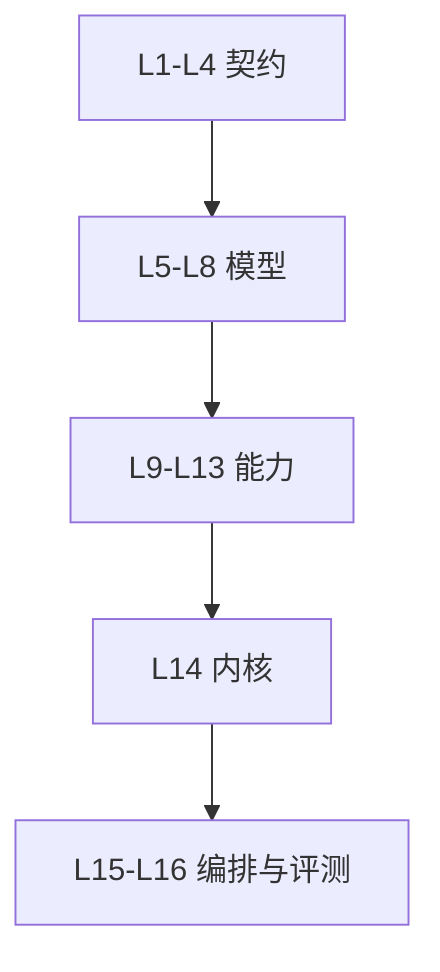

# AgentScope 新人上手指南（ONBOARDING）

> 源码 commit `f5e4d380`（2026-03-13），行号锚均经 grep/sed 核实；图谱基座 `.understand-anything/knowledge-graph.json`（557 节点/1554 边）。

## 1. 一图看懂

AgentScope 是阿里通义开源的生产级多智能体框架：释放 LLM 的推理与工具调用能力，而非用死板提示词约束智能体。一个 `ReActAgent` 开箱整合推理循环、工具调用（含 MCP）、长短期记忆、RAG 注入与自动记忆压缩；向下统一六家模型供应商，向上提供编排、会话持久化、tracing、评测与 RL 调优。

与 LangGraph 的差异在抽象取向：LangGraph 建模显式状态图，控制流由开发者画；AgentScope 走智能体自治——控制流在 `ReActAgent` 的 reasoning-acting 循环里（`src/agentscope/agent/_react_agent.py:432`），协作靠 `MsgHub` 广播与 pipeline 串联。相比 AutoGen 更强调单智能体完备能力面与生产工程配套；要"一个类拿到全功能智能体+可观测+RL 调优"选它。

## 2. 五分钟上手

```bash
pip install agentscope   # >=3.10（README.md:144）
export DASHSCOPE_API_KEY=sk-xxx
```

照抄 `examples/agent/react_agent/main.py`（:26 创建 agent）：

```python
toolkit = Toolkit()
toolkit.register_tool_function(execute_python_code)
agent = ReActAgent(
    name="Friday", sys_prompt="You are a helpful assistant.",
    model=DashScopeChatModel(model_name="qwen-max", stream=True),
    formatter=DashScopeChatFormatter(),   # 与 model 同厂商
    toolkit=toolkit, memory=InMemoryMemory())
msg = await agent(Msg("user", "帮我算 23*47", "user"))
```

三件套全部可注入（`src/agentscope/agent/_react_agent.py:177`）；工具 docstring 自动转 JSON schema；`agentscope.init(...)`（`src/agentscope/__init__.py:72`）可选接通 Studio/tracing。换供应商改两行：`OpenAIChatModel`（`src/agentscope/model/_openai_model.py:68`）配 `OpenAIChatFormatter`。

## 3. 架构总览（16 层）

206 个源文件被组织成 16 层、四块：



- **契约层 L1-L4**：`StateModule`（`src/agentscope/module/_state_module.py:20`）仿 PyTorch `state_dict`，可持久化体系的根抽象；`Msg`（`src/agentscope/message/_message_base.py:21`）统一三角色与七种内容块。
- **模型层 L5-L8**：formatter 七族转 API 方言；`ChatModelBase`（`src/agentscope/model/_model_base.py:13`）统一出口；embedding 五家。
- **能力层 L9-L13**：`Toolkit`（`src/agentscope/tool/_toolkit.py:117`）+MCP 四客户端；A2A 解析器；记忆双轨；RAG 与 realtime/TTS。
- **应用层 L14-L16**：`AgentBase`（`src/agentscope/agent/_agent_base.py:30`）三级内核；pipeline/session 编排；evaluate+tuner 收口。

## 4. 核心子系统深潜（agent / model / pipeline）

### 4.1 智能体内核

**钩子不是硬编码**：`_AgentMeta` 元类（`src/agentscope/agent/_agent_meta.py:147`）在类创建时把 `AgentBase` 三接口 `reply`/`observe`/`print`（`src/agentscope/agent/_agent_base.py:197` 起）包上钩子，`_ReActAgentMeta` 追加包装 `_reasoning`/`_acting`，共十档钩子位（`src/agentscope/agent/_react_agent_base.py:21`）。

`ReActAgent`（`src/agentscope/agent/_react_agent.py:98`）是全仓唯一维护的智能体：`CompressionConfig`（:107）驱动 token 超限自动压缩，旧消息以 `_MemoryMark.COMPRESSED`（:88）标记后排除出上下文；结构化输出靠 `generate_response` 工具产出 JSON 进回复 `metadata`。

### 4.2 模型层三件套

`ChatModelBase.__call__` 是唯一抽象出口（`src/agentscope/model/_model_base.py:39`），返回 `ChatResponse` 或异步流。**model 与 formatter 成对更换**：`OpenAIChatModel.__call__`（`src/agentscope/model/_openai_model.py:172`）吃 `OpenAIChatFormatter` 的方言输出。截断兜底在 `TruncatedFormatterBase`（`src/agentscope/formatter/_truncated_formatter_base.py:19`）。

### 4.3 编排：pipeline + MsgHub + session

`sequential_pipeline`（`src/agentscope/pipeline/_functional.py:10`）是顺序 await 链，`fanout_pipeline` 并发扇出。`MsgHub`（`src/agentscope/pipeline/_msghub.py:14`）让一组 agent 共享广播：任一回复经 `_broadcast_to_subscribers`（`src/agentscope/agent/_agent_base.py:469`）入全员记忆。会话恢复走 `SessionBase`（`src/agentscope/session/_session_base.py:12`）收任意 StateModule。

## 5. 一次调用的生命周期

以 `await agent(Msg("user", "问题", "user"))` 为例：

1. **入口**：`AgentBase.__call__`（`src/agentscope/agent/_agent_base.py:448`）记录 task 供中断，调 `self.reply`。
2. **入账检索**：`ReActAgent.reply`（`src/agentscope/agent/_react_agent.py:376`）先入记忆，再长期记忆（:878）与 RAG 检索（:904）拼上下文。
3. **循环**：`for _ in range(self.max_iters)`（:432），每轮先检查记忆压缩。
4. **推理**：`_reasoning`（:540）把 PlanNotebook 提示入记忆，`formatter.format`（:554）转方言后调 `self.model(...)`（:568）。
5. **行动**：每个 `tool_use` 块起 `_acting` 协程（:655），`parallel_tool_calls` 时 gather 并发；`toolkit.call_tool_function`（:683）校验参数、过中间件、执行并落账（:712）。
6. **出口**：无工具调用即返回；`max_iters` 耗尽则 `_summarizing` 总结；`__call__` 的 finally 广播给 MsgHub 订阅者。

## 6. 关键设计决策

- **formatter 隔离方言**：供应商差异全在 formatter 层（七族×2 变体），model 只管收发；新增供应商=三件套。
- **核心库只养一个智能体**：CONTRIBUTING.md:205 明确只维护 `ReActAgent`，专用智能体走 examples-first；实现文件下划线私有，公开 API 经 `__init__.py` re-export（`src/agentscope/agent/__init__.py:5`）；lazy import 硬约束（:114）。
- **tuner=agent learning**：`tune()`（`src/agentscope/tuner/_tune.py:16`）转接 Trinity-RFT 做 RL/SFT，训练 `ReActAgent` 的使用轨迹；旧名 `agentscope.tune` 导入即 raise（`src/agentscope/tune/__init__.py:4`）。
- **A2A 子包与 pip 包 a2a-sdk 同名**：仓内 `agentscope/a2a/` 与外部 SDK 顶层模块 `a2a` 字面相同，TYPE_CHECKING 双写占位规避运行时依赖（`src/agentscope/a2a/_base.py:7-9`），真实导入延迟到 `A2AAgent.__init__`（`src/agentscope/agent/_a2a_agent.py:76`）。
- **状态即 state_dict**：`__setattr__` 拦截自动登记嵌套子状态（`src/agentscope/module/_state_module.py:29`），session 能一锅端保存整个智能体。

## 7. 坑与勘误

以下 10 条全部源码实证：

1. **a2a 同名碰撞**：sys.path 塞入 `src/agentscope` 调试时 `import a2a` 撞本仓子包（`src/agentscope/a2a/_base.py:9` 字符串占位实证）。
2. **抽象基类不强制**：`@abstractmethod` 无 ABCMeta 兜底（`src/agentscope/a2a/_base.py:18`），忘实现不会实例化时报错（同款 `src/agentscope/embedding/_cache_base.py:12`）。
3. **Nacos 走 v2 命名空间**：导入根 `v2.nacos.*`（`src/agentscope/a2a/_nacos_resolver.py:67`）需 nacos-sdk-python 3.x，旧 SDK 必败。
4. **两处版本钉死**：`qdrant-client==1.15.1`（`pyproject.toml:120`，防 pymilvus 冲突）、`pypdf<=6.5.0`（`pyproject.toml:92-94`，避上游 bug）。
5. **write_text_file 替换后重新 readlines** 防行数误算（`src/agentscope/tool/_text_file/_write_text_file.py:188-191`）。
6. **execute_python_code 无沙箱**：钉 `PYTHONUTF8=1`（`src/agentscope/tool/_coding/_python.py:44-45`）保中文输出。
7. **Gemini realtime 的 API key 拼进 URL**（`src/agentscope/realtime/_gemini_realtime_model.py:85`），日志打印连接串会泄漏密钥。
8. **ACEBench 只启子集**：data_zh+2 个 data_agent 在册，data_normal/special 注释预留（`src/agentscope/evaluate/_ace_benchmark/_ace_benchmark.py:29`）。
9. **ACE 工具边角**：余额判定用 `>=`（`src/agentscope/evaluate/_ace_benchmark/_ace_tools_api/_food_platform_api.py:234`）余额恰等于总价被拒；新短信无 `time` 键（`src/agentscope/evaluate/_ace_benchmark/_ace_tools_api/_message_api.py:157-161`）。
10. **两条小坑**：有状态 MCP 客户端须 LIFO 关闭（`src/agentscope/mcp/_http_stateful_client.py:24`）；`DocMetadata` 混入 dashscope `DictMixin`（`src/agentscope/rag/_document.py:7`）。

## 8. 延伸阅读

15 步 tour 挑 6 步：**Step 6 ReAct 内核**（全仓最核心代码）；**Step 5 formatter 与截断**；**Step 7-8 Toolkit 与 MCP**；**Step 9 记忆与计划**；**Step 11 编排与会话**；**Step 15 评测与调优**（agent learning 入口）。

DeepWiki 快照在 `../deepwiki/`（40 页 100%，INDEX.md 入口）：2.1 Agent & ReAct Loop、3.2 Formatters、4.3 MCP、6.3 Long-term Memory 与本篇互证。其第 7/8 章（后端与 Web UI）属上游完整仓，本仓 `src/` 只有框架本体。

---

**自报**：不计空格 5,990 字；锚 55 个（42 全路径+13 短形式，均经源码复核）；8 节齐全。
