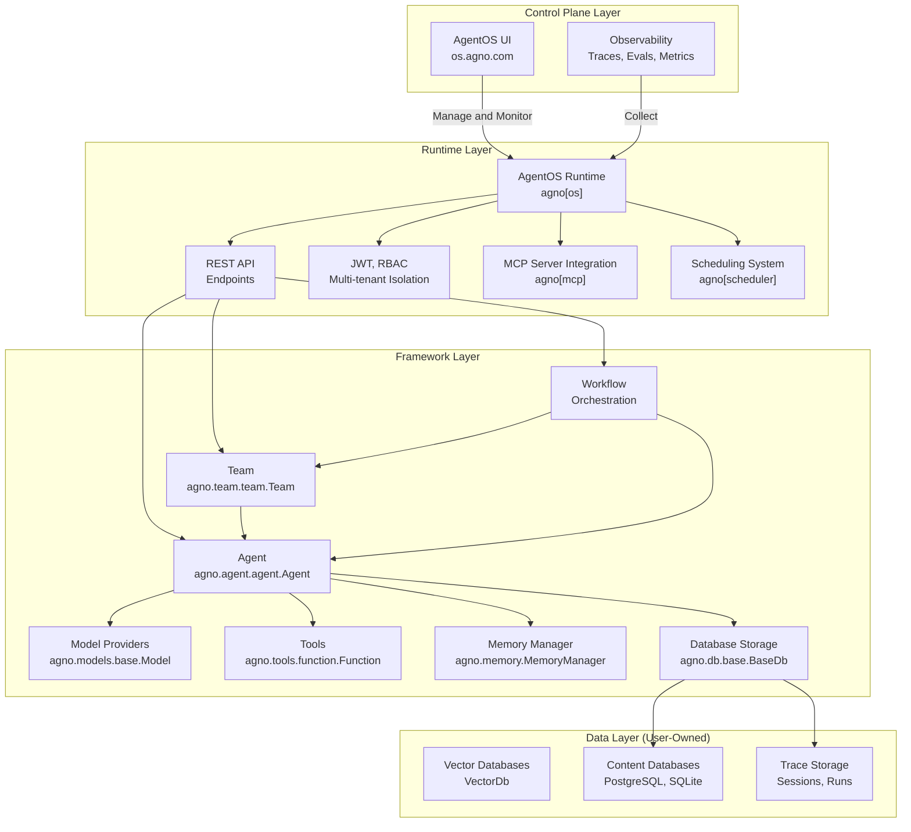
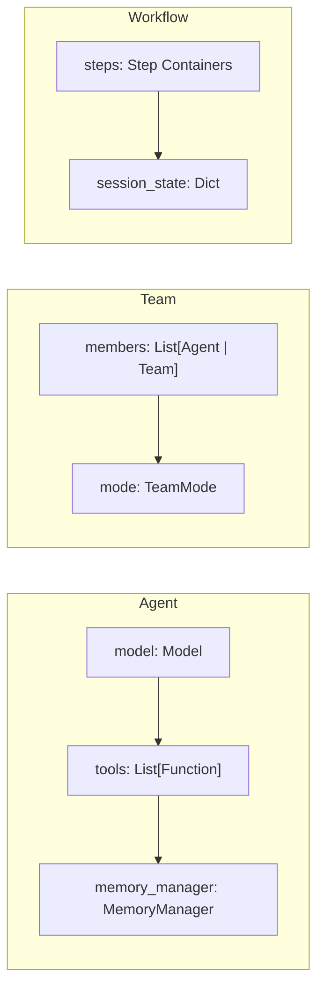

<!-- source: DeepWiki mcp.deepwiki.com · repo agno-agi/agno · page 1 Overview · fetched 2026-11-09 -->

# Overview

Relevant source files

The following files were used as context for generating this wiki page:

- [.cursorrules](.cursorrules)
- [.github/pull_request_template.md](.github/pull_request_template.md)
- [.github/workflows/claude.yml](.github/workflows/claude.yml)
- [.github/workflows/pr-triage.yml](.github/workflows/pr-triage.yml)
- [.gitignore](.gitignore)
- [AGENTS.md](AGENTS.md)
- [CLAUDE.md](CLAUDE.md)
- [CONTRIBUTING.md](CONTRIBUTING.md)
- [README.md](README.md)
- [cookbook/07_knowledge/02_building_blocks/README.md](cookbook/07_knowledge/02_building_blocks/README.md)
- [cookbook/07_knowledge/05_integrations/README.md](cookbook/07_knowledge/05_integrations/README.md)
- [cookbook/07_knowledge/05_integrations/vector_dbs/05_scylladb.py](cookbook/07_knowledge/05_integrations/vector_dbs/05_scylladb.py)
- [cookbook/README.md](cookbook/README.md)
- [libs/agno/agno/agent/agent.py](libs/agno/agno/agent/agent.py)
- [libs/agno/agno/models/base.py](libs/agno/agno/models/base.py)
- [libs/agno/agno/models/message.py](libs/agno/agno/models/message.py)
- [libs/agno/agno/models/response.py](libs/agno/agno/models/response.py)
- [libs/agno/agno/run/agent.py](libs/agno/agno/run/agent.py)
- [libs/agno/agno/run/base.py](libs/agno/agno/run/base.py)
- [libs/agno/agno/run/team.py](libs/agno/agno/run/team.py)
- [libs/agno/agno/team/team.py](libs/agno/agno/team/team.py)
- [libs/agno/agno/tools/function.py](libs/agno/agno/tools/function.py)
- [libs/agno/agno/tools/reasoning.py](libs/agno/agno/tools/reasoning.py)
- [libs/agno/agno/utils/events.py](libs/agno/agno/utils/events.py)
- [libs/agno/pyproject.toml](libs/agno/pyproject.toml)
- [libs/agno/tests/integration/agent/test_event_streaming.py](libs/agno/tests/integration/agent/test_event_streaming.py)
- [libs/agno/tests/integration/teams/test_event_streaming.py](libs/agno/tests/integration/teams/test_event_streaming.py)
- [libs/agno/tests/unit/agent/test_paused_user_input_persistence.py](libs/agno/tests/unit/agent/test_paused_user_input_persistence.py)
- [libs/agno/tests/unit/run/test_run_events.py](libs/agno/tests/unit/run/test_run_events.py)
- [libs/agno/tests/unit/run/test_run_input.py](libs/agno/tests/unit/run/test_run_input.py)
- [libs/agno/tests/unit/tools/test_functions.py](libs/agno/tests/unit/tools/test_functions.py)
- [libs/agno_infra/agno/cli/infra_cli.py](libs/agno_infra/agno/cli/infra_cli.py)
- [libs/agno_infra/agno/infra/enums.py](libs/agno_infra/agno/infra/enums.py)
- [libs/agno_infra/agno/infra/operator.py](libs/agno_infra/agno/infra/operator.py)
- [scripts/demo_setup.sh](scripts/demo_setup.sh)
- [scripts/dev_setup.sh](scripts/dev_setup.sh)

This document introduces the Agno framework, its three-layer architecture, and core design principles. It provides a high-level understanding of how Agno enables building, deploying, and managing AI agent systems at scale.

For hands-on examples, see [Quick Start Guide](#1.1). For detailed architectural patterns, see [Architecture Overview](#1.2). For definitions of core terms, see [Key Concepts and Terminology](#1.3).

Sources: [README.md:15-23](), [libs/agno/pyproject.toml:1-12]()

## What is Agno

Agno is a framework and runtime for agent platforms, allowing users to build, run, and manage agent systems [README.md:15-18](). It provides the building blocks to create AI agents, coordinate them into teams, and orchestrate them through multi-step workflows. It then serves those systems in production as stateless, session-scoped APIs with built-in monitoring and management capabilities [README.md:19-23]().

The framework addresses fundamental requirements for production agentic software:

1. **Framework Agnostic**: Build agents using the Agno SDK or integrate existing agents from other frameworks like the Claude Agent SDK, LangGraph, or DSPy via adapters [README.md:19](), [libs/agno/pyproject.toml:77](), [libs/agno/pyproject.toml:95-96]().
2. **Production Runtime**: Run agents as production services with tracing, scheduling, and RBAC via the `AgentOS` runtime [README.md:20](), [libs/agno/pyproject.toml:81]().
3. **Dynamic Governance**: Agno provides approval workflows and human-in-the-loop controls for sensitive tool executions using `ToolExecution` states and `requires_confirmation` flags [README.md:67](), [libs/agno/agno/models/base.py:44](), [libs/agno/agno/tools/function.py:34-45]().
4. **Integrated Learning**: Agents can persist user profiles, memories, and learned knowledge across sessions using the `LearningMachine` [README.md:64](), [libs/agno/agno/agent/agent.py:49](), [libs/agno/agno/agent/agent.py:131-137]().

Sources: [README.md:15-73](), [libs/agno/pyproject.toml:1-96](), [libs/agno/agno/agent/agent.py:43-137]()

## Three-Layer Architecture

Agno separates concerns into three distinct layers, each serving a specific role in the system lifecycle. For details, see [Architecture Overview](#1.2).

Title: Agno Three-Layer Architecture  
Sources: [README.md:17-30](), [libs/agno/pyproject.toml:80-85](), [libs/agno/agno/agent/agent.py:80-160]()

### Framework Layer

The framework layer provides building blocks for creating agentic systems. Core classes include `Agent` [libs/agno/agno/agent/agent.py:81](), `Team` [libs/agno/agno/team/team.py:83](), and `Function` [libs/agno/agno/tools/function.py:4](). These primitives share common infrastructure for model access via the `Model` base class [libs/agno/agno/models/base.py:134](), tool execution via `Function`, and persistence.

Sources: [libs/agno/agno/agent/agent.py:80-160](), [libs/agno/agno/team/team.py:83-125](), [libs/agno/agno/models/base.py:134-150]()

### Runtime Layer

The runtime layer (`AgentOS`) serves agents, teams, and workflows as production APIs [README.md:20](). It handles stateless execution, session persistence (`AgentSession`, `TeamSession`, `WorkflowSession`), JWT-based RBAC security, and built-in protocol interfaces [README.md:20](), [libs/agno/pyproject.toml:81](), [libs/agno/agno/agent/agent.py:71]().

Sources: [README.md:20-28](), [libs/agno/pyproject.toml:80-85](), [libs/agno/agno/agent/agent.py:71-72]()

### Control Plane Layer

The control plane ([os.agno.com](https://os.agno.com)) provides a web interface for testing, monitoring, and managing deployed systems [README.md:29](). It connects to running `AgentOS` instances to inspect traces, manage sessions, evaluate performance, and handle human approval requests [README.md:29](), [libs/agno/agno/models/base.py:44-57]().

Sources: [README.md:29-30](), [libs/agno/agno/models/base.py:44-57]()

## Core Orchestration Primitives

Agno provides core primitives to handle single-agent reasoning, multi-agent teams, and structured workflows. For full definitions, see [Key Concepts and Terminology](#1.3).

Title: Agno Orchestration Primitives  
Sources: [libs/agno/agno/agent/agent.py:80-142](), [libs/agno/agno/team/team.py:83-125]()

### Agent, Team, and Workflow

- **Agent**: Represents a single AI unit configured with a model, tools, prompt instructions, and memory management [libs/agno/agno/agent/agent.py:80-142]().
- **Team**: Coordinates multiple agents or sub-teams using specific team modes (e.g., autonomous task loops, leader routing) [libs/agno/agno/team/team.py:83-125]().
- **Workflow**: Orchestrates complex multi-step execution graphs with conditional branching, loops, and parallel steps.

Sources: [libs/agno/agno/agent/agent.py:80-142](), [libs/agno/agno/team/team.py:83-125]()

## Getting Started and Next Steps

To begin building with Agno:
- For minimal code examples, see the [Quick Start Guide](#1.1).
- For deep architectural insights, see [Architecture Overview](#1.2).
- For complete terminology definitions, see [Key Concepts and Terminology](#1.3).

Sources: [README.md:31-82]()

---

