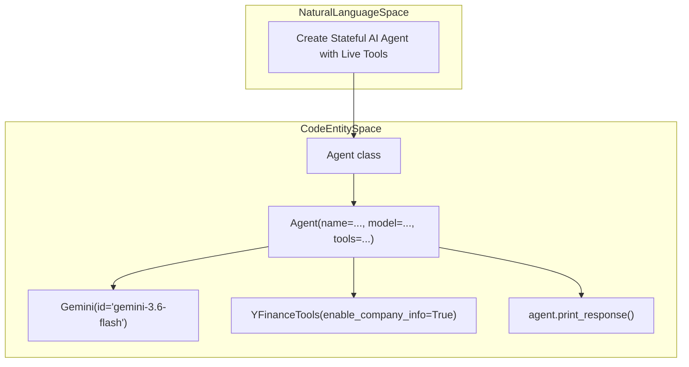
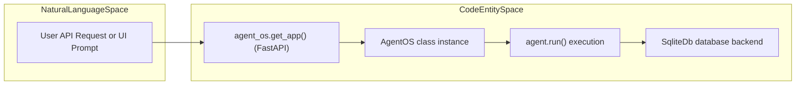
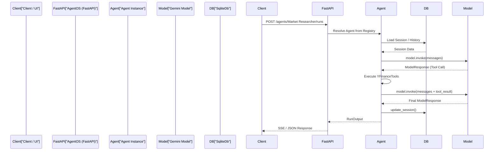

<!-- source: DeepWiki mcp.deepwiki.com · repo agno-agi/agno · page 1.1 Quick Start Guide · fetched 2026-11-09 -->

# Quick Start Guide

<details>
<summary>Relevant source files</summary>

The following files were used as context for generating this wiki page:

- [cookbook/00_quickstart/README.md](cookbook/00_quickstart/README.md)
- [cookbook/00_quickstart/TEST_LOG.md](cookbook/00_quickstart/TEST_LOG.md)
- [cookbook/00_quickstart/agent_search_over_knowledge.py](cookbook/00_quickstart/agent_search_over_knowledge.py)
- [cookbook/00_quickstart/agent_with_guardrails.py](cookbook/00_quickstart/agent_with_guardrails.py)
- [cookbook/00_quickstart/agent_with_memory.py](cookbook/00_quickstart/agent_with_memory.py)
- [cookbook/00_quickstart/agent_with_state_management.py](cookbook/00_quickstart/agent_with_state_management.py)
- [cookbook/00_quickstart/agent_with_storage.py](cookbook/00_quickstart/agent_with_storage.py)
- [cookbook/00_quickstart/agent_with_structured_output.py](cookbook/00_quickstart/agent_with_structured_output.py)
- [cookbook/00_quickstart/agent_with_tools.py](cookbook/00_quickstart/agent_with_tools.py)
- [cookbook/00_quickstart/agent_with_typed_input_output.py](cookbook/00_quickstart/agent_with_typed_input_output.py)
- [cookbook/01_demo/README.md](cookbook/01_demo/README.md)
- [cookbook/01_demo/TEST_LOG.md](cookbook/01_demo/TEST_LOG.md)
- [cookbook/01_demo/agents/code_search.py](cookbook/01_demo/agents/code_search.py)
- [cookbook/01_demo/agents/git_wiki.py](cookbook/01_demo/agents/git_wiki.py)
- [cookbook/01_demo/agents/local_wiki.py](cookbook/01_demo/agents/local_wiki.py)
- [cookbook/01_demo/agents/notion_wiki.py](cookbook/01_demo/agents/notion_wiki.py)
- [cookbook/01_demo/config.yaml](cookbook/01_demo/config.yaml)
- [cookbook/01_demo/db.py](cookbook/01_demo/db.py)
- [cookbook/01_demo/evals/cases.py](cookbook/01_demo/evals/cases.py)
- [cookbook/01_demo/generate_requirements.sh](cookbook/01_demo/generate_requirements.sh)
- [cookbook/01_demo/requirements.in](cookbook/01_demo/requirements.in)
- [cookbook/01_demo/requirements.txt](cookbook/01_demo/requirements.txt)
- [cookbook/01_demo/run.py](cookbook/01_demo/run.py)
- [cookbook/03_teams/02_modes/broadcast/04_structured_debate.py](cookbook/03_teams/02_modes/broadcast/04_structured_debate.py)

</details>


This page provides the minimal code examples required to create a stateful, tool-using agent using `Agent`, run it locally or via the production-ready `AgentOS` runtime, and connect it to the Control Plane UI. 

For detailed system architecture, see **Architecture Overview (1.2)**. For terminology and core concepts, see **Key Concepts and Terminology (1.3)**. For comprehensive agent configuration options, see **Agent System (2.1)**.

Sources: `[cookbook/00_quickstart/README.md:1-40]()`, `[cookbook/01_demo/run.py:1-29]()`

---

## Installation

Install Agno with the AgentOS runtime and your preferred model provider dependencies:

```bash
pip install -U 'agno[os]'
```

The `os` extra bundle includes `fastapi`, `uvicorn`, `websockets`, `sqlalchemy`, `PyJWT`, and `opentelemetry-sdk` required for production deployment and API hosting.

Sources: `[cookbook/01_demo/requirements.txt:3-3]()`, `[cookbook/00_quickstart/README.md:20-25]()`

---

## Creating Your First Agent

The most common starting point is a tool-enabled agent that can act on live data. Create an agent instance utilizing `Agent`, `Gemini`, and `YFinanceTools` `[cookbook/00_quickstart/agent_with_tools.py:26-45]()`.

```python
from agno.agent import Agent
from agno.models.google import Gemini
from agno.tools.yfinance import YFinanceTools

# 1. Define the Agent
agent = Agent(
    name="Market Researcher",
    model=Gemini(id="gemini-3.6-flash"),
    instructions=[
        "Use Yahoo Finance for facts that can change.",
        "Lead with the answer, then show the evidence.",
        "Use a table when comparing companies.",
    ],
    tools=[YFinanceTools(enable_company_info=True, enable_stock_fundamentals=True)],
    markdown=True,
)

# 2. Run the Agent (Local CLI)
if __name__ == "__main__":
    agent.print_response("What is the current price of NVDA?", stream=True)
```

### Natural Language Space to Code Entity Space: Agent Construction

The diagram below maps natural language intent to the concrete Python code entities (`Agent`, `Gemini`, `YFinanceTools`) that implement them.


Sources: `[cookbook/00_quickstart/agent_with_tools.py:19-54]()`

### Component Breakdown

| Class/Parameter | Purpose |
|-----------------|---------|
| `Agent` | Core class for creating autonomous entities with models, tools, and memory `[cookbook/00_quickstart/agent_with_tools.py:26-45]()`. |
| `Gemini` | Implementation of the `Model` interface for Google's Gemini API `[cookbook/00_quickstart/agent_with_tools.py:28-28]()`. |
| `tools` | List of toolkits or functions (e.g., `YFinanceTools`) provided to the model `[cookbook/00_quickstart/agent_with_tools.py:36-42]()`. |
| `instructions` | Defines agent persona and behavior rules `[cookbook/00_quickstart/agent_with_tools.py:29-35]()`. |
| `print_response` | Helper to execute the agent and stream output to the console `[cookbook/00_quickstart/agent_with_tools.py:51-54]()`. |

Sources: `[cookbook/00_quickstart/agent_with_tools.py:19-54]()`, `[cookbook/00_quickstart/README.md:29-40]()`

---

## Serving with AgentOS

To move from a local script to a production service, use the `AgentOS` runtime. This provides a REST API, session persistence via `SqliteDb`, and UI connectivity.

```python
from agno.agent import Agent
from agno.models.google import Gemini
from agno.os import AgentOS
from agno.db.sqlite import SqliteDb

# Define the agent with Gemini model
agent = Agent(name="Market Researcher", model=Gemini(id="gemini-3.6-flash"))

# Create the AgentOS runtime, register the agent, and set up the SQLite database
agent_os = AgentOS(
    agents=[agent], 
    db=SqliteDb(db_file="tmp/quickstart/agent_os.db"),
    tracing=True
)

# Obtain the FastAPI ASGI application
app = agent_os.get_app()
```

Run the server with FastAPI CLI:

```bash
export GOOGLE_API_KEY=your-key
fastapi dev run.py --port 7777
```

Sources: `[cookbook/01_demo/run.py:60-75]()`, `[cookbook/00_quickstart/README.md:118-122]()`

---

## Natural Language Space to Code Entity Space: AgentOS Runtime


Sources: `[cookbook/01_demo/run.py:25-75]()`

---

## Execution Flow: From HTTP Request to Agent Response


Sources: `[cookbook/01_demo/run.py:60-71]()`, `[cookbook/00_quickstart/README.md:118-127]()`

---

## Connecting to the AgentOS UI

The AgentOS Control Plane UI at [os.agno.com](https://os.agno.com) serves as the dashboard for managing instances, viewing run traces, and inspecting stored memories.

1. Open [os.agno.com](https://os.agno.com).
2. Click **"Add OS"** and choose **"Local"**.
3. Enter your running server endpoint (e.g., `http://localhost:7777`).
4. Select your agent and begin interacting.

Sources: `[cookbook/00_quickstart/README.md:124-127]()`, `[cookbook/01_demo/README.md:49-58]()`

---

## The Capability Ladder

Agno is organized as a progressive capability ladder:

| Feature | Cookbook Example | Description |
|---------|------------------|-------------|
| **Tools** | `agent_with_tools.py` | Enable live data interaction with toolkit integration `[cookbook/00_quickstart/agent_with_tools.py]()`. |
| **Structured Output** | `agent_with_structured_output.py` | Return validated typed objects for robust parsing `[cookbook/00_quickstart/agent_with_structured_output.py]()`. |
| **Storage** | `agent_with_storage.py` | Persist conversation history to SQLite `[cookbook/00_quickstart/agent_with_storage.py]()`. |
| **Memory** | `agent_with_memory.py` | Long-term user-specific memory `[cookbook/00_quickstart/agent_with_memory.py]()`. |
| **Knowledge** | `agent_search_over_knowledge.py` | Retrieval-augmented generation grounded in documents `[cookbook/00_quickstart/agent_search_over_knowledge.py]()`. |
| **Learning** | `agent_with_learning.py` | Cross-user shared learning stores `[cookbook/00_quickstart/agent_with_learning.py]()`. |
| **Human-in-the-Loop** | `human_in_the_loop.py` | Pausing runs for sensitive actions `[cookbook/00_quickstart/human_in_the_loop.py]()`. |
| **Teams** | `multi_agent_team.py` | Multi-agent coordination `[cookbook/00_quickstart/multi_agent_team.py]()`. |
| **Workflows** | `sequential_workflow.py` | Explicit multi-step orchestration `[cookbook/00_quickstart/sequential_workflow.py]()`. |

Sources: `[cookbook/00_quickstart/README.md:51-87]()`, `[cookbook/00_quickstart/TEST_LOG.md:21-160]()`

---

