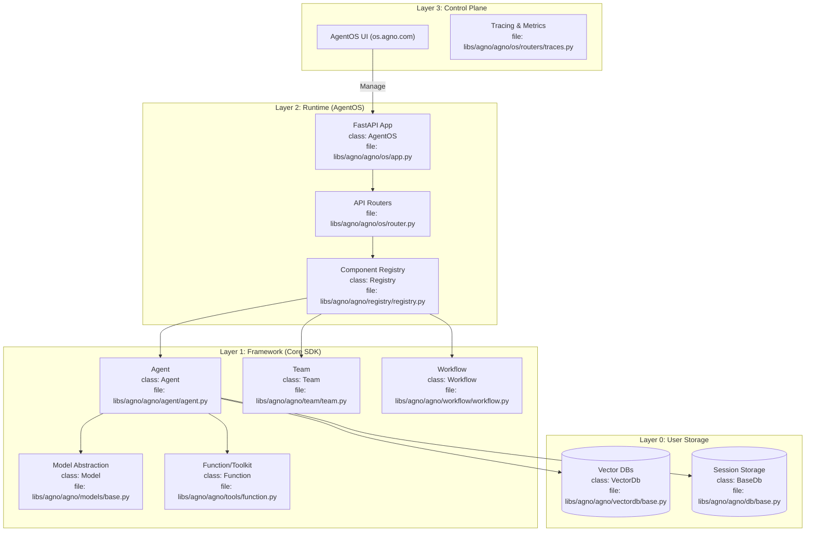
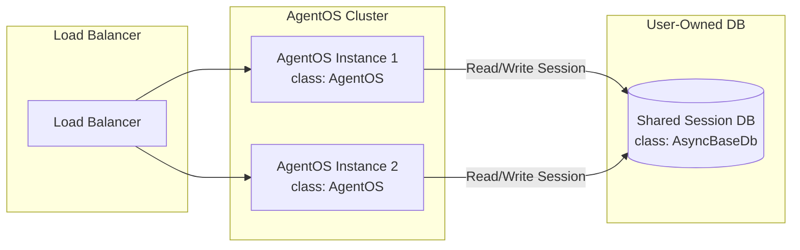
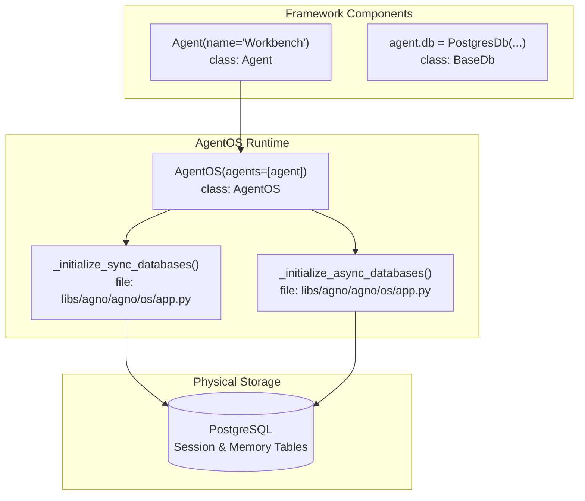

<!-- source: DeepWiki mcp.deepwiki.com · repo agno-agi/agno · page 1.2 Architecture Overview · fetched 2026-11-09 -->

# Architecture Overview

Relevant source files

The following files were used as context for generating this wiki page:

- [cookbook/05_agent_os/14_mcp/README.md](cookbook/05_agent_os/14_mcp/README.md)
- [cookbook/05_agent_os/14_mcp/TEST_LOG.md](cookbook/05_agent_os/14_mcp/TEST_LOG.md)
- [cookbook/05_agent_os/14_mcp/inspect_tools.py](cookbook/05_agent_os/14_mcp/inspect_tools.py)
- [libs/agno/agno/agent/agent.py](libs/agno/agno/agent/agent.py)
- [libs/agno/agno/models/base.py](libs/agno/agno/models/base.py)
- [libs/agno/agno/models/message.py](libs/agno/agno/models/message.py)
- [libs/agno/agno/models/response.py](libs/agno/agno/models/response.py)
- [libs/agno/agno/os/app.py](libs/agno/agno/os/app.py)
- [libs/agno/agno/os/config.py](libs/agno/agno/os/config.py)
- [libs/agno/agno/os/mcp.py](libs/agno/agno/os/mcp.py)
- [libs/agno/agno/os/middleware/mcp_routing.py](libs/agno/agno/os/middleware/mcp_routing.py)
- [libs/agno/agno/os/public/_policy.py](libs/agno/agno/os/public/_policy.py)
- [libs/agno/agno/os/router.py](libs/agno/agno/os/router.py)
- [libs/agno/agno/os/schema.py](libs/agno/agno/os/schema.py)
- [libs/agno/agno/run/agent.py](libs/agno/agno/run/agent.py)
- [libs/agno/agno/run/base.py](libs/agno/agno/run/base.py)
- [libs/agno/agno/run/team.py](libs/agno/agno/run/team.py)
- [libs/agno/agno/team/team.py](libs/agno/agno/team/team.py)
- [libs/agno/agno/tools/function.py](libs/agno/agno/tools/function.py)
- [libs/agno/agno/utils/events.py](libs/agno/agno/utils/events.py)
- [libs/agno/pyproject.toml](libs/agno/pyproject.toml)
- [libs/agno/tests/integration/agent/test_event_streaming.py](libs/agno/tests/integration/agent/test_event_streaming.py)
- [libs/agno/tests/integration/teams/test_event_streaming.py](libs/agno/tests/integration/teams/test_event_streaming.py)
- [libs/agno/tests/unit/agent/test_paused_user_input_persistence.py](libs/agno/tests/unit/agent/test_paused_user_input_persistence.py)
- [libs/agno/tests/unit/os/test_info_endpoint.py](libs/agno/tests/unit/os/test_info_endpoint.py)
- [libs/agno/tests/unit/os/test_mcp_routing.py](libs/agno/tests/unit/os/test_mcp_routing.py)
- [libs/agno/tests/unit/os/test_mcp_server.py](libs/agno/tests/unit/os/test_mcp_server.py)
- [libs/agno/tests/unit/run/test_run_events.py](libs/agno/tests/unit/run/test_run_events.py)
- [libs/agno/tests/unit/run/test_run_input.py](libs/agno/tests/unit/run/test_run_input.py)
- [libs/agno/tests/unit/tools/test_functions.py](libs/agno/tests/unit/tools/test_functions.py)

This document details the three-layer architecture of Agno, explaining its stateless runtime design, session-scoped execution, and user-owned storage model.

---

## Three-Layer Architecture

Agno is organized into three distinct layers, providing a separation between core logic, production serving, and management.

**Layer 3: Control Plane (AgentOS UI)**  
The management and observability layer. It provides a web interface at `os.agno.com` for monitoring agents, teams, and workflows, viewing session history, and evaluating runs [README.md:21-25](). It connects to running `AgentOS` instances to provide a unified dashboard for tracing and observability [libs/agno/agno/os/app.py:70-71]().

**Layer 2: Runtime (AgentOS)**  
The production serving layer. Implemented as the `AgentOS` class, it wraps framework components in a production-ready FastAPI application [libs/agno/agno/os/app.py:9-20, 77](). It handles REST/WebSocket routing, authentication, database auto-discovery, and lifecycle management for connections like MCP servers [libs/agno/agno/os/app.py:50-71, 100-110]().

**Layer 1: Framework (SDK)**  
The development layer. It provides the core building blocks: `Agent`, `Team`, `Workflow`, `Model`, and `Tool` [README.md:17-23](). These components define the logic, tools, memory, and knowledge of the AI system [libs/agno/agno/agent/agent.py:74-85](), [libs/agno/agno/team/team.py:81-99](), [libs/agno/agno/os/app.py:91]().

### Component Hierarchy and Data Flow

Title: Component Hierarchy and Data Flow across Agno Layers

Sources: [README.md:17-25, 42-53](), [libs/agno/agno/os/app.py:19-20, 50-71](), [libs/agno/agno/os/schema.py:7-32](), [libs/agno/agno/agent/agent.py:74-85](), [libs/agno/agno/team/team.py:81-99]()

---

## Stateless Runtime Design

The `AgentOS` runtime is designed to be stateless and horizontally scalable [README.md:59](). It does not hold session data in memory between requests by default, allowing any instance in a cluster to handle any request for a given `session_id` [libs/agno/agno/os/app.py:137-167]().

This stateless design means:

- The runtime treats every incoming request independently.
- State is loaded from and persisted to user-owned databases.
- In-flight and background persistence tasks are flushed on shutdown to prevent data loss [libs/agno/agno/os/app.py:137-167]().

### Request Lifecycle and State Loading

When a request arrives at an `AgentOS` instance:

1. **Registry Resolution**: The runtime identifies the component (`Agent`, `Team`, or `Workflow`) from the `Registry` using its unique ID [libs/agno/agno/os/app.py:65, 86]().

2. **Lifecycle Management**: `AgentOS` manages the lifespan of databases and external connections (like MCP) via async context managers [libs/agno/agno/os/app.py:100-121]().

3. **State Hydration**: If a `session_id` is provided, the framework component loads its history and `session_state` from the user's database [libs/agno/agno/os/utils.py:148-156]().

4. **Execution**: The component processes the input. For `Agent`, this involves model invocation and tool calling [libs/agno/agno/agent/agent.py:77, 128]().

5. **Persistence**: After execution, updated messages, metrics, and state are persisted back to the session database [libs/agno/agno/os/app.py:137-167]().

Title: Stateless Horizontal Scaling with Shared Session DB

Sources: [README.md:45, 59](), [libs/agno/agno/os/app.py:100-121, 137-167](), [libs/agno/agno/os/utils.py:142-168](), [libs/agno/agno/agent/agent.py:136]()

---

## Session-Scoped Execution

Each interaction with an `Agent`, `Team`, or `Workflow` is scoped to a session. The session captures conversation state, enabling persistent memory and context continuity between runs.

### Session State and History

- **`session_id`**: A unique identifier (typically a UUID) that scopes conversation state and history [libs/agno/agno/agent/agent.py:93](), [libs/agno/agno/os/utils.py:90]().

- **`session_state`**: An arbitrary dictionary persisted in the user's database to carry transient or custom state across runs [libs/agno/agno/agent/agent.py:95](), [libs/agno/agno/os/utils.py:148-155]().

- **History Management**: The system tracks previous interactions to craft context for subsequent runs. The `num_history_runs` parameter controls how much history is included in the context [libs/agno/agno/agent/agent.py:150]().

### Run Output and Events

Each execution produces structured outputs and may stream intermediate events for observability and interactive control.

- **`RunOutput`**: Represents the final result of a run including responses, status, and metadata [libs/agno/agno/run/agent.py:60](), [libs/agno/agno/models/base.py:45]().

- **`RunEvent`**: Streams detailed events during execution, such as model requests, tool calls, and run lifecycle events [libs/agno/agno/run/agent.py:59]().

- **Streaming Support**: The runtime supports Server-Sent Events (SSE) and WebSockets to enable clients to observe progress in real time [libs/agno/agno/os/app.py:51]().

Sources: [libs/agno/agno/os/schema.py:26](), [libs/agno/agno/os/utils.py:142-168](), [libs/agno/agno/run/agent.py:59-60](), [libs/agno/agno/agent/agent.py:93-95, 150]()

---

## User-Owned Storage Model

Agno adopts a "bring your own database" philosophy: user data such as sessions, memories, knowledge, and traces are stored in user-controlled infrastructure. This ensures data privacy and operational control [README.md:23, 51]().

### Key Storage Interfaces

- **`BaseDb` / `AsyncBaseDb`**: Abstract classes defining the interface for session, run, memory, and trace persistence [libs/agno/agno/db/base.py:36](), [libs/agno/agno/agent/agent.py:136]().

- **`Knowledge`**: Encapsulates the knowledge base with RAG (retrieval-augmented generation) capabilities, vector database integration, and content management [libs/agno/agno/knowledge/knowledge.py:24]().

- **AgentOS Database Auto-Discovery**: `AgentOS` scans and validates databases configured on startup, linking them with agents and sessions to ensure data consistency [libs/agno/agno/os/app.py:26-47]().

### Storage Data Flow Example

Title: Storage Database Initialization and Binding

Sources: [README.md:23, 51](), [libs/agno/agno/db/base.py:36](), [libs/agno/agno/os/app.py:26-47, 137-167](), [libs/agno/agno/agent/agent.py:136]()

---

## Request Processing and Security

### Authentication and Authorization

The `AgentOS` runtime offers built-in robust security mechanisms:

- **JWT-based RBAC**: Access control is enforced using JWT tokens and security keys to provide multi-tenant isolation and permissions [README.md:23, 56](), [libs/agno/agno/os/app.py:28]().

- **Authorization Configuration**: The `AuthorizationConfig` enables configuring scopes and rules governing access to agents, sessions, and resources [libs/agno/agno/os/app.py:28]().

### Human-in-the-Loop (HITL) Support

Agno supports workflows and tools requiring manual user intervention:

- The `requires_confirmation` flag on tools enables runs to pause and wait for explicit user approval before continuing execution [libs/agno/agno/tools/function.py:33](), [libs/agno/agno/agent/agent.py:144]().

- A dedicated approvals router manages paused runs, confirmation workflows, and resumes after approval, all integrated into AgentOS REST endpoints [libs/agno/agno/os/app.py:53]().

Sources: [README.md:23, 56](), [libs/agno/agno/os/app.py:28, 53](), [libs/agno/agno/tools/function.py:33](), [libs/agno/agno/agent/agent.py:144]()

---

This architecture supports scalable, manageable, and secure deployment of AI agent platforms, enabling developers to build complex AI workflows with full control over data and execution.

---

