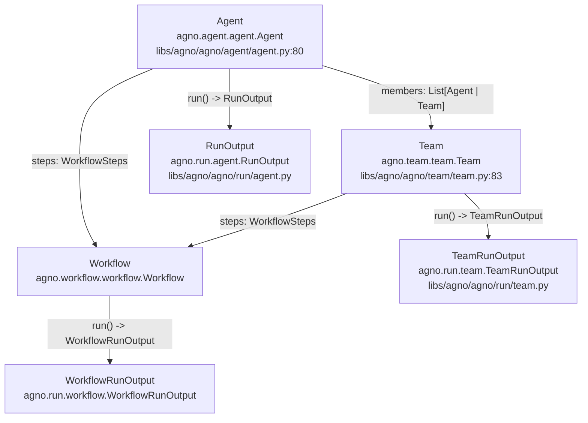
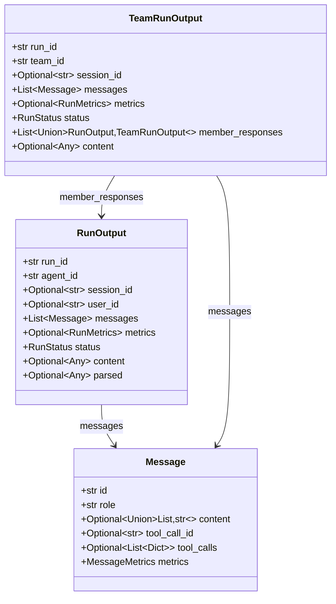

<!-- source: DeepWiki mcp.deepwiki.com · repo agno-agi/agno · page 1.3 Key Concepts and Terminology · fetched 2026-11-09 -->

# Key Concepts and Terminology

<details>
<summary>Relevant source files</summary>

The following files were used as context for generating this wiki page:

- [libs/agno/agno/agent/agent.py](libs/agno/agno/agent/agent.py)
- [libs/agno/agno/models/base.py](libs/agno/agno/models/base.py)
- [libs/agno/agno/models/message.py](libs/agno/agno/models/message.py)
- [libs/agno/agno/models/response.py](libs/agno/agno/models/response.py)
- [libs/agno/agno/run/agent.py](libs/agno/agno/run/agent.py)
- [libs/agno/agno/run/base.py](libs/agno/agno/run/base.py)
- [libs/agno/agno/run/team.py](libs/agno/agno/run/team.py)
- [libs/agno/agno/team/team.py](libs/agno/agno/team/team.py)
- [libs/agno/agno/tools/function.py](libs/agno/agno/tools/function.py)
- [libs/agno/agno/utils/events.py](libs/agno/agno/utils/events.py)
- [libs/agno/pyproject.toml](libs/agno/pyproject.toml)
- [libs/agno/tests/integration/agent/test_event_streaming.py](libs/agno/tests/integration/agent/test_event_streaming.py)
- [libs/agno/tests/integration/teams/test_event_streaming.py](libs/agno/tests/integration/teams/test_event_streaming.py)
- [libs/agno/tests/unit/agent/test_paused_user_input_persistence.py](libs/agno/tests/unit/agent/test_paused_user_input_persistence.py)
- [libs/agno/tests/unit/run/test_run_events.py](libs/agno/tests/unit/run/test_run_events.py)
- [libs/agno/tests/unit/run/test_run_input.py](libs/agno/tests/unit/run/test_run_input.py)
- [libs/agno/tests/unit/tools/test_functions.py](libs/agno/tests/unit/tools/test_functions.py)

</details>


## Purpose and Scope

This document defines the core abstractions and terminology used throughout the Agno framework. It serves as a comprehensive technical reference for understanding the fundamental building blocks that compose the system, from atomic execution units (`Agent`) to production deployment runtime (`AgentOS`).

For detailed implementation of specific components refer to their dedicated pages:  
- Agent system and lifecycle → [2.1 Agent System]()  
- Team orchestration → [2.2 Team Orchestration]()  
- Workflow engine → [2.3 Workflow System]()  
- Session persistence → [2.7 Session Management]()  
- Memory and learning → [2.8 Memory and Learning Systems]()  
- Knowledge management and RAG → [5.1 Knowledge Base and Agentic RAG]()  
- Tool definitions and execution → [4.1 Tool Architecture and Function Class]()  
- Production runtime → [7.1 AgentOS Architecture and Initialization]()

---

## Core Execution Units

Agno structures agentic software with three hierarchical execution units: **Agent**, **Team**, and **Workflow**, each building on top of the previous for increasing coordination complexity.

### Diagram: Core Execution Units and Code Mapping (Natural Language to Code Entity Space)



Sources: [libs/agno/agno/agent/agent.py:80](), [libs/agno/agno/team/team.py:83](), [libs/agno/agno/run/agent.py:1]()

---

### Agent

- **Class:** `agno.agent.agent.Agent`  
- **File:** [libs/agno/agno/agent/agent.py:80]()  

**Description:**  
The atomic execution unit in Agno. An `Agent` wraps a large language model (`Model`) instance, augmented by tools, memory, knowledge bases, guardrails, session management, and lifecycle hooks. It exposes synchronous and asynchronous run methods (`run()`, `arun()`) that accept raw user inputs, orchestrate multi-turn reasoning and tool execution loops, and return structured outputs.

**Key Attributes and Their Roles:**

| Attribute                     | Type                                   | Default   | Purpose                                                       |
|-------------------------------|--------------------------------------|-----------|---------------------------------------------------------------|
| `model`                       | `Optional[Model]`                     | `None`    | The primary LLM model the agent uses for inference.           |
| `name`                        | `Optional[str]`                      | `None`    | Human-readable name of the agent instance.                    |
| `id`                          | `Optional[str]`                      | `None`    | UUID for the agent (auto-generated if not set).               |
| `tools`                       | `Optional[List[Union[Toolkit, Callable, Dict, Function]]]` | `None` | Callable toolkits or functions integrated into this agent.    |
| `memory_manager`              | `Optional[MemoryManager]`             | `None`    | Component responsible for storing and retrieving memories.     |
| `knowledge`                  | `Optional[KnowledgeProtocol]`          | `None`    | Interface to knowledge base for retrieval-augmented generation (RAG). |
| `db`                         | `Optional[Union[BaseDb, AsyncBaseDb]]` | `None`   | Persistence backend for sessions, runs, memories, etc.         |
| `session_id`                 | `Optional[str]`                      | `None`    | Default session context for stateless run isolation.           |
| `session_state`              | `Optional[Dict[str, Any]]`            | `None`    | Mutable state dictionary associated with the session.          |
| `user_id`                    | `Optional[str]`                      | `None`    | User scoping identifier.                                        |
| `add_history_to_context`     | `bool`                              | `False`   | Whether to inject historical conversation content into context. |
| `num_history_runs`           | `Optional[int]`                     | `None`    | Number of past runs' contents to include in context.           |

Agents encapsulate prompt construction, tool calls, memory lookups, knowledge retrieval, run checkpointing, and result aggregation.

Sources: [libs/agno/agno/agent/agent.py:80-179]()

---

### Team

- **Class:** `agno.team.team.Team`  
- **File:** [libs/agno/agno/team/team.py:83]()  

**Description:**  
A `Team` is a multi-agent orchestration unit consisting of multiple member `Agent` or nested `Team` instances, coordinated by a leader model (`model`). Teams coordinate task delegation among members, combine their outputs according to different execution modes (`TeamMode`), and maintain session and context state. This enables complex distributed agent workflows mimicking organizational structures.

**Key Attributes:**

| Attribute                 | Type                                   | Default | Purpose                                                           |
|---------------------------|--------------------------------------|---------|-------------------------------------------------------------------|
| `members`                | `Union[List[Union[Agent, Team]], Callable]` | Required | Member agents or subteams forming this Team.                     |
| `model`                  | `Optional[Model]`                     | `None`    | The leader model to coordinate and delegate tasks.                |
| `mode`                   | `Optional[TeamMode]`                  | `None`    | Mode controlling delegation strategy and response synthesis.     |
| `delegate_to_all_members` | `bool`                              | `False`   | Whether to run all members concurrently without leader filtering. |
| `respond_directly`       | `bool`                              | `False`   | Return raw member outputs directly, skipping leader synthesis.    |
| `share_member_interactions` | `bool`                            | `False`   | Share member responses during task execution with other members.  |
| `add_team_history_to_members` | `bool`                         | `False`   | Include team history context when invoking member agents.         |

Teams run asynchronously or synchronously and return a consolidated result including member outputs and run events.

Sources: [libs/agno/agno/team/team.py:83-150]()

---

### Workflow

- **Class:** `agno.workflow.workflow.Workflow`  

**Description:**  
A `Workflow` orchestrates complex multi-step processes by chaining together sequences of steps. Steps can be `Agent` instances, `Team` instances, or custom Python callables/containers (`Step`, `Steps`, `Parallel`, `Loop`, `Condition`, `Router`). Workflows manage dependencies, branching, loops, human-in-the-loop patterns, and control flows using metadata and session context injection.

Sources: [libs/agno/agno/agent/agent.py:64]()

---

## Execution Results and Events

All execution units produce structured output classes capturing state, content, logs, metrics, and events.

### Diagram: Run Output and Event Hierarchy (Code Structure)



Sources: [libs/agno/agno/run/agent.py:40](), [libs/agno/agno/run/team.py:28](), [libs/agno/agno/models/message.py:56]()

---

### RunOutput

- **Class:** `agno.run.agent.RunOutput`  
- **File:** [libs/agno/agno/run/agent.py:1]()  

**Description:**  
The primary output container returned from an `Agent.run()` or `Agent.arun()` call. Contains conversation `messages`, execution `metrics`, run `status`, and optional structured content and parsed representations.

### TeamRunOutput

- **Class:** `agno.run.team.TeamRunOutput`  
- **File:** [libs/agno/agno/run/team.py:28]()  

**Description:**  
Output from a `Team.run()` invocation which aggregates member runs (`member_responses`) as well as team-level messages, status, and metrics.

### Message

- **Class:** `agno.models.message.Message`  
- **File:** [libs/agno/agno/models/message.py:56]()  

**Description:**  
Represents a single chat message or tool call result within run outputs. Supports multimodal content such as images (`Image`), audio (`Audio`), video (`Video`), and files (`File`), and includes cognitive fields like reasoning content and citations (`Citations`).

Sources: [libs/agno/agno/models/message.py:56-118]()

---

## Tools, Capabilities and Protocols

### Function & ToolExecution

- **Class:** `agno.tools.function.Function`  
- **File:** [libs/agno/agno/tools/function.py:1]()  
- **Class:** `agno.models.response.ToolExecution`  
- **File:** [libs/agno/agno/models/response.py:27]()  

**Description:**  
`Function` defines the schema and Python entrypoint for callable tools. `ToolExecution` captures the runtime execution state of a tool invocation, including arguments, results, errors, and Human-in-the-Loop (HITL) fields (`requires_confirmation`, `requires_user_input`, `approval_id`).

### Guardrails

- **Class:** `agno.guardrails.BaseGuardrail`  
- **File:** [libs/agno/agno/agent/agent.py:42]()  

**Description:**  
Provides mechanisms to enforce safety policies, constraints, and validation guardrails on inputs and outputs during agent execution.

### MCP (Model Context Protocol)

- **Module:** `agno.mcp`  
- **File:** [libs/agno/pyproject.toml:82]()  

**Description:**  
A standardized protocol that enables Agno agents to expose and utilize external tool sets via transports such as stdio, SSE, or HTTP streams, bridging external capabilities into agent conversations.

Sources: [libs/agno/agno/tools/function.py:1](), [libs/agno/agno/models/response.py:27](), [libs/agno/agno/agent/agent.py:42](), [libs/agno/pyproject.toml:82]()

---

## Production Runtime and Models

### AgentOS

**Description:**  
`AgentOS` is the production runtime and orchestration service for Agno agents, teams, and workflows. It exposes FastAPI-backed REST and WebSocket endpoints, handles authentication, database discovery, event streaming, scheduling, and registry lookups.

### Model (Base)

- **Class:** `agno.models.base.Model`  
- **File:** [libs/agno/agno/models/base.py:134]()  

**Description:**  
Abstract base class defining the provider-agnostic LLM interface for invocation, streaming, token counting, error retries, and structured outputs across 40+ providers.

Sources: [libs/agno/agno/models/base.py:134-184](), [libs/agno/pyproject.toml:81]()

---

## Learning, Memory, Knowledge and Context

### LearningMachine

- **Class:** `agno.learn.machine.LearningMachine`  
- **File:** [libs/agno/agno/agent/agent.py:49]()  

**Description:**  
Coordinates the learning subsystem by managing user profile stores, session contexts, entity memories, and decision logs, enabling agents to learn from every interaction and adapt over time.

### ContextProvider

- **Module:** `agno.context`  

**Description:**  
Provides a uniform API to plug external data sources (e.g., filesystems, Slack, Google Drive, wikis, database stores) into agents as natural-language accessible tools and context injections.

### Memory & Knowledge

- **Class:** `agno.memory.MemoryManager` / `UserMemory`  
- **File:** [libs/agno/agno/agent/agent.py:54](), [libs/agno/agno/db/base.py:39]()  
- **Class:** `agno.knowledge.protocol.KnowledgeProtocol`  
- **File:** [libs/agno/agno/agent/agent.py:43]()  

**Description:**  
`MemoryManager` handles retrieval and storage of past interactions and user memories. `Knowledge` defines the interface to external knowledge bases used for retrieval-augmented generation (RAG) and grounded responses.

Sources: [libs/agno/agno/agent/agent.py:39-54](), [libs/agno/agno/db/base.py:39]()

---

# Relationships and Data Flow Overview

### Diagram: System Component Integration and Code Space Mapping

```mermaid
graph LR
    subgraph NaturalLanguageSpace["Natural Language Space"]
        UserInput["User Input"]
        ModelResponse["Model Response"]
        ToolCall["Tool Calls / Functions"]
    end
    
    subgraph CodeEntitySpace["Agno Code Entity Space"]
        AgentInstance["Agent<br/>agno.agent.agent.Agent"]
        TeamInstance["Team<br/>agno.team.team.Team"]
        WorkflowInstance["Workflow<br/>agno.workflow.workflow.Workflow"]
        RunOutputInstance["RunOutput<br/>agno.run.agent.RunOutput"]
        SessionStore["Session Storage<br/>agno.db.base.BaseDb"]
        MemoryMgr["MemoryManager<br/>agno.memory.MemoryManager"]
        KnowledgeBase["Knowledge<br/>agno.knowledge.protocol.KnowledgeProtocol"]
        LearningSys["LearningMachine<br/>agno.learn.machine.LearningMachine"]
        ContextSys["ContextProvider<br/>agno.context"]
    end
    
    UserInput --> AgentInstance
    UserInput --> TeamInstance
    UserInput --> WorkflowInstance

    AgentInstance -->|run() / arun()| RunOutputInstance
    TeamInstance -->|run() / arun()| RunOutputInstance
    WorkflowInstance -->|run() / arun()| RunOutputInstance

    AgentInstance --> MemoryMgr
    TeamInstance --> MemoryMgr

    AgentInstance --> KnowledgeBase
    TeamInstance --> KnowledgeBase

    AgentInstance --> LearningSys
    TeamInstance --> LearningSys

    AgentInstance --> ContextSys
    TeamInstance --> ContextSys

    RunOutputInstance -->|persist| SessionStore
    SessionStore --> AgentInstance
    SessionStore --> TeamInstance
    
    ToolCall -->|tools invoke| AgentInstance
    ToolCall -->|tools invoke| TeamInstance

    AgentInstance --> ModelResponse
    TeamInstance --> ModelResponse
```

Sources: [libs/agno/agno/agent/agent.py:80-179](), [libs/agno/agno/team/team.py:83-177](), [libs/agno/agno/run/agent.py:40-142](), [libs/agno/agno/run/team.py:28-128]()

---

# Summary of Core Terms and Their Relationships

| Term             | Definition & Code Entity                                                                   | Relationship / Usage                                        |
|------------------|--------------------------------------------------------------------------------------------|------------------------------------------------------------|
| **Agent**        | Basic execution unit (`agno.agent.agent.Agent`) wrapping LLM, tools, memory, knowledge      | Executes requests, returns `RunOutput`                      |
| **Team**         | Multi-agent orchestration (`agno.team.team.Team`) coordinating member agents               | Runs member agents, returns `TeamRunOutput`                 |
| **Workflow**     | Multi-step process orchestration (`agno.workflow.workflow.Workflow`)                       | Controls execution graphs, steps, and HITL patterns         |
| **AgentOS**      | Production runtime & API server (`agno.os` / FastAPI)                                      | Hosts and scales agent deployments                          |
| **RunOutput**    | Agent execution result container (`agno.run.agent.RunOutput`)                              | Returned by `Agent.run()`                                   |
| **TeamRunOutput**| Team execution result container (`agno.run.team.TeamRunOutput`)                            | Returned by `Team.run()`                                    |
| **Session**      | Persistent context storage (`agno.session`) scoped by user/session ID                      | Persists state and history across runs                      |
| **Memory**       | Interaction storage (`agno.memory.MemoryManager`, `UserMemory`)                            | Retains user profile and past dialog context                |
| **Knowledge**    | Retrieval interface (`agno.knowledge.protocol.KnowledgeProtocol`)                          | Implements RAG and grounding                                |
| **Tools**        | Callable functions (`agno.tools.function.Function`) and toolkits                           | Extended capabilities producing `ToolExecution`             |
| **Guardrails**   | Safety policy enforcement (`agno.guardrails.BaseGuardrail`)                                | Validates inputs and outputs                                |
| **MCP**          | Model Context Protocol (`agno.mcp`) integration                                            | Out-of-process tool transport protocol                      |
| **LearningMachine**| Autonomous learning subsystem (`agno.learn.machine.LearningMachine`)                     | Coordinates feedback and profile adaptation                 |
| **ContextProvider**| External data source integration (`agno.context`)                                        | Dynamically injects live context and toolsets               |

Sources: [libs/agno/agno/agent/agent.py](), [libs/agno/agno/team/team.py](), [libs/agno/agno/run/agent.py]()

# End of Document

---

