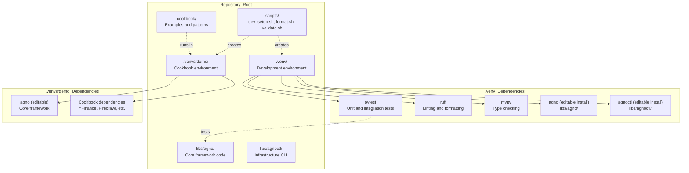
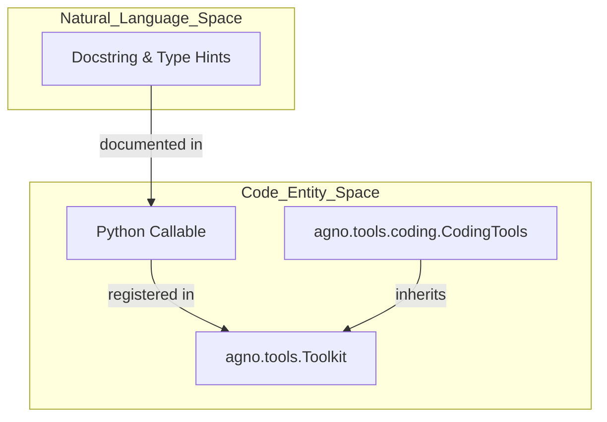
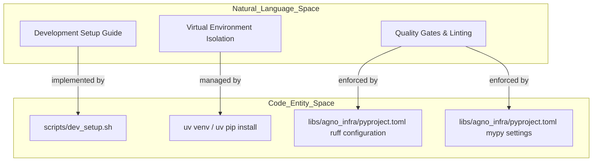

<!-- source: DeepWiki mcp.deepwiki.com · repo agno-agi/agno · page 10.1 Development Setup · fetched 2026-11-09 -->

# Development Setup

<details>
<summary>Relevant source files</summary>

The following files were used as context for generating this wiki page:

- [.cursorrules](.cursorrules)
- [.github/pull_request_template.md](.github/pull_request_template.md)
- [.github/workflows/claude.yml](.github/workflows/claude.yml)
- [.github/workflows/pr-triage.yml](.github/workflows/pr-triage.yml)
- [.gitignore](.gitignore)
- [AGENTS.md](AGENTS.md)
- [CLAUDE.md](CLAUDE.md)
- [CONTRIBUTING.md](CONTRIBUTING.md)
- [README.md](README.md)
- [cookbook/02_agents/10_human_in_the_loop/user_feedback.py](cookbook/02_agents/10_human_in_the_loop/user_feedback.py)
- [cookbook/02_agents/10_human_in_the_loop/user_input.py](cookbook/02_agents/10_human_in_the_loop/user_input.py)
- [cookbook/07_knowledge/02_building_blocks/README.md](cookbook/07_knowledge/02_building_blocks/README.md)
- [cookbook/07_knowledge/05_integrations/README.md](cookbook/07_knowledge/05_integrations/README.md)
- [cookbook/07_knowledge/05_integrations/vector_dbs/05_scylladb.py](cookbook/07_knowledge/05_integrations/vector_dbs/05_scylladb.py)
- [cookbook/91_tools/coding_tools/01_basic_usage.py](cookbook/91_tools/coding_tools/01_basic_usage.py)
- [cookbook/91_tools/coding_tools/02_all_tools.py](cookbook/91_tools/coding_tools/02_all_tools.py)
- [cookbook/91_tools/coding_tools/README.md](cookbook/91_tools/coding_tools/README.md)
- [cookbook/91_tools/coding_tools/TEST_LOG.md](cookbook/91_tools/coding_tools/TEST_LOG.md)
- [cookbook/README.md](cookbook/README.md)
- [libs/agno/agno/tools/coding.py](libs/agno/agno/tools/coding.py)
- [libs/agno/agno/tools/reasoning.py](libs/agno/agno/tools/reasoning.py)
- [libs/agno/tests/unit/tools/test_coding_tools.py](libs/agno/tests/unit/tools/test_coding_tools.py)
- [libs/agno_infra/agno/cli/infra_cli.py](libs/agno_infra/agno/cli/infra_cli.py)
- [libs/agno_infra/agno/infra/enums.py](libs/agno_infra/agno/infra/enums.py)
- [libs/agno_infra/agno/infra/operator.py](libs/agno_infra/agno/infra/operator.py)
- [libs/agno_infra/agno/utilities/json_io.py](libs/agno_infra/agno/utilities/json_io.py)
- [libs/agno_infra/agno/utilities/pyproject.py](libs/agno_infra/agno/utilities/pyproject.py)
- [libs/agno_infra/agno/utilities/yaml_io.py](libs/agno_infra/agno/utilities/yaml_io.py)
- [libs/agno_infra/pyproject.toml](libs/agno_infra/pyproject.toml)
- [libs/agno_infra/tests/test_utilities_encoding.py](libs/agno_infra/tests/test_utilities_encoding.py)
- [scripts/demo_setup.sh](scripts/demo_setup.sh)
- [scripts/dev_setup.sh](scripts/dev_setup.sh)

</details>


This page documents the development environment setup for the Agno codebase, including virtual environment configuration (`scripts/dev_setup.sh` and `scripts/demo_setup.sh`), directory structure, the `uv` package manager, and dependency installation workflows.

## 1. Virtual Environment Architecture

Agno uses separate virtual environments to isolate development dependencies from cookbook/demo dependencies. This separation prevents dependency conflicts and ensures clean testing environments. The package manager of choice is Astral `uv`.

### Virtual Environment Structure

**Diagram: Virtual environments, their setup scripts, and intended uses**



Sources: [scripts/dev_setup.sh:16-94](), [CLAUDE.md:40-53]()

### Environment Usage Matrix

| Environment | Purpose | Setup Script | Used For |
|-------------|---------|--------------|----------|
| `.venv/` | Development: tests, formatting, validation | `./scripts/dev_setup.sh` | `pytest`, `ruff`, `mypy`, `agnoctl` |
| `.venvs/demo/` | Cookbooks: has all demo dependencies | `./scripts/demo_setup.sh` | Running cookbook examples in `cookbook/` |

Sources: [CLAUDE.md:44-51](), [scripts/dev_setup.sh:1-94]()

## 2. Initial Setup and Prerequisites

### Prerequisites

- **Python**: Python 3.12 is targeted for primary development and CI workflows [scripts/dev_setup.sh:62]().
- **uv**: The Astral `uv` package manager is used for high-performance dependency resolution and environment management [scripts/dev_setup.sh:50-53]().

### Setting Up Development Environment

```bash
# Clone repository
git clone https://github.com/agno-agi/agno.git
cd agno

# Create development virtual environment
./scripts/dev_setup.sh
```

The `dev_setup.sh` script performs the following operations:
1. Validates that `uv` is installed on the system path [scripts/dev_setup.sh:50-53]().
2. Removes any existing `.venv` directory [scripts/dev_setup.sh:56-58]().
3. Creates a fresh virtual environment using Python 3.12: `uv venv .venv --python 3.12` [scripts/dev_setup.sh:61-63]().
4. Installs `libs/agnoctl[dev]` and `libs/agno[demo]` in **editable mode** via `uv pip install` [scripts/dev_setup.sh:68-70](). This ensures source code changes under `libs/agno/agno/` are reflected immediately.

Sources: [scripts/dev_setup.sh:1-94]()

## 3. Repository Structure and Code Entity Mapping

The repository separates core framework code, infrastructure tools, and third-party integrations.

### Core Framework and Tools Mapping

| Component | Directory Path | Key Entity |
|-----------|---------------|------------|
| Agents | `libs/agno/agno/agent/` | `Agent` [CLAUDE.md:129]() |
| Teams | `libs/agno/agno/team/` | `Team` [CLAUDE.md:130]() |
| Workflows | `libs/agno/agno/workflow/` | `Workflow` [CLAUDE.md:131]() |
| Tools | `libs/agno/agno/tools/` | `Toolkit` [libs/agno/agno/tools/coding.py:23]() |
| Coding Tools | `libs/agno/agno/tools/coding.py` | `CodingTools` [libs/agno/agno/tools/coding.py:23]() |

Sources: [CLAUDE.md:125-140](), [libs/agno/agno/tools/coding.py:23]()

## 4. Testing, Formatting, and Validation

### Running Tests
The project uses `pytest` for unit testing. Unit tests are located within the `libs/agno/tests/` directory [CLAUDE.md:139]().

```bash
source .venv/bin/activate

# Run core framework unit tests
pytest libs/agno/tests/
```

Sources: [CLAUDE.md:162-169]()

### Tool Integration Testing and Validation
Tools are validated by checking their schema generation and execution logic. Toolkits such as `CodingTools` inherit from `Toolkit` and register specific methods as executable tools [libs/agno/agno/tools/coding.py:23]().

**Diagram: Tool Definition and Validation Flow**



Sources: [libs/agno/agno/tools/coding.py:23]()

### Quality Gates
Development workflows enforce code consistency through strict local scripts and checks before submission:
- **Linting & Formatting**: `./scripts/format.sh` runs `ruff format` [CLAUDE.md:190-192]().
- **Validation & Type Checking**: `./scripts/validate.sh` runs `ruff check` and `mypy` [CLAUDE.md:193-195]().
- **PR Standards**: Titles must follow established formats (`type: description`) and target the main branch [CLAUDE.md:199-207]().

Sources: [CLAUDE.md:182-207]()

---

**Diagram: Natural Language to Code Entity Mapping for Development Environment Setup**



Sources: [scripts/dev_setup.sh:1-94](), [libs/agno_infra/pyproject.toml:85-110]()

---

