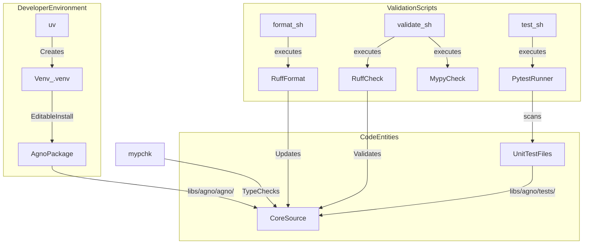
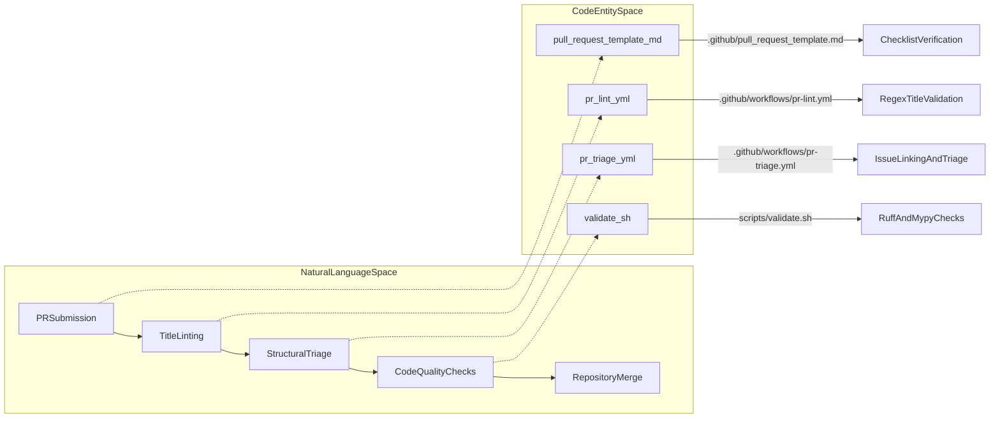

<!-- source: DeepWiki mcp.deepwiki.com · repo agno-agi/agno · page 10.3 Code Quality and Validation · fetched 2026-11-09 -->

# Code Quality and Validation

Relevant source files

The following files were used as context for generating this wiki page:

- [.cursorrules](.cursorrules)
- [.github/ISSUE_TEMPLATE/bug-report.yml](.github/ISSUE_TEMPLATE/bug-report.yml)
- [.github/ISSUE_TEMPLATE/feature-request.yml](.github/ISSUE_TEMPLATE/feature-request.yml)
- [.github/pull_request_template.md](.github/pull_request_template.md)
- [.github/workflows/claude.yml](.github/workflows/claude.yml)
- [.github/workflows/pr-lint.yml](.github/workflows/pr-lint.yml)
- [.github/workflows/pr-triage.yml](.github/workflows/pr-triage.yml)
- [.gitignore](.gitignore)
- [AGENTS.md](AGENTS.md)
- [CLAUDE.md](CLAUDE.md)
- [CONTRIBUTING.md](CONTRIBUTING.md)
- [README.md](README.md)
- [cookbook/07_knowledge/02_building_blocks/README.md](cookbook/07_knowledge/02_building_blocks/README.md)
- [cookbook/07_knowledge/05_integrations/README.md](cookbook/07_knowledge/05_integrations/README.md)
- [cookbook/07_knowledge/05_integrations/vector_dbs/05_scylladb.py](cookbook/07_knowledge/05_integrations/vector_dbs/05_scylladb.py)
- [cookbook/README.md](cookbook/README.md)
- [cookbook/observability/arize_phoenix_via_openinference.py](cookbook/observability/arize_phoenix_via_openinference.py)
- [cookbook/observability/arize_phoenix_via_openinference_local.py](cookbook/observability/arize_phoenix_via_openinference_local.py)
- [cookbook/observability/langfuse_via_openinference.py](cookbook/observability/langfuse_via_openinference.py)
- [cookbook/observability/langfuse_via_openinference_response_model.py](cookbook/observability/langfuse_via_openinference_response_model.py)
- [cookbook/observability/langfuse_via_openlit.py](cookbook/observability/langfuse_via_openlit.py)
- [cookbook/observability/langsmith_via_openinference.py](cookbook/observability/langsmith_via_openinference.py)
- [cookbook/observability/langtrace_op.py](cookbook/observability/langtrace_op.py)
- [cookbook/observability/teams/langfuse_via_openinference_team.py](cookbook/observability/teams/langfuse_via_openinference_team.py)
- [libs/agno/agno/tools/reasoning.py](libs/agno/agno/tools/reasoning.py)
- [libs/agno_infra/agno/cli/infra_cli.py](libs/agno_infra/agno/cli/infra_cli.py)
- [libs/agno_infra/agno/infra/enums.py](libs/agno_infra/agno/infra/enums.py)
- [libs/agno_infra/agno/infra/operator.py](libs/agno_infra/agno/infra/operator.py)
- [scripts/demo_setup.sh](scripts/demo_setup.sh)
- [scripts/dev_setup.sh](scripts/dev_setup.sh)

This page documents the code quality tooling and validation workflows that enforce coding standards in the Agno codebase. The framework uses `ruff` for code formatting and linting, `mypy` for static type checking, automated shell scripts for local verification, and GitHub Actions for PR triage, linting, and CI quality gates.

Sources: `[CONTRIBUTING.md:1-110]()`, `[CLAUDE.md:1-238]()`

## Overview and Tooling Architecture

Agno enforces strict code quality and type safety across core libraries (`libs/agno`, `libs/agno_infra`) and example code (`cookbook`) using standardized local scripts and automated continuous integration checks.

**Local Validation Tools:**
- `./scripts/format.sh` / `.\scripts\format.bat`: Formats code using `ruff` [CONTRIBUTING.md:61-73]().
- `./scripts/validate.sh` / `.\scripts\validate.bat`: Runs static analysis and type checks via `ruff check` and `mypy` [CONTRIBUTING.md:61-73]().
- `./scripts/test.sh`: Executes the test suite via `pytest` [CONTRIBUTING.md:74-84]().

**CI Quality Gates:**
- **PR Lint:** Enforces strict PR title syntax via `.github/workflows/pr-lint.yml` [CONTRIBUTING.md:32]().
- **PR Triage:** Validates linked issues, checks test coverage, and manages contributor labeling via `.github/workflows/pr-triage.yml` [CONTRIBUTING.md:26]().
- **AI Integration:** Governs automated assistance via `.github/workflows/claude.yml` and `.github/pull_request_template.md` `[CONTRIBUTING.md:30]`, `[.github/workflows/claude.yml:1-74]().

Sources: `[CONTRIBUTING.md:34-73]`, `[.github/workflows/pr-lint.yml:1-28]`, `[.github/workflows/pr-triage.yml:1-180]()`

## Local Formatting and Validation Scripts

Developers execute local formatting and validation prior to submitting code changes. The development environment relies on `uv` to provision a clean virtual environment (`.venv`) with editable installs `[CONTRIBUTING.md:34-50]`, `[scripts/dev_setup.sh:16-71]()`.

### Validation Script Execution Flow

The following diagram bridges the natural language description of local validation tasks to the underlying script execution and code entities:

Title: Local Validation and Testing Flow

Sources: `[CONTRIBUTING.md:34-85]`, `[scripts/dev_setup.sh:1-96]`, `[CLAUDE.md:155-170]()`

## Pull Request Triage and Automated Quality Gates

Agno uses automated workflows to triage pull requests and enforce repository governance.

### Automated Triage Logic
The `triage` job defined in [.github/workflows/pr-triage.yml:1-180]() executes the following checks:
1. **First-time Contributor Detection:** Searches pull requests by author and applies the `first-time-contributor` label `[.github/workflows/pr-triage.yml:66-81]()`.
2. **Issue Linking Validation:** Parses closing keywords (`fixes #N`, `closes #N`, `resolves #N`) against repository issues. Applies `missing-issue-link` if absent `[.github/workflows/pr-triage.yml:84-153]()`.
3. **PR Title Linter:** Validates pull request titles via `.github/workflows/pr-lint.yml` against a regular expression enforcing valid tags (`[feat]`, `[fix]`, `[cookbook]`, `[test]`, `[refactor]`, `[chore]`, `[style]`, `[revert]`, `[release]`) `[.github/workflows/pr-lint.yml:1-28]`, `[CONTRIBUTING.md:16-22]()`.

Sources: `[.github/workflows/pr-triage.yml:1-180]`, `[.github/workflows/pr-lint.yml:1-28]`, `[CONTRIBUTING.md:16-32]()`

## CI/CD Pipeline and Quality Gates

This diagram bridges natural language quality standards to the specific configuration files and workflow components enforcing them in CI.

Title: CI/CD Pipeline and Quality Gates

Sources: `[.github/pull_request_template.md:1-38]`, `[.github/workflows/pr-lint.yml:1-28]`, `[.github/workflows/pr-triage.yml:1-180]`, `[CONTRIBUTING.md:61-73]()`

## AI-Assisted Development and Review Integration

Agno supports AI-driven development through standardized instructions and GitHub integrations (`[CLAUDE.md:1-238]`, `[.github/workflows/claude.yml:1-74]()`).

- **AI Code Guidelines:** Instructions in `CLAUDE.md` govern repository structure, virtual environment usage (`.venv` vs `.venvs/demo`), and mandatory script execution prior to pushes `[CLAUDE.md:40-53]`, `[CLAUDE.md:182-198]()`.
- **Automated Review:** The Claude Code GitHub Action (`.github/workflows/claude.yml`) runs automated code review and assistance upon receiving comment triggers like `@claude` `[.github/workflows/claude.yml:1-74]()`.
- **AI Disclosure:** Contributors utilizing AI generation tools must explicitly mark the disclosure checkbox in `.github/pull_request_template.md` and satisfy standard quality bars `[CONTRIBUTING.md:30]`, `[.github/pull_request_template.md:28-33]()`.

Sources: `[.github/workflows/claude.yml:1-75]`, `[CLAUDE.md:1-238]`, `[.github/pull_request_template.md:1-38]`, `[CONTRIBUTING.md:30-32]()`

## Summary of Quality Standards

| Check | Tool / Workflow | Requirement |
| :--- | :--- | :--- |
| **Formatting** | `ruff format` | Must pass via `./scripts/format.sh` or `.\scripts\format.bat` `[CONTRIBUTING.md:61-73]()` |
| **Typing** | `mypy` & `ruff check` | Must pass via `./scripts/validate.sh` or `.\scripts\validate.bat` `[CONTRIBUTING.md:61-73]()` |
| **PR Title** | `pr-lint.yml` | Must match regex format (e.g., `[feat] title` or `feat: title`) `[.github/workflows/pr-lint.yml:1-28]()` |
| **Issue Link** | `pr-triage.yml` | Must reference an approved, labeled issue (`fixes #123`) `[.github/workflows/pr-triage.yml:30-34]`, `[.github/workflows/pr-triage.yml:149-155]()` |
| **AI Disclosure** | `pull_request_template.md` | Must explicitly state if changes were AI-generated `[.github/pull_request_template.md:28-33]()` |

Sources: `[CONTRIBUTING.md:16-73]`, `[.github/workflows/pr-lint.yml:1-28]`, `[.github/workflows/pr-triage.yml:1-180]`, `[.github/pull_request_template.md:1-38]()`

---

