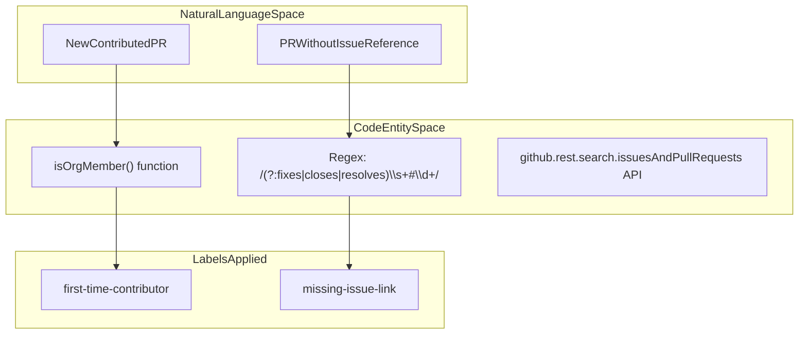
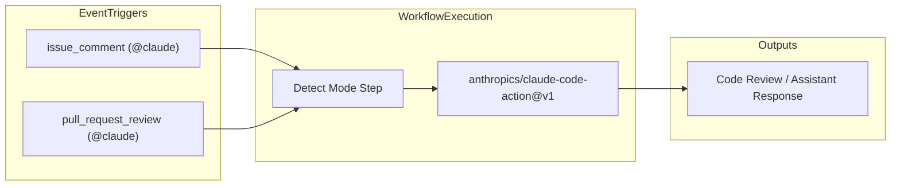

<!-- source: DeepWiki mcp.deepwiki.com · repo agno-agi/agno · page 10.5 Contributing Guidelines · fetched 2026-11-09 -->

# Contributing Guidelines

<details>
<summary>Relevant source files</summary>

The following files were used as context for generating this wiki page:

- [.cursorrules](.cursorrules)
- [.github/pull_request_template.md](.github/pull_request_template.md)
- [.github/workflows/claude.yml](.github/workflows/claude.yml)
- [.github/workflows/pr-triage.yml](.github/workflows/pr-triage.yml)
- [.gitignore](.gitignore)
- [AGENTS.md](AGENTS.md)
- [CLAUDE.md](CLAUDE.md)
- [CONTRIBUTING.md](CONTRIBUTING.md)
- [README.md](README.md)
- [cookbook/07_knowledge/02_building_blocks/README.md](cookbook/07_knowledge/02_building_blocks/README.md)
- [cookbook/07_knowledge/05_integrations/README.md](cookbook/07_knowledge/05_integrations/README.md)
- [cookbook/07_knowledge/05_integrations/vector_dbs/05_scylladb.py](cookbook/07_knowledge/05_integrations/vector_dbs/05_scylladb.py)
- [cookbook/README.md](cookbook/README.md)
- [libs/agno/agno/tools/reasoning.py](libs/agno/agno/tools/reasoning.py)
- [libs/agno_infra/agno/cli/infra_cli.py](libs/agno_infra/agno/cli/infra_cli.py)
- [libs/agno_infra/agno/infra/enums.py](libs/agno_infra/agno/infra/enums.py)
- [libs/agno_infra/agno/infra/operator.py](libs/agno_infra/agno/infra/operator.py)
- [scripts/demo_setup.sh](scripts/demo_setup.sh)
- [scripts/dev_setup.sh](scripts/dev_setup.sh)

</details>


This document details the development workflow, code quality standards, and extensibility patterns for contributing to Agno. It covers the fork-and-pull-request model, mandatory validation scripts, automated PR triage gates, AI disclosure requirements, and specific implementation guides for adding new Models, Vector Databases, and Tools.

## Development Environment Setup

Agno utilizes `uv` for high-performance dependency management and virtual environment isolation [CONTRIBUTING.md:34-39]().

### Virtual Environment Configuration

1. **Clone the repository.**
2. **Verify `uv` installation**: Run `uv --version`. If missing, install via `pip install uv` [CONTRIBUTING.md:36-39]().
3. **Initialize Environment**:
   * **Unix**: Run `./scripts/dev_setup.sh` [CONTRIBUTING.md:41]().
   * **Windows**: Run `.\scripts\dev_setup.bat` [CONTRIBUTING.md:42]().
   * This setup creates a `.venv` directory using Python 3.12, installs required packages, and installs `agnoctl[dev]` and `agno[demo]` in editable mode [CONTRIBUTING.md:43-46](), [scripts/dev_setup.sh:61-70]().
4. **Activation**:
   * **Unix**: `source .venv/bin/activate` [CONTRIBUTING.md:48]()
   * **Windows**: `.venv\Scripts\activate` [CONTRIBUTING.md:49]()

Sources: [CONTRIBUTING.md:34-49](), [scripts/dev_setup.sh:1-70]()

---

## Pull Request Workflow

Agno follows a standard fork-and-pull-request workflow. All external contributions must pass automated quality gates and triage checks [CONTRIBUTING.md:5-15]().

### PR Guidelines and Standards

To maintain project history and code quality, adhere to these core rules enforced by the `PR Lint` and `PR Triage` workflows [CONTRIBUTING.md:16-33]():

| Requirement | Description |
| :--- | :--- |
| **Title Format** | Must follow `[type] description` (e.g., `[feat] Add user authentication`) [CONTRIBUTING.md:20-21](). |
| **Issue Linking** | Description must reference a `ready` issue using keywords like `fixes #<number>`, `closes #<number>`, or `resolves #<number>` [CONTRIBUTING.md:23-26](). |
| **PR Template** | Keep every section of the pull request template in your description [.github/pull_request_template.md:1-38](). |
| **No Duplicates** | Search existing pull requests to confirm no one else is addressing the issue [CONTRIBUTING.md:28](). |
| **Respect Assignments** | Do not open PRs for issues assigned to others without maintainer confirmation [CONTRIBUTING.md:29](). |
| **AI Disclosure** | Disclose if a PR was entirely generated by AI tools in the PR template [CONTRIBUTING.md:30](). |

### Valid PR Type Tags
* `[feat]`: New functionality.
* `[fix]`: Bug fixes.
* `[cookbook]`: New or updated cookbook examples.
* `[test]`: Testing infrastructure or new test cases.
* `[refactor]`: Code changes that neither fix a bug nor add a feature.
* `[chore]`: Maintenance tasks, dependencies, and build scripts.
* `[style]`, `[revert]`, `[release]`.

Sources: [CONTRIBUTING.md:16-33](), [.github/pull_request_template.md:1-38]()

---

## Code Quality and Validation

Before submitting a PR, contributors **must** run formatting, static analysis, and test suites locally [CONTRIBUTING.md:61-84]().

### Formatting and Static Analysis
* **Format**: Run `./scripts/format.sh` (Unix) or `.\scripts\format.bat` (Windows) to execute `ruff format` [CONTRIBUTING.md:65-72]().
* **Validate**: Run `./scripts/validate.sh` (Unix) or `.\scripts\validate.bat` (Windows) to execute `ruff check` and static type checking via `mypy` [CONTRIBUTING.md:65-73]().

### Local Testing
Execute the test suite using `./scripts/test.sh` [CONTRIBUTING.md:80](). For targeted module testing, use `pytest` directly:
```bash
pytest ./libs/agno/tests/unit/test_agent.py
```
[CONTRIBUTING.md:82](), [CLAUDE.md:167-169]()

Sources: [CONTRIBUTING.md:61-84](), [CLAUDE.md:162-170]()

---

## Extensibility Patterns

Agno is architected for modular extension. Follow these patterns when implementing custom components.

### 1. Adding a New Vector Database
1. **Directory**: Create a new directory under `libs/agno/agno/vectordb/<your_db>/` [CONTRIBUTING.md:89]().
2. **Implementation**: Create a class inheriting from the `VectorDb` interface defined in `libs/agno/agno/vectordb/base.py` [CONTRIBUTING.md:90-92]().
3. **Exports**: Import your class in `libs/agno/agno/vectordb/<your_db>/__init__.py` [CONTRIBUTING.md:93]().
4. **Example**: Add a recipe under `cookbook/07_knowledge/` [CONTRIBUTING.md:95]().

Sources: [CONTRIBUTING.md:86-98]()

### 2. Adding a New Model Provider
1. **Directory**: Create a new directory under `libs/agno/agno/models/<your_model>/` [CONTRIBUTING.md:103]().
2. **OpenAI-Compatible**: If the provider supports the OpenAI API spec, inherit from `OpenAILike` in `libs/agno/agno/models/openai/like.py` [CONTRIBUTING.md:104-106]().
3. **Custom Spec**: If not OpenAI-compatible, implement the base `Model` interface [CONTRIBUTING.md:109-110]().
4. **Registration**: Export the class in `libs/agno/agno/models/<your_model>/__init__.py` [CONTRIBUTING.md:107]().

Sources: [CONTRIBUTING.md:100-110]()

### 3. Adding a New Tool
1. **Implementation**: Create a class inheriting from `Toolkit` [libs/agno/agno/tools/reasoning.py:10]().
2. **Entrypoints**: Define methods (e.g., `think`, `analyze`) [libs/agno/agno/tools/reasoning.py:50-116]() and register them via `super().__init__(tools=[...])` [libs/agno/agno/tools/reasoning.py:42-48]().
3. **Context Access**: Tools can accept `RunContext` parameters to interact with session state (`run_context.session_state`) [libs/agno/agno/tools/reasoning.py:52](), [libs/agno/agno/tools/reasoning.py:86-92]().

Sources: [libs/agno/agno/tools/reasoning.py:1-171]()

---

## CI/CD and Automation Architecture

The repository uses GitHub Actions to automate PR triage, quality checks, and CI verification.

### PR Triage and Labeling Architecture


*Diagram: PR triage logic mapping contribution events to automated labels.*

Sources: [.github/workflows/pr-triage.yml:1-153]()

### Claude Code Integration Architecture


*Diagram: Automated AI coding agent invocation flow.*

Sources: [.github/workflows/claude.yml:1-74]()

---

## AI-Assisted Development

Agno welcomes contributions developed with AI assistance (Claude Code, Cursor, GitHub Copilot) [CONTRIBUTING.md:30]().

### AI Disclosure and Compliance
* **Disclosure**: Authors must check the AI-generated box in the PR template [.github/pull_request_template.md:32]().
* **Quality Bar**: AI-generated code is held to the exact same standard as manual contributions—it must pass all linting, type checks, and comprehensive test coverage [CONTRIBUTING.md:30]().
* **Context Files**: Utilize `CLAUDE.md`, `AGENTS.md`, and `.cursorrules` to instruct coding agents on repository structure, virtual environments, and formatting rules [CLAUDE.md:1-238]().

Sources: [CONTRIBUTING.md:30](), [.github/pull_request_template.md:28-34](), [CLAUDE.md:1-20]()

---

