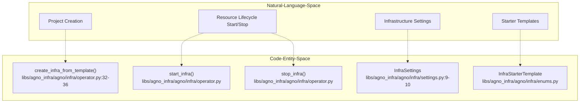
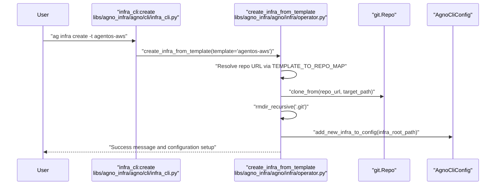

<!-- source: DeepWiki mcp.deepwiki.com · repo agno-agi/agno · page 10.6 Infrastructure Management · fetched 2026-11-09 -->

# Infrastructure Management

<details>
<summary>Relevant source files</summary>

The following files were used as context for generating this wiki page:

- [.cursorrules](.cursorrules)
- [.github/pull_request_template.md](.github/pull_request_template.md)
- [.github/workflows/claude.yml](.github/workflows/claude.yml)
- [.github/workflows/pr-triage.yml](.github/workflows/pr-triage.yml)
- [.gitignore](.gitignore)
- [AGENTS.md](AGENTS.md)
- [CLAUDE.md](CLAUDE.md)
- [CONTRIBUTING.md](CONTRIBUTING.md)
- [README.md](README.md)
- [cookbook/02_agents/10_human_in_the_loop/user_feedback.py](cookbook/02_agents/10_human_in_the_loop/user_feedback.py)
- [cookbook/02_agents/10_human_in_the_loop/user_input.py](cookbook/02_agents/10_human_in_the_loop/user_input.py)
- [cookbook/07_knowledge/02_building_blocks/README.md](cookbook/07_knowledge/02_building_blocks/README.md)
- [cookbook/07_knowledge/05_integrations/README.md](cookbook/07_knowledge/05_integrations/README.md)
- [cookbook/07_knowledge/05_integrations/vector_dbs/05_scylladb.py](cookbook/07_knowledge/05_integrations/vector_dbs/05_scylladb.py)
- [cookbook/91_tools/coding_tools/01_basic_usage.py](cookbook/91_tools/coding_tools/01_basic_usage.py)
- [cookbook/91_tools/coding_tools/02_all_tools.py](cookbook/91_tools/coding_tools/02_all_tools.py)
- [cookbook/91_tools/coding_tools/README.md](cookbook/91_tools/coding_tools/README.md)
- [cookbook/91_tools/coding_tools/TEST_LOG.md](cookbook/91_tools/coding_tools/TEST_LOG.md)
- [cookbook/README.md](cookbook/README.md)
- [libs/agno/agno/context/web/exa_mcp.py](libs/agno/agno/context/web/exa_mcp.py)
- [libs/agno/agno/context/web/parallel_mcp.py](libs/agno/agno/context/web/parallel_mcp.py)
- [libs/agno/agno/os/mcp_auth_builtin.py](libs/agno/agno/os/mcp_auth_builtin.py)
- [libs/agno/agno/tools/coding.py](libs/agno/agno/tools/coding.py)
- [libs/agno/agno/tools/mcp/params.py](libs/agno/agno/tools/mcp/params.py)
- [libs/agno/agno/tools/reasoning.py](libs/agno/agno/tools/reasoning.py)
- [libs/agno/tests/integration/tools/test_custom_api.py](libs/agno/tests/integration/tools/test_custom_api.py)
- [libs/agno/tests/system/Dockerfile.adk](libs/agno/tests/system/Dockerfile.adk)
- [libs/agno/tests/system/Dockerfile.agno_a2a](libs/agno/tests/system/Dockerfile.agno_a2a)
- [libs/agno/tests/system/Dockerfile.gateway](libs/agno/tests/system/Dockerfile.gateway)
- [libs/agno/tests/system/Dockerfile.remote](libs/agno/tests/system/Dockerfile.remote)
- [libs/agno/tests/system/docker-compose.yaml](libs/agno/tests/system/docker-compose.yaml)
- [libs/agno/tests/system/gateway_server.py](libs/agno/tests/system/gateway_server.py)
- [libs/agno/tests/system/requirements.txt](libs/agno/tests/system/requirements.txt)
- [libs/agno/tests/system/tests/test_mcp_routes.py](libs/agno/tests/system/tests/test_mcp_routes.py)
- [libs/agno/tests/system/tests/test_telegram_routes.py](libs/agno/tests/system/tests/test_telegram_routes.py)
- [libs/agno/tests/unit/tools/test_coding_tools.py](libs/agno/tests/unit/tools/test_coding_tools.py)
- [libs/agno_infra/agno/cli/infra_cli.py](libs/agno_infra/agno/cli/infra_cli.py)
- [libs/agno_infra/agno/infra/enums.py](libs/agno_infra/agno/infra/enums.py)
- [libs/agno_infra/agno/infra/operator.py](libs/agno_infra/agno/infra/operator.py)
- [libs/agno_infra/agno/utilities/json_io.py](libs/agno_infra/agno/utilities/json_io.py)
- [libs/agno_infra/agno/utilities/pyproject.py](libs/agno_infra/agno/utilities/pyproject.py)
- [libs/agno_infra/agno/utilities/yaml_io.py](libs/agno_infra/agno/utilities/yaml_io.py)
- [libs/agno_infra/pyproject.toml](libs/agno_infra/pyproject.toml)
- [libs/agno_infra/tests/test_utilities_encoding.py](libs/agno_infra/tests/test_utilities_encoding.py)
- [libs/agnoctl/pyproject.toml](libs/agnoctl/pyproject.toml)
- [scripts/demo_setup.sh](scripts/demo_setup.sh)
- [scripts/dev_setup.sh](scripts/dev_setup.sh)

</details>


This document covers the infrastructure management system provided by the `agno-infra` (`libs/agno_infra/`) package, the `ag infra` CLI, and the `agnoctl` (`libs/agnoctl/`) package [libs/agno_infra/pyproject.toml:1-41](), [libs/agnoctl/pyproject.toml:1-44](). This subsystem enables developers to create, deploy, and manage AgentOS codebases using template-based projects, handle resource group configurations, execute lifecycle operations (`create`, `up`, `down`, `patch`), and interact with deployment targets including Docker, AWS, and Railway [README.md:54-57]().

---

## 1. System Overview and Architecture

The infrastructure management system consists of three primary layers facilitating the transition from local code declarations to deployed cloud or container resources:

1. **CLI Layer** (`libs/agno_infra/agno/cli/infra_cli.py`): Implements the `ag infra` Typer application supporting resource operations like `create`, `up`, `down`, and `patch`.
2. **Operator Layer** (`libs/agno_infra/agno/infra/operator.py`): Contains the business logic for cloning starter templates, configuring environment secrets, and executing resource lifecycles.
3. **Settings Layer** (`libs/agno_infra/agno/infra/settings.py`): Defines `InfraSettings` for managing environment keys, regions, subnets, and operational flags across resources.

### Natural Language to Code Entity Mapping

The following diagram maps high-level infrastructure goals to their corresponding code symbols in the Agno codebase.

"Infrastructure Management Mapping"


**Sources:** `[libs/agno_infra/agno/cli/infra_cli.py:20-32](), [libs/agno_infra/agno/infra/operator.py:32-41](), [libs/agno_infra/agno/infra/settings.py:9-10]()`

---

## 2. Template-Based Project Creation

Agno provides pre-built starter templates for different deployment architectures. These templates are hosted as Git repositories and cloned into local directories during project initialization [README.md:54-57]().

### Available Templates and Repository Mapping

The infrastructure system maps `InfraStarterTemplate` enums to specific Git repositories via `TEMPLATE_TO_REPO_MAP` (`[libs/agno_infra/agno/infra/operator.py:25-29]()`).

| Template Enum | Project Name | Repository URL | Target Environment |
|--------------|--------------|----------------|--------------------|
| `agentos_docker` | `agentos-docker` | `https://github.com/agno-agi/agentos-docker-template` | Local Docker & Docker Compose |
| `agentos_aws` | `agentos-aws` | `https://github.com/agno-agi/agentos-aws-template` | AWS Cloud (ECS/Lambda/S3/RDS) |
| `agentos_railway` | `agentos-railway` | `https://github.com/agno-agi/agentos-railway-template` | Railway PaaS |

**Sources:** `[libs/agno_infra/agno/infra/operator.py:20-29]()`, `[libs/agno_infra/agno/cli/infra_cli.py:35-78]()`

### Project Creation Sequence

The `create_infra_from_template` function handles cloning, repository cleaning, and local configuration initialization (`[libs/agno_infra/agno/infra/operator.py:32-164]()`).

"Project Creation Sequence"


**Sources:** `[libs/agno_infra/agno/infra/operator.py:32-171]()`, `[libs/agno_infra/agno/cli/infra_cli.py:35-78]()`

---

## 3. CLI Command Architecture (`ag infra`)

The `infra_cli` Typer application (`[libs/agno_infra/agno/cli/infra_cli.py:20-32]()`) exposes commands to manage infrastructure projects from the terminal.

### Command Reference

| Command | Description | Core Implementation Function |
|---------|-------------|----------------------------|
| `create` | Clones a starter template into the current directory | `create_infra_from_template` (`[libs/agno_infra/agno/infra/operator.py:32-36]()`) |
| `up` | Deploys or starts infrastructure resources | `start_infra` (`[libs/agno_infra/agno/cli/infra_cli.py:155-155]()`) |
| `down` | Stops and tears down active resources | `stop_infra` (`[libs/agno_infra/agno/cli/infra_cli.py:155-155]()`) |
| `patch` | Updates or applies modifications to running resources | `update_infra` |

### Resource Filtering Syntax

Lifecycle commands accept a unified resource filter string using the format `ENV:INFRA:GROUP:NAME:TYPE` (`[libs/agno_infra/agno/cli/infra_cli.py:82-98]()`):

```bash
# Deploy all database resources in development environment on docker
ag infra up dev:docker:db:postgres:container
```

The string is parsed using `parse_resource_filter` (`[libs/agno_infra/agno/cli/infra_cli.py:156-156]()`) to limit the operational scope.

**Sources:** `[libs/agno_infra/agno/cli/infra_cli.py:20-156]()`

---

## 4. Resource Group Management and Settings

Infrastructure resource configuration is governed by `InfraSettings` (`[libs/agno_infra/agno/infra/settings.py:9-10]()`). It standardizes environment identification, AWS subnets, availability zones, and failure handling policies.

### Key Configuration Attributes

- **`infra_name`**: String identifier for the infrastructure deployment (`[libs/agno_infra/agno/infra/settings.py:13-13]()`).
- **`infra_root`**: `Path` object pointing to the root of the infrastructure project (`[libs/agno_infra/agno/infra/settings.py:16-16]()`).
- **Failure Flags**: `continue_on_create_failure`, `continue_on_delete_failure`, and `continue_on_patch_failure` dictate error tolerance during bulk resource updates (`[libs/agno_infra/agno/infra/settings.py:60-67]()`).
- **AWS Subnets & Networking**: Manages `aws_subnet_ids`, `aws_public_subnets`, `aws_private_subnets`, and security groups (`[libs/agno_infra/agno/infra/settings.py:77-94]()`).

"Resource Deployment Data Flow"

```mermaid
graph LR
    User["User: ag infra up --group db"]
    CLI["infra_cli:up()<br/>libs/agno_infra/agno/cli/infra_cli.py"]
    Parse["parse_resource_filter()<br/>libs/agno_infra/agno/utilities/"]
    Op["start_infra()<br/>libs/agno_infra/agno/infra/operator.py"]
    Settings["InfraSettings<br/>libs/agno_infra/agno/infra/settings.py"]
    Actual["Docker / Cloud Provider"]

    User --> CLI
    CLI --> Parse
    Parse --> Op
    Op --> Settings
    Settings --> Actual
```


**Sources:** `[libs/agno_infra/agno/infra/settings.py:9-10]()`, `[libs/agno_infra/agno/cli/infra_cli.py:81-129]`, `[libs/agno_infra/agno/infra/operator.py:155-155]()`

---

## 5. `agnoctl` Terminal Client

The `agnoctl` package (`libs/agnoctl/pyproject.toml`) provides an independent terminal CLI (`agno` / `agnoctl`) designed to connect to and operate remote or local AgentOS instances (`[libs/agnoctl/pyproject.toml:1-44]()`).

### Key Capabilities of `agnoctl`
- **AgentOS Operations**: Inspects running agents, teams, and workflows hosted on AgentOS servers.
- **Agentic Integration**: Built with human operators and coding agents in mind, outputting structured diagnostics and supporting terminal-based MCP client connections.
- **Dependencies**: Relies on `httpx`, `questionary` for interactive prompts, `rich` for terminal formatting, and `typer` for command routing (`[libs/agnoctl/pyproject.toml:26-32]()`).

**Sources:** `[libs/agnoctl/pyproject.toml:1-44]()`

---

## 6. Docker Compose Fallback & Development Tooling

When operating in environments without a formal Agno `InfraConfig`, the CLI provides fallback mechanisms to interact with standard Docker Compose setups (`[libs/agno/tests/system/docker-compose.yaml:1-149]()`).

- **Auto-Discovery**: `find_compose_files` scans the working directory for `docker-compose.yaml` or `compose.yml` files (`[libs/agno_infra/agno/cli/infra_cli.py:153-153]()`).
- **Compose Execution**: Automatically invokes `run_docker_compose_up` or `run_docker_compose_down` to manage multi-container services such as PostgreSQL (`pgvector`), AgentOS servers, and test gateways (`[libs/agno/tests/system/docker-compose.yaml:3-143]()`).

**Sources:** `[libs/agno_infra/agno/cli/infra_cli.py:153-186]()`, `[libs/agno/tests/system/docker-compose.yaml:1-149]()`

---

