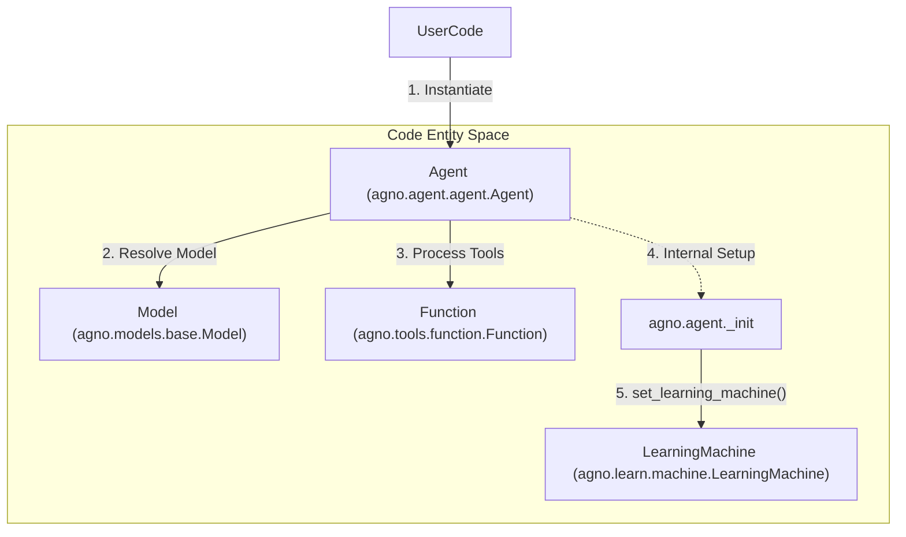
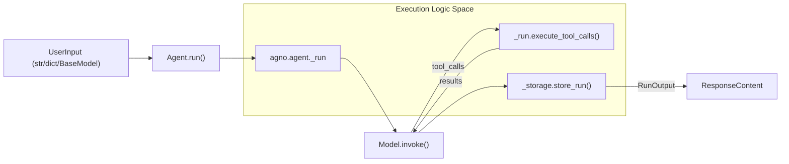

<!-- source: DeepWiki mcp.deepwiki.com · repo agno-agi/agno · page 11.1 Basic Agent Examples · fetched 2026-11-09 -->

# Basic Agent Examples

Relevant source files

The following files were used as context for generating this wiki page:

- [cookbook/00_quickstart/README.md](cookbook/00_quickstart/README.md)
- [cookbook/00_quickstart/TEST_LOG.md](cookbook/00_quickstart/TEST_LOG.md)
- [cookbook/00_quickstart/agent_search_over_knowledge.py](cookbook/00_quickstart/agent_search_over_knowledge.py)
- [cookbook/00_quickstart/agent_with_guardrails.py](cookbook/00_quickstart/agent_with_guardrails.py)
- [cookbook/00_quickstart/agent_with_memory.py](cookbook/00_quickstart/agent_with_memory.py)
- [cookbook/00_quickstart/agent_with_state_management.py](cookbook/00_quickstart/agent_with_state_management.py)
- [cookbook/00_quickstart/agent_with_storage.py](cookbook/00_quickstart/agent_with_storage.py)
- [cookbook/00_quickstart/agent_with_structured_output.py](cookbook/00_quickstart/agent_with_structured_output.py)
- [cookbook/00_quickstart/agent_with_tools.py](cookbook/00_quickstart/agent_with_tools.py)
- [cookbook/00_quickstart/agent_with_typed_input_output.py](cookbook/00_quickstart/agent_with_typed_input_output.py)
- [libs/agno/agno/tools/apify.py](libs/agno/agno/tools/apify.py)
- [libs/agno/agno/tools/dalle.py](libs/agno/agno/tools/dalle.py)
- [libs/agno/agno/utils/agent.py](libs/agno/agno/utils/agent.py)
- [libs/agno/tests/integration/agent/test_agent_convenience_functions.py](libs/agno/tests/integration/agent/test_agent_convenience_functions.py)
- [libs/agno/tests/integration/teams/test_team_convenience_functions.py](libs/agno/tests/integration/teams/test_team_convenience_functions.py)
- [libs/agno/tests/unit/agent/test_get_last_run_output_subclasses.py](libs/agno/tests/unit/agent/test_get_last_run_output_subclasses.py)
- [libs/agno/tests/unit/tools/test_apify.py](libs/agno/tests/unit/tools/test_apify.py)

This page demonstrates basic patterns for creating and using agents in Agno, covering simple agent instantiation, tool integration, persistent storage, memory management, structured outputs, guardrails, and multimodal inputs. These examples are primarily drawn from the `cookbook/00_quickstart` and `cookbook/02_agents` directories.

---

## Agent Creation and Execution Flow

The following diagrams illustrate the lifecycle of an agent from initialization to execution, mapping natural language configuration concepts to their code entities within the Agno framework.

### Agent Initialization Flow

Sources: [libs/agno/agno/agent/agent.py:68-182](), [libs/agno/agno/learn/machine.py:53-100]()

### Core Agent Execution Loop

Sources: [libs/agno/agno/agent/agent.py:1241-1485](), [libs/agno/agno/models/base.py:128-210]()

---

## Basic Agent with Tools

Tools allow agents to interact with external APIs and services. The simplest way to add tools is using built-in toolkits or passing Python functions directly to the `Agent` configuration. During initialization, functions are converted into `Function` execution wrappers [libs/agno/agno/agent/agent.py:171-174]().

| Component | Implementation | Description |
|:---|:---|:---|
| **Agent** | `Agent` | The main orchestrator for tool invocation and execution context. [libs/agno/agno/agent/agent.py:69-182]() |
| **Model** | `Model` | The LLM provider abstraction handling function calling schemas. [libs/agno/agno/models/base.py:130-184]() |
| **Tools** | `Toolkit` or `Function` | Executable objects that the model can generate JSON arguments for. [libs/agno/agno/agent/agent.py:171-174]() |
| **Tool Execution** | `execute_tool_calls` | The internal mechanism handling execution loops for tool outputs. [libs/agno/agno/agent/agent.py:1718-1719]() |

Sources: [libs/agno/agno/agent/agent.py:171-174](), [cookbook/00_quickstart/agent_with_tools.py:26-45]()

---

## Persistent Storage and Sessions

Storage enables agents to retain conversation history across runs or process restarts by persisting data to a relational database backend.

*   **Session**: A conversation thread identified by a unique `session_id`. [libs/agno/agno/agent/agent.py:87-88]()
*   **Run**: A single invocation turn producing a `RunOutput`. [libs/agno/agno/run/agent.py:53-57]()
*   **Persistence**: Handled via database abstractions like `SqliteDb` and automatically reloaded when referencing an existing `session_id`. [libs/agno/agno/agent/agent.py:130]()
*   **Convenience Functions**: The `Agent` class exposes methods such as `get_session()` and `get_chat_history()` to query session stores directly. [libs/agno/tests/integration/agent/test_agent_convenience_functions.py:31-40]()

Sources: [libs/agno/agno/agent/agent.py:87-109](), [libs/agno/agno/run/agent.py:53-57](), [cookbook/00_quickstart/agent_with_storage.py:1-50]()

---

## Memory and Personalization

While **Storage** tracks conversation logs, **Memory** maintains user-level facts and preferences via the `MemoryManager`. The `LearningMachine` coordinates background extraction and recall stores.

| Feature | Class/Parameter | Description |
|:---|:---|:---|
| **Memory Manager** | `MemoryManager` | Coordinates extraction and persistence of user profile data. [libs/agno/agno/memory/manager.py:1-50]() |
| **Agentic Memory** | `enable_agentic_memory=True` | Allows the agent to dynamically manage profile updates using tool calls. [libs/agno/agno/agent/agent.py:119-120]() |
| **Learning Machine** | `LearningMachine` | Unified subsystem for coordinating memories, profiles, and cross-session knowledge. [libs/agno/agno/learn/machine.py:53-100]() |
| **User ID** | `user_id` | Scopes historical memories to a specific entity across sessions. [libs/agno/agno/agent/agent.py:84]() |

Sources: [libs/agno/agno/agent/agent.py:116-127](), [libs/agno/agno/learn/machine.py:53-100](), [cookbook/00_quickstart/agent_with_memory.py:40-46]()

---

## Structured Input and Output

Agno integrates Pydantic to establish robust data boundaries, ensuring incoming payloads and final model outputs adhere to defined contracts.

| Entity | Code Reference | Purpose |
|:---|:---|:---|
| **Input Schema** | `input_schema` | Validates structured requests against a Pydantic `BaseModel` before execution. [libs/agno/agno/agent/agent.py:192-193]() |
| **Output Schema** | `output_schema` | Guarantees that the final `RunOutput.content` parses into the specified Pydantic model. [libs/agno/agno/agent/agent.py:202-203]() |
| **Typed Access** | `response.content` | Accesses the validated Pydantic model instance directly from the run response. [libs/agno/agno/run/agent.py:55]() |

Sources: [libs/agno/agno/agent/agent.py:192-206](), [cookbook/00_quickstart/agent_with_typed_input_output.py:31-77]()

---

## State Management

`session_state` provides a mutable dictionary stored within the session context, allowing agents and tools to maintain shared state across turns.

*   **Context Injection**: Setting `add_session_state_to_context=True` includes the state dictionary inside prompt contexts. [libs/agno/agno/agent/agent.py:92]()
*   **Tool Modification**: Custom tools access state via the `RunContext.session_state` reference. [cookbook/00_quickstart/agent_with_state_management.py:40-59]()
*   **Retrieval**: Current state variables can be queried post-run via `agent.get_session_state()`. [libs/agno/tests/integration/agent/test_agent_convenience_functions.py:205-206]()

Sources: [libs/agno/agno/agent/agent.py:89-96](), [cookbook/00_quickstart/agent_with_state_management.py:51-57]()

---

## Guardrails and Safety

Guardrails provide validation hooks during execution to intercept unsafe inputs, enforce safety policies, or integrate external security proxies.

| Guardrail Type | Interface | Function |
|:---|:---|:---|
| **Input Validation** | `input_guardrails` / `pre_hooks` | Inspects and validates raw user inputs prior to model ingestion. [libs/agno/agno/agent/agent.py:210]() |
| **Output Validation** | `output_guardrails` / `post_hooks` | Validates or filters generated responses for compliance or content safety. [libs/agno/agno/agent/agent.py:211]() |

Sources: [libs/agno/agno/agent/agent.py:210-211](), [cookbook/02_agents/08_guardrails/deepkeep_ai_firewall.py:26-41]()

---

## Knowledge Base and Agentic RAG

Agents utilize knowledge bases to perform retrieval-augmented generation across text, documents, or URLs.

*   **Knowledge Base**: Managed via implementations of the `Knowledge` class interface. [libs/agno/agno/agent/agent.py:151]()
*   **Hybrid Search**: Merges semantic and keyword matching via `SearchType.hybrid`. [cookbook/00_quickstart/agent_search_over_knowledge.py:43]()
*   **Agentic Search**: Automatically invokes retrieval tools when `search_knowledge=True`. [libs/agno/agno/agent/agent.py:152-157]()

Sources: [cookbook/00_quickstart/agent_search_over_knowledge.py:35-54](), [libs/agno/agno/agent/agent.py:151-165]()

---

## Multimodal Inputs

Agents process non-text inputs such as images, audio, video, and documents via the `agno.media` subsystem. These references are included in `Message` payloads and transmitted to compatible models.

| Media Type | Class | Description |
|:---|:---|:---|
| **Image** | `Image` | Encapsulates images via local paths or remote URLs. [libs/agno/agno/media.py:5]() |
| **Audio** | `Audio` | Encapsulates audio attachments. [libs/agno/agno/media.py:23]() |
| **Video** | `Video` | Encapsulates video streams or files. [libs/agno/agno/media.py:23]() |
| **File** | `File` | Represents generic binary file attachments. [libs/agno/agno/media.py:23]() |

Sources: [libs/agno/agno/utils/agent.py:22](), [libs/agno/agno/agent/agent.py:44](), [libs/agno/agno/models/message.py:76-81]()

---

