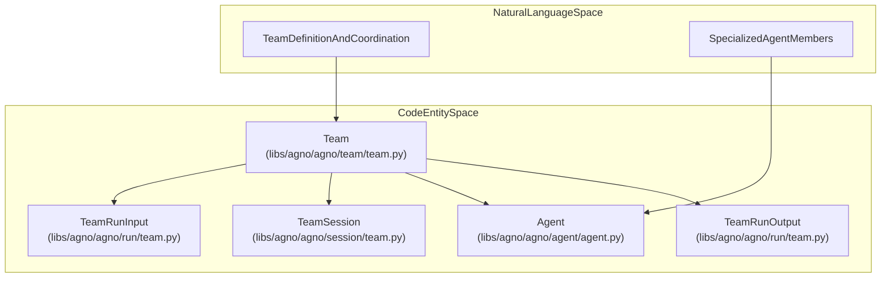
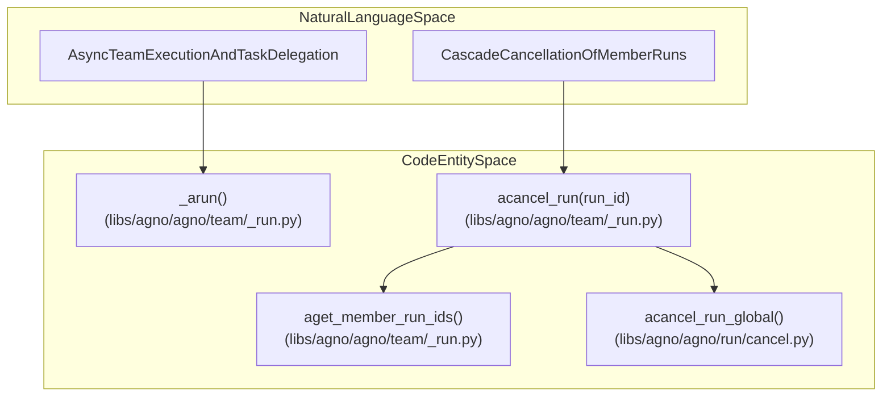
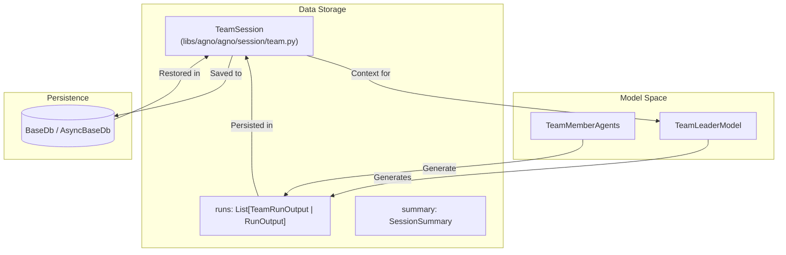

<!-- source: DeepWiki mcp.deepwiki.com · repo agno-agi/agno · page 11.2 Team and Collaboration Examples · fetched 2026-11-09 -->

# Team and Collaboration Examples

Relevant source files

The following files were used as context for generating this wiki page:

- [cookbook/02_agents/05_state_and_session/README.md](cookbook/02_agents/05_state_and_session/README.md)
- [cookbook/02_agents/05_state_and_session/last_n_session_messages.py](cookbook/02_agents/05_state_and_session/last_n_session_messages.py)
- [cookbook/03_teams/07_session/README.md](cookbook/03_teams/07_session/README.md)
- [cookbook/03_teams/07_session/TEST_LOG.md](cookbook/03_teams/07_session/TEST_LOG.md)
- [cookbook/03_teams/07_session/nested_team_deep_history.py](cookbook/03_teams/07_session/nested_team_deep_history.py)
- [cookbook/03_teams/07_session/nested_team_history.py](cookbook/03_teams/07_session/nested_team_history.py)
- [cookbook/03_teams/07_session/nested_team_history_to_members.py](cookbook/03_teams/07_session/nested_team_history_to_members.py)
- [cookbook/06_storage/04_session_summary_limits.py](cookbook/06_storage/04_session_summary_limits.py)
- [cookbook/07_knowledge/09_archive/vector_dbs/qdrant_db_offline_mode.py](cookbook/07_knowledge/09_archive/vector_dbs/qdrant_db_offline_mode.py)
- [cookbook/93_components/workflows/README.md](cookbook/93_components/workflows/README.md)
- [cookbook/93_components/workflows/save_hitl_condition_loop_router.py](cookbook/93_components/workflows/save_hitl_condition_loop_router.py)
- [cookbook/93_components/workflows/save_hitl_confirmation_steps.py](cookbook/93_components/workflows/save_hitl_confirmation_steps.py)
- [cookbook/93_components/workflows/save_hitl_user_input_steps.py](cookbook/93_components/workflows/save_hitl_user_input_steps.py)
- [libs/agno/agno/agent/_response.py](libs/agno/agno/agent/_response.py)
- [libs/agno/agno/session/agent.py](libs/agno/agno/session/agent.py)
- [libs/agno/agno/session/summary.py](libs/agno/agno/session/summary.py)
- [libs/agno/agno/session/team.py](libs/agno/agno/session/team.py)
- [libs/agno/agno/session/workflow.py](libs/agno/agno/session/workflow.py)
- [libs/agno/agno/team/_response.py](libs/agno/agno/team/_response.py)
- [libs/agno/tests/integration/managers/test_session_summary_manager.py](libs/agno/tests/integration/managers/test_session_summary_manager.py)
- [libs/agno/tests/integration/session/test_agent_session.py](libs/agno/tests/integration/session/test_agent_session.py)
- [libs/agno/tests/integration/session/test_share_sessions.py](libs/agno/tests/integration/session/test_share_sessions.py)
- [libs/agno/tests/integration/session/test_team_session.py](libs/agno/tests/integration/session/test_team_session.py)
- [libs/agno/tests/integration/teams/human_in_the_loop/test_continue_run_history_context.py](libs/agno/tests/integration/teams/human_in_the_loop/test_continue_run_history_context.py)
- [libs/agno/tests/integration/teams/test_history.py](libs/agno/tests/integration/teams/test_history.py)
- [libs/agno/tests/integration/teams/test_member_dedup.py](libs/agno/tests/integration/teams/test_member_dedup.py)
- [libs/agno/tests/unit/agent/test_followup_messages.py](libs/agno/tests/unit/agent/test_followup_messages.py)
- [libs/agno/tests/unit/team/test_basic.py](libs/agno/tests/unit/team/test_basic.py)
- [libs/agno/tests/unit/team/test_get_messages_dedup.py](libs/agno/tests/unit/team/test_get_messages_dedup.py)
- [libs/agno/tests/unit/workflow/test_workflow_session.py](libs/agno/tests/unit/workflow/test_workflow_session.py)

This page demonstrates practical examples of multi-agent coordination using the `Team` class (`libs/agno/agno/team/team.py`), showing common patterns for collaborative agent workflows, shared memory, distributed execution, and autonomous task management from `cookbook/03_teams`. These examples illustrate how to build complex agentic systems where multiple specialized agents work together to solve problems.

For information about individual agent patterns, see [Agent System](2.1). For workflow orchestration with sequential/parallel steps, see [Workflow System](2.3). For deployment patterns with AgentOS, see [AgentOS Runtime](7).

---

## 1. Team Coordination Architecture

Teams in Agno enable multiple agents to collaborate on tasks by coordinating their execution, sharing context, and combining their outputs. The `Team` class (`libs/agno/agno/team/team.py`) orchestrates agent members and determines how they interact.

### Team Component Structure and Code Entities

**Sources:** `libs/agno/agno/session/team.py:17-45` (), `libs/agno/tests/unit/team/test_basic.py:22-40` ()

---

## 2. Team Execution Modes and Async Flows

Teams support different coordination modes through configuration flags and asynchronous execution handlers. The orchestration strategy determines how the leader model interacts with members or delegates tasks.

### Execution Mode Configuration

| Parameter | Type | Default | Description |
|-----------|------|---------|-------------|
| `mode` | `Optional[TeamMode]` | `None` | Overrides boolean flags when set. Supports `TeamMode.tasks` for autonomous planning. |
| `delegate_to_all_members` | `bool` | `False` | Execute all members instead of selective delegation. |
| `respond_directly` | `bool` | `False` | Members respond directly without leader processing. |
| `determine_input_for_members` | `bool` | `True` | Leader determines what input each member receives. |

**Sources:** `libs/agno/agno/session/team.py:17-45` (), `libs/agno/tests/unit/team/test_basic.py:22-40` ()

### Async Execution and Cancellation Flow

**Sources:** `libs/agno/agno/session/team.py:17-95` (), `libs/agno/tests/unit/team/test_basic.py:176-196` ()

---

## 3. Session Management and Persistence

Teams maintain state through `TeamSession` instances (`libs/agno/agno/session/team.py`), which are stored in the database. These sessions track the team's progress, member interactions, and overall history.

### Team Session Architecture

**Sources:** `libs/agno/agno/session/team.py:17-61` (), `libs/agno/session/team.py:103-128` ()

### Message Retrieval and Deduplication
The `TeamSession` class provides the `get_messages()` method (`libs/agno/agno/session/team.py:130-169`()) to retrieve historical interactions with complex filtering parameters such as `member_ids`, `last_n_runs`, and `limit`. It automatically deduplicates member runs that appear in both standalone storage and nested within `member_responses` (`libs/agno/tests/unit/team/test_get_messages_dedup.py:108-143`()).

**Sources:** `libs/agno/agno/session/team.py:130-169` (), `libs/agno/tests/unit/team/test_get_messages_dedup.py:108-143` ()

---

## 4. History and Memory Coordination

Teams manage shared history across members to ensure contextually aware collaboration using `TeamSession` and session sharing mechanics (`libs/agno/session/team.py`).

### History Injection Patterns
*   **Member History Retrieval:** Extracts relevant context for specific members from the `TeamSession` using specialized filters (`libs/agno/session/team.py:130-169`()).
*   **Deduplication:** Ensures tool call IDs are unique and not duplicated between team-level and member-level storage (`libs/agno/tests/unit/team/test_get_messages_dedup.py:127-142`()).
*   **Persistence:** Each run within a session preserves temporal order during database storage and retrieval via `upsert_run` (`libs/agno/session/team.py:103-128`()).

**Sources:** `libs/agno/agno/session/team.py:103-169` (), `libs/agno/tests/unit/team/test_get_messages_dedup.py:108-143` ()

---

## 5. Implementation Details and Data Flow

### Team Run Input Handling
`TeamSession` manages sessions containing mixed execution outputs from both team leaders (`TeamRunOutput`) and individual members (`RunOutput`). The `upsert_run` method handles appending and updating runs while preserving state markers like `queue_attempt` (`libs/agno/session/team.py:103-128`()).

**Sources:** `libs/agno/agno/session/team.py:103-128` (), `libs/agno/session/agent.py:99-122` ()

### Session Summaries and Metrics
`SessionSummaryManager` (`libs/agno/agno/session/summary.py`) automatically generates conversational summaries and tracks topics discussed across sessions, integrating with `TeamSession` and `AgentSession` to maintain long-term memory without blowing up context windows.

**Sources:** `libs/agno/agno/session/summary.py:63-118` (), `libs/agno/tests/unit/team/test_basic.py:142-173` ()

---

