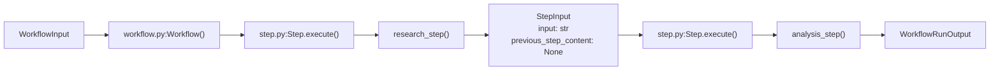
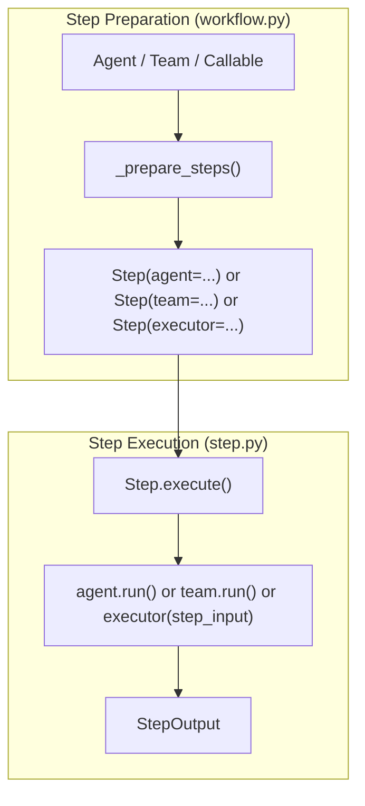
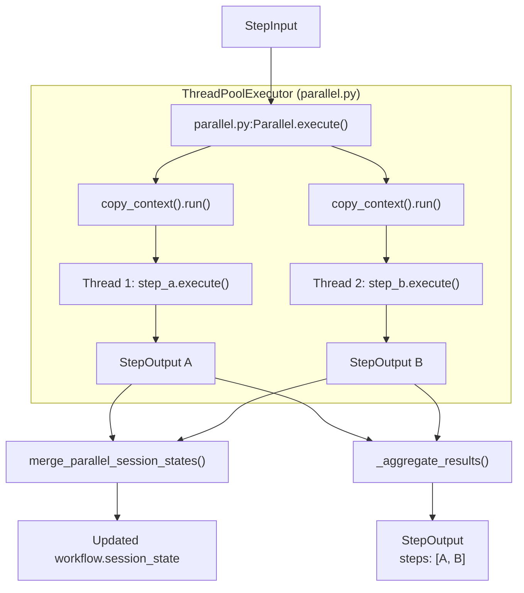
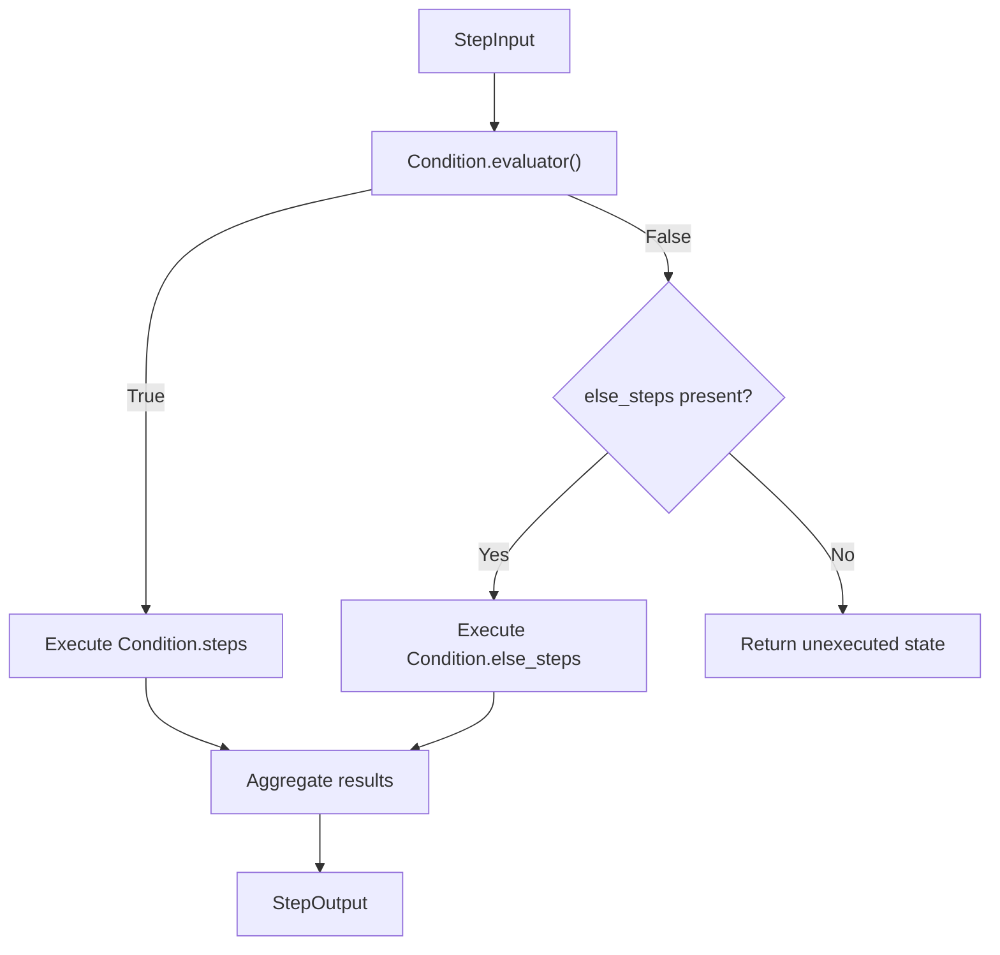
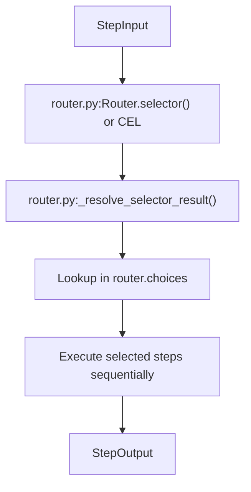
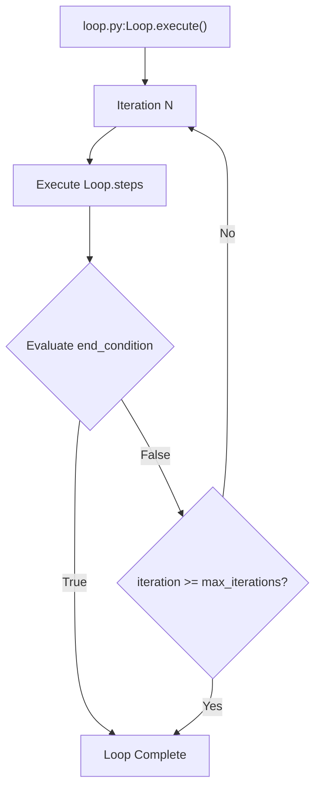

<!-- source: DeepWiki mcp.deepwiki.com · repo agno-agi/agno · page 11.3 Workflow Orchestration Examples · fetched 2026-11-09 -->

# Workflow Orchestration Examples

<details>
<summary>Relevant source files</summary>

The following files were used as context for generating this wiki page:

- [cookbook/04_workflows/03_loop_execution/loop_iterative_accumulation.py](cookbook/04_workflows/03_loop_execution/loop_iterative_accumulation.py)
- [cookbook/04_workflows/08_human_in_the_loop/condition/02_condition_on_error.py](cookbook/04_workflows/08_human_in_the_loop/condition/02_condition_on_error.py)
- [libs/agno/agno/run/workflow.py](libs/agno/agno/run/workflow.py)
- [libs/agno/agno/workflow/condition.py](libs/agno/agno/workflow/condition.py)
- [libs/agno/agno/workflow/loop.py](libs/agno/agno/workflow/loop.py)
- [libs/agno/agno/workflow/parallel.py](libs/agno/agno/workflow/parallel.py)
- [libs/agno/agno/workflow/router.py](libs/agno/agno/workflow/router.py)
- [libs/agno/agno/workflow/step.py](libs/agno/agno/workflow/step.py)
- [libs/agno/agno/workflow/steps.py](libs/agno/agno/workflow/steps.py)
- [libs/agno/agno/workflow/types.py](libs/agno/agno/workflow/types.py)
- [libs/agno/agno/workflow/workflow.py](libs/agno/agno/workflow/workflow.py)
- [libs/agno/tests/integration/workflows/test_condition_steps.py](libs/agno/tests/integration/workflows/test_condition_steps.py)
- [libs/agno/tests/integration/workflows/test_loop_steps.py](libs/agno/tests/integration/workflows/test_loop_steps.py)
- [libs/agno/tests/integration/workflows/test_parallel_steps.py](libs/agno/tests/integration/workflows/test_parallel_steps.py)
- [libs/agno/tests/integration/workflows/test_router_steps.py](libs/agno/tests/integration/workflows/test_router_steps.py)
- [libs/agno/tests/unit/workflow/test_media_aggregation.py](libs/agno/tests/unit/workflow/test_media_aggregation.py)
- [libs/agno/tests/unit/workflow/test_parallel_run_context_isolation.py](libs/agno/tests/unit/workflow/test_parallel_run_context_isolation.py)
- [libs/agno/tests/unit/workflow/test_previous_content_values.py](libs/agno/tests/unit/workflow/test_previous_content_values.py)
- [libs/agno/tests/unit/workflow/test_step_output_content_roundtrip.py](libs/agno/tests/unit/workflow/test_step_output_content_roundtrip.py)

</details>


This page illustrates multi-step workflows, parallel execution, conditional branching, loops, Human-in-the-Loop (HITL) patterns, and Common Expression Language (CEL) expressions using the Agno workflow system (`libs/agno/agno/workflow/`). It provides technical detail on implementation, data flow, and key classes based on `agno.workflow` modules and cookbook examples.

For foundational concepts about the workflow system architecture, see [2.3](). For details on individual step types and their execution semantics, see [2.3.1](). For information on step execution context and state management, see [2.3.2]().

## Sequential Step Execution

The simplest workflow pattern executes steps sequentially. Each step receives input via `StepInput`, which includes `previous_step_content` and `previous_step_outputs` [libs/agno/agno/workflow/workflow.py:730-760]().

### Basic Sequential Workflow Implementation

```python
from agno.workflow import Workflow, Step, StepInput, StepOutput

def research_step(step_input: StepInput) -> StepOutput:
    return StepOutput(content="Research findings...")

def analysis_step(step_input: StepInput) -> StepOutput:
    previous = step_input.previous_step_content
    return StepOutput(content=f"Analysis of: {previous}")

workflow = Workflow(
    name="Sequential Pipeline",
    steps=[research_step, analysis_step]
)
```

**Sequential Execution Flow (Natural Language Space to Code Entity Space)**


Sources: [libs/agno/agno/workflow/workflow.py:1-220](), [libs/agno/agno/workflow/step.py:1-198]()

### Using Agent and Team Steps

Steps can execute `Agent` or `Team` instances directly. The workflow initialization automatically wraps these in `Step` objects via `_prepare_steps()` [libs/agno/agno/workflow/workflow.py:172-184]().

```python
from agno.agent import Agent
from agno.workflow import Workflow

researcher = Agent(name="Researcher")
analyst = Agent(name="Analyst")

workflow = Workflow(
    steps=[researcher, analyst]
)
```

**Agent/Team Step Wrapping Architecture**


Sources: [libs/agno/agno/workflow/workflow.py:172-184](), [libs/agno/agno/workflow/step.py:1-198]()

---

## Parallel Execution

The `Parallel` class executes multiple steps concurrently using a `ThreadPoolExecutor`. Results are aggregated into a single `StepOutput` [libs/agno/agno/workflow/parallel.py:47-97]().

### Basic Parallel Execution

```python
from agno.workflow import Parallel

parallel = Parallel(step_a, step_b, name="Parallel Phase")
```

**Parallel Execution Architecture (Natural Language Space to Code Entity Space)**



Each parallel step receives a `deepcopy` of `session_state` to prevent race conditions. After execution, changes are merged back into the workflow state using `merge_parallel_session_states` [libs/agno/agno/workflow/parallel.py:25-25](). The `Parallel` class uses `copy_context().run()` to ensure `ContextVar` propagation in child threads [libs/agno/tests/integration/workflows/test_parallel_steps.py:169-184]().

Sources: [libs/agno/agno/workflow/parallel.py:47-97](), [libs/agno/agno/workflow/parallel.py:25-25](), [libs/agno/tests/integration/workflows/test_parallel_steps.py:169-184]()

---

## Conditional Branching

The `Condition` class evaluates a predicate (callable, boolean literal, or CEL expression string) and executes either `steps` or `else_steps` [libs/agno/agno/workflow/condition.py:55-120]().

### Condition with Else Branch

```python
from agno.workflow import Condition, Workflow

workflow = Workflow(
    steps=[
        Condition(
            evaluator=lambda x: "urgent" in x.input,
            steps=[priority_step],
            else_steps=[normal_step]
        )
    ]
)
```

**Conditional Branch Execution Flow**


Sources: [libs/agno/agno/workflow/condition.py:55-120]()

### CEL Expression Evaluators in Conditions

Conditions support Common Expression Language (CEL) evaluation strings. These expressions have access to `input`, `previous_step_content`, `previous_step_outputs`, `additional_data`, and `session_state` [libs/agno/agno/workflow/condition.py:67-79]().

```python
Condition(
    evaluator='input.contains("urgent") && session_state.retry_count < 3',
    steps=[priority_step]
)
```
Sources: [libs/agno/agno/workflow/condition.py:67-79](), [libs/agno/agno/workflow/condition.py:21-32]()

---

## Dynamic Routing

The `Router` class dynamically selects which step(s) to execute using a `selector` function, a CEL expression returning step names, or HITL route selection [libs/agno/agno/workflow/router.py:49-105]().

```python
from agno.workflow import Router, StepInput

def route_selector(step_input: StepInput):
    if "billing" in step_input.input:
        return ["billing_step"]
    return ["support_step"]

router = Router(
    selector=route_selector,
    choices=[billing_step, support_step]
)
```

**Router Step Resolution Flow**


Sources: [libs/agno/agno/workflow/router.py:49-105]()

---

## Loop Execution

The `Loop` class repeatedly executes a list of steps until an `end_condition` evaluates to `true` or `max_iterations` is reached [libs/agno/agno/workflow/loop.py:42-106](). Setting `forward_iteration_output=True` forwards each iteration's output as input to the next [libs/agno/agno/workflow/loop.py:79-81]().

```python
from agno.workflow import Loop

Loop(
    steps=[research_step],
    end_condition='current_iteration >= 3',
    max_iterations=5,
    forward_iteration_output=True
)
```

**Loop Execution Flow**


Sources: [libs/agno/agno/workflow/loop.py:42-106]()

---

## Human-in-the-Loop (HITL) Workflows

Agno workflows support pausing execution for human review via `HumanReview` configurations on `Step`, `Loop`, `Router`, `Condition`, and `Steps` [libs/agno/agno/workflow/types.py:65-107]().

### Output Review and Feedback

```python
from agno.workflow import Workflow, Step, HumanReview, OnReject

workflow = Workflow(
    steps=[
        Step(
            name="draft_email",
            agent=draft_agent,
            human_review=HumanReview(
                requires_output_review=True,
                on_reject=OnReject.retry,
                max_retries=3
            ),
        ),
    ]
)
```

**Output Review Pattern**

```mermaid
graph TD
    Agent["Agent Execution"] --> Output["StepOutput Generated"]
    Output --> ReviewCheck{"requires_output_review?"}
    ReviewCheck -->|Yes| Pause["Workflow Paused (StepPausedEvent)"]
    Pause --> Human["Human Reviewer Action"]
    Human -->|Confirm| Continue["Proceed to Next Step"]
    Human -->|Reject + Feedback| Retry["Retry Agent with Feedback"]
    Human -->|Edit| Edit["Update Output and Continue"]
    Retry --> Agent
```


Sources: [libs/agno/agno/workflow/types.py:65-107](), [libs/agno/agno/workflow/types.py:20-33]()

### HITL Timeouts

Workflows can handle unresponsiveness during pauses by setting `timeout` and `OnTimeout` strategies (`cancel`, `skip`, or `approve`) [libs/agno/agno/workflow/types.py:36-47], [libs/agno/agno/workflow/types.py:105-106]().

```python
Step(
    name="draft_email",
    human_review=HumanReview(
        requires_output_review=True,
        timeout=300,
        on_timeout=OnTimeout.approve
    )
)
```
Sources: [libs/agno/agno/workflow/types.py:36-47], [libs/agno/agno/workflow/types.py:105-106]()

---

## Data Flow and State Management

### Session State Propagation

The `session_state` dictionary is stored in the `WorkflowSession` and passed via `StepInput`. Parallel execution threads utilize `merge_parallel_session_states` to safely integrate updates from concurrent branches [libs/agno/agno/workflow/parallel.py:25-25]().

### Run History

`WorkflowSession` maintains execution history across runs, which can be injected into agent contexts for long-running workflows [libs/agno/agno/workflow/step.py:117-135]().

Sources: [libs/agno/agno/workflow/parallel.py:25-25](), [libs/agno/agno/workflow/step.py:117-135]()

---

