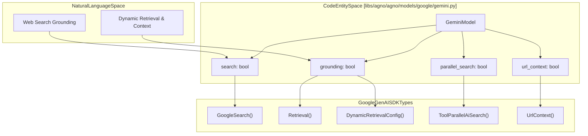
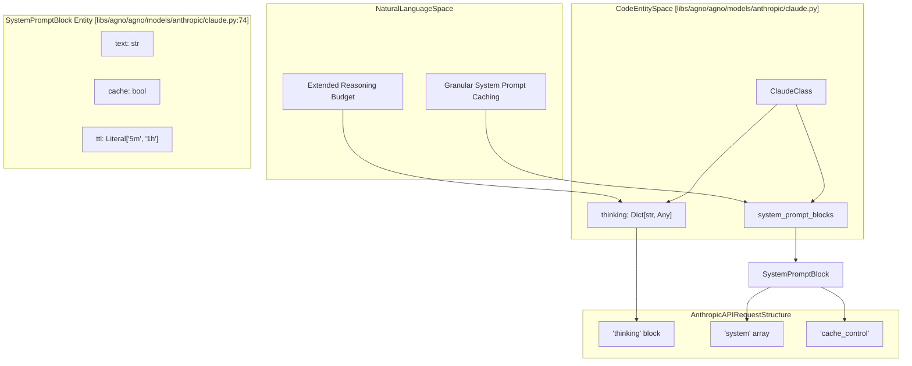
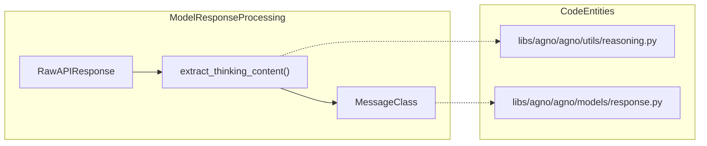
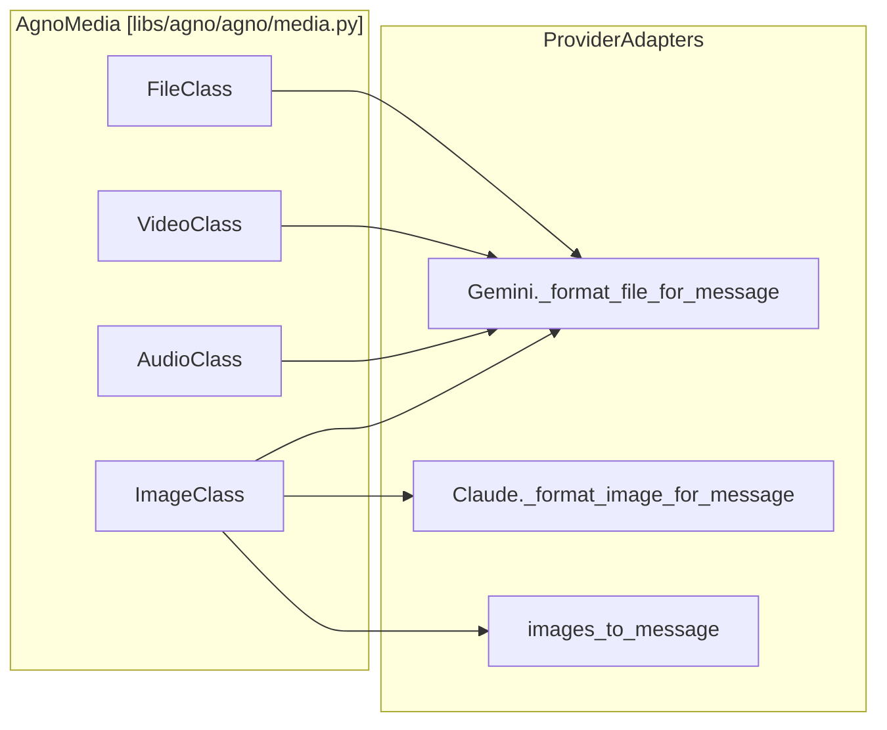

<!-- source: DeepWiki mcp.deepwiki.com · repo agno-agi/agno · page 11.4 Model-Specific Examples · fetched 2026-11-09 -->

# Model-Specific Examples

Relevant source files

The following files were used as context for generating this wiki page:

- [cookbook/10_reasoning/models/anthropic/TEST_LOG.md](cookbook/10_reasoning/models/anthropic/TEST_LOG.md)
- [cookbook/90_models/anthropic/TEST_LOG.md](cookbook/90_models/anthropic/TEST_LOG.md)
- [cookbook/90_models/anthropic/csv_input.py](cookbook/90_models/anthropic/csv_input.py)
- [cookbook/90_models/anthropic/financial_analyst_thinking.py](cookbook/90_models/anthropic/financial_analyst_thinking.py)
- [cookbook/90_models/anthropic/thinking.py](cookbook/90_models/anthropic/thinking.py)
- [cookbook/90_models/openai/responses/README.md](cookbook/90_models/openai/responses/README.md)
- [cookbook/90_models/openai/responses/TEST_LOG.md](cookbook/90_models/openai/responses/TEST_LOG.md)
- [cookbook/90_models/openai/responses/background.py](cookbook/90_models/openai/responses/background.py)
- [cookbook/90_models/openai/responses/stored_responses_without_chaining.py](cookbook/90_models/openai/responses/stored_responses_without_chaining.py)
- [cookbook/90_models/openrouter/responses/tool_use.py](cookbook/90_models/openrouter/responses/tool_use.py)
- [cookbook/91_tools/models_lab_tools.py](cookbook/91_tools/models_lab_tools.py)
- [cookbook/gemini_3/.gitignore](cookbook/gemini_3/.gitignore)
- [cookbook/gemini_3/11_text_to_speech.py](cookbook/gemini_3/11_text_to_speech.py)
- [cookbook/gemini_3/15_file_search.py](cookbook/gemini_3/15_file_search.py)
- [libs/agno/agno/models/anthropic/claude.py](libs/agno/agno/models/anthropic/claude.py)
- [libs/agno/agno/models/aws/claude.py](libs/agno/agno/models/aws/claude.py)
- [libs/agno/agno/models/azure/claude.py](libs/agno/agno/models/azure/claude.py)
- [libs/agno/agno/models/azure/openai_chat.py](libs/agno/agno/models/azure/openai_chat.py)
- [libs/agno/agno/models/openai/chat.py](libs/agno/agno/models/openai/chat.py)
- [libs/agno/agno/models/openai/responses.py](libs/agno/agno/models/openai/responses.py)
- [libs/agno/agno/models/openrouter/responses.py](libs/agno/agno/models/openrouter/responses.py)
- [libs/agno/agno/models/vertexai/claude.py](libs/agno/agno/models/vertexai/claude.py)
- [libs/agno/agno/reasoning/step.py](libs/agno/agno/reasoning/step.py)
- [libs/agno/agno/tools/models_labs.py](libs/agno/agno/tools/models_labs.py)
- [libs/agno/agno/utils/media.py](libs/agno/agno/utils/media.py)
- [libs/agno/agno/utils/models/claude.py](libs/agno/agno/utils/models/claude.py)
- [libs/agno/tests/integration/models/openai/chat/test_basic.py](libs/agno/tests/integration/models/openai/chat/test_basic.py)
- [libs/agno/tests/integration/models/openai/chat/test_reasoning_streaming.py](libs/agno/tests/integration/models/openai/chat/test_reasoning_streaming.py)
- [libs/agno/tests/integration/models/openai/responses/test_basic.py](libs/agno/tests/integration/models/openai/responses/test_basic.py)
- [libs/agno/tests/unit/models/anthropic/test_append_trailing_user_message.py](libs/agno/tests/unit/models/anthropic/test_append_trailing_user_message.py)
- [libs/agno/tests/unit/models/anthropic/test_citation_replay.py](libs/agno/tests/unit/models/anthropic/test_citation_replay.py)
- [libs/agno/tests/unit/models/anthropic/test_citation_suppression.py](libs/agno/tests/unit/models/anthropic/test_citation_suppression.py)
- [libs/agno/tests/unit/models/anthropic/test_request_kwargs_match_sdk.py](libs/agno/tests/unit/models/anthropic/test_request_kwargs_match_sdk.py)
- [libs/agno/tests/unit/models/anthropic/test_thinking_replay.py](libs/agno/tests/unit/models/anthropic/test_thinking_replay.py)
- [libs/agno/tests/unit/models/openai/test_openai_responses_background.py](libs/agno/tests/unit/models/openai/test_openai_responses_background.py)
- [libs/agno/tests/unit/models/openai/test_openai_responses_chaining.py](libs/agno/tests/unit/models/openai/test_openai_responses_chaining.py)
- [libs/agno/tests/unit/models/openai/test_openai_responses_id_handling.py](libs/agno/tests/unit/models/openai/test_openai_responses_id_handling.py)
- [libs/agno/tests/unit/models/openrouter_model/test_openrouter_responses.py](libs/agno/tests/unit/models/openrouter_model/test_openrouter_responses.py)
- [libs/agno/tests/unit/models/openrouter_model/test_openrouter_responses_reasoning.py](libs/agno/tests/unit/models/openrouter_model/test_openrouter_responses_reasoning.py)
- [libs/agno/tests/unit/models/test_client_caching.py](libs/agno/tests/unit/models/test_client_caching.py)
- [libs/agno/tests/unit/models/test_cross_model_tool_calls.py](libs/agno/tests/unit/models/test_cross_model_tool_calls.py)
- [libs/agno/tests/unit/scorer/test_model_identity.py](libs/agno/tests/unit/scorer/test_model_identity.py)
- [libs/agno/tests/unit/utils/test_claude.py](libs/agno/tests/unit/utils/test_claude.py)
- [libs/agno/tests/unit/utils/test_media_reconstruction.py](libs/agno/tests/unit/utils/test_media_reconstruction.py)

This page provides technical details and implementation patterns for provider-specific features within the Agno framework. While Agno provides a unified `Model` interface (`[libs/agno/agno/models/base.py]()`), certain providers offer unique capabilities—such as Claude's thinking mode and system prompt caching, Gemini's search grounding, and OpenAI's reasoning and responses APIs—that require specialized configuration and handling.

---

## 1. Gemini: Grounding and Multimodal Capabilities

The `Gemini` model class integrates with the `google-genai` SDK to provide support for Google's native features, including web search grounding, file search, and advanced multimodal handling `[libs/agno/agno/models/google/gemini.py:82-142]()`.

### Gemini Grounding and Search Architecture

**Sources:** `[libs/agno/agno/models/google/gemini.py:107-116]`, `[libs/agno/agno/models/google/gemini.py:43-65]`

### Implementation Details
*   **Search Grounding**: When `search=True` or `grounding=True` is set, the `Gemini` model initializes the corresponding `GoogleSearch` or `Retrieval` tools within the `google.genai` client `[libs/agno/agno/models/google/gemini.py:107-109]()`.
*   **Parallel Search**: Specifically for Vertex AI, `parallel_search` utilizes the `ToolParallelAiSearch` type to leverage grounding with public web data `[libs/agno/agno/models/google/gemini.py:114-121]()`.
*   **Multimodal Formatting**: The `_format_file_for_message` method handles Agno `File` objects by converting them into Gemini `Part` objects using `Part.from_bytes` for local content or `Part.from_uri` for GCS/HTTPS URIs `[libs/agno/agno/models/google/gemini.py:532-588]()`.
*   **Thinking Budget**: Gemini models support reasoning via `thinking_budget`, `include_thoughts`, and `thinking_level` parameters `[libs/agno/agno/models/google/gemini.py:139-141]()`.

Sources: `[libs/agno/agno/models/google/gemini.py:82-159]`, `[libs/agno/tests/unit/models/google/test_gemini.py:94-162]`

---

## 2. Claude: Thinking Mode, Skills, Caching, and Cloud Variants

Anthropic's Claude integration supports extended thinking (reasoning tokens), a granular caching system via system prompt blocks, specialized skills like PDF/Excel handling, and cloud provider subclasses including AWS Bedrock, Vertex AI, and Azure AI Foundry `[libs/agno/agno/models/anthropic/claude.py:95-170]()`, `[libs/agno/agno/models/aws/claude.py:27-48]()`, `[libs/agno/agno/models/vertexai/claude.py:22-41]()`, `[libs/agno/agno/models/azure/claude.py:28-48]()`.

### Claude Thinking and Cache Implementation

**Sources:** `[libs/agno/agno/models/anthropic/claude.py:74-91]`, `[libs/agno/agno/models/anthropic/claude.py:132-150]`

### Advanced Features & Cloud Integrations
*   **Thinking Mode**: Enabled via the `thinking` parameter, which accepts a dictionary defining reasoning budgets. The framework maintains a `NON_THINKING_MODELS` set to validate support `[libs/agno/agno/models/anthropic/claude.py:105-111]()`, `[libs/agno/agno/models/anthropic/claude.py:134-134]()`.
*   **Prompt Caching**: Beyond the model-level `cache_system_prompt`, Agno allows `system_prompt_blocks` which can be a list or a callable. Each `SystemPromptBlock` can independently trigger `cache_control` `[libs/agno/agno/models/anthropic/claude.py:140-149]()`.
*   **Skills**: Supports Anthropic-specific skills (e.g., `pptx`, `pdf`) via the `skills` parameter, which are injected into the request body `[libs/agno/agno/models/anthropic/claude.py:156-158]()`.
*   **Cloud Subclasses**: 
    *   `AwsBedrockAnthropicClaude` (`[libs/agno/agno/models/aws/claude.py:28-37]()`) manages IAM credentials and boto3 sessions, disabling native structured outputs due to Bedrock protocol constraints `[libs/agno/agno/models/aws/claude.py:52-54]()`.
    *   `VertexAI Claude` (`[libs/agno/agno/models/vertexai/claude.py:23-33]()`) configures GCP region and project-id parameters.
    *   `Azure AI Foundry Claude` (`[libs/agno/agno/models/azure/claude.py:28-38]()`) integrates with Azure resources and AD token providers.

Sources: `[libs/agno/agno/models/anthropic/claude.py:95-176]`, `[libs/agno/agno/models/aws/claude.py:27-106]`, `[libs/agno/agno/models/vertexai/claude.py:22-65]`, `[libs/agno/agno/models/azure/claude.py:28-88]`

---

## 3. OpenAI: Chat vs. Responses APIs, Chaining, and Azure Variants

Agno provides distinct implementations for OpenAI: `OpenAIChat` (`[libs/agno/agno/models/openai/chat.py:35]()`) for standard completions and `OpenAIResponses` (`[libs/agno/agno/models/openai/responses.py:32]()`) for the newer, stateful Responses API.

### OpenAI Model Differences

| Feature | OpenAIChat | OpenAIResponses |
|:---|:---|:---|
| **Primary Use** | Standard stateless completions | Stateful interaction with built-in tools |
| **Reasoning Support** | `reasoning_effort` parameter | `reasoning` dict (effort, summary) |
| **Structured Output** | `strict_output` via `response_format` | `strict_output` native support |
| **Background Mode** | Not Supported | Supported via `background=True` |
| **Tool Calling** | Standard Function calling | `max_tool_calls`, `parallel_tool_calls` |

**Sources:** `[libs/agno/agno/models/openai/chat.py:49-76]`, `[libs/agno/agno/models/openai/responses.py:44-71]`

### Responses API Chaining and Storage
*   `OpenAIResponses` manages conversation continuity independently of automatic message history replaying via `use_previous_response_id` and `store` flags `[libs/agno/agno/models/openai/responses.py:55-58]()`.
*   When a stale or foreign `previous_response_id` returns a 400 error, `_chain_rejected` catches the exception and falls back to context replaying `[libs/agno/agno/models/openai/responses.py:124-144]()`.
*   **Azure OpenAI**: `AzureOpenAI` (`[libs/agno/agno/models/azure/openai_chat.py:20-44]()`) extends `OpenAILike` to support Azure-specific endpoints, deployments, and `azure_ad_token_provider` workflows.

Sources: `[libs/agno/agno/models/openai/responses.py:32-153]`, `[libs/agno/agno/models/azure/openai_chat.py:20-123]`

---

## 4. DeepSeek and OpenRouter / Other Providers

DeepSeek models, OpenRouter, and other providers are integrated via `OpenAILike` or dedicated provider wrappers. Agno ensures thinking content and intermediate steps are captured during both standard invocation and streaming across compatible reasoning endpoints.

### Thinking Content Extraction Flow

**Sources:** `[libs/agno/agno/utils/reasoning.py:1-50]`, `[libs/agno/agno/models/response.py:1-30]`

---

## 5. Unified Media Support

Agno uses the `agno.media` module to standardize multimodal inputs (`Image`, `Audio`, `Video`, `File`) across different model providers `[libs/agno/agno/media.py:1-8]()`.

### Provider Media Implementation Mapping

**Sources:** `[libs/agno/agno/models/google/gemini.py:532-588]`, `[libs/agno/agno/utils/models/claude.py:128-130]`, `[libs/agno/agno/utils/openai.py:20]`

### Technical Constraints
*   **Gemini File Search**: Gemini can search across provided stores using `file_search_store_names` and `file_search_metadata_filter` `[libs/agno/agno/models/google/gemini.py:124-125]()`.
*   **Claude Citation Suppression**: When using structured outputs with Claude, Agno automatically suppresses citations because the Anthropic API rejects the combination of `citations` and `output_format` `[libs/agno/agno/models/anthropic/claude.py:160-163]()`.
*   **OpenAI Audio**: `OpenAIChat` supports native audio modalities via the `audio` and `modalities` parameters `[libs/agno/agno/models/openai/chat.py:60-63]()`.

Sources: `[libs/agno/agno/models/google/gemini.py:82-142]`, `[libs/agno/agno/models/anthropic/claude.py:95-176]`, `[libs/agno/agno/models/openai/chat.py:35-100]`

---

