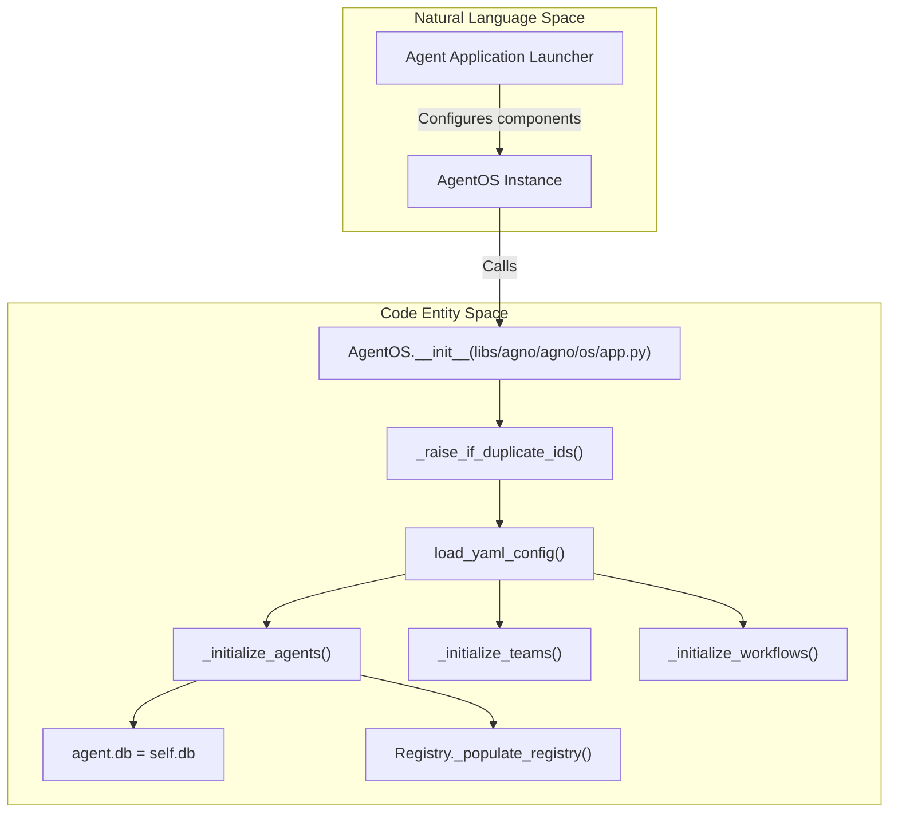
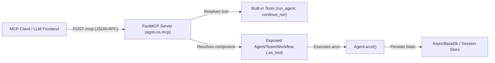
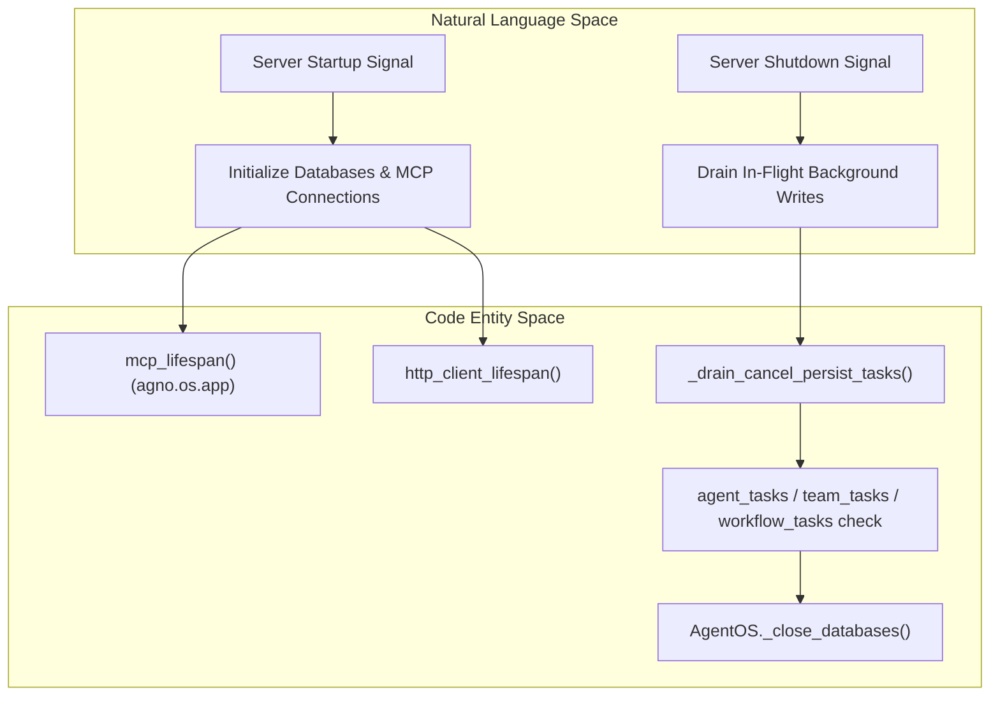

<!-- source: DeepWiki mcp.deepwiki.com · repo agno-agi/agno · page 11.6 AgentOS Deployment Examples · fetched 2026-11-09 -->

# AgentOS Deployment Examples

<details>
<summary>Relevant source files</summary>

The following files were used as context for generating this wiki page:

- [cookbook/01_demo/README.md](cookbook/01_demo/README.md)
- [cookbook/01_demo/TEST_LOG.md](cookbook/01_demo/TEST_LOG.md)
- [cookbook/01_demo/agents/code_search.py](cookbook/01_demo/agents/code_search.py)
- [cookbook/01_demo/agents/git_wiki.py](cookbook/01_demo/agents/git_wiki.py)
- [cookbook/01_demo/agents/local_wiki.py](cookbook/01_demo/agents/local_wiki.py)
- [cookbook/01_demo/agents/notion_wiki.py](cookbook/01_demo/agents/notion_wiki.py)
- [cookbook/01_demo/config.yaml](cookbook/01_demo/config.yaml)
- [cookbook/01_demo/db.py](cookbook/01_demo/db.py)
- [cookbook/01_demo/evals/cases.py](cookbook/01_demo/evals/cases.py)
- [cookbook/01_demo/generate_requirements.sh](cookbook/01_demo/generate_requirements.sh)
- [cookbook/01_demo/requirements.in](cookbook/01_demo/requirements.in)
- [cookbook/01_demo/requirements.txt](cookbook/01_demo/requirements.txt)
- [cookbook/01_demo/run.py](cookbook/01_demo/run.py)
- [cookbook/03_teams/02_modes/broadcast/04_structured_debate.py](cookbook/03_teams/02_modes/broadcast/04_structured_debate.py)
- [cookbook/05_agent_os/14_mcp/README.md](cookbook/05_agent_os/14_mcp/README.md)
- [cookbook/05_agent_os/14_mcp/TEST_LOG.md](cookbook/05_agent_os/14_mcp/TEST_LOG.md)
- [cookbook/05_agent_os/14_mcp/inspect_tools.py](cookbook/05_agent_os/14_mcp/inspect_tools.py)
- [libs/agno/agno/os/app.py](libs/agno/agno/os/app.py)
- [libs/agno/agno/os/config.py](libs/agno/agno/os/config.py)
- [libs/agno/agno/os/mcp.py](libs/agno/agno/os/mcp.py)
- [libs/agno/agno/os/middleware/mcp_routing.py](libs/agno/agno/os/middleware/mcp_routing.py)
- [libs/agno/agno/os/public/_policy.py](libs/agno/agno/os/public/_policy.py)
- [libs/agno/agno/os/router.py](libs/agno/agno/os/router.py)
- [libs/agno/agno/os/schema.py](libs/agno/agno/os/schema.py)
- [libs/agno/tests/unit/os/test_info_endpoint.py](libs/agno/tests/unit/os/test_info_endpoint.py)
- [libs/agno/tests/unit/os/test_mcp_routing.py](libs/agno/tests/unit/os/test_mcp_routing.py)
- [libs/agno/tests/unit/os/test_mcp_server.py](libs/agno/tests/unit/os/test_mcp_server.py)

</details>


This page demonstrates practical deployment patterns for `AgentOS` [libs/agno/agno/os/app.py:1-100](), the FastAPI-based runtime that exposes agents, teams, and workflows via REST, WebSocket, and Model Context Protocol (MCP) APIs. It covers production-grade deployment, specialized interfaces like Slack, AG-UI, and MCP, custom endpoints, authentication, WebSocket streaming, and the lifecycle management required for stateful agentic systems.

---

## Basic AgentOS Deployment

The simplest `AgentOS` [libs/agno/agno/os/app.py:1-100]() deployment creates an instance with registered agents, teams, or workflows, and calls `get_app()` to retrieve the fully configured FastAPI application. This application includes pre-configured routes for running agents, managing sessions, and accessing memory [libs/agno/agno/os/router.py:70-177]().

### Minimal Deployment Pattern

```python
from agno import Agent, AgentOS
from agno.models.openai import OpenAIChat
from agno.db.sqlite import SqliteDb

# Create agent with database persistence
agent = Agent(
    id="web-agent",
    name="Web Agent",
    model=OpenAIChat(id="gpt-4o"),
    db=SqliteDb(db_file="tmp/agents.db"),
)

# Create AgentOS instance
agent_os = AgentOS(
    name="My Agent System",
    agents=[agent],
)

# Get configured FastAPI app
app = agent_os.get_app()
```

### AgentOS Initialization and Component Registration Flow

The `AgentOS` constructor and its initialization routines handle component validation, registry population, and database binding [libs/agno/agno/os/app.py:223-340]().

Title: "AgentOS Initialization and Code Entity Binding"


**Sources:** [libs/agno/agno/os/app.py:192-340](), [libs/agno/agno/os/router.py:70-177]()

---

## Specialized Interfaces and MCP Integration

AgentOS provides built-in interface routers that map external event streams and protocols to Agno agent executions. These include Slack event handlers [cookbook/01_demo/run.py](), the AG-UI CopilotKit streaming protocol, and the Model Context Protocol (MCP) server.

### Model Context Protocol (MCP) Server

AgentOS can expose agents, teams, workflows, custom callables, and toolkits as an MCP server at `/mcp` using `MCPConfig` [libs/agno/agno/os/config.py:44-126]() and `build_mcp_server` [libs/agno/agno/os/mcp.py:1-168]().

* **Default Tools**: Exposes core operator tools (`run_agent`, `run_team`, `run_workflow`, `continue_run`, `cancel_run`, `get_agentos_config`) and session tools (`get_sessions`, `get_session_runs`) [cookbook/05_agent_os/14_mcp/README.md:38-52]().
* **Exposed Components**: Components can be registered directly or via `.as_tool(name=..., description=...)` to publish them under model-facing tool names [cookbook/05_agent_os/14_mcp/README.md:70-82]().

Title: "MCP Server Data Flow and Tool Resolution"


**Sources:** [libs/agno/agno/os/config.py:44-126](), [libs/agno/agno/os/mcp.py:1-168](), [cookbook/05_agent_os/14_mcp/README.md:1-155]()

---

## Authentication and Security

AgentOS handles security using security keys, Personal Access Tokens (PATs), and JWT-based authorization headers [libs/agno/agno/os/router.py:15-26]().

| Security Mode | Implementation / Mechanism |
| :--- | :--- |
| **JWT Authentication** | `JWTMiddleware` validates incoming Bearer tokens using configured verification keys and algorithms. |
| **Service Account Tokens** | Validated via `ServiceAccountVerification` and checked for required RBAC scopes [libs/agno/agno/os/schema.py:128-154](). |
| **WebSocket Security** | `validate_websocket_token` and `verify_websocket_service_account` authenticate real-time connections during the WebSocket handshake [libs/agno/agno/os/router.py:20-22](). |
| **CORS Policy** | Managed through `CORSConfig` and `update_cors_middleware` to restrict cross-origin access [libs/agno/agno/os/app.py:56-92](). |

**Sources:** [libs/agno/agno/os/router.py:15-26](), [libs/agno/agno/os/schema.py:119-154](), [libs/agno/agno/os/config.py:30-34]()

---

## Lifecycle Management and Custom FastAPI Applications

AgentOS applications use lifespan context managers to coordinate resource allocation, connection pools, and clean shutdowns [libs/agno/agno/os/app.py:128-177]().

### Application Lifespan and Cleanup Flow

Title: "AgentOS Lifespan and Shutdown Sequence"


**Sources:** [libs/agno/agno/os/app.py:128-177](), [cookbook/01_demo/run.py:36-49]()

---

