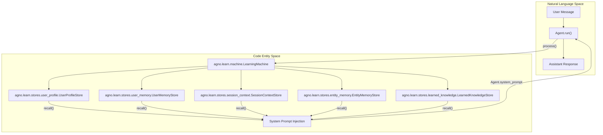
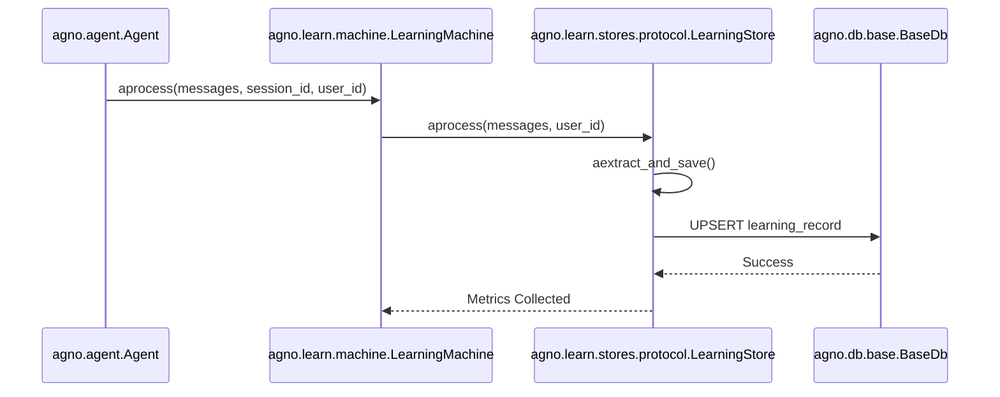

<!-- source: DeepWiki mcp.deepwiki.com · repo agno-agi/agno · page 11.7 Learning Machine Examples · fetched 2026-11-09 -->

# Learning Machine Examples

Relevant source files

The following files were used as context for generating this wiki page:

- [cookbook/08_learning/01_basics/6_extraction_limits.py](cookbook/08_learning/01_basics/6_extraction_limits.py)
- [cookbook/08_learning/07_patterns/research_assistant.py](cookbook/08_learning/07_patterns/research_assistant.py)
- [libs/agno/agno/agent/_init.py](libs/agno/agno/agent/_init.py)
- [libs/agno/agno/agent/_managers.py](libs/agno/agno/agent/_managers.py)
- [libs/agno/agno/learn/__init__.py](libs/agno/agno/learn/__init__.py)
- [libs/agno/agno/learn/config.py](libs/agno/agno/learn/config.py)
- [libs/agno/agno/learn/machine.py](libs/agno/agno/learn/machine.py)
- [libs/agno/agno/learn/schemas.py](libs/agno/agno/learn/schemas.py)
- [libs/agno/agno/learn/stores/__init__.py](libs/agno/agno/learn/stores/__init__.py)
- [libs/agno/agno/learn/stores/entity_memory.py](libs/agno/agno/learn/stores/entity_memory.py)
- [libs/agno/agno/learn/stores/learned_knowledge.py](libs/agno/agno/learn/stores/learned_knowledge.py)
- [libs/agno/agno/learn/stores/session_context.py](libs/agno/agno/learn/stores/session_context.py)
- [libs/agno/agno/learn/stores/user_memory.py](libs/agno/agno/learn/stores/user_memory.py)
- [libs/agno/agno/learn/stores/user_profile.py](libs/agno/agno/learn/stores/user_profile.py)
- [libs/agno/tests/unit/agent/test_memory_extra_messages.py](libs/agno/tests/unit/agent/test_memory_extra_messages.py)
- [libs/agno/tests/unit/learn/test_extraction_prompt_framing.py](libs/agno/tests/unit/learn/test_extraction_prompt_framing.py)
- [libs/agno/tests/unit/learn/test_session_context_store.py](libs/agno/tests/unit/learn/test_session_context_store.py)
- [libs/agno/tests/unit/test_learning_machine.py](libs/agno/tests/unit/test_learning_machine.py)
- [libs/agno/tests/unit/test_learning_message_filtering.py](libs/agno/tests/unit/test_learning_message_filtering.py)

This page documents the usage patterns and architecture of the `LearningMachine` subsystem in Agno, covering user profile extraction, persistent memory, session context, entity memory, learned knowledge, decision logs, and maintenance through the `Curator` [libs/agno/agno/learn/machine.py:1-13]().

## Learning Machine Architecture

The `LearningMachine` acts as a centralized orchestrator for specialized learning stores (`LearningStore`), each responsible for a distinct category of long-term or session-scoped memory [libs/agno/agno/learn/machine.py:82-87](). It integrates with the `Agent` class via initialization logic that supports the `learning=True` shortcut or custom configurations [libs/agno/agno/agent/_init.py:122-170]().

### Data Flow and Coordination

The following diagram illustrates how natural language conversations flow from user input to agent execution, triggering store processing and prompt injection via code entities.

**Learning Machine Execution Flow**

Sources: [libs/agno/agno/learn/machine.py:82-132](), [libs/agno/agno/learn/stores/session_context.py:58-77](), [libs/agno/agno/learn/stores/learned_knowledge.py:51-69]()

## Specialized Learning Stores

The `LearningMachine` coordinates multiple concrete implementations of the `LearningStore` protocol [libs/agno/agno/learn/machine.py:82-106]().

### 1. User Profile Extraction
The `UserProfileStore` handles structured long-term user attributes defined in a schema (such as `name`, `preferred_name`, and custom extensions) [libs/agno/agno/learn/stores/user_profile.py:62-77]().

*   **Implementation**: Defined in `UserProfileStore` [libs/agno/agno/learn/stores/user_profile.py:62-77]().
*   **Behavior**: Extracts facts conforming to the schema and injects them into the agent context [libs/agno/agno/learn/stores/user_profile.py:184-206]().
*   **Modes**: Supports `ALWAYS` (automatic background extraction) and `AGENTIC` (agent-driven tool execution via `update_user_profile`) [libs/agno/agno/learn/config.py:36-48]().

Sources: [libs/agno/agno/learn/stores/user_profile.py:62-77](), [libs/agno/agno/learn/stores/user_profile.py:184-206](), [libs/agno/agno/learn/config.py:36-48]()

### 2. Persistent User Memory
The `UserMemoryStore` manages unstructured observations and preferences about users that persist across sessions [libs/agno/agno/learn/stores/user_memory.py:57-67]().

*   **Implementation**: Defined in `UserMemoryStore` [libs/agno/agno/learn/stores/user_memory.py:57-67]().
*   **Behavior**: Performs background extraction or exposes agent tools (`update_user_memory`) to modify long-term memory records [libs/agno/agno/learn/stores/user_memory.py:21-24]().
*   **Isolation**: Scoped strictly by `user_id` across shared databases [libs/agno/agno/learn/stores/user_memory.py:57-63]().

Sources: [libs/agno/agno/learn/stores/user_memory.py:21-24](), [libs/agno/agno/learn/stores/user_memory.py:57-67]()

### 3. Session Context Tracking
The `SessionContextStore` maintains the active state, goals, plans, and progress of a single conversation session [libs/agno/agno/learn/stores/session_context.py:6-12]().

*   **Implementation**: Defined in `SessionContextStore` [libs/agno/agno/learn/stores/session_context.py:58-77]().
*   **Continuity**: Updates build upon previous session context rather than resetting, maintaining conversational continuity even when message history is truncated [libs/agno/agno/learn/stores/session_context.py:69-72]().
*   **Mode Restrictions**: Restricted strictly to `ALWAYS` mode; system-managed only without direct agent tool exposure [libs/agno/agno/learn/stores/session_context.py:24-25]().

Sources: [libs/agno/agno/learn/stores/session_context.py:6-25](), [libs/agno/agno/learn/stores/session_context.py:58-77]()

### 4. Entity Memory
The `EntityMemoryStore` stores knowledge about external entities such as organizations, projects, systems, or secondary persons [libs/agno/agno/learn/stores/entity_memory.py:6-12]().

*   **Implementation**: Defined in `EntityMemoryStore` [libs/agno/agno/learn/stores/entity_memory.py:35-55]().
*   **Agent Tools**: Exposes four primary tools: `remember_about`, `link_entities`, `search_entities`, and `forget` [libs/agno/agno/learn/stores/entity_memory.py:14-19]().
*   **Normalization**: Derives stable identifiers using slugification functions like `_slugify()` [libs/agno/agno/learn/stores/entity_memory.py:73-98]().

Sources: [libs/agno/agno/learn/stores/entity_memory.py:6-19](), [libs/agno/agno/learn/stores/entity_memory.py:35-55](), [libs/agno/agno/learn/stores/entity_memory.py:73-98]()

### 5. Learned Knowledge
The `LearnedKnowledgeStore` stores reusable insights and patterns using vector embeddings for semantic search [libs/agno/agno/learn/stores/learned_knowledge.py:51-69]().

*   **Implementation**: Defined in `LearnedKnowledgeStore` [libs/agno/agno/learn/stores/learned_knowledge.py:51-69]().
*   **Namespace Scoping**: Supports `global`, `user`-specific, or custom namespace groupings for privacy and sharing control [libs/agno/agno/learn/stores/learned_knowledge.py:57-61]().
*   **Agent Tools**: Exposes `search_learnings` and `save_learning` tools to agents [libs/agno/agno/learn/stores/learned_knowledge.py:62-64]().

Sources: [libs/agno/agno/learn/stores/learned_knowledge.py:51-69](), [libs/agno/agno/learn/stores/learned_knowledge.py:57-64]()

### 6. Decision Log
The `DecisionLogStore` records decisions made by agents alongside context, reasoning paths, and execution outcomes for auditing purposes [libs/agno/agno/learn/machine.py:21-28]().

*   **Implementation**: Managed via `DecisionLogConfig` and underlying storage adapters [libs/agno/agno/learn/config.py:21-28]().
*   **Mode**: Operates under agentic execution control where decisions are logged explicitly [libs/agno/agno/learn/config.py:36-48]().

Sources: [libs/agno/agno/learn/config.py:21-28](), [libs/agno/agno/learn/config.py:36-48]()

## Memory Management and Extraction

Background processing and extraction pipelines are orchestrated across asynchronous and synchronous paths [libs/agno/agno/agent/_managers.py:29-136]().

**Memory Processing Sequence**

Sources: [libs/agno/agno/learn/machine.py:82-132](), [libs/agno/agno/learn/stores/user_memory.py:118-149](), [libs/agno/agno/learn/stores/session_context.py:128-162]()

### Extraction Limits and Configuration
To prevent infinite update loops during automated extractions, stores respect `max_updates_per_run`, which bounds the number of write operations permitted per extraction pass [libs/agno/agno/learn/machine.py:124-125](), [libs/agno/agno/learn/config.py:78]().

Sources: [libs/agno/agno/learn/machine.py:124-125](), [libs/agno/agno/learn/config.py:78]()

## Memory Maintenance with Curator

The `Curator` component inside `LearningMachine` performs background maintenance and health optimization across stored records [libs/agno/agno/learn/machine.py:29]().

### Learning Modes
Learning stores operate under explicit modes defined by `LearningMode` [libs/agno/agno/learn/config.py:36-48]():
*   `ALWAYS`: Automatic extraction executed after each response [libs/agno/agno/learn/config.py:39]().
*   `AGENTIC`: Agent decides when to trigger learning stores via tools [libs/agno/agno/learn/config.py:40]().
*   `PROPOSE`: Agent proposes insights that require explicit human approval before persistence [libs/agno/agno/learn/config.py:41]().
*   `HITL`: Reserved specification mode [libs/agno/agno/learn/config.py:42]().

Sources: [libs/agno/agno/learn/machine.py:29](), [libs/agno/agno/learn/config.py:36-48]()

---

