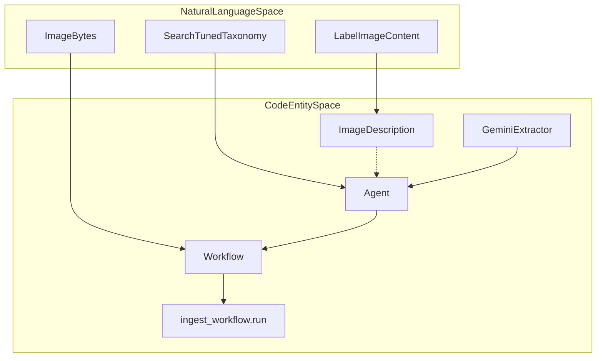
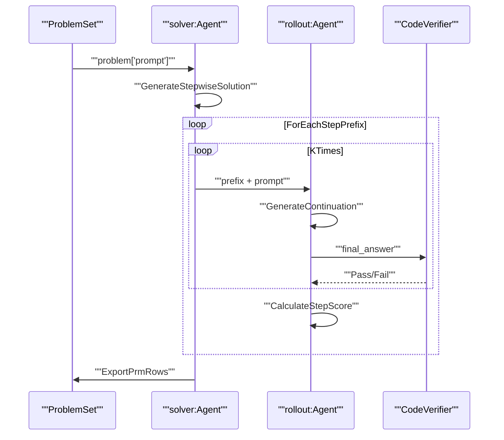

<!-- source: DeepWiki mcp.deepwiki.com · repo agno-agi/agno · page 11.8 Data Labeling Examples · fetched 2026-11-09 -->

# Data Labeling Examples

Relevant source files

The following files were used as context for generating this wiki page:

- [cookbook/data_labeling/image_search/.gitignore](cookbook/data_labeling/image_search/.gitignore)
- [cookbook/data_labeling/image_search/README.md](cookbook/data_labeling/image_search/README.md)
- [cookbook/data_labeling/image_search/TEST_LOG.md](cookbook/data_labeling/image_search/TEST_LOG.md)
- [cookbook/data_labeling/image_search/db.py](cookbook/data_labeling/image_search/db.py)
- [cookbook/data_labeling/image_search/generate_requirements.sh](cookbook/data_labeling/image_search/generate_requirements.sh)
- [cookbook/data_labeling/image_search/public/index.html](cookbook/data_labeling/image_search/public/index.html)
- [cookbook/data_labeling/image_search/requirements.in](cookbook/data_labeling/image_search/requirements.in)
- [cookbook/data_labeling/image_search/requirements.txt](cookbook/data_labeling/image_search/requirements.txt)
- [cookbook/data_labeling/image_search/run.py](cookbook/data_labeling/image_search/run.py)
- [cookbook/data_labeling/image_search/schemas.py](cookbook/data_labeling/image_search/schemas.py)
- [cookbook/data_labeling/image_search/settings.py](cookbook/data_labeling/image_search/settings.py)
- [cookbook/data_labeling/image_search/workflows/ingest.py](cookbook/data_labeling/image_search/workflows/ingest.py)
- [libs/agno/agno/learn/stores/decision_log.py](libs/agno/agno/learn/stores/decision_log.py)
- [libs/agno/tests/unit/models/test_claude_request_params.py](libs/agno/tests/unit/models/test_claude_request_params.py)

The `data_labeling` cookbook provides a comprehensive suite of patterns for building high-quality labeled datasets using LLM-as-judge workflows, multimodal extractors, and scale-out production pipelines. These patterns span text, image, audio, and video classification, structured extraction, pairwise preference ranking, rejection sampling, inter-annotator agreement, safety labeling, and durable storage patterns [cookbook/data_labeling/image_search/README.md:1-11]().

Sources: [cookbook/data_labeling/image_search/README.md:1-11]()

---

## Architecture and Workflow Patterns

Data labeling in Agno typically follows a structured flow where an `Agent` acts as a labeler, constrained by a Pydantic `output_schema` to ensure machine-readable results.

### Core Labeling Flow
The fundamental pattern involves passing raw data (text, images, audio, or video) to an agent configured with a specific taxonomy or extraction schema.

1. **Input Modalities**: Supports text, images (classification/bounding boxes), audio (transcription/diarization), video (event extraction), and documents (multi-page PDF extraction) [cookbook/data_labeling/image_search/README.md:5-11]().
2. **Output Schemas**: Uses Pydantic `BaseModel` to define the shape of the label, such as `ImageDescription` or structured classification schemas [cookbook/data_labeling/image_search/schemas.py:15-68]().
3. **Compositional Patterns**: Higher-order workflows like `llm_as_judge`, quality review cycles, and inter-annotator agreement can be layered on top of any modality [cookbook/data_labeling/image_search/README.md:5-11]().

### Natural Language to Code Entity Space: Labeling Pipeline
This diagram illustrates how a natural language labeling task is mapped to Agno code entities within an ingest workflow.

Sources: [cookbook/data_labeling/image_search/workflows/ingest.py:47-84](), [cookbook/data_labeling/image_search/schemas.py:15-68]()

### Image Search and Labeling Pipeline
In modern multimodal labeling pipelines, images are fetched, described via search-tuned schemas, embedded, and stored in a hybrid vector database like PgVector [cookbook/data_labeling/image_search/README.md:65-71]().

* **Extractor Agent Construction**: Each worker thread provisions a fresh `Agent` instance configured with a search-tuned instruction set and `output_schema=ImageDescription` [cookbook/data_labeling/image_search/workflows/ingest.py:78-84]().
* **Flattening and Ingestion**: The structured `ImageDescription` is flattened via `to_searchable_text()` into a rich semantic string, while raw structured fields and source URLs are stored as metadata in `Knowledge` [cookbook/data_labeling/image_search/schemas.py:70-84](), [cookbook/data_labeling/image_search/workflows/ingest.py:104-108]().
* **Hybrid Search Integration**: Leveraging `PgVector` with `SearchType.hybrid` combines dense cosine similarity with PostgreSQL full-text search (`to_tsvector`) for robust retrieval [cookbook/data_labeling/image_search/db.py:45-59]().

Sources: [cookbook/data_labeling/image_search/workflows/ingest.py:1-157](), [cookbook/data_labeling/image_search/schemas.py:1-84](), [cookbook/data_labeling/image_search/db.py:1-59]()

---

## Advanced Evaluation Patterns

### Pairwise Preference and Juries
For tasks like RLHF/DPO dataset generation, Agno implements "Jury" patterns where multiple model families vote on candidate responses.

* **Position Debiasing**: The system scores each pair in both orderings (A/B and B/A) to detect and neutralize lead-bias.
* **Self-Preference Recusal**: A juror may recuse itself if the candidate response was generated by its own model family.
* **Calibration and Weighting**: Jurors are first tested against a gold set, dropping those falling below an accuracy floor while weighting others by accuracy.

### Rejection Sampling and Process Rewards
Rejection sampling generates $K$ candidates and keeps only those passing a verifier.

* **Outcome Verification**: A pure-code verifier checks the `final_answer` against a known gold standard. Only traces resulting in the correct answer are retained.
* **Monte-Carlo (MC) Step Scoring**: Instead of just final outcomes, every step prefix is scored by running $K$ rollouts, where a step's reward is the fraction of rollouts that still reach the gold answer.

### Entity Interaction: Rejection Sampling Workflow
This diagram shows the interaction between the solver agent, rollout agent, and programmatic verifier.

Sources: [cookbook/data_labeling/image_search/workflows/ingest.py:92-141]()

---

## Scale-Out and Production Patterns

When moving from individual examples to datasets with 100k+ rows, Agno provides a scale-out harness focusing on reliability and cost.

### Resumable Async Pipelines
The scale-out harness utilizes concurrency control to bound execution while maintaining high throughput.

| Feature | Implementation | Purpose |
| :--- | :--- | :--- |
| **Async Fan-out** | `asyncio.gather` with concurrency limits | High throughput concurrency management. |
| **Checkpointing** | `JSONL` append/flush + loaded ID tracking | Makes interruption cheap; reruns skip already-labeled IDs. |
| **Cost Tracking** | `run.metrics` aggregation | Projects large-scale costs and compares interactive vs. batch pricing. |

### Token and Cost Accounting
Agno captures granular metrics for every labeling run, including `input_tokens`, `output_tokens`, and `reasoning_tokens`. In reasoning models, thinking tokens often dominate runtime cost considerations.

Sources: [cookbook/data_labeling/image_search/workflows/ingest.py:114-141]()

---

## Safety and Synthetic Data Curation

### Safety Labeling
Agents can be configured to classify prompts against a safety policy taxonomy (e.g., handling privacy-sensitive data, medical boundaries, or phishing attempts). Ambiguous cases are flagged with an escalation bit for human review.

### Synthetic Data Generation
Beyond labeling existing data, Agno supports generating new training data via:
* **Self-Instruct**: Generating SFT chat rows from seed topics.
* **Critique and Revision**: A constitutional AI flow where drafts are critiqued against principles and revised to produce paired choices.
* **Tool Call Trajectories**: Generating multi-turn trajectories validated against real tool schemas.

Sources: [cookbook/data_labeling/image_search/workflows/ingest.py:47-84](), [cookbook/data_labeling/image_search/schemas.py:15-68]()

---

