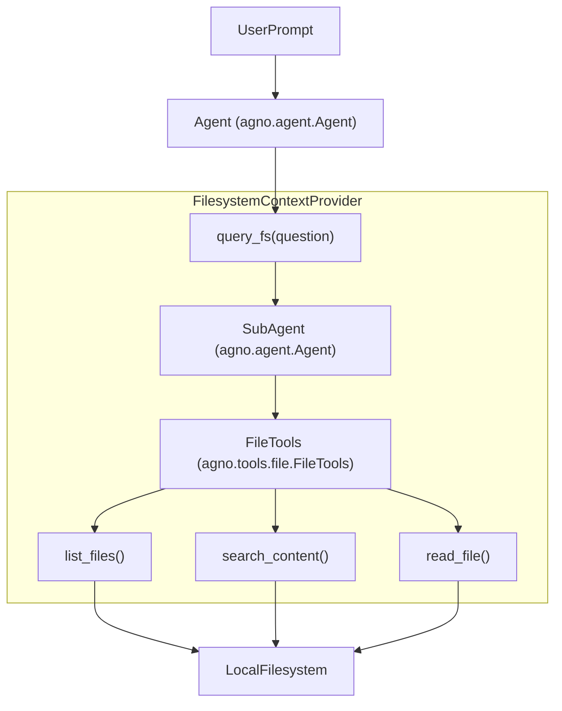
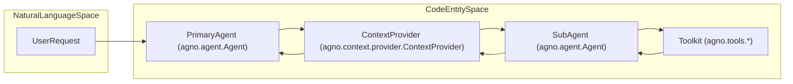
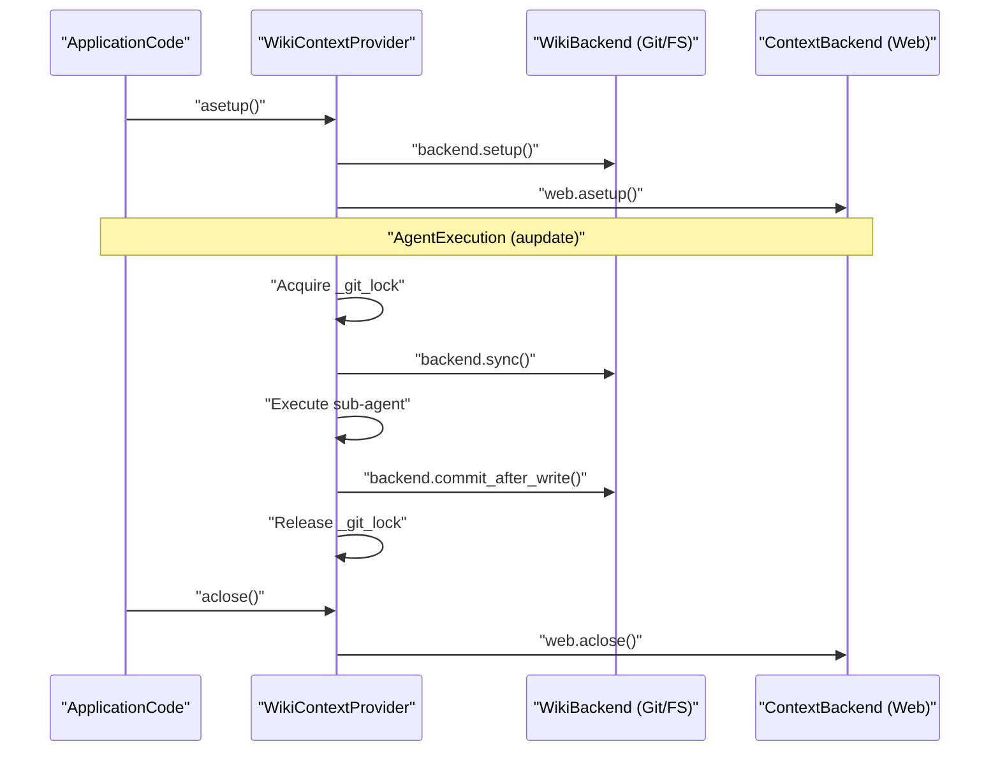

<!-- source: DeepWiki mcp.deepwiki.com · repo agno-agi/agno · page 12.1 ContextProvider Architecture · fetched 2026-11-09 -->

# ContextProvider Architecture

<details>
<summary>Relevant source files</summary>

The following files were used as context for generating this wiki page:

- [libs/agno/agno/context/calendar/provider.py](libs/agno/agno/context/calendar/provider.py)
- [libs/agno/agno/context/database/provider.py](libs/agno/agno/context/database/provider.py)
- [libs/agno/agno/context/fs/provider.py](libs/agno/agno/context/fs/provider.py)
- [libs/agno/agno/context/gdrive/provider.py](libs/agno/agno/context/gdrive/provider.py)
- [libs/agno/agno/context/gmail/provider.py](libs/agno/agno/context/gmail/provider.py)
- [libs/agno/agno/context/mcp/provider.py](libs/agno/agno/context/mcp/provider.py)
- [libs/agno/agno/context/provider.py](libs/agno/agno/context/provider.py)
- [libs/agno/agno/context/web/provider.py](libs/agno/agno/context/web/provider.py)
- [libs/agno/agno/context/wiki/provider.py](libs/agno/agno/context/wiki/provider.py)
- [libs/agno/agno/context/workspace/provider.py](libs/agno/agno/context/workspace/provider.py)
- [libs/agno/tests/unit/context/test_provider.py](libs/agno/tests/unit/context/test_provider.py)
- [libs/agno/tests/unit/context/test_wiki_provider.py](libs/agno/tests/unit/context/test_wiki_provider.py)

</details>


## Purpose and Scope
This document details the architecture of the `agno.context` subsystem, which provides a uniform abstraction for connecting external information sources—such as filesystems, databases, Slack workspaces, Google Drive, and MCP servers—to AI agents. It covers the `ContextProvider` base class [libs/agno/agno/context/provider.py:82](), `ContextMode` configurations [libs/agno/agno/context/mode.py:1](), execution methods (`query`, `update`, `status`) [libs/agno/agno/context/provider.py:139](), the `get_tools()` surface generation, underlying backends, and agent integration patterns.

Sources: [libs/agno/agno/context/provider.py:1-40]()

---

## Core Abstraction

The architecture is built around the `ContextProvider` base class, which defines how an external source identifies itself, reports health, and exposes functionality to an agent.

### The ContextProvider Base Class
Every provider inherits from the `ContextProvider` abstract base class [libs/agno/agno/context/provider.py:82](). This class defines the contract for natural-language interaction and tool generation.

| Method | Purpose |
|:---|:---|
| `status()` / `astatus()` | Returns a `Status` object indicating if the provider is correctly configured (e.g., API keys present, directory exists) [libs/agno/agno/context/provider.py:164-167](). |
| `query()` / `aquery()` | Executes a natural-language read request against the source, returning an `Answer` [libs/agno/agno/context/provider.py:139-143](). |
| `update()` / `aupdate()` | Executes a natural-language write/modification request against the source. Default implementation raises `NotImplementedError` [libs/agno/agno/context/provider.py:145-161](). |
| `get_tools()` | Returns the list of tools that should be registered with the calling `Agent` based on the active `ContextMode` [libs/agno/agno/context/provider.py:220-225](). |
| `instructions()` | Generates system prompt guidance telling the agent how and when to use the provided tools [libs/agno/agno/context/provider.py:209-218](). |

Sources: [libs/agno/agno/context/provider.py:82-225]()

### Context Modes
Providers support three primary modes of operation via the `ContextMode` enum [libs/agno/agno/context/mode.py:1](), which determines the complexity of the tool surface exposed to the agent:

1.  **`default`**: The provider's recommended exposure. For most providers, this exposes high-level tools (e.g., `query_<id>`, `update_<id>`) that route requests to internal sub-agents.
2.  **`agent`**: Wraps the provider behind a sub-agent; the calling agent gets a single `query_<id>` tool, effectively treating the source as natural language.
3.  **`tools`**: The provider flattens its internal toolkit and exposes raw functions directly to the calling agent (e.g., `list_files`, `read_file`), allowing primary agent orchestration.

Sources: [libs/agno/agno/context/provider.py:82-225](), [libs/agno/agno/context/mode.py:1-14]()

---

## Data Flow: Natural Language to Code Entities

The following diagrams illustrate how natural language requests are transformed into specific code-level actions and tool calls, bridging Natural Language Space and Code Entity Space.

### Natural Language to Filesystem Interaction

Sources: [libs/agno/agno/context/fs/provider.py:26-80](), [libs/agno/agno/context/fs/provider.py:120-132]()

### Multi-Agent Interaction: The Sub-Agent Pattern

Sources: [libs/agno/agno/context/provider.py:231-247](), [libs/agno/agno/context/fs/provider.py:104-117](), [libs/agno/agno/context/database/provider.py:161-169]()

---

## Implementation Details

### Sub-Agent Configuration
When a provider uses a sub-agent (in `default` or `agent` mode), it implements `_ensure_agent()` and `_build_agent()` [libs/agno/agno/context/fs/provider.py:104-117](). The sub-agent is configured with:
*   **ID/Name**: Namespaced to the provider (e.g., `fs`, `workspace`) [libs/agno/agno/context/workspace/provider.py:130-131]().
*   **Instructions**: Specialized system prompts for that specific source (e.g., `DEFAULT_FS_INSTRUCTIONS`) [libs/agno/agno/context/fs/provider.py:135-152]().
*   **Tools**: The underlying toolkit (e.g., `FileTools`, `Workspace`, `SQLTools`) [libs/agno/agno/context/database/provider.py:149]().

Sources: [libs/agno/agno/context/fs/provider.py:104-152](), [libs/agno/agno/context/database/provider.py:149-173]()

### Security and Scoping
The architecture enforces strict separation between read and write operations to prevent accidental data modification:
*   **Database**: `DatabaseContextProvider` uses separate `sql_engine` (writable) and `readonly_engine`. The `_read_agent` only has access to the readonly engine [libs/agno/agno/context/database/provider.py:72-73, 161-164]().
*   **Gmail/Calendar**: These providers split reads and writes into separate sub-agents with narrow instructions. Writes are often disabled by default (`write=False`) [libs/agno/agno/context/gmail/provider.py:109-110](), [libs/agno/agno/context/calendar/provider.py:102-103]().
*   **Read/Write Flags**: The `read` and `write` booleans in the constructor allow for asymmetric surfaces (e.g., a read-only event sink) [libs/agno/agno/context/provider.py:133-134]().

Sources: [libs/agno/agno/context/database/provider.py:72-164](), [libs/agno/agno/context/gmail/provider.py:109-155](), [libs/agno/agno/context/calendar/provider.py:102-140]()

### Provider Wiring into Agents
To wire a provider into an agent, the developer registers the provider's tools using `get_tools()`.

```python
from agno.agent import Agent
from agno.context.fs import FilesystemContextProvider
from agno.context.web import WebContextProvider

fs = FilesystemContextProvider(root="./docs")
web = WebContextProvider(backend=my_backend)

agent = Agent(
    tools=[*fs.get_tools(), *web.get_tools()],
    markdown=True,
)
```
Sources: [libs/agno/agno/context/provider.py:220-225]()

---

## Provider Lifecycle and Resource Management

Providers that hold async resources (like MCP sessions or Git repositories) implement `asetup()` and `aclose()` [libs/agno/agno/context/provider.py:169-178]().

### Resource Sequencing

Sources: [libs/agno/agno/context/wiki/provider.py:108-168]()

---

## Summary of Built-in Providers

| Class | Source | Tool Surface |
|:---|:---|:---|
| `FilesystemContextProvider` | Local directory | `query_<id>` (read-only) [libs/agno/agno/context/fs/provider.py:26-41]() |
| `WorkspaceContextProvider` | Project root | `query_<id>` (filtered/project-aware) [libs/agno/agno/context/workspace/provider.py:28-46]() |
| `WebContextProvider` | Search Engines | `query_<id>` via `ContextBackend` [libs/agno/agno/context/web/provider.py:25-39]() |
| `DatabaseContextProvider` | SQL Database | `query_<id>`, `update_<id>` [libs/agno/agno/context/database/provider.py:36-61]() |
| `GmailContextProvider` | Google Mail | `query_<id>`, `update_<id>` [libs/agno/agno/context/gmail/provider.py:82-112]() |
| `GoogleCalendarContextProvider` | Google Calendar | `query_<id>`, `update_<id>` [libs/agno/agno/context/calendar/provider.py:74-105]() |
| `GoogleDriveContextProvider` | Google Drive | `query_<id>` (read-only) [libs/agno/agno/context/gdrive/provider.py:59-80]() |
| `WikiContextProvider` | Markdown Files | `query_<id>`, `update_<id>` [libs/agno/agno/context/wiki/provider.py:41-69]() |
| `MCPContextProvider` | MCP Servers | `query_mcp_<slug>` (async-only) [libs/agno/agno/context/mcp/provider.py:52-74]() |

Sources: [libs/agno/agno/context/provider.py:82-108](), [libs/agno/agno/context/mcp/provider.py:52-83](), [libs/agno/agno/context/wiki/provider.py:41-79]()

---

