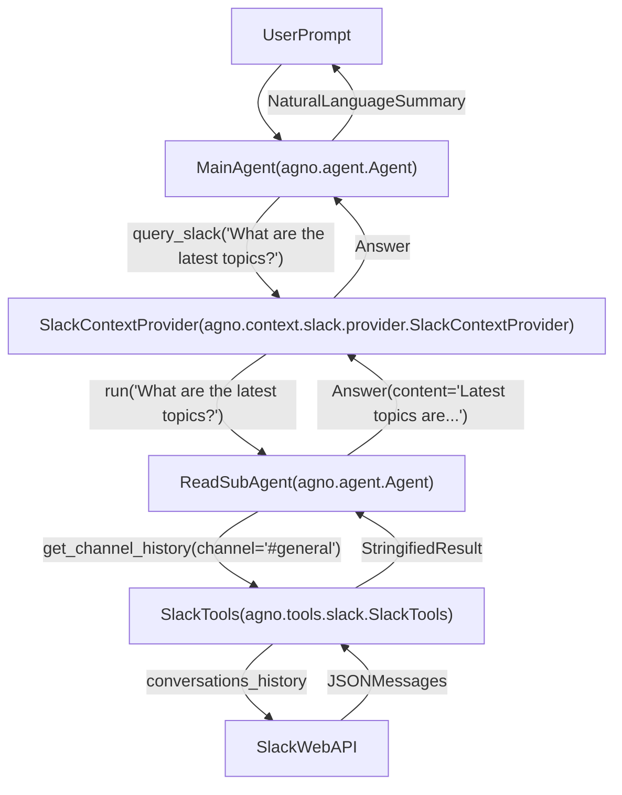
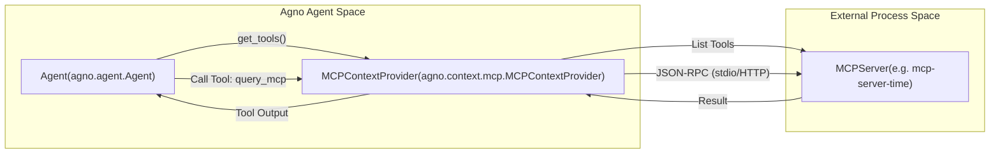

<!-- source: DeepWiki mcp.deepwiki.com · repo agno-agi/agno · page 12.2 Built-in Context Providers · fetched 2026-11-09 -->

# Built-in Context Providers

Relevant source files

The following files were used as context for generating this wiki page:

- [cookbook/12_context/03_web_parallel.py](cookbook/12_context/03_web_parallel.py)
- [cookbook/12_context/05_slack.py](cookbook/12_context/05_slack.py)
- [cookbook/12_context/06_slack_search_media.py](cookbook/12_context/06_slack_search_media.py)
- [cookbook/12_context/07_google_drive.py](cookbook/12_context/07_google_drive.py)
- [cookbook/12_context/09_web_plus_slack.py](cookbook/12_context/09_web_plus_slack.py)
- [cookbook/12_context/12_engineering_briefing.py](cookbook/12_context/12_engineering_briefing.py)
- [cookbook/12_context/13_workspace.py](cookbook/12_context/13_workspace.py)
- [cookbook/12_context/18_gmail.py](cookbook/12_context/18_gmail.py)
- [cookbook/12_context/19_calendar.py](cookbook/12_context/19_calendar.py)
- [cookbook/12_context/20_google_workspace.py](cookbook/12_context/20_google_workspace.py)
- [cookbook/12_context/21_gdrive_office.py](cookbook/12_context/21_gdrive_office.py)
- [cookbook/12_context/README.md](cookbook/12_context/README.md)
- [cookbook/12_context/TEST_LOG.md](cookbook/12_context/TEST_LOG.md)
- [cookbook/91_tools/google/README.md](cookbook/91_tools/google/README.md)
- [cookbook/91_tools/google_drive.py](cookbook/91_tools/google_drive.py)
- [cookbook/91_tools/slack_tools.py](cookbook/91_tools/slack_tools.py)
- [libs/agno/agno/context/calendar/__init__.py](libs/agno/agno/context/calendar/__init__.py)
- [libs/agno/agno/context/slack/__init__.py](libs/agno/agno/context/slack/__init__.py)
- [libs/agno/agno/context/slack/provider.py](libs/agno/agno/context/slack/provider.py)
- [libs/agno/agno/tools/slack.py](libs/agno/agno/tools/slack.py)
- [libs/agno/tests/unit/context/test_gdrive_mime_types.py](libs/agno/tests/unit/context/test_gdrive_mime_types.py)
- [libs/agno/tests/unit/context/test_parallel_backend.py](libs/agno/tests/unit/context/test_parallel_backend.py)
- [libs/agno/tests/unit/context/test_providers.py](libs/agno/tests/unit/context/test_providers.py)
- [libs/agno/tests/unit/tools/test_google_drive.py](libs/agno/tests/unit/tools/test_google_drive.py)
- [libs/agno/tests/unit/tools/test_slack_tools.py](libs/agno/tests/unit/tools/test_slack_tools.py)

The `agno.context` subsystem provides a uniform API for plugging external information sources into agents as natural-language tools [cookbook/12_context/README.md:3-4](). Built-in providers transform complex external systems—such as Slack workspaces, Google Drive, local file systems, and Model Context Protocol (MCP) servers—into natural-language interfaces [cookbook/12_context/README.md:3-11](). By abstracting these sources behind `query_<id>` and `update_<id>` tools, Agno allows agents to interact with diverse data environments without managing underlying SDKs or API authentication directly [cookbook/12_context/README.md:3-11]().

Built-in providers typically operate in three modes defined by `ContextMode`:
1. **Agent Mode (`ContextMode.agent`)**: The provider creates a scoped sub-agent (using a smaller, cost-effective model) to handle the heavy lifting of searching, filtering, and summarizing the external source [libs/agno/agno/context/slack/provider.py:144-145](). The main agent calls `query_<id>(question)`.
2. **Tools Mode (`ContextMode.tools`)**: The provider surfaces the raw underlying `Toolkit` (e.g., `SlackTools` or `WorkspaceTools`) directly to the main agent, bypassing sub-agent abstraction [libs/agno/agno/context/slack/provider.py:138-143]().
3. **Default Mode (`ContextMode.default`)**: Provides both `query_<id>` and `update_<id>` tools via sub-agents for read/write sources [libs/agno/agno/context/slack/provider.py:146-149]().

### Context Provider Architecture & Data Flow

The following diagram bridges the **Natural Language Space** to the **Code Entity Space**, illustrating how a prompt is routed through `SlackContextProvider` to `SlackTools` and the underlying Slack Web API [libs/agno/agno/context/slack/provider.py:101-122](), [libs/agno/agno/tools/slack.py:55-65](), [cookbook/12_context/05_slack.py:20-40]().

Title: "Slack Context Provider Data Flow"

Sources: [libs/agno/agno/context/slack/provider.py:101-122](), [libs/agno/agno/tools/slack.py:55-65](), [cookbook/12_context/05_slack.py:20-40]()

---

### Filesystem and Workspace Providers

These providers allow agents to interact with local directory trees.

#### FilesystemContextProvider
`FilesystemContextProvider` provides read-only access to a local directory, leveraging `FileTools` under the hood to search content and read files [cookbook/12_context/README.md:22]().
* **Constructor:** `FilesystemContextProvider(root=Path("."), id="fs")`.
* **Key Behavior:** Disables write and delete operations by default to maintain a safe, read-only context surface [libs/agno/tests/unit/context/test_providers.py:59-63]().

#### WorkspaceContextProvider
`WorkspaceContextProvider` is a specialized version of the filesystem provider optimized for software repositories [cookbook/12_context/README.md:23](). It automatically excludes common development noise such as virtual environments (`.venv`, `.venvs`), cache directories, and agent scratchpads [libs/agno/tests/unit/context/test_providers.py:118-131]().
* **Tools:** Surfaces read-only `list_files`, `search_content`, and `read_file` tools when configured in `ContextMode.tools` [libs/agno/tests/unit/context/test_providers.py:112-116]().
* **Security:** Enforces `allow_paths` and `exclude_patterns` to prevent agents from reading sensitive files (such as `.env`) by name [libs/agno/tests/unit/context/test_providers.py:134-156]().

Sources: [libs/agno/tests/unit/context/test_providers.py:35-171](), [cookbook/12_context/13_workspace.py:1-20]()

---

### WebContextProvider (Exa and Parallel)

`WebContextProvider` provides agents with a research interface to the live web via multiple backends [libs/agno/agno/context/web/provider.py:25-49]().

| Backend | Implementation | Description |
| :--- | :--- | :--- |
| `ExaBackend` | `agno.context.web.ExaBackend` | Direct SDK integration; requires `EXA_API_KEY` [cookbook/12_context/README.md:25]() |
| `ExaMCPBackend` | `agno.context.web.ExaMCPBackend` | Uses Exa's MCP server for keyless or keyed access [cookbook/12_context/README.md:24]() |
| `ParallelBackend` | `agno.context.web.ParallelBackend` | Uses Parallel AI's research API via `ParallelTools` [libs/agno/agno/context/web/parallel.py:1-10]() |
| `ParallelMCPBackend` | `agno.context.web.ParallelMCPBackend` | Connects to Parallel's web search via MCP [libs/agno/agno/context/web/parallel_mcp.py:39-51]() |

Sources: [libs/agno/agno/context/web/provider.py:25-49](), [libs/agno/agno/context/web/parallel_mcp.py:39-51](), [cookbook/12_context/12_engineering_briefing.py:39-39]()

---

### SlackContextProvider

`SlackContextProvider` provides natural-language read and write access to Slack via sub-agents [libs/agno/agno/context/slack/provider.py:41-49]().

* **Read Surface:** Surfaces `query_slack` for channel history, workspace search, and user/channel lookups [libs/agno/agno/context/slack/provider.py:7-8]().
* **Write Surface:** Surfaces `update_slack` to post messages or thread replies [libs/agno/agno/context/slack/provider.py:9-10]().
* **Authentication:** Uses `SLACK_BOT_TOKEN` (supporting `xoxb-` tokens). Supports `user_token` for `search_messages` functionality which requires `xoxp-` scopes [libs/agno/agno/context/slack/provider.py:79-89]().
* **Tool Selection:** Includes logic in `SlackTools` to guide the LLM between `send_message` and `send_message_thread` based on the presence of a `thread_ts` [libs/agno/agno/tools/slack.py:91-103]().

Sources: [libs/agno/agno/context/slack/provider.py:41-103](), [libs/agno/agno/tools/slack.py:39-137](), [libs/agno/tests/unit/tools/test_slack_tools.py:130-173]()

---

### Google Workspace Providers

Agno includes dedicated context providers for Google Drive, Gmail, and Calendar, supporting both Service Account and OAuth2 flows.

#### GoogleDriveContextProvider
`GoogleDriveContextProvider` enables agents to search and read documents across personal and Shared Drives using a dedicated sub-agent for query syntax and file navigation [cookbook/12_context/README.md:31]().

#### Gmail and Calendar Providers
* **GmailContextProvider:** Supports natural language querying of inboxes (`query_gmail`) and drafting/sending messages (`update_gmail`) [libs/agno/agno/context/gmail/provider.py:7-10](). Requires `delegated_user` for service account impersonation [libs/agno/agno/context/gmail/provider.py:141-148]().
* **GoogleCalendarContextProvider:** Provides tools for listing events, checking availability, and managing calendar entries (`query_calendar`, `update_calendar`) [libs/agno/agno/context/calendar/provider.py:5-10]().

Sources: [libs/agno/agno/context/gmail/provider.py:82-156](), [libs/agno/agno/context/calendar/provider.py:74-141]()

---

### Database and Wiki Providers

#### DatabaseContextProvider
`DatabaseContextProvider` wraps any SQLAlchemy-compatible database [cookbook/12_context/README.md:28](). It splits operations into `query_<id>` (read-only queries) and `update_<id>` (writable modifications) via separate sub-agents [cookbook/12_context/README.md:28]().

#### WikiContextProvider
`WikiContextProvider` is designed for managing a knowledge base of markdown files with pluggable backends [cookbook/12_context/README.md:32-35]() :
1. **FileSystemBackend:** Manages local `.md` files [cookbook/12_context/README.md:32]()
2. **GitBackend:** Manages a remote Git repository, where `update_wiki` automatically pulls, writes, and pushes commits [cookbook/12_context/README.md:33]()
3. **NotionDatabaseBackend:** Mirrors a Notion database as flat `.md` files with conflict detection [cookbook/12_context/README.md:34]()

Sources: [cookbook/12_context/README.md:28-35]()

---

### MCPContextProvider

`MCPContextProvider` allows any Model Context Protocol (MCP) server to be used as a context source [cookbook/12_context/README.md:30](). It can either surface the server's tools directly (`mode=tools`) or wrap them in a natural-language query tool (`mode=agent`).

The data flow between an Agno Agent, `MCPContextProvider`, and an external MCP server is illustrated below.

Title: "MCP Context Provider Architecture"

Sources: [cookbook/12_context/README.md:30]()

---

