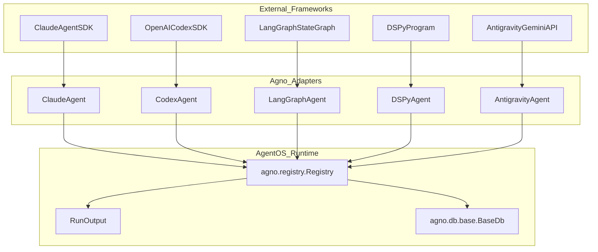
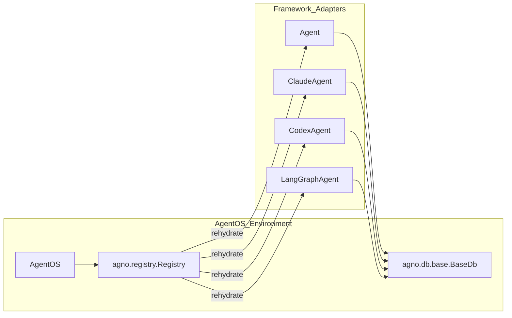

<!-- source: DeepWiki mcp.deepwiki.com · repo agno-agi/agno · page 13 Framework Integrations · fetched 2026-11-09 -->

# Framework Integrations

Relevant source files

The following files were used as context for generating this wiki page:

- [cookbook/frameworks/claude-agent-sdk/README.md](cookbook/frameworks/claude-agent-sdk/README.md)
- [cookbook/frameworks/claude-agent-sdk/TEST_LOG.md](cookbook/frameworks/claude-agent-sdk/TEST_LOG.md)
- [cookbook/frameworks/claude-agent-sdk/metrics.py](cookbook/frameworks/claude-agent-sdk/metrics.py)
- [cookbook/frameworks/claude-agent-sdk/metrics_agentos.py](cookbook/frameworks/claude-agent-sdk/metrics_agentos.py)
- [cookbook/frameworks/codex/README.md](cookbook/frameworks/codex/README.md)
- [cookbook/frameworks/codex/TEST_LOG.md](cookbook/frameworks/codex/TEST_LOG.md)
- [cookbook/frameworks/codex/codex_metrics.py](cookbook/frameworks/codex/codex_metrics.py)
- [cookbook/frameworks/codex/codex_metrics_agentos.py](cookbook/frameworks/codex/codex_metrics_agentos.py)
- [cookbook/frameworks/codex/codex_structured_output.py](cookbook/frameworks/codex/codex_structured_output.py)
- [libs/agno/agno/agents/base.py](libs/agno/agno/agents/base.py)
- [libs/agno/agno/agents/claude/agent.py](libs/agno/agno/agents/claude/agent.py)
- [libs/agno/agno/agents/codex/agent.py](libs/agno/agno/agents/codex/agent.py)
- [libs/agno/agno/exceptions.py](libs/agno/agno/exceptions.py)
- [libs/agno/tests/unit/agents/test_claude.py](libs/agno/tests/unit/agents/test_claude.py)
- [libs/agno/tests/unit/agents/test_codex.py](libs/agno/tests/unit/agents/test_codex.py)

The Agno framework provides a unified interface for deploying and managing agents built across different ecosystems. Through the use of adapter classes (`BaseExternalAgent`), AgentOS extends its production-grade features—such as session persistence, streaming, and API serving—to third-party frameworks including the **Claude Agent SDK**, **OpenAI Codex**, **LangGraph**, **DSPy**, and Google's **Antigravity** (Gemini Agents API) [libs/agno/agno/agents/base.py:24-30]().

This integration allows developers to register external agents alongside native Agno agents, exposing them through the same standard REST API surface and monitoring them via the AgentOS Control Plane. The `Registry` class serves as the central hub for managing these heterogeneous components, ensuring they are resolvable by the AgentOS runtime.

### Integration Architecture

The following diagram illustrates how external framework entities are mapped to Agno code entities (`BaseExternalAgent` implementations) to be served by `AgentOS`.

**Framework Mapping to AgentOS**

Sources: [libs/agno/agno/agents/base.py:24-30](), [libs/agno/agno/agents/claude/agent.py:155-165](), [libs/agno/agno/agents/codex/agent.py:160-170]()

---

## ClaudeAgent and Codex Adapters

Agno provides comprehensive adapters for wrapping advanced agent CLI runtimes and software development kits:
- **ClaudeAgent**: Wraps the Claude Agent SDK (`claude-agent-sdk`), managing tool execution, permission modes (`permission_mode`), allowed tools (`allowed_tools`), turn limits (`max_turns`), and MCP configurations [libs/agno/agno/agents/claude/agent.py:155-182]().
- **CodexAgent**: Wraps the OpenAI Codex SDK (`openai-codex`), handling thread-to-session mapping, sandbox environments (`sandbox_mode`), approval policies, reasoning effort, and structured outputs [libs/agno/agno/agents/codex/agent.py:160-187]().

For details, see [ClaudeAgent and Codex Adapters](#13.1).

Sources: [libs/agno/agno/agents/claude/agent.py:155-182](), [libs/agno/agno/agents/codex/agent.py:160-187]()

---

## LangGraph, DSPy and Antigravity Adapters

Agno also provides robust adapters for bridging popular graph-based workflows, programmatic optimization, and managed cloud APIs into AgentOS:

- **LangGraph**: The `LangGraphAgent` adapter allows compiled LangGraph state graphs to be treated as standard Agno agents, supporting checkpointing, state history inspection, and event translation.
- **DSPy**: The `DSPyAgent` adapter wraps DSPy programs to bring programmatic prompt optimization and structured reasoning into AgentOS.
- **Antigravity**: The `AntigravityAgent` and `AntigravityTools` adapters wrap Google's Gemini Agents API (`https://generativelanguage.googleapis.com/v1beta`), providing sandboxed Linux environment execution and custom agent registration.

For details, see [LangGraph, DSPy and Antigravity Adapters](#13.2).

Sources: [libs/agno/agno/agents/base.py:24-30]()

---

## Multi-Framework Deployments

AgentOS supports heterogeneous agent environments. A single instance can manage a collection of agents where each member is built using a different framework but shares a common control plane. This is achieved by populating the `Registry` with components regardless of their underlying SDK or execution model.

**Unified API and Storage**
| Feature | Agno Native | Claude SDK | Codex SDK | LangGraph | Antigravity |
| :--- | :--- | :--- | :--- | :--- | :--- |
| **API Endpoint** | `/agents/{id}/runs` | `/agents/{id}/runs` | `/agents/{id}/runs` | `/agents/{id}/runs` | `/agents/{id}/runs` |
| **Persistence** | `AgentSession` | `AgentSession` | `AgentSession` | `AgentSession` | `AgentSession` |
| **Streaming** | SSE Supported | SSE Supported | SSE Supported | SSE Supported | SSE Supported |
| **Registry** | `Registry.agents` | `Registry.agents` | `Registry.agents` | `Registry.agents` | `Registry.agents` |

**Cross-Framework Communication Architecture**

Sources: [libs/agno/agno/agents/base.py:24-30]()

---

## Remote Agent Integration

Framework integrations also extend to remote capabilities. Using `RemoteAgent` or `RemoteTeam`, Agno can interact with agents hosted on other AgentOS instances or frameworks that implement the Agno protocol.

* **Remote Protocol:** Ensures compatibility between local execution expectations and remote agent outputs using `RunOutput` [libs/agno/agno/agents/base.py:40-50]().
* **Config Discovery:** Remote configurations are retrieved via standardized endpoints that return registered agents and models from the `Registry`.

Sources: [libs/agno/agno/agents/base.py:40-50]()

---

