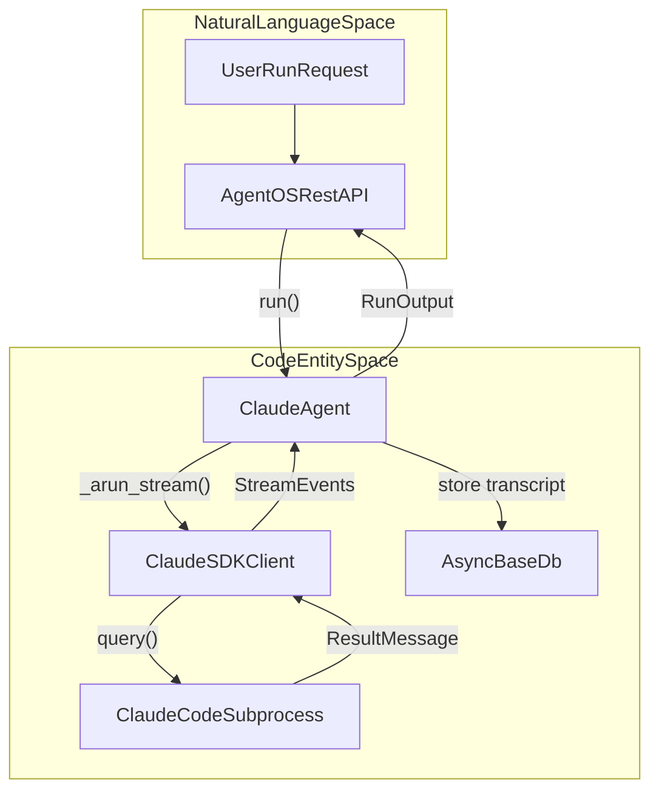
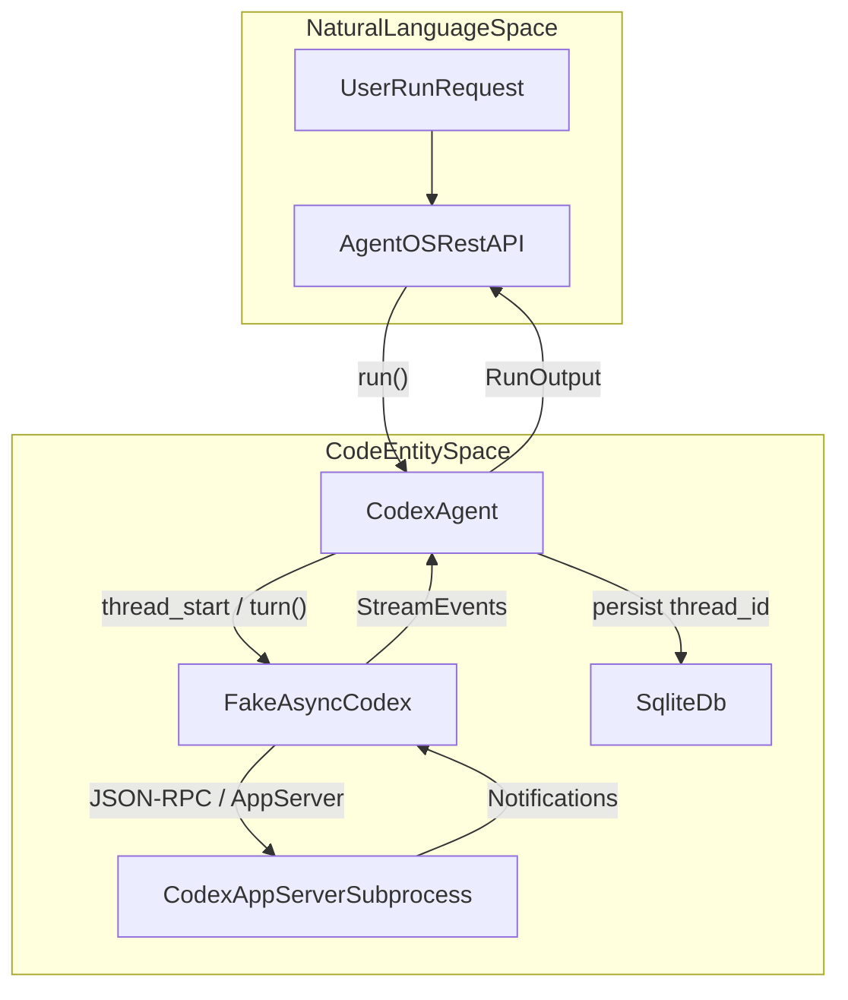

<!-- source: DeepWiki mcp.deepwiki.com · repo agno-agi/agno · page 13.1 ClaudeAgent and Codex Adapters · fetched 2026-11-09 -->

# ClaudeAgent and Codex Adapters

Relevant source files

The following files were used as context for generating this wiki page:

- [cookbook/frameworks/claude-agent-sdk/README.md](cookbook/frameworks/claude-agent-sdk/README.md)
- [cookbook/frameworks/claude-agent-sdk/TEST_LOG.md](cookbook/frameworks/claude-agent-sdk/TEST_LOG.md)
- [cookbook/frameworks/claude-agent-sdk/metrics.py](cookbook/frameworks/claude-agent-sdk/metrics.py)
- [cookbook/frameworks/claude-agent-sdk/metrics_agentos.py](cookbook/frameworks/claude-agent-sdk/metrics_agentos.py)
- [cookbook/frameworks/codex/README.md](cookbook/frameworks/codex/README.md)
- [cookbook/frameworks/codex/TEST_LOG.md](cookbook/frameworks/codex/TEST_LOG.md)
- [cookbook/frameworks/codex/codex_metrics.py](cookbook/frameworks/codex/codex_metrics.py)
- [cookbook/frameworks/codex/codex_metrics_agentos.py](cookbook/frameworks/codex/codex_metrics_agentos.py)
- [cookbook/frameworks/codex/codex_structured_output.py](cookbook/frameworks/codex/codex_structured_output.py)
- [libs/agno/agno/agents/base.py](libs/agno/agno/agents/base.py)
- [libs/agno/agno/agents/claude/agent.py](libs/agno/agno/agents/claude/agent.py)
- [libs/agno/agno/agents/codex/agent.py](libs/agno/agno/agents/codex/agent.py)
- [libs/agno/agno/exceptions.py](libs/agno/agno/exceptions.py)
- [libs/agno/tests/unit/agents/test_claude.py](libs/agno/tests/unit/agents/test_claude.py)
- [libs/agno/tests/unit/agents/test_codex.py](libs/agno/tests/unit/agents/test_codex.py)

## Purpose and Scope
This section covers third-party agent framework support within Agno via specialized adapter classes located in `agno/agents`: `ClaudeAgent` wrapping the Claude Agent SDK (`claude-agent-sdk`) [libs/agno/agno/agents/claude/agent.py:155-160]() and `CodexAgent` wrapping the official OpenAI Codex SDK (`openai-codex`) [libs/agno/agno/agents/codex/agent.py:161-165](). These adapters translate external agent subprocess lifecycles, MCP configurations, permission modes, and tool interactions into standard Agno `RunOutput`, event streams, persistent sessions, and AgentOS REST/WebSocket endpoints.

---

## 1. ClaudeAgent Architecture and Configuration

`ClaudeAgent` wraps a per-run Claude Agent SDK client, allowing agents powered by Claude Code to integrate with Agno's storage, streaming, and AgentOS runtime [libs/agno/agno/agents/claude/agent.py:155-162](). The SDK executes Claude Code locally as a subprocess where tool execution is handled internally, while Agno manages session boundaries and database persistence.

### Key Configuration Parameters
- `tools`: Built-in tool names or the Claude Code tool preset [libs/agno/agno/agents/claude/agent.py:170]().
- `allowed_tools`: Tool calls to pre-approve without altering the available tool set [libs/agno/agno/agents/claude/agent.py:171]().
- `disallowed_tools`: List of tools to block [libs/agno/agno/agents/claude/agent.py:172]().
- `permission_mode`: SDK permission mode, such as `default`, `acceptEdits`, or `dontAsk` [libs/agno/agno/agents/claude/agent.py:173]().
- `max_turns`: Maximum number of turns allowed per execution [libs/agno/agno/agents/claude/agent.py:174]().
- `max_budget_usd`: Maximum cost budget in USD [libs/agno/agno/agents/claude/agent.py:175]().
- `mcp_servers`: Model Context Protocol server configurations for custom tools [libs/agno/agno/agents/claude/agent.py:178]().
- `output_schema`: Pydantic model or JSON Schema for parsing structured final answers [libs/agno/agno/agents/claude/agent.py:179-180]().

### Data Flow and Execution
**Natural Language to Code Entity Space: ClaudeAgent Execution**

Sources: [libs/agno/agno/agents/claude/agent.py:155-182](), [cookbook/frameworks/claude-agent-sdk/README.md:111-135]()

---

## 2. CodexAgent Architecture and Configuration

`CodexAgent` wraps the official OpenAI Codex Python SDK (`openai-codex`) [libs/agno/agno/agents/codex/agent.py:161-165](). The SDK runs the Codex CLI locally as an app-server subprocess, managing the full agent loop (shell commands, file edits, web search, and MCP tools) [libs/agno/agno/agents/codex/agent.py:168-170](). The adapter maps each Agno session to a persistent Codex thread and translates app-server notifications into Agno run events [libs/agno/agno/agents/codex/agent.py:170-172]().

### Key Configuration Parameters
- `model`: Codex model identifier (defaults to `gpt-5.6-luna`) [libs/agno/agno/agents/codex/agent.py:176]() [cookbook/frameworks/codex/README.md:31]().
- `sandbox_mode`: Isolation level (`read-only`, `workspace-write`, or `full-access`) [libs/agno/agno/agents/codex/agent.py:179]().
- `approval_mode`: Native SDK review behavior (`auto_review` or `deny_all`) [libs/agno/agno/agents/codex/agent.py:180]().
- `approval_policy`: Native policy (`on-request`, `untrusted`, or `never`) [libs/agno/agno/agents/codex/agent.py:181]().
- `hitl_timeout`: Seconds a permission request waits for confirmation in chat [libs/agno/agno/agents/codex/agent.py:183-184]().
- `reasoning_effort`: Reasoning level (`minimal`, `low`, `medium`, `high`, or `xhigh`) [libs/agno/agno/agents/codex/agent.py:186]().
- `client_options`: Native `CodexConfig` for process environment and executable configuration [cookbook/frameworks/codex/README.md:87-88]().
- `thread_options` / `turn_options`: Typed dictionaries for thread creation/resume and turn-specific parameters [cookbook/frameworks/codex/README.md:89-93]().

### Data Flow and Execution
**Natural Language to Code Entity Space: CodexAgent Execution**

Sources: [libs/agno/agno/agents/codex/agent.py:161-187](), [cookbook/frameworks/codex/README.md:64-100]()

---

## 3. Metrics, Session Persistence, and AgentOS Integration

Both `ClaudeAgent` and `CodexAgent` fully integrate with Agno's metrics collection, persistent storage backends, and AgentOS runtime capabilities.

### Metrics Collection
Adapters aggregate token counts, execution duration, and cost tracking into standard `RunMetrics` [libs/agno/agno/agents/base.py:128-132]() and emit them via `ExternalRunMetricsEvent` or `RunCompleted` events [cookbook/frameworks/claude-agent-sdk/TEST_LOG.md:42-59]() [cookbook/frameworks/codex/codex_metrics_agentos.py:56-97](). These metrics aggregate upward into session-level totals (`session_data["session_metrics"]`) and daily database views consumed by AgentOS endpoints (`GET /metrics`) [cookbook/frameworks/claude-agent-sdk/TEST_LOG.md:42-59]() [cookbook/frameworks/codex/codex_metrics_agentos.py:99-128]().

### Session Mapping
- **ClaudeAgent**: Maps Agno sessions to Claude SDK session IDs stored in session metadata (`claude_sdk_session_id`) [libs/agno/tests/unit/agents/test_claude.py:215-221]().
- **CodexAgent**: Maps Agno sessions to Codex thread IDs stored in session data (`codex_thread_id`), allowing subsequent turns to seamlessly resume prior execution states [cookbook/frameworks/codex/TEST_LOG.md:32-39]().

### AgentOS Routing
When mounted in AgentOS, external agents support standard REST endpoints (`POST /agents/{agent_id}/runs`) and Server-Sent Events (SSE) streaming for real-time progress monitoring, tool execution display, and interactive approvals [cookbook/frameworks/claude-agent-sdk/README.md:75-98]() [cookbook/frameworks/codex/README.md:132-156]().

Sources: [libs/agno/agents/claude/agent.py:155-182](), [libs/agno/agents/codex/agent.py:161-187](), [cookbook/frameworks/claude-agent-sdk/TEST_LOG.md:42-59](), [cookbook/frameworks/codex/codex_metrics_agentos.py:56-128]()

---

