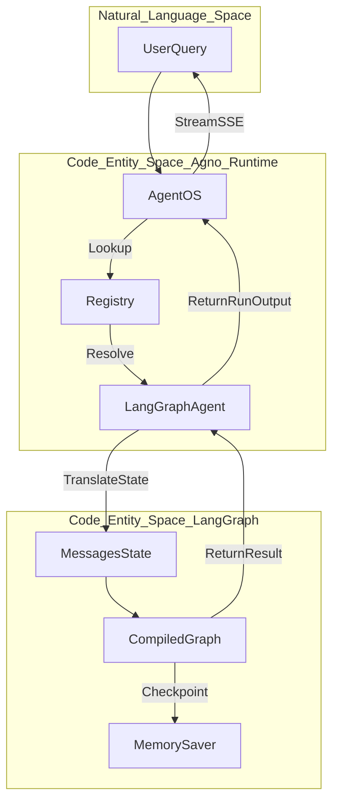
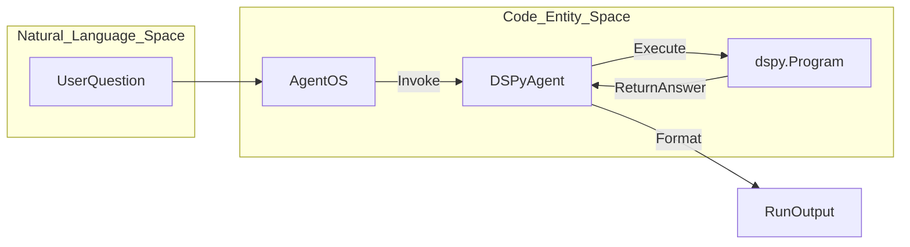
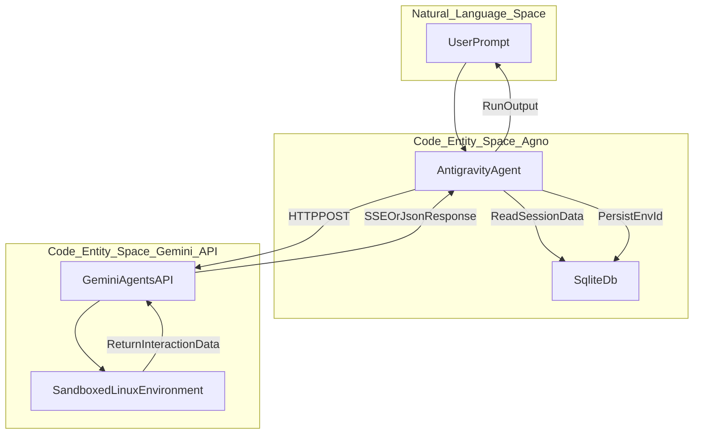

<!-- source: DeepWiki mcp.deepwiki.com · repo agno-agi/agno · page 13.2 LangGraph, DSPy and Antigravity Adapters · fetched 2026-11-09 -->

# LangGraph, DSPy and Antigravity Adapters

Relevant source files

The following files were used as context for generating this wiki page:

- [cookbook/frameworks/claude-agent-sdk/README.md](cookbook/frameworks/claude-agent-sdk/README.md)
- [cookbook/frameworks/claude-agent-sdk/TEST_LOG.md](cookbook/frameworks/claude-agent-sdk/TEST_LOG.md)
- [cookbook/frameworks/claude-agent-sdk/metrics.py](cookbook/frameworks/claude-agent-sdk/metrics.py)
- [cookbook/frameworks/claude-agent-sdk/metrics_agentos.py](cookbook/frameworks/claude-agent-sdk/metrics_agentos.py)
- [cookbook/frameworks/codex/README.md](cookbook/frameworks/codex/README.md)
- [cookbook/frameworks/codex/TEST_LOG.md](cookbook/frameworks/codex/TEST_LOG.md)
- [cookbook/frameworks/codex/codex_metrics.py](cookbook/frameworks/codex/codex_metrics.py)
- [cookbook/frameworks/codex/codex_metrics_agentos.py](cookbook/frameworks/codex/codex_metrics_agentos.py)
- [cookbook/frameworks/codex/codex_structured_output.py](cookbook/frameworks/codex/codex_structured_output.py)
- [libs/agno/agno/agents/antigravity/agent.py](libs/agno/agno/agents/antigravity/agent.py)
- [libs/agno/agno/agents/base.py](libs/agno/agno/agents/base.py)
- [libs/agno/agno/agents/claude/agent.py](libs/agno/agno/agents/claude/agent.py)
- [libs/agno/agno/agents/codex/agent.py](libs/agno/agno/agents/codex/agent.py)
- [libs/agno/agno/exceptions.py](libs/agno/agno/exceptions.py)
- [libs/agno/agno/tools/airflow.py](libs/agno/agno/tools/airflow.py)
- [libs/agno/agno/tools/antigravity.py](libs/agno/agno/tools/antigravity.py)
- [libs/agno/agno/utils/yaml_io.py](libs/agno/agno/utils/yaml_io.py)
- [libs/agno/tests/unit/agents/test_antigravity.py](libs/agno/tests/unit/agents/test_antigravity.py)
- [libs/agno/tests/unit/agents/test_claude.py](libs/agno/tests/unit/agents/test_claude.py)
- [libs/agno/tests/unit/agents/test_codex.py](libs/agno/tests/unit/agents/test_codex.py)
- [libs/agno/tests/unit/conftest.py](libs/agno/tests/unit/conftest.py)
- [libs/agno/tests/unit/tools/test_airflow_tools.py](libs/agno/tests/unit/tools/test_airflow_tools.py)
- [libs/agno/tests/unit/tools/test_antigravity.py](libs/agno/tests/unit/tools/test_antigravity.py)
- [libs/agno/tests/unit/utils/test_yaml_io.py](libs/agno/tests/unit/utils/test_yaml_io.py)

The Agno framework provides a unified runtime layer called **AgentOS** that allows developers to serve agents built in various frameworks using a consistent API. This is achieved through adapter classes like `LangGraphAgent`, `DSPyAgent`, and `AntigravityAgent`, which wrap external framework entities and expose them as Agno-compatible agents. These adapters handle the translation of session state, execution logic, and streaming events into the standard Agno `RunOutput` and `RunEvent` formats.

Sources: [libs/agno/agno/agents/base.py:1-40](), [libs/agno/agno/agents/antigravity/agent.py:24-62]()

---

## 1. LangGraph Integration

The `LangGraphAgent` acts as a bridge between Agno's `AgentOS` and LangGraph's compiled state machines. It allows developers to utilize LangGraph's complex cyclic graphs and state management while benefiting from Agno's production features like persistent session storage and the unified Control Plane UI.

### Implementation and Data Flow

When a `LangGraphAgent` is initialized, it wraps a compiled `StateGraph`. During execution, the adapter maps Agno's session messages to the LangGraph `MessagesState` and triggers the graph's execution. The `AgentOS` runtime manages the lifecycle of these sessions, resolving the appropriate agent via the `Registry` and handling the request through the agent router.

**LangGraph Integration Flow**

Sources: [libs/agno/agno/agents/base.py:1-40](), [libs/agno/agno/agents/antigravity/agent.py:24-62]()

### Time Travel and Checkpointing
Agno's `LangGraphAgent` supports LangGraph's "Time Travel" features, including replaying from checkpoints and forking state. By providing a `MemorySaver` checkpointer during graph compilation, users can invoke specialized methods on the adapter:
*   `get_state_history(session_id)`: Retrieves the reverse-chronological list of state snapshots.
*   `print_replay(session_id, checkpoint_id)`: Re-executes the graph from a specific point in time.
*   `print_fork(session_id, checkpoint_id, values)`: Creates a new execution path by modifying state values at a specific checkpoint.

Sources: [libs/agno/agno/agents/base.py:1-40]()

---

## 2. DSPy Integration

The `DSPyAgent` adapter allows `DSPy` programs (which focus on declarative programming and optimization) to be served as production-grade agents. This enables the use of DSPy's `ChainOfThought` or `ReAct` modules within the Agno ecosystem.

### Implementation and Session Handling

The `DSPyAgent` wraps a `dspy.Program` (or any callable DSPy module). The adapter ensures that the input/output signatures of the DSPy program are respected while maintaining Agno's session context. For multi-turn conversations, `AgentOS` provides the session management infrastructure to persist interaction history across runs.

**DSPy Execution Pattern**

Sources: [libs/agno/agno/agents/base.py:1-40]()

---

## 3. Antigravity Adapter (`AntigravityAgent` and `AntigravityTools`)

The Antigravity integration wraps Google's managed Gemini Agents API (`AntigravityAgent` and `AntigravityTools`), providing managed sandboxed execution environments, custom agent definitions, and SSE event translation [libs/agno/agno/agents/antigravity/agent.py:24-62](), [libs/agno/agno/tools/antigravity.py:37-43]().

### `AntigravityAgent` Architecture

`AntigravityAgent` inherits from `BaseExternalAgent` [libs/agno/agno/agents/antigravity/agent.py:7-24]() and connects to the Gemini Agents API (`https://generativelanguage.googleapis.com/v1beta`) [libs/agno/agno/agents/antigravity/agent.py:19-19](). It manages session continuity by caching the remote sandbox's `environment_id` and `previous_interaction_id` inside the persisted session's `session_data` [libs/agno/agno/agents/antigravity/agent.py:70-74]().

**Antigravity Execution and Session Flow**

Sources: [libs/agno/agno/agents/antigravity/agent.py:24-142](), [libs/agno/tests/unit/agents/test_antigravity.py:81-132]()

### Streaming Event Translation

When streaming is enabled, `AntigravityAgent` consumes Server-Sent Events (SSE) from the Gemini Agents API and translates raw frames (`interaction.start`, `content.delta`, `function_call`, `interaction.complete`) into Agno's standard `RunEvent` taxonomy (`RunStartedEvent`, `RunContentEvent`, `ToolCallStartedEvent`, `ToolCallCompletedEvent`) [libs/agno/tests/unit/agents/test_antigravity.py:166-178]().

Sources: [libs/agno/agno/agents/antigravity/agent.py:24-160](), [libs/agno/tests/unit/agents/test_antigravity.py:166-178]()

### `AntigravityTools`

`AntigravityTools` extends `Toolkit` [libs/agno/agno/tools/antigravity.py:37-43]() to let any Agno `Agent` or `Team` delegate complex sub-tasks to the Antigravity API. It registers functions such as `run_antigravity_task`, `run_custom_antigravity_agent`, `create_custom_antigravity_agent`, and `download_antigravity_environment_snapshot` [libs/agno/agno/tools/antigravity.py:87-97](). Environment IDs are automatically tracked and scoped inside the agent's `session_state` [libs/agno/tests/unit/tools/test_antigravity.py:57-97]().

Sources: [libs/agno/agno/tools/antigravity.py:37-140](), [libs/agno/tests/unit/tools/test_antigravity.py:41-97]()

---

## 4. Multi-Framework AgentOS Deployments

One of the primary advantages of these adapters is the ability to run multiple frameworks side-by-side in a single `AgentOS` instance. This allows a team to use Agno for tool-heavy agents, LangGraph for complex state-driven workflows, DSPy for optimized reasoning tasks, and Antigravity for managed sandboxed execution, all sharing the same database and API surface.

### Unified API Surface
When served via `AgentOS`, all adapted agents expose the same REST endpoints.

| Endpoint | Method | Description |
|:---|:---|:---|
| `/agents/{agent_id}/runs` | POST | Execute the agent (supports `stream=true`) |
| `/agents` | GET | List all registered agents across frameworks |
| `/sessions` | GET | List all active sessions across frameworks |

### Shared Infrastructure
*   **Streaming**: The adapters translate framework-specific events into Agno's `RunOutput` format for real-time delivery via Server-Sent Events (SSE).
*   **Deployment**: Agents are registered in the `AgentOS` constructor, which automatically generates the FastAPI application routes.
*   **External Tools**: Adapted agents can still leverage Agno's tool ecosystem, such as `MCPTools` for connecting to external Model Context Protocol servers.

Sources: [libs/agno/agno/agents/base.py:1-40](), [libs/agno/agno/agents/antigravity/agent.py:24-62]()

---

