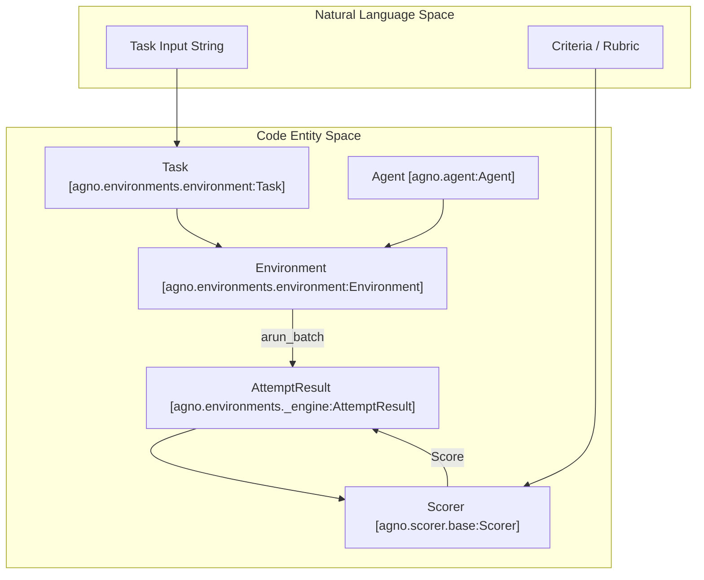
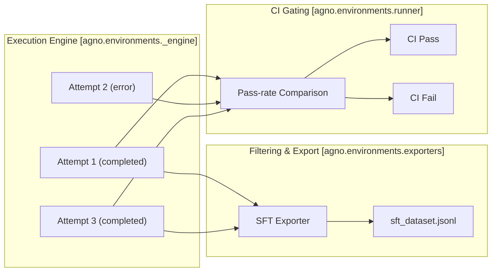

<!-- source: DeepWiki mcp.deepwiki.com · repo agno-agi/agno · page 14 Environments and Dataset Generation · fetched 2026-11-09 -->

# Environments and Dataset Generation

Relevant source files

The following files were used as context for generating this wiki page:

- [libs/agno/agno/eval/agent_as_judge.py](libs/agno/agno/eval/agent_as_judge.py)
- [libs/agno/agno/os/routers/evals/evals.py](libs/agno/agno/os/routers/evals/evals.py)
- [libs/agno/agno/os/routers/evals/utils.py](libs/agno/agno/os/routers/evals/utils.py)
- [libs/agno/agno/scorer/__init__.py](libs/agno/agno/scorer/__init__.py)
- [libs/agno/agno/scorer/_fence.py](libs/agno/agno/scorer/_fence.py)
- [libs/agno/agno/scorer/_model.py](libs/agno/agno/scorer/_model.py)
- [libs/agno/agno/scorer/base.py](libs/agno/agno/scorer/base.py)
- [libs/agno/agno/scorer/code.py](libs/agno/agno/scorer/code.py)
- [libs/agno/agno/scorer/judge.py](libs/agno/agno/scorer/judge.py)
- [libs/agno/agno/scorer/tools.py](libs/agno/agno/scorer/tools.py)
- [libs/agno/tests/unit/scorer/__init__.py](libs/agno/tests/unit/scorer/__init__.py)
- [libs/agno/tests/unit/scorer/digest_fixture.py](libs/agno/tests/unit/scorer/digest_fixture.py)
- [libs/agno/tests/unit/scorer/test_judge_scorer.py](libs/agno/tests/unit/scorer/test_judge_scorer.py)
- [libs/agno/tests/unit/scorer/test_scorer.py](libs/agno/tests/unit/scorer/test_scorer.py)
- [libs/agno/tests/unit/scorer/test_tool_call_scorer.py](libs/agno/tests/unit/scorer/test_tool_call_scorer.py)

The **Environments** subsystem in Agno provides a structured framework for agent verification, reinforcement learning (RL) style evaluation, and dataset generation [libs/agno/agno/scorer/base.py:1-6](). It allows developers to move beyond single-turn testing by running agents multiple times against specific tasks to determine statistical reliability, identify "learning zones," and export successful trajectories for Supervised Fine-Tuning (SFT).

By wrapping an agent's interaction with a task into a repeatable rollout, Agno enables the systematic measurement of pass rates, the inspection of failure modes, and the creation of high-quality training data from passing runs.

### Core Workflow

1. **Define Tasks**: Specify prompts and expected outcomes using the `Task` dataclass.
2. **Run Rollouts**: Execute the agent against these tasks multiple times using `run_rollouts` or `arun_rollouts`.
3. **Score Attempts**: Use built-in `Scorer` implementations (such as `CodeScorer`, `JudgeScorer`, or `ToolCallScorer`) to grade performance [libs/agno/agno/scorer/base.py:27-52](), [libs/agno/agno/scorer/judge.py:81-112]().
4. **Analyze Results**: Inspect rollout grids to find tasks where the agent is inconsistent (the "learning zone").
5. **Export Datasets**: Save successful interaction trajectories as SFT-ready datasets.

Sources:
- `libs/agno/agno/scorer/base.py:1-52` [libs/agno/agno/scorer/base.py:1-52]()
- `libs/agno/agno/scorer/judge.py:81-112` [libs/agno/agno/scorer/judge.py:81-112]()

## System Architecture

The environment system bridges the gap between raw agent execution and formal evaluation. It uses fingerprints to ensure reproducibility and provides a grid-based view of results across different models or agent configurations.

### Agent-Environment Interaction Space

Sources:
- `libs/agno/agno/scorer/base.py:27-52` [libs/agno/agno/scorer/base.py:27-52]()

## Environment and Task Architecture

The `Environment` class manages the lifecycle of an evaluation run. It utilizes `Task` definitions to prompt agents and tracks fingerprints to ensure that results are comparable across different versions of the codebase or model providers. The engine ensures attempt isolation by deep-copying agents and disabling response caching to prevent degenerate replays.

For details, see [Environment and Task Architecture](#14.1).

Sources:
- `libs/agno/agno/scorer/base.py:27-52` [libs/agno/agno/scorer/base.py:27-52]()

## Scorers

Scorers evaluate execution runs and return structured `Score` objects containing numerical values in `[0, 1]`, pass/fail flags, reasons, and optional details [libs/agno/agno/scorer/base.py:27-41](). Agno provides several built-in implementations:
* **CodeScorer**: Validates outputs using Python logic (e.g., custom assertions or callables) [libs/agno/tests/unit/scorer/test_scorer.py:117-135]().
* **JudgeScorer**: Uses an LLM-as-judge pattern (`_evaluator` Agent) to evaluate responses against free-text criteria with binary or numeric (1-10) modes, featuring nonce-fenced prompts for security [libs/agno/agno/scorer/judge.py:81-112](), [libs/agno/tests/unit/scorer/test_judge_scorer.py:105-120]().
* **ToolCallScorer**: Verifies that the agent invoked specific tools with correct arguments, supporting argument subset matching and strict tool allowance rules [libs/agno/tests/unit/scorer/test_tool_call_scorer.py:16-84]().

For details, see [Scorers](#14.2).

Sources:
- `libs/agno/agno/scorer/base.py:27-41` [libs/agno/agno/scorer/base.py:27-41]()
- `libs/agno/agno/scorer/judge.py:81-112` [libs/agno/agno/scorer/judge.py:81-112]()
- `libs/agno/tests/unit/scorer/test_scorer.py:117-135` [libs/agno/tests/unit/scorer/test_scorer.py:117-135]()
- `libs/agno/tests/unit/scorer/test_tool_call_scorer.py:16-84` [libs/agno/tests/unit/scorer/test_tool_call_scorer.py:16-84]()
- `libs/agno/tests/unit/scorer/test_judge_scorer.py:105-120` [libs/agno/tests/unit/scorer/test_judge_scorer.py:105-120]()

## Dataset Export and CI Gating

Once rollouts are complete, Agno can export passing trajectories as SFT datasets. The exporter filters for successful attempts and formats them for model training. Additionally, environment run results can be compared against baselines using diff utilities, enabling pass-rate floors to serve as robust CI gates.

For details, see [Dataset Export and CI Gating](#14.3).

### Dataset Generation and Gating Flow

Sources:
- `libs/agno/agno/scorer/base.py:27-52` [libs/agno/agno/scorer/base.py:27-52]()

---

