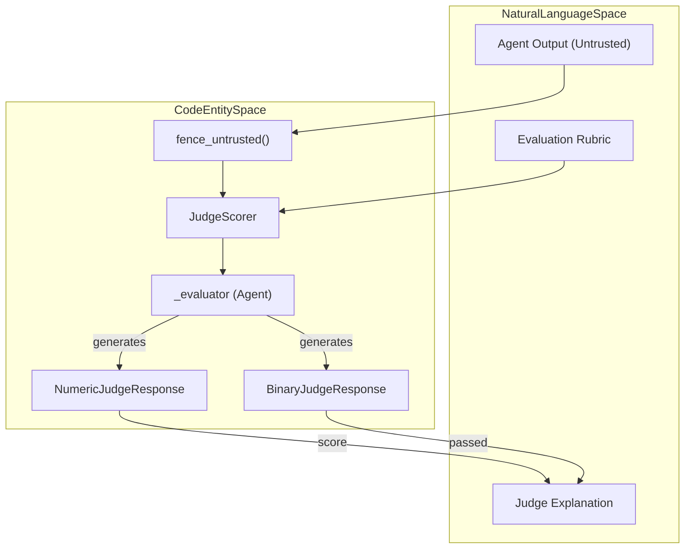
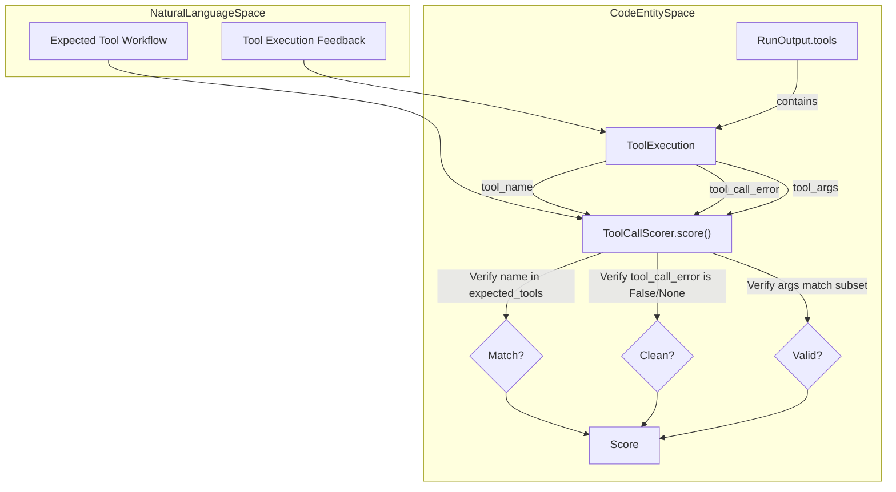

<!-- source: DeepWiki mcp.deepwiki.com · repo agno-agi/agno · page 14.2 Scorers · fetched 2026-11-09 -->

# Scorers

<details>
<summary>Relevant source files</summary>

The following files were used as context for generating this wiki page:

- [libs/agno/agno/eval/agent_as_judge.py](libs/agno/agno/eval/agent_as_judge.py)
- [libs/agno/agno/os/routers/evals/evals.py](libs/agno/agno/os/routers/evals/evals.py)
- [libs/agno/agno/os/routers/evals/utils.py](libs/agno/agno/os/routers/evals/utils.py)
- [libs/agno/agno/scorer/__init__.py](libs/agno/agno/scorer/__init__.py)
- [libs/agno/agno/scorer/_fence.py](libs/agno/agno/scorer/_fence.py)
- [libs/agno/agno/scorer/_model.py](libs/agno/agno/scorer/_model.py)
- [libs/agno/agno/scorer/base.py](libs/agno/agno/scorer/base.py)
- [libs/agno/agno/scorer/code.py](libs/agno/agno/scorer/code.py)
- [libs/agno/agno/scorer/judge.py](libs/agno/agno/scorer/judge.py)
- [libs/agno/agno/scorer/tools.py](libs/agno/agno/scorer/tools.py)
- [libs/agno/tests/unit/scorer/__init__.py](libs/agno/tests/unit/scorer/__init__.py)
- [libs/agno/tests/unit/scorer/digest_fixture.py](libs/agno/tests/unit/scorer/digest_fixture.py)
- [libs/agno/tests/unit/scorer/test_judge_scorer.py](libs/agno/tests/unit/scorer/test_judge_scorer.py)
- [libs/agno/tests/unit/scorer/test_scorer.py](libs/agno/tests/unit/scorer/test_scorer.py)
- [libs/agno/tests/unit/scorer/test_tool_call_scorer.py](libs/agno/tests/unit/scorer/test_tool_call_scorer.py)

</details>


This page explains the `Scorer` base architecture, the `Score` data class, and the built-in implementations (`CodeScorer`, `JudgeScorer`, and `ToolCallScorer`) used across the Agno evaluation and verification subsystems.

## Overview

Scorers bridge raw execution artifacts (`RunOutput` or `TeamRunOutput`) and quantitative evaluation metrics. They implement a common protocol requiring an asynchronous evaluation method (`ascore`), and optionally a synchronous counterpart (`score`), returning a normalized `Score` object [libs/agno/agno/scorer/base.py:27-52]().

The `agno.scorer` package maintains strict architectural boundaries: it must not import `agno.eval` or `agno.environments` to prevent circular dependency cycles during bootstrap [libs/agno/agno/scorer/base.py:1-6]().

```
┌─────────────────────────────────────────────────────────────┐
│                    AnyRunOutput                             │
│         (RunOutput | TeamRunOutput)                         │
└──────────────────────────────┬──────────────────────────────┘
                               │
                               ▼
┌─────────────────────────────────────────────────────────────┐
│                      Scorer Protocol                        │
│             ascore(run, expected) -> Score                  │
└──────┬───────────────────────┼──────────────────────┬───────┘
       │                       │                      │
       ▼                       ▼                      ▼
┌──────────────┐       ┌──────────────┐       ┌──────────────┐
│  CodeScorer  │       │ JudgeScorer  │       │ToolCallScorer│
└──────────────┘       └──────────────┘       └──────────────┘
```

Sources: [libs/agno/agno/scorer/base.py:1-52]()

---

## CodeScorer

`CodeScorer` provides deterministic, programmatic evaluation of runs using user-supplied Python callables (sync or async functions, or callable objects) [libs/agno/tests/unit/scorer/test_scorer.py:117-163]().

### Implementation Mechanics
The callable receives the run and an optional `expected` value. It can return a boolean, a float in `[0.0, 1.0]`, or an explicit `Score` instance [libs/agno/agno/scorer/base.py:27-41](), [libs/agno/tests/unit/scorer/test_scorer.py:117-136](). If a float is returned, `CodeScorer` compares it against `pass_threshold` to determine the `passed` boolean status [libs/agno/tests/unit/scorer/test_scorer.py:117-124]().

Sources: [libs/agno/agno/scorer/base.py:27-41](), [libs/agno/tests/unit/scorer/test_scorer.py:117-163]()

---

## JudgeScorer (LLM-as-a-Judge)

`JudgeScorer` evaluates runs using an internal LLM-backed evaluator agent against free-text criteria and optional reference answers [libs/agno/agno/scorer/judge.py:81-112]().

### Scoring Modes
*   **Binary Mode:** Uses `BinaryJudgeResponse` to emit a `passed` boolean and textual reasoning [libs/agno/agno/scorer/judge.py:24-29]().
*   **Numeric Mode:** Uses `NumericJudgeResponse` to grade the output on a 1–10 scale. The raw score is normalized via `value = (score - 1) / 9`, mapping 1 to `0.0` and 10 to `1.0`. A run passes if `raw_score >= threshold` (default `7`) [libs/agno/agno/scorer/judge.py:81-106]().

### Prompt Fencing and Model Fingerprinting
Untrusted run outputs are enclosed via `fence_untrusted`, wrapping content in nonce-delimited tags to instruct the judge model to treat the content strictly as data rather than instructions [libs/agno/agno/scorer/_fence.py:5-24](). Additionally, `JudgeScorer.digest()` hashes criteria, mode, threshold, and the judge model's identity payload to track scoring rule changes [libs/agno/agno/scorer/judge.py:146-163]().

### Entity Mapping: Judge Scoring



Sources: [libs/agno/agno/scorer/judge.py:81-163](), [libs/agno/agno/scorer/_fence.py:5-24]()

---

## ToolCallScorer

`ToolCallScorer` verifies that agent runs invoke expected tools with correct parameters, respecting error states and Human-in-the-Loop (HITL) constraints [libs/agno/tests/unit/scorer/test_tool_call_scorer.py:1-155]().

### Verification Criteria
*   **Execution Safety:** Only clean executions count. Tool calls with `tool_call_error=True` are immediately rejected [libs/agno/tests/unit/scorer/test_tool_call_scorer.py:65-68]().
*   **Argument Subset Matching:** Validates optional argument dictionaries against actual `ToolExecution.tool_args` [libs/agno/tests/unit/scorer/test_tool_call_scorer.py:71-83]().
*   **HITL Handling:** Verifies that pending or rejected interactive tool calls are correctly flagged [libs/agno/tests/unit/scorer/test_tool_call_scorer.py:16-40]().

### Entity Mapping: Tool Verification



Sources: [libs/agno/agno/scorer/tools.py:1-50](), [libs/agno/tests/unit/scorer/test_tool_call_scorer.py:1-155]()

---

