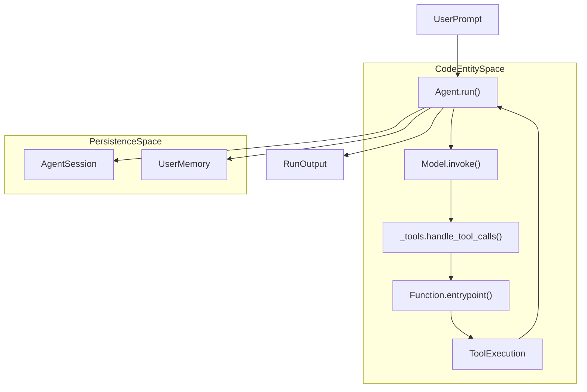
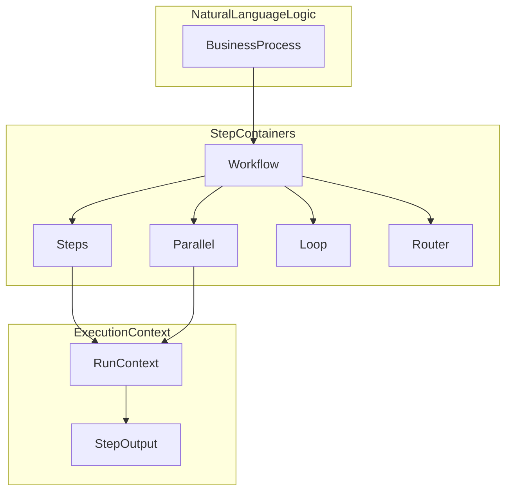

<!-- source: DeepWiki mcp.deepwiki.com · repo agno-agi/agno · page 15 Glossary · fetched 2026-11-09 -->

# Glossary

Relevant source files

The following files were used as context for generating this wiki page:

- [.cursorrules](.cursorrules)
- [.github/pull_request_template.md](.github/pull_request_template.md)
- [.github/workflows/claude.yml](.github/workflows/claude.yml)
- [.github/workflows/pr-triage.yml](.github/workflows/pr-triage.yml)
- [.gitignore](.gitignore)
- [AGENTS.md](AGENTS.md)
- [CLAUDE.md](CLAUDE.md)
- [CONTRIBUTING.md](CONTRIBUTING.md)
- [README.md](README.md)
- [cookbook/05_agent_os/14_mcp/README.md](cookbook/05_agent_os/14_mcp/README.md)
- [cookbook/05_agent_os/14_mcp/TEST_LOG.md](cookbook/05_agent_os/14_mcp/TEST_LOG.md)
- [cookbook/05_agent_os/14_mcp/inspect_tools.py](cookbook/05_agent_os/14_mcp/inspect_tools.py)
- [cookbook/07_knowledge/02_building_blocks/README.md](cookbook/07_knowledge/02_building_blocks/README.md)
- [cookbook/07_knowledge/05_integrations/README.md](cookbook/07_knowledge/05_integrations/README.md)
- [cookbook/07_knowledge/05_integrations/vector_dbs/05_scylladb.py](cookbook/07_knowledge/05_integrations/vector_dbs/05_scylladb.py)
- [cookbook/README.md](cookbook/README.md)
- [libs/agno/agno/agent/agent.py](libs/agno/agno/agent/agent.py)
- [libs/agno/agno/models/base.py](libs/agno/agno/models/base.py)
- [libs/agno/agno/models/message.py](libs/agno/agno/models/message.py)
- [libs/agno/agno/models/response.py](libs/agno/agno/models/response.py)
- [libs/agno/agno/os/app.py](libs/agno/agno/os/app.py)
- [libs/agno/agno/os/config.py](libs/agno/agno/os/config.py)
- [libs/agno/agno/os/mcp.py](libs/agno/agno/os/mcp.py)
- [libs/agno/agno/os/middleware/mcp_routing.py](libs/agno/agno/os/middleware/mcp_routing.py)
- [libs/agno/agno/os/public/_policy.py](libs/agno/agno/os/public/_policy.py)
- [libs/agno/agno/os/router.py](libs/agno/agno/os/router.py)
- [libs/agno/agno/os/schema.py](libs/agno/agno/os/schema.py)
- [libs/agno/agno/run/agent.py](libs/agno/agno/run/agent.py)
- [libs/agno/agno/run/base.py](libs/agno/agno/run/base.py)
- [libs/agno/agno/run/team.py](libs/agno/agno/run/team.py)
- [libs/agno/agno/team/team.py](libs/agno/agno/team/team.py)
- [libs/agno/agno/tools/function.py](libs/agno/agno/tools/function.py)
- [libs/agno/agno/tools/reasoning.py](libs/agno/agno/tools/reasoning.py)
- [libs/agno/agno/utils/events.py](libs/agno/agno/utils/events.py)
- [libs/agno/pyproject.toml](libs/agno/pyproject.toml)
- [libs/agno/tests/integration/agent/test_event_streaming.py](libs/agno/tests/integration/agent/test_event_streaming.py)
- [libs/agno/tests/integration/teams/test_event_streaming.py](libs/agno/tests/integration/teams/test_event_streaming.py)
- [libs/agno/tests/unit/agent/test_paused_user_input_persistence.py](libs/agno/tests/unit/agent/test_paused_user_input_persistence.py)
- [libs/agno/tests/unit/os/test_info_endpoint.py](libs/agno/tests/unit/os/test_info_endpoint.py)
- [libs/agno/tests/unit/os/test_mcp_routing.py](libs/agno/tests/unit/os/test_mcp_routing.py)
- [libs/agno/tests/unit/os/test_mcp_server.py](libs/agno/tests/unit/os/test_mcp_server.py)
- [libs/agno/tests/unit/run/test_run_events.py](libs/agno/tests/unit/run/test_run_events.py)
- [libs/agno/tests/unit/run/test_run_input.py](libs/agno/tests/unit/run/test_run_input.py)
- [libs/agno/tests/unit/tools/test_functions.py](libs/agno/tests/unit/tools/test_functions.py)
- [libs/agno_infra/agno/cli/infra_cli.py](libs/agno_infra/agno/cli/infra_cli.py)
- [libs/agno_infra/agno/infra/enums.py](libs/agno_infra/agno/infra/enums.py)
- [libs/agno_infra/agno/infra/operator.py](libs/agno_infra/agno/infra/operator.py)
- [scripts/demo_setup.sh](scripts/demo_setup.sh)
- [scripts/dev_setup.sh](scripts/dev_setup.sh)

This page defines codebase-specific terms, jargon, abbreviations, and domain concepts used within the Agno framework. It serves as a technical reference for onboarding engineers to understand the mapping between high-level concepts and their underlying code implementations.

---

## 1. Core Architecture Terms

### AgentOS
The production runtime layer of Agno. It is a FastAPI-based application that serves agents, teams, and workflows as scalable REST and WebSocket endpoints, providing built-in authentication, middleware, and database management.
*   **Implementation**: `AgentOS` class in [libs/agno/agno/os/app.py:19-25]()
*   **Key Function**: Manages component registration and API routing via routers like `get_agent_router` [libs/agno/agno/os/app.py:58-62]() and `get_workflow_router` [libs/agno/agno/os/app.py:78-81]().
*   **Lifespan Management**: Handles database initialization, telemetry emission [libs/agno/agno/os/app.py:151-164](), and background task draining [libs/agno/agno/os/app.py:166-178]() during the application lifecycle.

### Framework
The SDK layer used to define the logic of AI systems. It includes base classes for Agents, Teams, Workflows, and shared execution infrastructure like Tools, Knowledge, and Memory.
*   **Implementation**: Located primarily in `libs/agno/agno/agent/`, `libs/agno/agno/team/`, and `libs/agno/agno/workflow/`.

### Control Plane
The management layer (hosted at `os.agno.com`) that connects to running `AgentOS` instances for monitoring, tracing, metrics collection, and human-in-the-loop interactions.
*   **Source**: [README.md:21-30]()

Sources:
[README.md:21-30]()
[libs/agno/agno/os/app.py:19-25]()
[libs/agno/agno/os/app.py:58-62]()
[libs/agno/agno/os/app.py:78-81]()
[libs/agno/agno/os/app.py:151-164]()
[libs/agno/agno/os/app.py:166-178]()

---

## 2. Execution Entities

### Agent
A stateful entity that combines a `Model` with `Tools`, `Memory`, and `Knowledge` to perform discrete reasoning and task execution.
*   **Implementation**: `Agent` class in [libs/agno/agno/agent/agent.py:80-92]()
*   **Data Flow**: Processes a `Message` list [libs/agno/agno/models/message.py:1-45](), invokes a `Model` [libs/agno/agno/models/base.py:134-145](), handles `ToolExecution` [libs/agno/agno/models/response.py:44-58](), and returns a `RunOutput` [libs/agno/agno/run/agent.py:60-68]().

### Team
A collaborative group of agents coordinated under specific execution modes (e.g., `route`, `broadcast`, or `tasks`) managed by a team leader or routing logic.
*   **Implementation**: `Team` class in [libs/agno/agno/team/team.py:83-92]()
*   **Orchestration**: Managed via `TeamMode` [libs/agno/agno/team/mode.py:1-10]() and execution flags like `delegate_to_all_members` [libs/agno/agno/team/team.py:118-125]().

### Workflow
A pipeline-based execution model for multi-step deterministic and semi-autonomous processes. Unlike Agents which are fully autonomous, Workflows follow explicit step containers and control flows.
*   **Implementation**: `Workflow` class in [libs/agno/agno/workflow/workflow.py:1-35]()
*   **Step Types**: Includes container types like `Step`, `Steps`, `Parallel`, `Loop`, `Condition`, and `Router`.

### Learning Machine
A specialized system that enables agents to extract and persist structured insights from interactions into dedicated stores (User Profile, Entity Memory, Decision Log, etc.).
*   **Implementation**: `LearningMachine` class in [libs/agno/agno/agent/agent.py:43-52]()
*   **Integration**: Attached to Agents via configuration attributes.

Sources:
[libs/agno/agno/agent/agent.py:43-52]()
[libs/agno/agno/agent/agent.py:80-92]()
[libs/agno/agno/models/base.py:134-145]()
[libs/agno/agno/models/message.py:1-45]()
[libs/agno/agno/models/response.py:44-58]()
[libs/agno/agno/run/agent.py:60-68]()
[libs/agno/agno/team/mode.py:1-10]()
[libs/agno/agno/team/team.py:83-92]()
[libs/agno/agno/team/team.py:118-125]()
[libs/agno/agno/workflow/workflow.py:1-35]()

---

## 3. Communication and Data Space

### RunOutput
The standardized response container returned after an execution. It holds final text content, metrics, reasoning steps, and session references.
*   **Implementation**: `RunOutput` in [libs/agno/agno/run/agent.py:60-68](), `TeamRunOutput` in [libs/agno/agno/run/team.py:53-58](), and `WorkflowRunOutput`.

### RunEvent
An event type emitted during streaming execution representing state transitions (e.g., `RunStarted`, `ToolCallStarted`, `ModelResponseCompleted`).
*   **Implementation**: `RunEvent` in [libs/agno/agno/run/agent.py:65-70]() and `TeamRunEvent` in [libs/agno/agno/run/team.py:131-141]().

### Session
The persistence boundary for a conversation or workflow run, scoped by `session_id` and `user_id`.
*   **Implementation**: `AgentSession`, `TeamSession`, and `WorkflowSession` in [libs/agno/agno/session/agent.py:1-20]().

### Knowledge Base
A retrieval-augmented generation (RAG) component that indexes unstructured data sources and exposes them to agents for grounded responses.
*   **Protocol**: `KnowledgeProtocol` [libs/agno/agno/agent/agent.py:40-45]()
*   **Implementation**: `Knowledge` class in [libs/agno/agno/knowledge/knowledge.py:1-25]().

Sources:
[libs/agno/agno/agent/agent.py:40-45]()
[libs/agno/agno/knowledge/knowledge.py:1-25]()
[libs/agno/agno/run/agent.py:60-68]()
[libs/agno/agno/run/agent.py:65-70]()
[libs/agno/agno/run/team.py:53-58]()
[libs/agno/agno/run/team.py:131-141]()
[libs/agno/agno/session/agent.py:1-20]()

---

## 4. Technical Diagrams

### Natural Language to Code Entity Mapping: Agent Execution
This diagram bridges the gap between natural language requests and the specific code entities handling the agent lifecycle.

Sources:
[libs/agno/agno/agent/agent.py:80-172]()
[libs/agno/agno/models/base.py:134-184]()
[libs/agno/agno/run/agent.py:60-68]()

### Workflow Pipeline Architecture
This diagram illustrates how a Workflow coordinates complex multi-step execution using container step types.

Sources:
[libs/agno/agno/workflow/workflow.py:1-50]()
[libs/agno/agno/run/base.py:1-30]()

---

## 5. Domain Specific Jargon

| Term | Definition | Code Pointer |
| :--- | :--- | :--- |
| **MCP** | Model Context Protocol. A standard for agents to connect to external tool servers. | [libs/agno/agno/os/mcp.py:1-10](), [libs/agno/agno/tools/function.py:28-35]() |
| **HITL** | Human-in-the-Loop. Execution patterns that pause for user approval or input. | [libs/agno/agno/workflow/workflow.py:1-35]() |
| **Agentic RAG** | A pattern where the agent decides dynamically which filters or search parameters to use for retrieval. | [libs/agno/agno/agent/agent.py:130-142]() |
| **Tool Call Limit** | Safety mechanism to limit iterations in autonomous tool execution loops. | [libs/agno/agno/agent/agent.py:165-175]() |
| **Structured Output** | Forcing model responses into a validated Pydantic schema or strict JSON format. | [libs/agno/agno/models/base.py:148-152]() |
| **A2A** | Agent-to-Agent protocol for cross-OS agent communication and remote agent invocation. | [libs/agno/agno/os/app.py:20-25]() |
| **Checkpointing** | Persistence strategy for saving run state at specific intervals (e.g., tool-batch or terminal states). | [libs/agno/agno/agent/agent.py:153-160]() |
| **Fallback Models** | Secondary models automatically attempted when primary model invocations fail. | [libs/agno/agno/agent/agent.py:85-88]() |
| **Result Offloading** | Managing large tool outputs by persisting them externally rather than passing them directly into the context window. | [libs/agno/agno/agent/agent.py:147-152]() |

Sources:
[libs/agno/agno/agent/agent.py:85-88]()
[libs/agno/agno/agent/agent.py:130-142]()
[libs/agno/agno/agent/agent.py:147-152]()
[libs/agno/agno/agent/agent.py:153-160]()
[libs/agno/agno/agent/agent.py:165-175]()
[libs/agno/agno/models/base.py:148-152]()
[libs/agno/agno/os/app.py:20-25]()
[libs/agno/agno/os/mcp.py:1-10]()
[libs/agno/agno/tools/function.py:28-35]()
[libs/agno/agno/workflow/workflow.py:1-35]()