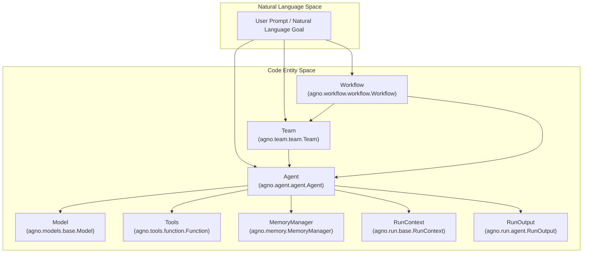

<!-- source: DeepWiki mcp.deepwiki.com · repo agno-agi/agno · page 2 Core Framework · fetched 2026-11-09 -->

# Core Framework

Relevant source files

The following files were used as context for generating this wiki page:

- [libs/agno/agno/agent/agent.py](libs/agno/agno/agent/agent.py)
- [libs/agno/agno/models/base.py](libs/agno/agno/models/base.py)
- [libs/agno/agno/models/message.py](libs/agno/agno/models/message.py)
- [libs/agno/agno/models/response.py](libs/agno/agno/models/response.py)
- [libs/agno/agno/run/agent.py](libs/agno/agno/run/agent.py)
- [libs/agno/agno/run/base.py](libs/agno/agno/run/base.py)
- [libs/agno/agno/run/team.py](libs/agno/agno/run/team.py)
- [libs/agno/agno/team/team.py](libs/agno/agno/team/team.py)
- [libs/agno/agno/tools/function.py](libs/agno/agno/tools/function.py)
- [libs/agno/agno/utils/events.py](libs/agno/agno/utils/events.py)
- [libs/agno/pyproject.toml](libs/agno/pyproject.toml)
- [libs/agno/tests/integration/agent/test_event_streaming.py](libs/agno/tests/integration/agent/test_event_streaming.py)
- [libs/agno/tests/integration/teams/test_event_streaming.py](libs/agno/tests/integration/teams/test_event_streaming.py)
- [libs/agno/tests/unit/agent/test_paused_user_input_persistence.py](libs/agno/tests/unit/agent/test_paused_user_input_persistence.py)
- [libs/agno/tests/unit/run/test_run_events.py](libs/agno/tests/unit/run/test_run_events.py)
- [libs/agno/tests/unit/run/test_run_input.py](libs/agno/tests/unit/run/test_run_input.py)
- [libs/agno/tests/unit/tools/test_functions.py](libs/agno/tests/unit/tools/test_functions.py)

## Purpose and Scope

The Core Framework is the foundational layer of the Agno SDK designed to provide composable building blocks and execution models that facilitate the construction of sophisticated AI systems. It offers core abstractions—Agents, Teams, and Workflows—that combine language models, tools, memory, and knowledge within a shared infrastructure. This infrastructure manages session state, message flows, event streaming, and persistent execution context, enabling reliable and observable AI agent orchestration at scale.

This page introduces the Core Framework overview at a high level. Each major component and concept has a dedicated child page covering detailed design, configuration, and usage:

- [Agent System](#2.1)
- [Team Orchestration](#2.2)
- [Workflow System](#2.3)
- [Run Output and Events](#2.4)
- [Message and Media Handling](#2.5)
- [Event Streaming System](#2.6)
- [Session Management](#2.7)
- [Memory and Learning Systems](#2.8)
- [Result Offloading and FileSystem](#2.9)
- [Reasoning and Skills](#2.10)
- [Sandboxed Execution](#2.11)

For runtime concerns, model provider integration, tooling, and knowledge management, see their respective sections in the wider documentation.

---

## Execution Primitives Overview

The Core Framework’s execution model centers on three main composable primitives and their backing code entities:

Title: Core Framework Execution Architecture

- **`Agent`**: Encapsulates a single AI agent instance with a model, tools, memory, and optional knowledge bases [libs/agno/agno/agent/agent.py:80-160]().
- **`Team`**: Orchestrates a collection of Agents or nested Teams, coordinating execution via configurable modes [libs/agno/agno/team/team.py:82-150]().
- **`Workflow`**: Manages multi-step orchestrations, combining Agents, Teams, and Callables in sequences, parallel tasks, conditionals, loops, or routers.

All primitives share a common core infrastructure centered around `RunContext` which manages run metadata, state, and cancellation [libs/agno/agno/run/base.py:17-50](). They use session-based persistence to maintain and mutate `session_state` for long-lived interactions.

Sources: [libs/agno/agno/agent/agent.py:80-160](), [libs/agno/agno/team/team.py:82-150](), [libs/agno/agno/run/base.py:17-50]()

---

## Agent System (#2.1)

The `Agent` class ([libs/agno/agno/agent/agent.py:80-160]()) is the atomic unit of execution in Agno, combining prompt instructions, tool definitions, retrieval knowledge, and memory management. It supports synchronous and asynchronous run methods (`run()`, `arun()`), streaming responses, output schemas via Pydantic, fallback models (`fallback_models`, `fallback_config`), and advanced checkpointing controls (`checkpoint="tool-batch"`).

For detailed parameters, run lifecycle stages, tool execution, session caching, and cancellation flows, see [Agent System](#2.1).

Sources: [libs/agno/agno/agent/agent.py:80-160](), [libs/agno/agno/models/base.py:133-184]()

---

## Team Orchestration (#2.2)

The `Team` class ([libs/agno/agno/team/team.py:82-150]()) coordinates groups of `Agent` or nested `Team` instances. It supports multiple coordination modes (`TeamMode`), dynamic task delegation, leader synthesis, member-level interaction sharing, and team-level output schemas.

For deeper coverage on coordination modes, member management, and shared context patterns, see [Team Orchestration](#2.2).

Sources: [libs/agno/agno/team/team.py:82-150]()

---

## Workflow System (#2.3)

The `Workflow` class enables structured multi-step business logic by orchestrating agents, teams, and arbitrary Python functions. It provides composition containers such as `Step`, `Steps`, `Parallel`, `Loop`, `Condition`, and `Router`.

It manages data passing via `RunContext`, session state propagation, and Human-in-the-Loop (HITL) workflows requiring confirmation (`requires_confirmation`) or user input (`requires_user_input`).

For details on step composition, execution semantics, and HITL patterns, see [Workflow System](#2.3).

Sources: [libs/agno/agno/run/workflow.py:1-50](), [libs/agno/agno/run/base.py:17-50]()

---

## Run Output and Events (#2.4)

Execution primitives produce structured output structures (`RunOutput`, `TeamRunOutput`, `WorkflowRunOutput`) that encapsulate final text, parsed Pydantic objects, token metrics, reasoning steps, and event streams. Intermediate events (`RunEvent`, `TeamRunEvent`) provide granular observability into tool calls, model requests, and reasoning loops.

For the full specification of output fields and event emission, see [Run Output and Events](#2.4).

Sources: [libs/agno/agno/run/agent.py:145-173](), [libs/agno/agno/run/team.py:131-150]()

---

## Message and Media Handling (#2.5)

The `Message` class ([libs/agno/agno/models/message.py:56-127]()) handles multimodal inputs and outputs across system, user, assistant, and tool roles. It natively manages attached media (`Image`, `Video`, `Audio`, `File`), citations, reasoning content, and provider-specific metadata.

For media format conversion and pipeline flow, see [Message and Media Handling](#2.5).

Sources: [libs/agno/agno/models/message.py:56-127]()

---

## Event Streaming System (#2.6)

Agno provides unified event streaming capabilities via `stream_events`, translating internal state transitions into Server-Sent Events (SSE). This supports real-time progress tracking, intermediate tool outputs, token streaming, and session resume/replay from persisted event logs.

For implementation details on SSE format and replay behavior, see [Event Streaming System](#2.6).

Sources: [libs/agno/agno/run/agent.py:145-173](), [libs/agno/agno/models/response.py:12-24]()

---

## Session Management (#2.7)

Sessions maintain state persistence across multiple interactions. `AgentSession`, `TeamSession`, and `WorkflowSession` encapsulate run histories, session metadata, and user-scoped data (`user_id`, `session_id`), backed by pluggable database backends via `BaseDb`.

For lifecycle management, summarization, and persistence details, see [Session Management](#2.7).

Sources: [libs/agno/agno/agent/agent.py:94-110](), [libs/agno/agno/db/base.py:35-36]()

---

## Memory and Learning Systems (#2.8)

Long-term memory management is handled through `UserMemory`, `MemoryManager`, and automated extraction/compaction strategies. These components extract key facts from interactions, persist them to storage, and recall relevant context into agent prompts dynamically.

For compaction strategies and storage persistence, see [Memory and Learning Systems](#2.8).

Sources: [libs/agno/agno/agent/agent.py:130-142]()

---

## Result Offloading and FileSystem (#2.9)

To handle large tool outputs and data persistence, Agno provides result offloading (`offload_tool_results`, `ResultStore`) and a database-backed agent `FileSystem` abstraction. These tools prevent context window saturation by offloading bulky tool payloads to durable stores.

For configuration and API specifications, see Result Offloading and FileSystem [#2.9].

Sources: [libs/agno/agno/agent/agent.py:147-152]()

---

## Reasoning and Skills (#2.10)

The framework supports advanced agent reasoning via `ReasoningTools`, provider-specific reasoning adapters under `agno/reasoning`, `ReasoningStep` tracking, and modular `Agent Skills` that extend agent capabilities dynamically at runtime.

For adapter configurations and reasoning manager mechanics, see [Reasoning and Skills](#2.10).

Sources: [libs/agno/agno/run/agent.py:13-13]()

---

## Sandboxed Execution (#2.11)

The `agno/sandbox` subsystem provides secure, isolated code execution environments featuring coordinators, execution harnesses, state checkpointing to Postgres/S3, and integration with Docker and AgentOS.

For sandbox architecture and cookbooks, see [Sandboxed Execution](#2.11).

Sources: [libs/agno/agno/agent/agent.py:60-62]()

---

