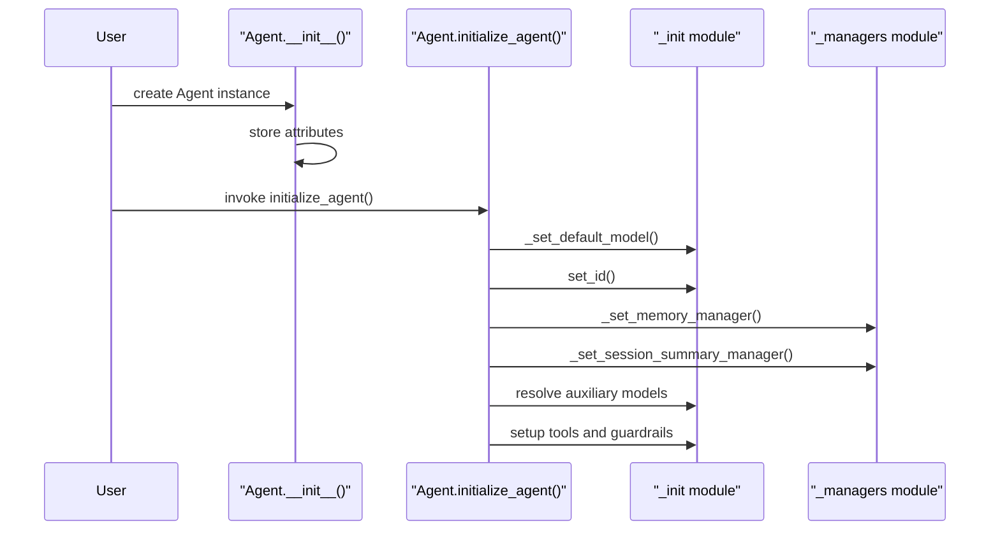
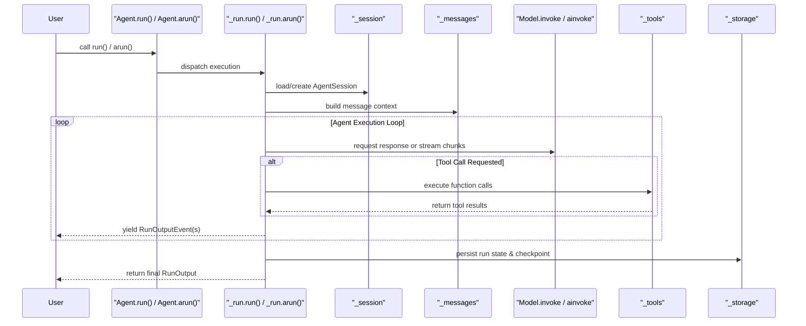

<!-- source: DeepWiki mcp.deepwiki.com · repo agno-agi/agno · page 2.1 Agent System · fetched 2026-11-09 -->

# Agent System

<details>
<summary>Relevant source files</summary>

The following files were used as context for generating this wiki page:

- [cookbook/02_agents/11_approvals/TEST_LOG.md](cookbook/02_agents/11_approvals/TEST_LOG.md)
- [cookbook/02_agents/11_approvals/approval_post_hook.py](cookbook/02_agents/11_approvals/approval_post_hook.py)
- [cookbook/07_knowledge/02_building_blocks/12_hyde_query_transformer.py](cookbook/07_knowledge/02_building_blocks/12_hyde_query_transformer.py)
- [cookbook/07_knowledge/02_building_blocks/13_hyde_with_hybrid_search.py](cookbook/07_knowledge/02_building_blocks/13_hyde_with_hybrid_search.py)
- [libs/agno/agno/agent/_default_tools.py](libs/agno/agno/agent/_default_tools.py)
- [libs/agno/agno/agent/_messages.py](libs/agno/agno/agent/_messages.py)
- [libs/agno/agno/agent/_run.py](libs/agno/agno/agent/_run.py)
- [libs/agno/agno/agent/_tools.py](libs/agno/agno/agent/_tools.py)
- [libs/agno/agno/agent/agent.py](libs/agno/agno/agent/agent.py)
- [libs/agno/agno/knowledge/query_transformer/__init__.py](libs/agno/agno/knowledge/query_transformer/__init__.py)
- [libs/agno/agno/knowledge/query_transformer/base.py](libs/agno/agno/knowledge/query_transformer/base.py)
- [libs/agno/agno/knowledge/query_transformer/hyde.py](libs/agno/agno/knowledge/query_transformer/hyde.py)
- [libs/agno/agno/models/base.py](libs/agno/agno/models/base.py)
- [libs/agno/agno/models/message.py](libs/agno/agno/models/message.py)
- [libs/agno/agno/models/response.py](libs/agno/agno/models/response.py)
- [libs/agno/agno/os/managers.py](libs/agno/agno/os/managers.py)
- [libs/agno/agno/run/agent.py](libs/agno/agno/run/agent.py)
- [libs/agno/agno/run/approval.py](libs/agno/agno/run/approval.py)
- [libs/agno/agno/run/base.py](libs/agno/agno/run/base.py)
- [libs/agno/agno/run/team.py](libs/agno/agno/run/team.py)
- [libs/agno/agno/team/_default_tools.py](libs/agno/agno/team/_default_tools.py)
- [libs/agno/agno/team/_init.py](libs/agno/agno/team/_init.py)
- [libs/agno/agno/team/_messages.py](libs/agno/agno/team/_messages.py)
- [libs/agno/agno/team/_run.py](libs/agno/agno/team/_run.py)
- [libs/agno/agno/team/_session.py](libs/agno/agno/team/_session.py)
- [libs/agno/agno/team/_task_tools.py](libs/agno/agno/team/_task_tools.py)
- [libs/agno/agno/team/_tools.py](libs/agno/agno/team/_tools.py)
- [libs/agno/agno/team/team.py](libs/agno/agno/team/team.py)
- [libs/agno/agno/tools/function.py](libs/agno/agno/tools/function.py)
- [libs/agno/agno/utils/events.py](libs/agno/agno/utils/events.py)
- [libs/agno/agno/utils/knowledge.py](libs/agno/agno/utils/knowledge.py)
- [libs/agno/pyproject.toml](libs/agno/pyproject.toml)
- [libs/agno/tests/integration/agent/human_in_the_loop/test_approval_multi_pause.py](libs/agno/tests/integration/agent/human_in_the_loop/test_approval_multi_pause.py)
- [libs/agno/tests/integration/agent/test_event_streaming.py](libs/agno/tests/integration/agent/test_event_streaming.py)
- [libs/agno/tests/integration/os/test_approval_multi_pause.py](libs/agno/tests/integration/os/test_approval_multi_pause.py)
- [libs/agno/tests/integration/teams/human_in_the_loop/test_team_approval_multi_pause.py](libs/agno/tests/integration/teams/human_in_the_loop/test_team_approval_multi_pause.py)
- [libs/agno/tests/integration/teams/test_event_streaming.py](libs/agno/tests/integration/teams/test_event_streaming.py)
- [libs/agno/tests/unit/agent/test_paused_user_input_persistence.py](libs/agno/tests/unit/agent/test_paused_user_input_persistence.py)
- [libs/agno/tests/unit/agent/test_run_regressions.py](libs/agno/tests/unit/agent/test_run_regressions.py)
- [libs/agno/tests/unit/agent/test_team_tool_propagation.py](libs/agno/tests/unit/agent/test_team_tool_propagation.py)
- [libs/agno/tests/unit/run/test_approval.py](libs/agno/tests/unit/run/test_approval.py)
- [libs/agno/tests/unit/run/test_approval_multi_pause.py](libs/agno/tests/unit/run/test_approval_multi_pause.py)
- [libs/agno/tests/unit/run/test_run_events.py](libs/agno/tests/unit/run/test_run_events.py)
- [libs/agno/tests/unit/run/test_run_input.py](libs/agno/tests/unit/run/test_run_input.py)
- [libs/agno/tests/unit/team/test_acontinue_run_background_stream.py](libs/agno/tests/unit/team/test_acontinue_run_background_stream.py)
- [libs/agno/tests/unit/team/test_get_tool_names.py](libs/agno/tests/unit/team/test_get_tool_names.py)
- [libs/agno/tests/unit/team/test_parser_model_tool_strictness.py](libs/agno/tests/unit/team/test_parser_model_tool_strictness.py)
- [libs/agno/tests/unit/tools/test_functions.py](libs/agno/tests/unit/tools/test_functions.py)

</details>


## Purpose and Scope

This page documents the `Agent` class (`[libs/agno/agno/agent/agent.py:80-430]()`), which serves as the primary execution primitive in Agno for autonomous, tool-using LLM agents. An `Agent` wraps a language model with tools, memory, knowledge bases, guardrails, and configurable execution settings to create a reusable, stateful AI component.

For multi-agent collaboration, see [Team Orchestration](#2.2). For deterministic step-based orchestration, see [Workflow System](#2.3). For message and media handling details, see [Message and Media Handling](#2.5).

**Sources:** [libs/agno/agno/agent/agent.py:80-430]()

---

## Agent Class Architecture

The `Agent` class is a dataclass defined at `[libs/agno/agno/agent/agent.py:80-430]()` containing numerous configuration attributes organized into functional groups.

### Agent Class Structure Diagram

```mermaid
graph TB
    Agent["Agent<br/>@dataclass(init=False)<br/>libs/agno/agno/agent/agent.py:80"]
    
    subgraph "Core Dependencies"
        model["model: Optional[Model]<br/>Line 84"]
        fallback_models["fallback_models: Optional[List[Union[Model, str]]]<br/>Line 86"]
        fallback_config["fallback_config: Optional[FallbackConfig]<br/>Line 88"]
        db["db: Optional[Union[BaseDb, AsyncBaseDb]]<br/>Line 145"]
        knowledge["knowledge: Optional[KnowledgeProtocol/Callable]"]
    end
    
    subgraph "Execution Components"
        tools["tools: Optional[List[Union[Toolkit, Callable, Function, Dict]]]"]
        pre_hooks["pre_hooks: Optional[List[Union[Callable, BaseGuardrail, BaseEval]]]"]
        post_hooks["post_hooks: Optional[List[Union[Callable, BaseGuardrail, BaseEval]]]"]
        memory_manager["memory_manager: Optional[MemoryManager]<br/>Line 132"]
        session_summary_manager["session_summary_manager: Optional[SessionSummaryManager]<br/>Line 120"]
        guardrails["guardrails: Optional[List[BaseGuardrail]]"]
        skills["skills: Optional[Skills]<br/>Line 73"]
    end
    
    subgraph "State Management"
        session_id["session_id: Optional[str]<br/>Line 100"]
        session_state["session_state: Optional[Dict]<br/>Line 102"]
        add_session_state_to_context["add_session_state_to_context: bool<br/>Line 104"]
        enable_agentic_state["enable_agentic_state: bool<br/>Line 106"]
        overwrite_db_session_state["overwrite_db_session_state: bool<br/>Line 108"]
        cache_session["cache_session: bool<br/>Line 110"]
    end
    
    subgraph "Memory and Learning"
        enable_agentic_memory["enable_agentic_memory: bool<br/>Line 137"]
        update_memory_on_run["update_memory_on_run: bool<br/>Line 139"]
        add_memories_to_context["add_memories_to_context: Optional[bool]<br/>Line 141"]
    end

    subgraph "Run History and Output"
        add_history_to_context["add_history_to_context: bool<br/>Line 163"]
        num_history_runs["num_history_runs: Optional[int]<br/>Line 165"]
        output_schema["output_schema: Optional[Type[BaseModel]]"]
        structured_outputs["structured_outputs: bool"]
        parse_response["parse_response: bool"]
        use_json_mode["use_json_mode: bool"]
    end
    
    subgraph "Execution Options"
        checkpoint["checkpoint: Optional[Literal['runs', 'tool-batch', 'tools']]<br/>Line 159"]
    end
    
    subgraph "Other"
        user_id["user_id: Optional[str]<br/>Line 96"]
        name["name: Optional[str]<br/>Line 90"]
        id_field["id: Optional[str]<br/>Line 92"]
    end
    
    Agent --> model
    Agent --> fallback_models
    Agent --> fallback_config
    Agent --> db
    Agent --> knowledge
    Agent --> tools
    Agent --> pre_hooks
    Agent --> post_hooks
    Agent --> memory_manager
    Agent --> session_summary_manager
    Agent --> guardrails
    Agent --> skills
    Agent --> session_id
    Agent --> session_state
    Agent --> add_session_state_to_context
    Agent --> enable_agentic_state
    Agent --> overwrite_db_session_state
    Agent --> cache_session
    Agent --> enable_agentic_memory
    Agent --> update_memory_on_run
    Agent --> add_memories_to_context
    Agent --> add_history_to_context
    Agent --> num_history_runs
    Agent --> output_schema
    Agent --> structured_outputs
    Agent --> parse_response
    Agent --> use_json_mode
    Agent --> checkpoint
    Agent --> user_id
    Agent --> name
    Agent --> id_field
```



**Sources:** [libs/agno/agno/agent/agent.py:80-171]()

---

## Initialization and Configuration

### Basic Initialization and Lazy Wiring

The `Agent` constructor stores configuration parameters without immediately performing heavy initialization or connecting to databases. Resource resolution and component wiring occur lazily when the agent initializes or executes its first run (`[libs/agno/agno/agent/agent.py:720-810]`).

```python
from agno.agent import Agent
from agno.models.openai import OpenAIChat

agent = Agent(
    model=OpenAIChat(id="gpt-4o"),
    name="My Agent",
    description="An agent that helps with tasks",
    instructions=["Be helpful", "Be concise"],
    fallback_models=[OpenAIChat(id="gpt-4o-mini")],
)
```

The initialization process (`[libs/agno/agno/agent/agent.py:720-810]`) performs:
- Default model resolution if none is provided.
- Unique `id` generation if omitted.
- Resolution of memory managers, session summary managers, and auxiliary models (`[libs/agno/agno/agent/_init.py]()`, `[libs/agno/agno/agent/_managers.py]()`).
- Tool binding, guardrail setup, and checkpoint configuration.



**Sources:** [libs/agno/agno/agent/agent.py:720-810](), [libs/agno/agno/agent/_init.py]()

### Model Configuration, Fallbacks, and Retry Logic

The agent model (`model`) defines the underlying LLM provider interface (`[libs/agno/agno/models/base.py:134]()`). `fallback_models` provides a prioritized sequence of fallback models (`[libs/agno/agno/agent/agent.py:86]()`) to invoke if the primary model fails.

Error-specific fallback routing can be configured using `fallback_config` (`[libs/agno/agno/agent/agent.py:88]()`). Additionally, the `Model` class implements retry loops and exponential backoff (`[libs/agno/agno/models/base.py:176-187]()`).

**Sources:** [libs/agno/agno/agent/agent.py:84-88](), [libs/agno/agno/models/base.py:134-187]()

---

## Execution Lifecycle

### Run Methods (`run` and `arun`)

The `Agent` class provides both synchronous (`run`) and asynchronous (`arun`) execution entrypoints (`[libs/agno/agno/agent/agent.py]()`). Both methods handle:
- Input message parsing and media attachment validation (`[libs/agno/agno/run/agent.py:40-142]()`).
- Session state loading and storage (`[libs/agno/agno/session/__init__.py]()`).
- Context assembly, including chat history, memories, and knowledge items (`[libs/agno/agno/agent/_messages.py]()`).
- Tool execution loops, reasoning steps, and streaming event emission (`[libs/agno/agno/agent/_run.py]()`).



**Sources:** [libs/agno/agno/agent/agent.py](), [libs/agno/agno/agent/_run.py](), [libs/agno/agno/run/agent.py:40-142]()

---

## Tool Integration and HITL Controls

### Tool Registration and Resolution

Tools are registered via `tools` (`[libs/agno/agno/agent/agent.py]`) and can include decorated functions (`@tool`, `[libs/agno/agno/tools/decorator.py]()`), `Toolkit` instances, or raw `Function` objects (`[libs/agno/agno/tools/function.py:1-120]()`).

At runtime, `_tools.get_tools()` resolves and validates tool bindings, verifying that asynchronous tools are not invoked in synchronous execution modes (`[libs/agno/agno/agent/_tools.py]()`).

### Human-in-the-Loop (HITL)

Tool executions can be configured with user control flow fields (`[libs/agno/agno/models/response.py:27-71]()`):
- `requires_confirmation`: Pauses execution for user approval.
- `requires_user_input`: Prompts the user for structured inputs or feedback fields (`[libs/agno/agno/models/response.py:50-54]()`).
- `external_execution_required`: Offloads execution to an external worker or system.

When a tool pauses, the agent emits a `RunPaused` event (`[libs/agno/agno/run/agent.py:156]()`), allowing state to be persisted and resumed later upon receiving user input or confirmation.

**Sources:** [libs/agno/agno/tools/decorator.py](), [libs/agno/agno/tools/function.py:1-120](), [libs/agno/agno/models/response.py:27-71](), [libs/agno/agno/run/agent.py:144-173]()

---

## Memory, Checkpointing, and Offloading

### Memory Systems
- **Chat History:** Injected into context when `add_history_to_context` is enabled (`[libs/agno/agno/agent/agent.py:163]()`).
- **User Memories:** Managed via `MemoryManager` (`[libs/agno/agno/memory/__init__.py]()`).
- **Agentic Memory:** When `enable_agentic_memory` is True, the agent receives built-in memory management tools (`[libs/agno/agno/agent/agent.py:137]()`).

### Checkpointing
The `checkpoint` attribute (`[libs/agno/agno/agent/agent.py:159]()`) controls persistence frequency:
- `"runs"` (default): Writes state only at terminal run completion.
- `"tool-batch"`: Writes state after each model turn / tool-gather barrier, enabling fine-grained resumption and message boundaries (`[libs/agno/agno/models/message.py:121-125]()`).
- `"tools"`: Reserved for future releases.

### Result Offloading
Large tool results can be offloaded from active memory to durable backend storage using result stores, configured via `offload_tool_results` (`[libs/agno/agno/agent/_tools.py:50-70]()`).

**Sources:** [libs/agno/agno/agent/agent.py:137-163](), [libs/agno/agno/models/message.py:121-125](), [libs/agno/agno/agent/_tools.py:50-70]()

---

## Knowledge Integration (RAG)

Agents integrate with knowledge bases conforming to `KnowledgeProtocol` (`[libs/agno/agno/knowledge/protocol.py]()`) to support Retrieval-Augmented Generation (RAG). Retrieved chunks are dynamically injected into the context window, filtered using `knowledge_filters` or agent-controlled filters (`[libs/agno/agno/agent/agent.py]()`).

**Sources:** [libs/agno/agno/knowledge/protocol.py](), [libs/agno/agno/agent/agent.py]()

---

## Structured Outputs and Parsing

Structured responses are supported via `output_schema` (a Pydantic model) and `structured_outputs` flags (`[libs/agno/agno/agent/agent.py]()`). If the primary model requires assistance parsing or formatting outputs, a specialized `parser_model` can be configured (`[libs/agno/agno/agent/agent.py]()`).

**Sources:** [libs/agno/agno/agent/agent.py]()

---

## Event Streaming and Cancellation

### Event Streaming
Streaming execution yields events such as `RunStarted`, `RunContent`, `ToolCallStarted`, `RunPaused`, and `RunCompleted` (`[libs/agno/agno/run/agent.py:145-173]()`), facilitating real-time UI updates and telemetry tracking.

### Cancellation
Running agents can be interrupted using `cancel_run(run_id: str)` (`[libs/agno/agno/agent/agent.py]()`), which triggers cancellation tokens and cleans up active background tasks (`[libs/agno/agno/run/cancel.py]()`).

**Sources:** [libs/agno/agno/run/agent.py:145-173](), [libs/agno/agno/run/cancel.py]()

---

## Bridging Natural Language Concepts to Code Entities

```mermaid
flowchart TB
  subgraph "Natural Language Space"
    nl1["Agent Class"]
    nl2["Model Integration"]
    nl3["Tool Registry"]
    nl4["Memory Manager"]
    nl5["Knowledge Base"]
    nl6["Guardrails"]
    nl7["Run Output & Events"]
    nl8["Fallback Config"]
    nl9["Checkpointing"]
    nl10["Session Management"]
    nl11["Run Cancellation"]
  end

  subgraph "Code Entity Space"
    ce1["Agent (libs/agno/agno/agent/agent.py:80)"]
    ce2["Model (libs/agno/agno/models/base.py:134)"]
    ce3["_tools.get_tools (libs/agno/agno/agent/_tools.py)"]
    ce4["MemoryManager (libs/agno/agno/memory/__init__.py)"]
    ce5["KnowledgeProtocol (libs/agno/agno/knowledge/protocol.py)"]
    ce6["BaseGuardrail (libs/agno/agno/guardrails/base.py)"]
    ce7["RunOutput & RunEvent (libs/agno/agno/run/agent.py:67,145)"]
    ce8["FallbackConfig (libs/agno/agno/models/fallback.py)"]
    ce9["Agent.checkpoint (libs/agno/agno/agent/agent.py:159)"]
    ce10["AgentSession (libs/agno/agno/session/__init__.py)"]
    ce11["cancel_run (libs/agno/agno/run/cancel.py)"]
  end

  nl1 --> ce1
  nl2 --> ce2
  nl3 --> ce3
  nl4 --> ce4
  nl5 --> ce5
  nl6 --> ce6
  nl7 --> ce7
  nl8 --> ce8
  nl9 --> ce9
  nl10 --> ce10
  nl11 --> ce11
```



**Sources:** [libs/agno/agno/agent/agent.py:80](), [libs/agno/agno/models/base.py:134](), [libs/agno/agno/agent/_tools.py](), [libs/agno/agno/memory/__init__.py](), [libs/agno/agno/knowledge/protocol.py](), [libs/agno/agno/guardrails/base.py](), [libs/agno/agno/run/agent.py:67,145](), [libs/agno/agno/models/fallback.py](), [libs/agno/agno/run/cancel.py]()

---

