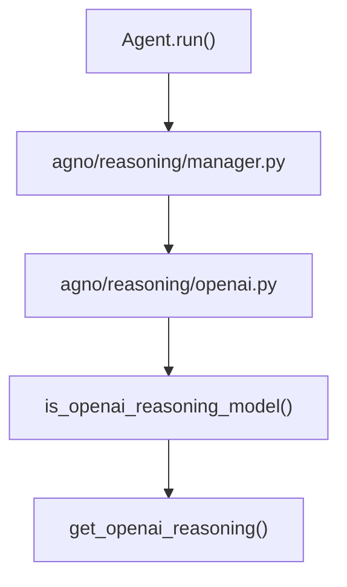

<!-- source: DeepWiki mcp.deepwiki.com · repo agno-agi/agno · page 2.10 Reasoning and Skills · fetched 2026-11-09 -->

# Reasoning and Skills

<details>
<summary>Relevant source files</summary>

The following files were used as context for generating this wiki page:

- [.cursorrules](.cursorrules)
- [.github/pull_request_template.md](.github/pull_request_template.md)
- [.github/workflows/claude.yml](.github/workflows/claude.yml)
- [.github/workflows/pr-triage.yml](.github/workflows/pr-triage.yml)
- [.gitignore](.gitignore)
- [AGENTS.md](AGENTS.md)
- [CLAUDE.md](CLAUDE.md)
- [CONTRIBUTING.md](CONTRIBUTING.md)
- [README.md](README.md)
- [cookbook/07_knowledge/02_building_blocks/README.md](cookbook/07_knowledge/02_building_blocks/README.md)
- [cookbook/07_knowledge/05_integrations/README.md](cookbook/07_knowledge/05_integrations/README.md)
- [cookbook/07_knowledge/05_integrations/vector_dbs/05_scylladb.py](cookbook/07_knowledge/05_integrations/vector_dbs/05_scylladb.py)
- [cookbook/10_reasoning/models/openai/README.md](cookbook/10_reasoning/models/openai/README.md)
- [cookbook/10_reasoning/models/openai/TEST_LOG.md](cookbook/10_reasoning/models/openai/TEST_LOG.md)
- [cookbook/10_reasoning/models/openai/gpt_6.py](cookbook/10_reasoning/models/openai/gpt_6.py)
- [cookbook/README.md](cookbook/README.md)
- [libs/agno/agno/reasoning/anthropic.py](libs/agno/agno/reasoning/anthropic.py)
- [libs/agno/agno/reasoning/azure_ai_foundry.py](libs/agno/agno/reasoning/azure_ai_foundry.py)
- [libs/agno/agno/reasoning/deepseek.py](libs/agno/agno/reasoning/deepseek.py)
- [libs/agno/agno/reasoning/gemini.py](libs/agno/agno/reasoning/gemini.py)
- [libs/agno/agno/reasoning/groq.py](libs/agno/agno/reasoning/groq.py)
- [libs/agno/agno/reasoning/manager.py](libs/agno/agno/reasoning/manager.py)
- [libs/agno/agno/reasoning/moonshot.py](libs/agno/agno/reasoning/moonshot.py)
- [libs/agno/agno/reasoning/ollama.py](libs/agno/agno/reasoning/ollama.py)
- [libs/agno/agno/reasoning/openai.py](libs/agno/agno/reasoning/openai.py)
- [libs/agno/agno/reasoning/openrouter.py](libs/agno/agno/reasoning/openrouter.py)
- [libs/agno/agno/reasoning/vertexai.py](libs/agno/agno/reasoning/vertexai.py)
- [libs/agno/agno/tools/reasoning.py](libs/agno/agno/tools/reasoning.py)
- [libs/agno/tests/integration/models/deepseek/test_reasoning_streaming.py](libs/agno/tests/integration/models/deepseek/test_reasoning_streaming.py)
- [libs/agno/tests/unit/reasoning/test_reasoning_api_checkers.py](libs/agno/tests/unit/reasoning/test_reasoning_api_checkers.py)
- [libs/agno/tests/unit/reasoning/test_reasoning_checkers.py](libs/agno/tests/unit/reasoning/test_reasoning_checkers.py)
- [libs/agno_infra/agno/cli/infra_cli.py](libs/agno_infra/agno/cli/infra_cli.py)
- [libs/agno_infra/agno/infra/enums.py](libs/agno_infra/agno/infra/enums.py)
- [libs/agno_infra/agno/infra/operator.py](libs/agno_infra/agno/infra/operator.py)
- [scripts/demo_setup.sh](scripts/demo_setup.sh)
- [scripts/dev_setup.sh](scripts/dev_setup.sh)

</details>


This page documents the reasoning subsystem (`ReasoningTools`, `ReasoningStep`, per-provider reasoning adapters, reasoning manager) and the Agent Skills subsystem within the Agno framework. Reasoning enables agents to perform stepwise, introspective, and provider-specific logical thought processes, while skills package reusable domain expertise and capabilities as callable tools.

---

## 1. Reasoning Subsystem Architecture

The reasoning subsystem encapsulates step-by-step logical workflows executed by agents using reasoning tools and provider-specific adapters. 

- **`ReasoningTools` Toolkit**: A toolset providing reusable functions to express reasoning steps as internal thoughts (`think`) or analysis (`analyze`) along with metadata such as confidence and next actions [libs/agno/agno/tools/reasoning.py:10-48]().
- **`ReasoningStep`**: A structured Pydantic model representing a single reasoning passage, including title, thought, action, result, next action, and confidence score [libs/agno/agno/reasoning/step.py:1-5]().
- **Per-Provider Reasoning Adapters (`agno/reasoning/`)**: Provider-specific modules containing model checkers and invocation runners for native reasoning models across OpenAI, Gemini, DeepSeek, Anthropic, and others [libs/agno/agno/reasoning/openai.py:1-40]().


Sources: `libs/agno/agno/tools/reasoning.py:10-48`, `libs/agno/agno/reasoning/openai.py:1-41`, `libs/agno/agno/reasoning/step.py:1-5`

---

## 2. Step-by-Step Reasoning with `ReasoningTools`

Located in `libs/agno/agno/tools/reasoning.py`, the `ReasoningTools` class inherits from `Toolkit` and provides two primary scratchpad tools for programmatic chain-of-thought generation [libs/agno/agno/tools/reasoning.py:10-48]().

### `think` Method
The `think` method acts as an internal scratchpad for breaking down complex problems [libs/agno/agno/tools/reasoning.py:50-115]().
- Parameters: `run_context: RunContext`, `title: str`, `thought: str`, `action: Optional[str]`, `confidence: float` [libs/agno/agno/tools/reasoning.py:50-57]().
- Execution: Creates a `ReasoningStep` with `NextAction.CONTINUE`, appends it to `run_context.session_state["reasoning_steps"][current_run_id]`, and returns a formatted string of all accumulated steps [libs/agno/agno/tools/reasoning.py:75-111]().

### `analyze` Method
The `analyze` method processes the outcome of prior actions and determines subsequent directions [libs/agno/agno/tools/reasoning.py:116-171]().
- Parameters: `run_context: RunContext`, `title: str`, `result: str`, `analysis: str`, `next_action: str`, `confidence: float` [libs/agno/agno/tools/reasoning.py:116-124]().
- Execution: Maps string actions (`continue`, `validate`, `final_answer`) to `NextAction` enums, records the step into session state, and returns the accumulated reasoning trace [libs/agno/agno/tools/reasoning.py:137-171]().

```mermaid
title "Natural Language Space to Code Entity Space: ReasoningTools Execution"
flowchart TD
  NaturalLanguageThought[/"Agent decides to break down problem"/] --> |"invokes"| ToolThink["ReasoningTools.think()"]
  ToolThink --> |"constructs"| StepObj["ReasoningStep(title, thought, action, confidence)"]
  StepObj --> |"mutates"| SessionDict["run_context.session_state['reasoning_steps'][run_id]"]
  SessionDict --> |"serializes via"| ModelDump["ReasoningStep.model_dump_json()"]
  ModelDump --> |"persists in"| AgentSession["AgentSession storage"]
```
Sources: `libs/agno/agno/tools/reasoning.py:10-171`

---

## 3. Per-Provider Reasoning Adapters

Agno implements dedicated adapter modules under `libs/agno/agno/reasoning/` to integrate provider-native reasoning models (such as OpenAI o-series, DeepSeek R1, Gemini 2.5/3, etc.).

### OpenAI Reasoning Adapter (`agno/reasoning/openai.py`)
- **Model Detection**: `is_openai_reasoning_model(reasoning_model: Model) -> bool` inspects class names (`OpenAIChat`, `OpenAIResponses`) and model identifiers (`o1`, `o3`, `o4`, `gpt-5`, `deepseek-r1`) [libs/agno/agno/reasoning/openai.py:14-41]().
- **Synchronous Execution**: `get_openai_reasoning()` adjusts developer messages to system roles, executes `reasoning_agent.run()`, accumulates evaluation metrics, and extracts content between `<think>` tags [libs/agno/agno/reasoning/openai.py:43-79]().
- **Asynchronous Execution**: `aget_openai_reasoning()` provides the non-blocking equivalent using `arun()` [libs/agno/agno/reasoning/openai.py:82-118]().
- **Streaming**: `get_openai_reasoning_stream()` yields incremental content deltas or the final `Message` object [libs/agno/agno/reasoning/openai.py:120-175]().

Sources: `libs/agno/agno/reasoning/openai.py:1-175`

---

## 4. Agent Skills Subsystem

The Agent Skills subsystem packages domain expertise, instructions, reference documentation, and executable scripts into named skill bundles that agents can progressively discover and invoke.

### `Skills` Orchestrator Class
Defined in `libs/agno/agno/skills/agent_skills.py`, the `Skills` class coordinates skill loading, system prompt injection, and tool exposition.
- **Loader Integration**: Accepts multiple `SkillLoader` instances to populate internal skill registries.
- **System Prompt Snippet Generation**: Generates an XML-formatted summary (`get_system_prompt_snippet()`) describing available skills and guidelines without loading full instruction texts into context prematurely.
- **Exposed Tools**: Registers callable functions (`get_skill_instructions`, `get_skill_reference`, `get_skill_script`) enabling agents to dynamically query documentation or execute scripts.

```mermaid
title "Natural Language Space to Code Entity Space: Agent Skills Resolution"
flowchart TD
  AgentSkillIntent[/"Agent requests skill documentation"/] --> |"calls"| SkillsGetTools["Skills.get_tools()"]
  SkillsGetTools --> |"accesses registry"| SkillsDict["Skills._skills: Dict[str, Skill]"]
  SkillsDict --> |"retrieves via"| SkillLoaderCall["SkillLoader.load_skills()"]
  SkillLoaderCall --> |"reads"| FileSystem["Filesystem safe path join & execution"]
  FileSystem --> |"returns content to"| AgentContext["Agent Context Stream"]
```
Sources: `libs/agno/agno/skills/agent_skills.py:1-170`

---

