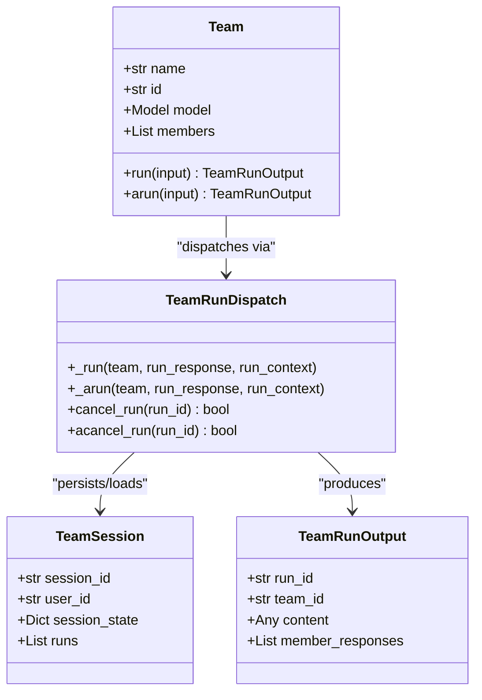
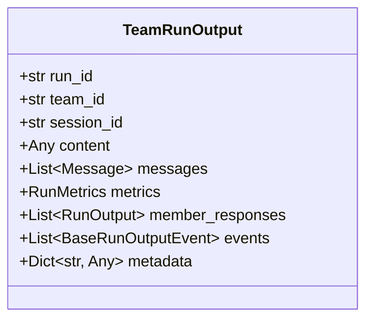
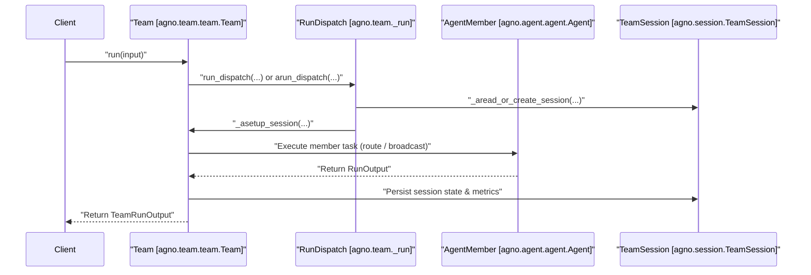

<!-- source: DeepWiki mcp.deepwiki.com · repo agno-agi/agno · page 2.2 Team Orchestration · fetched 2026-11-09 -->

# Team Orchestration

<details>
<summary>Relevant source files</summary>

The following files were used as context for generating this wiki page:

- [cookbook/02_agents/11_approvals/TEST_LOG.md](cookbook/02_agents/11_approvals/TEST_LOG.md)
- [cookbook/02_agents/11_approvals/approval_post_hook.py](cookbook/02_agents/11_approvals/approval_post_hook.py)
- [cookbook/91_tools/tavily_tools_advanced.py](cookbook/91_tools/tavily_tools_advanced.py)
- [libs/agno/agno/agent/_run.py](libs/agno/agno/agent/_run.py)
- [libs/agno/agno/agent/_utils.py](libs/agno/agno/agent/_utils.py)
- [libs/agno/agno/os/managers.py](libs/agno/agno/os/managers.py)
- [libs/agno/agno/run/approval.py](libs/agno/agno/run/approval.py)
- [libs/agno/agno/team/_run.py](libs/agno/agno/team/_run.py)
- [libs/agno/agno/team/_utils.py](libs/agno/agno/team/_utils.py)
- [libs/agno/agno/tools/tavily.py](libs/agno/agno/tools/tavily.py)
- [libs/agno/tests/integration/agent/human_in_the_loop/test_approval_multi_pause.py](libs/agno/tests/integration/agent/human_in_the_loop/test_approval_multi_pause.py)
- [libs/agno/tests/integration/os/test_approval_multi_pause.py](libs/agno/tests/integration/os/test_approval_multi_pause.py)
- [libs/agno/tests/integration/teams/human_in_the_loop/test_team_approval_multi_pause.py](libs/agno/tests/integration/teams/human_in_the_loop/test_team_approval_multi_pause.py)
- [libs/agno/tests/integration/teams/test_team_delegation.py](libs/agno/tests/integration/teams/test_team_delegation.py)
- [libs/agno/tests/unit/agent/test_callable_resources.py](libs/agno/tests/unit/agent/test_callable_resources.py)
- [libs/agno/tests/unit/agent/test_run_regressions.py](libs/agno/tests/unit/agent/test_run_regressions.py)
- [libs/agno/tests/unit/os/test_per_request_isolation.py](libs/agno/tests/unit/os/test_per_request_isolation.py)
- [libs/agno/tests/unit/run/test_approval.py](libs/agno/tests/unit/run/test_approval.py)
- [libs/agno/tests/unit/run/test_approval_multi_pause.py](libs/agno/tests/unit/run/test_approval_multi_pause.py)
- [libs/agno/tests/unit/team/test_acontinue_run_background_stream.py](libs/agno/tests/unit/team/test_acontinue_run_background_stream.py)
- [libs/agno/tests/unit/team/test_callable_resources.py](libs/agno/tests/unit/team/test_callable_resources.py)
- [libs/agno/tests/unit/team/test_delegate_closure_bug.py](libs/agno/tests/unit/team/test_delegate_closure_bug.py)
- [libs/agno/tests/unit/tools/test_tavily.py](libs/agno/tests/unit/tools/test_tavily.py)

</details>


## Purpose and Scope

This wiki page covers the technical implementation of team-based multi-agent coordination in Agno. It details the `Team` class (`agno.team.team.Team`), member management and lifecycle utilities (`agno.team._members`, `agno.team._utils`), execution dispatch and cancellation (`agno.team._run`), team-level output schemas (`agno.run.team`), and shared context/session management patterns.

Sources:
- [libs/agno/agno/team/team.py:1-200]()
- [libs/agno/agno/team/_run.py:1-186]()
- [libs/agno/agno/run/team.py:45-95]()

---

## Team Class Structure and Member Management

The `Team` class serves as the primary coordinator for multi-agent workflows. It maintains a collection of member agents or nested teams, a coordinator model, and persistent session state.

### Member List and Initialization

Members can be provided as a static list or a dynamic callable factory. During initialization, child members inherit the parent team's routing context.

```python
from agno.team import Team
from agno.agent import Agent
from agno.models.openai import OpenAIChat

team = Team(
    name="content_team",
    model=OpenAIChat(id="gpt-4o"),
    members=[
        Agent(name="researcher", model=OpenAIChat(id="gpt-4o")),
        Agent(name="writer", model=OpenAIChat(id="gpt-4o")),
    ],
)
```

Key configuration parameters accepted by the `Team` constructor include:

| Parameter | Type | Description |
| :--- | :--- | :--- |
| `members` | `Union[List[Union[Agent, Team]], Callable]` | Static list or factory returning team members |
| `model` | `Optional[Model]` | Team-level coordinator model |
| `mode` | `Optional[TeamMode]` | Coordination strategy (`route`, `tasks`, etc.) |
| `respond_directly` | `bool` | Whether to bypass aggregator and return direct member outputs |
| `delegate_to_all_members` | `bool` | Broadcast task to all members simultaneously |
| `determine_input_for_members` | `bool` | Whether the coordinator model customizes member inputs |
| `name` | `Optional[str]` | Human-readable team identifier |
| `id` | `Optional[str]` | Unique team UUID, autogenerated if omitted |

Sources:
- [libs/agno/agno/team/team.py:80-150]()
- [libs/agno/agno/team/_utils.py:112-161]()

### Deep Copy and Isolation

To support per-request isolation and concurrent runs (e.g., within AgentOS), teams support deep copying via `deep_copy` in `agno.team._utils`, which isolates mutable session state while sharing heavy resources like database connections and model pools.

Sources:
- [libs/agno/agno/team/_utils.py:112-182]()
- [libs/agno/tests/unit/os/test_per_request_isolation.py:120-167]()

---

## Coordination Modes

The `Team` class supports multiple execution coordination patterns:

1. **Route Mode (Default):** The coordinator model evaluates incoming queries and exposes members as internal callable tools. It routes tasks selectively to the appropriate member agent.
2. **Delegate to All Members:** With `delegate_to_all_members=True`, the team leader broadcasts the prompt to all configured members concurrently without routing filters.
3. **Tasks Mode:** The team manages iterative autonomous task loops up to `max_iterations` for complex agentic workflows.

Sources:
- [libs/agno/tests/integration/teams/test_team_delegation.py:14-153]()

---

## Diagram: Team Architecture to Code Entities

Diagrammatic mapping between high-level team orchestration concepts and the underlying Python classes and functions in Agno.



Sources:
- [libs/agno/agno/team/team.py:80-170]()
- [libs/agno/agno/team/_run.py:154-215]()
- [libs/agno/run/team.py:45-95]()

---

## Shared Context and Session State

Teams manage conversation history and shared variables across member agents.

### Session State and Serialization

The `session_state` dictionary persists across runs in the configured database backend. Context dictionaries are serialized using helper functions such as `_convert_dependencies_to_string` to ensure safe JSON formatting or fallback string representations.

```python
# Context dictionary conversion handling inside agno.team._utils
def _convert_dependencies_to_string(team: Team, context: Dict[str, Any]) -> str:
    ...
```

Sources:
- [libs/agno/agno/team/_utils.py:71-105]()

### History Sharing Controls

- `add_team_history_to_members`: Propagates past team runs into member prompt context.
- `share_member_interactions`: Exposes individual member inputs and outputs to all other peers within the current run execution turn.

Sources:
- [libs/agno/agno/team/team.py:100-140]()

---

## Team-Level Output Schema and Data Models

Run results are encapsulated by `TeamRunOutput`, which aggregates metrics, content, and individual member execution outputs.



Sources:
- [libs/agno/run/team.py:45-95]()

---

## Team Run Lifecycle, Execution, and Cancellation

Team execution flows through dispatch handlers (`run_dispatch`, `_arun`, `_run`) located in `agno.team._run`. When a run is cancelled, cascading cancellation calls abort all active member execution threads.



Sources:
- [libs/agno/agno/team/_run.py:154-222]()
- [libs/agno/tests/unit/team/test_acontinue_run_background_stream.py:58-88]()

---

# Summary

The `Team` class provides robust multi-agent coordination through flexible membership models, distinct coordination strategies (`route`, `delegate_to_all_members`, and autonomous task loops), and synchronized session state persistence.

Sources:
- [libs/agno/agno/team/team.py:80-180]()
- [libs/agno/agno/team/_run.py:1-222]()
- [libs/agno/run/team.py:45-95]()

---

