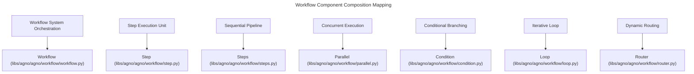
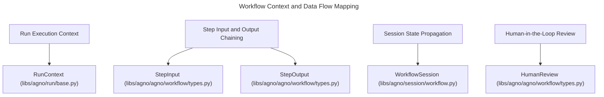

<!-- source: DeepWiki mcp.deepwiki.com · repo agno-agi/agno · page 2.3 Workflow System · fetched 2026-11-09 -->

# Workflow System

Relevant source files

The following files were used as context for generating this wiki page:

- [cookbook/04_workflows/03_loop_execution/loop_iterative_accumulation.py](cookbook/04_workflows/03_loop_execution/loop_iterative_accumulation.py)
- [cookbook/04_workflows/08_human_in_the_loop/condition/02_condition_on_error.py](cookbook/04_workflows/08_human_in_the_loop/condition/02_condition_on_error.py)
- [libs/agno/agno/run/workflow.py](libs/agno/agno/run/workflow.py)
- [libs/agno/agno/workflow/condition.py](libs/agno/agno/workflow/condition.py)
- [libs/agno/agno/workflow/loop.py](libs/agno/agno/workflow/loop.py)
- [libs/agno/agno/workflow/parallel.py](libs/agno/agno/workflow/parallel.py)
- [libs/agno/agno/workflow/router.py](libs/agno/agno/workflow/router.py)
- [libs/agno/agno/workflow/step.py](libs/agno/agno/workflow/step.py)
- [libs/agno/agno/workflow/steps.py](libs/agno/agno/workflow/steps.py)
- [libs/agno/agno/workflow/types.py](libs/agno/agno/workflow/types.py)
- [libs/agno/agno/workflow/workflow.py](libs/agno/agno/workflow/workflow.py)
- [libs/agno/tests/integration/workflows/test_condition_steps.py](libs/agno/tests/integration/workflows/test_condition_steps.py)
- [libs/agno/tests/integration/workflows/test_loop_steps.py](libs/agno/tests/integration/workflows/test_loop_steps.py)
- [libs/agno/tests/integration/workflows/test_parallel_steps.py](libs/agno/tests/integration/workflows/test_parallel_steps.py)
- [libs/agno/tests/integration/workflows/test_router_steps.py](libs/agno/tests/integration/workflows/test_router_steps.py)
- [libs/agno/tests/unit/workflow/test_media_aggregation.py](libs/agno/tests/unit/workflow/test_media_aggregation.py)
- [libs/agno/tests/unit/workflow/test_parallel_run_context_isolation.py](libs/agno/tests/unit/workflow/test_parallel_run_context_isolation.py)
- [libs/agno/tests/unit/workflow/test_previous_content_values.py](libs/agno/tests/unit/workflow/test_previous_content_values.py)
- [libs/agno/tests/unit/workflow/test_step_output_content_roundtrip.py](libs/agno/tests/unit/workflow/test_step_output_content_roundtrip.py)

## Purpose and Scope

The Workflow System orchestrates multi-step processes by composing various step types such as Agents, Teams, nested Workflows, and callables into flexible pipelines that support sequential, parallel, conditional, looped, and routed execution. It manages step dependencies, metadata, input/output data flow, human-in-the-loop (HITL) interactions, and persistent run/session state `[libs/agno/agno/workflow/workflow.py:39-148]()`.

This page presents an architectural overview, focusing on the `Workflow` class core concepts including step composition, dependencies, metadata handling, and run parameters that enable complex workflows. Detailed step semantics and execution mechanics are covered in child pages:

- See [Workflow Step Types](#2.3.1) for specific step containers and execution behaviors
- See [Step Execution and Context](#2.3.2) for run context, input/output chaining, dependency injection, and session state propagation
- See [Human-in-the-Loop (HITL) Workflows](#2.3.3) for manual intervention, route selection, and approval pattern details

Sources: [libs/agno/agno/workflow/workflow.py:39-148](), [libs/agno/agno/workflow/step.py:160-192]()

---

## Workflow Architecture and Step Composition

The `Workflow` class orchestrates execution over a set of composable steps `[libs/agno/agno/workflow/workflow.py:172-184]()`. Workflows can nest other workflows and containers to form complex graphs `[libs/agno/agno/workflow/workflow.py:211-218]()`. The core step types include:

- `Step`: basic unit wrapping an executor (Agent, Team, nested Workflow, or callable) `[libs/agno/agno/workflow/step.py:160-172]()`
- `Steps`: sequential pipeline of steps `[libs/agno/agno/workflow/steps.py:40-50]()`
- `Parallel`: concurrent execution of steps `[libs/agno/agno/workflow/parallel.py:47-61]()`
- `Condition`: branching logic (`if`/`else`) `[libs/agno/agno/workflow/condition.py:55-94]()`
- `Loop`: iterative step repetition with end condition `[libs/agno/agno/workflow/loop.py:43-83]()`
- `Router`: dynamic step selection or user-driven route selection `[libs/agno/agno/workflow/router.py:50-83]()`

These are composable and nestable containers forming the workflow DAG. Below is a mapping of natural language workflow concepts to code entities:

Workflow container classes and their composition define the structure for orchestrating multi-step executions by nesting and combining steps.

Sources: [libs/agno/agno/workflow/workflow.py:172-184](), [libs/agno/agno/workflow/step.py:160-192](), [libs/agno/agno/workflow/types.py:65-107]()

---

## Core Step Types Overview

The Workflow System defines various step types that provide primitives for task orchestration:

| Step Type | Source File | Description | Key Configuration Parameters |
|-----------|-------------|-------------|------------------------------|
| `Step` | `step.py` | Fundamental execution unit wrapping a single executor (Agent/Team/Callable/Workflow) with retry, failures, HITL options `[libs/agno/agno/workflow/step.py:160-172]()` | `agent`, `team`, `executor`, `workflow`, `max_retries`, `skip_on_failure` |
| `Steps` | `steps.py` | Sequential pipeline of steps executed one after another `[libs/agno/agno/workflow/steps.py:40-50]()` | `steps` (list), `requires_confirmation` |
| `Parallel` | `parallel.py` | Executes multiple steps concurrently with merged session state `[libs/agno/agno/workflow/parallel.py:47-61]()` | Variadic `steps`, supports context propagation |
| `Condition` | `condition.py` | Conditional branching step with if and optional else branches `[libs/agno/agno/workflow/condition.py:55-94]()` | `evaluator` (callable, bool, or CEL expression), `steps`, `else_steps` |
| `Loop` | `loop.py` | Executes steps repeatedly until end condition or max iterations reached `[libs/agno/agno/workflow/loop.py:43-83]()` | `steps`, `max_iterations`, `end_condition` (CEL or function), `forward_iteration_output` |
| `Router` | `router.py` | Dynamically selects which step(s) to execute based on input or user selection `[libs/agno/agno/workflow/router.py:50-83]()` | `choices` (steps), `selector` (function or CEL), HITL route selection options |

For detailed usage, configuration, and execution semantics of each step type, see [Workflow Step Types](#2.3.1).

Sources: [libs/agno/agno/workflow/step.py:160-172](), [libs/agno/agno/workflow/steps.py:40-50](), [libs/agno/agno/workflow/parallel.py:47-61](), [libs/agno/agno/workflow/condition.py:55-94](), [libs/agno/agno/workflow/loop.py:43-83](), [libs/agno/agno/workflow/router.py:50-83]()

---

## Step Execution, Context, and Data Flow

Data flows through workflows by passing `StepInput` objects into each step and collecting `StepOutput` results `[libs/agno/agno/workflow/types.py:141-143]()`. These encapsulate run context, dependency injection, and state propagation across step executions.

Below is a mapping of context and data flow concepts to code entities:

For complete details on run context, step input/output chaining, dependency injection, session state propagation, and CEL expressions, see [Step Execution and Context](#2.3.2).

Sources: [libs/agno/agno/workflow/types.py:141-143](), [libs/agno/session/workflow.py:112-112]()

---

## Human-in-the-Loop (HITL) Integration

Human-in-the-loop workflows are enabled by the `HumanReview` dataclass which configures pause conditions at multiple levels `[libs/agno/agno/workflow/types.py:64-79]`:

- Pre-execution confirmation (`requires_confirmation`) `[libs/agno/agno/workflow/types.py:82-83]()`
- User input collection (`requires_user_input` with schema) `[libs/agno/agno/workflow/types.py:86-88]()`
- Post-execution output review (`requires_output_review`) `[libs/agno/agno/workflow/types.py:94-96]()`
- Routing selection and per-iteration reviews in loops `[libs/agno/agno/workflow/types.py:90-99]()`

When a step or workflow hits a pause point, a `StepRequirement` object is emitted alongside events like `StepPausedEvent`, storing full context for resuming the run `[libs/agno/agno/run/workflow.py:54-54]()`. The system persists workflow sessions (`WorkflowSession`), allowing paused workflows to be resumed asynchronously `[libs/agno/session/workflow.py:112-112]()`.

For implementation details of HITL execution states, workflows, route selection, and approval patterns, see [Human-in-the-Loop (HITL) Workflows](#2.3.3).

Sources: [libs/agno/agno/workflow/types.py:64-107](), [libs/agno/agno/run/workflow.py:39-80](), [libs/agno/session/workflow.py:112-112]()

---

## Session Persistence and State Management

Workflows track execution state and results using persistent sessions:

- `WorkflowSession` stores active workflow state, run history, saved paused execution data, and accumulated workflow data `[libs/agno/session/workflow.py:112-112]()`.
- Each step has identifiers for traceability and for identifying pause/resume boundaries `[libs/agno/run/workflow.py:93-98]()`.
- Session state is stored in a database backend (`BaseDb`, `AsyncBaseDb`) and passed into executions for continuity `[libs/agno/db/base.py:41-41]()`.
- Child step executions within containers like `Parallel` receive isolated context copies and merge changes back upon completion `[libs/agno/workflow/parallel.py:25-25]()`.

Sources: [libs/agno/session/workflow.py:112-112](), [libs/agno/db/base.py:41-41](), [libs/agno/workflow/parallel.py:25-25]()

---

# Summary

The `Workflow` system in Agno serves as a powerful orchestration layer to build AI agent pipelines combining multi-step sequences, parallel branches, conditionals, loops, dynamic routing, and human-in-the-loop interventions `[libs/agno/agno/workflow/workflow.py:132-136]()`. Steps are composable containers that execute agents, teams, or arbitrary logic while managing input/output data flow, retries, error handling, and rich metadata `[libs/agno/agno/workflow/workflow.py:211-220]()`. Workflows manage execution context, session persistence, event streaming, and interactive pauses for user approvals or inputs `[libs/agno/run/workflow.py:39-84]()`.

For detailed usage, configuration, and execution semantics of each step type and context propagation, refer to the child pages:

- [Workflow Step Types](#2.3.1)  
- [Step Execution and Context](#2.3.2)  
- [Human-in-the-Loop (HITL) Workflows](#2.3.3)  

Sources: [libs/agno/agno/workflow/workflow.py:132-220](), [libs/agno/agno/run/workflow.py:39-84]()

---

