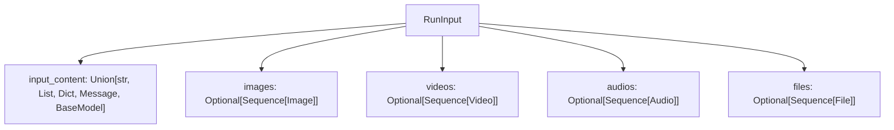
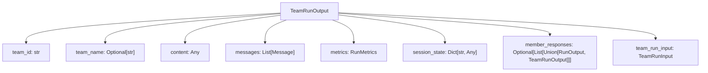
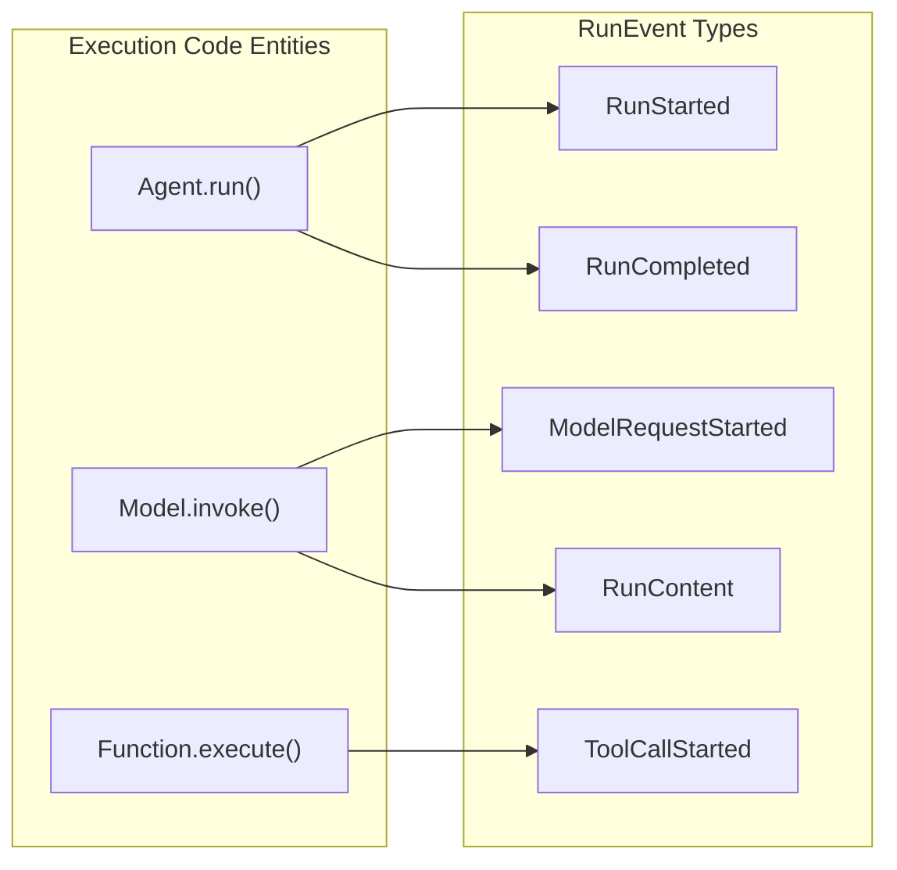
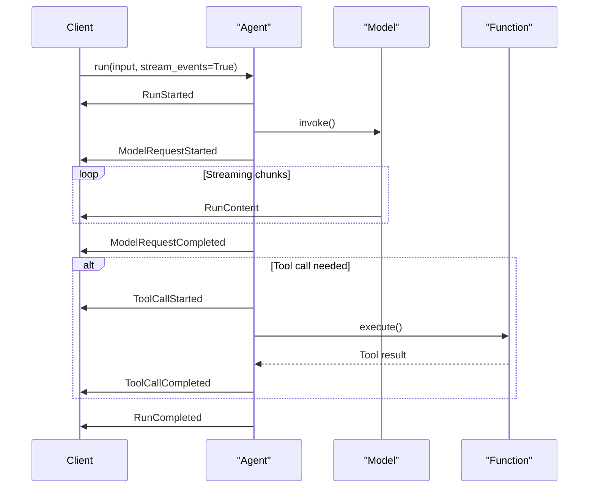
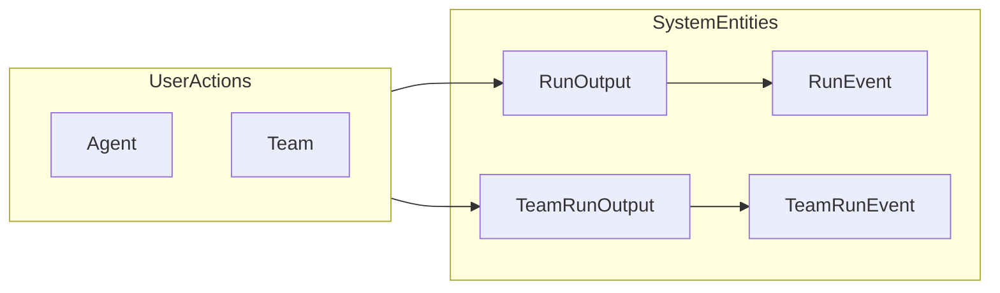

<!-- source: DeepWiki mcp.deepwiki.com · repo agno-agi/agno · page 2.4 Run Output and Events · fetched 2026-11-09 -->

# Run Output and Events

<details>
<summary>Relevant source files</summary>

The following files were used as context for generating this wiki page:

- [libs/agno/agno/agent/agent.py](libs/agno/agno/agent/agent.py)
- [libs/agno/agno/models/base.py](libs/agno/agno/models/base.py)
- [libs/agno/agno/models/message.py](libs/agno/agno/models/message.py)
- [libs/agno/agno/models/response.py](libs/agno/agno/models/response.py)
- [libs/agno/agno/run/__init__.py](libs/agno/agno/run/__init__.py)
- [libs/agno/agno/run/agent.py](libs/agno/agno/run/agent.py)
- [libs/agno/agno/run/base.py](libs/agno/agno/run/base.py)
- [libs/agno/agno/run/cancel.py](libs/agno/agno/run/cancel.py)
- [libs/agno/agno/run/cancellation_management/__init__.py](libs/agno/agno/run/cancellation_management/__init__.py)
- [libs/agno/agno/run/cancellation_management/base.py](libs/agno/agno/run/cancellation_management/base.py)
- [libs/agno/agno/run/cancellation_management/in_memory_cancellation_manager.py](libs/agno/agno/run/cancellation_management/in_memory_cancellation_manager.py)
- [libs/agno/agno/run/cancellation_management/redis_cancellation_manager.py](libs/agno/agno/run/cancellation_management/redis_cancellation_manager.py)
- [libs/agno/agno/run/team.py](libs/agno/agno/run/team.py)
- [libs/agno/agno/team/team.py](libs/agno/agno/team/team.py)
- [libs/agno/agno/tools/function.py](libs/agno/agno/tools/function.py)
- [libs/agno/agno/utils/events.py](libs/agno/agno/utils/events.py)
- [libs/agno/agno/utils/response.py](libs/agno/agno/utils/response.py)
- [libs/agno/pyproject.toml](libs/agno/pyproject.toml)
- [libs/agno/tests/integration/agent/test_agent_run_cancellation.py](libs/agno/tests/integration/agent/test_agent_run_cancellation.py)
- [libs/agno/tests/integration/agent/test_event_streaming.py](libs/agno/tests/integration/agent/test_event_streaming.py)
- [libs/agno/tests/integration/teams/test_event_streaming.py](libs/agno/tests/integration/teams/test_event_streaming.py)
- [libs/agno/tests/unit/agent/test_paused_user_input_persistence.py](libs/agno/tests/unit/agent/test_paused_user_input_persistence.py)
- [libs/agno/tests/unit/run/test_run_events.py](libs/agno/tests/unit/run/test_run_events.py)
- [libs/agno/tests/unit/run/test_run_input.py](libs/agno/tests/unit/run/test_run_input.py)
- [libs/agno/tests/unit/tools/test_functions.py](libs/agno/tests/unit/tools/test_functions.py)
- [libs/agno/tests/unit/utils/test_response.py](libs/agno/tests/unit/utils/test_response.py)

</details>


## Purpose and Scope

This document describes the internal structures and system for capturing the output and events produced during the execution of `Agent`, `Team`, and `Workflow` instances in Agno. It covers the design and composition of `RunOutput` and related output data structures, the various `RunEvent` types emitted to represent execution state and progress, how events are streamed and stored, and how users can consume and observe these events efficiently during and after execution.

Sources: `[libs/agno/agno/run/agent.py:25-70]()`, `[libs/agno/agno/run/team.py:50-58]()`

---

## RunOutput Structure

At the core of Agno's execution model is the `RunOutput` data structure, defined primarily in `[libs/agno/agno/run/agent.py]()`. This structure encapsulates the end result of an agent execution, including response content, message history, execution metadata, token metrics, tool invocation data, media outputs, and optionally a rich event trace that captures every meaningful state change during the run.

### Key Entities and Relationships in RunOutput

```mermaid
graph TB
    subgraph "Code Entity Space"
        RunOutput["RunOutput"]
        RunInput["RunInput"]
        Message["Message"]
        RunMetrics["RunMetrics"]
        ToolExecution["ToolExecution"]
        RunEvent["RunOutputEvent"]
        BaseModel["BaseModel"]
    end

    subgraph "Natural Language / Domain Space"
        ExecutionResult["Execution Result Content"]
        ConversationHistory["Conversation Messages"]
        PerformanceStats["Token Usage & Timing Metrics"]
        ToolCallHistory["Tools Called and their Results"]
        StructuredOutput["Deserialized Structured Output"]
        ExecutionEvents["Execution Event Stream"]
    end

    RunOutput -- "captures overall" --> ExecutionResult
    RunOutput -- "includes" --> ConversationHistory
    RunOutput -- "tracks" --> PerformanceStats
    RunOutput -- "records" --> ToolCallHistory
    RunOutput -- "optionally" --> ExecutionEvents
    RunOutput -- "exposes input as" --> RunInput
    RunOutput -- "may include" --> StructuredOutput
```



The `RunOutput` includes unique identifiers (`run_id`, `session_id`, `user_id`), execution status (`RunStatus`), and session state dictionaries for persistent session context across runs.

### Important RunOutput Fields

| Field Name | Type | Description |
|------------|------|-------------|
| `run_id` | `str` | Unique identifier for the run (UUID) |
| `session_id` | `Optional[str]` | ID for the user session maintaining conversation state |
| `user_id` | `Optional[str]` | Identifier for the user who initiated the run |
| `agent_id` | `str` | Identifier of the Agent that created this output |
| `content` | `Any` | Main output content (string, object, or model response) |
| `messages` | `List[Message]` | Full conversation/message list for this run |
| `metrics` | `RunMetrics` | Execution performance metrics (tokens, duration) |
| `tools` | `List[ToolExecution]` | Tool calls made during run with args/results |
| `status` | `RunStatus` | Final run status (success, cancelled, failed, etc.) |
| `events` | `Optional[List[RunOutputEvent]]` | Optional list of run events for observability |
| `parsed_output` | `Optional[BaseModel]` | Optional structured output parsed using `output_schema` |
| `reasoning_content` | `Optional[str]` | Reasoning/thinking text generated by models |
| `session_state` | `Dict[str, Any]` | Persistent state across runs in a session |
| Media fields (`images`, `videos`, `audios`, `files`) | Lists of media types | Media artifacts generated, e.g., images and files |
| `response_audio` | `Optional[Audio]` | Audio output from model responses |

Sources: `[libs/agno/agno/run/agent.py:269-459]()`, `[libs/agno/agno/models/message.py:56-127]()`, `[libs/agno/agno/run/agent.py:145-182]()`

---

## RunInput Structure

`RunInput` records the raw and auxiliary inputs submitted to the run, preserving the exact input content and media passed by the user or caller.



This enables runs to reflect exactly the caller's input, including multimodal content, for accurate playback or auditing.

Sources: `[libs/agno/agno/run/agent.py:40-143]()`, `[libs/agno/agno/media.py:1-131]()`

---

## TeamRunOutput Structure

For team executions, Agno defines `TeamRunOutput` which extends the notion of run output to coordinate multiple agent members and aggregate their responses, while retaining team and delegation metadata.

### TeamRunOutput Relationships



This model allows representing the team's leader response with the underlying member runs embedded for inspection or downstream processing.

Sources: `[libs/agno/agno/run/team.py:28-129]()`, `[libs/agno/agno/models/response.py:116-166]()`

---

## WorkflowRunOutput Structure

Workflows orchestrate multi-step computations and collect outputs from steps, maintaining detailed metrics and step results.

| Field       | Type                      | Description                                            |
|-------------|---------------------------|--------------------------------------------------------|
| `run_id`    | `str`                     | Unique workflow run ID                                 |
| `workflow_id`| `str`                    | Workflow identifier                                   |
| `status`    | `RunStatus`               | Workflow-level status                                 |
| `step_results` | `List[StepOutput]`       | Ordered outputs from each executed workflow step     |
| `nested_depth` | `int`                   | Nesting level (zero for top-level workflows)         |
| `events`    | `List[BaseWorkflowRunOutputEvent]` | Event stream specific to workflow execution     |
| `metrics`   | `WorkflowMetrics`         | Aggregated token usage and timing metrics             |

The `WorkflowRunOutput` inherits from `BaseRunOutputEvent` which includes standardized serialization logic defined in `[libs/agno/agno/run/base.py:78-166]()`.

Sources: `[libs/agno/agno/run/base.py:78-166]()`

---

## Event System Overview

Agno features a detailed event system, emitting rich lifecycle events during runs for Agents, Teams, and Workflows. These events furnish observability into the run progress, states, and intermediate data.

### Event Base and Indexing

Events derive from `BaseRunOutputEvent` (dataclass in `[libs/agno/agno/run/base.py:78-166]()`) featuring:

- Monotonically increasing `event_index` stamped by the stream during emission to ensure ordered replay and synchronization (`[libs/agno/agno/run/base.py:51-76]()`).
- Deep serialization to dict/JSON supporting nested media, references, and structured components (`[libs/agno/agno/run/base.py:107-166]()`).
- Fields selectively nullified in shallow copies during serialization to optimize payload sizes.

### Agent RunEvent Types

The `RunEvent` enumeration breaks down run lifecycle into discrete event types:

| Category            | Event Name              | Description                                  |
|---------------------|-------------------------|----------------------------------------------|
| **Lifecycle**       | `RunStarted`, `RunCompleted`, `RunCancelled`, `RunError` | Start/end/cancellation/error lifecycle events |
| **Streaming Content**| `RunContent`, `RunIntermediateContent`, `RunContentCompleted` | Response streaming chunks and their finalization |
| **Tool Execution**  | `ToolCallStarted`, `ToolCallCompleted`, `ToolCallError` | Tool/function invocation and results          |
| **Model Interaction**| `ModelRequestStarted`, `ModelRequestCompleted` | Boundaries around LLM API calls               |
| **Reasoning**       | `ReasoningStarted`, `ReasoningStep`, `ReasoningCompleted` | Steps and phases for reasoning-style models  |
| **Human-in-the-Loop**| `RunPaused`, `RunContinued` | Pausing and resuming runs for user input/approval |
| **Memory Updates**  | `MemoryUpdateStarted`, `MemoryUpdateCompleted` | Lifecycle of memory extraction and persistence |

Sources: `[libs/agno/agno/run/agent.py:145-182]()`, `[libs/agno/agno/run/base.py:78-166]()`

---

## Event Mapping: From Execution to Emitted Events



Sources: `[libs/agno/agno/run/agent.py:145-182]()`, `[libs/agno/agno/models/base.py:134-184]()`

---

## Event Lifecycle and Execution Flow

During a typical agent run with `stream_events=True`, the lifecycle proceeds with key event emissions:



Sources: `[libs/agno/agno/run/agent.py:145-182]()`, `[libs/agno/tests/integration/agent/test_event_streaming.py:1-60]()`

---

## Consuming Events for Observability

### Streaming Event Consumption

When running an agent or team with the `stream_events=True` parameter, the caller receives an iterable or async iterable yielding `RunOutput` objects or event deltas.

```python
for event in agent.run("Hello, world!", stream_events=True):
    if event.event == RunEvent.run_started:
        print(f"Run {event.run_id} started")
    elif event.event == RunEvent.tool_call_started:
        print(f"Invoking tool: {event.tool.tool_name}")
    elif event.event == RunEvent.run_content:
        print(event.content, end="", flush=True)
    elif event.event == RunEvent.run_completed:
        print("Run completed")
```

Sources: `[libs/agno/tests/integration/teams/test_event_streaming.py:19-52]()`

### Event Persistence and Post-execution Access

Setting `store_events=True` on the Agent or Team causes all emitted events to be persisted in the database associated with the run session. Later retrieval includes the full event list in the final `RunOutput.events` attribute (`[libs/agno/tests/integration/teams/test_event_streaming.py:53-116]()`).

Sources: `[libs/agno/tests/integration/teams/test_event_streaming.py:53-116]()`

---

## State Access Within Tools

Tools executed during a run can receive a `RunContext` argument (`[libs/agno/agno/run/base.py:17-49]`) that exposes:
- The current session state dictionary (`session_state`).
- A shallow copy of the current messages list (`messages`).
- Runtime-resolved resources like tools or knowledge managers.

Sources: `[libs/agno/agno/run/base.py:17-49]()`

---

## Best Practices for Event Consumption

- **Filtering Events:** Use configuration flags to omit noisy events like `RunContent` if only lifecycle monitoring is required.
- **Error Monitoring:** Listen to `RunError` and `ToolCallError` events to handle failures cleanly.
- **Metrics Analysis:** Use `RunMetrics` emitted in completion events to gather token usage and latencies (`[libs/agno/tests/integration/teams/test_event_streaming.py:90-96]()`).

Sources: `[libs/agno/tests/integration/teams/test_event_streaming.py:90-116]()`

---

# Summary Diagram: Code Entities Bridging User Actions to System Events



Sources: `[libs/agno/agno/agent/agent.py:80-100]()`, `[libs/agno/agno/team/team.py:83-110]()`, `[libs/agno/agno/run/agent.py:145-182]()`, `[libs/agno/agno/run/team.py:131-165]()`

---

