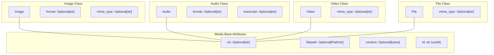
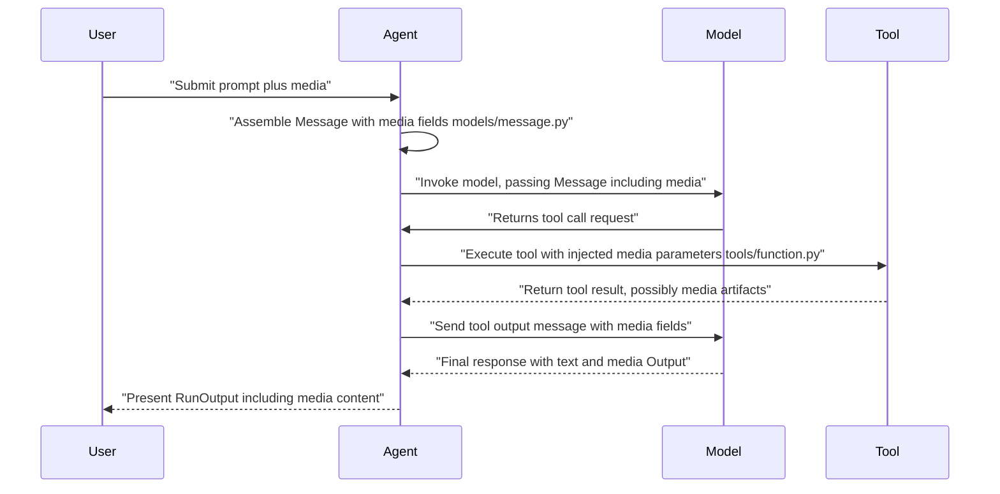
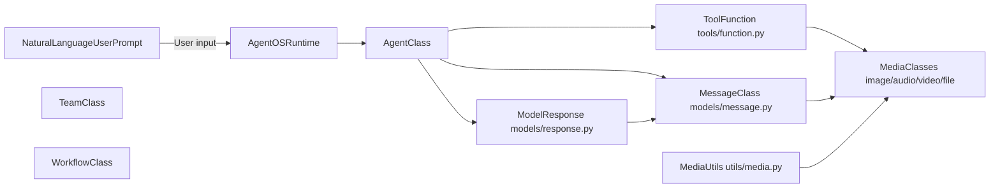

<!-- source: DeepWiki mcp.deepwiki.com · repo agno-agi/agno · page 2.5 Message and Media Handling · fetched 2026-11-09 -->

# Message and Media Handling

Relevant source files

The following files were used as context for generating this wiki page:

- [cookbook/01_demo/settings.py](cookbook/01_demo/settings.py)
- [cookbook/04_workflows/06_advanced_concepts/file_propagation/file_generation_workflow.py](cookbook/04_workflows/06_advanced_concepts/file_propagation/file_generation_workflow.py)
- [cookbook/05_agent_os/02_databases/gcs_media_storage.py](cookbook/05_agent_os/02_databases/gcs_media_storage.py)
- [cookbook/05_agent_os/02_databases/s3_media_storage.py](cookbook/05_agent_os/02_databases/s3_media_storage.py)
- [cookbook/06_storage/11_media_storage_file_generation.py](cookbook/06_storage/11_media_storage_file_generation.py)
- [cookbook/91_tools/file_generation_tools.py](cookbook/91_tools/file_generation_tools.py)
- [cookbook/91_tools/models_lab_tools.py](cookbook/91_tools/models_lab_tools.py)
- [cookbook/gemini_3/.gitignore](cookbook/gemini_3/.gitignore)
- [cookbook/gemini_3/11_text_to_speech.py](cookbook/gemini_3/11_text_to_speech.py)
- [cookbook/gemini_3/15_file_search.py](cookbook/gemini_3/15_file_search.py)
- [libs/agno/agno/tools/file/__init__.py](libs/agno/agno/tools/file/__init__.py)
- [libs/agno/agno/tools/file/file.py](libs/agno/agno/tools/file/file.py)
- [libs/agno/agno/tools/file/generation.py](libs/agno/agno/tools/file/generation.py)
- [libs/agno/agno/tools/file_generation.py](libs/agno/agno/tools/file_generation.py)
- [libs/agno/agno/tools/models_labs.py](libs/agno/agno/tools/models_labs.py)
- [libs/agno/agno/utils/media.py](libs/agno/agno/utils/media.py)
- [libs/agno/tests/unit/tools/test_file_generation.py](libs/agno/tests/unit/tools/test_file_generation.py)
- [libs/agno/tests/unit/utils/test_media_reconstruction.py](libs/agno/tests/unit/utils/test_media_reconstruction.py)
- [libs/agno/tests/unit/utils/test_path_safety_consistency.py](libs/agno/tests/unit/utils/test_path_safety_consistency.py)

## Purpose and Scope

This page explains the message and media handling within the Agno framework. It details:

- The `Message` class and its comprehensive structure as a universal communication container.
- The representation and unified interface for multimodal content: images, videos, audio, and files.
- Media MIME-type resolution, format detection, and download utilities.
- Media flow during agent, team, and workflow execution with tool calls and model interactions.
- Message serialization, reconstruction, and persistence.
- Citation handling supporting Retrieval-Augmented Generation (RAG) workflows.

This page forms a foundational understanding of how Agno supports rich multimodal interactions seamlessly across agents, teams, and workflows.

Sources: [libs/agno/agno/models/message.py:56-125](), [libs/agno/agno/utils/media.py:15-167]()

---

## Message Structure

### Core `Message` Class

The key structure for all conversational data is the `Message` class, a Pydantic `BaseModel` defined in [libs/agno/agno/models/message.py:56-125](). It serves as a flexible container for text, structured data, and media content exchanged between users, agents, models, and tools.

**Key Fields:**

- **Identity:** `id` (uuid4), `role` (`system`, `user`, `assistant`, `tool`), and optional `name`.
- **Textual Content:** `content` (string or list), plus optional compressed or reasoning-specific contents.
- **Tool Interaction:** `tool_call_id`, `tool_calls` (list of tool call dicts), `tool_name`, `tool_args`, and `tool_call_error`.
- **Media Fields:** Collections of `images`, `videos`, `audio`, `files`, plus single media outputs (`image_output`, `video_output` etc.) for generated artifacts.
- **Metadata:** `provider_data` (provider-specific metadata), `citations` for source attribution, `references`, `metrics`, and status flags like `temporary`, `from_history`, `stop_after_tool_call`, and `add_to_agent_memory`.

```mermaid
graph TB
    Message["Message BaseModel<br/>models/message.py:56"]
    
    subgraph Identity["Identity"]
        ID["id: str<br/>uuid4"]
        Role["role: str<br/>system/user/assistant/tool"]
        Name["name: Optional[str]"]
    end
    
    subgraph Content["Content"]
        ContentVal["content: Optional[Union[List, str]]"]
        CompressedContent["compressed_content: Optional[str]"]
        ReasoningContent["reasoning_content: Optional[str]"]
        RedactedReasoning["redacted_reasoning_content: Optional[str]"]
    end
    
    subgraph ToolInteraction["Tool Interaction"]
        ToolCallID["tool_call_id: Optional[str]"]
        ToolCalls["tool_calls: Optional[List[Dict]]"]
        ToolName["tool_name: Optional[str]"]
        ToolArgs["tool_args: Optional[Any]"]
        ToolCallError["tool_call_error: Optional[bool]"]
    end
    
    subgraph MediaFields["Media Fields"]
        Images["images: Optional[Sequence[Image]]"]
        Audio["audio: Optional[Sequence[Audio]]"]
        Videos["videos: Optional[Sequence[Video]]"]
        Files["files: Optional[Sequence[File]]"]
        AudioOutput["audio_output: Optional[Audio]"]
        ImageOutput["image_output: Optional[Image]"]
        VideoOutput["video_output: Optional[Video]"]
        FileOutput["file_output: Optional[File]"]
    end
    
    subgraph Metadata["Metadata"]
        ProviderData["provider_data: Optional[Dict]"]
        Citations["citations: Optional[Citations]"]
        References["references: Optional[MessageReferences]"]
        Metrics["metrics: MessageMetrics"]
        CreatedAt["created_at: int"]
        Temporary["temporary: bool = False"]
        FromHistory["from_history: bool = False"]
        StopAfterToolCall["stop_after_tool_call: bool"]
        AddToMemory["add_to_agent_memory: bool"]
    end
    
    Message --> ID
    Message --> Role
    Message --> Name
    Message --> ContentVal
    Message --> CompressedContent
    Message --> ReasoningContent
    Message --> RedactedReasoning
    Message --> ToolCallID
    Message --> ToolCalls
    Message --> ToolName
    Message --> ToolArgs
    Message --> ToolCallError
    Message --> Images
    Message --> Audio
    Message --> Videos
    Message --> Files
    Message --> AudioOutput
    Message --> ImageOutput
    Message --> VideoOutput
    Message --> FileOutput
    Message --> ProviderData
    Message --> Citations
    Message --> References
    Message --> Metrics
    Message --> CreatedAt
    Message --> Temporary
    Message --> FromHistory
    Message --> StopAfterToolCall
    Message --> AddToMemory
```

The `Message` class allows extension by model providers via `model_config = ConfigDict(extra="allow", populate_by_name=True, arbitrary_types_allowed=True)` enabling provider-specific message fields [libs/agno/agno/models/message.py:127]().

Sources: [libs/agno/agno/models/message.py:56-125](), [libs/agno/agno/models/message.py:127]()

---

## Media Types in the Framework

### Unified Media Classes

Agno’s media subsystem defines unified classes for different media types, designed to work smoothly across all providers and tools:

- **`Image`** — with optional fields like `format` and `mime_type`.
- **`Audio`** — supports transcript, sample rate, channels, and format.
- **`Video`** — with format and MIME type metadata.
- **`File`** — generic file container, with filename and MIME type.

Each class supports three mutually exclusive content sources:

- `url` (remote URI to the media)
- `filepath` (local path to the media file)
- `content` (raw media bytes)

They implement strict validation to ensure exactly one source exists, and can serialize/deserialize seamlessly.

These classes are defined inside `agno.media` and used across the core models and tools [libs/agno/agno/models/message.py:78-87](), [libs/agno/agno/models/response.py:123-126](), [libs/agno/agno/agent/agent.py:45]().

### Media MIME Type Resolution and Helpers

Agno provides utilities to resolve MIME types and detect media formats for smooth interoperability:

- **`resolve_image_mime_type`**: Given optional parameters including explicit MIME, format, file extension, and raw bytes, this function finds the best MIME type, prioritizing explicit `mime_type`, then format, then file extension, then magic bytes, and defaulting to `image/jpeg` as fallback [libs/agno/agno/utils/media.py:37-63]().

- **Magic Byte Detection (`get_image_type`)**: Uses file header bytes to detect formats such as PNG, GIF, JPEG, HEIC, and WebP for media without extensions [libs/agno/agno/utils/media.py:15-34]().

- **Download Helpers**: Separate functions handle HTTP download and save for `download_image`, `download_audio`, `download_video`, and generic `download_file` ensuring integrity and error handling [libs/agno/agno/utils/media.py:74-167]().

Sources: [libs/agno/agno/utils/media.py:15-167](), [libs/agno/agno/models/message.py:78-87](), [libs/agno/agno/models/response.py:123-126](), [libs/agno/agno/agent/agent.py:45]()

---

## Media Handling in Messages and Model Responses

The `Message` class allows media attachments in both input and output roles:

- **Input media fields** we send to models or tools: `images`, `audio`, `videos`, `files` (all as sequences).
- **Output media fields**, which represent artifacts generated by a model or tool: singular versions `image_output`, `audio_output`, `video_output`, `file_output` [libs/agno/agno/models/message.py:78-81](), [libs/agno/agno/models/message.py:84-87]().

Similarly, the `ModelResponse` class (model output) contains analogous fields to track media artifacts generated during run execution [libs/agno/agno/models/response.py:123-126]().

The media fields can contain fully constructed media instances or placeholders with references or base64 content. Deserialization carefully handles reconstruction via `Message.from_dict()` to restore `Image`, `Audio`, `Video`, and `File` objects from dictionary data, handling base64 decoding or URL references [libs/agno/agno/models/message.py:149-193]().

Sources: [libs/agno/agno/models/message.py:78-87](), [libs/agno/agno/models/message.py:149-193](), [libs/agno/agno/models/response.py:123-126]()

---

## Media Flow Through Agent/Team/Workflow Executions

### Media Injection into Tool Calls

When an agent or a workflow executes a tool function, media content from the current run can automatically be injected into tool parameters, if the tool declares parameters named among:

- `images`
- `videos`
- `audios`
- `files`

This enables seamless passing of media content produced or collected during execution to downstream tools without manual wiring. The tuple `MEDIA_INJECTED_PARAMS` holds these param names [libs/agno/agno/tools/function.py:37]().

### Cache Behavior regarding Media

Tool calls bearing attached media artifacts are marked as **uncacheable** because the media represents complex inputs not easily hashed. The helper function `_carries_media` recursively scans tool results looking for embedded media to flag caching eligibility [libs/agno/agno/tools/function.py:101-107](), [libs/agno/agno/tools/function.py:140-160]().

### Multimodal Flow Diagram: Natural Language to Code Entities

Sources: [libs/agno/agno/models/message.py:62-87](), [libs/agno/agno/tools/function.py:37-42](), [libs/agno/agno/tools/function.py:101-107](), [libs/agno/agno/tools/function.py:140-160](), [libs/agno/agno/agent/agent.py:73]()

---

## Message Serialization and Reconstruction

### Serialization with `to_dict`

The `ModelResponse` class exposes a `to_dict()` method for serialization of the full response including media attachments and tool executions. This facilitates caching or saving run results persistently [libs/agno/agno/models/response.py:163-183]().

### Reconstruction with `from_dict`

The `Message.from_dict()` method supports deep reconstruction of media objects from serialized dictionary representations. It handles:

- Distinguishing raw base64-encoded content vs references (URLs, filepaths) to instantiate `Image`, `Audio`, `Video`, and `File` objects correctly.
- Applying format and MIME type resolution logic.
- Ensuring nested media lists are restored properly.

Sources: [libs/agno/agno/models/response.py:163-183](), [libs/agno/agno/models/message.py:149-193]()

---

## Citations and References

Agno supports structured **citations** and **message references** to enable sophisticated source tracking for retrieval-augmented or knowledge-grounded agents.

- `MessageReferences` capture the original query, the retrieved documents, and retrieval time which are attached to messages [libs/agno/agno/models/message.py:14-23]().
- `Citations` consolidate multiple `UrlCitation` and `DocumentCitation` entries emitted by models or tools, enabling the agent to attribute content sources in responses [libs/agno/agno/models/message.py:40-54]().

Sources: [libs/agno/agno/models/message.py:14-54]()

---

## Summary of Key Entities and Functions

| Entity/Function | Purpose | Source |
|-----------------|---------|--------|
| `Message` | Universal message container supporting text and media | [libs/agno/agno/models/message.py:56]() |
| `Image`, `Audio`, `Video`, `File` | Unified media classes with URL/filepath/content | [libs/agno/agno/models/message.py:78-87]() |
| `resolve_image_mime_type` | MIME type detector for images, fallback support | [libs/agno/agno/utils/media.py:37-63]() |
| `download_image`, `download_audio`, `download_video` | Utilities to download media from URLs | [libs/agno/agno/utils/media.py:74-167]() |
| `MEDIA_INJECTED_PARAMS` | Media parameter names for automatic injection in tools | [libs/agno/agno/tools/function.py:37]() |
| `_carries_media` | Detect presence of media in tool results, impacts caching | [libs/agno/agno/tools/function.py:140-160]() |
| `ModelResponse.to_dict` | Serialize full model response including media/tools | [libs/agno/agno/models/response.py:163-183]() |
| `Message.from_dict` | Deserialize message and reconstruct media objects | [libs/agno/agno/models/message.py:149-193]() |
| `MessageReferences`, `Citations` | Structured provenance data for retrieval grounded responses | [libs/agno/agno/models/message.py:14-54]() |

Sources: [libs/agno/agno/models/message.py:14-87](), [libs/agno/agno/models/response.py:163-183](), [libs/agno/agno/tools/function.py:37-160](), [libs/agno/agno/utils/media.py:37-167]()

---

## Bridging Natural Language Systems and Code Entities

### Diagram: Model Interaction and Message/Media Layer

Sources: [libs/agno/agno/models/message.py:56](), [libs/agno/agno/models/response.py:123](), [libs/agno/agno/tools/function.py:37](), [libs/agno/agno/utils/media.py:37]()

---

