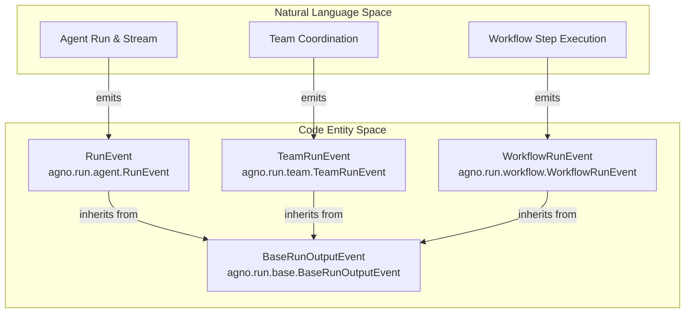

<!-- source: DeepWiki mcp.deepwiki.com · repo agno-agi/agno · page 2.6 Event Streaming System · fetched 2026-11-09 -->

# Event Streaming System

<details>
<summary>Relevant source files</summary>

The following files were used as context for generating this wiki page:

- [libs/agno/agno/agent/agent.py](libs/agno/agno/agent/agent.py)
- [libs/agno/agno/job_queue/config.py](libs/agno/agno/job_queue/config.py)
- [libs/agno/agno/models/base.py](libs/agno/agno/models/base.py)
- [libs/agno/agno/models/message.py](libs/agno/agno/models/message.py)
- [libs/agno/agno/models/response.py](libs/agno/agno/models/response.py)
- [libs/agno/agno/os/job_queue.py](libs/agno/agno/os/job_queue.py)
- [libs/agno/agno/os/routers/agents/router.py](libs/agno/agno/os/routers/agents/router.py)
- [libs/agno/agno/os/routers/teams/router.py](libs/agno/agno/os/routers/teams/router.py)
- [libs/agno/agno/os/routers/workflows/router.py](libs/agno/agno/os/routers/workflows/router.py)
- [libs/agno/agno/os/utils.py](libs/agno/agno/os/utils.py)
- [libs/agno/agno/run/agent.py](libs/agno/agno/run/agent.py)
- [libs/agno/agno/run/base.py](libs/agno/agno/run/base.py)
- [libs/agno/agno/run/team.py](libs/agno/agno/run/team.py)
- [libs/agno/agno/team/team.py](libs/agno/agno/team/team.py)
- [libs/agno/agno/tools/function.py](libs/agno/agno/tools/function.py)
- [libs/agno/agno/utils/events.py](libs/agno/agno/utils/events.py)
- [libs/agno/pyproject.toml](libs/agno/pyproject.toml)
- [libs/agno/tests/integration/agent/test_event_streaming.py](libs/agno/tests/integration/agent/test_event_streaming.py)
- [libs/agno/tests/integration/db/test_company_queue_projection.py](libs/agno/tests/integration/db/test_company_queue_projection.py)
- [libs/agno/tests/integration/os/test_agent_runs.py](libs/agno/tests/integration/os/test_agent_runs.py)
- [libs/agno/tests/integration/os/test_team_runs.py](libs/agno/tests/integration/os/test_team_runs.py)
- [libs/agno/tests/integration/os/test_workflow_runs.py](libs/agno/tests/integration/os/test_workflow_runs.py)
- [libs/agno/tests/integration/teams/test_event_streaming.py](libs/agno/tests/integration/teams/test_event_streaming.py)
- [libs/agno/tests/unit/agent/test_paused_user_input_persistence.py](libs/agno/tests/unit/agent/test_paused_user_input_persistence.py)
- [libs/agno/tests/unit/os/test_queue_db_components.py](libs/agno/tests/unit/os/test_queue_db_components.py)
- [libs/agno/tests/unit/os/test_queue_wake_on_enqueue.py](libs/agno/tests/unit/os/test_queue_wake_on_enqueue.py)
- [libs/agno/tests/unit/os/test_queue_worker.py](libs/agno/tests/unit/os/test_queue_worker.py)
- [libs/agno/tests/unit/os/test_ws_workflow_submission_parity.py](libs/agno/tests/unit/os/test_ws_workflow_submission_parity.py)
- [libs/agno/tests/unit/run/test_run_events.py](libs/agno/tests/unit/run/test_run_events.py)
- [libs/agno/tests/unit/run/test_run_input.py](libs/agno/tests/unit/run/test_run_input.py)
- [libs/agno/tests/unit/tools/test_functions.py](libs/agno/tests/unit/tools/test_functions.py)

</details>


## Purpose and Scope

The Event Streaming System in Agno provides granular, real-time event emission during the execution of `Agent`, `Team`, and `Workflow` components (`[libs/agno/agno/run/agent.py:145-190]()`, `[libs/agno/agno/run/team.py:131-165]()`). These events enable real-time observability into run progress, covering model requests, tool invocations, reasoning steps, session management, and error handling. The subsystem supports synchronous and asynchronous streaming runs via `stream_events`, Server-Sent Events (SSE) formatting (`[libs/agno/agno/os/utils.py:92-92]()`), WebSocket live tail pushing (`[libs/agno/agno/os/routers/workflows/router.py:160-184]()`), and event replay/resumption backed by persistent event streams (`[libs/agno/agno/os/routers/agents/router.py:43-43]()`).

---

## Event Architecture and Domain Models

The event streaming infrastructure segregates events into discrete domains corresponding to the framework execution entities: Agents, Teams, and Workflows. Each domain provides an enumeration of event types extending base output event classes (`[libs/agno/agno/run/agent.py:65-70]()`, `[libs/agno/agno/run/team.py:53-57]()`).


*Title: Bridging Execution Domains to Run Event Classes*

**Sources:** [libs/agno/agno/run/agent.py:65-70](), [libs/agno/agno/run/team.py:53-57](), [libs/agno/agno/run/base.py:14-16]()

---

## The `stream_events` Parameter

Granular event emission is controlled primarily via the `stream_events` parameter on `Agent.run()`, `Agent.arun()`, and corresponding `Team` and `Workflow` methods (`[libs/agno/agno/os/routers/agents/router.py:142-160]()`). 

- `stream=False, stream_events=False`: Returns a monolithic final response object (`RunOutput`) with no intermediate streaming.
- `stream=True, stream_events=False`: Streams incremental content chunks (`run_content`) only, omitting internal state changes like tool calls or reasoning steps.
- **`stream_events=True`**: Streams detailed intermediate events (`RunOutputEvent`) alongside content deltas, granting full transparency into tool inputs, outputs, reasoning tokens, and lifecycle state changes.

When `store_events=True` is enabled in conjunction with event streaming, events are persistently appended to the session database (`AgentSession`, `TeamSession`) for subsequent auditing or replay (`[libs/agno/agno/run/agent.py:734-780]()`).

**Sources:** [libs/agno/agno/os/routers/agents/router.py:142-160](), [libs/agno/agno/run/agent.py:734-780]()

---

## Detailed Agent `RunEvent` Types and Serialization

The `RunEvent` enum (`[libs/agno/agno/run/agent.py:145-190]`) defines the full taxonomy of agent-level run events:

| Event Enum Value | Description | Emission Trigger |
| :--- | :--- | :--- |
| `run_started` | Signals the beginning of a run (`RunStartedEvent`). | Entry into `Agent.run()` or `arun()` |
| `run_content` | Incremental model text chunk (`RunContentEvent`). | Streaming token from model response |
| `run_content_completed` | Completion of current text generation block. | Model stream termination for turn |
| `run_completed` | Finalization of run with metrics and outputs. | Successful run termination |
| `run_error` | Execution failure containing exception details (`RunErrorEvent`). | Uncaught exception or guardrail rejection |
| `tool_call_started` | Tool invocation initiated (`ToolCallStartedEvent`). | Prior to executing `Function.entrypoint` |
| `tool_call_completed` | Tool execution finished successfully. | Return value obtained from tool execution |
| `reasoning_started`/`step` | Agent internal reasoning process tracking. | Reasoning manager execution steps |
| `run_paused`/`run_continued` | Human-in-the-loop pause and resume lifecycle. | Approval gates or required user input |

All emitted events inherit from `BaseRunOutputEvent` (`[libs/agno/agno/run/base.py:14-16]()`), implementing safe dictionary serialization (`to_dict()`) which strips unpicklable references and structures fields for JSON serialization.

**Sources:** [libs/agno/agno/run/agent.py:145-190](), [libs/agno/agno/run/base.py:14-16]()

---

## Server-Sent Events (SSE) Format and WebSocket Routing

AgentOS exposes streaming endpoints that convert internal `RunOutputEvent` instances into standard Server-Sent Events (SSE) or WebSocket payloads (`[libs/agno/agno/os/routers/agents/router.py:124-163]()`, `[libs/agno/agno/os/routers/workflows/router.py:160-184]()`).

```mermaid
graph TB
    subgraph Code_Entity_Space ["Code Entity Space"]
        AgentArun["Agent.arun(stream=True, stream_events=True)<br/>agno.agent.Agent"]
        Streamer["agent_response_streamer()<br/>agno.os.routers.agents.router"]
        SseFormatter["format_sse_event()<br/>agno.os.utils"]
        WsPump["_pump_event_stream_to_websocket()<br/>agno.os.routers.workflows.router"]
        EventStream["EventStreamProtocol<br/>agno.os.event_streams"]
    end

    subgraph Transport_Layer ["Transport Layer"]
        SSE["HTTP SSE Stream<br/>text/event-stream"]
        WS["WebSocket Text Frame<br/>JSON Payload"]
    end

    AgentArun -->|async generator chunks| Streamer
    Streamer -->|raw event object| SseFormatter
    SseFormatter -->|data: json\n\n| SSE
    
    EventStream -->|tail()| WsPump
    WsPump -->|json.dumps()| WS
```
*Title: Event Transport Architecture from Agent Execution to HTTP/WebSocket Clients*

**Sources:** [libs/agno/agno/os/routers/agents/router.py:124-163](), [libs/agno/agno/os/routers/workflows/router.py:160-184](), [libs/agno/agno/os/utils.py:92-92]()

---

## Resume, Replay, and Durable Progress Tracking

Agno's event streaming system supports resilient client reconnection and run resumption. When an event stream is persisted via `get_event_stream()`, clients can disconnect and reconnect without losing progress (`[libs/agno/agno/os/routers/workflows/router.py:166-183]()`).

- **Event Indexing:** Every event is stamped with an monotonic `event_index` integer (`[libs/agno/agno/os/routers/workflows/router.py:136-157]()`).
- **Live Tailing:** The `event_stream.tail(run_id, last_event_index=from_index)` asynchronous generator fetches historical events starting from `from_index` and seamlessly transitions into live tail streaming (`[libs/agno/agno/os/routers/workflows/router.py:180-183]()`).
- **Pending Run Polling:** If a run status is `pending` (e.g. waiting in the durable job queue), the WebSocket pump polls the run status at intervals (`_PENDING_TAIL_PROBE_SECONDS = 2.0`) before entering the live event stream (`[libs/agno/agno/os/routers/workflows/router.py:126-179]()`).

**Sources:** [libs/agno/agno/os/routers/workflows/router.py:126-183](), [libs/agno/os/event_streams.py]()

---

# References

- Agent run event definitions: [libs/agno/agno/run/agent.py:145-190]()
- Team run event definitions: [libs/agno/agno/run/team.py:131-165]()
- Base run output events: [libs/agno/agno/run/base.py:14-16]()
- Agent response streamer implementation: [libs/agno/agno/os/routers/agents/router.py:124-163]()
- WebSocket event stream tail pumping: [libs/agno/agno/os/routers/workflows/router.py:160-184]()

---

