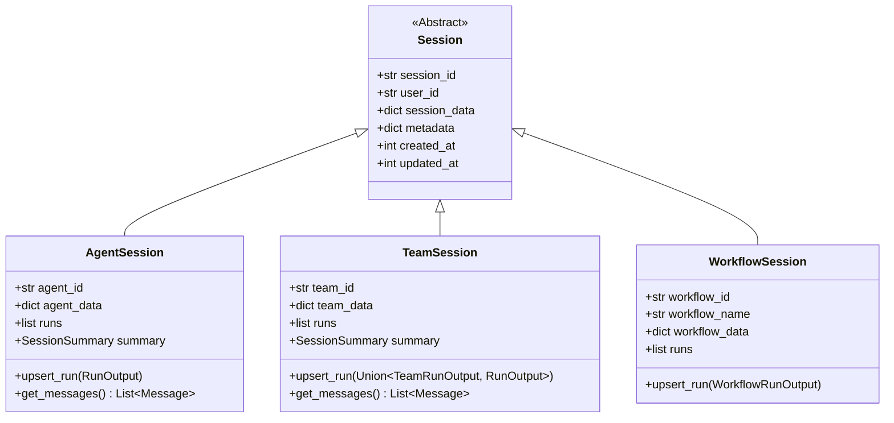
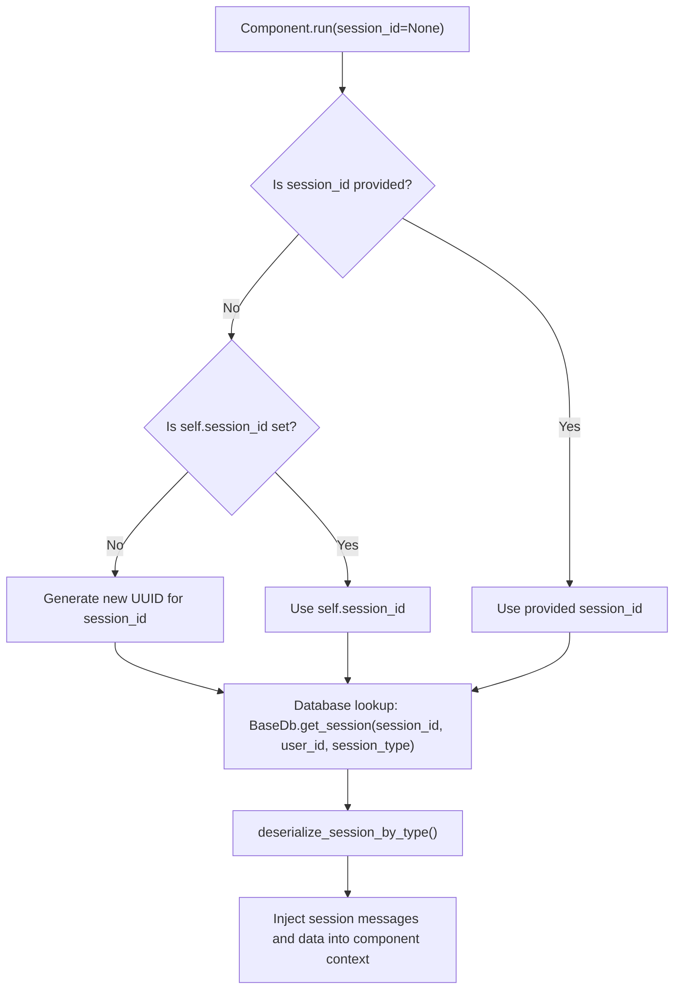
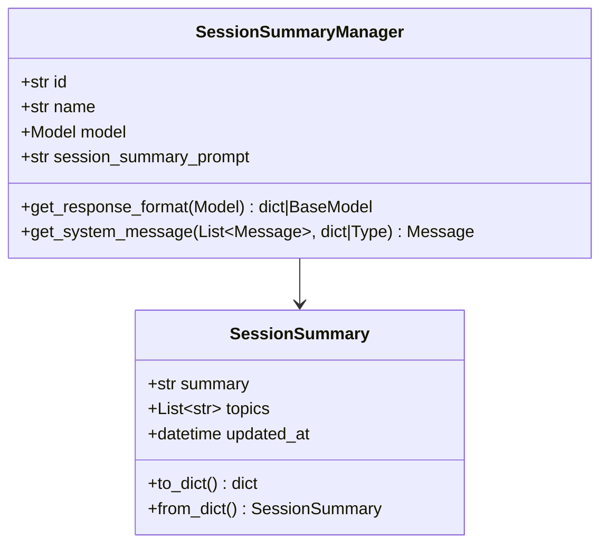
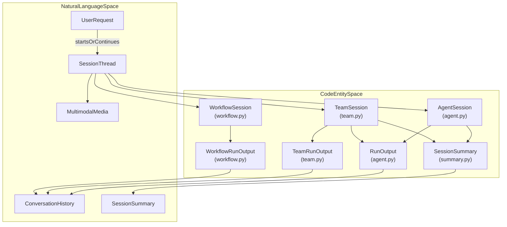
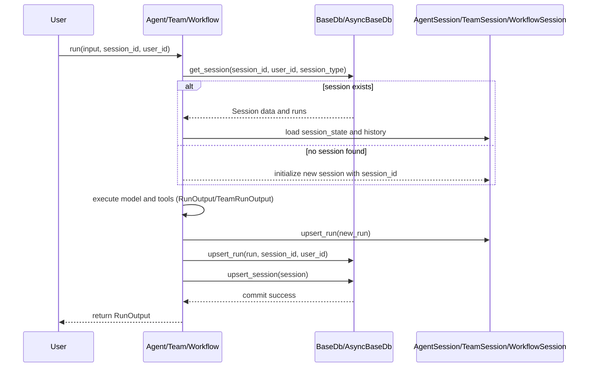

<!-- source: DeepWiki mcp.deepwiki.com · repo agno-agi/agno · page 2.7 Session Management · fetched 2026-11-09 -->

# Session Management

Relevant source files

The following files were used as context for generating this wiki page:

- [cookbook/02_agents/05_state_and_session/README.md](cookbook/02_agents/05_state_and_session/README.md)
- [cookbook/02_agents/05_state_and_session/last_n_session_messages.py](cookbook/02_agents/05_state_and_session/last_n_session_messages.py)
- [cookbook/03_teams/07_session/README.md](cookbook/03_teams/07_session/README.md)
- [cookbook/03_teams/07_session/TEST_LOG.md](cookbook/03_teams/07_session/TEST_LOG.md)
- [cookbook/03_teams/07_session/nested_team_deep_history.py](cookbook/03_teams/07_session/nested_team_deep_history.py)
- [cookbook/03_teams/07_session/nested_team_history.py](cookbook/03_teams/07_session/nested_team_history.py)
- [cookbook/03_teams/07_session/nested_team_history_to_members.py](cookbook/03_teams/07_session/nested_team_history_to_members.py)
- [cookbook/06_storage/04_session_summary_limits.py](cookbook/06_storage/04_session_summary_limits.py)
- [libs/agno/agno/session/agent.py](libs/agno/agno/session/agent.py)
- [libs/agno/agno/session/summary.py](libs/agno/agno/session/summary.py)
- [libs/agno/agno/session/team.py](libs/agno/agno/session/team.py)
- [libs/agno/agno/session/workflow.py](libs/agno/agno/session/workflow.py)
- [libs/agno/tests/integration/managers/test_session_summary_manager.py](libs/agno/tests/integration/managers/test_session_summary_manager.py)
- [libs/agno/tests/integration/session/test_agent_session.py](libs/agno/tests/integration/session/test_agent_session.py)
- [libs/agno/tests/integration/session/test_share_sessions.py](libs/agno/tests/integration/session/test_share_sessions.py)
- [libs/agno/tests/integration/session/test_team_session.py](libs/agno/tests/integration/session/test_team_session.py)
- [libs/agno/tests/integration/teams/human_in_the_loop/test_continue_run_history_context.py](libs/agno/tests/integration/teams/human_in_the_loop/test_continue_run_history_context.py)
- [libs/agno/tests/integration/teams/test_history.py](libs/agno/tests/integration/teams/test_history.py)
- [libs/agno/tests/integration/teams/test_member_dedup.py](libs/agno/tests/integration/teams/test_member_dedup.py)
- [libs/agno/tests/unit/team/test_basic.py](libs/agno/tests/unit/team/test_basic.py)
- [libs/agno/tests/unit/team/test_get_messages_dedup.py](libs/agno/tests/unit/team/test_get_messages_dedup.py)
- [libs/agno/tests/unit/workflow/test_workflow_session.py](libs/agno/tests/unit/workflow/test_workflow_session.py)

This page covers the session model used by Agents, Teams, and Workflows in Agno: how sessions are identified, what data they store, how they are loaded and persisted across runs, and how session state is exposed to components at runtime.

For storage backends that persist sessions (table schemas, CRUD operations, pagination), see [5.5](). For memory that learns from past interactions (user profiles, long-term facts), see [2.8](). For the AgentOS REST API routes that expose sessions to external clients, see [7.2]().

---

## What Is a Session?

A **session** is a named conversation thread associated with a specific component (`Agent`, `Team`, or `Workflow`) and an optional user. It provides:

- **Identity continuity** — a unique `session_id` groups multiple sequential runs into a single thread.
- **State persistence** — `session_data` (storing `session_state` and media) survives across runs.
- **History access** — prior messages are reloaded and injected into the model context.
- **Metrics tracking** — cumulative token usage and performance data per thread.
- **Summaries** — optionally auto-generated summaries of the conversation via `SessionSummaryManager`.

Sessions are stored in user-owned databases via the `db` parameter on each component. If no database backend is attached, session data is ephemeral and does not persist between process restarts.

Sources:  
[libs/agno/agno/session/agent.py:16-45](),  
[libs/agno/agno/session/team.py:18-45](),  
[libs/agno/agno/session/workflow.py:18-44]()

---

## Session Types

Three primary session classes correspond to the three component types. These dataclasses define the schema for data serialized to the database.

| Class | Component Type | Primary Key Fields |
|---|---|---|
| `AgentSession` | `Agent` | `session_id`, `agent_id` |
| `TeamSession` | `Team` | `session_id`, `team_id` |
| `WorkflowSession` | `Workflow` | `session_id`, `workflow_id` |

All session types share underlying database tables (configured via `session_table` on the database backend) but are resolved using distinct `SessionType` enums.

### Session Class Space to Code Entity Space

Sources:  
[libs/agno/agno/session/agent.py:16-45](),  
[libs/agno/agno/session/team.py:18-45](),  
[libs/agno/agno/session/workflow.py:18-44](),  
[libs/agno/agno/db/base.py:29-29]()

---

## Session Identity and Scoping

Every session is uniquely identified by a combination of identifiers that support multi-tenant and multi-component isolation.

| Field | Description |
|---|---|
| `session_id` | UUID string. Auto-generated per run if not provided. Passed to `run()` or set on the component. |
| `user_id` | Optional string. Scopes the session to a specific user. Database backends index on `(session_id, user_id)`. |

Database lookups filter by both fields when `user_id` is configured, guaranteeing user isolation. In the AgentOS runtime, `enforce_owner_on_entity` middleware verifies user access based on JWT claims and scopes.

### Session Resolution Flow

Sources:  
[libs/agno/agno/session/agent.py:20-27](),  
[libs/agno/agno/session/team.py:22-29](),  
[libs/agno/agno/os/middleware/user_scope.py:15-18](),  
[libs/agno/agno/db/utils.py:10-10]()

---

## Session Data Structures and Persistence

### AgentSession
The `AgentSession` class manages state for an individual `Agent`:
- `agent_id`: Target agent identifier.
- `user_id`: Interacting user ID.
- `workflow_id`: Optional parent workflow context.
- `agent_data`: Serialized metadata regarding the agent (name, model configuration).
- `session_data`: Arbitrary session state, including multimodal assets (`images`, `videos`, `audio`).
- `runs`: List of `RunOutput` or `TeamRunOutput` representing historical executions.
- `summary`: Optional `SessionSummary` instance capturing conversation context.

The `upsert_run()` method updates or appends execution outputs while stripping volatile timing elements from message metrics before writing.

Sources:  
[libs/agno/agno/session/agent.py:16-45](),  
[libs/agno/agno/session/agent.py:99-122]()

### TeamSession
The `TeamSession` class handles state for a `Team` component:
- `team_id`: Team identifier.
- `user_id`: Interacting user.
- `team_data`: Serialized configuration of team agents and models.
- `session_data`: Team-level session state and shared metrics.
- `runs`: List of `TeamRunOutput` and member-level `RunOutput` objects.
- `summary`: Optional team session summary.

`TeamSession.upsert_run()` handles nested execution outputs, and `get_messages()` implements robust deduplication to prevent duplicate tool call IDs or message repeats when member runs appear in both standalone storage and within `member_responses`.

Sources:  
[libs/agno/agno/session/team.py:18-45](),  
[libs/agno/agno/session/team.py:103-128](),  
[libs/agno/tests/unit/team/test_get_messages_dedup.py:111-142]()

### WorkflowSession
Sessions for `Workflow` manage step-based execution pipelines:
- `workflow_id` and `workflow_name`
- `user_id` for scoping.
- `runs`: List of `WorkflowRunOutput` objects per execution.
- `session_data` and `workflow_data`: Custom state and pipeline metadata dictionaries.

Runs are managed via `WorkflowSession.upsert_run()`.

Sources:  
[libs/agno/agno/session/workflow.py:18-44](),  
[libs/agno/agno/session/workflow.py:143-160]()

---

## Session Lifecycle and Upserting

The execution lifecycle of a session follows these distinct phases:

1. **Initialization:** When `run()` is invoked, the component resolves or initializes a session instance.
2. **Loading:** The session is queried from the database backend, deserializing historical runs and `session_data`.
3. **Execution:** The model processes inputs, executes tool calls, and produces a new `RunOutput`, `TeamRunOutput`, or `WorkflowRunOutput`.
4. **Run Upsertion:** `upsert_run()` adds or updates the run in the session's in-memory list. Transient metrics like message timers are purged.
5. **Persistence:** Under the v3 storage contract, session metadata and individual runs are persisted via `upsert_session()` and `upsert_run()` calls.

Sources:  
[libs/agno/agno/session/agent.py:99-122](),  
[libs/agno/agno/session/team.py:103-128](),  
[libs/agno/agno/session/workflow.py:143-160](),  
[libs/agno/agno/db/base.py:29-29]()

---

## Session Summaries

To mitigate context window bloat during long-running sessions, Agno provides automated summarization via `SessionSummaryManager`.

- `SessionSummary` stores the summary text, extracted topics, and update timestamp.
- `SessionSummaryManager` inspects past conversation messages using `session.get_messages()` and invokes an LLM to generate a `SessionSummaryResponse`.
- The generated summary is attached to the session object and persisted during database updates.

Sources:  
[libs/agno/agno/session/summary.py:23-102](),  
[libs/agno/agno/session/agent.py:40-40](),  
[libs/agno/agno/session/team.py:40-40]()

---

## Shared Sessions and Interoperability

Agno supports sharing a single `session_id` across different component types (e.g., continuing an Agent session with a Team, or vice versa):

- `TeamSession.from_dict()` inspects stored runs, deserializing items containing `agent_id` as `RunOutput` and items containing `team_id` as `TeamRunOutput`.
- `AgentSession.from_dict()` similarly handles embedded `TeamRunOutput` objects.
- Message filtering (`last_n_runs`, role filtering, and member message skipping) ensures context is cleanly extracted regardless of which component type originally wrote the run.

Sources:  
[libs/agno/agno/session/agent.py:69-96](),  
[libs/agno/agno/session/team.py:74-82](),  
[libs/agno/tests/integration/session/test_share_sessions.py:86-140]()

---

## Summary Diagram: Natural Language "Session" to Code Entities

Sources:  
[libs/agno/agno/session/agent.py:16-45](),  
[libs/agno/agno/session/team.py:18-45](),  
[libs/agno/agno/session/workflow.py:18-44](),  
[libs/agno/agno/session/summary.py:23-44]()

---

## Summary Diagram: Session Persistence and Runtime Flow

Sources:  
[libs/agno/agno/session/agent.py:99-122](),  
[libs/agno/agno/session/team.py:103-128](),  
[libs/agno/agno/session/workflow.py:143-160](),  
[libs/agno/agno/db/base.py:29-29]()

---

