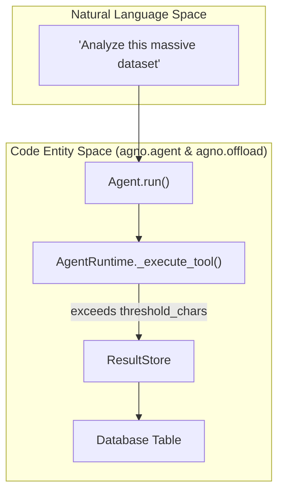
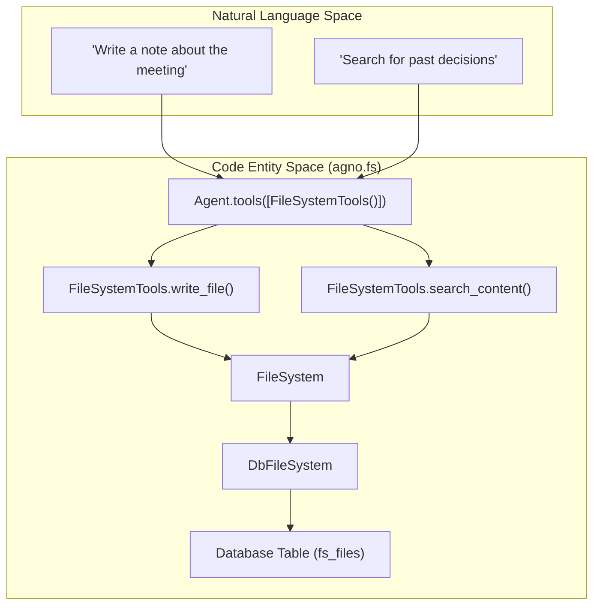

<!-- source: DeepWiki mcp.deepwiki.com · repo agno-agi/agno · page 2.9 Result Offloading and FileSystem · fetched 2026-11-09 -->

# Result Offloading and FileSystem

Relevant source files

The following files were used as context for generating this wiki page:

- [cookbook/05_agent_os/29_manager/README.md](cookbook/05_agent_os/29_manager/README.md)
- [cookbook/05_agent_os/29_manager/TEST_LOG.md](cookbook/05_agent_os/29_manager/TEST_LOG.md)
- [cookbook/05_agent_os/29_manager/manager_discovery.py](cookbook/05_agent_os/29_manager/manager_discovery.py)
- [cookbook/07_knowledge/09_archive/chunking/agentic_chunking_custom_prompt_no_size.py](cookbook/07_knowledge/09_archive/chunking/agentic_chunking_custom_prompt_no_size.py)
- [cookbook/07_knowledge/09_archive/chunking/agentic_chunking_custom_prompt_with_size.py](cookbook/07_knowledge/09_archive/chunking/agentic_chunking_custom_prompt_with_size.py)
- [cookbook/91_tools/unsplash_tools.py](cookbook/91_tools/unsplash_tools.py)
- [cookbook/frameworks/sandbox/docker/sandbox_s3_checkpoints.py](cookbook/frameworks/sandbox/docker/sandbox_s3_checkpoints.py)
- [libs/agno/agno/hooks/decorator.py](libs/agno/agno/hooks/decorator.py)
- [libs/agno/agno/knowledge/chunking/agentic.py](libs/agno/agno/knowledge/chunking/agentic.py)
- [libs/agno/agno/knowledge/filesystem.py](libs/agno/agno/knowledge/filesystem.py)
- [libs/agno/agno/offload/tools.py](libs/agno/agno/offload/tools.py)
- [libs/agno/agno/os/diagnostics.py](libs/agno/agno/os/diagnostics.py)
- [libs/agno/agno/os/manager/config.py](libs/agno/agno/os/manager/config.py)
- [libs/agno/agno/os/manager/manager.py](libs/agno/agno/os/manager/manager.py)
- [libs/agno/agno/os/manager/prompts.py](libs/agno/agno/os/manager/prompts.py)
- [libs/agno/agno/registry/_reserved.py](libs/agno/agno/registry/_reserved.py)
- [libs/agno/agno/tools/scheduler.py](libs/agno/agno/tools/scheduler.py)
- [libs/agno/agno/tools/studio.py](libs/agno/agno/tools/studio.py)
- [libs/agno/agno/tools/studio_runner.py](libs/agno/agno/tools/studio_runner.py)
- [libs/agno/agno/tools/unsplash.py](libs/agno/agno/tools/unsplash.py)
- [libs/agno/tests/unit/knowledge/chunking/test_agentic_chunking.py](libs/agno/tests/unit/knowledge/chunking/test_agentic_chunking.py)
- [libs/agno/tests/unit/knowledge/test_filesystem_knowledge.py](libs/agno/tests/unit/knowledge/test_filesystem_knowledge.py)
- [libs/agno/tests/unit/os/test_manager.py](libs/agno/tests/unit/os/test_manager.py)
- [libs/agno/tests/unit/tools/test_scheduler.py](libs/agno/tests/unit/tools/test_scheduler.py)
- [libs/agno/tests/unit/tools/test_studio.py](libs/agno/tests/unit/tools/test_studio.py)
- [libs/agno/tests/unit/tools/test_studio_runner.py](libs/agno/tests/unit/tools/test_studio_runner.py)
- [libs/agno/tests/unit/tools/test_unsplash.py](libs/agno/tests/unit/tools/test_unsplash.py)

The purpose of this page is to document Agno's result offloading mechanism (`offload_tool_results`, `ResultStore`) and the agent FileSystem abstraction backed by a database (`DbFileSystem`, `FileSystemTools`), enabling agents to handle large tool outputs and maintain durable private storage efficiently.

---

## Result Offloading

### Purpose and Rationale

Agents frequently invoke tools that produce massive payloads, such as large database dumps, detailed web scrapes, or extensive documents. Injecting these payloads directly into the model's prompt context leads to token limit exhaustion, latency degradation, and degraded response quality. Agno solves this by offloading tool results that exceed a configured character length threshold.

### Components and Configuration

- **`offload_tool_results`**: A configuration parameter on the `Agent` and `OSManager` classes enabling result offloading [libs/agno/agno/agent/agent.py:1-20](), [libs/agno/agno/os/manager/config.py:37-39]().
- **`ResultStore`**: The persistence interface responsible for storing large tool outputs outside the prompt context and returning stable reference handles [libs/agno/tests/unit/os/test_manager.py:18-18]().
- **`get_read_result_function`**: A utility function providing agents with the capability to read back offloaded tool results on demand [libs/agno/tests/unit/os/test_manager.py:19-19]().

### Data Flow

Sources: [libs/agno/agno/agent/agent.py:1-20](), [libs/agno/tests/unit/os/test_manager.py:18-19]()

---

## FileSystem Abstraction

The `FileSystem` class provides a private, durable, quota-limited filesystem per agent or namespace [libs/agno/agno/fs/fs.py:111-153](). It allows agents to maintain persistent notes, configuration files, and running documents across sessions.

### Architecture Overview

- **Namespace Scoped**: Each `FileSystem` instance addresses a distinct namespace, isolating files by user, agent, or team.
- **Pluggable Backend**: Backed by database storage via `DbFileSystem` or custom filesystem backends.
- **Quota Enforcement**: Enforces `max_file_bytes` per file and `max_namespace_bytes` per namespace.
- **Dynamic Placeholders**: Supports templates like `{user_id}`, `{agent_id}`, and `{team_id}` resolved dynamically at runtime from `RunContext`.

Sources: [libs/agno/agno/fs/fs.py:111-153]()

---

### FileSystem Toolkits — The `FileSystemTools` Class

Agents interact with their file storage using the `FileSystemTools` toolkit, which exposes traditional filesystem semantics [libs/agno/agno/fs/toolkit.py:93-158]().

#### Tool Surface

| Tool Name | Description |
|---|---|
| `read_file` | Read contents of a file, optionally by line range |
| `write_file` | Write (overwrite) file contents |
| `append_file` | Append lines to a file with optional per-line deduplication (`unique` flag) |
| `replace_lines` | Replace lines in a file between start and end line |
| `list_files` | List files in a directory with optional pattern and recursion |
| `search_content` | Search files for a given text query, returning matching files and line numbers |
| `move_file` | Rename or move a file |
| `delete_file` | Delete a file (guarded by `allow_delete=True`) |

Sources: [libs/agno/agno/fs/toolkit.py:93-158]()

---

### FileSystem Data Flow Diagram

Sources: [libs/agno/agno/fs/fs.py:111-153](), [libs/agno/agno/fs/toolkit.py:93-158]()

---

## File Generation Tooling

Agno includes `FileGenerationTools` for generating various file formats (JSON, CSV, PDF, DOCX, HTML, plain text) within workflows or agent runs [libs/agno/agno/tools/file/generation.py:7-12]().

### Key Features

- Enforces strict path validation (`safe_join_filename`, `safe_join_relative_path`) to prevent path traversal and control character injection [libs/agno/tests/unit/utils/test_path_safety_consistency.py:1-180]().
- Integrates seamlessly with the `FileSystem` abstraction for saving generated outputs to persistent storage.

Sources: [libs/agno/agno/tools/file/generation.py:7-12](), [libs/agno/tests/unit/utils/test_path_safety_consistency.py:1-180]()

---

## Durable Records Pattern with FileSystem

The FileSystem's specialized line-based tools support robust progress tracking across agent runs:
- `check_lines` verifies the presence of specific records or processed item hashes.
- `append_file` with `unique=True` appends new log entries without duplication.
- Agents query `check_lines` prior to executing batch tasks and record completions via `append_file`, achieving idempotent, durable execution tracking.

Sources: [cookbook/13_filesystem/02_durable_records/basic.py:1-83]()

---

## References and Sources

- Result Offloading configuration: [libs/agno/agno/agent/agent.py:1-20](), [libs/agno/agno/os/manager/config.py:37-39]()
- ResultStore and read functions: [libs/agno/tests/unit/os/test_manager.py:18-19]()
- FileSystem core class and namespace resolution: [libs/agno/agno/fs/fs.py:111-153]()
- FileSystemTools toolkit implementation: [libs/agno/agno/fs/toolkit.py:93-158]()
- File generation tool implementation: [libs/agno/agno/tools/file/generation.py:7-12]()
- Path safety test suite: [libs/agno/tests/unit/utils/test_path_safety_consistency.py:1-180]()
- Durable records example pattern: [cookbook/13_filesystem/02_durable_records/basic.py:1-83]()

---

