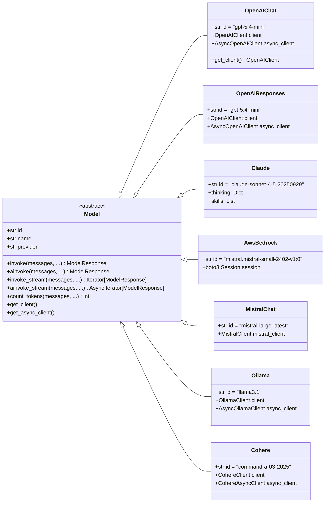
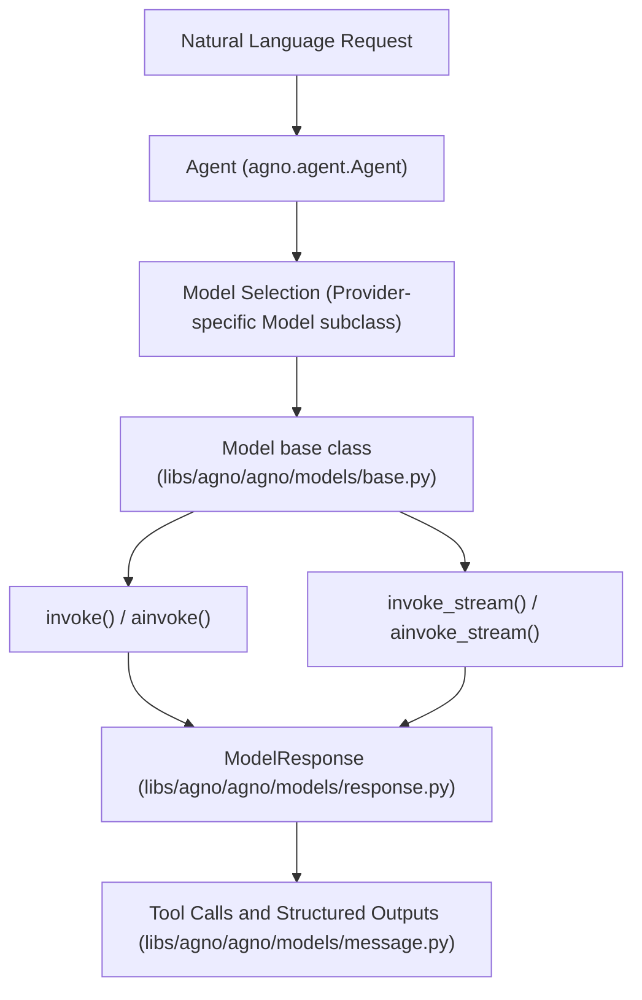
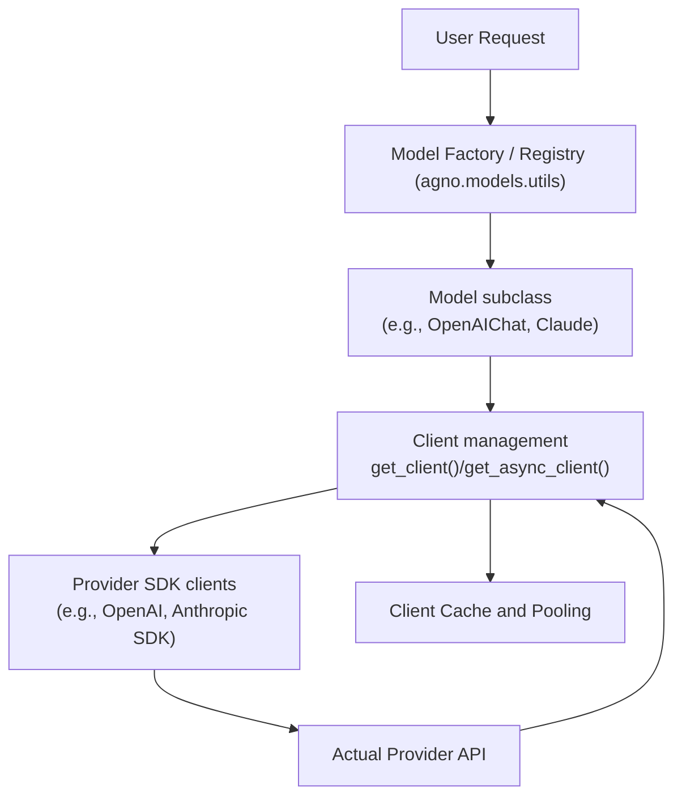

<!-- source: DeepWiki mcp.deepwiki.com · repo agno-agi/agno · page 3 Model Integrations · fetched 2026-11-09 -->

# Model Integrations

Relevant source files

The following files were used as context for generating this wiki page:

- [cookbook/90_models/mistral/basic.py](cookbook/90_models/mistral/basic.py)
- [cookbook/90_models/mistral/tool_use.py](cookbook/90_models/mistral/tool_use.py)
- [libs/agno/agno/knowledge/embedder/mistral.py](libs/agno/agno/knowledge/embedder/mistral.py)
- [libs/agno/agno/models/aws/bedrock.py](libs/agno/agno/models/aws/bedrock.py)
- [libs/agno/agno/models/azure/ai_foundry.py](libs/agno/agno/models/azure/ai_foundry.py)
- [libs/agno/agno/models/cerebras/cerebras.py](libs/agno/agno/models/cerebras/cerebras.py)
- [libs/agno/agno/models/cohere/chat.py](libs/agno/agno/models/cohere/chat.py)
- [libs/agno/agno/models/groq/groq.py](libs/agno/agno/models/groq/groq.py)
- [libs/agno/agno/models/huggingface/huggingface.py](libs/agno/agno/models/huggingface/huggingface.py)
- [libs/agno/agno/models/ibm/watsonx.py](libs/agno/agno/models/ibm/watsonx.py)
- [libs/agno/agno/models/meta/llama.py](libs/agno/agno/models/meta/llama.py)
- [libs/agno/agno/models/mistral/mistral.py](libs/agno/agno/models/mistral/mistral.py)
- [libs/agno/agno/models/ollama/chat.py](libs/agno/agno/models/ollama/chat.py)
- [libs/agno/agno/utils/models/mistral.py](libs/agno/agno/utils/models/mistral.py)
- [libs/agno/tests/integration/models/huggingface/test_basic.py](libs/agno/tests/integration/models/huggingface/test_basic.py)
- [libs/agno/tests/integration/models/huggingface/test_tool_use.py](libs/agno/tests/integration/models/huggingface/test_tool_use.py)
- [libs/agno/tests/unit/models/test_huggingface_request_params.py](libs/agno/tests/unit/models/test_huggingface_request_params.py)
- [libs/agno/tests/unit/models/test_mistral_request_params.py](libs/agno/tests/unit/models/test_mistral_request_params.py)

## Purpose and Scope

This page presents an overview of Agno’s unified model integration layer. It abstracts over 40 large language model (LLM) providers, offering a common interface for invoking models synchronously and asynchronously, streaming outputs, executing tool calls, and handling structured output formats. This abstraction enables developers to seamlessly switch providers or combine them while leveraging provider-specific capabilities transparently.

Key layer responsibilities include:

- Defining a consistent `Model` base interface for invoking models, managing clients, and token counting [libs/agno/agno/models/base.py:130-184]().
- Supporting multiple invocation styles: synchronous, asynchronous, streaming [libs/agno/agno/models/base.py:214-265]().
- Normalizing provider responses into `ModelResponse` objects [libs/agno/agno/models/response.py:114-163]().
- Handling lifecycle, authentication, retry logic, and connection pooling of model clients [libs/agno/agno/models/base.py:170-187]().
- Recognizing provider-specific features like output schemas, tool calling, and experimental betas [libs/agno/agno/models/openai/chat.py:35-164]().

For detailed technical design of the model interface, client lifecycle, streaming, tool calling, and structured outputs, see the child sections below.

Supported providers access a diverse ecosystem, including:

- OpenAI Chat and Responses APIs (`OpenAIChat`, `OpenAIResponses`) [libs/agno/agno/models/openai/chat.py:1-164](), [libs/agno/agno/models/openai/responses.py:31-153]()
- Anthropic Claude models (`Claude`) [libs/agno/agno/models/anthropic/claude.py:95-173]()
- Google Gemini and other providers (`AwsBedrock`, `MistralChat`, `Cohere`, `Ollama`, `Groq`, `Cerebras`, etc.) [libs/agno/agno/models/aws/bedrock.py:40-160](), [libs/agno/agno/models/mistral/mistral.py:38-70](), [libs/agno/agno/models/cohere/chat.py:27-111](), [libs/agno/agno/models/ollama/chat.py:26-105](), [libs/agno/agno/models/groq/groq.py:30-143](), [libs/agno/agno/models/cerebras/cerebras.py:35-72]().

Sources: [libs/agno/agno/models/base.py:130-184](), [libs/agno/agno/models/anthropic/claude.py:95-173](), [libs/agno/agno/models/openai/chat.py:1-164](), [libs/agno/agno/models/openai/responses.py:31-153](), [libs/agno/agno/models/aws/bedrock.py:40-160]().

---

## Model Abstraction Architecture

Agno’s model layer organizes all supported providers as subclasses of the core abstract `Model` base class [libs/agno/agno/models/base.py:130-184](). This class defines key invocation methods with consistent signatures and manages client instances. Each subclass represents a provider-specific implementation, encapsulating authentication, API parameter translation, and streaming capabilities.

### Model Class Hierarchy Overview

This polymorphic design lets agents call models via the same interface, regardless of provider differences.

For details on the base interface, client lifecycle, and provider resolution utilities, see [Model Interface and Architecture](#3.1).

Sources: [libs/agno/agno/models/base.py:130-184](), [libs/agno/agno/models/openai/chat.py:35-91](), [libs/agno/agno/models/anthropic/claude.py:95-173](), [libs/agno/agno/models/aws/bedrock.py:40-160](), [libs/agno/agno/models/mistral/mistral.py:38-70](), [libs/agno/agno/models/ollama/chat.py:26-105](), [libs/agno/agno/models/cohere/chat.py:27-111]().

---

## Core Interface Methods and Provider Ecosystem

The `Model` base class defines core methods to interact with LLMs across different invocation scenarios [libs/agno/agno/models/base.py:214-265]():

| Method | Description | Returns |
|---|---|---|
| `invoke(messages, ...)` | Synchronously call the model with a message list. | `ModelResponse` [libs/agno/agno/models/base.py:214-225]() |
| `ainvoke(messages, ...)` | Asynchronous equivalent of `invoke()`. | Awaitable `ModelResponse` [libs/agno/agno/models/base.py:226-261]() |
| `invoke_stream(messages, ...)` | Synchronous streaming API returning incremental deltas. | Iterator `[ModelResponse]` [libs/agno/agno/models/base.py:242-252]() |
| `ainvoke_stream(messages, ...)`| Async streaming version returning async iterator. | AsyncIterator `[ModelResponse]` [libs/agno/agno/models/base.py:256-265]() |
| `count_tokens(messages, ...)` | Estimate token usage for cost management and model constraints. | `int` [libs/agno/agno/models/base.py:195-210]() |

Agno incorporates over 40 distinct providers, each modeled as a subclass of `Model`. Key provider integrations include:
- **OpenAI:** Covered via `OpenAIChat` and `OpenAIResponses` supporting native structured outputs, chaining, and reasoning models [libs/agno/agno/models/openai/chat.py:35-164](). For details, see [OpenAI Integration](#3.2).
- **Anthropic Claude:** Covered via the `Claude` class supporting thinking modes, prompt caching, and betas [libs/agno/agno/models/anthropic/claude.py:95-173](). For details, see [Anthropic Claude](#3.3).
- **Google Gemini and Others:** Covers Gemini grounding, search, Groq, Mistral (`MistralChat`), Cohere (`Cohere`), Ollama (`Ollama`), Cerebras (`Cerebras`), HuggingFace (`HuggingFace`), and 30+ more [libs/agno/agno/models/mistral/mistral.py:38-69](), [libs/agno/agno/models/cerebras/cerebras.py:35-72](). For details, see [Google Gemini and Other Providers](#3.4).

Sources: [libs/agno/agno/models/base.py:130-270](), [libs/agno/agno/models/openai/chat.py:35-164](), [libs/agno/agno/models/anthropic/claude.py:95-173](), [libs/agno/agno/models/mistral/mistral.py:38-69](), [libs/agno/agno/models/cerebras/cerebras.py:35-72]().

---

## Specialized Capabilities, Tools, and Structured Outputs

Beyond basic text generation, Agno models integrate deeply with agent execution loops through specialized capabilities:
- **Provider-Specific Features:** Unique capabilities such as Claude thinking modes, Gemini grounding, OpenAI web search, Perplexity citations, and DeepSeek thinking are managed via model parameters and flags. For details, see [Provider-Specific Features](#3.5).
- **Tool Calling and Function Execution:** Models translate declarations into provider-specific formats, execute parallel tool calls, and receive feedback messages. For details, see [Tool Calling and Function Execution](#3.6).
- **Structured Outputs:** Pydantic models passed via `output_schema` are automatically converted to JSON schemas with strict mode enforcement when supported. For details, see [Structured Outputs](#3.7).

Sources: [libs/agno/agno/models/cohere/chat.py:165-173](), [libs/agno/agno/models/mistral/mistral.py:38-187](), [libs/agno/agno/models/cerebras/cerebras.py:54-122]().

---

## Streaming, Lifecycle, and Error Resilience

Response parsing, client caching, and error recovery are handled uniformly across providers:
- **Streaming and Response Processing:** `invoke_stream` and `ainvoke_stream` yield `ModelResponse` deltas, parsing chunk streams and aggregating metrics [libs/agno/agno/models/base.py:242-265](). For details, see [Streaming and Response Processing](#3.8).
- **Client Lifecycle and Retry Logic:** Connection pooling, error classification (`ModelAuthenticationError`, `ModelRateLimitError`), retryable exceptions, and exponential backoff ensure robust production operation [libs/agno/agno/exceptions.py](). For details, see [Client Lifecycle and Retry Logic](#3.9).

Sources: [libs/agno/agno/models/base.py:170-270](), [libs/agno/agno/models/groq/groq.py:72-95](), [libs/agno/agno/models/aws/bedrock.py:120-160]().

---

# Diagrams Bridging Natural Language to Code Entity Space

### 1. From Natural Language to Model Interface Code Entities

This diagram traces a natural language prompt flow through Agno's agent to the model abstraction layer, exposing key code entities and files related to invocation and response handling.

Sources: [libs/agno/agno/models/base.py:130-270](), [libs/agno/agno/models/response.py:114-163]().

---

### 2. Provider Selection and Client Lifecycle

This diagram illustrates the code path from user request through provider model resolution and internal client lifecycle management ensuring efficient API consumption.

Sources: [libs/agno/agno/models/base.py:170-187](), [libs/agno/agno/models/openai/chat.py:35-120](), [libs/agno/agno/models/anthropic/claude.py:95-150]().

---

# Summary

Agno’s model integration layer offers a powerful, extensible abstraction over a large ecosystem of LLM providers. It simplifies agent development by unifying provider diversity behind a stable interface supporting synchronous, asynchronous, streaming, and structured output workflows.

To dive into details on specific providers, usage patterns, and capabilities, explore the child pages:
- [Model Interface and Architecture](#3.1)
- [OpenAI Integration](#3.2)
- [Anthropic Claude](#3.3)
- [Google Gemini and Other Providers](#3.4)
- [Provider-Specific Features](#3.5)
- [Tool Calling and Function Execution](#3.6)
- [Structured Outputs](#3.7)
- [Streaming and Response Processing](#3.8)
- [Client Lifecycle and Retry Logic](#3.9)

Sources: [libs/agno/agno/models/base.py:130-270](), [libs/agno/agno/models/response.py:114-163]().

---

