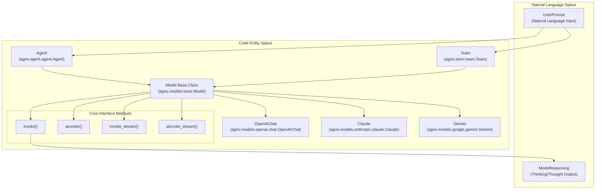
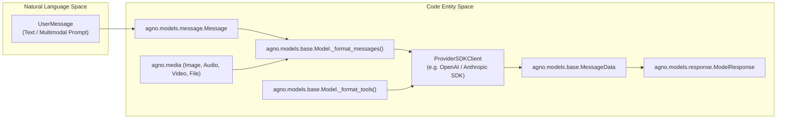

<!-- source: DeepWiki mcp.deepwiki.com · repo agno-agi/agno · page 3.1 Model Interface and Architecture · fetched 2026-11-09 -->

# Model Interface and Architecture

Relevant source files

The following files were used as context for generating this wiki page:

- [cookbook/90_models/heabsy/README.md](cookbook/90_models/heabsy/README.md)
- [cookbook/90_models/heabsy/TEST_LOG.md](cookbook/90_models/heabsy/TEST_LOG.md)
- [cookbook/90_models/heabsy/basic.py](cookbook/90_models/heabsy/basic.py)
- [cookbook/90_models/heabsy/structured_output.py](cookbook/90_models/heabsy/structured_output.py)
- [cookbook/90_models/heabsy/tool_use.py](cookbook/90_models/heabsy/tool_use.py)
- [libs/agno/agno/agent/agent.py](libs/agno/agno/agent/agent.py)
- [libs/agno/agno/models/base.py](libs/agno/agno/models/base.py)
- [libs/agno/agno/models/heabsy/__init__.py](libs/agno/agno/models/heabsy/__init__.py)
- [libs/agno/agno/models/heabsy/heabsy.py](libs/agno/agno/models/heabsy/heabsy.py)
- [libs/agno/agno/models/message.py](libs/agno/agno/models/message.py)
- [libs/agno/agno/models/response.py](libs/agno/agno/models/response.py)
- [libs/agno/agno/models/utils.py](libs/agno/agno/models/utils.py)
- [libs/agno/agno/run/agent.py](libs/agno/agno/run/agent.py)
- [libs/agno/agno/run/base.py](libs/agno/agno/run/base.py)
- [libs/agno/agno/run/team.py](libs/agno/agno/run/team.py)
- [libs/agno/agno/team/team.py](libs/agno/agno/team/team.py)
- [libs/agno/agno/tools/function.py](libs/agno/agno/tools/function.py)
- [libs/agno/agno/utils/events.py](libs/agno/agno/utils/events.py)
- [libs/agno/pyproject.toml](libs/agno/pyproject.toml)
- [libs/agno/tests/integration/agent/test_event_streaming.py](libs/agno/tests/integration/agent/test_event_streaming.py)
- [libs/agno/tests/integration/teams/test_event_streaming.py](libs/agno/tests/integration/teams/test_event_streaming.py)
- [libs/agno/tests/unit/agent/test_paused_user_input_persistence.py](libs/agno/tests/unit/agent/test_paused_user_input_persistence.py)
- [libs/agno/tests/unit/models/test_heabsy.py](libs/agno/tests/unit/models/test_heabsy.py)
- [libs/agno/tests/unit/run/test_run_events.py](libs/agno/tests/unit/run/test_run_events.py)
- [libs/agno/tests/unit/run/test_run_input.py](libs/agno/tests/unit/run/test_run_input.py)
- [libs/agno/tests/unit/tools/test_functions.py](libs/agno/tests/unit/tools/test_functions.py)
- [libs/agno/tests/unit/utils/test_model_string.py](libs/agno/tests/unit/utils/test_model_string.py)

## Purpose and Scope

This page documents the **Model base class**, core invocation and streaming patterns, client lifecycle management, and **provider resolution utilities** that power model-agnostic agent development in Agno. The `Model` class provides a unified interface for interacting with 40+ LLM providers, handling message formatting, response parsing, retry logic, token counting, and metrics collection [libs/agno/agno/models/base.py:134-188]().

This page covers the abstract interface and common functionality shared across all model providers. For specific provider implementations, see:
- OpenAI Integration: [3.2]()
- Anthropic Claude: [3.3]()
- Google Gemini and Other Providers: [3.4]()
- Provider-Specific Features: [3.5]()

For model capabilities like tool calling and structured outputs, see [3.6]() and [3.7]().

---

## Architecture Overview

The model system follows a provider abstraction pattern where all LLM providers implement a common `Model` interface [libs/agno/agno/models/base.py:134-143](). Orchestrators like `Agent`, `Team`, and `Workflow` interact with this interface rather than direct provider SDKs.

### System Architecture Diagram (Natural Language to Code Space)

Sources: [libs/agno/agno/models/base.py:134-188](), [libs/agno/agno/agent/agent.py:73-84](), [libs/agno/agno/team/team.py:80-88]()

---

## Model Base Class

The `Model` class is an abstract base class defined at [libs/agno/agno/models/base.py:134-188](). It encapsulates common logic around provider interaction while requiring concrete subclasses to implement low-level API calls.

### Key Attributes

| Attribute | Type | Description |
|-----------|------|-------------|
| `id` | `str` | Model identifier (e.g., "gpt-4o", "gemini-2.0-flash") [libs/agno/agno/models/base.py:136]() |
| `name` | `Optional[str]` | Human-readable name for the model [libs/agno/agno/models/base.py:138]() |
| `provider` | `Optional[str]` | Provider name (e.g., "OpenAI", "Google") [libs/agno/agno/models/base.py:140]() |
| `supports_native_structured_outputs` | `bool` | Supports native JSON schema enforcement for structured outputs [libs/agno/agno/models/base.py:149]() |
| `supports_json_schema_outputs` | `bool` | Requires JSON schema for structured outputs (e.g., LMStudio) [libs/agno/agno/models/base.py:151]() |
| `retries` | `int` | Number of retry attempts for provider errors [libs/agno/agno/models/base.py:178]() |
| `delay_between_retries` | `int` | Delay in seconds between retries [libs/agno/agno/models/base.py:180]() |
| `exponential_backoff` | `bool` | If true, delay between retries is doubled each time [libs/agno/agno/models/base.py:182]() |
| `retry_with_guidance` | `bool` | Whether to retry once with corrective instructions on known errors [libs/agno/agno/models/base.py:185]() |
| `cache_response` | `bool` | Cache model responses to reduce redundant calls during development [libs/agno/agno/models/base.py:172]() |

### Design Notes

- The class uses Python's `@dataclass` for attribute management.
- It defines a `MessageData` container to accumulate outputs during streaming.
- The `Model` instance acts as an adapter between Agno's message schemas and provider SDKs.

Sources: [libs/agno/agno/models/base.py:134-188]()

---

## Provider Resolution Utilities

Agno includes centralized provider lookup and instantiation utilities in [libs/agno/agno/models/utils.py:10-106]() to dynamically resolve model strings and provider configurations across 40+ supported backends.

### Registry Structures

- `_PROVIDERS`: A single source of truth mapping stable provider keys to tuples of `(module, class_name, default_name, default_provider_display)` [libs/agno/agno/models/utils.py:15-89]().
- `MODEL_PROVIDER_CLASSES`: Maps provider keys directly to their implementation modules and classes for dynamic construction [libs/agno/agno/models/utils.py:91-93]().
- `_KEY_TO_PROVIDER` and `_NAME_TO_PROVIDER_KEY`: Indices for matching display names and provider slugs to unique model classes [libs/agno/agno/models/utils.py:95-103]().

Sources: [libs/agno/agno/models/utils.py:10-106]()

---

## Core Invocation Methods and Streaming

All concrete `Model` subclasses must implement four core API interaction methods supporting synchronous, asynchronous, streaming, and non-streaming execution [libs/agno/agno/models/base.py:587-653]().

### Method Signatures

1. `invoke()`: Synchronous interface generating a single `ModelResponse`.
2. `ainvoke()`: Asynchronous counterpart of `invoke()`.
3. `invoke_stream()`: Synchronous generator yielding incremental `ModelResponse` deltas.
4. `ainvoke_stream()`: Asynchronous generator variant for streaming model outputs.

### Common Parameters

- `messages`: List of Agno `Message` instances representing conversation history [libs/agno/agno/models/message.py:56-126]().
- `assistant_message`: `Message` object populated with the model's reply [libs/agno/agno/models/base.py:590]().
- `response_format`: Optional Pydantic model or dict defining structured output schemas [libs/agno/agno/models/base.py:591]().
- `tools`: Optional list of `Function` or `Toolkit` objects defining callable tools [libs/agno/agno/models/base.py:592]().

Sources: [libs/agno/agno/models/base.py:587-653](), [libs/agno/agno/models/message.py:56-126]()

---

## Message and Media Data Flow

The `Model` interface translates Agno's internal message representation into provider-specific formats, processing multimodal inputs like images, audio, video, and files.

### Data Flow Diagram (Natural Language to Code Space)

### MessageData Class

- A dataclass that accumulatively stores partial output data such as content, reasoning, citations, media artifacts, and tool call metadata during streaming [libs/agno/agno/models/base.py:68-87]().

Sources: [libs/agno/agno/models/base.py:68-87](), [libs/agno/agno/models/base.py:1144-1240](), [libs/agno/agno/models/message.py:56-126]()

---

## Token Counting and Metrics

Agno supports token usage estimation and observability across providers.

### Token Counting Logic

The `count_tokens()` method estimates token usage based on:
1. Counting tokens in input `messages` using provider-specific tokenizers or fallback logic.
2. Counting tokens contributed by tool declarations.
3. Counting tokens for output schemas when structured output is enabled.

Sources: [libs/agno/agno/models/base.py:1070-1100]()

---

## Client Lifecycle, Caching, and Retry Logic

### Client Management and Caching

- Models maintain internal client instances cached on the model object to reuse connection pools and authentication.
- Response caching (`cache_response=True`) serializes responses to disk using MD5 hashes of queries, model IDs, and parameters to avoid redundant calls [libs/agno/agno/models/base.py:172-174]().

### Retry and Error Classification

- Synchronous and asynchronous retry wrappers (`_invoke_with_retry`, `_ainvoke_with_retry`) handle transient failures using exponential backoff [libs/agno/agno/models/base.py:220-313]().
- Errors are classified via `classify_error()` into retryable provider errors, `ContextWindowExceededError`, or `RunCancelledException` [libs/agno/agno/models/base.py:196-218](), [libs/agno/agno/exceptions.py:34-40]().

Sources: [libs/agno/agno/models/base.py:172-313](), [libs/agno/agno/exceptions.py:34-40]()

---

