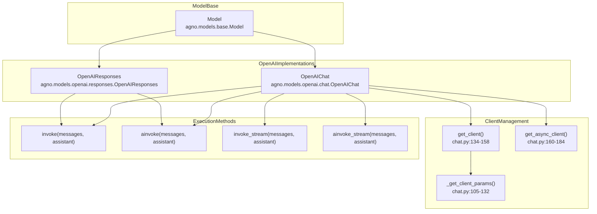
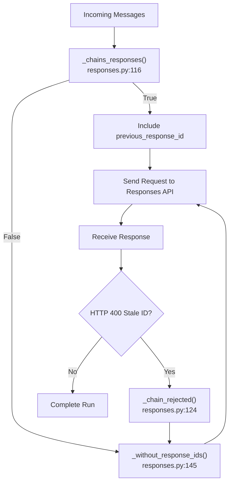
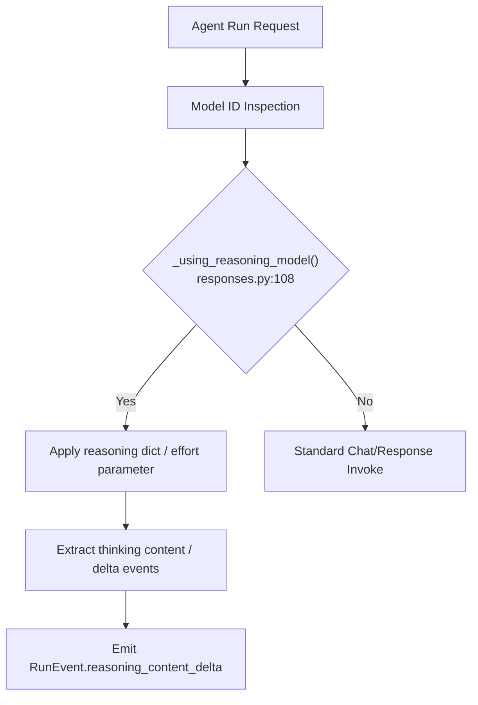
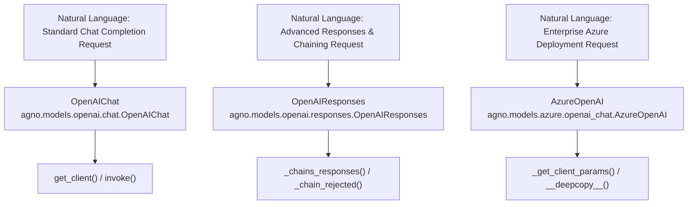
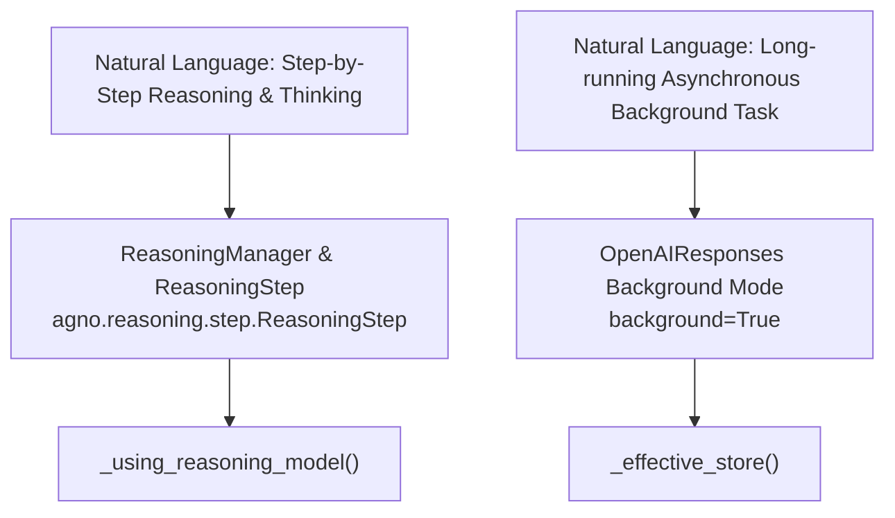

<!-- source: DeepWiki mcp.deepwiki.com · repo agno-agi/agno · page 3.2 OpenAI Integration · fetched 2026-11-09 -->

# OpenAI Integration

Relevant source files

The following files were used as context for generating this wiki page:

- [cookbook/90_models/azure/openai/README.md](cookbook/90_models/azure/openai/README.md)
- [cookbook/90_models/azure/openai/TEST_LOG.md](cookbook/90_models/azure/openai/TEST_LOG.md)
- [cookbook/90_models/azure/openai/responses.py](cookbook/90_models/azure/openai/responses.py)
- [cookbook/90_models/openai/responses/README.md](cookbook/90_models/openai/responses/README.md)
- [cookbook/90_models/openai/responses/TEST_LOG.md](cookbook/90_models/openai/responses/TEST_LOG.md)
- [cookbook/90_models/openai/responses/background.py](cookbook/90_models/openai/responses/background.py)
- [cookbook/90_models/openai/responses/stored_responses_without_chaining.py](cookbook/90_models/openai/responses/stored_responses_without_chaining.py)
- [cookbook/90_models/openrouter/responses/tool_use.py](cookbook/90_models/openrouter/responses/tool_use.py)
- [libs/agno/agno/models/aws/__init__.py](libs/agno/agno/models/aws/__init__.py)
- [libs/agno/agno/models/azure/__init__.py](libs/agno/agno/models/azure/__init__.py)
- [libs/agno/agno/models/azure/openai_chat.py](libs/agno/agno/models/azure/openai_chat.py)
- [libs/agno/agno/models/azure/openai_responses.py](libs/agno/agno/models/azure/openai_responses.py)
- [libs/agno/agno/models/openai/chat.py](libs/agno/agno/models/openai/chat.py)
- [libs/agno/agno/models/openai/responses.py](libs/agno/agno/models/openai/responses.py)
- [libs/agno/agno/models/openrouter/responses.py](libs/agno/agno/models/openrouter/responses.py)
- [libs/agno/agno/reasoning/step.py](libs/agno/agno/reasoning/step.py)
- [libs/agno/tests/integration/agent/test_rag.py](libs/agno/tests/integration/agent/test_rag.py)
- [libs/agno/tests/integration/models/openai/chat/test_basic.py](libs/agno/tests/integration/models/openai/chat/test_basic.py)
- [libs/agno/tests/integration/models/openai/chat/test_reasoning_streaming.py](libs/agno/tests/integration/models/openai/chat/test_reasoning_streaming.py)
- [libs/agno/tests/integration/models/openai/responses/test_basic.py](libs/agno/tests/integration/models/openai/responses/test_basic.py)
- [libs/agno/tests/unit/models/azure/test_openai_responses.py](libs/agno/tests/unit/models/azure/test_openai_responses.py)
- [libs/agno/tests/unit/models/openai/test_openai_responses_background.py](libs/agno/tests/unit/models/openai/test_openai_responses_background.py)
- [libs/agno/tests/unit/models/openai/test_openai_responses_chaining.py](libs/agno/tests/unit/models/openai/test_openai_responses_chaining.py)
- [libs/agno/tests/unit/models/openai/test_openai_responses_id_handling.py](libs/agno/tests/unit/models/openai/test_openai_responses_id_handling.py)
- [libs/agno/tests/unit/models/openrouter_model/test_openrouter_responses.py](libs/agno/tests/unit/models/openrouter_model/test_openrouter_responses.py)
- [libs/agno/tests/unit/models/openrouter_model/test_openrouter_responses_reasoning.py](libs/agno/tests/unit/models/openrouter_model/test_openrouter_responses_reasoning.py)
- [libs/agno/tests/unit/models/test_client_caching.py](libs/agno/tests/unit/models/test_client_caching.py)
- [libs/agno/tests/unit/models/test_provider_resolution.py](libs/agno/tests/unit/models/test_provider_resolution.py)
- [libs/agno/tests/unit/scorer/test_model_identity.py](libs/agno/tests/unit/scorer/test_model_identity.py)
- [libs/agno/tests/unit/tools/test_google_maps.py](libs/agno/tests/unit/tools/test_google_maps.py)

## Purpose and Scope
This section covers the technical implementation of OpenAI integrations within the Agno framework, focusing on `OpenAIChat`, `OpenAIResponses`, conversation chaining, background execution mode, native reasoning models, and Azure-specific variants (`AzureOpenAI`). It details request construction, client lifecycle management, response parsing, and error recovery.

Sources: [libs/agno/agno/models/openai/chat.py:34-164](), [libs/agno/agno/models/openai/responses.py:31-153](), [libs/agno/agno/models/azure/openai_chat.py:20-123]()

---

## 1. Core Model Architecture: OpenAIChat and OpenAIResponses

Agno provides two primary model wrappers for OpenAI: `OpenAIChat` (targeting the Chat Completions API) and `OpenAIResponses` (targeting the Responses API). Both inherit from the base `Model` class (`agno.models.base.Model`) and support synchronous and asynchronous invocation, streaming, tool calling, and native structured outputs (`strict_output=True`).

### Class Structure and Invocation Flow

*Figure 1: Class hierarchy and execution lifecycle for OpenAI models.*

Sources: [libs/agno/agno/models/openai/chat.py:34-164](), [libs/agno/agno/models/openai/responses.py:31-120]()

---

## 2. Conversation Chaining in OpenAIResponses

The `OpenAIResponses` class supports automatic conversation chaining using `previous_response_id` when response storage is enabled (`store=True` or default). 

### Chaining Logic and Functions
- `_chains_responses()`: Determines whether turns continue through `previous_response_id` rather than replayed context (`libs/agno/agno/models/openai/responses.py:116-123`()).
- `_chain_rejected(request_params, exc)`: Handles `400` status errors where a chained `previous_response_id` has expired or is missing on the server, permitting fallback to full context re-submission (`libs/agno/agno/models/openai/responses.py:124-144`()).
- `_without_response_ids(messages)`: Strips stored response IDs from messages to force context replay when chaining is rejected or disabled (`libs/agno/agno/models/openai/responses.py:145-153`()).

*Figure 2: Conversation chaining and error recovery flow in OpenAIResponses.*

Sources: [libs/agno/agno/models/openai/responses.py:116-153](), [libs/agno/tests/unit/models/openai/test_openai_responses_chaining.py:78-108]()

---

## 3. Background Mode in OpenAIResponses

For long-running execution or batch processing, `OpenAIResponses` supports asynchronous background polling:
- `background`: Set to `True` to enable background mode. The API returns immediately, and Agno polls the response status until completion (`libs/agno/agno/models/openai/responses.py:65-67`()).
- `background_poll_interval`: Time in seconds between polling attempts (default `2.0`) (`libs/agno/agno/models/openai/responses.py:68-70`()).
- `background_max_wait`: Maximum timeout in seconds before cancelling and raising an error (default `600.0`) (`libs/agno/agno/models/openai/responses.py:71`()).
- `_effective_store()`: Automatically enforces `store=True` when `background=True` since background tasks require server-side storage (`libs/agno/agno/models/openai/responses.py:112-115`()).

Sources: [libs/agno/agno/models/openai/responses.py:65-71](), [libs/agno/agno/models/openai/responses.py:112-115]()

---

## 4. Reasoning Models and Support

Agno integrates deep support for reasoning models (`o1`, `o3`, `o4-mini`, `gpt-5`, etc.):
- `_using_reasoning_model()`: Checks if `self.id` starts with known reasoning prefixes (`o3`, `o4-mini`, `gpt-5`, `gpt-6`) (`libs/agno/agno/models/openai/responses.py:108-111`()).
- `reasoning_effort`: Parameter in `OpenAIChat` and `OpenAIResponses` controlling internal thinking depth (`libs/agno/agno/models/openai/chat.py:51()`, `libs/agno/agno/models/openai/responses.py:52()`).
- `ReasoningStep`: Structured dataclass capturing incremental reasoning outputs and confidence scores (`libs/agno/agno/reasoning/step.py:14-28`()).

*Figure 3: Reasoning model integration and event emission flow.*

Sources: [libs/agno/agno/models/openai/responses.py:108-111](), [libs/agno/agno/models/openai/chat.py:51()](libs/agno/agno/models/openai/chat.py), [libs/agno/agno/reasoning/step.py:14-28]()

---

## 5. Azure OpenAI Variants

Agno provides enterprise-grade Azure integration via `AzureOpenAI` (inheriting from `OpenAILike`) (`libs/agno/agno/models/azure/openai_chat.py:20()`):
- Environment variables: `AZURE_OPENAI_API_KEY`, `AZURE_OPENAI_ENDPOINT`, `AZURE_OPENAI_DEPLOYMENT` (`libs/agno/agno/models/azure/openai_chat.py:94-96`()).
- Authentication: Supports API keys, Azure AD tokens (`azure_ad_token`), or external token providers (`azure_ad_token_provider`) (`libs/agno/agno/models/azure/openai_chat.py:98-103`()).
- `__deepcopy__()`: Explicitly preserves client instances (`client`, `async_client`, `http_client`) during deep copies to retain authentication state across reasoning iterations (`libs/agno/agno/models/azure/openai_chat.py:61-89`()).

Sources: [libs/agno/agno/models/azure/openai_chat.py:20-123]()

---

## 6. Bridge: Natural Language Space to Code Entity Space

The following diagrams map conceptual user intents to concrete Agno classes and methods.

*Figure 4: Conceptual mapping of OpenAI models to code implementation entities.*

Sources: [libs/agno/agno/models/openai/chat.py:34-158](), [libs/agno/agno/models/openai/responses.py:31-144](), [libs/agno/agno/models/azure/openai_chat.py:20-123]()

*Figure 5: Mapping of reasoning and background execution concepts to Agno codebase symbols.*

Sources: [libs/agno/agno/models/openai/responses.py:65-115](), [libs/agno/agno/reasoning/step.py:14-28]()

---

