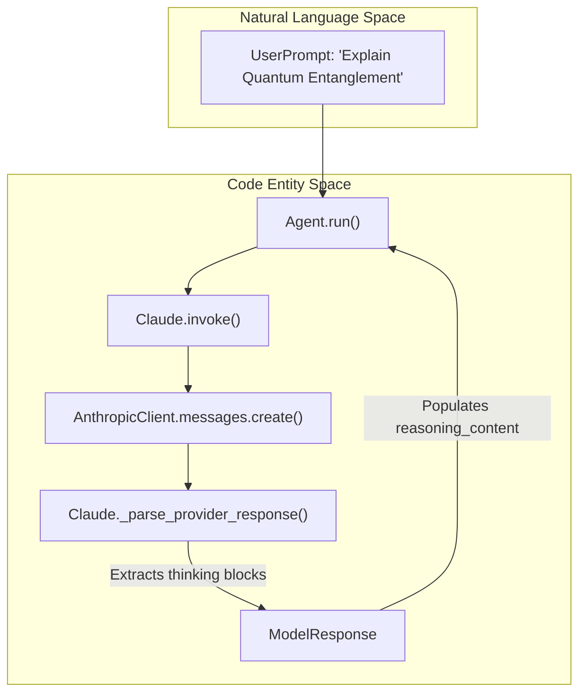
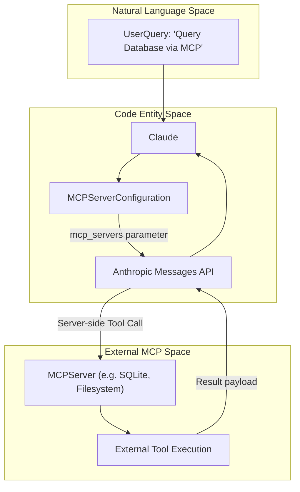

<!-- source: DeepWiki mcp.deepwiki.com · repo agno-agi/agno · page 3.3 Anthropic Claude · fetched 2026-11-09 -->

# Anthropic Claude

Relevant source files

The following files were used as context for generating this wiki page:

- [cookbook/10_reasoning/models/anthropic/TEST_LOG.md](cookbook/10_reasoning/models/anthropic/TEST_LOG.md)
- [cookbook/90_models/anthropic/TEST_LOG.md](cookbook/90_models/anthropic/TEST_LOG.md)
- [cookbook/90_models/anthropic/csv_input.py](cookbook/90_models/anthropic/csv_input.py)
- [cookbook/90_models/anthropic/financial_analyst_thinking.py](cookbook/90_models/anthropic/financial_analyst_thinking.py)
- [cookbook/90_models/anthropic/thinking.py](cookbook/90_models/anthropic/thinking.py)
- [libs/agno/agno/models/anthropic/claude.py](libs/agno/agno/models/anthropic/claude.py)
- [libs/agno/agno/models/aws/claude.py](libs/agno/agno/models/aws/claude.py)
- [libs/agno/agno/models/azure/claude.py](libs/agno/agno/models/azure/claude.py)
- [libs/agno/agno/models/vertexai/claude.py](libs/agno/agno/models/vertexai/claude.py)
- [libs/agno/agno/utils/models/claude.py](libs/agno/agno/utils/models/claude.py)
- [libs/agno/tests/integration/models/anthropic/test_basic.py](libs/agno/tests/integration/models/anthropic/test_basic.py)
- [libs/agno/tests/integration/models/aws/bedrock/test_basic.py](libs/agno/tests/integration/models/aws/bedrock/test_basic.py)
- [libs/agno/tests/integration/models/aws/claude/test_basic.py](libs/agno/tests/integration/models/aws/claude/test_basic.py)
- [libs/agno/tests/integration/models/azure/ai_foundry/test_basic.py](libs/agno/tests/integration/models/azure/ai_foundry/test_basic.py)
- [libs/agno/tests/integration/models/azure/openai/test_basic.py](libs/agno/tests/integration/models/azure/openai/test_basic.py)
- [libs/agno/tests/integration/models/cohere/test_basic.py](libs/agno/tests/integration/models/cohere/test_basic.py)
- [libs/agno/tests/integration/models/deepseek/test_basic.py](libs/agno/tests/integration/models/deepseek/test_basic.py)
- [libs/agno/tests/integration/models/fireworks/test_basic.py](libs/agno/tests/integration/models/fireworks/test_basic.py)
- [libs/agno/tests/integration/models/groq/test_basic.py](libs/agno/tests/integration/models/groq/test_basic.py)
- [libs/agno/tests/integration/models/mistral/test_basic.py](libs/agno/tests/integration/models/mistral/test_basic.py)
- [libs/agno/tests/integration/models/nvidia/test_basic.py](libs/agno/tests/integration/models/nvidia/test_basic.py)
- [libs/agno/tests/integration/models/ollama/test_basic.py](libs/agno/tests/integration/models/ollama/test_basic.py)
- [libs/agno/tests/integration/models/openrouter/test_basic.py](libs/agno/tests/integration/models/openrouter/test_basic.py)
- [libs/agno/tests/integration/models/sambanova/test_basic.py](libs/agno/tests/integration/models/sambanova/test_basic.py)
- [libs/agno/tests/integration/models/together/test_basic.py](libs/agno/tests/integration/models/together/test_basic.py)
- [libs/agno/tests/integration/models/xai/test_basic.py](libs/agno/tests/integration/models/xai/test_basic.py)
- [libs/agno/tests/unit/models/anthropic/test_append_trailing_user_message.py](libs/agno/tests/unit/models/anthropic/test_append_trailing_user_message.py)
- [libs/agno/tests/unit/models/anthropic/test_citation_replay.py](libs/agno/tests/unit/models/anthropic/test_citation_replay.py)
- [libs/agno/tests/unit/models/anthropic/test_citation_suppression.py](libs/agno/tests/unit/models/anthropic/test_citation_suppression.py)
- [libs/agno/tests/unit/models/anthropic/test_request_kwargs_match_sdk.py](libs/agno/tests/unit/models/anthropic/test_request_kwargs_match_sdk.py)
- [libs/agno/tests/unit/models/anthropic/test_thinking_replay.py](libs/agno/tests/unit/models/anthropic/test_thinking_replay.py)
- [libs/agno/tests/unit/models/test_cross_model_tool_calls.py](libs/agno/tests/unit/models/test_cross_model_tool_calls.py)
- [libs/agno/tests/unit/utils/test_claude.py](libs/agno/tests/unit/utils/test_claude.py)

## Purpose and Scope
This page documents the Anthropic Claude model integration in Agno, covering the `Claude` class [libs/agno/agno/models/anthropic/claude.py:97-180](), its configuration options, and provider-specific features including thinking mode, skills, prompt caching, message formatting, model context protocol (MCP) integration, and cloud-hosted subclasses (AWS Bedrock, Google Vertex AI, and Azure AI Foundry).

Agno provides a unified interface for Claude across multiple hosting environments:
- **Anthropic Direct**: via `agno.models.anthropic.Claude` [libs/agno/agno/models/anthropic/claude.py:97-180]()
- **AWS Bedrock**: via `agno.models.aws.Claude` [libs/agno/agno/models/aws/claude.py:27-48]()
- **Google Vertex AI**: via `agno.models.vertexai.Claude` [libs/agno/agno/models/vertexai/claude.py:22-41]()
- **Azure AI Foundry**: via `agno.models.azure.Claude` [libs/agno/agno/models/azure/claude.py:28-48]()

Sources: [libs/agno/agno/models/anthropic/claude.py:97-180](), [libs/agno/agno/models/aws/claude.py:27-48](), [libs/agno/agno/models/vertexai/claude.py:22-41](), [libs/agno/agno/models/azure/claude.py:28-48]()

---

## Claude Class Overview

The `Claude` class in `libs/agno/agno/models/anthropic/claude.py` [libs/agno/agno/models/anthropic/claude.py:97-180]() encapsulates the Anthropic Claude model interaction, providing configuration, client management, and request/response handling.

### Key Configuration Parameters

| Parameter                          | Type                                                                 | Default                         | Description                                                                                   |
|------------------------------------|----------------------------------------------------------------------|---------------------------------|-----------------------------------------------------------------------------------------------|
| `id`                               | `str`                                                                | `"claude-sonnet-5-5"`           | Model identifier for Anthropic Claude [libs/agno/agno/models/anthropic/claude.py:130]()                                                         |
| `max_tokens`                       | `Optional[int]`                                                      | `8192`                          | Maximum token budget for output generation [libs/agno/agno/models/anthropic/claude.py:135]()                                    |
| `thinking`                         | `Optional[Dict[str, Any]]`                                            | `None`                          | Enables extended thinking/reasoning mode (e.g. budget_tokens) [libs/agno/agno/models/anthropic/claude.py:136]()                                 |
| `output_config`                    | `Optional[Dict[str, Any]]`                                            | `None`                          | Configuration for structured outputs [libs/agno/agno/models/anthropic/claude.py:137]()                                                          |
| `cache_system_prompt`              | `Optional[bool]`                                                     | `False`                         | Enable ephemeral prompt caching for system messages [libs/agno/agno/models/anthropic/claude.py:142]()                                           |
| `extended_cache_time`              | `Optional[bool]`                                                     | `False`                         | Extend system prompt cache TTL from 5 minutes to 1 hour [libs/agno/agno/models/anthropic/claude.py:143]()                                       |
| `cache_tools`                      | `bool`                                                               | `False`                         | Enable caching for tools [libs/agno/agno/models/anthropic/claude.py:144]()                                                                      |
| `system_prompt_blocks`             | `Optional[Union[List[SystemPromptBlock], Callable[[], List[SystemPromptBlock]]]]` | `None`                          | Multi-block system prompts with per-block cache control [libs/agno/agno/models/anthropic/claude.py:151]()                                       |
| `betas`                            | `Optional[List[str]]`                                                | `None`                          | List of experimental or beta feature flags [libs/agno/agno/models/anthropic/claude.py:155]()            |
| `mcp_servers`                      | `Optional[List[MCPServerConfiguration]]`                             | `None`                          | Configurations for Model Context Protocol servers [libs/agno/agno/models/anthropic/claude.py:157]()                                              |
| `skills`                           | `Optional[List[Dict[str, str]]]`                                     | `None`                          | Anthropic agent skills (PowerPoint, Excel, PDF) [libs/agno/agno/models/anthropic/claude.py:158]()                                               |
| `citations`                        | `bool`                                                               | `True`                          | Attach citations to document blocks [libs/agno/agno/models/anthropic/claude.py:165]()                                                           |
| `append_trailing_user_message`     | `Optional[bool]`                                                     | `None`                          | Appends trailing user message if conversation ends with assistant message [libs/agno/agno/models/anthropic/claude.py:170]()       |

#### System Prompt Block
The `SystemPromptBlock` class [libs/agno/agno/models/anthropic/claude.py:76-94]() allows fine-grained cache control over segments of the system prompt. This enables caching static instructions while keeping dynamic parts uncached. The `ttl` property overrides the model-level `extended_cache_time` for that specific block [libs/agno/agno/models/anthropic/claude.py:76-94]().

Sources: [libs/agno/agno/models/anthropic/claude.py:76-180]()

---

## Extended Thinking Mode

Claude models support extended thinking (reasoning), where the model generates internal thought blocks before formulating its final response.

### Implementation and Validation
- **Model Support Validation**: Agno maintains a `NON_THINKING_MODELS` set (including Claude 3 and 3.5 Haiku variants) to prevent invalid requests [libs/agno/agno/models/anthropic/claude.py:107-113]().
- **Configuration**: Thinking is enabled by supplying a configuration dictionary (e.g., `{"type": "enabled", "budget_tokens": 1024}`) via the `thinking` parameter [libs/agno/agno/models/anthropic/claude.py:136]().
- **Utility Routing**: Functions like `supports_thinking_budget` [libs/agno/agno/utils/models/claude.py:118-125]() and `route_thinking_budget_to_adaptive` [libs/agno/agno/utils/models/claude.py:12-13]() ensure correct payload formatting across model generations and cloud providers.

### Reasoning Data Flow

Title: "ClaudeReasoningDataFlow"

Sources: [libs/agno/agno/models/anthropic/claude.py:97-136](), [libs/agno/agno/utils/models/claude.py:118-125]()

---

## Skills and Beta Features

Claude integrates specialized agent skills and beta API flags to support document generation, code execution, and extended contexts.

### Skills Integration
Skills are configured as a list of dictionaries passed to the `skills` parameter, for example:
`skills=[{"type": "anthropic", "skill_id": "pptx", "version": "latest"}]` [libs/agno/agno/models/anthropic/claude.py:158-160]().

### Automatic Beta Header Injection
Agno automatically manages beta headers based on active configurations. When features such as `mcp_servers` or `skills` are defined, the model integration appends the required feature strings to the `betas` request list [libs/agno/agno/models/anthropic/claude.py:155-160]().

Sources: [libs/agno/agno/models/anthropic/claude.py:155-160]()

---

## Message and Media Formatting

Claude expects specific formatting for multimodal content and conversation turns.

### Multimodal Handling
- **Images and Files**: `_format_file_for_message` handles document types like PDFs (encoded as `base64`) and text-based files like CSVs or Markdown (sent as raw text blocks) [libs/agno/agno/utils/models/claude.py:6-22]().
- **Citations**: Citations are attached to document blocks by default (`citations=True`), but are suppressed automatically when structured output mode is active to prevent API errors [libs/agno/agno/models/anthropic/claude.py:163-165]().

### Assistant Message Prefill
Newer Claude models deprecate assistant message prefill. Agno manages this via `append_trailing_user_message`. If a conversation sequence ends with an assistant message on a non-supporting model version, Agno appends a trailing user message (defaulting to `"continue"`) [libs/agno/agno/models/anthropic/claude.py:167-171](). Prefill eligibility is determined dynamically via `supports_prefill` [libs/agno/agno/utils/models/claude.py:92-99]().

Sources: [libs/agno/agno/models/anthropic/claude.py:163-171](), [libs/agno/agno/utils/models/claude.py:6-99]()

---

## Prompt Caching

Agno supports Anthropic's ephemeral prompt caching mechanism to optimize token costs and reduce request latency.

### Caching Controls
- **System Caching**: `cache_system_prompt=True` marks system messages for caching [libs/agno/agno/models/anthropic/claude.py:142]().
- **Tool Caching**: `cache_tools=True` enables caching for function and tool definitions [libs/agno/agno/models/anthropic/claude.py:144]().
- **Extended TTL**: `extended_cache_time=True` extends the cache TTL from 5 minutes to 1 hour [libs/agno/agno/models/anthropic/claude.py:143]().
- **Granular Control**: `system_prompt_blocks` allows block-level cache overrides via `SystemPromptBlock` [libs/agno/agno/models/anthropic/claude.py:76-94]().

Sources: [libs/agno/agno/models/anthropic/claude.py:76-144]()

---

## Model Context Protocol (MCP) Integration

Claude supports the Model Context Protocol (MCP) to interact directly with external tool servers and resources.

### Configuration
MCP servers are defined using `MCPServerConfiguration` and `MCPToolConfiguration` data classes [libs/agno/agno/utils/models/claude.py:128-140](), which are passed directly to the `mcp_servers` attribute on `Claude` [libs/agno/agno/models/anthropic/claude.py:157]().

### MCP Tool Execution Flow

Title: "ClaudeMCPToolCallFlow"

Sources: [libs/agno/agno/models/anthropic/claude.py:157](), [libs/agno/agno/utils/models/claude.py:128-140]()

---

## Hosting Subclasses: Bedrock, Vertex AI, and Azure AI Foundry

Agno implements specialized subclasses to run Claude models across major cloud provider infrastructures:

1. **AWS Bedrock (`agno.models.aws.Claude`)**:
   - Uses `AnthropicBedrock` and `AsyncAnthropicBedrock` clients [libs/agno/agno/models/aws/claude.py:17]().
   - Supports `boto3` session integration, atomic credential snapshots via `get_frozen_credentials()`, and IAM role rotation [libs/agno/agno/models/aws/claude.py:44-73]().
   - Disables native structured outputs due to Bedrock platform constraints [libs/agno/agno/models/aws/claude.py:49-55]().

2. **Google Vertex AI (`agno.models.vertexai.Claude`)**:
   - Uses `AnthropicVertex` and `AsyncAnthropicVertex` clients [libs/agno/agno/models/vertexai/claude.py:17]().
   - Configures regional endpoints (`region`, `project_id`, `base_url`) [libs/agno/agno/models/vertexai/claude.py:35-37]().
   - Overrides native structured output support [libs/agno/agno/models/vertexai/claude.py:42-48]().

3. **Azure AI Foundry (`agno.models.azure.Claude`)**:
   - Uses `AnthropicFoundry` and `AsyncAnthropicFoundry` clients [libs/agno/agno/models/azure/claude.py:23]().
   - Supports Azure resource scoping, base URLs, and `azure_ad_token_provider` callbacks [libs/agno/agno/models/azure/claude.py:41-43]().
   - Disables native structured outputs for partner model endpoints [libs/agno/agno/models/azure/claude.py:49-55]().

Sources: [libs/agno/agno/models/aws/claude.py:17-106](), [libs/agno/agno/models/vertexai/claude.py:17-64](), [libs/agno/agno/models/azure/claude.py:23-88]()

---

