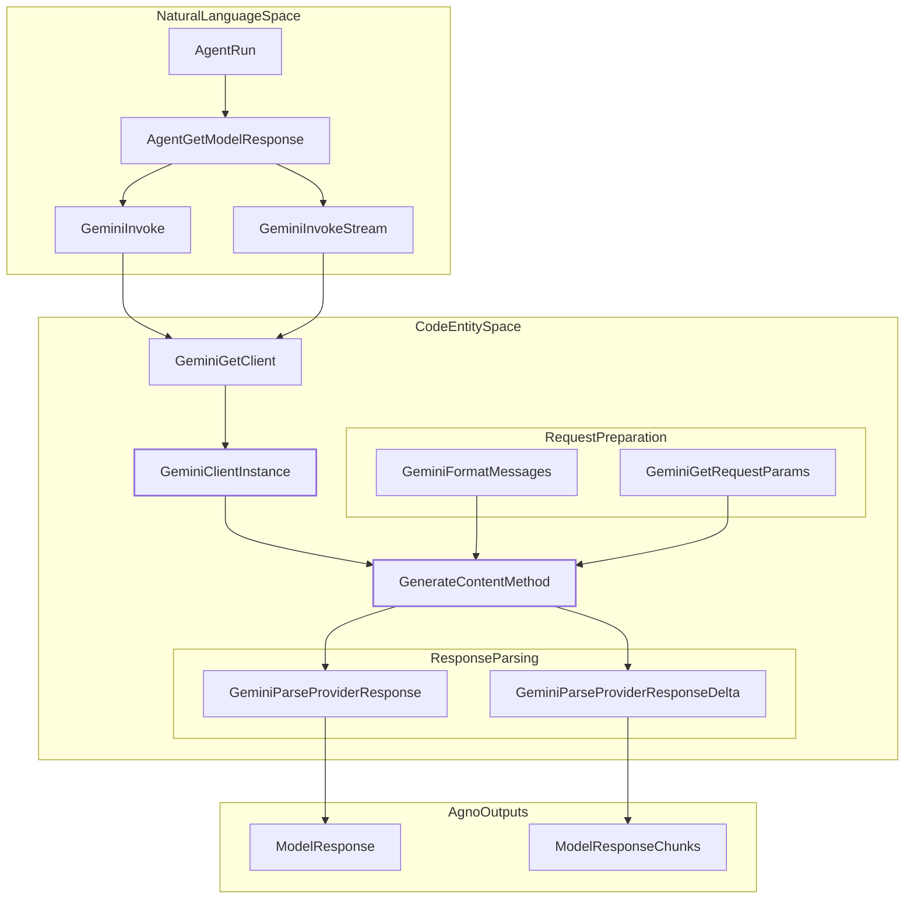
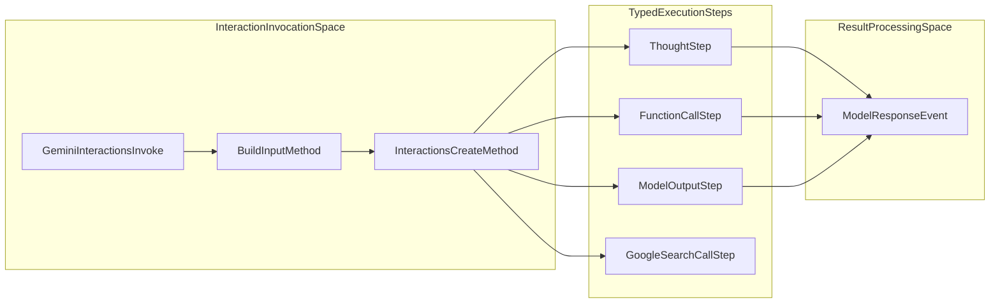

<!-- source: DeepWiki mcp.deepwiki.com · repo agno-agi/agno · page 3.4 Google Gemini and Other Providers · fetched 2026-11-09 -->

# Google Gemini and Other Providers

Relevant source files

The following files were used as context for generating this wiki page:

- [cookbook/03_teams/22_metrics/01_team_metrics.py](cookbook/03_teams/22_metrics/01_team_metrics.py)
- [cookbook/03_teams/22_metrics/04_team_tool_metrics.py](cookbook/03_teams/22_metrics/04_team_tool_metrics.py)
- [cookbook/90_models/google/gemini/parallel_grounding.py](cookbook/90_models/google/gemini/parallel_grounding.py)
- [cookbook/90_models/google/gemini/timeout.py](cookbook/90_models/google/gemini/timeout.py)
- [cookbook/90_models/google/gemini_interactions/README.md](cookbook/90_models/google/gemini_interactions/README.md)
- [cookbook/90_models/google/gemini_interactions/TEST_LOG.md](cookbook/90_models/google/gemini_interactions/TEST_LOG.md)
- [cookbook/90_models/google/gemini_interactions/audio_understanding.py](cookbook/90_models/google/gemini_interactions/audio_understanding.py)
- [cookbook/90_models/google/gemini_interactions/basic.py](cookbook/90_models/google/gemini_interactions/basic.py)
- [cookbook/90_models/google/gemini_interactions/document_processing.py](cookbook/90_models/google/gemini_interactions/document_processing.py)
- [cookbook/90_models/google/gemini_interactions/image_understanding.py](cookbook/90_models/google/gemini_interactions/image_understanding.py)
- [cookbook/90_models/google/gemini_interactions/multi_turn.py](cookbook/90_models/google/gemini_interactions/multi_turn.py)
- [cookbook/90_models/google/gemini_interactions/search.py](cookbook/90_models/google/gemini_interactions/search.py)
- [cookbook/90_models/google/gemini_interactions/structured_output.py](cookbook/90_models/google/gemini_interactions/structured_output.py)
- [cookbook/90_models/google/gemini_interactions/thinking.py](cookbook/90_models/google/gemini_interactions/thinking.py)
- [cookbook/90_models/google/gemini_interactions/tool_use.py](cookbook/90_models/google/gemini_interactions/tool_use.py)
- [cookbook/90_models/google/gemini_interactions/video_understanding.py](cookbook/90_models/google/gemini_interactions/video_understanding.py)
- [cookbook/90_models/litellm/structured_output.py](cookbook/90_models/litellm/structured_output.py)
- [cookbook/90_models/openrouter/chat/image_generation.py](cookbook/90_models/openrouter/chat/image_generation.py)
- [libs/agno/agno/company/declarations.py](libs/agno/agno/company/declarations.py)
- [libs/agno/agno/models/deepinfra/deepinfra.py](libs/agno/agno/models/deepinfra/deepinfra.py)
- [libs/agno/agno/models/fireworks/fireworks.py](libs/agno/agno/models/fireworks/fireworks.py)
- [libs/agno/agno/models/google/gemini.py](libs/agno/agno/models/google/gemini.py)
- [libs/agno/agno/models/google/gemini_interactions.py](libs/agno/agno/models/google/gemini_interactions.py)
- [libs/agno/agno/models/internlm/internlm.py](libs/agno/agno/models/internlm/internlm.py)
- [libs/agno/agno/models/litellm/chat.py](libs/agno/agno/models/litellm/chat.py)
- [libs/agno/agno/models/lmstudio/lmstudio.py](libs/agno/agno/models/lmstudio/lmstudio.py)
- [libs/agno/agno/models/meta/llama_openai.py](libs/agno/agno/models/meta/llama_openai.py)
- [libs/agno/agno/models/nvidia/nvidia.py](libs/agno/agno/models/nvidia/nvidia.py)
- [libs/agno/agno/models/openrouter/openrouter.py](libs/agno/agno/models/openrouter/openrouter.py)
- [libs/agno/agno/models/perplexity/perplexity.py](libs/agno/agno/models/perplexity/perplexity.py)
- [libs/agno/agno/models/sambanova/sambanova.py](libs/agno/agno/models/sambanova/sambanova.py)
- [libs/agno/agno/models/together/together.py](libs/agno/agno/models/together/together.py)
- [libs/agno/agno/models/vercel/v0.py](libs/agno/agno/models/vercel/v0.py)
- [libs/agno/agno/models/xai/xai.py](libs/agno/agno/models/xai/xai.py)
- [libs/agno/agno/utils/gemini.py](libs/agno/agno/utils/gemini.py)
- [libs/agno/agno/utils/models/llama.py](libs/agno/agno/utils/models/llama.py)
- [libs/agno/agno/utils/models/openai_responses.py](libs/agno/agno/utils/models/openai_responses.py)
- [libs/agno/agno/utils/models/schema_utils.py](libs/agno/agno/utils/models/schema_utils.py)
- [libs/agno/tests/integration/models/google/test_structured_response.py](libs/agno/tests/integration/models/google/test_structured_response.py)
- [libs/agno/tests/integration/models/google/test_tool_parsing.py](libs/agno/tests/integration/models/google/test_tool_parsing.py)
- [libs/agno/tests/integration/models/litellm/test_basic.py](libs/agno/tests/integration/models/litellm/test_basic.py)
- [libs/agno/tests/integration/models/litellm/test_tool_use.py](libs/agno/tests/integration/models/litellm/test_tool_use.py)
- [libs/agno/tests/integration/models/litellm_openai/test_basic.py](libs/agno/tests/integration/models/litellm_openai/test_basic.py)
- [libs/agno/tests/integration/models/litellm_openai/test_tool_use.py](libs/agno/tests/integration/models/litellm_openai/test_tool_use.py)
- [libs/agno/tests/integration/models/lmstudio/test_basic.py](libs/agno/tests/integration/models/lmstudio/test_basic.py)
- [libs/agno/tests/integration/models/meta/llama/test_tool_use.py](libs/agno/tests/integration/models/meta/llama/test_tool_use.py)
- [libs/agno/tests/integration/models/meta/llama_openai/test_multimodal.py](libs/agno/tests/integration/models/meta/llama_openai/test_multimodal.py)
- [libs/agno/tests/integration/models/meta/llama_openai/test_tool_use.py](libs/agno/tests/integration/models/meta/llama_openai/test_tool_use.py)
- [libs/agno/tests/integration/models/openai/chat/test_structured_response.py](libs/agno/tests/integration/models/openai/chat/test_structured_response.py)
- [libs/agno/tests/integration/models/openai/responses/test_structured_response.py](libs/agno/tests/integration/models/openai/responses/test_structured_response.py)
- [libs/agno/tests/unit/models/google/test_gemini.py](libs/agno/tests/unit/models/google/test_gemini.py)
- [libs/agno/tests/unit/models/google/test_gemini_interactions.py](libs/agno/tests/unit/models/google/test_gemini_interactions.py)
- [libs/agno/tests/unit/models/google/test_gemini_thread_safety.py](libs/agno/tests/unit/models/google/test_gemini_thread_safety.py)
- [libs/agno/tests/unit/models/litellm/test_chat_metrics.py](libs/agno/tests/unit/models/litellm/test_chat_metrics.py)
- [libs/agno/tests/unit/models/litellm/test_structured_output.py](libs/agno/tests/unit/models/litellm/test_structured_output.py)
- [libs/agno/tests/unit/models/meta_model/__init__.py](libs/agno/tests/unit/models/meta_model/__init__.py)
- [libs/agno/tests/unit/models/meta_model/test_llama_openai_format_message.py](libs/agno/tests/unit/models/meta_model/test_llama_openai_format_message.py)
- [libs/agno/tests/unit/models/openai/test_openai_metrics.py](libs/agno/tests/unit/models/openai/test_openai_metrics.py)
- [libs/agno/tests/unit/models/openrouter_model/test_openrouter_image_generation.py](libs/agno/tests/unit/models/openrouter_model/test_openrouter_image_generation.py)
- [libs/agno/tests/unit/models/perplexity/test_perplexity_metrics.py](libs/agno/tests/unit/models/perplexity/test_perplexity_metrics.py)
- [libs/agno/tests/unit/utils/test_gemini.py](libs/agno/tests/unit/utils/test_gemini.py)
- [libs/agno/tests/unit/utils/test_gemini_dict_support.py](libs/agno/tests/unit/utils/test_gemini_dict_support.py)
- [libs/agno/tests/unit/utils/test_openai_responses.py](libs/agno/tests/unit/utils/test_openai_responses.py)

This page documents the Google Gemini model integration in the Agno framework, including the specialized `GeminiInteractions` API [libs/agno/agno/models/google/gemini_interactions.py:126-127](), groundings, search and URL context capabilities [libs/agno/agno/models/google/gemini.py:107-112](), alongside comprehensive coverage for over 30 other supported model providers including LiteLLM, Cerebras, xAI, Groq, Mistral, and Perplexity [libs/agno/agno/models/litellm/chat.py:28-38](), [libs/agno/agno/models/xai/xai.py:21-36]().

## Overview

The Gemini integration provides access to Google's Generative AI models via the `google-genai` SDK [libs/agno/agno/models/google/gemini.py:42-73](). Agno supports both the standard `generateContent` workflow via the `Gemini` class [libs/agno/agno/models/google/gemini.py:81-82]() and advanced server-side conversation management via the `GeminiInteractions` class [libs/agno/agno/models/google/gemini_interactions.py:126-127]().

**Key Gemini Capabilities:**
- **Grounding & Search:** Integrated Google Search, Vertex AI Search, and Parallel Web Search [libs/agno/agno/models/google/gemini.py:107-122]().
- **URL Context:** Ability to pass specific URLs for model grounding [libs/agno/agno/models/google/gemini.py:110]().
- **Multimodal Inputs:** Native support for Images, Video, Audio, and Files [libs/agno/agno/models/google/gemini.py:17-18]().
- **Reasoning Controls:** Thinking budget and level configurations for Gemini models [libs/agno/agno/models/google/gemini.py:139-141]().
- **Interactions API:** Server-side history management and typed execution steps [libs/agno/agno/models/google/gemini_interactions.py:131-140]().

Sources: [libs/agno/agno/models/google/gemini.py:81-156](), [libs/agno/agno/models/google/gemini_interactions.py:126-194]()

## Gemini Class Architecture

The `Gemini` class handles the translation between Agno's internal `Message` objects and the Google GenAI `Content` types.

### Code-to-System Mapping
The following diagram bridges Agno Framework entities to the Google GenAI SDK entities.

Title: Agno Gemini Integration Data Flow

Sources: [libs/agno/agno/models/google/gemini.py:81-193](), [libs/agno/agno/models/google/gemini.py:172-193]()

### Key Implementation Details
- **Client Management:** The `get_client()` method lazily initializes the `GeminiClient`, handling both Google AI Studio (API Key) and Vertex AI (Project/Location) configurations [libs/agno/agno/models/google/gemini.py:172-193]().
- **Role Mapping:** Gemini maps `assistant` to `model` [libs/agno/agno/models/google/gemini.py:162-164]() and returns `tool` results as `user` messages in the message history [libs/agno/agno/models/google/gemini.py:167-170]().
- **Metric Collection:** Gemini returns cumulative token counts. Agno sets `collect_metrics_on_completion = True` to ensure accurate accounting on the final chunk [libs/agno/agno/models/google/gemini.py:148]().

Sources: [libs/agno/agno/models/google/gemini.py:148-170](), [libs/agno/agno/models/google/gemini.py:172-193]()

## Gemini Grounding, Search, and URL Context

Gemini models support advanced web and datastore grounding configurations directly within the `Gemini` dataclass parameters:
- `search: bool`: Enables Google Search grounding [libs/agno/agno/models/google/gemini.py:107]().
- `grounding: bool`: Enables general grounding metadata [libs/agno/agno/models/google/gemini.py:108]().
- `url_context: bool`: Enables URL context retrieval for grounding [libs/agno/agno/models/google/gemini.py:110]().
- `vertexai_search: bool` and `vertexai_search_datastore`: Integrates Vertex AI Search corpuses [libs/agno/agno/models/google/gemini.py:111-112]().
- `parallel_search: bool`: Uses Parallel Web Systems' search API for public web data grounding on Vertex AI [libs/agno/agno/models/google/gemini.py:116-117]().

Sources: [libs/agno/agno/models/google/gemini.py:107-122]()

## Gemini Interactions API

The `GeminiInteractions` class implements Google's server-side conversation history API [libs/agno/agno/models/google/gemini_interactions.py:126-127](). Instead of resending all messages each turn, it references a `previous_interaction_id` and only transmits new input.

### Interactions Typed Execution
Title: Gemini Interactions Typed Execution Flow

Sources: [libs/agno/agno/models/google/gemini_interactions.py:35-55](), [libs/agno/agno/models/google/gemini_interactions.py:87-104](), [libs/agno/agno/models/google/gemini_interactions.py:126-140]()

**Interactions Benefits:**
- **Server-side History:** Reduces token costs by referencing prior turns [libs/agno/agno/models/google/gemini_interactions.py:137]().
- **Typed Steps:** Better observability via distinct steps for thinking, searching, and calling tools [libs/agno/agno/models/google/gemini_interactions.py:139]().
- **Background Execution:** Support for long-running tasks [libs/agno/agno/models/google/gemini_interactions.py:140]().

Sources: [libs/agno/agno/models/google/gemini_interactions.py:131-140]()

## Multi-Provider Support

Agno supports over 30 model providers via a unified `Model` interface [libs/agno/agno/models/base.py:10-11](). Providers can be instantiated directly or via model strings parsed by `get_model`.

### Provider Feature Matrix
| Provider | Class Name | Key File | Native Structured Output |
| :--- | :--- | :--- | :--- |
| **Google Gemini** | `Gemini` | `agno/models/google/gemini.py` | ✅ [libs/agno/agno/models/google/gemini.py:100]() |
| **Google Interactions** | `GeminiInteractions` | `agno/models/google/gemini_interactions.py` | ✅ [libs/agno/agno/models/google/gemini_interactions.py:162]() |
| **LiteLLM** | `LiteLLM` | `agno/models/litellm/chat.py` | ❌ (Configurable) [libs/agno/agno/models/litellm/chat.py:42]() |
| **xAI (Grok)** | `xAI` | `agno/models/xai/xai.py` | ✅ (OpenAI-compatible) [libs/agno/agno/models/xai/xai.py:21]() |
| **OpenRouter** | `OpenRouter` | `agno/models/openrouter/openrouter.py` | ✅ [libs/agno/agno/models/openrouter/openrouter.py:17]() |

Sources: [libs/agno/agno/models/google/gemini.py:100](), [libs/agno/agno/models/google/gemini_interactions.py:162](), [libs/agno/agno/models/litellm/chat.py:42](), [libs/agno/agno/models/xai/xai.py:21](), [libs/agno/agno/models/openrouter/openrouter.py:17]()

### LiteLLM, xAI, and Other Specialized Providers
- **LiteLLM (`LiteLLM`):** Provides a unified interface across 100+ LLM providers by leveraging the LiteLLM Python SDK, supporting environment validation, custom API bases, and routing [libs/agno/agno/models/litellm/chat.py:28-46]().
- **xAI (`xAI`):** Extends OpenAI-compatible chat endpoints with live search parameters (`search_parameters`) and citation extraction (`citations`) [libs/agno/agno/models/xai/xai.py:21-42](), [libs/agno/agno/models/xai/xai.py:86-106]().
- **OpenRouter (`OpenRouter`):** Manages multi-model routing, fallback models configuration (`models` parameter), and multimodal data URL extraction [libs/agno/agno/models/openrouter/openrouter.py:17-40](), [libs/agno/agno/models/openrouter/openrouter.py:82-90]().

Sources: [libs/agno/agno/models/litellm/chat.py:28-86](), [libs/agno/agno/models/xai/xai.py:21-106](), [libs/agno/agno/models/openrouter/openrouter.py:17-90]()

## Tool Calling and Structured Outputs

Agno unifies tool calling and structured response parsing across Gemini and all 30+ secondary providers through normalized execution blocks and Pydantic schema adapters (`prepare_response_schema`) [libs/agno/agno/utils/gemini.py:51-80]().

Sources: [libs/agno/agno/utils/gemini.py:51-80]()

---

