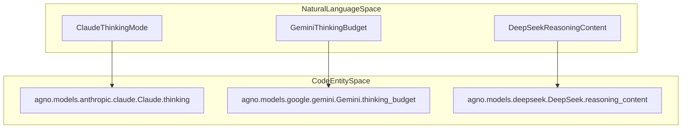

<!-- source: DeepWiki mcp.deepwiki.com · repo agno-agi/agno · page 3.5 Provider-Specific Features · fetched 2026-11-09 -->

# Provider-Specific Features

<details>
<summary>Relevant source files</summary>

The following files were used as context for generating this wiki page:

- [cookbook/10_reasoning/models/anthropic/TEST_LOG.md](cookbook/10_reasoning/models/anthropic/TEST_LOG.md)
- [cookbook/90_models/anthropic/TEST_LOG.md](cookbook/90_models/anthropic/TEST_LOG.md)
- [cookbook/90_models/anthropic/csv_input.py](cookbook/90_models/anthropic/csv_input.py)
- [cookbook/90_models/anthropic/financial_analyst_thinking.py](cookbook/90_models/anthropic/financial_analyst_thinking.py)
- [cookbook/90_models/anthropic/thinking.py](cookbook/90_models/anthropic/thinking.py)
- [cookbook/90_models/tuning_engines/README.md](cookbook/90_models/tuning_engines/README.md)
- [cookbook/90_models/tuning_engines/basic.py](cookbook/90_models/tuning_engines/basic.py)
- [libs/agno/agno/models/anthropic/claude.py](libs/agno/agno/models/anthropic/claude.py)
- [libs/agno/agno/models/aws/claude.py](libs/agno/agno/models/aws/claude.py)
- [libs/agno/agno/models/azure/claude.py](libs/agno/agno/models/azure/claude.py)
- [libs/agno/agno/models/tuning_engines/__init__.py](libs/agno/agno/models/tuning_engines/__init__.py)
- [libs/agno/agno/models/tuning_engines/tuning_engines.py](libs/agno/agno/models/tuning_engines/tuning_engines.py)
- [libs/agno/agno/models/vertexai/claude.py](libs/agno/agno/models/vertexai/claude.py)
- [libs/agno/agno/utils/functions.py](libs/agno/agno/utils/functions.py)
- [libs/agno/agno/utils/models/claude.py](libs/agno/agno/utils/models/claude.py)
- [libs/agno/tests/unit/models/anthropic/test_append_trailing_user_message.py](libs/agno/tests/unit/models/anthropic/test_append_trailing_user_message.py)
- [libs/agno/tests/unit/models/anthropic/test_citation_replay.py](libs/agno/tests/unit/models/anthropic/test_citation_replay.py)
- [libs/agno/tests/unit/models/anthropic/test_citation_suppression.py](libs/agno/tests/unit/models/anthropic/test_citation_suppression.py)
- [libs/agno/tests/unit/models/anthropic/test_request_kwargs_match_sdk.py](libs/agno/tests/unit/models/anthropic/test_request_kwargs_match_sdk.py)
- [libs/agno/tests/unit/models/anthropic/test_thinking_replay.py](libs/agno/tests/unit/models/anthropic/test_thinking_replay.py)
- [libs/agno/tests/unit/models/test_cross_model_tool_calls.py](libs/agno/tests/unit/models/test_cross_model_tool_calls.py)
- [libs/agno/tests/unit/models/tuning_engines/__init__.py](libs/agno/tests/unit/models/tuning_engines/__init__.py)
- [libs/agno/tests/unit/models/tuning_engines/test_tuning_engines.py](libs/agno/tests/unit/models/tuning_engines/test_tuning_engines.py)
- [libs/agno/tests/unit/utils/test_claude.py](libs/agno/tests/unit/utils/test_claude.py)
- [libs/agno/tests/unit/utils/test_functions.py](libs/agno/tests/unit/utils/test_functions.py)

</details>


This page details provider-specific behaviors, features, and implementation details that differ across LLM providers in Agno. While the framework provides a unified `Model` interface, each provider has unique capabilities, parameter requirements, and behavioral patterns that developers must understand when working with specific models.

---

## Metrics Collection Patterns

Different providers report token usage metrics differently during streaming responses, requiring provider-specific handling.

### Incremental vs Cumulative Token Reporting

```mermaid
graph TB
    subgraph "OpenAI-Style Providers"
        OAIStream["StreamingResponse"]
        OAIChunk1["Chunk1<br/>tokens:+5"]
        OAIChunk2["Chunk2<br/>tokens:+3"]
        OAIChunk3["Chunk3<br/>tokens:+7"]
        OAITotal["Total:15tokens<br/>SumOfAllChunks"]
        
        OAIStream --> OAIChunk1
        OAIChunk1 --> OAIChunk2
        OAIChunk2 --> OAIChunk3
        OAIChunk3 --> OAITotal
    end
    
    subgraph "Perplexity-Gemini-Style Providers"
        PGStream["StreamingResponse"]
        PGChunk1["Chunk1<br/>tokens:5"]
        PGChunk2["Chunk2<br/>tokens:8"]
        PGChunk3["Chunk3<br/>tokens:15"]
        PGTotal["Total:15tokens<br/>UseOnlyFinalChunk"]
        
        PGStream --> PGChunk1
        PGChunk1 --> PGChunk2
        PGChunk2 --> PGChunk3
        PGChunk3 --> PGTotal
    end
```


**Incremental vs Cumulative Token Counting**

The `collect_metrics_on_completion` flag controls when metrics are collected from streaming responses.

| Provider | `collect_metrics_on_completion` | Behavior |
|----------|--------------------------------|----------|
| `OpenAIChat` | `False` | Each chunk reports **incremental** tokens; sum all chunks. |
| `Anthropic Claude` | N/A | Metrics reported once at completion via `Usage` or `BetaUsage` [libs/agno/agno/models/anthropic/claude.py:52-67](). |
| `Perplexity` | `True` | Each chunk reports **cumulative** tokens; use only final chunk [libs/agno/agno/models/perplexity/perplexity.py:45-46](). |
| `Gemini` | `True` | Cumulative counts in each chunk; collect only on final completion [libs/agno/agno/models/google/gemini.py:148-149](). |

Sources: [libs/agno/agno/models/perplexity/perplexity.py:45-46](), [libs/agno/agno/models/anthropic/claude.py:52-67](), [libs/agno/agno/models/google/gemini.py:148-149]()

---

## Search, Grounding, and Citations

Several providers support native web search capabilities, grounding, and specialized citation formats.

### Gemini Grounding and Search
Gemini provides extensive grounding capabilities, including Google Search and Vertex AI Search.
- **Google Search Grounding**: Enabled via the `search` or `grounding` flags [libs/agno/agno/models/google/gemini.py:107-108]().
- **Dynamic Retrieval**: Users can set a `grounding_dynamic_threshold` to control when search is triggered [libs/agno/agno/models/google/gemini.py:109]().
- **Parallel Web Search**: Vertex AI users can leverage `parallel_search` using Parallel Web Systems' API for grounding with public data [libs/agno/agno/models/google/gemini.py:116-121]().
- **Vertex AI Search**: Integration with Vertex AI Search datastores via `vertexai_search` and `vertexai_search_datastore` [libs/agno/agno/models/google/gemini.py:111-112]().

### OpenAI Responses Web Search
The `OpenAIResponses` class supports native OpenAI web search capabilities via its responses-specific parameters, allowing agents to fetch live web data without manual tool configuration.

### Perplexity Citations
Perplexity models (such as `sonar`) automatically provide URLs and web search citations in their responses. The `Perplexity` model class parses these raw citations into structured `Citations` and `UrlCitation` objects within the `ModelResponse` [libs/agno/agno/models/perplexity/perplexity.py:140-144]().

Sources: [libs/agno/agno/models/google/gemini.py:107-125](), [libs/agno/agno/models/perplexity/perplexity.py:140-144]()

---

## Extended Thinking and Reasoning

Agno provides specialized handling for models that generate internal "thoughts" or reasoning steps before producing an answer.

### Reasoning Execution Space to Code Entity Mapping


**Reasoning Mapping**

### Provider Implementation Details
- **Anthropic Claude**: Supports `thinking` mode via a `thinking` dictionary structure specifying `budget_tokens` [libs/agno/agno/models/anthropic/claude.py:134]().
- **DeepSeek**: Captures internal reasoning via `reasoning_content` fields in assistant messages, separating chain-of-thought tokens from final completion output.
- **Gemini**: Supports thinking in 2.5+ models via `thinking_budget`, `include_thoughts`, and `thinking_level` [libs/agno/agno/models/google/gemini.py:139-141]().

Sources: [libs/agno/agno/models/anthropic/claude.py:105-134](), [libs/agno/agno/models/google/gemini.py:139-141]()

---

## Claude-Specific Capabilities, Skills, and Beta Flags

### Claude Skills and Beta Features
Claude models support specialized "skills" (such as automated data analysis or document creation) via the `skills` parameter [libs/agno/agno/models/anthropic/claude.py:158-160](). Additionally, experimental parameters and headers can be supplied via the `betas` configuration list [libs/agno/agno/models/anthropic/claude.py:155]().

### Prompt Caching and Prefill
- **SystemPromptBlock**: Allows splitting the system prompt into independently cacheable segments with individual time-to-live (`ttl`) parameters using the `SystemPromptBlock` Pydantic model [libs/agno/agno/models/anthropic/claude.py:76-94]().
- **Assistant Prefill**: Uses `supports_prefill` and `append_trailing_user_message` to manage conversational history formatting when the conversation ends with an assistant turn [libs/agno/agno/utils/models/claude.py:92-100](), [libs/agno/agno/models/anthropic/claude.py:167-172]().

### AWS Bedrock, Vertex AI, and Azure AI Foundry Variants
Agno provides specialized subclasses for running Claude across cloud hyperscalers:
- **AWS Bedrock Claude**: Manages `boto3` session initialization, credential freezing, and client recreation [libs/agno/agno/models/aws/claude.py:27-48]().
- **Vertex AI Claude**: Handles `project_id`, `region`, and endpoint routing specific to Google Cloud Platform [libs/agno/agno/models/vertexai/claude.py:23-41]().
- **Azure AI Foundry Claude**: Manages Azure authentication tokens, resource scopes, and `AnthropicFoundry` client initialization [libs/agno/agno/models/azure/claude.py:28-48]().

Sources: [libs/agno/agno/models/anthropic/claude.py:76-172](), [libs/agno/agno/utils/models/claude.py:92-100](), [libs/agno/agno/models/aws/claude.py:27-48](), [libs/agno/agno/models/vertexai/claude.py:23-41](), [libs/agno/agno/models/azure/claude.py:28-48]()

---

## Tuning Engines and Fallback Models

### Tuning Engines Subsystem
Agno features a model tuning engine abstraction (`agno.models.tuning_engines`) designed to optimize prompt parameters and model hyper-parameters across supported inference backends.

### Fallback Model Configuration
Agno allows configuring fallback models to handle provider rate limits, network outages, or model degradation. The `fallback_models` parameter accepts a list of model identifiers or instantiated `Model` objects.

```python
from agno.agent import Agent

agent = Agent(
    model="openai:gpt-4o",
    fallback_models=["anthropic:claude-3-5-sonnet-latest"]
)
```

The underlying `Model` infrastructure and string parsing utilities parse these configurations into their respective provider classes, ensuring cross-model tool call ID reformatting (`reformat_tool_call_ids`) so history remains consistent across provider handoffs [libs/agno/tests/unit/utils/test_model_string.py:23-55]().

Sources: [libs/agno/tests/unit/utils/test_model_string.py:23-55](), [libs/agno/agno/models/base.py:19](), [libs/agno/agno/models/tuning_engines/tuning_engines.py:1-45]()

---

