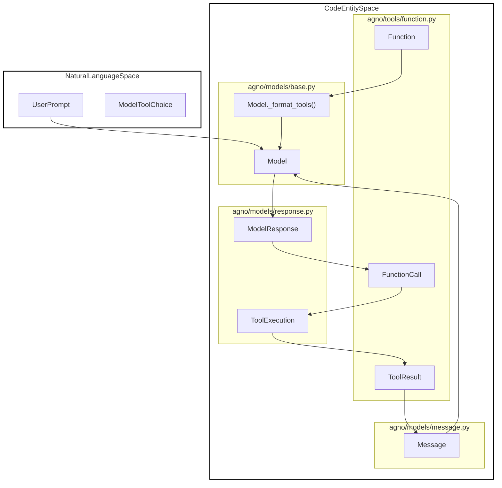
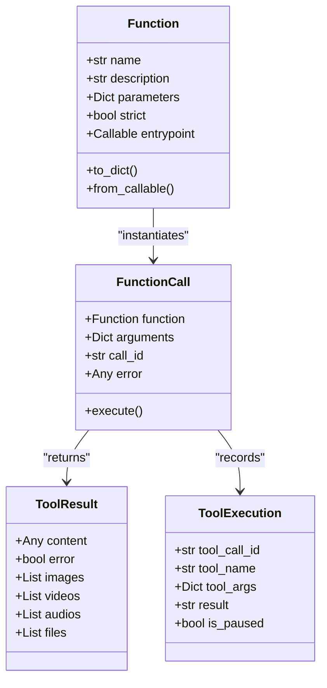
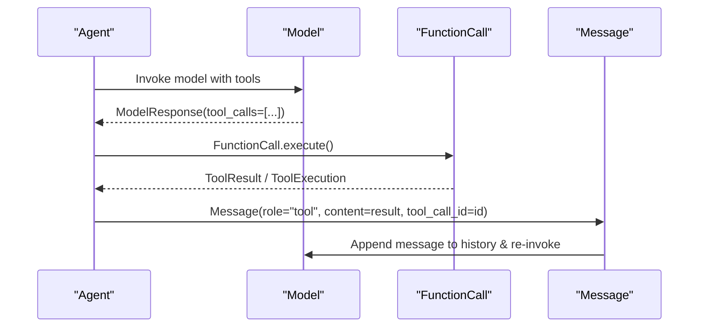

<!-- source: DeepWiki mcp.deepwiki.com · repo agno-agi/agno · page 3.6 Tool Calling and Function Execution · fetched 2026-11-09 -->

# Tool Calling and Function Execution

Relevant source files

The following files were used as context for generating this wiki page:

- [libs/agno/agno/agent/agent.py](libs/agno/agno/agent/agent.py)
- [libs/agno/agno/models/base.py](libs/agno/agno/models/base.py)
- [libs/agno/agno/models/message.py](libs/agno/agno/models/message.py)
- [libs/agno/agno/models/response.py](libs/agno/agno/models/response.py)
- [libs/agno/agno/run/agent.py](libs/agno/agno/run/agent.py)
- [libs/agno/agno/run/base.py](libs/agno/agno/run/base.py)
- [libs/agno/agno/run/team.py](libs/agno/agno/run/team.py)
- [libs/agno/agno/team/team.py](libs/agno/agno/team/team.py)
- [libs/agno/agno/tools/function.py](libs/agno/agno/tools/function.py)
- [libs/agno/agno/utils/events.py](libs/agno/agno/utils/events.py)
- [libs/agno/pyproject.toml](libs/agno/pyproject.toml)
- [libs/agno/tests/integration/agent/test_event_streaming.py](libs/agno/tests/integration/agent/test_event_streaming.py)
- [libs/agno/tests/integration/models/anthropic/test_tool_use.py](libs/agno/tests/integration/models/anthropic/test_tool_use.py)
- [libs/agno/tests/integration/models/aws/bedrock/test_tool_use.py](libs/agno/tests/integration/models/aws/bedrock/test_tool_use.py)
- [libs/agno/tests/integration/models/aws/claude/test_tool_use.py](libs/agno/tests/integration/models/aws/claude/test_tool_use.py)
- [libs/agno/tests/integration/models/azure/ai_foundry/test_tool_use.py](libs/agno/tests/integration/models/azure/ai_foundry/test_tool_use.py)
- [libs/agno/tests/integration/models/azure/openai/test_tool_use.py](libs/agno/tests/integration/models/azure/openai/test_tool_use.py)
- [libs/agno/tests/integration/models/cohere/test_tool_use.py](libs/agno/tests/integration/models/cohere/test_tool_use.py)
- [libs/agno/tests/integration/models/google/test_basic.py](libs/agno/tests/integration/models/google/test_basic.py)
- [libs/agno/tests/integration/models/google/test_multimodal.py](libs/agno/tests/integration/models/google/test_multimodal.py)
- [libs/agno/tests/integration/models/google/test_tool_use.py](libs/agno/tests/integration/models/google/test_tool_use.py)
- [libs/agno/tests/integration/models/groq/test_tool_use.py](libs/agno/tests/integration/models/groq/test_tool_use.py)
- [libs/agno/tests/integration/models/ibm/watsonx/test_tool_use.py](libs/agno/tests/integration/models/ibm/watsonx/test_tool_use.py)
- [libs/agno/tests/integration/models/mistral/test_tool_use.py](libs/agno/tests/integration/models/mistral/test_tool_use.py)
- [libs/agno/tests/integration/models/nvidia/test_tool_use.py](libs/agno/tests/integration/models/nvidia/test_tool_use.py)
- [libs/agno/tests/integration/models/ollama/test_tool_use.py](libs/agno/tests/integration/models/ollama/test_tool_use.py)
- [libs/agno/tests/integration/models/openai/chat/test_tool_use.py](libs/agno/tests/integration/models/openai/chat/test_tool_use.py)
- [libs/agno/tests/integration/models/openai/responses/test_tool_use.py](libs/agno/tests/integration/models/openai/responses/test_tool_use.py)
- [libs/agno/tests/integration/models/xai/test_tool_use.py](libs/agno/tests/integration/models/xai/test_tool_use.py)
- [libs/agno/tests/integration/teams/test_event_streaming.py](libs/agno/tests/integration/teams/test_event_streaming.py)
- [libs/agno/tests/unit/agent/test_paused_user_input_persistence.py](libs/agno/tests/unit/agent/test_paused_user_input_persistence.py)
- [libs/agno/tests/unit/run/test_run_events.py](libs/agno/tests/unit/run/test_run_events.py)
- [libs/agno/tests/unit/run/test_run_input.py](libs/agno/tests/unit/run/test_run_input.py)
- [libs/agno/tests/unit/tools/test_functions.py](libs/agno/tests/unit/tools/test_functions.py)

## Purpose and Scope

This page details the tool calling and function execution subsystem within the Agno framework. It covers the end-to-end tool call flow from large language models, declaration formatting across diverse provider APIs, parallel tool execution semantics, cross-model compatibility handling, and result feedback loops that feed execution output back into agent message history.

---

## 1. Overview of Tool Calling Flow

Tool calling allows LLMs to invoke registered Python functions during execution. The Agno framework automates the cycle of capturing model tool requests, executing the target functions, recording metrics and media, and appending results back into the conversation state.

**Tool Calling Architecture and Flow**

**Key Code Entities:**

| Entity | Location | Purpose |
| :--- | :--- | :--- |
| `Function` | [libs/agno/agno/tools/function.py:1-50]() | Encapsulates tool metadata, parameter schema, strict flags, and entrypoint |
| `FunctionCall` | [libs/agno/agno/tools/function.py:1-50]() | Represents a requested tool call with arguments, ID, and execution logic |
| `ToolResult` | [libs/agno/agno/tools/function.py:1-50]() | Stores execution content, error states, and media artifacts |
| `Model` | [libs/agno/agno/models/base.py:134-184]() | Base abstraction handling `_tool_choice`, formatting, and invocation |
| `ModelResponse` | [libs/agno/agno/models/response.py:116-166]() | Captures model outputs including `tool_calls` and `tool_executions` |

Sources: [libs/agno/agno/tools/function.py:1-50](), [libs/agno/agno/models/base.py:134-184](), [libs/agno/agno/models/response.py:116-166]()

---

## 2. Function Class and Tool Schema

The `Function` class defines callable tools available to models. It builds parameter schemas dynamically from Python callables using type hints and docstring parsing.

**Function Schema and Execution Classes**

- **Introspection & Validation:** `Function.from_callable()` parses docstrings (via `docstring_parser`) and type annotations to build JSON Schema structures [libs/agno/tests/unit/tools/test_functions.py:100-121]().
- **Strict Mode:** Setting `strict=True` forces all parameters to be required in the schema, complying with provider constraints [libs/agno/tests/unit/tools/test_functions.py:165-177]().

Sources: [libs/agno/agno/tools/function.py:1-50](), [libs/agno/tests/unit/tools/test_functions.py:100-177]()

---

## 3. Function Declaration Formatting and Cross-Model Compatibility

Different model providers require distinct tool declaration formats. Agno normalizes these definitions before transmission.

- **Serialization:** `Function.to_dict()` outputs the standard dictionary format containing name, description, parameters, and strictness flags [libs/agno/tests/unit/tools/test_functions.py:77-99]().
- **Provider Adapters:** Subclasses of `Model` in [libs/agno/agno/models/base.py]() transform these schemas into provider-specific payloads (e.g., OpenAI tool definitions, Anthropic tool blocks, or Gemini `FunctionDeclaration` objects).
- **Cross-Model Compatibility:** The abstraction layer normalizes differences in argument decoding, handling JSON string payloads, dictionary arguments, and missing or extra keys gracefully across OpenAI, Anthropic, Gemini, Mistral, Groq, and Bedrock.

Sources: [libs/agno/tests/unit/tools/test_functions.py:77-99](), [libs/agno/agno/models/base.py:134-184]()

---

## 4. Tool Choice and Parallel Tool Calls

### Tool Choice Configuration

The `_tool_choice` attribute on `Model` configures model tool behavior:
- `"auto"`: The model decides between generating text or calling tools.
- `"none"`: Disables tool calling entirely.
- Specific function configuration dictionaries forcing a particular tool call.

### Parallel Tool Calls

Agno models support parallel tool invocation, where models request multiple function executions in a single assistant turn.

- **Handling Multiple Calls:** `ModelResponse.tool_calls` captures a list of requested tool invocations [libs/agno/agno/models/response.py:116-166]().
- **Execution:** The runtime iterates through `tool_calls`, instantiates `FunctionCall` objects, and executes them (concurrently or sequentially), recording each as a `ToolExecution` item inside `ModelResponse.tool_executions`.

Sources: [libs/agno/agno/models/base.py:134-184](), [libs/agno/agno/models/response.py:116-166]()

---

## 5. Tool Results and Context Feedback

After a function runs, its output is wrapped into a `ToolResult` and fed back into the conversation context as a tool message.

**Tool Execution and Feedback Sequence**

- **Feedback Loop:** Tool outputs become `Message` objects with `role="tool"` and matching `tool_call_id`, allowing the model to reason over the results [libs/agno/agno/models/message.py:56-127]().
- **Caching:** Tools support file-based result caching via `cache_results=True`, avoiding redundant execution during development [libs/agno/agno/tools/function.py:1-50]().

Sources: [libs/agno/agno/tools/function.py:1-50](), [libs/agno/agno/models/message.py:56-127]()

---

## 6. Execution Lifecycle and Streaming Events

During streaming runs (`stream=True` and `stream_events=True`), tool execution emits lifecycle events for real-time observability:
1. `ToolCallStarted`: Emitted when function execution begins [libs/agno/agno/run/agent.py:145-173]().
2. `ToolCallCompleted`: Emitted when execution finishes successfully [libs/agno/agno/run/agent.py:145-173]().
3. `ToolCallError`: Emitted if an exception occurs during execution [libs/agno/agno/run/agent.py:145-173]().
4. `ToolCallPaused`: Emitted when execution halts due to human-in-the-loop (HITL) approval requirements or user input prompts [libs/agno/agno/models/response.py:12-24]().

Sources: [libs/agno/agno/run/agent.py:145-173](), [libs/agno/agno/models/response.py:12-24]()

---

