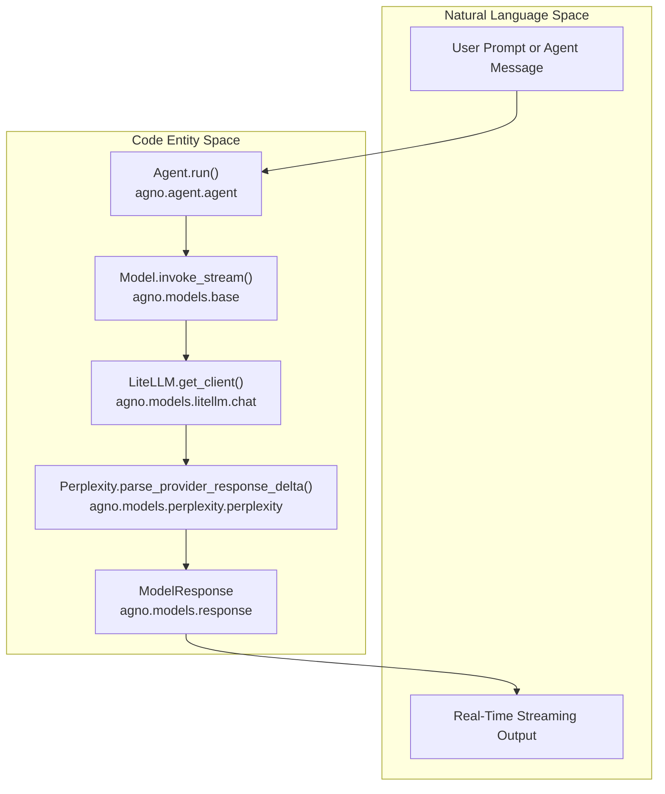
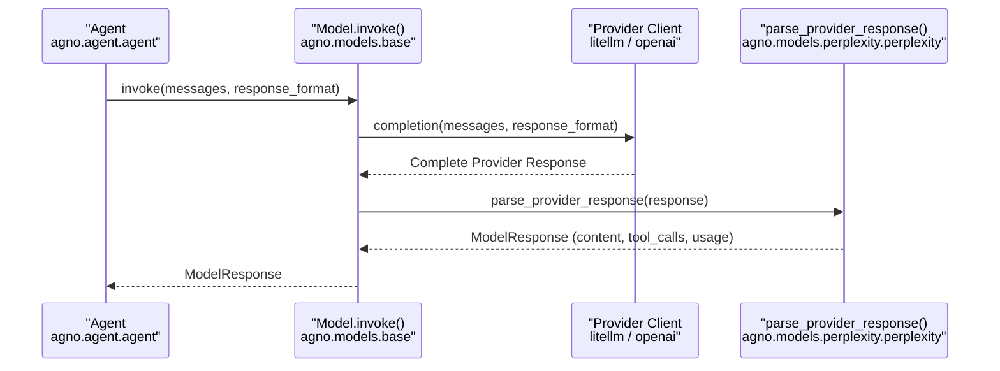
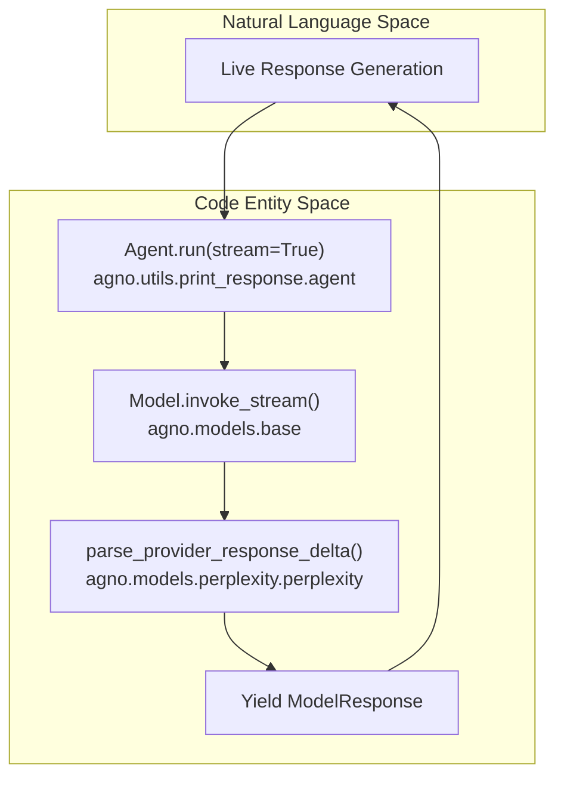

<!-- source: DeepWiki mcp.deepwiki.com · repo agno-agi/agno · page 3.8 Streaming and Response Processing · fetched 2026-11-09 -->

# Streaming and Response Processing

Relevant source files

The following files were used as context for generating this wiki page:

- [cookbook/03_teams/22_metrics/01_team_metrics.py](cookbook/03_teams/22_metrics/01_team_metrics.py)
- [cookbook/03_teams/22_metrics/04_team_tool_metrics.py](cookbook/03_teams/22_metrics/04_team_tool_metrics.py)
- [cookbook/90_models/litellm/structured_output.py](cookbook/90_models/litellm/structured_output.py)
- [libs/agno/agno/models/litellm/chat.py](libs/agno/agno/models/litellm/chat.py)
- [libs/agno/agno/models/perplexity/perplexity.py](libs/agno/agno/models/perplexity/perplexity.py)
- [libs/agno/agno/models/vercel/v0.py](libs/agno/agno/models/vercel/v0.py)
- [libs/agno/agno/utils/print_response/agent.py](libs/agno/agno/utils/print_response/agent.py)
- [libs/agno/agno/utils/print_response/team.py](libs/agno/agno/utils/print_response/team.py)
- [libs/agno/tests/integration/models/litellm/test_basic.py](libs/agno/tests/integration/models/litellm/test_basic.py)
- [libs/agno/tests/integration/models/litellm/test_tool_use.py](libs/agno/tests/integration/models/litellm/test_tool_use.py)
- [libs/agno/tests/integration/models/litellm_openai/test_basic.py](libs/agno/tests/integration/models/litellm_openai/test_basic.py)
- [libs/agno/tests/integration/models/litellm_openai/test_tool_use.py](libs/agno/tests/integration/models/litellm_openai/test_tool_use.py)
- [libs/agno/tests/unit/models/litellm/test_chat_metrics.py](libs/agno/tests/unit/models/litellm/test_chat_metrics.py)
- [libs/agno/tests/unit/models/litellm/test_structured_output.py](libs/agno/tests/unit/models/litellm/test_structured_output.py)
- [libs/agno/tests/unit/models/openai/test_openai_metrics.py](libs/agno/tests/unit/models/openai/test_openai_metrics.py)
- [libs/agno/tests/unit/models/perplexity/test_perplexity_metrics.py](libs/agno/tests/unit/models/perplexity/test_perplexity_metrics.py)

This page details how the Agno framework handles response generation, chunk parsing, streaming iteration, token metrics collection, and delta aggregation across model providers [libs/agno/agno/models/litellm/chat.py:27-105](), [libs/agno/agno/models/perplexity/perplexity.py:27-180](). It covers synchronous and asynchronous invocation paths (`invoke`, `ainvoke`, `invoke_stream`, `ainvoke_stream`), provider-specific delta processing, and usage accounting via `MessageMetrics` [libs/agno/tests/unit/models/openai/test_openai_metrics.py:110-173]().

Sources: [libs/agno/agno/models/litellm/chat.py:27-105](), [libs/agno/agno/models/perplexity/perplexity.py:27-180](), [libs/agno/tests/unit/models/openai/test_openai_metrics.py:110-173]()

---

## 1. Architecture and Response Flow

The Agno model abstraction layer normalizes inputs and outputs across more than 40 providers. When an agent or client requests a completion, execution flows from the high-level agent runtime through the `Model` interface to specific provider integrations like `LiteLLM` or `Perplexity`.

Sources: [libs/agno/agno/models/litellm/chat.py:87-106](), [libs/agno/agno/models/perplexity/perplexity.py:150-180]()

---

## 2. Non-Streaming Response Processing

Non-streaming requests use `invoke` or `ainvoke` to transmit messages to the underlying provider client and wait for a complete response payload [libs/agno/tests/unit/models/litellm/test_structured_output.py:41-60]().

### Execution Sequence

Sources: [libs/agno/agno/models/litellm/chat.py:129-167](), [libs/agno/agno/models/perplexity/perplexity.py:102-148]()

---

## 3. Streaming Response Processing (`invoke_stream`)

When streaming is enabled (`stream=True`), models return an iterator over incremental response chunks. Each chunk is parsed via provider-specific delta parsers [libs/agno/agno/models/perplexity/perplexity.py:150-180]().

### Streaming Data Flow and Chunk Parsing

Sources: [libs/agno/agno/utils/print_response/agent.py:87-106](), [libs/agno/agno/models/perplexity/perplexity.py:150-180]()

---

## 4. `ModelResponse` Deltas and Incremental Aggregation

During streaming, providers emit partial chunks containing `ChoiceDelta` or equivalent structures. The framework aggregates these deltas into a unified `ModelResponse` instance containing:
- `content`: Incremental text segments.
- `tool_calls`: Partial or complete tool execution payloads [libs/agno/agno/models/perplexity/perplexity.py:170-172]().
- `citations`: Reference URLs (e.g., from Perplexity Sonar models) [libs/agno/agno/models/perplexity/perplexity.py:173-177]().
- `response_usage`: Token metrics collected from the chunk or final completion frame [libs/agno/agno/models/perplexity/perplexity.py:179-180]().

Sources: [libs/agno/agno/models/perplexity/perplexity.py:150-180]()

---

## 5. Metrics Collection and Token Accounting

Token usage and performance metrics are managed via `MessageMetrics` [libs/agno/tests/unit/models/openai/test_openai_metrics.py:10-14](). Providers differ in how they report usage during streaming:
- **Incremental Providers (e.g. OpenAI, LiteLLM)**: Report token usage across chunks, allowing metrics collection on every chunk where usage is present [libs/agno/tests/unit/models/openai/test_openai_metrics.py:77-108]().
- **Cumulative Providers (e.g. Perplexity)**: Report running totals in each chunk. To avoid incorrect token inflation, these models set `collect_metrics_on_completion: bool = True`, ensuring metrics are extracted only from the final chunk (`finish_reason` is not None) [libs/agno/agno/models/perplexity/perplexity.py:44-46](), [libs/agno/tests/unit/models/perplexity/test_perplexity_metrics.py:114-153]().

### Token Calculation & Details

Metrics extraction parses prompt and completion details, accounting for cached tokens, audio tokens, and reasoning tokens [libs/agno/tests/unit/models/openai/test_openai_metrics.py:110-173](), [libs/agno/tests/unit/models/litellm/test_chat_metrics.py:31-67]().

Sources: [libs/agno/agno/models/perplexity/perplexity.py:44-46](), [libs/agno/tests/unit/models/openai/test_openai_metrics.py:77-173](), [libs/agno/tests/unit/models/litellm/test_chat_metrics.py:31-126]()

---

