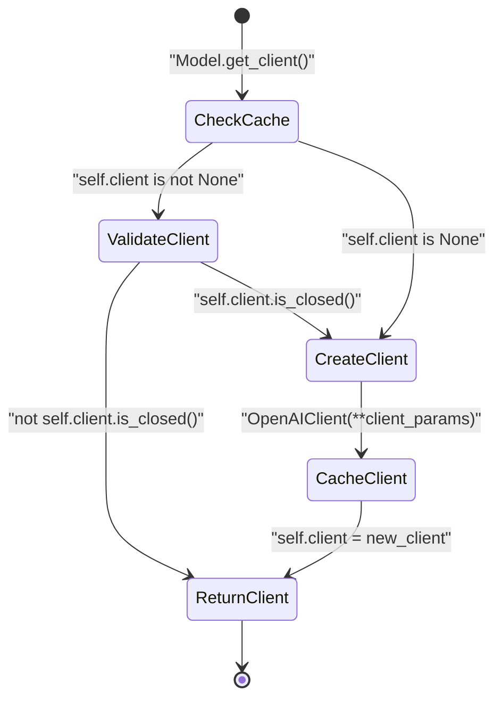
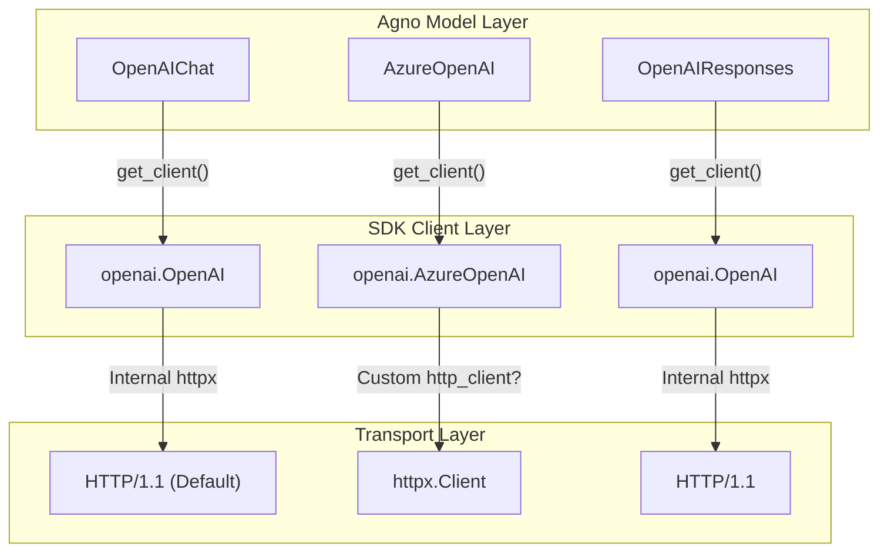

<!-- source: DeepWiki mcp.deepwiki.com · repo agno-agi/agno · page 3.9 Client Lifecycle and Retry Logic · fetched 2026-11-09 -->

# Client Lifecycle and Retry Logic

<details>
<summary>Relevant source files</summary>

The following files were used as context for generating this wiki page:

- [cookbook/90_models/openai/responses/README.md](cookbook/90_models/openai/responses/README.md)
- [cookbook/90_models/openai/responses/TEST_LOG.md](cookbook/90_models/openai/responses/TEST_LOG.md)
- [cookbook/90_models/openai/responses/background.py](cookbook/90_models/openai/responses/background.py)
- [cookbook/90_models/openai/responses/stored_responses_without_chaining.py](cookbook/90_models/openai/responses/stored_responses_without_chaining.py)
- [cookbook/90_models/openrouter/responses/tool_use.py](cookbook/90_models/openrouter/responses/tool_use.py)
- [libs/agno/agno/models/azure/openai_chat.py](libs/agno/agno/models/azure/openai_chat.py)
- [libs/agno/agno/models/openai/chat.py](libs/agno/agno/models/openai/chat.py)
- [libs/agno/agno/models/openai/responses.py](libs/agno/agno/models/openai/responses.py)
- [libs/agno/agno/models/openrouter/responses.py](libs/agno/agno/models/openrouter/responses.py)
- [libs/agno/agno/os/interfaces/whatsapp/security.py](libs/agno/agno/os/interfaces/whatsapp/security.py)
- [libs/agno/agno/reasoning/step.py](libs/agno/agno/reasoning/step.py)
- [libs/agno/agno/tools/crawl4ai.py](libs/agno/agno/tools/crawl4ai.py)
- [libs/agno/tests/integration/models/openai/chat/test_basic.py](libs/agno/tests/integration/models/openai/chat/test_basic.py)
- [libs/agno/tests/integration/models/openai/chat/test_reasoning_streaming.py](libs/agno/tests/integration/models/openai/chat/test_reasoning_streaming.py)
- [libs/agno/tests/integration/models/openai/responses/test_basic.py](libs/agno/tests/integration/models/openai/responses/test_basic.py)
- [libs/agno/tests/unit/models/litellm/test_client_deepcopy.py](libs/agno/tests/unit/models/litellm/test_client_deepcopy.py)
- [libs/agno/tests/unit/models/openai/test_openai_responses_background.py](libs/agno/tests/unit/models/openai/test_openai_responses_background.py)
- [libs/agno/tests/unit/models/openai/test_openai_responses_chaining.py](libs/agno/tests/unit/models/openai/test_openai_responses_chaining.py)
- [libs/agno/tests/unit/models/openai/test_openai_responses_id_handling.py](libs/agno/tests/unit/models/openai/test_openai_responses_id_handling.py)
- [libs/agno/tests/unit/models/openai/test_request_param_types.py](libs/agno/tests/unit/models/openai/test_request_param_types.py)
- [libs/agno/tests/unit/models/openrouter_model/test_openrouter_responses.py](libs/agno/tests/unit/models/openrouter_model/test_openrouter_responses.py)
- [libs/agno/tests/unit/models/openrouter_model/test_openrouter_responses_reasoning.py](libs/agno/tests/unit/models/openrouter_model/test_openrouter_responses_reasoning.py)
- [libs/agno/tests/unit/models/test_client_caching.py](libs/agno/tests/unit/models/test_client_caching.py)
- [libs/agno/tests/unit/models/test_parse_tool_calls_name.py](libs/agno/tests/unit/models/test_parse_tool_calls_name.py)
- [libs/agno/tests/unit/scorer/test_model_identity.py](libs/agno/tests/unit/scorer/test_model_identity.py)
- [libs/agno/tests/unit/tools/test_crawl4ai.py](libs/agno/tests/unit/tools/test_crawl4ai.py)
- [scripts/test_setup.sh](scripts/test_setup.sh)

</details>


This document explains how model provider clients are initialized, cached, and reused across requests, as well as the retry mechanisms and error recovery strategies employed when communicating with LLM APIs. This covers the lifecycle management of HTTP clients, connection pooling, authentication, and handling transient failures through configurable retry logic.

---

## Client Caching and Lifecycle

Model provider classes cache their API clients to avoid recreating HTTP connections on every request. Clients are validated before reuse to ensure they are not closed or invalid.

### Client Validation Flow

Title: Client Validation Logic in `Model.get_client()`


**Client Lifecycle States:**
- **None**: No client has been created yet.
- **Open**: Client exists and `is_closed()` returns `False`.
- **Closed**: Client exists but `is_closed()` returns `True` (needs recreation).

Sources: [libs/agno/agno/models/openai/chat.py:141-143](), [libs/agno/agno/models/openai/responses.py:165-166](), [libs/agno/agno/models/azure/openai_chat.py:133-134]()

### Client Isolation and Caching Patterns

Agno implements a per-model-instance caching strategy. While global `httpx` singletons exist for general utility, model providers manage their own SDK clients to avoid resource leaks and respect provider-specific protocol requirements (e.g., OpenAI's preference for HTTP/1.1 to avoid transient 400 errors caused by HTTP/2 edge cases).

| Model Class | Client Attribute | Cache Scope | Logic Site |
|-------------|------------------|-------------|------------|
| `OpenAIChat` | `client` / `async_client` | Per-Instance | [libs/agno/agno/models/openai/chat.py:90-91]() |
| `OpenAIResponses` | `client` / `async_client` | Per-Instance | [libs/agno/agno/models/openai/responses.py:88-89]() |
| `AzureOpenAI` | `client` / `async_client` | Per-Instance | [libs/agno/agno/models/azure/openai_chat.py:58-59]() |

**Thread Safety and Instance Independence:**
Each model instance maintains its own client reference. This allows multiple agents to operate with different configurations (e.g., different API keys or timeouts) without interfering with each other's connection pools. `AzureOpenAI` specifically implements a custom `__deepcopy__` to preserve client references and authentication state during model duplication.

Sources: [libs/agno/tests/unit/models/test_client_caching.py:145-158](), [libs/agno/agno/models/openai/chat.py:141-158](), [libs/agno/agno/models/azure/openai_chat.py:61-89]()

---

## Connection Pooling and HTTP Management

Agno manages HTTP connections through `httpx`. While individual model SDKs manage their own internal clients, Agno allows customization via `http_client` parameters on model initializers while defaulting to SDK behaviors that optimize transport stability.

### Model-SDK Integration

Title: Association between Model Providers and Code Entities


Sources: [libs/agno/agno/models/openai/chat.py:151-158](), [libs/agno/agno/models/azure/openai_chat.py:138-149](), [libs/agno/tests/unit/models/test_client_caching.py:118-130]()

---

## Retry Configuration and Error Handling

Agno provides a robust retry system at the model level to handle transient API errors, rate limits, and provider-specific failures.

### Exception Classification

Agno classifies exceptions into retryable and non-retryable categories using `ModelProviderError.classify()`. This method inspects status codes and error messages to determine if an error is a rate limit or a context window issue.

**Context Window Detection:**
The framework uses `CONTEXT_WINDOW_PATTERNS` to identify when a model's token limit has been exceeded. Patterns include strings like `context_length_exceeded`, `too many tokens`, and `prompt is too long`.

| Exception Class | Trigger Condition | Source |
|-----------------|-------------------|--------|
| `ModelRateLimitError` | Status code 429 (standard) or 529 (Anthropic Overloaded). | [libs/agno/agno/exceptions.py:174-178]() |
| `ContextWindowExceededError` | Matches `CONTEXT_WINDOW_PATTERNS`. | [libs/agno/agno/exceptions.py:134-148]() |
| `ModelAuthenticationError` | Missing or invalid API keys. | [libs/agno/agno/exceptions.py:119-128]() |
| `RetryAgentRun` | Specific tool call failures intended for retry. | [libs/agno/agno/exceptions.py:64-78]() |

### Error Handling Flow

Title: Model Error Handling Flow
```mermaid
graph TB
    Invoke["Model.invoke()"] --> SDKCall["Provider SDK Call"]
    SDKCall -->|Success| Response["ModelResponse"]
    SDKCall -->|Error| Classify["ModelProviderError.classify()"]
    
    Classify -->|Rate Limit (429/529)| Retryable["ModelRateLimitError"]
    Classify -->|Context Limit| Context["ContextWindowExceededError"]
    Classify -->|Auth Error| Auth["ModelAuthenticationError"]
    
    Retryable --> RetryLoop{"Retry limit reached?"}
    RetryLoop -->|No| Wait["Sleep (Backoff)"]
    Wait --> SDKCall
    RetryLoop -->|Yes| Fatal["raise ModelProviderError"]
    
    Context --> Stop["Stop Execution / Raise Error"]
    Auth --> Stop
```

Sources: [libs/agno/agno/exceptions.py:161-178](), [libs/agno/tests/unit/models/test_context_window_patterns.py:12-42]()

---

