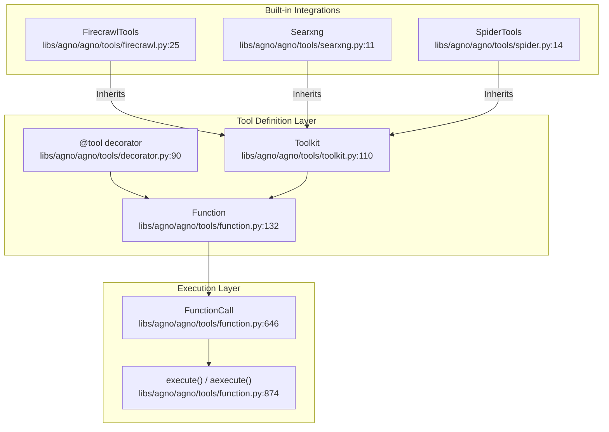
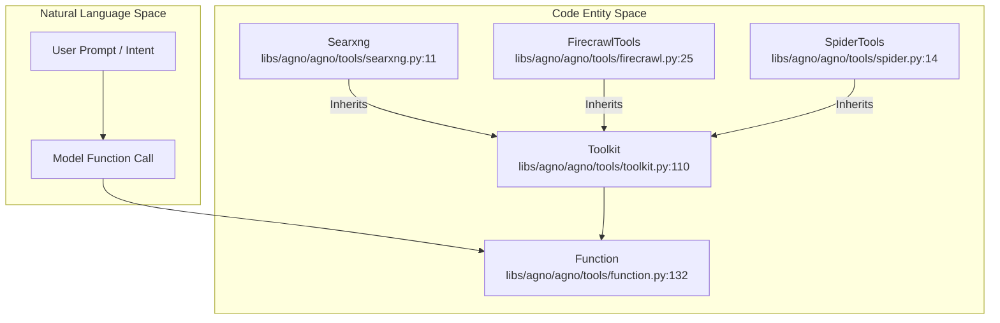
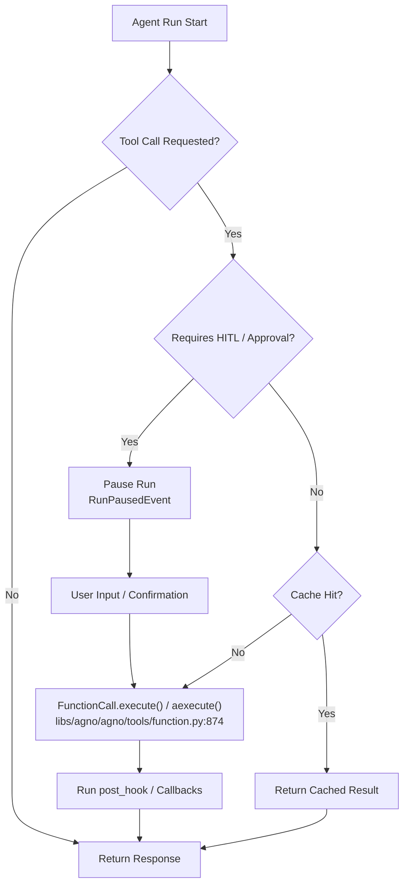

<!-- source: DeepWiki mcp.deepwiki.com · repo agno-agi/agno · page 4 Tool Ecosystem · fetched 2026-11-09 -->

# Tool Ecosystem

Relevant source files

The following files were used as context for generating this wiki page:

- [cookbook/90_models/anthropic/markdown_input.py](cookbook/90_models/anthropic/markdown_input.py)
- [cookbook/90_models/anthropic/pydantic_tool_input.py](cookbook/90_models/anthropic/pydantic_tool_input.py)
- [libs/agno/agno/__init__.py](libs/agno/agno/__init__.py)
- [libs/agno/agno/tools/baidusearch.py](libs/agno/agno/tools/baidusearch.py)
- [libs/agno/agno/tools/decorator.py](libs/agno/agno/tools/decorator.py)
- [libs/agno/agno/tools/firecrawl.py](libs/agno/agno/tools/firecrawl.py)
- [libs/agno/agno/tools/searxng.py](libs/agno/agno/tools/searxng.py)
- [libs/agno/agno/tools/spider.py](libs/agno/agno/tools/spider.py)
- [libs/agno/agno/tools/toolkit.py](libs/agno/agno/tools/toolkit.py)
- [libs/agno/tests/integration/models/anthropic/test_format_tools.py](libs/agno/tests/integration/models/anthropic/test_format_tools.py)
- [libs/agno/tests/integration/tools/test_toolkit_run_context.py](libs/agno/tests/integration/tools/test_toolkit_run_context.py)
- [libs/agno/tests/unit/tools/test_baidusearch.py](libs/agno/tests/unit/tools/test_baidusearch.py)
- [libs/agno/tests/unit/tools/test_firecrawl.py](libs/agno/tests/unit/tools/test_firecrawl.py)
- [libs/agno/tests/unit/tools/test_searxng.py](libs/agno/tests/unit/tools/test_searxng.py)
- [libs/agno/tests/unit/tools/test_spider.py](libs/agno/tests/unit/tools/test_spider.py)
- [libs/agno/tests/unit/tools/test_toolkit.py](libs/agno/tests/unit/tools/test_toolkit.py)

## Purpose and Scope

This document provides a high-level overview of the tool ecosystem within the Agno framework, which is fundamental for enabling agents to execute complex functions and interact with both internal and external systems. The tool ecosystem is provider-agnostic and supports seamless execution workflows across major LLM providers such as OpenAI, Anthropic, and Google Gemini [libs/agno/agno/tools/function.py:132-194]().

The key components include:
- **Function Class** – A robust abstraction wrapping Python callables into structured JSON-schema-backed entities [libs/agno/agno/tools/function.py:132-194]().
- **@tool Decorator** – Simplifies tool creation by automating parameter extraction and enhancing function metadata [libs/agno/agno/tools/decorator.py:90-131]().
- **Execution Controls** – Mechanisms for tool caching, hooks, execution flags, and pausing for human-approved flows [libs/agno/agno/tools/function.py:162-193]().
- **Built-in Toolkits** – Pre-built integrations for search, finance, SaaS, code execution, and data tools [libs/agno/agno/tools/toolkit.py:110-134]().
- **Model Context Protocol (MCP)** – A standard protocol that allows external servers to expose tools to Agno agents via `MCPTools` [libs/agno/agno/tools/toolkit.py:110-134]().

For deep technical details, see the child pages:
- [Tool Architecture and Function Class](#4.1) — Document `Function` class, `from_callable` factory, parameter schemas, entrypoint execution, `Toolkit` base class, and function-to-tool conversion.
- [Creating Tools with @tool Decorator](#4.2) — Show how to use `@tool` decorator on Python functions, parameter type inference, docstring parsing, tool hooks, and registering custom tools with agents.
- [Tool Execution Controls](#4.3) — Explain `requires_confirmation`, `requires_user_input`, `external_execution` flags, `ToolExecution` state, and how runs pause for approval.
- [Human-in-the-Loop (HITL)](#4.4) — Detail `RunPausedEvent`, `ToolExecution` resolution, confirmation workflows, user input schemas, approvals router, and resume-after-approval patterns.
- [Built-in Tool Integrations](#4.5) — Survey pre-built toolkits: search/web (Firecrawl, Searxng, Spider, BaiduSearch), finance, SaaS, code execution, and data tools.
- [Model Context Protocol (MCP)](#4.6) — Explain MCP integration for agents, transports, session/header management, and multi-server configurations.

---

## Tool System Architecture

The Agno tool system enables agents to bridge natural language models with real-world functionality by mapping function definitions to JSON schemas and managing controlled execution.

Sources: [libs/agno/agno/tools/function.py:132-1045](), [libs/agno/agno/tools/toolkit.py:110-134](), [libs/agno/agno/tools/decorator.py:90-131](), [libs/agno/agno/tools/firecrawl.py:25-78](), [libs/agno/agno/tools/searxng.py:11-35](), [libs/agno/agno/tools/spider.py:14-51]()

---

## 4.1 Tool Architecture and Function Class

The `Function` class wraps Python functions and presents them to language models with clean parameter type definitions [libs/agno/agno/tools/function.py:132-194](). Using `Function.from_callable`, Agno inspects Python type hints and docstrings to generate valid JSON schemas for model tool calling. The `Toolkit` base class groups collections of related functions, managing shared attributes like execution timeouts, caching configurations, and tool filtering (`include_tools`, `exclude_tools`) [libs/agno/agno/tools/toolkit.py:110-134]().

For details, see [Tool Architecture and Function Class](#4.1).

Sources: [libs/agno/agno/tools/function.py:132-387](), [libs/agno/agno/tools/toolkit.py:110-134]()

---

## 4.2 Creating Tools with @tool Decorator

The `@tool` decorator streamlines tool authoring on standard Python functions [libs/agno/agno/tools/decorator.py:90-131](). It infers argument types, parses docstrings into tool descriptions, and supports hooks (`pre_hook`, `post_hook`, `tool_hooks`) for intercepting execution. It also allows configuration of strict mode, execution constraints, and caching parameters directly on the decorated function.

For details, see [Creating Tools with @tool Decorator](#4.2).

Sources: [libs/agno/agno/tools/decorator.py:90-156]()

---

## 4.3 Tool Execution Controls

Agno provides explicit execution flags and controls on `Function` and `Toolkit` instances, including result caching (`cache_results`, `cache_ttl`, `cache_dir`), timeouts, and exclusive execution scoping (`requires_confirmation`, `requires_user_input`, `external_execution`) [libs/agno/agno/tools/function.py:162-193](), [libs/agno/agno/tools/toolkit.py:110-134](). These controls ensure that tool execution obeys safety limits and environment constraints.

For details, see [Tool Execution Controls](#4.3).

Sources: [libs/agno/agno/tools/function.py:162-193](), [libs/agno/agno/tools/toolkit.py:110-134]()

---

## 4.4 Human-in-the-Loop (HITL)

Tools can be configured to require user confirmation or structured input before running [libs/agno/agno/tools/function.py:171-179](). When triggered, the agent run pauses and emits a `RunPausedEvent`, allowing external systems, APIs, or user interfaces to review the tool call, provide inputs, or grant approval before resuming execution.

For details, see [Human-in-the-Loop (HITL)](#4.4).

Sources: [libs/agno/agno/tools/function.py:41-116](), [libs/agno/agno/tools/function.py:171-179]()

---

## 4.5 Built-in Tool Integrations

Agno includes extensive pre-built toolkits spanning web search and scraping (such as `FirecrawlTools`, `Searxng`, `SpiderTools`, and `BaiduSearchTools`), financial data, SaaS applications, code execution environments, and databases [libs/agno/agno/tools/firecrawl.py:25-78](), [libs/agno/agno/tools/searxng.py:11-35](), [libs/agno/agno/tools/spider.py:14-51](), [libs/agno/agno/tools/baidusearch.py:18-54](). These inherit from `Toolkit` and provide robust error handling, JSON encoding, and configurable parameters.

For details, see [Built-in Tool Integrations](#4.5).

Sources: [libs/agno/agno/tools/firecrawl.py:25-78](), [libs/agno/agno/tools/searxng.py:11-35](), [libs/agno/agno/tools/spider.py:14-51](), [libs/agno/agno/tools/baidusearch.py:18-54]()

---

## 4.6 Model Context Protocol (MCP)

Agno supports integration with Model Context Protocol (MCP) servers, enabling agents to dynamically discover and execute tools exposed by external MCP servers across transports like `stdio`, `SSE`, and `streamable-HTTP`. This allows seamless interoperability with third-party tool ecosystems and shared server toolboxes.

For details, see [Model Context Protocol (MCP)](#4.6).

Sources: [libs/agno/agno/tools/toolkit.py:110-134]()

---

# Summary Diagram: Bridging Natural Language Space to Code Entity Space

Sources: [libs/agno/agno/tools/function.py:132-194](), [libs/agno/agno/tools/toolkit.py:110-134](), [libs/agno/agno/tools/searxng.py:11-35](), [libs/agno/agno/tools/firecrawl.py:25-78](), [libs/agno/agno/tools/spider.py:14-51]()

---

# Summary Diagram: Tool Execution and HITL Flow

Sources: [libs/agno/agno/tools/function.py:646-1043]()

---

