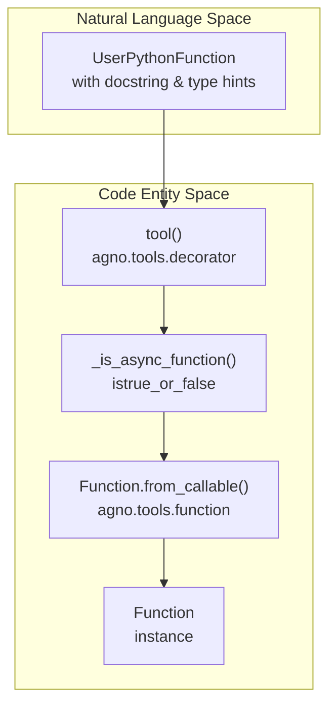
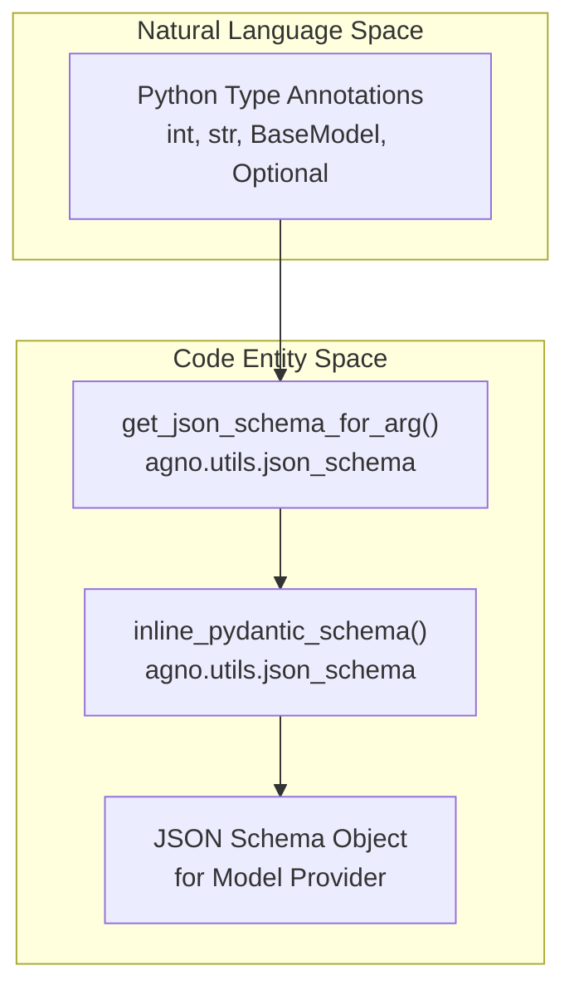

<!-- source: DeepWiki mcp.deepwiki.com · repo agno-agi/agno · page 4.2 Creating Tools with @tool Decorator · fetched 2026-11-09 -->

# Creating Tools with @tool Decorator

<details>
<summary>Relevant source files</summary>

The following files were used as context for generating this wiki page:

- [cookbook/02_agents/04_tools/04_tools_with_literal_type_param.py](cookbook/02_agents/04_tools/04_tools_with_literal_type_param.py)
- [cookbook/02_agents/04_tools/README.md](cookbook/02_agents/04_tools/README.md)
- [cookbook/02_agents/04_tools/TEST_LOG.md](cookbook/02_agents/04_tools/TEST_LOG.md)
- [cookbook/90_models/anthropic/markdown_input.py](cookbook/90_models/anthropic/markdown_input.py)
- [cookbook/90_models/anthropic/pydantic_tool_input.py](cookbook/90_models/anthropic/pydantic_tool_input.py)
- [libs/agno/agno/__init__.py](libs/agno/agno/__init__.py)
- [libs/agno/agno/tools/baidusearch.py](libs/agno/agno/tools/baidusearch.py)
- [libs/agno/agno/tools/decorator.py](libs/agno/agno/tools/decorator.py)
- [libs/agno/agno/tools/firecrawl.py](libs/agno/agno/tools/firecrawl.py)
- [libs/agno/agno/tools/searxng.py](libs/agno/agno/tools/searxng.py)
- [libs/agno/agno/tools/spider.py](libs/agno/agno/tools/spider.py)
- [libs/agno/agno/tools/toolkit.py](libs/agno/agno/tools/toolkit.py)
- [libs/agno/agno/utils/json_schema.py](libs/agno/agno/utils/json_schema.py)
- [libs/agno/tests/integration/agent/test_tool_parsing.py](libs/agno/tests/integration/agent/test_tool_parsing.py)
- [libs/agno/tests/integration/models/anthropic/test_format_tools.py](libs/agno/tests/integration/models/anthropic/test_format_tools.py)
- [libs/agno/tests/integration/tools/test_toolkit_run_context.py](libs/agno/tests/integration/tools/test_toolkit_run_context.py)
- [libs/agno/tests/unit/agent/test_agentic_state_schema.py](libs/agno/tests/unit/agent/test_agentic_state_schema.py)
- [libs/agno/tests/unit/tools/test_baidusearch.py](libs/agno/tests/unit/tools/test_baidusearch.py)
- [libs/agno/tests/unit/tools/test_firecrawl.py](libs/agno/tests/unit/tools/test_firecrawl.py)
- [libs/agno/tests/unit/tools/test_searxng.py](libs/agno/tests/unit/tools/test_searxng.py)
- [libs/agno/tests/unit/tools/test_spider.py](libs/agno/tests/unit/tools/test_spider.py)
- [libs/agno/tests/unit/tools/test_toolkit.py](libs/agno/tests/unit/tools/test_toolkit.py)
- [libs/agno/tests/unit/utils/test_json_schema.py](libs/agno/tests/unit/utils/test_json_schema.py)

</details>


This page details the implementation and usage of the `@tool` decorator in Agno (`libs/agno/agno/tools/decorator.py`), which converts standard Python functions into `Function` instances capable of being executed by agents and LLMs. It covers parameter type inference, docstring parsing into JSON Schema, execution controls, tool hooks, and organizing custom tools within `Toolkit` classes (`libs/agno/agno/tools/toolkit.py`).

---

## 1. The `@tool` Decorator Architecture

The `@tool` decorator transforms a synchronous or asynchronous Python callable into an instance of `Function`. Under the hood, it inspects function signatures, detects coroutines via `_is_async_function`, and delegates parsing to `Function.from_callable()` [libs/agno/agno/tools/decorator.py:13-53](), [libs/agno/agno/tools/decorator.py:90-117]().


Sources: [libs/agno/agno/tools/decorator.py:13-53](), [libs/agno/agno/tools/decorator.py:90-117]()

---

## 2. Parameter Type Inference and Schema Generation

Type annotations on decorated functions are analyzed to build strict JSON Schemas utilized by model providers for tool calling [libs/agno/agno/utils/json_schema.py:20-164]().

- **Basic Mapping**: `get_json_type_for_py_type()` converts Python primitives (`int`, `float`, `str`, `bool`, `NoneType`) into JSON Schema types (`integer`, `number`, `string`, `boolean`, `null`) [libs/agno/agno/utils/json_schema.py:20-43]().
- **Complex Collections**: `get_json_schema_for_arg()` handles generic containers (`list`, `tuple`, `set`, `dict`), generating typed items or `additionalProperties` constraints [libs/agno/agno/utils/json_schema.py:99-136]().
- **Pydantic Models & Dataclasses**: Nested Pydantic `BaseModel` classes or dataclasses have their schemas automatically extracted and recursively inlined using `inline_pydantic_schema()` [libs/agno/agno/utils/json_schema.py:46-96](), [libs/agno/agno/utils/json_schema.py:152-164]().


Sources: [libs/agno/agno/utils/json_schema.py:20-96](), [libs/agno/agno/utils/json_schema.py:99-164]()

---

## Compatibility and Configuration Arguments

The `@tool` decorator accepts configuration parameters that govern execution behavior, user interaction flags, caching, and interception hooks [libs/agno/agno/tools/decorator.py:61-83]().

| Argument | Type | Description |
| :--- | :--- | :--- |
| `name` | `Optional[str]` | Override the registered function name [libs/agno/agno/tools/decorator.py:94]() |
| `description` | `Optional[str]` | Override or supply a custom description [libs/agno/agno/tools/decorator.py:95]() |
| `strict` | `Optional[bool]` | Enforce strict parameter validation in model schemas [libs/agno/agno/tools/decorator.py:99]() |
| `requires_confirmation` | `Optional[bool]` | Pause tool execution awaiting user approval [libs/agno/agno/tools/decorator.py:104]() |
| `requires_user_input` | `Optional[bool]` | Pause tool execution to collect prompt input fields [libs/agno/agno/tools/decorator.py:105]() |
| `external_execution` | `Optional[bool]` | Delegate execution outside the agent context [libs/agno/agno/tools/decorator.py:107]() |
| `pre_hook` | `Optional[Callable]` | Executed prior to running the function [libs/agno/agno/tools/decorator.py:109]() |
| `post_hook` | `Optional[Callable]` | Executed after the function completes [libs/agno/agno/tools/decorator.py:110]() |
| `tool_hooks` | `Optional[List[Callable]]` | Pipeline of wrapping interceptor hooks [libs/agno/agno/tools/decorator.py:111]() |

> **Exclusive Flag Validation**: Only one of `requires_user_input`, `requires_confirmation`, or `external_execution` may be enabled simultaneously [libs/agno/agno/tools/decorator.py:165-172]().

Sources: [libs/agno/agno/tools/decorator.py:61-115](), [libs/agno/agno/tools/decorator.py:165-172]()

---

## Tool Hooks and Interception

Tool hooks allow telemetry, auditing, or argument manipulation by passing custom callables via `tool_hooks`, `pre_hook`, or `post_hook` [libs/agno/agno/tools/decorator.py:77-79]().

```python
@tool(tool_hooks=[my_custom_hook])
def compute_metric(value: float) -> float:
    """Compute normalized metric."""
    return value * 2.0
```

Hooks execute around the core entrypoint invocation, providing access to runtime arguments and context [libs/agno/agno/tools/decorator.py:109-111]().

Sources: [libs/agno/agno/tools/decorator.py:77-111]()

---

## Registering Custom Tools in a Toolkit

Related tools can be grouped into custom `Toolkit` subclasses [libs/agno/agno/tools/toolkit.py:110-142](). Toolkits manage initialization, automatic discovery of methods, inclusion/exclusion filters, and shared states [libs/agno/agno/tools/toolkit.py:115-134]().

```python
from agno.tools import Toolkit

class CustomAnalyticsToolkit(Toolkit):
    def __init__(self, endpoint: str, **kwargs):
        self.endpoint = endpoint
        tools = [self.fetch_telemetry, self.push_event]
        super().__init__(name="analytics", tools=tools, **kwargs)

    def fetch_telemetry(self, query: str) -> str:
        """Fetch telemetry data."""
        return f"Results from {self.endpoint}"

    def push_event(self, event_name: str) -> str:
        """Push an event."""
        return f"Event {event_name} logged."
```

Sources: [libs/agno/agno/tools/toolkit.py:110-142](), [libs/agno/agno/tools/firecrawl.py:25-78](), [libs/agno/agno/tools/searxng.py:11-35]()

---

