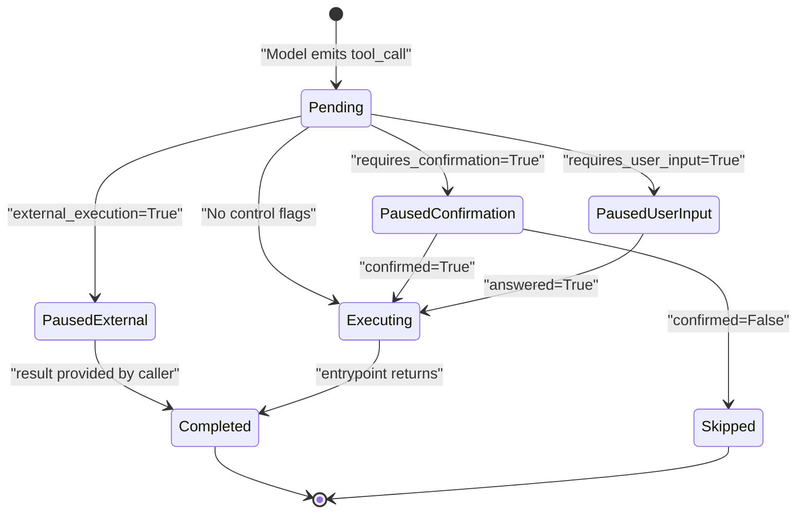
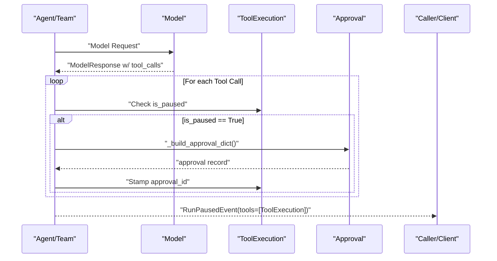
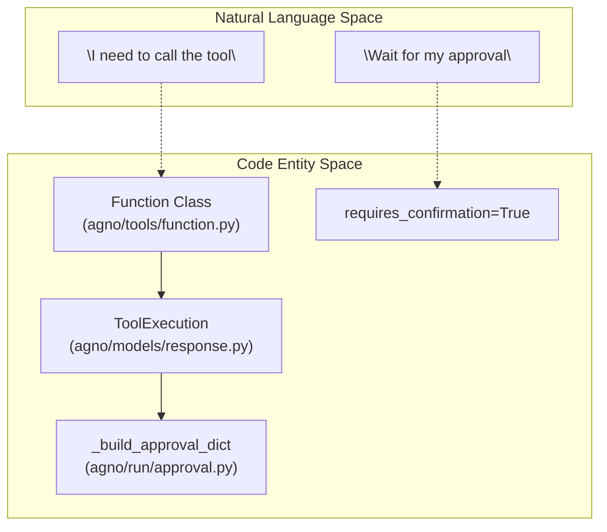
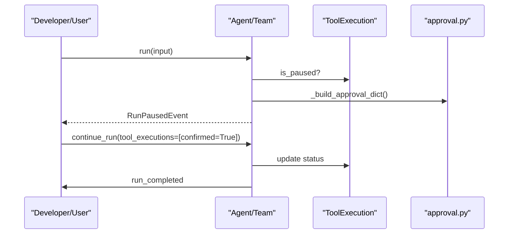

<!-- source: DeepWiki mcp.deepwiki.com · repo agno-agi/agno · page 4.3 Tool Execution Controls · fetched 2026-11-09 -->

# Tool Execution Controls

<details>
<summary>Relevant source files</summary>

The following files were used as context for generating this wiki page:

- [cookbook/02_agents/11_approvals/TEST_LOG.md](cookbook/02_agents/11_approvals/TEST_LOG.md)
- [cookbook/02_agents/11_approvals/approval_post_hook.py](cookbook/02_agents/11_approvals/approval_post_hook.py)
- [libs/agno/agno/agent/_run.py](libs/agno/agno/agent/_run.py)
- [libs/agno/agno/os/managers.py](libs/agno/agno/os/managers.py)
- [libs/agno/agno/run/approval.py](libs/agno/agno/run/approval.py)
- [libs/agno/agno/team/_run.py](libs/agno/agno/team/_run.py)
- [libs/agno/tests/integration/agent/human_in_the_loop/test_approval_multi_pause.py](libs/agno/tests/integration/agent/human_in_the_loop/test_approval_multi_pause.py)
- [libs/agno/tests/integration/os/test_approval_multi_pause.py](libs/agno/tests/integration/os/test_approval_multi_pause.py)
- [libs/agno/tests/integration/teams/human_in_the_loop/test_team_approval_multi_pause.py](libs/agno/tests/integration/teams/human_in_the_loop/test_team_approval_multi_pause.py)
- [libs/agno/tests/unit/agent/test_run_regressions.py](libs/agno/tests/unit/agent/test_run_regressions.py)
- [libs/agno/tests/unit/run/test_approval.py](libs/agno/tests/unit/run/test_approval.py)
- [libs/agno/tests/unit/run/test_approval_multi_pause.py](libs/agno/tests/unit/run/test_approval_multi_pause.py)
- [libs/agno/tests/unit/team/test_acontinue_run_background_stream.py](libs/agno/tests/unit/team/test_acontinue_run_background_stream.py)

</details>


## Purpose and Scope

This page explains the execution control flags (`requires_confirmation`, `requires_user_input`, and `external_execution`) defined on the `Function` class [libs/agno/tests/unit/tools/test_functions.py:27-55](), the `ToolExecution` runtime state, and the mechanisms by which agent and team runs pause to wait for external approval or resolution.

For the broader Human-in-the-Loop (HITL) architecture—including how runs resume and the `RunPausedEvent` lifecycle—see **Human-in-the-Loop (4.4)**. For general tool architecture and the `@tool` decorator, see **Tool Architecture (4.1)** and **Creating Tools with @tool (4.2)**.

Sources:
[libs/agno/tests/unit/tools/test_functions.py:27-55](), [libs/agno/agno/run/approval.py:13-19]()

---

## Control Flags Overview

The execution control of tool calls is governed by primary flags configured on the `Function` class [libs/agno/tests/unit/tools/test_functions.py:27-55](). These flags determine whether a tool call should pause execution and wait for external input or explicit approval before proceeding:

| Flag                     | Class Field                  | Behavior                                                              |
|--------------------------|------------------------------|-----------------------------------------------------------------------|
| `requires_confirmation`  | `Function.requires_confirmation`  | Pauses run; user must explicitly confirm or deny before execution      |
| `requires_user_input`    | `Function.requires_user_input`    | Pauses run; user supplies structured field values before execution    |
| `external_execution`     | `Function.external_execution`     | Pauses run; result is provided by an external system, not the runtime |

Additional optional flags modulate specific behaviors:

| Flag                      | Behavior                                                                       |
|---------------------------|--------------------------------------------------------------------------------|
| `external_execution_silent` | Suppresses verbose paused messages when `external_execution=True` |
| `approval_type`           | Sets approval style: `"required"` (blocking) or `"audit"` (non-blocking audit trail) |

Sources:
[libs/agno/tests/unit/tools/test_functions.py:27-55](), [libs/agno/agno/run/approval.py:13-19]()

---

## Setting Control Flags

### Via the `@tool` Decorator

Control flags are configured directly when declaring a tool via the `@tool` decorator [libs/agno/tests/unit/tools/test_functions.py:57-76](). 

```python
from agno.tools.decorator import tool

@tool(requires_confirmation=True)
def send_email(to: str, subject: str, body: str) -> str:
    """Send an email."""
    ...

@tool(requires_user_input=True)
def connect_database(host: str, password: str) -> str:
    """Connect to the database."""
    ...

@tool(external_execution=True)
def deploy_to_production(service: str, version: str) -> str:
    """Deploy a service to production."""
    ...
```

The system inspects these flags via helper functions such as `_get_pause_type` to determine the appropriate pause category (`user_input`, `external_execution`, or `confirmation`) when creating approval records [libs/agno/agno/run/approval.py:13-19]().

Sources:
[libs/agno/tests/unit/tools/test_functions.py:57-76](), [libs/agno/agno/run/approval.py:13-19]()

---

## `ToolExecution`: Runtime State

`ToolExecution` represents the runtime execution state of an individual tool call during an agent or team run. It holds call metadata, arguments, results, and HITL flags [libs/agno/agno/models/response.py:28-65]().

### Execution State Transitions for Tool Calls


*(Diagram 1: Tool Call State Transitions)*

Sources:
[libs/agno/agno/models/response.py:27-108]()

---

## Execution Flow: Model Response to Pause

When a model response contains tool calls, the execution loop checks each tool's pause status via `ToolExecution` and triggers approval record persistence if required [libs/agno/agno/run/approval.py:152-164]().


*(Diagram 2: Execution Pause Flow)*

Sources:
[libs/agno/agno/run/approval.py:46-59](), [libs/agno/agno/run/approval.py:152-164]()

---

## Approval Record Creation and Resolution Gating

When a run pauses for a tool requiring approval (`approval_type="required"`), approval record managers generate a database record to track and resolve the blocking request [libs/agno/agno/run/approval.py:152-164]().

- `_build_approval_dict` extracts `tool_name`, `tool_args`, and `pause_type` using `_get_pause_type` [libs/agno/agno/run/approval.py:13-19](), [libs/agno/agno/run/approval.py:117-136]().
- The approval record is assigned a unique `id` linked to `run_id` and `session_id`, with run status set to `paused` [libs/agno/agno/run/approval.py:125-148]().
- Subsequent continuation requires validating that pending records are fully resolved before execution unblocks, preventing stale approvals from authorizing new tool calls [libs/agno/tests/unit/run/test_approval_multi_pause.py:1-7]().

Sources:
[libs/agno/agno/run/approval.py:13-19](), [libs/agno/agno/run/approval.py:117-148](), [libs/agno/tests/unit/run/test_approval_multi_pause.py:1-7]()

---

## Natural Language and Code Entity Mapping

### Natural Language Space to Code Entity Space


*(Diagram 3: Natural Language to Code Entity Space Mapping)*

Sources:
[libs/agno/agno/tools/function.py:132-188](), [libs/agno/agno/run/approval.py:117-148]()

### Runtime Control Flow Entity Space


*(Diagram 4: Runtime Control Flow Entity Space)*

Sources:
[libs/agno/agno/run/approval.py:117-148](), [libs/agno/tests/unit/run/test_approval.py:1-21]()

---

## Glossary of Key Classes and Concepts

| Name              | Description                                          | File Reference                                |
|-------------------|------------------------------------------------------|-----------------------------------------------|
| `Function`        | Represents a tool, including execution control flags | [libs/agno/tests/unit/tools/test_functions.py:27-55]() |
| `ToolExecution`   | Runtime state of a tool call including HITL flags    | [libs/agno/agno/models/response.py:27-108]() |
| `RunPausedEvent`  | Event emitted when a run pauses awaiting tool resolution | [libs/agno/agno/agent/_run.py:111]()      |
| `_build_approval_dict` | Logic for formatting approval records during HITL pauses | [libs/agno/agno/run/approval.py:117-148]() |

Sources:
[libs/agno/tests/unit/tools/test_functions.py:27-55](), [libs/agno/agno/models/response.py:27-108](), [libs/agno/agno/run/approval.py:117-148]()

---

