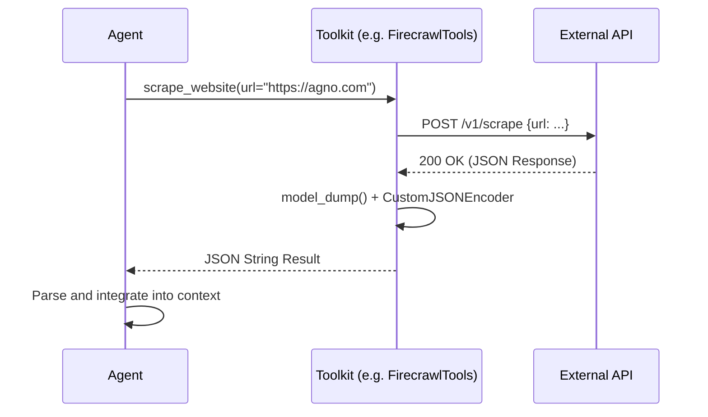

<!-- source: DeepWiki mcp.deepwiki.com · repo agno-agi/agno · page 4.5 Built-in Tool Integrations · fetched 2026-11-09 -->

# Built-in Tool Integrations

Relevant source files

The following files were used as context for generating this wiki page:

- [cookbook/04_workflows/05_conditional_branching/selector_media_pipeline.py](cookbook/04_workflows/05_conditional_branching/selector_media_pipeline.py)
- [cookbook/05_agent_os/chart_responses/README.md](cookbook/05_agent_os/chart_responses/README.md)
- [cookbook/05_agent_os/chart_responses/TEST_LOG.md](cookbook/05_agent_os/chart_responses/TEST_LOG.md)
- [cookbook/05_agent_os/chart_responses/agentos_chart_responses.py](cookbook/05_agent_os/chart_responses/agentos_chart_responses.py)
- [cookbook/05_agent_os/chart_responses/agentos_chart_team.py](cookbook/05_agent_os/chart_responses/agentos_chart_team.py)
- [cookbook/05_agent_os/chart_responses/agentos_platform_dashboard.py](cookbook/05_agent_os/chart_responses/agentos_platform_dashboard.py)
- [cookbook/90_models/groq/research_agent_seltz.py](cookbook/90_models/groq/research_agent_seltz.py)
- [cookbook/90_models/openai/responses/image_generation_agent.py](cookbook/90_models/openai/responses/image_generation_agent.py)
- [cookbook/91_tools/README.md](cookbook/91_tools/README.md)
- [cookbook/91_tools/TEST_LOG.md](cookbook/91_tools/TEST_LOG.md)
- [cookbook/91_tools/adanos_tools.py](cookbook/91_tools/adanos_tools.py)
- [cookbook/91_tools/atomic_mail_tools.py](cookbook/91_tools/atomic_mail_tools.py)
- [cookbook/91_tools/file_tools.py](cookbook/91_tools/file_tools.py)
- [cookbook/91_tools/google/gmail/action_items.py](cookbook/91_tools/google/gmail/action_items.py)
- [cookbook/91_tools/google/gmail/followup_tracker.py](cookbook/91_tools/google/gmail/followup_tracker.py)
- [cookbook/91_tools/google/gmail/inbox_triage.py](cookbook/91_tools/google/gmail/inbox_triage.py)
- [cookbook/91_tools/google_maps_tools.py](cookbook/91_tools/google_maps_tools.py)
- [cookbook/91_tools/googlecalendar_tools.py](cookbook/91_tools/googlecalendar_tools.py)
- [cookbook/91_tools/googlesheets_tools.py](cookbook/91_tools/googlesheets_tools.py)
- [cookbook/91_tools/local_file_system_tools.py](cookbook/91_tools/local_file_system_tools.py)
- [cookbook/91_tools/minimax_tools.py](cookbook/91_tools/minimax_tools.py)
- [cookbook/91_tools/models/gemini_video_generation.py](cookbook/91_tools/models/gemini_video_generation.py)
- [cookbook/91_tools/models/openai_tools.py](cookbook/91_tools/models/openai_tools.py)
- [cookbook/91_tools/parallel/README.md](cookbook/91_tools/parallel/README.md)
- [cookbook/91_tools/parallel/company_enrichment.py](cookbook/91_tools/parallel/company_enrichment.py)
- [cookbook/91_tools/parallel/competitor_tracker.py](cookbook/91_tools/parallel/competitor_tracker.py)
- [cookbook/91_tools/parallel/investment_monitor.py](cookbook/91_tools/parallel/investment_monitor.py)
- [cookbook/91_tools/parallel/market_research.py](cookbook/91_tools/parallel/market_research.py)
- [cookbook/91_tools/parallel/news_search.py](cookbook/91_tools/parallel/news_search.py)
- [cookbook/91_tools/parallel/output_schemas.py](cookbook/91_tools/parallel/output_schemas.py)
- [cookbook/91_tools/parallel/parallel_tools.py](cookbook/91_tools/parallel/parallel_tools.py)
- [cookbook/91_tools/perplexity_tools.py](cookbook/91_tools/perplexity_tools.py)
- [cookbook/91_tools/scrapegraph_tools.py](cookbook/91_tools/scrapegraph_tools.py)
- [cookbook/91_tools/seltz_tools.py](cookbook/91_tools/seltz_tools.py)
- [cookbook/91_tools/shell_tools.py](cookbook/91_tools/shell_tools.py)
- [cookbook/91_tools/sixtydb_tools.py](cookbook/91_tools/sixtydb_tools.py)
- [cookbook/91_tools/sofya_tools.py](cookbook/91_tools/sofya_tools.py)
- [cookbook/91_tools/superserve_tools.py](cookbook/91_tools/superserve_tools.py)
- [cookbook/91_tools/yfinance_tools.py](cookbook/91_tools/yfinance_tools.py)
- [cookbook/scripts/cookbook_runner.py](cookbook/scripts/cookbook_runner.py)
- [libs/agno/agno/knowledge/chunking/semantic.py](libs/agno/agno/knowledge/chunking/semantic.py)
- [libs/agno/agno/models/dashscope/dashscope.py](libs/agno/agno/models/dashscope/dashscope.py)
- [libs/agno/agno/tools/adanos.py](libs/agno/agno/tools/adanos.py)
- [libs/agno/agno/tools/agentql.py](libs/agno/agno/tools/agentql.py)
- [libs/agno/agno/tools/api.py](libs/agno/agno/tools/api.py)
- [libs/agno/agno/tools/arxiv.py](libs/agno/agno/tools/arxiv.py)
- [libs/agno/agno/tools/atomic_mail.py](libs/agno/agno/tools/atomic_mail.py)
- [libs/agno/agno/tools/aws_lambda.py](libs/agno/agno/tools/aws_lambda.py)
- [libs/agno/agno/tools/bitbucket.py](libs/agno/agno/tools/bitbucket.py)
- [libs/agno/agno/tools/brandfetch.py](libs/agno/agno/tools/brandfetch.py)
- [libs/agno/agno/tools/brightdata.py](libs/agno/agno/tools/brightdata.py)
- [libs/agno/agno/tools/browserbase.py](libs/agno/agno/tools/browserbase.py)
- [libs/agno/agno/tools/calcom.py](libs/agno/agno/tools/calcom.py)
- [libs/agno/agno/tools/chart.py](libs/agno/agno/tools/chart.py)
- [libs/agno/agno/tools/clickup.py](libs/agno/agno/tools/clickup.py)
- [libs/agno/agno/tools/confluence.py](libs/agno/agno/tools/confluence.py)
- [libs/agno/agno/tools/csv_toolkit.py](libs/agno/agno/tools/csv_toolkit.py)
- [libs/agno/agno/tools/daytona.py](libs/agno/agno/tools/daytona.py)
- [libs/agno/agno/tools/desi_vocal.py](libs/agno/agno/tools/desi_vocal.py)
- [libs/agno/agno/tools/duckdb.py](libs/agno/agno/tools/duckdb.py)
- [libs/agno/agno/tools/duckduckgo.py](libs/agno/agno/tools/duckduckgo.py)
- [libs/agno/agno/tools/e2b.py](libs/agno/agno/tools/e2b.py)
- [libs/agno/agno/tools/eleven_labs.py](libs/agno/agno/tools/eleven_labs.py)
- [libs/agno/agno/tools/exa.py](libs/agno/agno/tools/exa.py)
- [libs/agno/agno/tools/financial_datasets.py](libs/agno/agno/tools/financial_datasets.py)
- [libs/agno/agno/tools/github.py](libs/agno/agno/tools/github.py)
- [libs/agno/agno/tools/google/calendar.py](libs/agno/agno/tools/google/calendar.py)
- [libs/agno/agno/tools/google/drive.py](libs/agno/agno/tools/google/drive.py)
- [libs/agno/agno/tools/google/gmail.py](libs/agno/agno/tools/google/gmail.py)
- [libs/agno/agno/tools/google/slides.py](libs/agno/agno/tools/google/slides.py)
- [libs/agno/agno/tools/hackernews.py](libs/agno/agno/tools/hackernews.py)
- [libs/agno/agno/tools/local_file_system.py](libs/agno/agno/tools/local_file_system.py)
- [libs/agno/agno/tools/minimax.py](libs/agno/agno/tools/minimax.py)
- [libs/agno/agno/tools/mlx_transcribe.py](libs/agno/agno/tools/mlx_transcribe.py)
- [libs/agno/agno/tools/models/gemini.py](libs/agno/agno/tools/models/gemini.py)
- [libs/agno/agno/tools/models/groq.py](libs/agno/agno/tools/models/groq.py)
- [libs/agno/agno/tools/moviepy_video.py](libs/agno/agno/tools/moviepy_video.py)
- [libs/agno/agno/tools/neo4j.py](libs/agno/agno/tools/neo4j.py)
- [libs/agno/agno/tools/newspaper.py](libs/agno/agno/tools/newspaper.py)
- [libs/agno/agno/tools/newspaper4k.py](libs/agno/agno/tools/newspaper4k.py)
- [libs/agno/agno/tools/openai.py](libs/agno/agno/tools/openai.py)
- [libs/agno/agno/tools/openbb.py](libs/agno/agno/tools/openbb.py)
- [libs/agno/agno/tools/openweather.py](libs/agno/agno/tools/openweather.py)
- [libs/agno/agno/tools/parallel.py](libs/agno/agno/tools/parallel.py)
- [libs/agno/agno/tools/perplexity.py](libs/agno/agno/tools/perplexity.py)
- [libs/agno/agno/tools/pubmed.py](libs/agno/agno/tools/pubmed.py)
- [libs/agno/agno/tools/python.py](libs/agno/agno/tools/python.py)
- [libs/agno/agno/tools/reddit.py](libs/agno/agno/tools/reddit.py)
- [libs/agno/agno/tools/scrapegraph.py](libs/agno/agno/tools/scrapegraph.py)
- [libs/agno/agno/tools/seltz.py](libs/agno/agno/tools/seltz.py)
- [libs/agno/agno/tools/serper.py](libs/agno/agno/tools/serper.py)
- [libs/agno/agno/tools/shell.py](libs/agno/agno/tools/shell.py)
- [libs/agno/agno/tools/sixtydb.py](libs/agno/agno/tools/sixtydb.py)
- [libs/agno/agno/tools/sofya.py](libs/agno/agno/tools/sofya.py)
- [libs/agno/agno/tools/sql.py](libs/agno/agno/tools/sql.py)
- [libs/agno/agno/tools/superserve.py](libs/agno/agno/tools/superserve.py)
- [libs/agno/agno/tools/todoist.py](libs/agno/agno/tools/todoist.py)
- [libs/agno/agno/tools/trello.py](libs/agno/agno/tools/trello.py)
- [libs/agno/agno/tools/website.py](libs/agno/agno/tools/website.py)
- [libs/agno/agno/tools/whatsapp.py](libs/agno/agno/tools/whatsapp.py)
- [libs/agno/agno/tools/workflow.py](libs/agno/agno/tools/workflow.py)
- [libs/agno/agno/tools/workspace.py](libs/agno/agno/tools/workspace.py)
- [libs/agno/agno/tools/yfinance.py](libs/agno/agno/tools/yfinance.py)
- [libs/agno/agno/tools/youtube.py](libs/agno/agno/tools/youtube.py)
- [libs/agno/agno/tools/zendesk.py](libs/agno/agno/tools/zendesk.py)
- [libs/agno/agno/tools/zoom.py](libs/agno/agno/tools/zoom.py)
- [libs/agno/agno/utils/code_execution.py](libs/agno/agno/utils/code_execution.py)
- [libs/agno/agno/utils/shell.py](libs/agno/agno/utils/shell.py)
- [libs/agno/agno/utils/string.py](libs/agno/agno/utils/string.py)
- [libs/agno/agno/vectordb/couchbase/couchbase.py](libs/agno/agno/vectordb/couchbase/couchbase.py)
- [libs/agno/tests/integration/agent/test_structured_output_parsing.py](libs/agno/tests/integration/agent/test_structured_output_parsing.py)
- [libs/agno/tests/integration/tools/test_seltz.py](libs/agno/tests/integration/tools/test_seltz.py)
- [libs/agno/tests/unit/db/test_span_schema.py](libs/agno/tests/unit/db/test_span_schema.py)
- [libs/agno/tests/unit/knowledge/chunking/test_semantic_chunking.py](libs/agno/tests/unit/knowledge/chunking/test_semantic_chunking.py)
- [libs/agno/tests/unit/test_model_type.py](libs/agno/tests/unit/test_model_type.py)
- [libs/agno/tests/unit/tools/models/test_gemini.py](libs/agno/tests/unit/tools/models/test_gemini.py)
- [libs/agno/tests/unit/tools/models/test_groq.py](libs/agno/tests/unit/tools/models/test_groq.py)
- [libs/agno/tests/unit/tools/test_adanos.py](libs/agno/tests/unit/tools/test_adanos.py)
- [libs/agno/tests/unit/tools/test_atomic_mail.py](libs/agno/tests/unit/tools/test_atomic_mail.py)
- [libs/agno/tests/unit/tools/test_bitbucket.py](libs/agno/tests/unit/tools/test_bitbucket.py)
- [libs/agno/tests/unit/tools/test_brightdata.py](libs/agno/tests/unit/tools/test_brightdata.py)
- [libs/agno/tests/unit/tools/test_browserbase.py](libs/agno/tests/unit/tools/test_browserbase.py)
- [libs/agno/tests/unit/tools/test_chart.py](libs/agno/tests/unit/tools/test_chart.py)
- [libs/agno/tests/unit/tools/test_confluence.py](libs/agno/tests/unit/tools/test_confluence.py)
- [libs/agno/tests/unit/tools/test_csv_toolkit.py](libs/agno/tests/unit/tools/test_csv_toolkit.py)
- [libs/agno/tests/unit/tools/test_custom_api.py](libs/agno/tests/unit/tools/test_custom_api.py)
- [libs/agno/tests/unit/tools/test_daytona.py](libs/agno/tests/unit/tools/test_daytona.py)
- [libs/agno/tests/unit/tools/test_duckdb.py](libs/agno/tests/unit/tools/test_duckdb.py)
- [libs/agno/tests/unit/tools/test_e2b.py](libs/agno/tests/unit/tools/test_e2b.py)
- [libs/agno/tests/unit/tools/test_exa.py](libs/agno/tests/unit/tools/test_exa.py)
- [libs/agno/tests/unit/tools/test_filetools.py](libs/agno/tests/unit/tools/test_filetools.py)
- [libs/agno/tests/unit/tools/test_github.py](libs/agno/tests/unit/tools/test_github.py)
- [libs/agno/tests/unit/tools/test_gmail_pagination.py](libs/agno/tests/unit/tools/test_gmail_pagination.py)
- [libs/agno/tests/unit/tools/test_gmail_tools.py](libs/agno/tests/unit/tools/test_gmail_tools.py)
- [libs/agno/tests/unit/tools/test_google_calendar.py](libs/agno/tests/unit/tools/test_google_calendar.py)
- [libs/agno/tests/unit/tools/test_hackernews.py](libs/agno/tests/unit/tools/test_hackernews.py)
- [libs/agno/tests/unit/tools/test_local_file_system.py](libs/agno/tests/unit/tools/test_local_file_system.py)
- [libs/agno/tests/unit/tools/test_minimax.py](libs/agno/tests/unit/tools/test_minimax.py)
- [libs/agno/tests/unit/tools/test_moviepy_video.py](libs/agno/tests/unit/tools/test_moviepy_video.py)
- [libs/agno/tests/unit/tools/test_neo4j.py](libs/agno/tests/unit/tools/test_neo4j.py)
- [libs/agno/tests/unit/tools/test_openai_tools.py](libs/agno/tests/unit/tools/test_openai_tools.py)
- [libs/agno/tests/unit/tools/test_parallel_tools.py](libs/agno/tests/unit/tools/test_parallel_tools.py)
- [libs/agno/tests/unit/tools/test_perplexity.py](libs/agno/tests/unit/tools/test_perplexity.py)
- [libs/agno/tests/unit/tools/test_pubmed.py](libs/agno/tests/unit/tools/test_pubmed.py)
- [libs/agno/tests/unit/tools/test_python_tools.py](libs/agno/tests/unit/tools/test_python_tools.py)
- [libs/agno/tests/unit/tools/test_reddit.py](libs/agno/tests/unit/tools/test_reddit.py)
- [libs/agno/tests/unit/tools/test_scrapegraph.py](libs/agno/tests/unit/tools/test_scrapegraph.py)
- [libs/agno/tests/unit/tools/test_seltz.py](libs/agno/tests/unit/tools/test_seltz.py)
- [libs/agno/tests/unit/tools/test_serper.py](libs/agno/tests/unit/tools/test_serper.py)
- [libs/agno/tests/unit/tools/test_shell_tools.py](libs/agno/tests/unit/tools/test_shell_tools.py)
- [libs/agno/tests/unit/tools/test_sixtydb.py](libs/agno/tests/unit/tools/test_sixtydb.py)
- [libs/agno/tests/unit/tools/test_sofya.py](libs/agno/tests/unit/tools/test_sofya.py)
- [libs/agno/tests/unit/tools/test_sql_connection_url.py](libs/agno/tests/unit/tools/test_sql_connection_url.py)
- [libs/agno/tests/unit/tools/test_superserve.py](libs/agno/tests/unit/tools/test_superserve.py)
- [libs/agno/tests/unit/tools/test_todoist_tools.py](libs/agno/tests/unit/tools/test_todoist_tools.py)
- [libs/agno/tests/unit/tools/test_workspace.py](libs/agno/tests/unit/tools/test_workspace.py)
- [libs/agno/tests/unit/tools/test_youtube.py](libs/agno/tests/unit/tools/test_youtube.py)
- [libs/agno/tests/unit/tools/test_zoom_tools.py](libs/agno/tests/unit/tools/test_zoom_tools.py)
- [libs/agno/tests/unit/utils/test_string.py](libs/agno/tests/unit/utils/test_string.py)
- [libs/agno/tests/unit/vectordb/test_couchbase.py](libs/agno/tests/unit/vectordb/test_couchbase.py)
- [libs/agno/tests/unit/vectordb/test_elasticsearch.py](libs/agno/tests/unit/vectordb/test_elasticsearch.py)

This page surveys the pre-built tool integration classes included in the `agno.tools` package. These integration classes wrap third-party APIs, SaaS platforms, local execution environments, data stores, and media processors, exposing their capabilities as callable tools that agents can invoke during an execution run.

For information on the underlying tool machinery—such as the `Function` class, `@tool` decorator, and execution controls—see **Tool Architecture (4.1)** and **Creating Tools with @tool (4.2)**. For exposing external tools over the Model Context Protocol, see **Model Context Protocol (4.6)**.

---

## 1. How Built-In Tools Are Registered and Initialized

All built-in tool classes inherit from the `Toolkit` base class and are instantiated before being passed to the `Agent`'s `tools` parameter. The agent's execution engine introspects each toolkit object, enumerates its callable methods, and registers each method as a `Function` object that the language model can invoke via function calling.

Multiple toolkits can be combined in a single list. Individual functions within a toolkit can be selectively enabled or disabled during initialization using configuration flags (such as `enable_search` or `enable_get_contents` [libs/agno/agno/tools/exa.py:99-108](), or granular tool toggles in Google toolkits [libs/agno/agno/tools/google/calendar.py:71-85]()) to finely control tool exposure.

### Toolkit-to-Code Entity Mapping

```mermaid
graph TD
    subgraph "NaturalLanguageSpace"
        NLS1["Search the web for repositories"]
        NLS2["Read latest emails and calendar events"]
        NLS3["Read and edit local code files"]
        NLS4["Search biomedical literature on PubMed"]
    end

    subgraph "CodeEntitySpace"
        GHT["GithubTools(Toolkit)<br/>libs/agno/agno/tools/github.py:16"] --> GH1["search_repositories()"]
        GMT["GmailTools(GoogleToolkit)<br/>libs/agno/agno/tools/google/gmail.py:131"] --> GM1["get_latest_emails()"]
        GCT["GoogleCalendarTools(GoogleToolkit)<br/>libs/agno/agno/tools/google/calendar.py:48"] --> GC1["list_events()"]
        COT["CodingTools(Toolkit)<br/>libs/agno/agno/tools/coding.py:23"] --> CO1["read_file() / edit_file()"]
        PMT["PubmedTools(Toolkit)<br/>libs/agno/agno/tools/pubmed.py:11"] --> PM1["search_pubmed()"]
    end

    NLS1 --> GH1
    NLS2 --> GM1
    NLS2 --> GC1
    NLS3 --> CO1
    NLS4 --> PM1
```

Sources: [libs/agno/agno/tools/github.py:16-70](), [libs/agno/agno/tools/google/gmail.py:131-140](), [libs/agno/agno/tools/google/calendar.py:48-88](), [libs/agno/agno/tools/coding.py:23-48](), [libs/agno/agno/tools/pubmed.py:11-31]()

---

## 2. Search and Web Toolkits

Pre-built web search, crawling, and research toolkits enable agents to query search engines, parse structured web content, and retrieve online research data.

### ExaTools
- **Module:** `agno.tools.exa`  
- **Class:** `ExaTools` [libs/agno/agno/tools/exa.py:16-16]()  
- **Credentials:** Requires `EXA_API_KEY` [libs/agno/agno/tools/exa.py:73-75]()  
- **Key Functions:** `search_exa`, `get_contents`, `find_similar`, `exa_answer`, `research` [libs/agno/agno/tools/exa.py:99-109](). Configures thread pool execution with timeouts [libs/agno/agno/tools/exa.py:112-122]() and formats parsed search results into JSON strings [libs/agno/agno/tools/exa.py:123-139]().

### FirecrawlTools
- **Module:** `agno.tools.firecrawl`  
- **Class:** `FirecrawlTools` [libs/agno/agno/tools/firecrawl.py:25-25]()  
- **Credentials:** Requires `FIRECRAWL_API_KEY` [libs/agno/agno/tools/firecrawl.py:58-60]()  
- **Key Functions:** `scrape_website`, `crawl_website`, `map_website`, `search_web` [libs/agno/agno/tools/firecrawl.py:68-77](). Utilizes custom JSON serialization encoders for handling complex nested scraping responses [libs/agno/agno/tools/firecrawl.py:15-23]().

Sources: [libs/agno/agno/tools/exa.py:16-139](), [libs/agno/agno/tools/firecrawl.py:15-152]()

---

## 3. Finance Toolkits

### YFinanceTools
- **Module:** `agno.tools.yfinance`  
- **Class:** `YFinanceTools`  
- **Key Functions:** Retrieves real-time stock prices, historical market data, income statements, balance sheets, cash flow statements, analyst recommendations, and corporate metadata via the `yfinance` library.

Sources: [libs/agno/agno/tools/yfinance.py:1-100]()

---

## 4. SaaS, Productivity, and Google Workspace Toolkits

### GithubTools
- **Module:** `agno.tools.github`  
- **Class:** `GithubTools` [libs/agno/agno/tools/github.py:16-16]()  
- **Credentials:** Requires `GITHUB_ACCESS_TOKEN` [libs/agno/agno/tools/github.py:23-23]()  
- **Key Functions:** `search_repositories`, `list_repositories`, `create_repository`, `get_pull_request`, `create_issue`, `create_file`, `update_file`, `search_code` [libs/agno/agno/tools/github.py:28-68](). Backed by `PyGithub` [libs/agno/agno/tools/github.py:10-13]() and tested extensively with unit fixtures [libs/agno/tests/unit/tools/test_github.py:18-31]().

### GmailTools, Google Drive Tools, and Google Calendar Tools
- **Modules:** `agno.tools.google.gmail`, `agno.tools.google.drive`, `agno.tools.google.calendar`  
- **Classes:** `GmailTools`, `GoogleDriveTools`, `GoogleCalendarTools` [libs/agno/agno/tools/google/calendar.py:48-48]()  
- **Credentials:** OAuth2 user credentials or Google Service Account JSON files [libs/agno/agno/tools/google/gmail.py:47-64](), [libs/agno/agno/tools/google/drive.py:18-23](), [libs/agno/agno/tools/google/calendar.py:59-66]()  
- **Key Functions:** 
  - Gmail: `get_latest_emails`, `send_email`, `create_draft_email`, `search_emails` [libs/agno/agno/tools/google/gmail.py:157-164]().
  - Drive: `search_files`, `read_file`, `upload_file`, `download_file` with automatic binary MIME type detection [libs/agno/agno/tools/google/drive.py:164-169]() and specialized drive query guidance [libs/agno/agno/tools/google/drive.py:84-107]().
  - Calendar: `list_events`, `get_event`, `create_event`, `update_event`, `delete_event`, `check_availability`, `find_available_slots` [libs/agno/agno/tools/google/calendar.py:89-152]().

Sources: [libs/agno/agno/tools/github.py:16-70](), [libs/agno/tests/unit/tools/test_github.py:18-31](), [libs/agno/agno/tools/google/gmail.py:131-169](), [libs/agno/agno/tools/google/drive.py:68-173](), [libs/agno/agno/tools/google/calendar.py:48-168](), [libs/agno/tests/unit/tools/test_google_calendar.py:32-117]()

---

## 5. Code Execution, File, and Workspace Toolkits

### CodingTools and FileTools
- **Module:** `agno.tools.coding`, `agno.tools.file`  
- **Classes:** `CodingTools` [libs/agno/agno/tools/coding.py:23-23](), `FileTools` [libs/agno/tests/unit/tools/test_filetools.py:8-8]()  
- **Key Functions:** `read_file`, `edit_file`, `write_file`, `save_file`, `list_files`, `search_files`, `replace_file_chunk`, `run_shell`, `grep` [libs/agno/agno/tools/coding.py:80-114](), [libs/agno/tests/unit/tools/test_filetools.py:18-114](). Designed with strict base directory confinement (`base_dir`), relative path normalization, and pattern exclusion filters.

### E2B and Daytona Tools
- **Modules:** `agno.tools.e2b`, `agno.tools.daytona`  
- **Classes:** `E2BTools`, `DaytonaTools`  
- **Key Functions:** Provide remote cloud sandbox execution environments where agents can run untrusted code snippets, execute shell scripts, and manage files securely isolated from the host server.

Sources: [libs/agno/agno/tools/coding.py:23-114](), [libs/agno/tests/unit/tools/test_filetools.py:1-126](), [libs/agno/agno/tools/e2b.py:1-50](), [libs/agno/agno/tools/daytona.py:1-50]()

---

## 6. Data and Research Toolkits

### CsvTools, DuckDBTools, SQLTools, and PubmedTools
- **Modules:** `agno.tools.csv_toolkit`, `agno.tools.duckdb`, `agno.tools.sql`, `agno.tools.pubmed`  
- **Classes:** `CsvTools`, `DuckDBTools`, `SQLTools`, `PubmedTools` [libs/agno/agno/tools/pubmed.py:11-11]()  
- **Key Functions:** 
  - Data / SQL: Query structured CSV files, execute ad-hoc SQL queries locally against DuckDB, or connect to enterprise relational databases.
  - Pubmed: `search_pubmed` [libs/agno/agno/tools/pubmed.py:142-143]() queries the NCBI Entrez eutils API (`esearch.fcgi` and `efetch.fcgi`) [libs/agno/agno/tools/pubmed.py:33-47](), parsing article XML trees to extract structured summaries, abstracts, MeSH terms, DOIs, and full-text URLs [libs/agno/agno/tools/pubmed.py:53-138]().

Sources: [libs/agno/agno/tools/csv_toolkit.py:1-50](), [libs/agno/agno/tools/duckdb.py:1-50](), [libs/agno/agno/tools/pubmed.py:11-140]()

---

## 7. Media and Model Toolkits

### OpenAITools
- **Module:** `agno.tools.openai`  
- **Class:** `OpenAITools` [libs/agno/agno/tools/openai.py:23-23]()  
- **Credentials:** Requires `OPENAI_API_KEY` [libs/agno/agno/tools/openai.py:59-61]()  
- **Key Functions:** `transcribe_audio` (Whisper integration) [libs/agno/agno/tools/openai.py:83-87](), `generate_image` (DALL-E image generation returning base64/artifact bytes) [libs/agno/agno/tools/openai.py:103-110](), and `generate_speech` (TTS generation).

Sources: [libs/agno/agno/tools/openai.py:23-81]()

---

## 8. Technical Data Flow: Tool Execution Logic

The following sequence diagram illustrates how an agent invokes a built-in tool method (such as a web scraper or search API) and processes its return payload.

Sources: [libs/agno/agno/tools/firecrawl.py:80-91]()

---

## 9. Summary Table of Built-in Tools

| Toolkit | Module | Required Credential | Description |
| :--- | :--- | :--- | :--- |
| `GithubTools` | `agno.tools.github` | `GITHUB_ACCESS_TOKEN` [libs/agno/agno/tools/github.py:23-23]() | Full GitHub API repository & PR management [libs/agno/agno/tools/github.py:16-70]() |
| `GmailTools` | `agno.tools.google.gmail` | OAuth2 / Service Account [libs/agno/agno/tools/google/gmail.py:47-64]() | Email read, write, and draft operations [libs/agno/agno/tools/google/gmail.py:131-169]() |
| `GoogleDriveTools` | `agno.tools.google.drive` | OAuth2 / Service Account [libs/agno/agno/tools/google/drive.py:18-23]() | File search and management [libs/agno/agno/tools/google/drive.py:68-110]() |
| `GoogleCalendarTools` | `agno.tools.google.calendar` | OAuth2 / Service Account [libs/agno/agno/tools/google/calendar.py:59-66]() | Calendar event scheduling and availability [libs/agno/agno/tools/google/calendar.py:48-88]() |
| `ExaTools` | `agno.tools.exa` | `EXA_API_KEY` [libs/agno/agno/tools/exa.py:73-75]() | Neural web search and research [libs/agno/agno/tools/exa.py:16-72]() |
| `FirecrawlTools` | `agno.tools.firecrawl` | `FIRECRAWL_API_KEY` [libs/agno/agno/tools/firecrawl.py:58-60]() | Web scraping and crawling [libs/agno/agno/tools/firecrawl.py:25-57]() |
| `CodingTools` / `FileTools` | `agno.tools.coding` / `agno.tools.file` | None | Local file editing, grep, and file IO [libs/agno/agno/tools/coding.py:23-48]() |
| `PubmedTools` | `agno.tools.pubmed` | None (email param) | Biomedical literature search via NCBI Entrez [libs/agno/agno/tools/pubmed.py:11-31]() |
| `OpenAITools` | `agno.tools.openai` | `OPENAI_API_KEY` [libs/agno/agno/tools/openai.py:59-61]() | Transcription, image, and speech generation [libs/agno/agno/tools/openai.py:23-81]() |
| `YFinanceTools` | `agno.tools.yfinance` | None | Financial markets and stock data retrieval |

Sources: [libs/agno/agno/tools/github.py:16-70](), [libs/agno/agno/tools/google/gmail.py:131-169](), [libs/agno/agno/tools/google/drive.py:68-110](), [libs/agno/agno/tools/google/calendar.py:48-88](), [libs/agno/agno/tools/exa.py:16-72](), [libs/agno/agno/tools/firecrawl.py:25-57](), [libs/agno/agno/tools/coding.py:23-48](), [libs/agno/agno/tools/pubmed.py:11-31](), [libs/agno/agno/tools/openai.py:23-81]()

---

