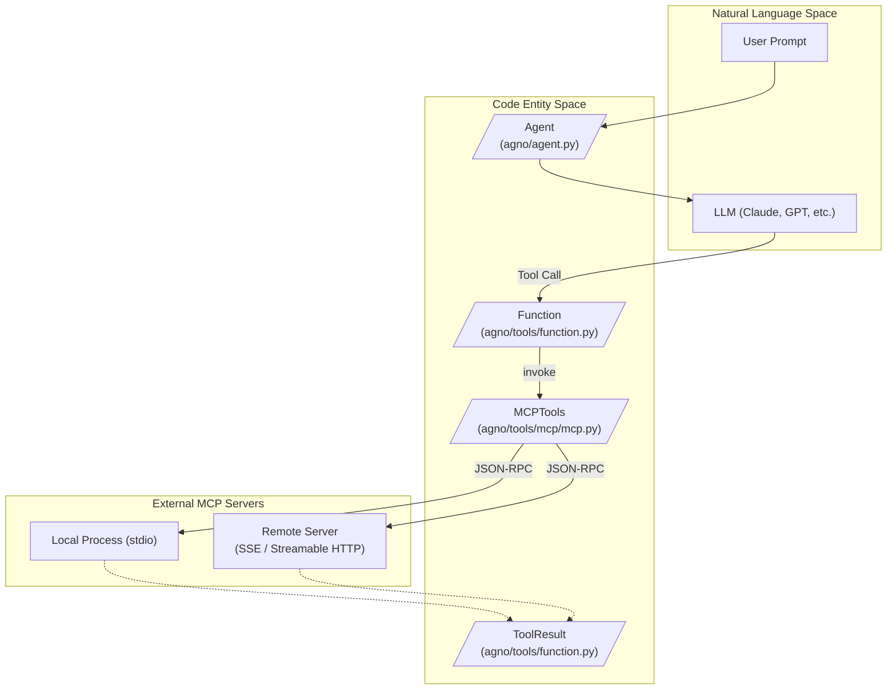
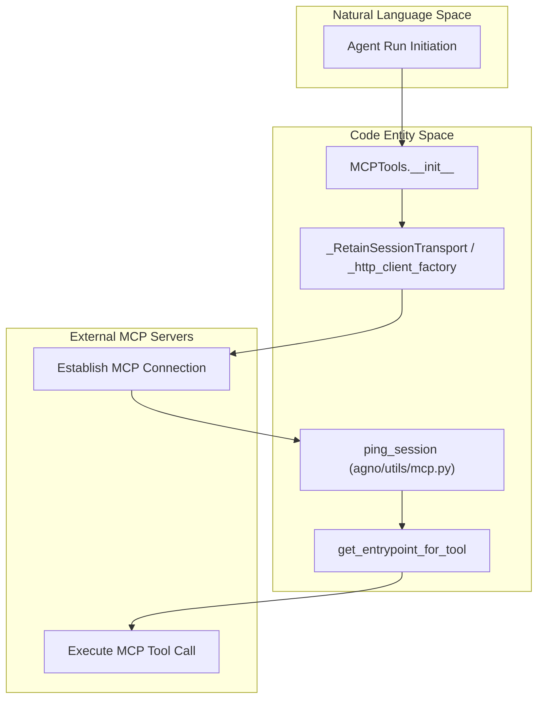
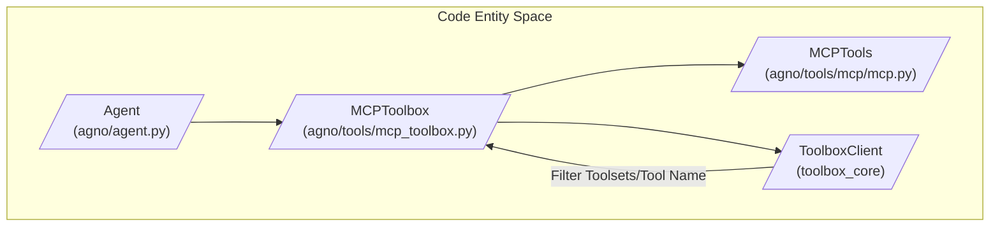

<!-- source: DeepWiki mcp.deepwiki.com · repo agno-agi/agno · page 4.6 Model Context Protocol (MCP) · fetched 2026-11-09 -->

# Model Context Protocol (MCP)

<details>
<summary>Relevant source files</summary>

The following files were used as context for generating this wiki page:

- [cookbook/91_tools/mcp/README.md](cookbook/91_tools/mcp/README.md)
- [cookbook/91_tools/mcp/TEST_LOG.md](cookbook/91_tools/mcp/TEST_LOG.md)
- [cookbook/91_tools/mcp/bgpt.py](cookbook/91_tools/mcp/bgpt.py)
- [cookbook/91_tools/mcp/magic_hour.py](cookbook/91_tools/mcp/magic_hour.py)
- [cookbook/91_tools/mcp/peer_cash.py](cookbook/91_tools/mcp/peer_cash.py)
- [libs/agno/agno/tools/mcp/mcp.py](libs/agno/agno/tools/mcp/mcp.py)
- [libs/agno/agno/utils/mcp.py](libs/agno/agno/utils/mcp.py)
- [libs/agno/tests/unit/tools/test_mcp.py](libs/agno/tests/unit/tools/test_mcp.py)
- [libs/agno/tests/unit/tools/test_mcp_pagination.py](libs/agno/tests/unit/tools/test_mcp_pagination.py)

</details>


This page details the Model Context Protocol (MCP) integration within the Agno framework. It covers how agents consume external tools via `MCPTools`, support for various transport protocols (`stdio`, `SSE`, `streamable-http`), session and header management, tool pagination, and multi-server agent configurations.

---

## 1. Overview and Architecture

The Model Context Protocol (MCP) is an open standard enabling AI models to interact with external tools and data sources through a unified interface. Within Agno, MCP integration allows agents to dynamically load and invoke remote or local tools exposed by any MCP-compliant server using `MCPTools` [libs/agno/agno/tools/mcp/mcp.py:9-14]() and `MCPSession` [libs/agno/agno/utils/mcp.py:21-33]().

### Roles and Data Flow



Sources:
[libs/agno/agno/tools/mcp/mcp.py:30-58](), [libs/agno/agno/utils/mcp.py:87-112]()

---

## 2. Consuming External Tools with MCPTools

`MCPTools` extends `Toolkit` to manage connections, session lifecycles, tool discovery, and tool invocation against MCP servers [libs/agno/agno/tools/mcp/mcp.py:9-14]().

### Transports and Configuration

Agno supports three primary transport protocols for connecting to MCP servers:

| Transport | Configuration Class | Description |
| :--- | :--- | :--- |
| `stdio` | `StdioServerParameters` | Launches and communicates with a local subprocess over standard input/output [libs/agno/tests/unit/tools/test_mcp.py:7-10]() |
| `sse` | `SSEClientParams` | Connects to legacy Server-Sent Events endpoints [libs/agno/tools/mcp/params.py](), [libs/agno/tests/unit/tools/test_mcp.py:12]() |
| `streamable-http` | `StreamableHTTPClientParams` | Connects over modern streaming HTTP endpoints for efficient remote tool execution [libs/agno/tools/mcp/params.py](), [libs/agno/tests/unit/tools/test_mcp.py:12]() |

`MCPTools` automatically determines the transport based on input parameters (e.g., providing a `url` defaults to `streamable-http`, while a `command` defaults to `stdio`) [libs/agno/tests/unit/tools/test_mcp.py:60-70]().

### Tool Discovery and Bounded Pagination

When `MCPTools` builds its tool registry via `build_tools()`, it queries the remote MCP server using `list_tools`. To prevent infinite loops or excessive memory consumption on misbehaving servers returning non-terminating cursors, pagination is bounded by `_MCP_TOOL_PAGINATION_MAX_PAGES` (defaulting to 250 pages) [libs/agno/agno/tools/mcp/mcp.py:28-30](), [libs/agno/tests/unit/tools/test_mcp_pagination.py:97-112]().

Sources:
[libs/agno/agno/tools/mcp/mcp.py:28-48](), [libs/agno/tests/unit/tools/test_mcp.py:28-50](), [libs/agno/tests/unit/tools/test_mcp_pagination.py:17-48]()

---

## 3. Session and Header Management

`MCPTools` manages connection sessions and allows dynamic header injection per request, supporting authenticated endpoints and persistent sessions.

### Header Providers

For HTTP and streamable-http transports, dynamic headers can be injected using a `header_provider` callback function [libs/agno/tests/unit/tools/test_mcp.py:155-175](). This allows agents to fetch fresh bearer tokens or credentials at runtime:

```python
from agno.tools.mcp import MCPTools

mcp_tools = MCPTools(
    url="https://api.example.com/mcp",
    header_provider=lambda: {"Authorization": "Bearer " + get_fresh_token()}
)
```

### Session Retention and Transport Lifecycles

The internal helper `_RetainSessionTransport` allows keeping the server session alive when the client closes, overriding default SDK behavior where a close sends an immediate `DELETE` request [libs/agno/agno/tools/mcp/mcp.py:51-125](). Additionally, protocol modes can be configured to `"legacy"` (maintaining long-lived session state and using `ping_session` to check liveness) or `"auto"` (supporting newer sessionless or stateless execution modes) [cookbook/91_tools/mcp/README.md:52-55](), [libs/agno/utils/mcp.py:128-144]().

### Session & Transport Lifecycle Flow



Sources:
[libs/agno/agno/tools/mcp/mcp.py:51-155](), [libs/agno/tests/unit/tools/test_mcp.py:155-175](), [libs/agno/utils/mcp.py:128-144](), [cookbook/91_tools/mcp/README.md:52-55]()

---

## 4. MCP Toolbox Integration (`MCPToolbox`)

`MCPToolbox` combines MCP server connectivity with `toolbox-core` to provide advanced tool filtering [libs/agno/agno/tools/mcp_toolbox.py:21-28](). Instead of loading an entire server toolset into an agent's context window, `MCPToolbox` allows filtering by specific `toolsets` or a single `tool_name` [libs/agno/agno/tools/mcp_toolbox.py:30-50]().

### MCPToolbox Architecture



Sources:
[libs/agno/agno/tools/mcp_toolbox.py:21-75]()

---

## 5. Multi-Server Configurations and Namespace Isolation

Agents can aggregate tools from multiple independent MCP servers simultaneously by passing multiple `MCPTools` (or `MCPToolbox`) instances into the agent's `tools` list [cookbook/91_tools/mcp/README.md:27-30]().

```python
from agno.agent import Agent
from agno.tools.mcp import MCPTools

filesystem_tools = MCPTools(command="npx -y @modelcontextprotocol/server-filesystem /tmp")
github_tools = MCPTools(command="npx -y @modelcontextprotocol/server-github")

agent = Agent(
    tools=[filesystem_tools, github_tools],
    show_tool_calls=True,
)
```

Each toolkit derives a unique and stable namespace based on its connection parameters using `get_default_toolkit_name`, which strips out credentials, query parameters, and fragments, ensuring safe registry names without leaking sensitive data [libs/agno/agno/utils/mcp.py:51-108]().

Sources:
[cookbook/91_tools/mcp/README.md:27-30](), [libs/agno/agno/utils/mcp.py:51-108]()

---

