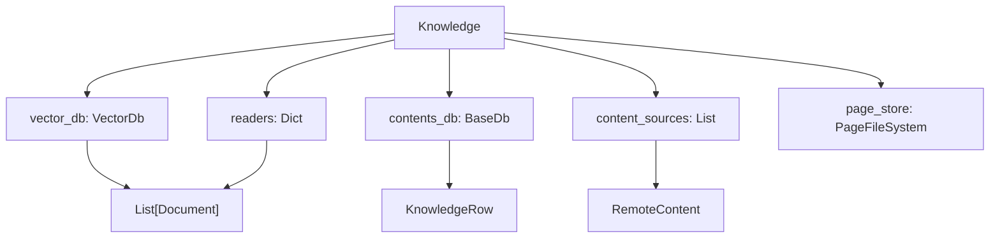
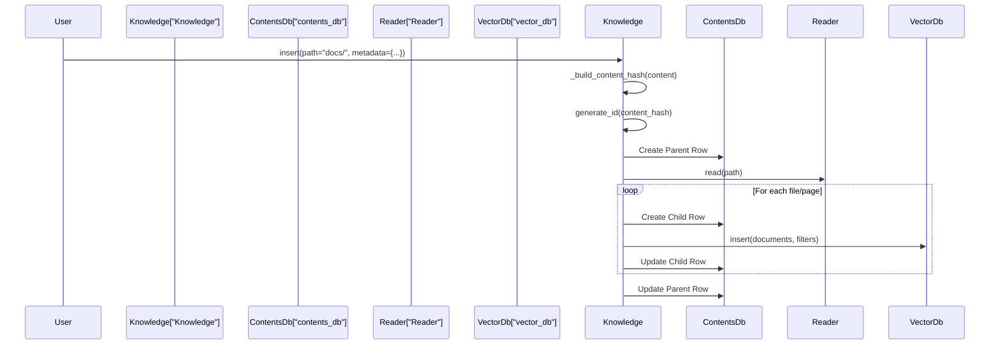
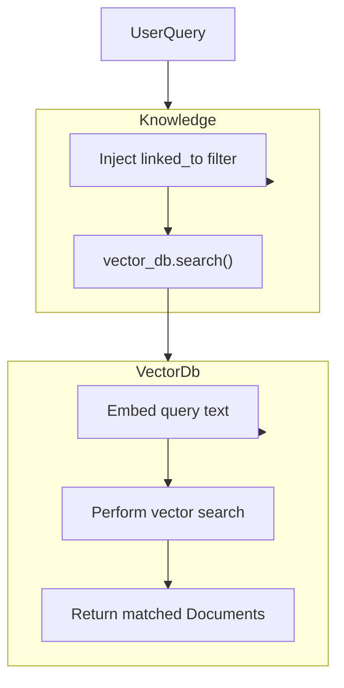
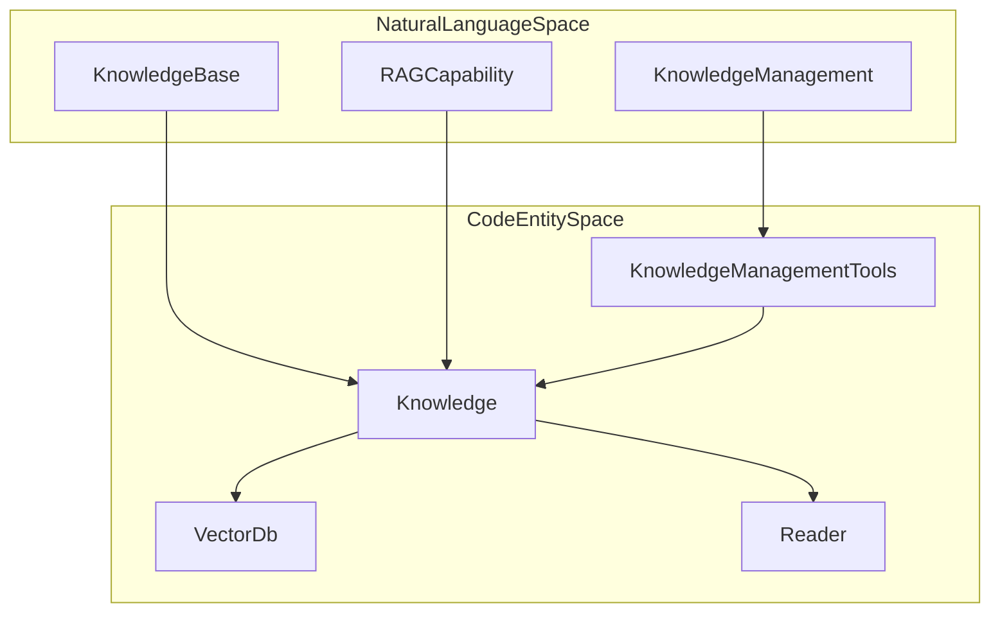
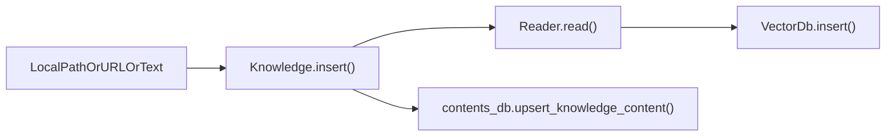

<!-- source: DeepWiki mcp.deepwiki.com · repo agno-agi/agno · page 5.1 Knowledge Base and Agentic RAG · fetched 2026-11-09 -->

# Knowledge Base and Agentic RAG

<details>
<summary>Relevant source files</summary>

The following files were used as context for generating this wiki page:

- [cookbook/07_knowledge/01_getting_started/05_website_per_page.py](cookbook/07_knowledge/01_getting_started/05_website_per_page.py)
- [cookbook/07_knowledge/04_advanced/06_prefix_search.py](cookbook/07_knowledge/04_advanced/06_prefix_search.py)
- [cookbook/07_knowledge/04_advanced/README.md](cookbook/07_knowledge/04_advanced/README.md)
- [cookbook/91_tools/knowledge_management_tools.py](cookbook/91_tools/knowledge_management_tools.py)
- [cookbook/91_tools/other/human_in_the_loop.py](cookbook/91_tools/other/human_in_the_loop.py)
- [libs/agno/agno/context/backend.py](libs/agno/agno/context/backend.py)
- [libs/agno/agno/context/web/parallel.py](libs/agno/agno/context/web/parallel.py)
- [libs/agno/agno/knowledge/knowledge.py](libs/agno/agno/knowledge/knowledge.py)
- [libs/agno/agno/knowledge/reader/page_fetcher.py](libs/agno/agno/knowledge/reader/page_fetcher.py)
- [libs/agno/agno/knowledge/reader/sitemap_reader.py](libs/agno/agno/knowledge/reader/sitemap_reader.py)
- [libs/agno/agno/knowledge/reader/utils/urls.py](libs/agno/agno/knowledge/reader/utils/urls.py)
- [libs/agno/agno/os/routers/knowledge/knowledge.py](libs/agno/agno/os/routers/knowledge/knowledge.py)
- [libs/agno/agno/vectordb/score.py](libs/agno/agno/vectordb/score.py)
- [libs/agno/tests/integration/teams/human_in_the_loop/test_team_tool_hitl.py](libs/agno/tests/integration/teams/human_in_the_loop/test_team_tool_hitl.py)
- [libs/agno/tests/unit/knowledge/test_folder_content_rows.py](libs/agno/tests/unit/knowledge/test_folder_content_rows.py)
- [libs/agno/tests/unit/knowledge/test_knowledge_content_hash.py](libs/agno/tests/unit/knowledge/test_knowledge_content_hash.py)
- [libs/agno/tests/unit/knowledge/test_knowledge_encoding.py](libs/agno/tests/unit/knowledge/test_knowledge_encoding.py)
- [libs/agno/tests/unit/knowledge/test_knowledge_isolation.py](libs/agno/tests/unit/knowledge/test_knowledge_isolation.py)
- [libs/agno/tests/unit/knowledge/test_knowledge_metadata_propagation.py](libs/agno/tests/unit/knowledge/test_knowledge_metadata_propagation.py)
- [libs/agno/tests/unit/knowledge/test_knowledge_readers.py](libs/agno/tests/unit/knowledge/test_knowledge_readers.py)
- [libs/agno/tests/unit/knowledge/test_per_page_content_rows.py](libs/agno/tests/unit/knowledge/test_per_page_content_rows.py)
- [libs/agno/tests/unit/os/routers/test_knowledge_upload_chunker.py](libs/agno/tests/unit/os/routers/test_knowledge_upload_chunker.py)
- [libs/agno/tests/unit/os/test_knowledge_upload_validation.py](libs/agno/tests/unit/os/test_knowledge_upload_validation.py)
- [libs/agno/tests/unit/os/test_knowledge_url_input.py](libs/agno/tests/unit/os/test_knowledge_url_input.py)
- [libs/agno/tests/unit/reader/test_page_fetcher.py](libs/agno/tests/unit/reader/test_page_fetcher.py)
- [libs/agno/tests/unit/reader/test_sitemap_reader.py](libs/agno/tests/unit/reader/test_sitemap_reader.py)
- [libs/agno/tests/unit/tools/test_knowledge_management_tools.py](libs/agno/tests/unit/tools/test_knowledge_management_tools.py)
- [libs/agno/tests/unit/vectordb/test_pgvector.py](libs/agno/tests/unit/vectordb/test_pgvector.py)
- [libs/agno/tests/unit/vectordb/test_score.py](libs/agno/tests/unit/vectordb/test_score.py)

</details>


## Purpose and Scope

This document explains the `Knowledge` system, which provides Retrieval-Augmented Generation (RAG) capabilities to AI agents. The `Knowledge` class enables indexing, storage, and semantic search of diverse content to ground agent responses with relevant information.

**Scope**: This page covers the high-level architecture of the `Knowledge` class, content insertion methods, content management, metadata filtering, and how agents utilize the knowledge base for grounded generation. Detailed technical aspects on remote content sources and ingestion are documented in the child page [Remote Content Integration](#5.1.1). Content processing strategies (readers, chunkers, embedders) are described in [Content Processing Pipeline](#5.1.2). Page publication, page filesystems, and shell-like page retrieval tools are covered in [Published Pages and Page Filesystem](#5.1.3). Vector database support is covered in [Vector Database Integrations](#5.2).

---

## Knowledge Architecture

### Core Components

The `Knowledge` class acts as the core knowledge base integrating several subsystems:

| Component       | Type                        | Responsibility                                   |
|-----------------|-----------------------------|-------------------------------------------------|
| `vector_db`     | `VectorDb`                  | Embedding storage and vector semantic search    |
| `contents_db`   | `BaseDb` or `AsyncBaseDb`   | Persistent content metadata and status management (also available via `content_db` alias) |
| `readers`       | `Dict[str, Reader]`         | File type processors transforming content to documents |
| `content_sources` | `List[BaseStorageConfig]` | Configuration for external remote content       |
| `page_store`    | `Any`                       | Durable page filesystem store (e.g., `PageFileSystem`) |
| `page_search`   | `PageSearchConfig`          | Transaction-local planner configuration for page search |
| `reranker`      | `Reranker`                  | Optional reordering strategy applied to vector search results |

Title: "Knowledge System Structure"


Sources: [libs/agno/agno/knowledge/knowledge.py:69-141](), [libs/agno/agno/db/schemas/knowledge.py:1-16]()

### Initialization and Configuration

A `Knowledge` instance is configured using keyword arguments. The `content_db` keyword is preferred, while `contents_db` remains a supported read/write alias [libs/agno/agno/knowledge/knowledge.py:120-128](). During initialization, it verifies database references and sets up internal search and embedding configurations [libs/agno/agno/knowledge/knowledge.py:126-149]().

```python
from agno.knowledge.knowledge import Knowledge
from agno.vectordb.qdrant import Qdrant
from agno.db.sqlite import SqliteDb

knowledge = Knowledge(
    name="Product Docs",
    content_db=SqliteDb(db_file="tmp/knowledge_contents.db"),
    vector_db=Qdrant(
        collection="product-docs",
        url="http://localhost:6333",
    ),
    max_results=10,
    isolate_vector_search=False
)
```

Sources: [libs/agno/agno/knowledge/knowledge.py:102-149](), [cookbook/91_tools/knowledge_management_tools.py:32-40]()

---

## Content Insertion

### Insertion Methods Overview

The `Knowledge` class supports both synchronous and asynchronous insertion of content. Content can originate from local paths, URLs, direct text content, or structured remote configurations [libs/agno/agno/knowledge/knowledge.py:81-119]().

| Method          | Description                                |
|-----------------|--------------------------------------------|
| `insert()`      | Sync insertion of single content item     |
| `ainsert()`     | Async insertion of single content item    |

These methods generate a unique content hash based on the content, name, and description to ensure consistency and support deduplication or updates [libs/agno/agno/knowledge/knowledge.py:169-170]().

### Multi-Page and Folder Handling
When ingesting complex sources like websites via readers (such as `SitemapReader`) or local directories, the system creates one `contents_db` row per child element (page or file). These child rows are linked to a parent row representing the site or folder [libs/agno/tests/unit/knowledge/test_per_page_content_rows.py:1-7](), [libs/agno/tests/unit/knowledge/test_folder_content_rows.py:1-7]().

Title: "Ingestion Sequence"


Sources: [libs/agno/agno/knowledge/knowledge.py:102-172](), [libs/agno/tests/unit/knowledge/test_per_page_content_rows.py:152-168](), [libs/agno/tests/unit/knowledge/test_folder_content_rows.py:133-153]()

---

## Search and Retrieval

### Search Methods

The main interface to query knowledge is via semantic similarity vector search. The `Knowledge` class delegates these calls to the configured `vector_db`.

| Method   | Returns                | Description                   |
|----------|------------------------|-------------------------------|
| `search()` | `List[Document]` | Synchronous semantic search |
| `asearch()` | `List[Document]` | Asynchronous semantic search |

### Metadata Filtering and Isolation

Agents can perform filtered searches using metadata. If `isolate_vector_search` is set to `True`, the system adds a `linked_to` metadata key to every chunk. During search, it automatically applies an `EQ` filter on `linked_to` to ensure data isolation within shared vector databases [libs/agno/agno/knowledge/knowledge.py:80-84]().

Title: "Search Execution Flow"


Sources: [libs/agno/agno/knowledge/knowledge.py:80-84](), [libs/agno/tests/unit/tools/test_knowledge_management_tools.py:85-91]()

---

## Agentic RAG and Management Tools

Agents interact with knowledge in two ways:
1. **Search-Only**: Grounding responses by retrieving context.
2. **Management**: Using `KnowledgeManagementTools` to ingest URLs, text, or files, list content, and remove items [libs/agno/tools/knowledge.py:32]().

### Knowledge Management Toolkit
The `KnowledgeManagementTools` provides functions that allow an agent to manage the knowledge base lifecycle [libs/agno/tests/unit/tools/test_knowledge_management_tools.py:177-184]():
- `ingest_url`: Ingest content from a URL.
- `ingest_text`: Ingest raw text.
- `list_content`: List items in the `contents_db`.
- `remove_content`: Delete content and its associated vectors.

Sources: [libs/agno/tools/knowledge.py:32](), [cookbook/91_tools/knowledge_management_tools.py:45-54](), [libs/agno/tests/unit/tools/test_knowledge_management_tools.py:177-184]()

---

## Code Entity References

| Name                  | Location                                             | Purpose                                             |
|-----------------------|-----------------------------------------------------|-----------------------------------------------------|
| `Knowledge`           | [libs/agno/agno/knowledge/knowledge.py:69]()        | Main class for knowledge base management            |
| `Document`            | [libs/agno/agno/knowledge/document/base.py:12]()    | Internal representation of text chunks with metadata|
| `Reader`              | [libs/agno/agno/knowledge/reader/base.py:13]()       | Base class for all document readers                 |
| `VectorDb`            | [libs/agno/tests/unit/tools/test_knowledge_management_tools.py:34]() | Base interface for vector database integrations |
| `KnowledgeManagementTools` | [libs/agno/tools/knowledge.py:32]() | Toolkit for agentic knowledge management |
| `PageSearchConfig`    | [libs/agno/agno/knowledge/page/types.py:11]()       | Transaction-local planner options for page search   |

Sources: [libs/agno/agno/knowledge/knowledge.py:69-141](), [libs/agno/agno/knowledge/page/types.py:11-28]()

---

## Child Pages

- **[Remote Content Integration](#5.1.1)** — Explain RemoteKnowledge, content loaders (S3, GitHub, SharePoint, GCS, Azure Blob), storage configs, and automated content ingestion.
- **[Content Processing Pipeline](#5.1.2)** — Cover Readers (PDF, DOCX, CSV, website, sitemap, JSON, MDX), chunking strategies (semantic, recursive, agentic, markdown), embedders, and document-to-vector transformation.
- **[Published Pages and Page Filesystem](#5.1.3)** — Document the page subsystem: PageCoordinator transactional publication across catalog/filesystem/vectors, page types and errors, PageFileSystem shell-like commands (ls/cat/rg), page search tools in chat and MCP modes, and source migration.

---

## Diagrams Bridging Natural Language to Code Entities

Title: "Knowledge Base Concept to Code Mapping"

Sources: [libs/agno/agno/knowledge/knowledge.py:69-141](), [libs/agno/tools/knowledge.py:32]()

Title: "Content Ingestion System Flow"

Sources: [libs/agno/agno/knowledge/knowledge.py:102-172](), [libs/agno/agno/knowledge/reader/base.py:13]()

---

